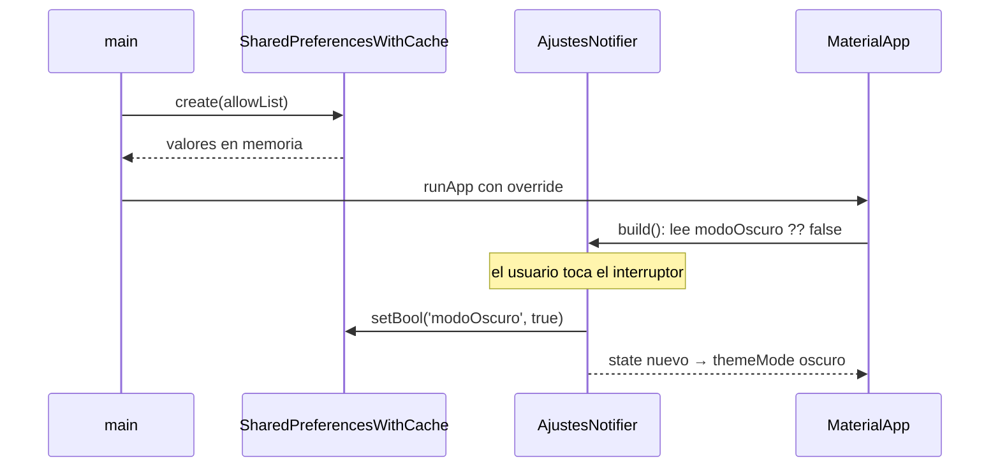
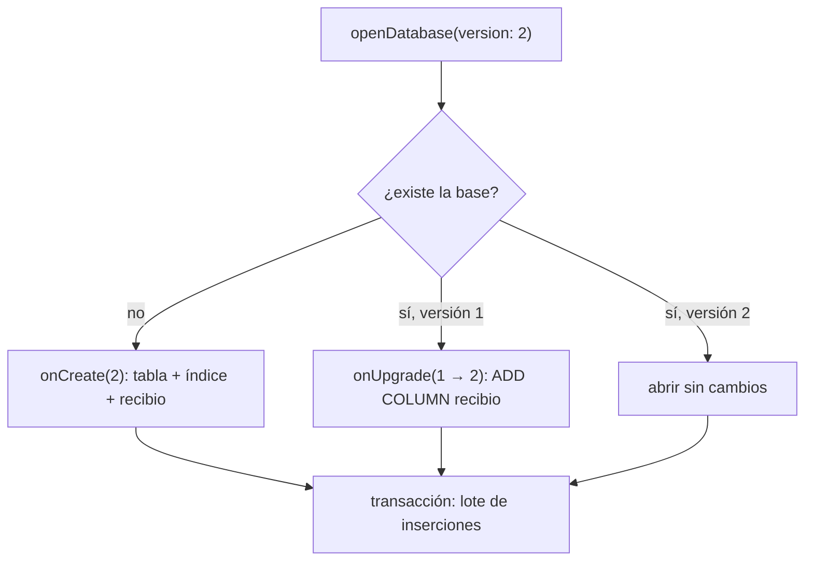
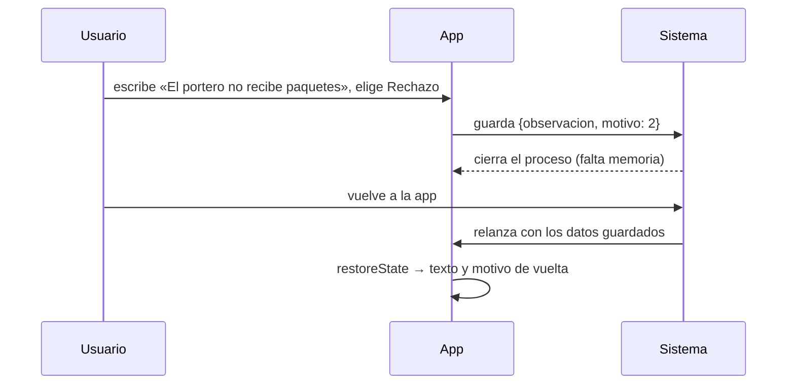
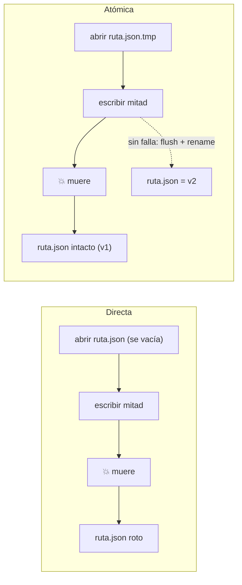

# Módulo 6: Persistencia local: preferencias, SQLite, trabajo sin red, restauración y archivos

**Entorno comprobado para esta edición (2026-11-24):** Flutter 3.50.1 (canal estable) con Dart 3.14.0 en Linux
x86_64, con `shared_preferences` 2.5.6, `sqflite_common_ffi` 2.4.7 (SQLite 3.54.1, el que reporta
`sqlite_version()`) y `flutter_riverpod` 3.5.0. Todo el código se analizó con `flutter analyze` (`No issues found!`) y
se ejecutó ese día, en `/home/estudiante/labs/flutter/m6` (tu `~/labs/flutter/m6`). Las bases de datos y los archivos
de los Temas 2, 3 y 5 son **reales**: se crearon en el disco con `dart run`. Las pruebas de pantalla reemplazan el
almacenamiento del teléfono por uno en memoria, que es la forma oficial de probar `shared_preferences`. **Los
pantallazos los dibujó Flutter** con la herramienta del Módulo 1.

El conductor marca una entrega en un sótano sin señal, cierra la app para contestar una llamada y Android la cierra en
segundo plano para liberar memoria. Cuando vuelve, la entrega debe seguir marcada, el formulario que estaba
escribiendo debe estar igual, y cuando aparezca la señal, el servidor debe enterarse sin que él haga nada. Todo eso es
persistencia local: guardar en el teléfono lo que no puede depender de la red ni de que la app siga viva.

**Al terminar este módulo podrás:**
- guardar preferencias con `shared_preferences` y cargarlas antes de dibujar la primera pantalla;
- diseñar una base SQLite con tabla, índice, transacciones y migraciones de versión;
- implementar una cola de cambios pendientes que se sincroniza en orden cuando vuelve la red, y mostrarla al usuario;
- restaurar el estado de una pantalla cuando el sistema cierra la app con `RestorationMixin`;
- escribir archivos de forma atómica para no dejarlos a medias.

**Esquema del módulo:** Tema 1 (preferencias) → Tema 2 (SQLite) → Tema 3 (primero el teléfono: sincronización) →
Tema 4 (restauración) → Tema 5 (archivos) → Proyecto 23.

**Qué necesitas saber antes:** el Módulo 5 completo, en especial **los fallos de red** (Tema 3) y **la sesión**
(Tema 5); del Módulo 4, **`Notifier`** y **los overrides de providers** (Temas 3 y 6); del Módulo 0, **records** y
**`Future`** (Temas 3 y 6). De Fundamentos, **SQL** (`CREATE TABLE`, `SELECT`, `UPDATE`, índices) se usa sin
volver a explicarlo.

**Qué no se repite:** los providers y su prueba (Módulo 4); la sesión y el almacenamiento seguro de tokens (Módulo 5,
Tema 5). Firebase (Firestore con caché sin conexión) es una alternativa administrada a los Temas 2 y 3; no se usa aquí
porque necesita un proyecto en la nube, y se menciona en «Del laboratorio a producción».

**Prepara el proyecto:**

```text
$ cd ~/labs/flutter
$ flutter create --org com.academia --platforms=web,linux --empty m6
$ cd m6
$ flutter pub add shared_preferences sqflite_common_ffi path flutter_riverpod
$ flutter pub add dev:shared_preferences_platform_interface
```

`sqflite_common_ffi` es la versión de `sqflite` para escritorio y para la consola: usa la misma API (`Database`,
`query`, `transaction`) y la biblioteca SQLite del sistema. En Android e iOS se usa `sqflite` y el código de los temas
no cambia, salvo la fábrica de bases de datos.

```dart
// lib/main.dart — carga las preferencias antes de dibujar y abre los ajustes del Tema 1
import 'package:flutter_riverpod/flutter_riverpod.dart';
import 'package:material_ui/material_ui.dart';

import 'tema1/ajustes.dart';

Future<void> main() async {
  WidgetsFlutterBinding.ensureInitialized();                       // necesario antes de usar plugins en main
  final preferencias = await abrirPreferencias();
  runApp(ProviderScope(
    overrides: [preferenciasProvider.overrideWithValue(preferencias)],
    child: const AppConAjustes(),
  ));
}
```


## Aprende construyendo


### Tema 1: Preferencias: shared_preferences y la pantalla de ajustes · Básico · 40 min

<details open>
<summary><strong>Capa 1 — Lectura</strong></summary>

#### Objetivos
Al terminar este tema podrás:
- guardar y leer valores simples con `SharedPreferencesWithCache`;
- cargar las preferencias antes de `runApp` y entregarlas a la app con un override;
- diseñar una pantalla de ajustes con secciones, interruptores y un desplegable;
- comprobar en una prueba que las preferencias sobreviven a reiniciar la app.

**Conceptos clave:** preferencia, `SharedPreferencesWithCache`, lista de claves permitidas, valor por defecto,
almacenamiento en memoria para pruebas

#### El problema
El conductor activa el modo oscuro y desactiva la vibración. Al día siguiente, la app vuelve al modo claro y vibra en
cada escaneo. Las preferencias deben guardarse en el teléfono, cargarse antes de dibujar la primera pantalla (si no,
se ve un destello del tema claro) y tener valores por defecto sensatos para quien nunca abrió los ajustes.

Este tema usa **`Notifier`** y **overrides** (Módulo 4, Temas 3 y 6) y **`themeMode`** (Módulo 2, Tema 6).

#### Glosario del tema

**preferencia**
- **Definición técnica:** valor simple (booleano, número, texto o lista de textos) que configura la app para un usuario y se guarda en el almacenamiento clave-valor del sistema.
- **En palabras sencillas:** una opción que la app recuerda.
- **Dónde se rompe la comparación:** no es una base de datos: no sirve para listas de entregas ni para datos sensibles.
- **Ejemplo:** `modoOscuro`, `vibrar`, `filtroInicial`.
- **Error típico:** guardar la ruta del día como un JSON gigante en una preferencia.

**`SharedPreferencesWithCache`**
- **Definición técnica:** API de `shared_preferences` que carga los valores una vez en memoria, los lee de forma sincrónica y escribe de forma asincrónica en el almacenamiento.
- **En palabras sencillas:** una copia en memoria para leer rápido, que se guarda en el disco al escribir.
- **Dónde se rompe la comparación:** si otro proceso cambia los valores (un widget del sistema), la copia no se entera; para eso existe `SharedPreferencesAsync`.
- **Ejemplo:** `_p.getBool('modoOscuro')` sin `await`.
- **Error típico:** usar el `SharedPreferences.getInstance()` antiguo en código nuevo; sigue funcionando, pero la documentación recomienda las dos API nuevas.

**lista de claves permitidas**
- **Definición técnica:** `allowList` de las opciones de la caché: solo esas claves se cargan y se pueden escribir.
- **En palabras sencillas:** la lista de opciones que existen.
- **Dónde se rompe la comparación:** una clave nueva hay que agregarla a la lista, o falla.
- **Ejemplo:** escribir `clave-inventada` lanza `ArgumentError`.
- **Error típico:** escribir `'modo_oscuro'` en un lugar y `'modoOscuro'` en otro; la lista lo detecta en la primera prueba.

**valor por defecto**
- **Definición técnica:** valor que se usa cuando la clave nunca se guardó (`getBool` devuelve `null`).
- **En palabras sencillas:** la opción de fábrica.
- **Dónde se rompe la comparación:** no se guarda: si mañana cambias el valor por defecto, cambia para todos los que nunca tocaron la opción.
- **Ejemplo:** `vibrar` es `true` si no hay nada guardado.
- **Error típico:** guardar el valor por defecto al arrancar: después ya no se puede cambiar para nadie.

**almacenamiento en memoria para pruebas**
- **Definición técnica:** implementación de la plataforma (`InMemorySharedPreferencesAsync`) que reemplaza el almacenamiento real en las pruebas.
- **En palabras sencillas:** un cajón de mentira que se comporta como el de verdad.
- **Dónde se rompe la comparación:** dura mientras dura la prueba; sirve para simular un reinicio de la app, no del teléfono.
- **Ejemplo:** `SharedPreferencesAsyncPlatform.instance = InMemorySharedPreferencesAsync.empty();`.
- **Error típico:** olvidarlo y ver la prueba fallar porque no hay plataforma.

#### ► CÓMO FUNCIONA
`main` espera a que se carguen las preferencias y las entrega a la app con un override. El `Notifier` de ajustes lee
los valores (o sus valores por defecto) al construirse. Cada cambio se guarda primero y después actualiza el estado,
y `MaterialApp` cambia de tema al instante.



#### Problema resuelto 1.1
Construye la pantalla de ajustes, cambia dos opciones, reinicia la app y comprueba que siguen como las dejó.

**Razonamiento:**
1. `preferenciasProvider` lanza un error si nadie lo reemplaza: obliga a cargarlo en `main` (y en la prueba).
2. `AjustesNotifier` lee con valores por defecto y guarda antes de cambiar el estado.
3. La pantalla agrupa las opciones en secciones con un título pequeño y un divisor.
4. La prueba «reinicia» la app con un `ProviderScope` nuevo (otra `key`), que vuelve a leer del almacenamiento.

```dart
// lib/tema1/ajustes.dart — preferencias del conductor guardadas con SharedPreferencesWithCache
import 'package:flutter_riverpod/flutter_riverpod.dart';
import 'package:material_ui/material_ui.dart';
import 'package:shared_preferences/shared_preferences.dart';

/// Las preferencias se cargan una vez, al arrancar, y se entregan a la app con un override.
final preferenciasProvider = Provider<SharedPreferencesWithCache>((ref) => throw UnimplementedError('se inyecta en main'));

Future<SharedPreferencesWithCache> abrirPreferencias() => SharedPreferencesWithCache.create(
      cacheOptions: const SharedPreferencesWithCacheOptions(
        allowList: {'modoOscuro', 'vibrar', 'filtroInicial'},          // solo estas claves: evita errores de escritura
      ),
    );

class Ajustes {
  const Ajustes({required this.modoOscuro, required this.vibrar, required this.filtroInicial});
  final bool modoOscuro;
  final bool vibrar;
  final String filtroInicial;
}

class AjustesNotifier extends Notifier<Ajustes> {
  SharedPreferencesWithCache get _p => ref.read(preferenciasProvider);

  @override
  Ajustes build() => Ajustes(
        modoOscuro: _p.getBool('modoOscuro') ?? false,                // valor por defecto si nunca se guardó
        vibrar: _p.getBool('vibrar') ?? true,
        filtroInicial: _p.getString('filtroInicial') ?? 'Pendientes',
      );

  Future<void> modoOscuro(bool v) async {
    await _p.setBool('modoOscuro', v);                              // primero guardar, después mostrar
    state = Ajustes(modoOscuro: v, vibrar: state.vibrar, filtroInicial: state.filtroInicial);
  }

  Future<void> vibrar(bool v) async {
    await _p.setBool('vibrar', v);
    state = Ajustes(modoOscuro: state.modoOscuro, vibrar: v, filtroInicial: state.filtroInicial);
  }

  Future<void> filtroInicial(String v) async {
    await _p.setString('filtroInicial', v);
    state = Ajustes(modoOscuro: state.modoOscuro, vibrar: state.vibrar, filtroInicial: v);
  }
}

final ajustesProvider = NotifierProvider<AjustesNotifier, Ajustes>(AjustesNotifier.new);

class AppConAjustes extends ConsumerWidget {
  const AppConAjustes({super.key});

  @override
  Widget build(BuildContext context, WidgetRef ref) {
    final ajustes = ref.watch(ajustesProvider);
    return MaterialApp(
      debugShowCheckedModeBanner: false,
      theme: ThemeData(colorSchemeSeed: Colors.indigo),
      darkTheme: ThemeData(colorSchemeSeed: Colors.indigo, brightness: Brightness.dark),
      themeMode: ajustes.modoOscuro ? ThemeMode.dark : ThemeMode.light,
      home: const PantallaAjustes(),
    );
  }
}

class PantallaAjustes extends ConsumerWidget {
  const PantallaAjustes({super.key});

  @override
  Widget build(BuildContext context, WidgetRef ref) {
    final ajustes = ref.watch(ajustesProvider);
    final acciones = ref.read(ajustesProvider.notifier);
    return Scaffold(
      appBar: AppBar(title: const Text('Ajustes')),
      body: ListView(
        children: [
          const ListTile(dense: true, title: Text('Pantalla')),
          SwitchListTile(
            secondary: const Icon(Icons.dark_mode_outlined),
            title: const Text('Modo oscuro'),
            subtitle: const Text('Más cómodo de noche'),
            value: ajustes.modoOscuro,
            onChanged: acciones.modoOscuro,
          ),
          const Divider(),
          const ListTile(dense: true, title: Text('Ruta')),
          SwitchListTile(
            secondary: const Icon(Icons.vibration),
            title: const Text('Vibrar al escanear'),
            value: ajustes.vibrar,
            onChanged: acciones.vibrar,
          ),
          ListTile(
            leading: const Icon(Icons.filter_list),
            title: const Text('Al abrir, mostrar'),
            trailing: DropdownButton<String>(
              value: ajustes.filtroInicial,
              underline: const SizedBox.shrink(),
              items: const [
                DropdownMenuItem(value: 'Todas', child: Text('Todas')),
                DropdownMenuItem(value: 'Pendientes', child: Text('Pendientes')),
                DropdownMenuItem(value: 'Entregadas', child: Text('Entregadas')),
              ],
              onChanged: (v) => acciones.filtroInicial(v!),
            ),
          ),
        ],
      ),
    );
  }
}
```

```dart
import 'package:flutter_riverpod/flutter_riverpod.dart';
import 'package:flutter_test/flutter_test.dart';
import 'package:m6/tema1/ajustes.dart';
import 'package:material_ui/material_ui.dart';
import 'package:shared_preferences_platform_interface/in_memory_shared_preferences_async.dart';
import 'package:shared_preferences_platform_interface/shared_preferences_async_platform_interface.dart';

import 'pantallazo.dart';

/// Abre la app como si arrancara de cero, con lo que haya guardado en el almacenamiento.
Future<void> arrancar(WidgetTester tester) async {
  final preferencias = await abrirPreferencias();
  await tester.pumpWidget(ProviderScope(
    key: UniqueKey(),                                              // un contenedor nuevo: nada queda en memoria
    overrides: [preferenciasProvider.overrideWithValue(preferencias)],
    child: const AppConAjustes(),
  ));
}

void main() {
  setUpAll(cargarFuentes);

  testWidgets('las preferencias sobreviven a reiniciar la app', (tester) async {
    // En las pruebas, el almacenamiento real del teléfono se reemplaza por uno en memoria.
    SharedPreferencesAsyncPlatform.instance = InMemorySharedPreferencesAsync.empty();
    tamanoPantalla(tester, tamano: const Size(390, 440));

    await arrancar(tester);
    await pantallazo('m6-t1-ajustes-inicio');
    await tester.tap(find.text('Modo oscuro'));
    await tester.tap(find.text('Vibrar al escanear'));
    await tester.pumpAndSettle();

    await arrancar(tester);                                         // «cerrar y volver a abrir»
    await tester.pumpAndSettle();
    final p = await abrirPreferencias();
    debugPrint('después de reiniciar: modoOscuro=${p.getBool('modoOscuro')}, vibrar=${p.getBool('vibrar')}, '
        'filtro=${p.getString('filtroInicial')}');
    await pantallazo('m6-t1-ajustes-reabierta');

    try {
      await p.setString('clave-inventada', 'x');
    } catch (e) {
      debugPrint('clave fuera de la lista: ${e.runtimeType}');
    }
  });
}
```

```text
$ flutter test test/tema1_test.dart
00:00 +0: loading /home/estudiante/labs/flutter/m6/test/tema1_test.dart
00:00 +0: (setUpAll)
00:00 +0: las preferencias sobreviven a reiniciar la app
después de reiniciar: modoOscuro=true, vibrar=false, filtro=null
clave fuera de la lista: ArgumentError
00:01 +1: (tearDownAll)
00:01 +1: All tests passed!
```


**Explicación por partes.**
- Línea 7: un provider que se reemplaza en `main` es la forma de entregar a Riverpod algo que se carga antes de
  arrancar.
- Líneas 9–13: la lista de claves permitidas; la última línea de la salida muestra el `ArgumentError` de una clave
  que no está.
- Líneas 26–30: los valores por defecto. `filtro=null` en la salida: nunca se guardó, y la pantalla muestra
  «Pendientes» por defecto.
- Líneas 32–35: guardar y después cambiar el estado. Si el guardado falla, la pantalla no muestra algo que no quedó
  guardado.
- El pantallazo de la derecha es la app **después de reiniciar**: abrió directamente en modo oscuro.

> **Error común.** Leer las preferencias dentro de la primera pantalla con un `FutureBuilder`. Durante unos cuadros
> la app se dibuja con el tema claro y después cambia: un destello que el usuario nota.

> **Error común.** Guardar en preferencias el token de sesión. No está cifrado; los tokens van en el almacenamiento
> seguro (Módulo 5, Tema 5).

> **Buena práctica.** Agrupa los ajustes por tema («Pantalla», «Ruta») y escribe un subtítulo cuando el nombre no
> basta («Más cómodo de noche»). Pocas opciones, con buenos valores por defecto, valen más que muchas.

> **Prevenir errores.** Usa la lista de claves permitidas y constantes para los nombres de las claves; un error de
> escritura en una clave es invisible hasta que alguien reporta que «la opción no se guarda».

#### Checkpoint 1.1
¿Qué muestra el desplegable «Al abrir, mostrar» la primera vez, y qué hay guardado para esa clave?

Respuesta: muestra «Pendientes», el valor por defecto; no hay nada guardado (`filtro=null`) hasta que el usuario lo
cambie.

</details>

<details>
<summary><strong>Capa 2 — Construcción</strong></summary>

#### Paso 1 · Crea los archivos
Crea `lib/tema1/ajustes.dart`, `lib/main.dart` y `test/tema1_test.dart`.

#### Paso 2 · Ejecuta la prueba
Ejecuta `flutter test --update-goldens test/tema1_test.dart` y compara los dos pantallazos.

#### Paso 3 · Ejecuta la app
Ejecuta `flutter run -d chrome`, cambia las opciones, cierra la pestaña y vuelve a abrir. En la web, las preferencias
se guardan en el almacenamiento local del navegador.

#### Paso 4 · Agrega una opción
Agrega «Tamaño de letra del mapa» (pequeño, normal, grande) con un `SegmentedButton`, guardado como texto.

#### Paso 5 · Restablece
Agrega un botón «Restablecer ajustes» que borre las tres claves con `remove` y vuelva a los valores por defecto.

#### Resumen
- Una **preferencia** es un valor simple que la app recuerda; **`SharedPreferencesWithCache`** la lee sin esperar.
- La **lista de claves permitidas** detecta claves mal escritas.
- El **valor por defecto** no se guarda.
- En las pruebas se usa el **almacenamiento en memoria para pruebas**.

#### Ejercicio verificable 1
Básico. ¿Qué devuelve `getBool('vibrar')` si el usuario nunca abrió los ajustes, y qué ve en la pantalla?

Respuesta esperada: `null`; la pantalla muestra el interruptor encendido porque el valor por defecto es `true`.

#### Ejercicio verificable 2
Intermedio. En el Paso 4, ¿qué error aparece si olvidas agregar la clave nueva a `allowList`?

Respuesta esperada: un `ArgumentError` al guardar, como el de la última línea de la salida.

#### Ejercicio verificable 3
Reto. En el Paso 5, ¿por qué conviene `remove` en lugar de guardar los valores por defecto?

Respuesta esperada: porque con `remove` la clave vuelve a no existir y la app usa el valor por defecto actual; si
guardaras `true`, un cambio futuro del valor por defecto ya no aplicaría a ese usuario.

#### En el trabajo
Toda app tiene una pantalla de ajustes, y los reportes de «la opción no se guarda» son frecuentes. La carga antes de
`runApp` y las pruebas con reinicio, como en este tema, evitan los dos problemas típicos: el destello y la clave mal
escrita.

</details>

### Tema 2: SQLite: tablas, índices, transacciones y migraciones · Intermedio · 55 min

<details open>
<summary><strong>Capa 1 — Lectura</strong></summary>

#### Objetivos
Al terminar este tema podrás:
- crear el esquema en `onCreate` y cambiarlo de versión en `onUpgrade` sin perder datos;
- guardar muchas filas en una transacción con un lote;
- consultar con parámetros (`?`) y comprobar con `EXPLAIN QUERY PLAN` que se usa un índice;
- demostrar que una transacción fallida no deja datos a medias.

**Conceptos clave:** versión del esquema, migración, transacción, lote, consulta con parámetros, índice

#### El problema
La ruta del día tiene decenas de entregas, cada una con su estado, y la app debe poder buscar «las pendientes» sin
recorrer todo. Además, la versión 2 de la app necesita guardar quién recibió cada paquete: los conductores que ya
tienen la versión 1 instalada tienen una base con datos, y actualizar la app no puede borrarlos.

Este tema usa **SQL** (Fundamentos), **`Future`** (Módulo 0, Tema 3) y **la idea de repositorio** (Módulo 4, Tema 4).

#### Glosario del tema

**versión del esquema**
- **Definición técnica:** número entero que `sqflite` guarda en la base (`PRAGMA user_version`) y compara con el que pide la app al abrir.
- **En palabras sencillas:** la edición del plano de la base.
- **Dónde se rompe la comparación:** solo sube; bajar de versión necesita `onDowngrade` y rara vez tiene sentido.
- **Ejemplo:** la app vieja abre con versión 1 y la nueva con versión 2.
- **Error típico:** cambiar el `CREATE TABLE` sin subir la versión: las bases existentes nunca reciben la columna.

**migración**
- **Definición técnica:** cambio del esquema de una base existente, ejecutado en `onUpgrade` según la versión anterior y la nueva.
- **En palabras sencillas:** remodelar sin sacar los muebles.
- **Dónde se rompe la comparación:** cada migración se escribe una vez y se queda para siempre, para quien actualice desde versiones muy viejas.
- **Ejemplo:** `if (de < 2) ALTER TABLE entregas ADD COLUMN recibio TEXT`.
- **Error típico:** probar solo con bases nuevas (que pasan por `onCreate`) y nunca con una base de la versión anterior.

**transacción**
- **Definición técnica:** grupo de operaciones que se confirman todas juntas o ninguna; `db.transaction` deshace todo si una lanza.
- **En palabras sencillas:** todo o nada.
- **Dónde se rompe la comparación:** dentro de la transacción hay que usar `txn`, no `db`; usar `db` deja esperando a la base.
- **Ejemplo:** la ruta con `EN-4481` sin destinatario no deja guardada `EN-4480`.
- **Error típico:** guardar 50 filas una por una sin transacción: es lento y, si falla la 30, quedan 29.

**lote**
- **Definición técnica:** `Batch`: lista de operaciones que se envían a SQLite juntas con `commit`.
- **En palabras sencillas:** llevar todas las cajas en un viaje.
- **Dónde se rompe la comparación:** un lote no es una transacción por sí mismo; dentro de `transaction`, sí lo es.
- **Ejemplo:** `txn.batch()` y `lote.commit(noResult: true)`.
- **Error típico:** pedir los resultados de un lote de miles de inserciones cuando no se usan; `noResult: true` evita ese trabajo.

**consulta con parámetros**
- **Definición técnica:** consulta con `?` en lugar de valores, que se entregan aparte en `whereArgs`; SQLite los trata como datos, nunca como SQL.
- **En palabras sencillas:** los valores van en su propio sobre.
- **Dónde se rompe la comparación:** los nombres de tabla y columna no se pueden parametrizar.
- **Ejemplo:** el texto `x' OR '1'='1` devuelve 0 filas.
- **Error típico:** armar la consulta con interpolación (`"estado = '$estado'"`), que abre la puerta a la inyección SQL.

**índice**
- **Definición técnica:** estructura adicional (árbol B) que SQLite mantiene sobre una o más columnas para encontrar filas sin recorrer la tabla.
- **En palabras sencillas:** el índice alfabético de un libro.
- **Dónde se rompe la comparación:** acelera la lectura y hace un poco más lenta la escritura.
- **Ejemplo:** `SEARCH entregas USING INDEX idx_entregas_estado (estado=?)`.
- **Error típico:** crear índices en todas las columnas «por si acaso».

#### ► CÓMO FUNCIONA
Al abrir, `sqflite` compara la versión guardada con la pedida: si no hay base, ejecuta `onCreate` con la versión
nueva; si la guardada es menor, ejecuta `onUpgrade`. Después, las escrituras van en transacciones y las lecturas usan
parámetros y el índice.



#### Problema resuelto 2.1
Crea la base en versión 1 con dos entregas, ábrela con la versión 2 y comprueba que la migración conserva los datos.
Usa la base: guarda, marca, consulta, revisa el plan, provoca una transacción fallida y prueba una inyección.

**Razonamiento:**
1. `abrirBase` recibe la fábrica (para usar `sqflite` en el teléfono o `ffi` en la consola) y la versión.
2. `onCreate` crea la versión completa; `onUpgrade` aplica solo lo que falta desde la versión anterior.
3. `EntregasLocales` agrupa las operaciones, como un repositorio.
4. El programa es de consola y crea la base en la carpeta temporal del sistema.

```dart
// lib/tema2/base_datos.dart — SQLite con sqflite: tabla, índice, transacción y migración de versión
import 'package:sqflite_common_ffi/sqflite_ffi.dart';

/// Versión 1: la tabla de entregas. Versión 2: agrega quién recibió (migración).
Future<Database> abrirBase(DatabaseFactory fabrica, String ruta, {int version = 2, void Function(String)? anotar}) {
  final log = anotar ?? (_) {};
  return fabrica.openDatabase(
    ruta,
    options: OpenDatabaseOptions(
      version: version,
      onCreate: (db, v) async {                                      // base nueva: crea el esquema completo
        log('onCreate: versión $v');
        await db.execute('''
          CREATE TABLE entregas (
            guia TEXT PRIMARY KEY,
            destinatario TEXT NOT NULL,
            direccion TEXT NOT NULL,
            estado TEXT NOT NULL DEFAULT 'pendiente',
            actualizada INTEGER NOT NULL
          )''');
        await db.execute('CREATE INDEX idx_entregas_estado ON entregas(estado)');
        if (v >= 2) await db.execute('ALTER TABLE entregas ADD COLUMN recibio TEXT');
      },
      onUpgrade: (db, de, a) async {                                 // base existente de una versión anterior
        log('onUpgrade: de $de a $a');
        if (de < 2) await db.execute('ALTER TABLE entregas ADD COLUMN recibio TEXT');
      },
    ),
  );
}

class EntregasLocales {
  EntregasLocales(this.db);
  final Database db;

  /// Guarda la ruta completa en una sola transacción: o entran todas o ninguna.
  Future<void> guardarRuta(List<Map<String, Object?>> ruta) => db.transaction((txn) async {
        final lote = txn.batch();
        for (final e in ruta) {
          lote.insert('entregas', {...e, 'actualizada': DateTime.now().millisecondsSinceEpoch},
              conflictAlgorithm: ConflictAlgorithm.replace);         // si ya existe, la reemplaza
        }
        await lote.commit(noResult: true);
      });

  Future<List<Map<String, Object?>>> pendientes() =>
      db.query('entregas', where: 'estado = ?', whereArgs: ['pendiente'], orderBy: 'guia');   // ? evita inyección SQL

  Future<int> marcarEntregada(String guia, String recibio) => db.update(
        'entregas',
        {'estado': 'entregada', 'recibio': recibio, 'actualizada': DateTime.now().millisecondsSinceEpoch},
        where: 'guia = ?',
        whereArgs: [guia],
      );
}
```

```dart
// bin/tema2.dart — crea una base en versión 1, la migra a la 2 y la usa
// ignore_for_file: avoid_print — es un programa de consola: imprimir es su salida
import 'dart:io';

import 'package:m6/tema2/base_datos.dart';
import 'package:sqflite_common_ffi/sqflite_ffi.dart';

Future<void> main() async {
  sqfliteFfiInit();                                                 // en el teléfono esto lo hace sqflite
  final fabrica = databaseFactoryFfi;
  final ruta = '${Directory.systemTemp.path}/entregas_m6.db';
  await fabrica.deleteDatabase(ruta);

  var db = await abrirBase(fabrica, ruta, version: 1, anotar: print);   // la app «vieja»
  await EntregasLocales(db).guardarRuta([
    {'guia': 'EN-4471', 'destinatario': 'Marta Gómez', 'direccion': 'Calle 80 # 68-45'},
    {'guia': 'EN-4472', 'destinatario': 'Luis Pardo', 'direccion': 'Carrera 15 # 93-20'},
  ]);
  print('columnas v1: ${(await db.rawQuery('PRAGMA table_info(entregas)')).map((c) => c['name']).toList()}');
  await db.close();

  db = await abrirBase(fabrica, ruta, anotar: print);                 // la app actualizada abre la misma base
  final locales = EntregasLocales(db);
  print('columnas v2: ${(await db.rawQuery('PRAGMA table_info(entregas)')).map((c) => c['name']).toList()}');
  print('versión guardada: ${await db.getVersion()}; filas conservadas: ${(await db.rawQuery('SELECT COUNT(*) AS n FROM entregas')).first['n']}');

  await locales.guardarRuta([
    {'guia': 'EN-4472', 'destinatario': 'Luis Pardo', 'direccion': 'Carrera 15 # 93-20'},
    {'guia': 'EN-4475', 'destinatario': 'Ana Ríos', 'direccion': 'Avenida 68 # 22-10'},
  ]);
  print('marcadas: ${await locales.marcarEntregada('EN-4471', 'Portería')}');
  print('pendientes: ${(await locales.pendientes()).map((e) => e['guia']).toList()}');

  final plan = await db.rawQuery("EXPLAIN QUERY PLAN SELECT * FROM entregas WHERE estado = 'pendiente'");
  print('plan: ${plan.map((p) => p['detail']).join('; ')}');

  try {
    await locales.guardarRuta([
      {'guia': 'EN-4480', 'destinatario': 'Nuevo', 'direccion': 'Calle 1'},
      {'guia': 'EN-4481', 'destinatario': null, 'direccion': 'Calle 2'},     // viola NOT NULL
    ]);
  } on DatabaseException catch (e) {
    print('transacción fallida: ${e.toString().split(' (').first}');
  }
  print('¿quedó EN-4480? ${(await db.query('entregas', where: 'guia = ?', whereArgs: ['EN-4480'])).length}');

  final inyeccion = "x' OR '1'='1";
  print('con ? y el texto «$inyeccion»: ${(await db.query('entregas', where: 'estado = ?', whereArgs: [inyeccion])).length} filas');
  await db.close();
}
```

```text
$ dart run bin/tema2.dart
onCreate: versión 1
columnas v1: [guia, destinatario, direccion, estado, actualizada]
onUpgrade: de 1 a 2
columnas v2: [guia, destinatario, direccion, estado, actualizada, recibio]
versión guardada: 2; filas conservadas: 2
marcadas: 1
pendientes: [EN-4472, EN-4475]
plan: SEARCH entregas USING INDEX idx_entregas_estado (estado=?)
transacción fallida: DatabaseException(ffi sqlite_error 1299: SqliteException(1299): while executing statement, NOT NULL constraint failed: entregas.destinatario, constraint failed
¿quedó EN-4480? 0
con ? y el texto «x' OR '1'='1»: 0 filas
```

**Explicación por partes.**
- `onCreate: versión 1` y, al reabrir, `onUpgrade: de 1 a 2`: la columna `recibio` aparece y las dos filas se
  conservan.
- Línea 41: `ConflictAlgorithm.replace` actualiza `EN-4472`, que ya existía; la ruta queda con tres guías.
- El plan dice `SEARCH ... USING INDEX`: la consulta de pendientes no recorre la tabla. Sin el índice diría `SCAN
  entregas`.
- La transacción con una fila inválida falló por `NOT NULL constraint failed: entregas.destinatario`, y `EN-4480`, que
  era válida, **no quedó**: todo o nada.
- La «inyección» devolvió 0 filas: el texto se comparó como un estado, no se ejecutó como SQL.

> **Error común.** Escribir las migraciones solo en `onCreate`. Quien instala la app desde cero recibe la columna;
> quien actualiza, no, y la app falla con `no such column: recibio` solo para los usuarios antiguos.

> **Error común.** Abrir la base en cada consulta. Abrir es caro; se abre una vez al arrancar y se comparte, por
> ejemplo con un provider.

> **Buena práctica.** Prueba cada migración con una base creada por la versión anterior, como hace este tema con la
> versión 1. Guarda una base de cada versión publicada para las pruebas.

> **Prevenir errores.** Usa `?` siempre, aunque el valor «venga de la app». Los valores que hoy son internos mañana
> vienen de un campo de texto.

#### Checkpoint 2.1
Si un conductor salta de la versión 1 a una futura versión 3 que agrega la columna `foto`, ¿qué debe hacer
`onUpgrade`?

Respuesta: aplicar las dos migraciones en orden: `if (de < 2)` agrega `recibio` y `if (de < 3)` agrega `foto`. Por
eso cada migración se escribe con `de < N` y no con `de == N - 1`.

</details>

<details>
<summary><strong>Capa 2 — Construcción</strong></summary>

#### Paso 1 · Crea los archivos
Crea `lib/tema2/base_datos.dart` y `bin/tema2.dart`.

#### Paso 2 · Ejecuta
Ejecuta `dart run bin/tema2.dart`.

#### Paso 3 · Quita el índice
Comenta el `CREATE INDEX`, borra la base y ejecuta. Lee el plan.

#### Paso 4 · Migra a la versión 3
Agrega la columna `foto TEXT` en una versión 3 y abre con `version: 3` la base que dejó el Paso 2.

#### Paso 5 · Mira la base
Instala la herramienta `sqlite3` del sistema y abre el archivo `entregas_m6.db` de la carpeta temporal:
`sqlite3 /tmp/entregas_m6.db '.schema'`.

#### Resumen
- La **versión del esquema** decide si se ejecuta `onCreate` o una **migración** en `onUpgrade`.
- Una **transacción** con un **lote** guarda todo o nada.
- Las **consultas con parámetros** evitan la inyección; un **índice** evita recorrer la tabla.

#### Ejercicio verificable 1
Básico. ¿Cuántas entregas hay en la base al final del programa?

Respuesta esperada: tres: `EN-4471` (entregada), `EN-4472` y `EN-4475` (pendientes). `EN-4480` no quedó porque su
transacción falló.

#### Ejercicio verificable 2
Intermedio. En el Paso 3, ¿qué dice el plan?

Respuesta esperada: `SCAN entregas`: sin índice, SQLite recorre todas las filas.

#### Ejercicio verificable 3
Reto. En el Paso 4, ¿qué imprime el `anotar` al abrir la base del Paso 2 con `version: 3`?

Respuesta esperada: `onUpgrade: de 2 a 3`. Solo se ejecuta la migración que falta; `if (de < 2)` no se cumple.

#### En el trabajo
SQLite es la base de datos más usada en teléfonos y la que hay detrás de muchas bibliotecas de persistencia (Drift,
Floor). Las migraciones probadas con bases reales de versiones anteriores son una de las prácticas que más evitan
fallos al publicar una actualización.

</details>

### Tema 3: Primero el teléfono: cola de cambios y sincronización · Avanzado · 55 min

<details open>
<summary><strong>Capa 1 — Lectura</strong></summary>

#### Objetivos
Al terminar este tema podrás:
- guardar un cambio en el teléfono y anotarlo en una cola en la misma transacción;
- enviar la cola en orden, borrar solo lo confirmado y detenerse al primer fallo;
- mostrar al usuario qué está guardado solo en el teléfono, con un aviso que explica sin alarmar;
- probar la sincronización con un servidor que se apaga y se enciende.

**Conceptos clave:** primero el teléfono (*offline-first*), cola de cambios pendientes, sincronización en orden,
confirmación, estado visible de sincronización

#### El problema
El conductor marca dos entregas en un sótano. Si la app espera al servidor para marcarlas, no puede trabajar; si las
marca solo en el teléfono, el despacho nunca se entera. La app debe marcarlas al instante en el teléfono, recordar que
están por enviar y enviarlas solas cuando haya señal, en el orden en que ocurrieron.

Este tema usa **transacciones** y **SQLite** (Tema 2), **los fallos de red** (Módulo 5, Tema 3) y **el aviso que no
alarma** (Módulo 5, Tema 4).

#### Glosario del tema

**primero el teléfono (*offline-first*)**
- **Definición técnica:** diseño en el que la app lee y escribe siempre en el almacenamiento local, y la red solo sincroniza ese almacenamiento con el servidor.
- **En palabras sencillas:** la app trabaja con lo que tiene en el bolsillo; la red es un mensajero.
- **Dónde se rompe la comparación:** algunos datos deben confirmarse con el servidor antes de mostrarse (un pago).
- **Ejemplo:** `EN-4471` aparece entregada aunque el servidor esté apagado.
- **Error típico:** mostrar un error y no dejar trabajar cuando no hay red.

**cola de cambios pendientes**
- **Definición técnica:** tabla con los cambios locales que el servidor todavía no confirmó, en el orden en que ocurrieron (`id` autoincremental).
- **En palabras sencillas:** la lista de recados por hacer.
- **Dónde se rompe la comparación:** guarda cambios, no estados: si se marca y se desmarca, son dos recados.
- **Ejemplo:** la tabla `pendientes`.
- **Error típico:** anotar el recado fuera de la transacción del cambio: si la app muere entre los dos, el cambio queda local para siempre.

**sincronización en orden**
- **Definición técnica:** enviar los cambios pendientes del más antiguo al más nuevo, deteniéndose en el primer fallo para que ninguno se adelante.
- **En palabras sencillas:** hacer los recados en orden y, si uno no se puede, esperar.
- **Dónde se rompe la comparación:** un cambio que el servidor rechaza para siempre bloquearía la cola; hay que apartarlo (una «cola de errores»).
- **Ejemplo:** el `break` al primer fallo.
- **Error típico:** enviar todo en paralelo: «entregada» puede llegar antes que «en camino».

**confirmación**
- **Definición técnica:** respuesta exitosa del servidor que permite borrar el cambio de la cola.
- **En palabras sencillas:** el recibido.
- **Dónde se rompe la comparación:** si el servidor guardó pero la respuesta se perdió, el cambio se enviará otra vez; el servidor debe aceptar el mismo cambio dos veces sin duplicarlo (idempotencia).
- **Ejemplo:** `db.delete('pendientes', ...)` solo después de `enviar` sin error.
- **Error típico:** borrar antes de enviar.

**estado visible de sincronización**
- **Definición técnica:** indicadores en la interfaz que muestran qué cambios están solo en el teléfono.
- **En palabras sencillas:** que el conductor sepa que lo suyo está guardado y se enviará.
- **Dónde se rompe la comparación:** no debe parecer un error: la app está funcionando como debe.
- **Ejemplo:** el aviso «2 cambios guardados en el teléfono» y el ícono de nube con flecha.
- **Error típico:** esconderlo: el conductor marca dos veces o llama a despacho para confirmar.

#### ► CÓMO FUNCIONA
Marcar sin red es una transacción con dos escrituras: el estado en `entregas` y el recado en `pendientes`. La
sincronización lee la cola en orden, envía cada cambio, borra solo los confirmados y se detiene si uno falla. La
pantalla lee las dos tablas y marca las filas que tienen recados.

```mermaid
sequenceDiagram
    participant C as Conductor
    participant DB as SQLite
    participant S as Sincronizador
    participant SV as Servidor
    C->>DB: marcar EN-4471 (entregas + pendientes, una transacción)
    S->>DB: leer pendientes por id
    S->>SV: POST EN-4471 → sin conexión
    S-->>S: detenerse; quedan 2
    Note over SV: vuelve la red
    S->>SV: POST EN-4471 → 200
    S->>DB: borrar recado 1
    S->>SV: POST EN-4475 → 200
    S->>DB: borrar recado 2
```

#### Problema resuelto 3.1
Marca dos entregas con el servidor apagado, intenta sincronizar, enciende el servidor y sincroniza. Después, dibuja la
ruta sin red a partir de la base real.

**Razonamiento:**
1. `marcarSinRed` hace las dos escrituras en una transacción.
2. `sincronizar` recibe un `Enviador`: en la consola es HTTP real; en la app sería el `Dio` del Módulo 5.
3. El programa enciende un servidor HTTP mínimo en el puerto 8086 en el momento justo.
4. La prueba de pantalla crea la base con `tester.runAsync` (las operaciones de archivo no funcionan con el reloj
   simulado) y dibuja `PantallaOffline` con las filas leídas.

```dart
// lib/tema3/sincronizacion.dart — primero el teléfono: guardar local, anotar el cambio y enviarlo cuando haya red
import 'package:sqflite_common_ffi/sqflite_ffi.dart';

Future<void> crearCola(Database db) => db.execute('''
      CREATE TABLE IF NOT EXISTS pendientes (
        id INTEGER PRIMARY KEY AUTOINCREMENT,                 -- el orden en que ocurrieron
        guia TEXT NOT NULL,
        estado TEXT NOT NULL,
        recibio TEXT
      )''');

/// Marca la entrega en el teléfono y anota el cambio para enviarlo después, en la misma transacción.
Future<void> marcarSinRed(Database db, String guia, String recibio) => db.transaction((txn) async {
      await txn.update('entregas', {'estado': 'entregada', 'recibio': recibio}, where: 'guia = ?', whereArgs: [guia]);
      await txn.insert('pendientes', {'guia': guia, 'estado': 'entregada', 'recibio': recibio});
    });

abstract interface class Enviador {
  Future<void> enviar(String guia, String estado, String? recibio);   // lanza si no pudo
}

/// Envía los cambios en orden. Si uno falla, se detiene: el siguiente no puede adelantarse.
Future<({int enviados, int quedan})> sincronizar(Database db, Enviador enviador) async {
  var enviados = 0;
  for (final p in await db.query('pendientes', orderBy: 'id')) {
    try {
      await enviador.enviar(p['guia']! as String, p['estado']! as String, p['recibio'] as String?);
    } catch (_) {
      break;                                                          // sin red: se intenta en la próxima
    }
    await db.delete('pendientes', where: 'id = ?', whereArgs: [p['id']]);   // solo se borra lo confirmado
    enviados++;
  }
  final quedan = (await db.rawQuery('SELECT COUNT(*) AS n FROM pendientes')).first['n']! as int;
  return (enviados: enviados, quedan: quedan);
}
```

```dart
// bin/tema3.dart — marca entregas sin red y las sincroniza cuando el servidor vuelve
// ignore_for_file: avoid_print — es un programa de consola: imprimir es su salida
import 'dart:convert';
import 'dart:io';

import 'package:m6/tema2/base_datos.dart';
import 'package:m6/tema3/sincronizacion.dart';
import 'package:sqflite_common_ffi/sqflite_ffi.dart';

/// Envía cada cambio con POST al servidor de prueba.
class EnviadorHttp implements Enviador {
  final _cliente = HttpClient()..connectionTimeout = const Duration(milliseconds: 500);

  @override
  Future<void> enviar(String guia, String estado, String? recibio) async {
    final peticion = await _cliente.post('127.0.0.1', 8086, '/entregas/$guia/estado');
    peticion.headers.contentType = ContentType.json;
    peticion.write(jsonEncode({'estado': estado, 'recibio': recibio}));
    final r = await peticion.close();
    await r.drain<void>();
    if (r.statusCode != 200) throw HttpException('código ${r.statusCode}');
  }
}

Future<HttpServer> encenderServidor() async {
  final s = await HttpServer.bind(InternetAddress.loopbackIPv4, 8086);
  s.listen((p) async {
    print('  servidor recibió: ${p.method} ${p.uri.path} ${await utf8.decodeStream(p)}');
    p.response.statusCode = 200;
    await p.response.close();
  });
  return s;
}

Future<void> main() async {
  sqfliteFfiInit();
  final ruta = '${Directory.systemTemp.path}/offline_m6.db';
  await databaseFactoryFfi.deleteDatabase(ruta);
  final db = await abrirBase(databaseFactoryFfi, ruta);
  await crearCola(db);
  await EntregasLocales(db).guardarRuta([
    for (final g in ['EN-4471', 'EN-4472', 'EN-4475']) {'guia': g, 'destinatario': 'D', 'direccion': 'X'},
  ]);
  final enviador = EnviadorHttp();

  print('1. sin servidor: el conductor marca dos entregas');
  await marcarSinRed(db, 'EN-4471', 'Portería');
  await marcarSinRed(db, 'EN-4475', 'Ana Ríos');
  print('   en el teléfono ya figuran: ${(await db.query('entregas', where: "estado = 'entregada'")).map((e) => e['guia']).toList()}');
  print('   intento de sincronizar: ${await sincronizar(db, enviador)}');

  print('2. vuelve la red');
  final servidor = await encenderServidor();
  print('   sincronizar: ${await sincronizar(db, enviador)}');
  print('   sincronizar otra vez: ${await sincronizar(db, enviador)}');
  await servidor.close(force: true);
  await db.close();
}
```

```text
$ dart run bin/tema3.dart
1. sin servidor: el conductor marca dos entregas
   en el teléfono ya figuran: [EN-4471, EN-4475]
   intento de sincronizar: (enviados: 0, quedan: 2)
2. vuelve la red
  servidor recibió: POST /entregas/EN-4471/estado {"estado":"entregada","recibio":"Portería"}
  servidor recibió: POST /entregas/EN-4475/estado {"estado":"entregada","recibio":"Ana Ríos"}
   sincronizar: (enviados: 2, quedan: 0)
   sincronizar otra vez: (enviados: 0, quedan: 0)
```

```dart
// lib/tema3/pantalla_offline.dart — la ruta muestra qué está guardado solo en el teléfono
import 'package:material_ui/material_ui.dart';

typedef FilaRuta = ({String guia, bool entregada, bool porEnviar});

class PantallaOffline extends StatelessWidget {
  const PantallaOffline({super.key, required this.filas, required this.conRed});
  final List<FilaRuta> filas;
  final bool conRed;

  @override
  Widget build(BuildContext context) {
    final colores = Theme.of(context).colorScheme;
    final porEnviar = filas.where((f) => f.porEnviar).length;
    return Scaffold(
      appBar: AppBar(title: const Text('Ruta de hoy')),
      body: Column(
        children: [
          if (!conRed && porEnviar > 0)                               // el aviso explica, no alarma
            Container(
              width: double.infinity,
              color: colores.secondaryContainer,
              padding: const EdgeInsets.symmetric(horizontal: 16, vertical: 12),
              child: Row(children: [
                Icon(Icons.cloud_off, color: colores.onSecondaryContainer),
                const SizedBox(width: 12),
                Expanded(
                  child: Text(
                    'Sin conexión. $porEnviar ${porEnviar == 1 ? 'cambio guardado' : 'cambios guardados'} '
                    'en el teléfono; se enviarán solos.',
                    style: TextStyle(color: colores.onSecondaryContainer),
                  ),
                ),
              ]),
            ),
          Expanded(
            child: ListView(
              children: [
                for (final f in filas)
                  ListTile(
                    leading: Icon(f.entregada ? Icons.check_circle : Icons.inventory_2_outlined,
                        color: f.entregada ? colores.primary : null),
                    title: Text(f.guia),
                    subtitle: Text(f.entregada ? 'Entregada' : 'Pendiente'),
                    trailing: f.porEnviar
                        ? Tooltip(message: 'Por enviar', child: Icon(Icons.cloud_upload_outlined, color: colores.outline))
                        : null,
                  ),
              ],
            ),
          ),
        ],
      ),
    );
  }
}
```

```dart
import 'dart:io';

import 'package:flutter_test/flutter_test.dart';
import 'package:m6/tema2/base_datos.dart';
import 'package:m6/tema3/pantalla_offline.dart';
import 'package:m6/tema3/sincronizacion.dart';
import 'package:material_ui/material_ui.dart';
import 'package:sqflite_common_ffi/sqflite_ffi.dart';

import 'pantallazo.dart';

/// Lee la ruta y la cola desde una base SQLite real.
Future<List<FilaRuta>> leerFilas(Database db) async {
  final cola = {for (final p in await db.query('pendientes')) p['guia']};
  return [
    for (final e in await db.query('entregas', orderBy: 'guia'))
      (guia: e['guia']! as String, entregada: e['estado'] == 'entregada', porEnviar: cola.contains(e['guia'])),
  ];
}

void main() {
  setUpAll(cargarFuentes);

  testWidgets('la ruta sin red, leída de SQLite', (tester) async {
    tamanoPantalla(tester, tamano: const Size(390, 420));
    // Las operaciones de archivo son reales: se ejecutan fuera del reloj simulado de la prueba.
    final filas = await tester.runAsync(() async {
      sqfliteFfiInit();
      final ruta = '${Directory.systemTemp.path}/pantalla_m6.db';
      await databaseFactoryFfi.deleteDatabase(ruta);
      final db = await abrirBase(databaseFactoryFfi, ruta);
      await crearCola(db);
      await EntregasLocales(db).guardarRuta([
        for (final g in ['EN-4471', 'EN-4472', 'EN-4475', 'EN-4478']) {'guia': g, 'destinatario': 'D', 'direccion': 'X'},
      ]);
      await marcarSinRed(db, 'EN-4471', 'Portería');
      await marcarSinRed(db, 'EN-4475', 'Ana Ríos');
      final f = await leerFilas(db);
      await db.close();
      return f;
    });
    debugPrint('filas leídas de SQLite: $filas');
    await tester.pumpWidget(MaterialApp(
      debugShowCheckedModeBanner: false,
      theme: ThemeData(colorSchemeSeed: Colors.indigo),
      home: PantallaOffline(filas: filas!, conRed: false),
    ));
    await pantallazo('m6-t3-sin-red');
  });
}
```

```text
$ flutter test test/tema3_test.dart
00:00 +0: loading /home/estudiante/labs/flutter/m6/test/tema3_test.dart
00:00 +0: (setUpAll)
00:00 +0: la ruta sin red, leída de SQLite
filas leídas de SQLite: [(entregada: true, guia: EN-4471, porEnviar: true), (entregada: false, guia: EN-4472, porEnviar: false), (entregada: true, guia: EN-4475, porEnviar: true), (entregada: false, guia: EN-4478, porEnviar: false)]
00:00 +1: (tearDownAll)
00:01 +1: All tests passed!
```


**Explicación por partes.**
- Paso 1 de la salida: las dos entregas figuran como entregadas en el teléfono, y el intento de sincronizar envía 0 y
  deja 2: el primer envío falló y el ciclo se detuvo.
- Paso 2: el servidor recibió los dos cambios **en orden** y la cola quedó vacía; sincronizar otra vez no envía nada.
- Línea 29: el `break` es la sincronización en orden. Línea 31: solo se borra lo confirmado.
- En el pantallazo, el aviso usa `secondaryContainer`, no el color de error: no hay nada que corregir.

> **Error común.** Sincronizar solo al abrir la app. Si el conductor recupera la señal con la app abierta, nada se
> envía hasta el día siguiente. Sincroniza al volver la red, al marcar y cada cierto tiempo (Módulo 7: trabajo en
> segundo plano).

> **Error común.** Un servidor que crea un registro nuevo por cada envío. Si la confirmación se pierde, la entrega se
> registra dos veces. El servidor debe tratar «EN-4471 entregada» como idempotente.

> **Buena práctica.** Muestra la cantidad de cambios por enviar y un ícono por fila. Es la forma de que el conductor
> confíe en la app sin red.

> **Prevenir errores.** Prueba la sincronización con el servidor apagado, encendido a mitad y con respuestas lentas.
> El orden y la confirmación solo se notan con fallos reales.

#### Checkpoint 3.1
Si el servidor rechaza para siempre el primer cambio (por ejemplo, con 400), ¿qué pasa con los demás?

Respuesta: nunca se envían: el ciclo se detiene en el primero cada vez. Hay que distinguir los fallos temporales (sin
red, 503) de los permanentes (400) y mover estos últimos a una tabla de errores para revisarlos.

</details>

<details>
<summary><strong>Capa 2 — Construcción</strong></summary>

#### Paso 1 · Crea los archivos
Crea `lib/tema3/sincronizacion.dart`, `bin/tema3.dart`, `lib/tema3/pantalla_offline.dart` y `test/tema3_test.dart`.

#### Paso 2 · Ejecuta
Ejecuta `dart run bin/tema3.dart` y `flutter test --update-goldens test/tema3_test.dart`.

#### Paso 3 · Encienda a mitad
Haz que el servidor responda 503 al segundo `POST` y vuelve a ejecutar. ¿Cuántos se envían?

#### Paso 4 · Marca y desmarca
Agrega `desmarcarSinRed` y marca y desmarca `EN-4472` sin red. ¿Cuántos recados hay en la cola?

#### Paso 5 · Separa los permanentes
Crea la tabla `pendientes_fallidos` y mueve allí los cambios que el servidor rechaza con 400.

#### Resumen
- **Primero el teléfono**: se trabaja local y la red sincroniza.
- La **cola de cambios pendientes** se escribe en la misma transacción que el cambio.
- La **sincronización en orden** se detiene al primer fallo y borra solo con **confirmación**.
- El **estado visible de sincronización** da confianza sin alarmar.

#### Ejercicio verificable 1
Básico. ¿Qué imprime el primer intento de sincronizar?

Respuesta esperada: `(enviados: 0, quedan: 2)`.

#### Ejercicio verificable 2
Intermedio. En el Paso 3, ¿qué imprime la sincronización con el servidor encendido?

Respuesta esperada: `(enviados: 1, quedan: 1)`: el primero se confirmó y se borró; el segundo recibió 503, el
`EnviadorHttp` lanzó `HttpException` y el ciclo se detuvo.

#### Ejercicio verificable 3
Reto. En el Paso 4, ¿cuántos recados quedan y por qué no se pueden «cancelar»?

Respuesta esperada: dos (entregada y pendiente). Si el primero ya se hubiera enviado, cancelar el segundo dejaría al
servidor con un estado que el conductor corrigió. Se pueden compactar solo los recados que nunca salieron del
teléfono, y con cuidado.

#### En el trabajo
Las apps de campo (entregas, inspecciones, ventas) se construyen primero para el teléfono, porque la señal falla
justo donde se trabaja. Firestore y bibliotecas como PowerSync o Drift con sincronización ofrecen versiones
administradas de esta cola; entender la versión a mano permite elegir y depurar cualquiera.

</details>

### Tema 4: Restauración: volver como estaba cuando el sistema cierra la app · Intermedio · 35 min

<details open>
<summary><strong>Capa 1 — Lectura</strong></summary>

#### Objetivos
Al terminar este tema podrás:
- explicar por qué Android e iOS cierran apps en segundo plano y qué pierde la app;
- hacer restaurable un formulario con `RestorationMixin` y valores `Restorable`;
- activar la restauración con `restorationScopeId`;
- comprobar la restauración en una prueba con `restartAndRestore`.

**Conceptos clave:** cierre por el sistema, restauración de estado, `RestorationMixin`, `RestorableProperty`,
`restorationId`

#### El problema
El conductor está escribiendo una novedad y abre la cámara para tomar una foto. La cámara usa mucha memoria y el
sistema cierra la app en segundo plano. Al volver, el sistema la abre de nuevo, pero el formulario aparece vacío. Para
el usuario, la app «se borró sola».

Este tema usa **`StatefulWidget`** y **`dispose`** (Módulo 1, Tema 4) y **`SegmentedButton`** (Módulo 4, Tema 3).

#### Glosario del tema

**cierre por el sistema**
- **Definición técnica:** cuando el sistema operativo necesita memoria, termina el proceso de una app en segundo plano; al volver, la relanza y le entrega los datos que guardó para restaurarla.
- **En palabras sencillas:** el sistema «presta» tu memoria a otra app y te devuelve una hoja de notas.
- **Dónde se rompe la comparación:** no es lo mismo que cerrar la app a propósito: en ese caso no se restaura nada.
- **Ejemplo:** abrir la cámara desde la app de entregas en un teléfono con poca memoria.
- **Error típico:** probarlo solo en teléfonos de gama alta, donde casi nunca ocurre.

**restauración de estado**
- **Definición técnica:** mecanismo de Flutter que guarda valores pequeños en un `RestorationBucket` que el sistema conserva, y los devuelve al relanzar la app.
- **En palabras sencillas:** la hoja de notas que la app escribe antes de que la cierren.
- **Dónde se rompe la comparación:** es para estado de la interfaz (texto escrito, pestaña elegida), no para datos de negocio (esos van a SQLite, Tema 2).
- **Ejemplo:** el texto de la novedad y el motivo elegido.
- **Error típico:** restaurar listas grandes: el sistema limita el tamaño de lo que guarda.

**`RestorationMixin`**
- **Definición técnica:** mezcla para `State` que pide un `restorationId` y registra propiedades restaurables en `restoreState`.
- **En palabras sencillas:** lo que convierte una pantalla en restaurable.
- **Dónde se rompe la comparación:** si un ancestro no tiene ámbito de restauración, no hace nada; `restorationScopeId` en la app lo crea.
- **Ejemplo:** `_NovedadRestaurableState with RestorationMixin`.
- **Error típico:** dos pantallas con el mismo `restorationId` en el mismo ámbito: se pisan los datos.

**`RestorableProperty`**
- **Definición técnica:** familia de valores que saben guardarse y restaurarse: `RestorableInt`, `RestorableBool`, `RestorableTextEditingController`, etc.
- **En palabras sencillas:** variables con memoria.
- **Dónde se rompe la comparación:** se registran una vez en `restoreState` y se liberan en `dispose`.
- **Ejemplo:** `RestorableInt(0)` para el motivo.
- **Error típico:** usar `TextEditingController` normal en una pantalla que debería restaurarse.

**`restorationId`**
- **Definición técnica:** identificador del widget dentro de su ámbito de restauración; junto con los nombres de cada propiedad, ubica los datos guardados.
- **En palabras sencillas:** la etiqueta del cajón donde se guardan las notas.
- **Dónde se rompe la comparación:** si cambia entre versiones, los datos guardados no se encuentran (lo cual suele estar bien).
- **Ejemplo:** `'novedad'` con propiedades `'observacion'` y `'motivo'`.
- **Error típico:** generarlo con algo que cambia en cada ejecución.

#### ► CÓMO FUNCIONA
`restorationScopeId` crea el ámbito de la app. La pantalla registra sus propiedades; Flutter guarda sus valores en el
bucket del sistema cada vez que cambian. Cuando el sistema relanza la app, Flutter reconstruye la pantalla y llama a
`restoreState`, que devuelve los valores guardados a las propiedades.



#### Problema resuelto 4.1
Haz restaurable el formulario de novedad y compáralo con la misma pantalla sin restauración, simulando en una prueba
que el sistema cierra la app.

**Razonamiento:**
1. Las dos versiones comparten `FormularioNovedad`; solo cambia dónde vive el estado.
2. La versión restaurable usa `RestorableTextEditingController` y `RestorableInt`.
3. La app declara `restorationScopeId: 'app'`.
4. `tester.restartAndRestore()` destruye la app y la vuelve a crear con los datos guardados, como haría el sistema.

```dart
// lib/tema4/restauracion.dart — si el sistema cierra la app en segundo plano, el formulario vuelve como estaba
import 'package:material_ui/material_ui.dart';

class NovedadRestaurable extends StatefulWidget {
  const NovedadRestaurable({super.key});

  @override
  State<NovedadRestaurable> createState() => _NovedadRestaurableState();
}

class _NovedadRestaurableState extends State<NovedadRestaurable> with RestorationMixin {
  final _observacion = RestorableTextEditingController();          // como TextEditingController, pero restaurable
  final _motivo = RestorableInt(0);

  @override
  String get restorationId => 'novedad';                            // nombre único dentro de su ámbito

  @override
  void restoreState(RestorationBucket? anterior, bool primeraVez) {
    registerForRestoration(_observacion, 'observacion');
    registerForRestoration(_motivo, 'motivo');
  }

  @override
  void dispose() {
    _observacion.dispose();
    _motivo.dispose();
    super.dispose();
  }

  @override
  Widget build(BuildContext context) => FormularioNovedad(
        observacion: _observacion.value,
        motivo: _motivo.value,
        alElegir: (i) => setState(() => _motivo.value = i),
      );
}

/// La misma pantalla sin restauración, para comparar.
class NovedadSinRestaurar extends StatefulWidget {
  const NovedadSinRestaurar({super.key});

  @override
  State<NovedadSinRestaurar> createState() => _NovedadSinRestaurarState();
}

class _NovedadSinRestaurarState extends State<NovedadSinRestaurar> {
  final _observacion = TextEditingController();
  var _motivo = 0;

  @override
  void dispose() {
    _observacion.dispose();
    super.dispose();
  }

  @override
  Widget build(BuildContext context) =>
      FormularioNovedad(observacion: _observacion, motivo: _motivo, alElegir: (i) => setState(() => _motivo = i));
}

class FormularioNovedad extends StatelessWidget {
  const FormularioNovedad({super.key, required this.observacion, required this.motivo, required this.alElegir});
  final TextEditingController observacion;
  final int motivo;
  final ValueChanged<int> alElegir;

  @override
  Widget build(BuildContext context) => Scaffold(
        appBar: AppBar(title: const Text('Novedad EN-4472')),
        body: ListView(
          padding: const EdgeInsets.all(16),
          children: [
            SegmentedButton<int>(
              showSelectedIcon: false,
              segments: const [
                ButtonSegment(value: 0, label: Text('Nadie')),
                ButtonSegment(value: 1, label: Text('Dirección')),
                ButtonSegment(value: 2, label: Text('Rechazo')),
              ],
              selected: {motivo},
              onSelectionChanged: (s) => alElegir(s.first),
            ),
            const SizedBox(height: 16),
            TextField(
              controller: observacion,
              maxLines: 3,
              decoration: const InputDecoration(labelText: 'Qué pasó', border: OutlineInputBorder()),
            ),
          ],
        ),
      );
}
```

```dart
import 'package:flutter_test/flutter_test.dart';
import 'package:m6/tema4/restauracion.dart';
import 'package:material_ui/material_ui.dart';

import 'pantallazo.dart';

void main() {
  setUpAll(cargarFuentes);

  for (final restaurable in [false, true]) {
    testWidgets('el sistema cierra la app: ${restaurable ? 'con' : 'sin'} restauración', (tester) async {
      tamanoPantalla(tester, tamano: const Size(390, 300));
      await tester.pumpWidget(MaterialApp(
        debugShowCheckedModeBanner: false,
        restorationScopeId: 'app',                                   // activa la restauración en toda la app
        theme: ThemeData(colorSchemeSeed: Colors.indigo),
        home: restaurable ? const NovedadRestaurable() : const NovedadSinRestaurar(),
      ));
      await tester.tap(find.text('Rechazo'));
      await tester.enterText(find.byType(TextField), 'El portero no recibe paquetes');
      await tester.pumpAndSettle();

      await tester.restartAndRestore();                              // como si Android hubiera matado la app
      final texto = tester.widget<TextField>(find.byType(TextField)).controller!.text;
      final motivo = tester.widget<SegmentedButton<int>>(find.byType(SegmentedButton<int>)).selected.first;
      debugPrint('${restaurable ? 'con' : 'sin'} restauración → texto: «$texto», motivo: $motivo');
      if (restaurable) await pantallazo('m6-t4-restaurado');
    });
  }
}
```

```text
$ flutter test test/tema4_test.dart
00:00 +0: loading /home/estudiante/labs/flutter/m6/test/tema4_test.dart
00:00 +0: (setUpAll)
00:00 +0: el sistema cierra la app: sin restauración
sin restauración → texto: «», motivo: 0
00:01 +1: el sistema cierra la app: con restauración
con restauración → texto: «El portero no recibe paquetes», motivo: 2
00:01 +2: (tearDownAll)
00:01 +2: All tests passed!
```


**Explicación por partes.**
- Línea 12: el controlador restaurable reemplaza al `TextEditingController`; `.value` es el controlador normal.
- Líneas 18–22: `registerForRestoration` une cada propiedad con su nombre.
- Sin restauración, la salida muestra el texto vacío y el motivo 0: lo que vería el conductor.
- Con restauración, vuelven el texto y el motivo 2 (Rechazo), como muestra el pantallazo.

> **Error común.** Creer que «la app guarda sola». Flutter solo restaura lo que se registra; la posición de las listas
> y el texto de los campos se pierden si no se hacen restaurables.

> **Error común.** Usar la restauración para la ruta del día. Si la app se cierra de verdad (por el usuario o un
> reinicio), la restauración no ocurre. Los datos de negocio van en SQLite.

> **Buena práctica.** Haz restaurables las pantallas donde se escribe (formularios) y la navegación
> (`restorationScopeId` en `MaterialApp`; `go_router` también la soporta). Son las que más duele perder.

> **Prevenir errores.** En Android, activa «No conservar actividades» en las opciones de desarrollador y prueba cada
> formulario: cada vez que sales de la app, el sistema la cierra.

#### Checkpoint 4.1
¿Qué pasa si quitas `restorationScopeId: 'app'` de la `MaterialApp` de la prueba restaurable?

Respuesta: no hay ámbito de restauración y nada se guarda. En la prueba ni siquiera se llega a comparar: falla en
`restartAndRestore` con `Failed assertion: ... 'binding.restorationManager.debugRootBucketAccessed'`, que avisa que
ninguna parte de la app usó la restauración. En el teléfono, el formulario volvería vacío.

</details>

<details>
<summary><strong>Capa 2 — Construcción</strong></summary>

#### Paso 1 · Crea los archivos
Crea `lib/tema4/restauracion.dart` y `test/tema4_test.dart`.

#### Paso 2 · Ejecuta
Ejecuta `flutter test --update-goldens test/tema4_test.dart`.

#### Paso 3 · Quita el ámbito
Quita `restorationScopeId` y ejecuta la prueba restaurable.

#### Paso 4 · Restaura la posición de una lista
Crea una lista larga con `ListView.builder(restorationId: 'lista', ...)`, desplázala y comprueba con
`restartAndRestore` que vuelve a la misma posición.

#### Paso 5 · Pruébalo en Android
En un teléfono o emulador con «No conservar actividades», escribe en el formulario, sal a la pantalla de inicio y
vuelve.

#### Resumen
- El **cierre por el sistema** borra el estado en memoria; la **restauración de estado** lo devuelve.
- **`RestorationMixin`** y las **`RestorableProperty`** hacen restaurable una pantalla, identificada por su
  **`restorationId`**.

#### Ejercicio verificable 1
Básico. ¿Qué motivo imprime la prueba sin restauración?

Respuesta esperada: `motivo: 0`, el valor inicial.

#### Ejercicio verificable 2
Intermedio. En el Paso 3, ¿qué imprime la prueba restaurable?

Respuesta esperada: no imprime nada: las dos pruebas fallan en `restartAndRestore` con la aserción
`'binding.restorationManager.debugRootBucketAccessed'`. Sin ámbito, nadie pidió el almacenamiento de restauración, y
la herramienta de pruebas lo señala como un error de configuración.

#### Ejercicio verificable 3
Reto. En el Paso 4, ¿se restaura la posición sin `restorationScopeId` en la app?

Respuesta esperada: no. Todos los widgets restaurables necesitan un ámbito de restauración en algún ancestro.

#### En el trabajo
Las pruebas de Google Play y las revisiones de calidad incluyen casos de «la app pierde lo escrito al volver».
`restartAndRestore` permite cubrirlos en el CI, sin teléfonos.

</details>

### Tema 5: Archivos: dónde guardar y cómo no dejarlos a medias · Intermedio · 35 min

<details open>
<summary><strong>Capa 1 — Lectura</strong></summary>

#### Objetivos
Al terminar este tema podrás:
- elegir la carpeta correcta con `path_provider` según el tipo de archivo;
- escribir un archivo de forma atómica: temporal más renombrado;
- demostrar qué queda en el disco cuando la app muere a mitad de una escritura;
- asegurarte de que los datos lleguen al disco con `flush`.

**Conceptos clave:** carpeta de la app, escritura atómica, archivo temporal, renombrado atómico, `flush`

#### El problema
La app guarda una copia de la ruta del día en un archivo JSON para abrir más rápido. Un día, el teléfono se queda sin
batería justo mientras escribe. Al encenderlo, el archivo tiene la mitad de la ruta, el JSON no se puede leer y la app
no abre. El problema no es el formato: es la forma de escribir.

Este tema usa **JSON** (Módulo 5, Tema 2) y **`Future`** (Módulo 0, Tema 3).

#### Glosario del tema

**carpeta de la app**
- **Definición técnica:** carpetas que el sistema asigna a cada app y que `path_provider` entrega: `getApplicationSupportDirectory` (datos internos), `getApplicationDocumentsDirectory` (documentos del usuario), `getTemporaryDirectory` (caché que el sistema puede borrar).
- **En palabras sencillas:** los cajones propios de la app, cada uno con su regla.
- **Dónde se rompe la comparación:** en iOS, los documentos pueden respaldarse en iCloud; en Android, la caché se borra cuando falta espacio.
- **Ejemplo:** la copia de la ruta va en la de soporte; las fotos temporales, en la temporal.
- **Error típico:** guardar datos importantes en la carpeta temporal y perderlos un día cualquiera.

**escritura atómica**
- **Definición técnica:** forma de escribir en la que el archivo final pasa del contenido viejo al nuevo en un solo paso, sin un estado intermedio visible.
- **En palabras sencillas:** o la versión vieja completa o la nueva completa, nunca media.
- **Dónde se rompe la comparación:** cuesta un archivo temporal del mismo tamaño mientras se escribe.
- **Ejemplo:** `guardarAtomico`.
- **Error típico:** sobrescribir directamente el archivo importante.

**archivo temporal**
- **Definición técnica:** archivo al lado del final (`ruta.json.tmp`) donde se escribe el contenido nuevo completo antes de reemplazar.
- **En palabras sencillas:** el borrador.
- **Dónde se rompe la comparación:** debe estar en el mismo disco y carpeta para que el renombrado sea atómico.
- **Ejemplo:** `File('${archivo.path}.tmp')`.
- **Error típico:** escribir el temporal en `/tmp` y moverlo a otra partición: el «renombrado» se convierte en copia.

**renombrado atómico**
- **Definición técnica:** en el mismo sistema de archivos, `rename` reemplaza la entrada del directorio de una vez: quien abra el archivo ve el viejo o el nuevo.
- **En palabras sencillas:** cambiar la etiqueta del cajón.
- **Dónde se rompe la comparación:** garantiza que el nombre apunta a un archivo completo, no que los bytes ya estén en el disco: por eso antes va `flush`.
- **Ejemplo:** `await temporal.rename(archivo.path)`.
- **Error típico:** borrar el viejo y después renombrar: entre los dos pasos no hay archivo.

**`flush`**
- **Definición técnica:** pide al sistema que pase al disco los datos que tiene en memoria para ese archivo.
- **En palabras sencillas:** asegurarse de que lo escrito no se quedó en el aire.
- **Dónde se rompe la comparación:** cuesta tiempo; se hace al terminar, no en cada línea.
- **Ejemplo:** `await f.flush()` antes de cerrar.
- **Error típico:** confiar en que `writeString` ya dejó los datos en el disco.

#### ► CÓMO FUNCIONA
La escritura directa abre el archivo final (que se vacía al abrirlo) y lo llena en partes: si la app muere entre
partes, queda a medias. La escritura atómica llena un temporal, hace `flush` y renombra: si muere antes del
renombrado, el archivo final sigue siendo el viejo completo.



#### Problema resuelto 5.1
Guarda la ruta en versión 1 de las dos formas y simula que la app muere a mitad de guardar la versión 2. Lee lo que
quedó en cada caso.

**Razonamiento:**
1. `_escribirEnPartes` escribe en dos partes y puede lanzar entre ellas, como si la app muriera.
2. `guardarDirecto` usa esa función sobre el archivo final; `guardarAtomico`, sobre el temporal, y renombra.
3. El programa intenta leer el JSON que quedó; si falla, lo muestra.
4. En la app, la carpeta saldría de `getApplicationSupportDirectory()`; en la consola, de la carpeta temporal del
   sistema.

```dart
// lib/tema5/archivos.dart — escribir un archivo sin dejarlo a medias si la app se cierra mientras escribe
import 'dart:io';

/// Escribe en dos partes. `fallarALaMitad` simula que la app muere entre una parte y la otra.
Future<void> _escribirEnPartes(File archivo, String contenido, {bool fallarALaMitad = false}) async {
  final f = await archivo.open(mode: FileMode.write);                // FileMode.write vacía el archivo al abrir
  try {
    final mitad = contenido.length ~/ 2;
    await f.writeString(contenido.substring(0, mitad));
    if (fallarALaMitad) throw const FileSystemException('la app se cerró mientras escribía');
    await f.writeString(contenido.substring(mitad));
    await f.flush();                                                // que llegue al disco, no solo a la memoria
  } finally {
    await f.close();
  }
}

/// Directo: sobrescribe el archivo. Si falla a la mitad, el archivo queda a medias.
Future<void> guardarDirecto(File archivo, String contenido, {bool fallarALaMitad = false}) =>
    _escribirEnPartes(archivo, contenido, fallarALaMitad: fallarALaMitad);

/// Atómico: escribe en un temporal al lado y lo renombra. El renombrado reemplaza el archivo de una vez.
Future<void> guardarAtomico(File archivo, String contenido, {bool fallarALaMitad = false}) async {
  final temporal = File('${archivo.path}.tmp');
  await _escribirEnPartes(temporal, contenido, fallarALaMitad: fallarALaMitad);
  await temporal.rename(archivo.path);                              // en el mismo disco, rename es atómico
}
```

```dart
// bin/tema5.dart — guarda la ruta del día y simula que la app muere a mitad de la escritura
// ignore_for_file: avoid_print — es un programa de consola: imprimir es su salida
import 'dart:convert';
import 'dart:io';

import 'package:m6/tema5/archivos.dart';

Future<void> main() async {
  final carpeta = await Directory.systemTemp.createTemp('ruta_');  // en la app: getApplicationSupportDirectory()
  final v1 = jsonEncode({'version': 1, 'guias': ['EN-4471', 'EN-4472']});
  final v2 = jsonEncode({'version': 2, 'guias': ['EN-4471', 'EN-4472', 'EN-4475', 'EN-4478']});

  for (final (nombre, guardar) in [('directo', guardarDirecto), ('atómico', guardarAtomico)]) {
    final archivo = File('${carpeta.path}/ruta_$nombre.json');
    await guardar(archivo, v1);
    try {
      await guardar(archivo, v2, fallarALaMitad: true);
    } on FileSystemException catch (e) {
      print('$nombre: ${e.message}');
    }
    final leido = await archivo.readAsString();
    try {
      print('  quedó una ruta válida, versión ${(jsonDecode(leido) as Map)['version']}');
    } on FormatException {
      print('  quedó un archivo roto: «$leido»');
    }
    await guardar(archivo, v2);
    print('  sin falla: versión ${(jsonDecode(await archivo.readAsString()) as Map)['version']}');
  }
  print('archivos en la carpeta: ${carpeta.listSync().map((f) => f.uri.pathSegments.last).toList()..sort()}');
  await carpeta.delete(recursive: true);
}
```

```text
$ dart run bin/tema5.dart
directo: la app se cerró mientras escribía
  quedó un archivo roto: «{"version":2,"guias":["EN-4471"»
  sin falla: versión 2
atómico: la app se cerró mientras escribía
  quedó una ruta válida, versión 1
  sin falla: versión 2
archivos en la carpeta: [ruta_atómico.json, ruta_directo.json]
```

**Explicación por partes.**
- Directo: quedó `{"version":2,"guias":["EN-4471"`: la versión 1 ya se había borrado al abrir y la 2 quedó a medias.
  La app no podría leer su copia.
- Atómico: la falla ocurrió en el temporal; el archivo final siguió siendo la versión 1, válida.
- Las dos formas funcionan igual cuando no hay falla.
- La carpeta solo tiene los dos archivos finales: el temporal del intento fallido se reemplazó con el renombrado
  exitoso siguiente.

> **Error común.** `archivo.writeAsString(json)` sobre el archivo importante. Es cómodo y es exactamente la escritura
> directa de este tema.

> **Error común.** Guardar en la carpeta de documentos archivos internos que el usuario no debe ver ni respaldar
> (cachés, bases). Van en la de soporte.

> **Buena práctica.** Si una lectura falla por formato, no borres el archivo: renómbralo (`.roto`) y regístralo. Sirve
> para entender el problema y no destruye datos que quizás se puedan recuperar.

> **Prevenir errores.** Pruebas como esta, que simulan fallas a mitad de camino, son la única forma de ver estos
> errores antes de que ocurran en el teléfono de alguien.

#### Checkpoint 5.1
¿Por qué `guardarAtomico` escribe el temporal en la misma carpeta y no en `Directory.systemTemp`?

Respuesta: porque `rename` solo es atómico dentro del mismo sistema de archivos. La carpeta temporal puede estar en
otro disco o partición, y el renombrado se convertiría en una copia, que sí puede quedar a medias.

</details>

<details>
<summary><strong>Capa 2 — Construcción</strong></summary>

#### Paso 1 · Crea los archivos
Crea `lib/tema5/archivos.dart` y `bin/tema5.dart`.

#### Paso 2 · Ejecuta
Ejecuta `dart run bin/tema5.dart`.

#### Paso 3 · Lee con recuperación
Escribe `Future<Map<String, Object?>?> leerRuta(File archivo)` que devuelva `null` si no existe y, si el JSON está roto,
renombre el archivo a `.roto` y devuelva `null`.

#### Paso 4 · Usa path_provider
En un proyecto con Android o iOS, agrega `path_provider` y usa `getApplicationSupportDirectory()` como carpeta.

#### Paso 5 · Limpia los temporales
Al arrancar, borra los `.tmp` que hayan quedado de una falla anterior.

#### Resumen
- La **carpeta de la app** depende del tipo de archivo.
- La **escritura atómica** usa un **archivo temporal**, `flush` y un **renombrado atómico**.
- La escritura directa puede dejar el archivo a medias.

#### Ejercicio verificable 1
Básico. ¿Qué versión queda en el archivo atómico después de la falla?

Respuesta esperada: la versión 1, como muestra la salida.

#### Ejercicio verificable 2
Intermedio. En el Paso 3, ¿qué devuelve `leerRuta` para el archivo directo roto y qué archivos quedan?

Respuesta esperada: `null`, y en la carpeta queda `ruta_directo.json.roto` en lugar de `ruta_directo.json`.

#### Ejercicio verificable 3
Reto. Si la app muere después de `flush` y antes de `rename`, ¿qué queda?

Respuesta esperada: el archivo final con la versión 1 y un `ruta.json.tmp` completo con la versión 2. Al arrancar, el
Paso 5 lo borraría; una versión más elaborada podría renombrarlo, porque está completo.

#### En el trabajo
Las bases de datos (SQLite incluido) usan la misma idea con un diario de transacciones. Para archivos propios
(cachés, exportaciones, configuraciones), la escritura atómica es una práctica estándar y una pregunta habitual en
revisiones de código.

</details>

### Proyecto 23: la ruta que funciona sin red

<details open>
<summary><strong>Capa 1 — Lectura</strong></summary>

Vas a hacer que la app de entregas funcione todo el día sin depender de la señal: la ruta se guarda en SQLite, los
cambios se encolan y se envían solos, las preferencias y los formularios sobreviven a los cierres, y la copia de
arranque nunca queda rota.

**Qué debe cumplir:**
- Las preferencias se cargan antes de `runApp` y la pantalla de ajustes las guarda (Tema 1).
- La ruta vive en SQLite con índice y migraciones probadas desde la versión anterior (Tema 2).
- Marcar y reportar novedades funciona sin red, con cola, sincronización en orden y estado visible (Tema 3).
- El formulario de novedad y la navegación se restauran tras un cierre del sistema (Tema 4).
- La copia de arranque se escribe de forma atómica y se recupera si está rota (Tema 5).

</details>

<details>
<summary><strong>Capa 2 — Construcción</strong></summary>

**Pruebas que debes ejecutar y su evidencia esperada:**

| Prueba | Cómo | Evidencia esperada |
|---|---|---|
| Ajustes tras reinicio | prueba con `ProviderScope` nuevo | modo oscuro y vibración como se dejaron |
| Migración | abrir con la versión nueva una base de la anterior | `onUpgrade` y las filas conservadas |
| Sin red | marcar tres entregas con el servidor apagado | pantallazo con el aviso y tres íconos por enviar |
| Vuelve la red | encender el servidor y sincronizar | el servidor recibe los tres cambios en orden; la cola queda vacía |
| Cierre del sistema | `restartAndRestore` en la novedad | texto y motivo restaurados |
| Copia rota | escribir la copia a medias y arrancar | la app abre con la base y deja un `.roto` |

**Entregables:** el proyecto; la salida de la sincronización con el servidor apagado y encendido; y
`persistencia.md` con qué se guarda dónde (preferencias, SQLite, restauración, archivos) y por qué.

</details>
