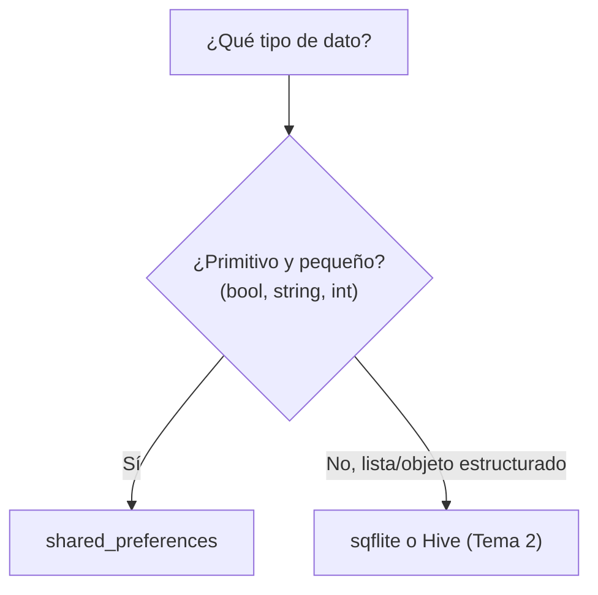
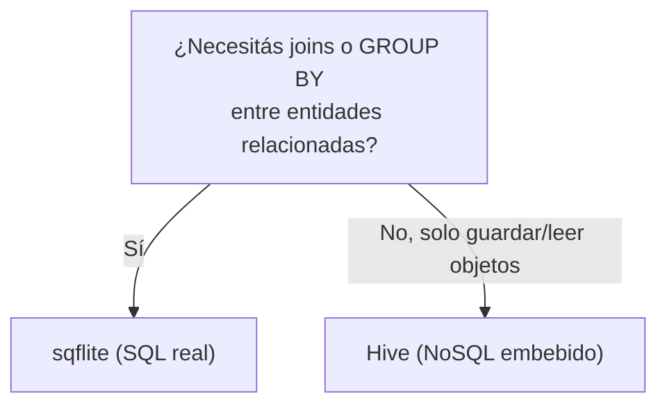
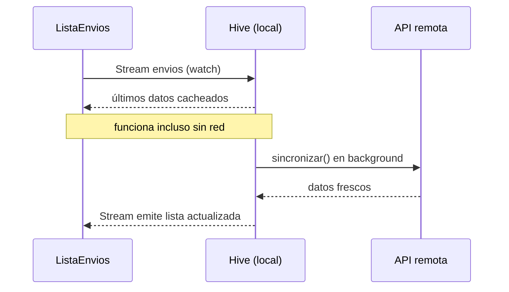
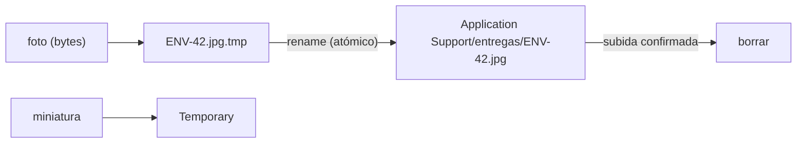

# Módulo 6: Persistencia local


## Aprende construyendo

### Tema 1: shared_preferences

#### Paso 1 · Objetivo y preparación
Al finalizar vas a persistir el filtro de zona preferido del conductor con `shared_preferences`, confirmando por qué ese mecanismo no sería apropiado para guardar la lista completa de envíos. Prerrequisitos: Módulo 5 completo.

#### Paso 2 · Contexto y caso real
Cada vez que el conductor abre RutaFlow, el filtro de zona vuelve a "todas" por defecto — necesita recordar la última zona seleccionada entre sesiones, un dato simple y pequeño.

#### Paso 3 · Teoría, modelo mental y analogía
`shared_preferences` provee almacenamiento clave-valor simple, ideal para configuración pequeña de tipos primitivos; no apropiado para datos estructurados en volumen.
**Conceptos clave:** almacenamiento clave-valor simple, no apropiado para datos estructurados grandes.

```dart
final prefs = SharedPreferencesAsync();
await prefs.setBool('tema_oscuro', true);
final temaOscuro = await prefs.getBool('tema_oscuro') ?? false;
```

> `SharedPreferences.getInstance()` aparece en muchos tutoriales, pero el paquete la declara *legacy* («will be deprecated in the future») y recomienda `SharedPreferencesAsync` o `SharedPreferencesWithCache` para código nuevo. Con `SharedPreferencesAsync` cada lectura es `await` (fuente: https://pub.dev/packages/shared_preferences).

`shared_preferences` provee una API simple de almacenamiento clave-valor persistente, ideal específicamente para configuración pequeña y de tipos primitivos (un booleano de tema oscuro, un string de idioma preferido, un entero de contador de sesiones); no es apropiado para guardar una lista grande de objetos estructurados (como una colección completa de tareas de usuario), dado que su modelo de almacenamiento no está diseñado para consultas eficientes sobre datos relacionales o estructurados en volumen, y forzar ese caso de uso hacia `shared_preferences` (por ejemplo, serializando manualmente una lista completa a un único string JSON gigante) sacrifica tanto el rendimiento como la capacidad de consultar o modificar elementos individuales de forma eficiente.

Esta distinción de "para qué sirve cada mecanismo de persistencia" es análoga a `UserDefaults` en iOS (el equivalente conceptual de `shared_preferences` en el ecosistema Apple, apropiado solo para configuración pequeña, nunca para datos estructurados en volumen) y a `SharedPreferences` de Android nativo (Módulo 6 de ese track, aunque en Android Room reemplaza ese rol para datos relacionales).

**Analogía:** `shared_preferences` es como una pequeña libreta de notas personales apropiada para anotar un par de preferencias simples (recordatorios cortos), pero completamente inadecuada para llevar el inventario completo de un almacén con miles de artículos individuales, para lo cual se necesita un sistema de registro estructurado apropiado.

**¿Por qué es importante?** `shared_preferences` NO es apropiado para guardar una lista grande de objetos estructurados, dado que su modelo de almacenamiento clave-valor simple no está diseñado para consultas eficientes sobre datos relacionales o en volumen, a diferencia de `sqflite` o Hive.

**Código del ejemplo:**

```dart
await prefs.setBool('tema_oscuro', true);   // apropiado: valor simple
// NO apropiado: prefs.setString('lista_tareas', jsonEncode(listaGrandeDeObjetos))
```

**Diagrama: qué guardar en shared_preferences**



En el proyecto integrador RutaFlow, `zona_preferida` vive en `lib/features/deliveries/domain/delivery_providers.dart`. Práctica: identificá en tu proyecto propio una preferencia simple y persistila con `shared_preferences`.

#### Paso 4 · Demostración guiada desde cero
```dart
import 'package:flutter/material.dart';
import 'package:shared_preferences/shared_preferences.dart';

Future<void> main() async {
  WidgetsFlutterBinding.ensureInitialized();
  final prefs = SharedPreferencesAsync();
  final zona = await prefs.getString('zona_preferida') ?? 'todas';
  runApp(MaterialApp(home: SelectorZona(prefs: prefs, zonaInicial: zona)));
}

class SelectorZona extends StatefulWidget {
  const SelectorZona({required this.prefs, required this.zonaInicial, super.key});
  final SharedPreferencesAsync prefs;
  final String zonaInicial;

  @override
  State<SelectorZona> createState() => _SelectorZonaState();
}

class _SelectorZonaState extends State<SelectorZona> {
  late String zona = widget.zonaInicial;

  Future<void> elegir(String nueva) async {
    await widget.prefs.setString('zona_preferida', nueva);
    if (!mounted) return;
    setState(() => zona = nueva);
  }

  @override
  Widget build(BuildContext context) => Scaffold(
        appBar: AppBar(title: Text('Zona preferida: $zona')),
        body: ListView(children: [
          for (final opcion in ['todas', 'norte', 'sur'])
            ListTile(
              title: Text(opcion),
              trailing: opcion == zona ? const Icon(Icons.check) : null,
              onTap: () => elegir(opcion),
            ),
        ]),
      );
}
```

**Ejecuta el ejemplo** (crea un proyecto Flutter desde cero, reemplaza `lib/main.dart` por el archivo completo de arriba y arráncalo en un emulador o dispositivo):

```bash
flutter create demo_flutter
cd demo_flutter
flutter pub add shared_preferences
flutter run
```
Si después ejecutas `flutter test`, borra antes `test/widget_test.dart`: prueba el contador de la plantilla, que ya no existe.

Resultado esperado: cerrar y volver a abrir RutaFlow restaura automáticamente `zona_preferida` como `'norte'`, sin que el conductor tenga que volver a seleccionarla.

#### Paso 5 · Práctica guiada
Pista: guardá también la lista completa de envíos del día serializada como un único string JSON gigante con `prefs.setString('envios_cache', jsonEncode(listaEnvios))` — ese es el fallo deliberado: con cientos de envíos, cada lectura y escritura de esa preferencia completa deserializa y vuelve a serializar la lista completa cada vez, y no hay forma de consultar o modificar un envío individual sin tocar el string gigante entero.

#### Paso 6 · Práctica independiente
Corregí el Paso 5 quitando la lista de envíos de `shared_preferences` por completo, dejando ahí únicamente `zona_preferida`, y documentá qué mecanismo de persistencia (Tema 2) sería apropiado para la lista de envíos en su lugar.

#### Paso 7 · Cierre
Entregá la preferencia simple persistida del Paso 4, el mal uso de shared_preferences para datos estructurados del Paso 5, y la documentación del Paso 6; explicá por qué el modelo clave-valor de `shared_preferences` no está diseñado para consultas eficientes sobre datos en volumen. Siguiente paso: estudia sqflite y Hive para la lista de envíos. Errores comunes: guardar una lista grande de objetos estructurados en `shared_preferences`, no proveer un valor por defecto al leer una preferencia que puede no existir todavía, y usar `shared_preferences` para datos sensibles sin cifrado. Fuentes oficiales: https://pub.dev/packages/shared_preferences y https://docs.flutter.dev/cookbook/persistence/key-value.
**Implicación práctica:** `shared_preferences` no es apropiado para guardar una lista grande de objetos estructurados, dado que su modelo clave-valor simple no está diseñado para consultas eficientes sobre datos en volumen.

### Tema 2: sqflite vs Hive

#### Paso 1 · Objetivo y preparación
Al finalizar vas a decidir entre `sqflite` y Hive para cachear la lista de envíos de RutaFlow, según si necesitás consultas relacionales o simplemente guardar objetos directos. Prerrequisitos: Tema 1 de este módulo.

#### Paso 2 · Contexto y caso real
RutaFlow necesita responder "¿cuántos envíos tiene el conductor X en la zona Y, agrupados por estado?" — una consulta que cruza múltiples criterios, distinta de simplemente "guardame este envío y devolvémelo después por su id".

#### Paso 3 · Teoría, modelo mental y analogía
`sqflite` expone SQL real, apropiado para queries relacionales complejas y agregaciones; Hive es más simple y directo para persistir objetos completos sin relaciones complejas entre entidades.
**Conceptos clave:** SQL relacional con queries complejas frente a NoSQL embebido simple y directo.

```dart
final db = await openDatabase('app.db', version: 1, onCreate: (db, version) {
  db.execute('CREATE TABLE tarea(id TEXT PRIMARY KEY, titulo TEXT, completada INTEGER)');
});

await db.insert('tarea', {'id': '1', 'titulo': 'Comprar leche', 'completada': 0});
final tareas = await db.query('tarea');
```

```dart
// lib/tarea.dart
import 'package:hive/hive.dart';

part 'tarea.g.dart'; // lo genera: dart run build_runner build

@HiveType(typeId: 0)
class Tarea extends HiveObject {
  Tarea({required this.titulo, required this.completada});

  @HiveField(0)
  String titulo;

  @HiveField(1)
  bool completada;
}

// En main(), antes de abrir la caja (Hive.initFlutter viene de hive_flutter):
await Hive.initFlutter();
Hive.registerAdapter(TareaAdapter()); // clase generada en tarea.g.dart
final box = await Hive.openBox<Tarea>('tareas');
await box.add(Tarea(titulo: 'Comprar leche', completada: false));
```

Dependencias: `flutter pub add hive hive_flutter` y `flutter pub add dev:hive_generator dev:build_runner`. **Estado del paquete:** la última versión estable de `hive` es la 2.2.3, publicada en 2022 (https://pub.dev/packages/hive). Aquí se usa para comparar modelos; en un proyecto nuevo evalúa primero `sqflite` o una alternativa mantenida.

`sqflite` expone SQL real sobre SQLite, apropiado cuando la app necesita queries relacionales complejas, joins entre tablas, o agregaciones (`GROUP BY`, `COUNT`), capacidades del modelo relacional que Hive, como base NoSQL embebida más simple centrada en almacenar objetos directamente sin un motor de consultas relacional completo, no ofrece de la misma forma nativa; Hive es considerablemente más simple y directo para modelos de objetos sin relaciones complejas entre entidades (guardar y recuperar objetos completos por clave), con una API más cercana al modelo mental de "una colección de objetos Dart persistidos directamente", sin la capa intermedia de mapear entre filas SQL y objetos Dart que `sqflite` requiere.

Esta misma decisión de "SQL relacional tipado vs NoSQL embebido simple" se refleja en Room (SQL tipado, Módulo 6 del track de Android) frente a SwiftData (una capa más simple sobre Core Data, Módulo 6 del track de iOS), aunque cada ecosistema resuelve la elección con herramientas propias específicas de su plataforma.

**Analogía:** `sqflite` es como un sistema de archivo relacional completo con capacidad de generar reportes cruzados complejos entre distintas categorías de información; Hive es como un conjunto de cajas etiquetadas donde cada caja contiene directamente los objetos completos que se necesitan, ideal cuando no se requiere cruzar información entre cajas distintas de forma compleja.

**¿Por qué es importante?** Elegir entre Hive y `sqflite` depende de si la app necesita queries relacionales complejas (joins, agregaciones, apropiado para `sqflite`) o simplemente persistir y recuperar objetos directos sin relaciones complejas (más simple con Hive).

**Diagrama:**

```
sqflite  → SQL relacional real, joins, agregaciones complejas
Hive     → NoSQL embebido simple, objetos directos sin relaciones complejas
```

**Diagrama: decisión sqflite vs Hive**



En el proyecto integrador RutaFlow, la base `sqflite` vive en `lib/features/deliveries/data/envio_dao.dart`. Verificá la agregación con:

```bash
flutter test test/envio_dao_test.dart
```

#### Paso 4 · Demostración guiada desde cero
```dart
import 'package:flutter/material.dart';
import 'package:sqflite/sqflite.dart';

Future<void> main() async {
  WidgetsFlutterBinding.ensureInitialized();
  final db = await openDatabase('rutaflow.db', version: 1, onCreate: (db, version) async {
    await db.execute('CREATE TABLE envio(id TEXT PRIMARY KEY, zona TEXT, conductor TEXT, estado TEXT)');
  });
  await db.delete('envio'); // la demostración arranca siempre con los mismos datos
  for (final (id, estado) in [('RF-1', 'entregado'), ('RF-2', 'entregado'), ('RF-3', 'en_ruta')]) {
    await db.insert('envio', {'id': id, 'zona': 'norte', 'conductor': 'c-891', 'estado': estado});
  }
  final resumen = await db.rawQuery(
    'SELECT estado, COUNT(*) as total FROM envio WHERE conductor = ? AND zona = ? GROUP BY estado',
    ['c-891', 'norte'],
  );
  runApp(MaterialApp(
    home: Scaffold(
      body: SafeArea(
        child: Column(children: [
          for (final fila in resumen) Text('${fila['estado']}: ${fila['total']}'),
        ]),
      ),
    ),
  ));
}
```

**Ejecuta el ejemplo** (crea un proyecto Flutter desde cero, reemplaza `lib/main.dart` por el archivo completo de arriba y arráncalo en un emulador o dispositivo):

```bash
flutter create demo_flutter
cd demo_flutter
flutter pub add sqflite
flutter run
```
Si después ejecutas `flutter test`, borra antes `test/widget_test.dart`: prueba el contador de la plantilla, que ya no existe.

Resultado esperado: `resumen` devuelve directamente el conteo de envíos agrupados por estado para ese conductor y zona específicos — una agregación relacional que `sqflite` resuelve con una sola query SQL, sin cargar todos los envíos en memoria y agruparlos manualmente en Dart.

#### Paso 5 · Práctica guiada
Pista: intentá resolver esa misma agregación con Hive, cargando `box.values.toList()` (todos los envíos) y agrupando manualmente con `.where()`/`.fold()` en Dart — ese es el fallo deliberado: funciona con pocos envíos, pero a medida que la cantidad de envíos históricos crece a miles, cargar la colección completa en memoria para cada consulta agregada se vuelve notablemente más lento que dejar que SQLite resuelva la agregación internamente.

#### Paso 6 · Práctica independiente
Corregí el Paso 5 volviendo a `sqflite` para este caso específico, y documentá un caso distinto (guardar la última posición GPS conocida de un conductor) donde Hive sí sería la opción más simple y directa, sin necesitar ninguna query relacional.

#### Paso 7 · Cierre
Entregá la agregación SQL del Paso 4, el costo de la alternativa con Hive del Paso 5, y el caso documentado donde Hive sí es apropiado del Paso 6; explicá el criterio concreto que usarías para elegir entre ambos la próxima vez. Siguiente paso: estudia offline-first y Firebase. Errores comunes: elegir Hive para datos que necesitan queries relacionales complejas con joins o agregaciones, elegir `sqflite` para un caso simple de objetos sin relaciones, y no medir el costo real de cargar una colección completa en memoria antes de descartar una opción. Fuentes oficiales: https://pub.dev/packages/sqflite y https://pub.dev/packages/hive.
**Implicación práctica:** Elegir entre Hive y `sqflite` depende de si la app necesita queries relacionales complejas (apropiado para `sqflite`) o simplemente persistir y recuperar objetos directos sin relaciones complejas (más simple con Hive).

### Tema 3: Offline-first y Firebase

#### Paso 1 · Objetivo y preparación
Al finalizar vas a hacer que `ListaEnvios` lea siempre de una caja de Hive local (nunca directamente de la API), con un proceso de sincronización separado que la actualiza en segundo plano. Prerrequisitos: Tema 2 de este módulo.

#### Paso 2 · Contexto y caso real
Si `ListaEnvios` leyera directamente de la API cada vez, un conductor sin señal en una zona rural vería la pantalla completamente vacía, en vez de ver al menos los últimos envíos sincronizados antes de perder conexión.

#### Paso 3 · Teoría, modelo mental y analogía
En offline-first, la UI siempre lee de la caché local reactiva; un proceso de sincronización separado actualiza esa caché en segundo plano con datos frescos de la API.
**Conceptos clave:** la UI lee siempre de la caché local, sincronización en segundo plano.

```dart
Stream<List<Tarea>> get tareas => box.watch().map((_) => box.values.toList());

Future<void> sincronizar() async {
  final remotas = await api.obtenerTareas();
  for (final t in remotas) { box.put(t.id, t); }
}
```

Una estrategia offline-first en Flutter sigue exactamente el mismo principio ya estudiado en Room/Android (Módulo 6 de ese track) y SwiftData/iOS (Módulo 6 de ese track): la UI siempre lee de la caché local (aquí, un `Stream` reactivo sobre una caja de Hive que emite una nueva lista cada vez que los datos cambian), mientras un proceso de sincronización separado actualiza esa caché en segundo plano con datos frescos de la API remota, garantizando que la app permanezca funcional (mostrando al menos el último caché sincronizado) incluso sin conexión a internet.

Firebase (Authentication para gestión de usuarios, Firestore como base de datos NoSQL en la nube con sincronización en tiempo real incorporada, Cloud Functions para lógica de backend serverless, y FCM para notificaciones push) es una opción de backend-as-a-service extremadamente popular en el ecosistema Flutter específicamente porque ofrece integración oficial de primera clase con Flutter, permitiendo construir apps completas con backend funcional sin necesariamente escribir y mantener un servidor propio desde cero, aunque a costa de cierto acoplamiento a la plataforma y modelo de datos específicos de Firebase.

**Analogía:** offline-first con Hive/sqflite es como un noticiero local que siempre muestra las últimas noticias impresas disponibles mientras un equipo de reporteros recaba actualizaciones en segundo plano; Firebase es como contratar un servicio integral de infraestructura ya preconstruido (autenticación, base de datos, funciones de servidor, notificaciones) en vez de construir cada una de esas piezas de infraestructura por separado desde cero.

**¿Por qué es importante?** Offline-first mantiene la app funcional sin conexión leyendo siempre de la caché local sincronizada en background; Firebase ofrece un backend completo con integración oficial de primera clase en Flutter, apropiado para reducir el esfuerzo de construir infraestructura de servidor propia desde cero.

**Diagrama:**

```
UI ← siempre lee de → Hive/sqflite (caché local reactiva)
                          ↑
                   Sincronización en background
                          ↓
                        API remota / Firebase
```

**Diagrama: flujo offline-first**



En el proyecto integrador RutaFlow, este patrón vive en `lib/features/offline/pending_delivery.dart`. Límite de la decisión: offline-first no conviene para datos que exigen siempre el valor más reciente sin excepción (un saldo bancario en tiempo real, por ejemplo) — ahí mostrar un dato cacheado potencialmente desactualizado sería incorrecto; para el estado de envíos de RutaFlow, mostrar el último dato conocido es preferible a una pantalla vacía.

---

#### Paso 4 · Demostración guiada desde cero
```dart
import 'dart:async';

import 'package:flutter/material.dart';
import 'package:hive_flutter/hive_flutter.dart';

class Envio {
  const Envio(this.id, this.estado);
  final String id;
  final String estado;
}

/// API simulada: en la app real es Dio contra el backend.
class ApiEnvios {
  Future<List<Envio>> obtenerEnvios() async {
    await Future<void>.delayed(const Duration(seconds: 1));
    return const [Envio('RF-4471', 'en_ruta'), Envio('RF-5002', 'entregado')];
  }
}

class RepositorioEnvios {
  RepositorioEnvios(this.box, this.api);
  final Box<String> box; // id -> estado
  final ApiEnvios api;

  List<Envio> get _actuales => [for (final id in box.keys.cast<String>()) Envio(id, box.get(id)!)];

  // La UI siempre lee de la caché local; cada cambio en la caja emite la lista nueva.
  Stream<List<Envio>> get envios async* {
    yield _actuales;
    yield* box.watch().map((_) => _actuales);
  }

  Future<void> sincronizar() async {
    try {
      final remotos = await api.obtenerEnvios();
      for (final e in remotos) {
        await box.put(e.id, e.estado);
      }
    } on Exception {
      // Sin red: la pantalla sigue mostrando la caché local.
    }
  }
}

Future<void> main() async {
  await Hive.initFlutter();
  final box = await Hive.openBox<String>('envios');
  final repo = RepositorioEnvios(box, ApiEnvios());
  runApp(MaterialApp(home: ListaEnvios(repo: repo)));
  unawaited(repo.sincronizar());
}

class ListaEnvios extends StatefulWidget {
  const ListaEnvios({required this.repo, super.key});
  final RepositorioEnvios repo;

  @override
  State<ListaEnvios> createState() => _ListaEnviosState();
}

class _ListaEnviosState extends State<ListaEnvios> {
  late final Stream<List<Envio>> envios = widget.repo.envios;

  @override
  Widget build(BuildContext context) => Scaffold(
        appBar: AppBar(title: const Text('Envíos (caché local)')),
        body: StreamBuilder<List<Envio>>(
          stream: envios,
          builder: (context, snapshot) => ListView(children: [
            for (final e in snapshot.data ?? const <Envio>[])
              ListTile(title: Text(e.id), subtitle: Text(e.estado)),
          ]),
        ),
      );
}
```

**Ejecuta el ejemplo** (crea un proyecto Flutter desde cero, reemplaza `lib/main.dart` por el archivo completo de arriba y arráncalo en un emulador o dispositivo):

```bash
flutter create demo_flutter
cd demo_flutter
flutter pub add hive hive_flutter
flutter run
```
Si después ejecutas `flutter test`, borra antes `test/widget_test.dart`: prueba el contador de la plantilla, que ya no existe.

Resultado esperado: `ListaEnvios` se suscribe al `Stream envios` (que lee de Hive) y muestra los últimos datos cacheados incluso en modo avión; cuando `sincronizar()` completa con conectividad real, la caja de Hive se actualiza y el `Stream` emite automáticamente la lista refrescada.

#### Paso 5 · Práctica guiada
Pista: cambiá `ListaEnvios` para que llame directamente a `api.obtenerEnvios()` dentro de un `FutureBuilder`, "para tener siempre los datos más frescos" — ese es el fallo deliberado: activá el modo avión y reabrí la pantalla; ahora `ListaEnvios` muestra un estado de error o una pantalla vacía, en vez de los últimos envíos sincronizados que sí existían en la caché local.

#### Paso 6 · Práctica independiente
Corregí el Paso 5 devolviendo `ListaEnvios` a leer del `Stream` sobre Hive, y confirmá explícitamente (activando modo avión) que la pantalla sigue mostrando los últimos envíos cacheados, aunque desactualizados, en vez de un error.

#### Paso 7 · Cierre
Entregá el patrón offline-first del Paso 4, la pantalla rota en modo avión provocada en el Paso 5, y la confirmación del Paso 6; explicá por qué hacer que la UI dependa directamente de la API rompe exactamente la garantía que offline-first existe para dar. Siguiente paso: cerrá el módulo evaluando si Firebase encajaría como backend para RutaFlow. Errores comunes: hacer que la UI dependa directamente de la API en vez de la caché local, sincronizar sin ningún indicador de que los datos mostrados podrían estar desactualizados, y no considerar Firebase cuando el proyecto podría evitar construir backend propio desde cero. Fuentes oficiales: https://docs.flutter.dev/app-architecture/design-patterns/offline-first y https://firebase.google.com/docs/flutter/setup.
**Implicación práctica:** Offline-first mantiene la app funcional sin conexión leyendo siempre de la caché local sincronizada en background, en vez de depender directamente de la disponibilidad de la API.

## Laboratorio práctico

**Objetivo del laboratorio:** construir una app con caché local que funciona sin conexión a internet.

**Requisitos previos:** Módulo 5 completado.

| Paso | Acción | Código | Explicación |
|---|---|---|---|
| 1 | Guardar una preferencia simple | Ver Tema 1 | `shared_preferences` |
| 2 | Definir una tabla con `sqflite` y CRUD básico | Ver Tema 2 | SQL relacional |
| 3 | Repetir el modelo con Hive | Ver Tema 2 | Compara ergonomía |
| 4 | Implementar offline-first simple | Ver Tema 3 | UI lee siempre de la caché local |

**Verificación:** el laboratorio se considera exitoso si la app muestra datos correctamente incluso en modo avión (usando el último caché sincronizado), y si la preferencia simple guardada con `shared_preferences` persiste correctamente entre reinicios de la app.

**Errores comunes y soluciones**

- **Guardar una lista grande de objetos estructurados en `shared_preferences`.** Usa `sqflite` o Hive para ese caso de uso.
- **Elegir Hive cuando la app necesita queries relacionales complejas con joins.** Prefiere `sqflite` para ese caso.
- **Hacer que la UI dependa directamente de la API en vez de la caché local.** Rompe offline-first; la UI debe leer siempre del caché.

---

## Laboratorio de transferencia

### Tema 4: Restauración de formularios con RestorationMixin y una prueba de recreación

#### Paso 1 · Objetivo y preparación
Al finalizar conservarás un campo transitorio durante una restauración del framework y lo verificarás con una prueba de widget. **Prerrequisitos:** StatefulWidget, controladores y dispose. Flutter instalado y `flutter doctor` revisado. Ejemplo independiente desde una carpeta vacía.

#### Paso 2 · Contexto y caso real
El proyecto integrador permite escribir una dirección antes de confirmar la entrega. **¿Por qué es importante?** Un rebuild no prueba recuperación de estado y un hot reload puede ocultar que se perdería al reconstruir la sesión.

#### Paso 3 · Teoría, modelo mental y analogía
Un scope identifica el árbol restaurable. `RestorationMixin` registra propiedades con identificadores estables. `RestorableTextEditingController` conserva el valor del campo y permite recuperar su controlador. **Analogía:** un guardarropa devuelve cada objeto usando su número de ficha; si cambias o repites identificadores, rompes la relación. El límite es que restauración de UI no sustituye almacenamiento duradero ni sincronización con el servidor.

#### Paso 4 · Demostración guiada desde cero
```bash
flutter create restauracion_demo
cd restauracion_demo
```
Reemplaza `lib/main.dart`:
```dart
import 'package:flutter/material.dart';

void main() => runApp(const DraftApp());
class DraftApp extends StatelessWidget {
  const DraftApp({super.key});
  @override
  Widget build(BuildContext context) => const MaterialApp(
    restorationScopeId: 'entregas', home: DraftPage());
}
class DraftPage extends StatefulWidget {
  const DraftPage({super.key});
  @override
  State<DraftPage> createState() => _DraftState();
}
class _DraftState extends State<DraftPage> with RestorationMixin {
  final address = RestorableTextEditingController();
  @override
  String get restorationId => 'borrador';
  @override
  void restoreState(RestorationBucket? oldBucket, bool initialRestore) {
    registerForRestoration(address, 'direccion');
  }
  @override
  void dispose() {
    address.dispose();
    super.dispose();
  }
  @override
  Widget build(BuildContext context) => Scaffold(
    appBar: AppBar(title: const Text('Borrador')),
    body: Padding(padding: const EdgeInsets.all(24), child: TextField(
      controller: address.value,
      decoration: const InputDecoration(labelText: 'Dirección'))));
}
```
Reemplaza `test/widget_test.dart`:
```dart
import 'package:flutter/material.dart';
import 'package:flutter_test/flutter_test.dart';
import 'package:restauracion_demo/main.dart';

void main() {
  testWidgets('restaura el texto transitorio', (tester) async {
    await tester.pumpWidget(const DraftApp());
    await tester.enterText(find.byType(TextField), 'Calle 42');
    await tester.pump(); // Serializa el cambio antes de simular la restauración.
    await tester.restartAndRestore();
    expect(find.text('Calle 42'), findsOneWidget);
  });
}
```
```bash
flutter test
flutter run
```
**Resultado esperado:** prueba correcta y un campo de dirección en el destino elegido. Explica cada bloque: scope del app, registro de propiedad, conexión del controlador y limpieza. La prueba reconstruye y restaura el estado del framework; no mata realmente un proceso Android.

#### Paso 5 · Práctica guiada
**Fallo deliberado:** retira `restorationScopeId` de MaterialApp. La prueba deja de conservar el texto. **Pista:** registrar una propiedad no basta si no hay un árbol de restauración. Repón el scope y verifica de nuevo.

#### Paso 6 · Práctica independiente
Añade un segundo campo restaurable con otro identificador y prueba dos valores distintos después de `restartAndRestore`. Explica qué parte de un formulario debe persistirse en una base de datos si se requiere recuperación tras cierre explícito.

#### Paso 7 · Cierre
El siguiente paso es ensayar recuperación en dispositivo y persistencia duradera con la política del producto. **Errores comunes:** reutilizar IDs, no disponer controladores y creer que hot reload valida restauración. **Límites y decisión de uso:** no almacenes fotografías, listas grandes ni secretos como estado transitorio; tampoco prometas recuperación tras desinstalar.

**Fuente oficial:** [Flutter: restaurar estado](https://docs.flutter.dev/platform-integration/android/restore-state-android).

### Tema 5: Archivos en Flutter: path_provider, carpetas correctas y escritura segura · Intermedio · 35 min

**Prerrequisito:** tema «sqflite vs Hive» de este módulo.

**Al finalizar podrás:** obtener la carpeta adecuada con `path_provider`, guardar la foto de una entrega de forma atómica y limpiar la caché temporal sin perder evidencia.

**¿Por qué es importante?** Guardar en la carpeta equivocada hace que el sistema borre archivos importantes o que los temporales llenen el teléfono. Escribir sin cuidado deja archivos a medias si la app se cierra.

#### Paso 1 · Objetivo y preparación

Agrega `path_provider` y `path` con `flutter pub add path_provider path`. Ejecuta en Android o iOS (en web no hay sistema de archivos).

#### Paso 2 · Contexto y caso real

RutaFlow guardaba las fotos de entrega en la carpeta temporal. En teléfonos con poco espacio, el sistema las borraba antes de subirlas y se perdía la evidencia de entregas reales.

#### Paso 3 · Teoría, modelo mental y analogía

**Conceptos clave:** `getApplicationDocumentsDirectory`, `getApplicationSupportDirectory`, `getTemporaryDirectory`, escritura atómica, ruta relativa, limpieza de temporales.

| Función | Carpeta | ¿El sistema la borra? | Úsala para |
|---|---|---|---|
| `getApplicationDocumentsDirectory()` | documentos de la app | no | archivos del usuario |
| `getApplicationSupportDirectory()` | datos internos | no | evidencia pendiente de subir, bases |
| `getTemporaryDirectory()` | temporales | sí, cuando necesita espacio | miniaturas, descargas que se pueden repetir |

**Escritura atómica:** escribe primero en un archivo `.tmp` y luego renómbralo. Renombrar dentro de la misma carpeta es atómico: o existe el archivo completo o no existe.

Guarda en la base solo la **ruta relativa** (`entregas/ENV-42.jpg`): la carpeta absoluta de la app puede cambiar entre instalaciones o actualizaciones en iOS.

**Analogía:** la carpeta temporal es la mesa de trabajo que limpian cada noche; `Application Support` es el archivador con llave. La analogía falla en que no sabes a qué hora limpian la mesa.

**Límite de uso:** no guardes archivos grandes en SharedPreferences ni en la base: guarda el archivo y su ruta. En web, `path_provider` no aplica; usa almacenamiento del navegador o el servidor.



#### Paso 4 · Demostración guiada desde cero

Archivo `lib/data/almacen_fotos.dart`:

```dart
import 'dart:io';
import 'dart:typed_data';
import 'package:path/path.dart' as p;
import 'package:path_provider/path_provider.dart';

class AlmacenFotos {
  Future<Directory> _carpeta() async {
    final base = await getApplicationSupportDirectory();
    return Directory(p.join(base.path, 'entregas')).create(recursive: true);
  }

  /// Guarda de forma atómica y devuelve la ruta RELATIVA para la base de datos.
  Future<String> guardar(String codigo, Uint8List bytes) async {
    final carpeta = await _carpeta();
    final destino = File(p.join(carpeta.path, '$codigo.jpg'));
    final temporal = File('${destino.path}.tmp');
    await temporal.writeAsBytes(bytes, flush: true);
    await temporal.rename(destino.path); // o queda completo o no queda
    return p.join('entregas', '$codigo.jpg');
  }

  Future<File> abrir(String rutaRelativa) async =>
      File(p.join((await getApplicationSupportDirectory()).path, rutaRelativa));

  Future<int> limpiarTemporales() async {
    final tmp = await getTemporaryDirectory();
    var borrados = 0;
    await for (final f in tmp.list()) {
      if (f is File && f.path.endsWith('.miniatura.jpg')) { await f.delete(); borrados++; }
    }
    return borrados;
  }
}
```

Ejecútalo:

```bash
flutter run
# en Android, revisa el archivo con:
adb shell run-as co.rutaflow.app ls files/entregas
```

**Explicación por bloques:** `_carpeta` usa `Application Support` y crea `entregas` si no existe. `guardar` escribe en un `.tmp` con `flush: true` (los bytes llegan al disco) y luego renombra: si la app muere a la mitad, no queda un JPG corrupto. Devuelve la ruta relativa para guardarla en la base. `abrir` reconstruye la ruta completa en el momento. `limpiarTemporales` recorre la carpeta temporal y borra solo las miniaturas.

**Resultado esperado:**

```text
Tras guardar ENV-42, `adb shell run-as co.rutaflow.app ls files/entregas` muestra ENV-42.jpg (en Android, Application Support corresponde a files/).
La base guarda «entregas/ENV-42.jpg», no la ruta absoluta.
```

**Fallo deliberado:** cambia `getApplicationSupportDirectory` por `getTemporaryDirectory` y llena el almacenamiento del emulador. **Error esperado:** después de que el sistema libera espacio, `abrir` devuelve un archivo que ya no existe (`PathNotFoundException`). **Diagnóstico:** la carpeta temporal se puede borrar en cualquier momento. La evidencia pendiente va en `Application Support`.

#### Paso 5 · Práctica guiada

1. **Reproducción:** guarda una foto y encuéntrala con `adb` o en el contenedor del simulador de iOS.
2. **Variación:** guarda una miniatura en la carpeta temporal y bórrala con `limpiarTemporales`.
3. **Diagnóstico:** reproduce el fallo deliberado o simúlalo borrando la carpeta temporal a mano.
4. **Integración:** escribe una prueba con un directorio temporal falso usando `PathProviderPlatform` de `plugin_platform_interface`.
5. **Diseño:** lista los archivos de la app de RutaFlow y en qué carpeta va cada uno.

**Pista:** si un archivo desaparece solo, revisa si estaba en la carpeta temporal.

#### Paso 6 · Práctica independiente

Después de que el servidor confirme la subida de una foto, bórrala de `entregas/` y registra cuántos bytes se liberaron.

#### Paso 7 · Cierre

- [ ] Eliges la carpeta correcta para cada archivo.
- [ ] Guardas de forma atómica.
- [ ] Guardas rutas relativas en la base.
- [ ] Limpias los temporales que creas.

Si fallas dos o más, vuelve al Paso 3. **Errores comunes:** guardar evidencia en temporales, guardar rutas absolutas y escribir directo al archivo final. **Siguiente paso:** el tema «Offline-first y Firebase» sube estos archivos cuando hay conexión.

**Transferencia al proyecto integrador «RutaFlow»:** guarda las fotos de entrega de RutaFlow en `Application Support/entregas` de forma atómica y bórralas solo tras confirmar la subida.

**Fuente oficial:** [pub.dev — path_provider](https://pub.dev/packages/path_provider) y [Flutter — Read and write files](https://docs.flutter.dev/cookbook/persistence/reading-writing-files).

