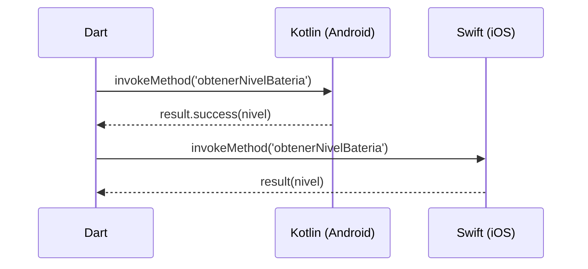
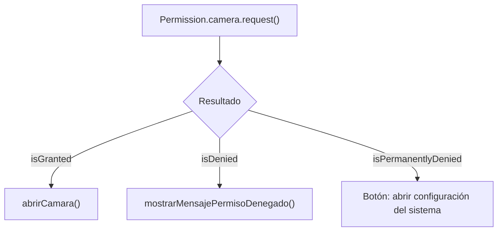
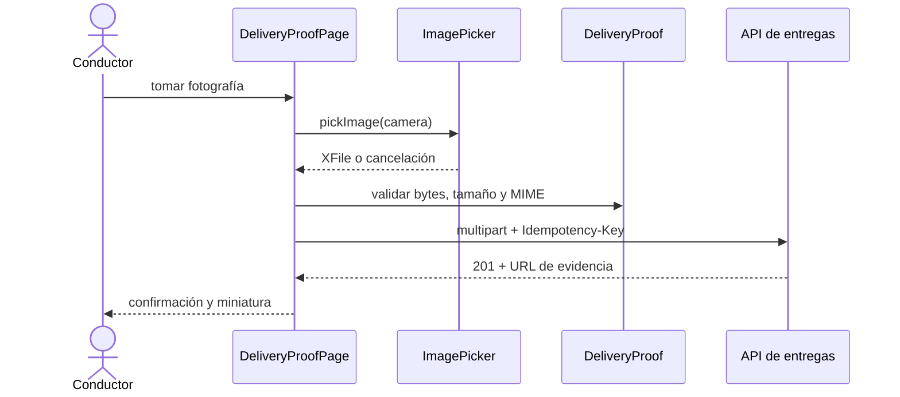
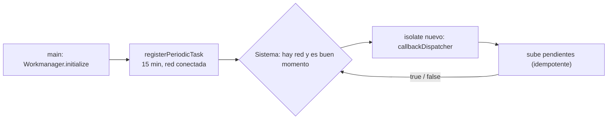
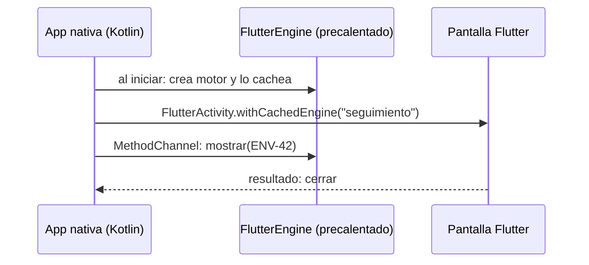

# Módulo 7: Integración con plataformas nativas


## Aprende construyendo

### Tema 1: MethodChannel · Avanzado · 45 min

#### Paso 1 · Objetivo y preparación
Al finalizar vas a crear un `MethodChannel` que consulte el nivel de batería del dispositivo (el Paso 3 lo introduce con un canal más simple que lee la versión del sistema operativo), implementado tanto en Android (Kotlin) como en iOS (Swift). Prerrequisitos: Módulo 6 completo.

#### Paso 2 · Contexto y caso real
Flutter no tiene acceso directo a las APIs nativas de batería de cada sistema operativo — necesitás un puente explícito que invoque código Kotlin en Android y Swift en iOS, cada uno con su propia forma de leer ese dato, para avisarle al conductor que cargue el teléfono antes de iniciar una ruta larga.

#### Paso 3 · Teoría, modelo mental y analogía
Un `MethodChannel` establece un canal bidireccional identificado por un nombre único; `invokeMethod` desde Dart envía la invocación, y `setMethodCallHandler` en el lado nativo responde.
**Conceptos clave:** puente de comunicación bidireccional entre Dart y el código nativo de cada plataforma.

```dart
// Dart
const canal = MethodChannel('com.miapp/sistema');
final version = await canal.invokeMethod<String>('obtenerVersionSO');
```

```kotlin
// Android (Kotlin)
MethodChannel(flutterEngine.dartExecutor.binaryMessenger, "com.miapp/sistema")
    .setMethodCallHandler { call, result ->
        if (call.method == "obtenerVersionSO") result.success(Build.VERSION.RELEASE)
    }
```

```swift
// iOS (Swift)
let canal = FlutterMethodChannel(name: "com.miapp/sistema", binaryMessenger: controller.binaryMessenger)
canal.setMethodCallHandler { call, result in
    if call.method == "obtenerVersionSO" { result(UIDevice.current.systemVersion) }
}
```

Un `MethodChannel` establece un canal de comunicación bidireccional identificado por un nombre único de string (`"com.miapp/sistema"`) entre el código Dart y el código nativo de cada plataforma: `invokeMethod` desde Dart envía una invocación asíncrona hacia el lado nativo correspondiente, y el `setMethodCallHandler` en Kotlin (Android) o Swift (iOS) recibe esa invocación, ejecuta la lógica nativa necesaria (aquí, leer la versión del sistema operativo mediante APIs específicas de cada plataforma) y devuelve el resultado de vuelta hacia Dart de forma asíncrona.

Este mecanismo es necesario específicamente porque Dart, aunque compila a código nativo en ambas plataformas, no tiene acceso directo a las APIs específicas de cada sistema operativo (las APIs de Android están escritas en Kotlin/Java, las de iOS en Swift/Objective-C); el `MethodChannel` es el puente explícito que permite que la lógica de la app, mayoritariamente escrita en Dart, invoque esas capacidades nativas específicas de plataforma cuando sea necesario, requiriendo implementar el lado receptor por separado en cada plataforma (Kotlin para Android, Swift para iOS), dado que cada una expone sus propias APIs de sistema con su propio lenguaje nativo.

**Analogía:** un `MethodChannel` es como un servicio de traducción e intermediación entre dos oficinas que hablan idiomas distintos (Dart y el código nativo de cada plataforma): una solicitud se traduce y transmite hacia la oficina correspondiente, se procesa allí con las herramientas específicas disponibles en esa oficina, y la respuesta se traduce de vuelta hacia el idioma original del solicitante.

**Diagrama:**

```
Dart: invokeMethod('obtenerVersionSO')
   ↓
Kotlin (Android) / Swift (iOS): setMethodCallHandler procesa y responde
   ↓
Dart: recibe el resultado de vuelta
```

**Diagrama: MethodChannel bidireccional**



En el proyecto integrador RutaFlow, practicá este patrón creando tu propio canal en tu proyecto propio antes de depender de un plugin publicado para el mismo dato.

**Límites y decisión de uso:** Un canal transmite valores compatibles con su codec y requiere una implementación nativa por plataforma. Maneja método ausente y error explícitamente; no lo uses para reglas de negocio que pueden permanecer en Dart y probarse sin dispositivo.

**¿Por qué es importante?** El `MethodChannel` es el puente explícito necesario porque Dart no tiene acceso directo a las APIs nativas de cada sistema operativo, requiriendo implementación por separado en cada plataforma.

#### Paso 4 · Demostración guiada desde cero
```dart
import 'package:flutter/material.dart';
import 'package:flutter/services.dart';

const canal = MethodChannel('com.rutaflow/bateria');

void main() => runApp(const MaterialApp(home: PantallaBateria()));

class PantallaBateria extends StatefulWidget {
  const PantallaBateria({super.key});

  @override
  State<PantallaBateria> createState() => _PantallaBateriaState();
}

class _PantallaBateriaState extends State<PantallaBateria> {
  String texto = 'Toca el botón para leer la batería';

  Future<void> leer() async {
    String nuevo;
    try {
      final nivel = await canal.invokeMethod<int>('obtenerNivelBateria');
      nuevo = 'Batería: $nivel%';
    } on PlatformException catch (e) {
      nuevo = 'Error nativo: ${e.message}';
    } on MissingPluginException {
      nuevo = 'Esta plataforma no implementa el canal';
    }
    if (!mounted) return;
    setState(() => texto = nuevo);
  }

  @override
  Widget build(BuildContext context) => Scaffold(
        body: Center(child: Text(texto)),
        floatingActionButton: FloatingActionButton(onPressed: leer, child: const Icon(Icons.battery_std)),
      );
}
```

**Ejecuta el ejemplo** (crea un proyecto Flutter desde cero, reemplaza `lib/main.dart` por el archivo completo de arriba y arráncalo en un emulador o dispositivo):

```bash
flutter create demo_flutter
cd demo_flutter
flutter run
```
Si después ejecutas `flutter test`, borra antes `test/widget_test.dart`: prueba el contador de la plantilla, que ya no existe.

Reemplaza `android/app/src/main/kotlin/<tu/paquete>/MainActivity.kt` (conserva la línea `package` que generó `flutter create`):

```kotlin
import android.content.Context
import android.os.BatteryManager
import io.flutter.embedding.android.FlutterActivity
import io.flutter.embedding.engine.FlutterEngine
import io.flutter.plugin.common.MethodChannel

class MainActivity : FlutterActivity() {
    override fun configureFlutterEngine(flutterEngine: FlutterEngine) {
        super.configureFlutterEngine(flutterEngine)
        MethodChannel(flutterEngine.dartExecutor.binaryMessenger, "com.rutaflow/bateria")
            .setMethodCallHandler { call, result ->
                if (call.method == "obtenerNivelBateria") {
                    val nivel = obtenerNivelReal()
                    if (nivel != -1) result.success(nivel)
                    else result.error("NO_DISPONIBLE", "Nivel de batería no disponible.", null)
                } else {
                    result.notImplemented()
                }
            }
    }

    private fun obtenerNivelReal(): Int {
        val bateria = getSystemService(Context.BATTERY_SERVICE) as BatteryManager
        return bateria.getIntProperty(BatteryManager.BATTERY_PROPERTY_CAPACITY)
    }
}
```

Y en iOS, `ios/Runner/AppDelegate.swift` (plantilla de Flutter 3.41+ con `UISceneDelegate`, según la guía oficial):

```swift
import Flutter
import UIKit

@main
@objc class AppDelegate: FlutterAppDelegate, FlutterImplicitEngineDelegate {
  func didInitializeImplicitFlutterEngine(_ engineBridge: FlutterImplicitEngineBridge) {
    GeneratedPluginRegistrant.register(with: engineBridge.pluginRegistry)

    let canal = FlutterMethodChannel(
      name: "com.rutaflow/bateria",
      binaryMessenger: engineBridge.applicationRegistrar.messenger()
    )
    canal.setMethodCallHandler { [weak self] call, result in
      guard call.method == "obtenerNivelBateria" else {
        result(FlutterMethodNotImplemented)
        return
      }
      self?.obtenerNivelReal(result: result)
    }
  }

  private func obtenerNivelReal(result: FlutterResult) {
    let dispositivo = UIDevice.current
    dispositivo.isBatteryMonitoringEnabled = true
    if dispositivo.batteryState == .unknown {
      result(FlutterError(code: "NO_DISPONIBLE", message: "Nivel de batería no disponible.", details: nil))
    } else {
      result(Int(dispositivo.batteryLevel * 100))
    }
  }
}
```

Si tu `AppDelegate.swift` generado es distinto (versiones anteriores a 3.41), conserva su estructura y agrega solo el canal; la guía oficial muestra ambas variantes: https://docs.flutter.dev/platform-integration/platform-channels. Para canales con tipos verificados en ambos lados, el paquete oficial `pigeon` genera este código por ti.

Resultado esperado: llamar a `canal.invokeMethod<int>('obtenerNivelBateria')` desde Dart dispara la lógica nativa de Android, que lee el nivel real de batería del dispositivo y lo devuelve a Dart de forma asíncrona.

#### Paso 5 · Práctica guiada
Pista: implementá el `setMethodCallHandler` únicamente en Android, pero probá la app en un dispositivo iOS sin implementar el lado Swift — ese es el fallo deliberado: `invokeMethod` lanza una excepción `MissingPluginException` en tiempo de ejecución en iOS, porque no hay ningún handler nativo registrado del lado de esa plataforma para ese canal.

#### Paso 6 · Práctica independiente
Corregí el Paso 5 implementando también el `FlutterMethodChannel` del lado de Swift, y agregá un manejo explícito del caso en que `call.method` no coincide con ningún método conocido, en vez de dejarlo sin respuesta.

#### Paso 7 · Cierre
Entregá el MethodChannel funcionando en ambas plataformas del Paso 4, el `MissingPluginException` provocado en el Paso 5, y el manejo de método desconocido del Paso 6; explicá por qué un `MethodChannel` requiere implementación explícita en cada plataforma, sin que implementarlo en una sea suficiente para la otra. Siguiente paso: estudia plugins federados. Errores comunes: implementar el lado nativo en una sola plataforma y asumir que funciona en ambas, no manejar el caso de un método invocado que no existe del lado nativo, y usar `MethodChannel` para algo que ya resuelve un plugin publicado en pub.dev. Fuentes oficiales: https://docs.flutter.dev/platform-integration/platform-channels y https://api.flutter.dev/flutter/services/MethodChannel-class.html.

### Tema 2: Plugins federados · Avanzado · 35 min

#### Paso 1 · Objetivo y preparación
Al finalizar vas a evaluar la estructura de `geolocator` (un plugin federado real) para entender cómo RutaFlow podría agregar soporte de una plataforma nueva sin tocar el paquete principal. Prerrequisitos: Tema 1 de este módulo.

#### Paso 2 · Contexto y caso real
RutaFlow usa geolocalización en Android e iOS hoy; si más adelante alguien quisiera agregar soporte para Flutter Web, necesitaría poder hacerlo sin modificar ni romper las implementaciones de Android/iOS ya probadas en producción.

#### Paso 3 · Teoría, modelo mental y analogía
Un plugin federado separa la interfaz Dart pública de las implementaciones concretas por plataforma, cada una en su propio paquete independiente.
**Conceptos clave:** separación de la interfaz Dart de las implementaciones específicas por plataforma.

Un plugin federado separa formalmente la interfaz Dart pública (el conjunto de métodos y tipos que el desarrollador Flutter consume, independiente de la plataforma) de las implementaciones concretas específicas de cada plataforma (Android, iOS, web, cada una en su propio paquete separado que implementa esa misma interfaz), permitiendo que la comunidad agregue soporte para una plataforma nueva (por ejemplo, una implementación para Linux o Windows) sin necesidad de modificar el paquete principal ni las implementaciones ya existentes de otras plataformas, dado que cada implementación específica de plataforma vive de forma completamente independiente y aislada de las demás.

Esta arquitectura de plugin federado es especialmente valiosa para el ecosistema de paquetes de terceros de Flutter, donde un mismo plugin popular (por ejemplo, uno de geolocalización o de cámara) necesita mantener implementaciones nativas correctas y actualizadas para múltiples plataformas simultáneamente: separar esas implementaciones en paquetes independientes permite que distintos mantenedores, potencialmente sin ninguna relación directa entre sí, contribuyan y actualicen cada implementación de plataforma de forma independiente sin coordinar cambios en un único paquete monolítico compartido.

**Analogía:** un plugin federado es como un estándar de enchufe eléctrico universal definido de forma independiente de la implementación local específica de cada país (voltaje, forma física del conector): el estándar general permite que cualquier fabricante local implemente su propia versión conforme a las especificidades de su región, sin necesidad de coordinar cambios con los fabricantes de otras regiones.

**¿Por qué es importante?** Un plugin federado permite agregar soporte para una plataforma nueva sin modificar el paquete principal ni las implementaciones existentes de otras plataformas, facilitando que la comunidad contribuya implementaciones específicas de forma independiente y descentralizada.

**Diagrama:**

```
Paquete principal (interfaz Dart)
   ├── Implementación Android (paquete separado)
   ├── Implementación iOS (paquete separado)
   └── Implementación web (paquete separado, agregable sin tocar los demás)
```

En el proyecto integrador RutaFlow, la geolocalización de `lib/features/journey/presentation/journey_controller.dart` depende de `geolocator` como ejemplo real de esta arquitectura federada. Práctica: verificá en pub.dev qué paquetes de implementación federada usa una dependencia de tu proyecto propio.

#### Paso 4 · Demostración guiada desde cero
```text
geolocator (interfaz Dart pública)
  ├── geolocator_android (implementación Android, paquete separado)
  ├── geolocator_apple (implementación iOS/macOS, paquete separado)
  └── geolocator_web (implementación web, agregable sin tocar los demás)
```

**Ejecuta el ejemplo** (crea un proyecto Flutter desde cero, pega el widget en `lib/main.dart` y arráncalo en un emulador o dispositivo):

```bash
flutter create demo_flutter
cd demo_flutter
flutter run
```
Para las pruebas de widget: `flutter test`.

Resultado esperado: inspeccionando pub.dev, cada implementación de plataforma de `geolocator` vive en su propio paquete versionado independientemente — actualizar `geolocator_android` no exige ni afecta ninguna modificación en `geolocator_apple`.

#### Paso 5 · Práctica guiada
Pista: imaginá que el equipo de RutaFlow decide "simplificar" copiando toda la lógica de `geolocator_android` directamente dentro del código de la app, en vez de depender del paquete federado — ese es el fallo deliberado: ahora RutaFlow tiene que mantener manualmente esa integración nativa cada vez que Android cambia sus APIs de ubicación, perdiendo las correcciones que la comunidad ya mantiene en el paquete federado real.

#### Paso 6 · Práctica independiente
Corregí el Paso 5 explicando por escrito por qué depender del paquete federado permite recibir actualizaciones de la comunidad sin esfuerzo propio, y verificá en pub.dev qué plataformas tiene actualmente soportadas `geolocator`.

#### Paso 7 · Cierre
Entregá la estructura federada analizada del Paso 4, la decisión de copiar código desaconsejada en el Paso 5, y tu explicación del Paso 6; explicá por qué la arquitectura federada permite que la comunidad contribuya implementaciones de plataforma de forma independiente y descentralizada. Siguiente paso: estudia permisos de plataforma y cuándo escribir un platform channel propio. Errores comunes: copiar la lógica de un plugin federado en vez de depender de él, asumir que todas las plataformas de un plugin federado tienen el mismo nivel de soporte sin verificarlo, y modificar directamente el código de un paquete de terceros en vez de contribuir al repositorio real. Fuentes oficiales: https://docs.flutter.dev/packages-and-plugins/developing-packages#federated-plugins y https://pub.dev/packages/geolocator.
**Implicación práctica:** Un plugin federado permite agregar soporte para una plataforma nueva sin modificar el paquete principal ni las implementaciones existentes de otras plataformas.

### Tema 3: Permisos de plataforma y cuándo escribir un platform channel propio · Avanzado · 35 min

#### Paso 1 · Objetivo y preparación
Al finalizar vas a solicitar el permiso de cámara para que el conductor pueda fotografiar una evidencia de entrega, manejando explícitamente tanto la concesión como el rechazo. Prerrequisitos: Tema 2 de este módulo.

#### Paso 2 · Contexto y caso real
Si el conductor rechaza el permiso de cámara y la app simplemente intenta abrir la cámara igual sin verificar el resultado, puede crashear o quedar en un estado confuso sin ninguna explicación visible.

#### Paso 3 · Teoría, modelo mental y analogía
Solicitar un permiso sensible requiere manejar explícitamente ambos resultados posibles: concedido y denegado, mostrando un mensaje apropiado en el segundo caso.
**Conceptos clave:** manejo explícito del rechazo, búsqueda de un plugin existente antes de construir uno propio.

```dart
final estado = await Permission.camera.request();
if (estado.isGranted) { abrirCamara(); } else { mostrarMensajePermisoDenegado(); }
```

Solicitar un permiso de plataforma sensible (cámara, ubicación, contactos) requiere manejar explícitamente ambos resultados posibles: concedido (proceder con la funcionalidad que depende de ese permiso) y denegado (mostrar un mensaje apropiado explicando por qué la funcionalidad no está disponible, en vez de simplemente fallar silenciosamente o crashear al intentar usar una capacidad sin el permiso correspondiente); este es el mismo patrón de manejo de permisos estudiado en Android nativo (Módulo 2 de ese track) e iOS nativo, expuesto aquí a través de un plugin de Flutter que internamente usa `MethodChannel` para comunicarse con las APIs nativas de permisos de cada plataforma.

Escribir un platform channel propio solo se justifica cuando el plugin necesario no existe ya publicado en pub.dev (el repositorio central de paquetes Dart/Flutter), o cuando se requiere una integración muy específica de bajo nivel que ningún plugin genérico existente cubre adecuadamente para el caso de uso concreto de la app; buscar primero un plugin ya existente y mantenido por la comunidad ahorra el esfuerzo considerable de escribir y mantener código nativo duplicado por plataforma (Kotlin para Android, Swift para iOS) que un plugin ya publicado probablemente ya resolvió correctamente, incluyendo el manejo de casos límite que un platform channel propio recién escrito podría no haber considerado todavía.

**Analogía:** manejar explícitamente el rechazo de un permiso es como preparar de antemano una respuesta cortés para cuando alguien decline una solicitud, en vez de quedarse sin ningún plan de contingencia si la respuesta no es la esperada; escribir un platform channel propio antes de buscar un plugin existente es como construir una herramienta especializada desde cero sin verificar primero si ya existe una herramienta comercial probada que resuelve exactamente la misma necesidad.

**¿Por qué es importante?** Manejar explícitamente el caso de permiso denegado evita fallos silenciosos o crashes; escribir un platform channel propio solo se justifica cuando no existe ya un plugin publicado, dado que reescribir esa integración manualmente duplica esfuerzo que probablemente ya está resuelto y mantenido por la comunidad.

**Diagrama: flujo de solicitud de permiso**



En el proyecto integrador RutaFlow, esta solicitud de permiso vive en `lib/features/delivery_proof/presentation/delivery_proof_page.dart`.

#### Paso 4 · Demostración guiada desde cero
```dart
import 'package:flutter/material.dart';
import 'package:permission_handler/permission_handler.dart';

void main() => runApp(const MaterialApp(home: PantallaEvidencia()));

class PantallaEvidencia extends StatefulWidget {
  const PantallaEvidencia({super.key});

  @override
  State<PantallaEvidencia> createState() => _PantallaEvidenciaState();
}

class _PantallaEvidenciaState extends State<PantallaEvidencia> {
  String mensaje = 'Toca el botón para fotografiar la evidencia';

  void abrirCamara() => setState(() => mensaje = 'Permiso concedido: aquí se abre la cámara');

  void mostrarMensajePermisoDenegado() => setState(() => mensaje =
      'Sin permiso de cámara no puedes fotografiar la evidencia. Puedes activarlo en Ajustes.');

  Future<void> pedirPermiso() async {
    final estado = await Permission.camera.request();
    if (!mounted) return;
    if (estado.isGranted) {
      abrirCamara();
    } else {
      mostrarMensajePermisoDenegado();
    }
  }

  @override
  Widget build(BuildContext context) => Scaffold(
        body: Center(child: Padding(padding: const EdgeInsets.all(24), child: Text(mensaje))),
        floatingActionButton: FloatingActionButton(onPressed: pedirPermiso, child: const Icon(Icons.camera_alt)),
      );
}
```

**Ejecuta el ejemplo** (crea un proyecto Flutter desde cero, reemplaza `lib/main.dart` por el archivo completo de arriba y arráncalo en un emulador o dispositivo):

```bash
flutter create demo_flutter
cd demo_flutter
flutter pub add permission_handler
flutter run
```
Si después ejecutas `flutter test`, borra antes `test/widget_test.dart`: prueba el contador de la plantilla, que ya no existe.

Resultado esperado: si el conductor concede el permiso, la cámara se abre normalmente; si lo rechaza, la app muestra un mensaje explicando por qué no puede fotografiar la evidencia, en vez de intentar abrir la cámara igual o quedar sin ninguna respuesta visible.

#### Paso 5 · Práctica guiada
Pista: quitá el `else` y dejá solo `if (estado.isGranted) { abrirCamara(); }` — ese es el fallo deliberado: si el conductor rechaza el permiso, la app simplemente no hace nada en absoluto, sin ningún mensaje ni indicio de por qué el botón de "Fotografiar evidencia" no tuvo ningún efecto visible.

#### Paso 6 · Práctica independiente
Corregí el Paso 5 restaurando el `else` con un mensaje explícito, y agregá un tercer caso para `estado.isPermanentlyDenied`, ofreciendo un botón que abra la configuración del sistema directamente.

#### Paso 7 · Cierre
Entregá el manejo de concesión/rechazo del Paso 4, el silencio sin feedback provocado en el Paso 5, y el tercer caso de rechazo permanente del Paso 6; explicá por qué un permiso denegado nunca debería dejar a la app sin ninguna respuesta visible para el usuario. Siguiente paso: estudia cámara, galería y carga multipart de una evidencia. Errores comunes: no manejar el caso de permiso denegado, no distinguir rechazo simple de rechazo permanente, y escribir un platform channel propio para pedir un permiso que un plugin ya publicado resuelve. Fuentes oficiales: https://pub.dev/packages/permission_handler y https://docs.flutter.dev/platform-integration/platform-channels.
**Implicación práctica:** Manejar explícitamente el caso de permiso denegado evita fallos silenciosos; escribir un platform channel propio solo se justifica cuando no existe ya un plugin publicado que resuelva la necesidad.

### Tema 4: Cámara, galería y carga multipart de una evidencia · Avanzado · 45 min

#### Paso 1 · Objetivo y preparación
Al finalizar vas a construir el flujo de "evidencia de entrega": el conductor toma una fotografía, el dominio la valida (tamaño, formato) y el repositorio la sube con una clave de idempotencia. Prerrequisitos: Módulo 5 completo, `image_picker` instalado.

#### Paso 2 · Contexto y caso real
Una foto visible en pantalla todavía no es una evidencia persistida — capturar, validar y transferir son responsabilidades distintas que no deberían vivir todas juntas dentro de la misma pantalla.

#### Paso 3 · Teoría, modelo mental y analogía
El dominio no depende de `XFile` ni de Dio; valida bytes, tamaño y MIME de forma aislada; el repositorio traduce ese contrato a HTTP con una clave de idempotencia para que reintentar no duplique la evidencia.
**Conceptos clave:** `XFile`, permiso contextual, validación local, puerto de dominio, `FormData`, progreso, idempotencia y archivo temporal.

En esta app construiremos la evidencia de entrega: el conductor toma una fotografía o elige una imagen, ve una previsualización y confirma antes de subirla. Capturar, validar y transferir son responsabilidades distintas. La pantalla no debe conocer cabeceras HTTP ni construir `FormData`; pide una imagen a un adaptador de dispositivo y entrega una evidencia válida a un repositorio.

**Requisitos previos:** una app creada con `flutter create demo_driver`, el Módulo 5 para Dio y un emulador o dispositivo. Desde la raíz ejecuta:

```bash
flutter pub add image_picker dio mime http_parser
```

Agrega las descripciones de uso en `ios/Runner/Info.plist` (`NSCameraUsageDescription` y `NSPhotoLibraryUsageDescription`). En Android verifica la configuración exigida por la versión actual del plugin y prueba el flujo de recuperación cuando el sistema destruye la actividad por falta de memoria; no copies permisos antiguos sin revisar la plataforma objetivo.

```text
lib/features/delivery_proof/
├── domain/delivery_proof.dart
├── domain/delivery_proof_repository.dart
├── application/attach_delivery_proof.dart
├── infrastructure/image_picker_proof_source.dart
├── infrastructure/dio_delivery_proof_repository.dart
└── presentation/delivery_proof_page.dart
```

Primero representa la entrada válida en `lib/features/delivery_proof/domain/delivery_proof.dart`. El dominio no depende de `XFile`, widgets ni Dio:

```dart
import 'dart:typed_data';

final class DeliveryProof {
  DeliveryProof({required this.bytes, required this.fileName, required this.mimeType}) {
    if (bytes.isEmpty) throw ArgumentError('La imagen está vacía');
    if (bytes.lengthInBytes > 5 * 1024 * 1024) {
      throw ArgumentError('La imagen supera 5 MB');
    }
    if (!{'image/jpeg', 'image/png'}.contains(mimeType)) {
      throw ArgumentError('Formato no permitido: $mimeType');
    }
  }

  final Uint8List bytes;
  final String fileName;
  final String mimeType;
}
```

El adaptador `lib/features/delivery_proof/infrastructure/image_picker_proof_source.dart` convierte el resultado del plugin en un tipo propio. `pickImage` puede devolver `null`: cancelar el selector no es un error.

```dart
import 'package:image_picker/image_picker.dart';
import 'package:mime/mime.dart';

import '../domain/delivery_proof.dart';

final class ImagePickerProofSource {
  ImagePickerProofSource(this._picker);
  final ImagePicker _picker;

  Future<DeliveryProof?> capture() async {
    final file = await _picker.pickImage(
      source: ImageSource.camera,
      imageQuality: 82,
      maxWidth: 1920,
    );
    if (file == null) return null;
    final bytes = await file.readAsBytes();
    return DeliveryProof(
      bytes: bytes,
      fileName: file.name,
      mimeType: lookupMimeType(file.name, headerBytes: bytes) ?? '',
    );
  }
}
```

Define en `lib/features/delivery_proof/domain/delivery_proof_repository.dart` el contrato que necesita el caso de uso:

```dart
import 'delivery_proof.dart';

abstract interface class DeliveryProofRepository {
  Future<Uri> upload({
    required String deliveryId,
    required DeliveryProof proof,
    required String idempotencyKey,
    required void Function(double progress) onProgress,
  });
}
```

La implementación `lib/features/delivery_proof/infrastructure/dio_delivery_proof_repository.dart` traduce el contrato de dominio a HTTP. Envía un identificador de idempotencia para que reintentar después de perder la conexión no cree dos evidencias:

```dart
import 'package:dio/dio.dart';
import 'package:http_parser/http_parser.dart';

import '../domain/delivery_proof.dart';
import '../domain/delivery_proof_repository.dart';

final class DioDeliveryProofRepository implements DeliveryProofRepository {
  DioDeliveryProofRepository(this._dio);
  final Dio _dio;

  @override
  Future<Uri> upload({
    required String deliveryId,
    required DeliveryProof proof,
    required String idempotencyKey,
    required void Function(double) onProgress,
  }) async {
    final response = await _dio.post<Map<String, dynamic>>(
      '/deliveries/$deliveryId/proof',
      data: FormData.fromMap({
        'file': MultipartFile.fromBytes(
          proof.bytes,
          filename: proof.fileName,
          contentType: MediaType.parse(proof.mimeType),
        ),
      }),
      options: Options(headers: {'Idempotency-Key': idempotencyKey}),
      onSendProgress: (sent, total) => onProgress(total == 0 ? 0 : sent / total),
    );
    return Uri.parse(response.data!['url'] as String);
  }
}
```



**Analogía:** la cámara obtiene el paquete, el dominio inspecciona peso y tipo, y el repositorio es la empresa transportadora. La pantalla coordina el envío, pero no necesita conocer cómo se construye el vehículo HTTP.

**Resultado esperado:** al confirmar aparece progreso de 0 a 100 %, el servidor responde `201` con una URL y la interfaz cambia a «Evidencia guardada». Cancelar vuelve a la pantalla sin error; un PNG/JPEG mayor de 5 MB se rechaza antes de consumir red.

**Fallo deliberado:** activa modo avión cuando la carga llegue aproximadamente al 50 %. La interfaz debe conservar la fotografía para reintento, mostrar un error recuperable y reutilizar la misma clave de idempotencia. No marques la entrega como completada hasta recibir la confirmación del servidor.

**Modificación sin copiar:** agrega selección desde galería y compresión en un isolate. Decide mediante una prueba qué componente cambia y demuestra que `DeliveryProof` sigue sin importar paquetes de Flutter.

---

**Transferencia al proyecto integrador «Aplicación móvil del repartidor»:** Captura una evidencia y envíala con autorización por guía. Prueba cancelación de cámara y subida interrumpida; conserva el archivo hasta confirmar recepción y evita duplicarlo al reintentar.

**Límites y decisión de uso:** Capturar una foto no acredita que el servidor la recibió ni que el usuario estaba autorizado. Conserva referencia local, controla tamaño y tipo en el backend y ofrece recuperación si permiso, almacenamiento o red fallan.

**¿Por qué es importante?** Una foto visible en pantalla todavía no es una evidencia persistida; separar selección, validación y carga permite probar reglas sin cámara real y reintentar con seguridad.

#### Paso 4 · Demostración guiada desde cero
```dart
import 'dart:typed_data';

import 'package:flutter/material.dart';

final class DeliveryProof {
  DeliveryProof({required this.bytes, required this.fileName, required this.mimeType}) {
    if (bytes.isEmpty) throw ArgumentError('La imagen está vacía');
    if (bytes.lengthInBytes > 5 * 1024 * 1024) throw ArgumentError('La imagen supera 5 MB');
    if (!{'image/jpeg', 'image/png'}.contains(mimeType)) throw ArgumentError('Formato no permitido: $mimeType');
  }
  final Uint8List bytes;
  final String fileName;
  final String mimeType;
}

String probar(int tamano, String mimeType) {
  try {
    DeliveryProof(bytes: Uint8List(tamano), fileName: 'evidencia', mimeType: mimeType);
    return 'aceptada';
  } on ArgumentError catch (e) {
    return 'rechazada: ${e.message}';
  }
}

void main() => runApp(MaterialApp(
      home: Scaffold(
        body: SafeArea(
          child: Column(children: [
            Text('1 MB JPEG: ${probar(1024 * 1024, 'image/jpeg')}'),
            Text('6 MB JPEG: ${probar(6 * 1024 * 1024, 'image/jpeg')}'),
            Text('1 MB GIF: ${probar(1024 * 1024, 'image/gif')}'),
          ]),
        ),
      ),
    ));
```

**Ejecuta el ejemplo** (crea un proyecto Flutter desde cero, reemplaza `lib/main.dart` por el archivo completo de arriba y arráncalo en un emulador o dispositivo):

```bash
flutter create demo_flutter
cd demo_flutter
flutter run
```
Si después ejecutas `flutter test`, borra antes `test/widget_test.dart`: prueba el contador de la plantilla, que ya no existe.

Resultado esperado: construir un `DeliveryProof` con una imagen de 6 MB (o un tipo MIME no permitido) lanza un `ArgumentError` inmediatamente en el dominio, antes de que esos bytes lleguen siquiera a considerarse para una subida por red.

#### Paso 5 · Práctica guiada
Pista: activá modo avión cuando la carga llegue aproximadamente al 50% sin una clave de idempotencia estable del lado del repositorio — ese es el fallo deliberado: reintentar la subida desde cero después de recuperar la conexión puede crear una segunda evidencia en el servidor para la misma entrega, en vez de completar o reemplazar la que se cortó a la mitad.

#### Paso 6 · Práctica independiente
Corregí confirmando que la implementación reutiliza la misma `idempotencyKey` en el reintento, y que la interfaz conserva la fotografía localmente para ese reintento, sin marcar la entrega como completada hasta recibir la confirmación `201` real del servidor.

#### Paso 7 · Cierre
Entregá el dominio con validación del Paso 4, el riesgo de evidencia duplicada del Paso 5, y la confirmación de idempotencia del Paso 6; explicá por qué separar selección, validación y transferencia permite probar las reglas de validación sin necesitar una cámara real. Siguiente paso: cerrá el módulo integrando permisos, MethodChannel y carga de evidencia en el flujo completo. Errores comunes: confiar únicamente en la extensión del archivo para validar el tipo, marcar la entrega como completa antes de la confirmación del servidor, y generar una nueva clave de idempotencia en cada reintento. Fuentes oficiales: https://pub.dev/packages/image_picker y https://pub.dev/packages/dio.

### Tema 5: Trabajo en segundo plano con workmanager: sincronizar aunque la app esté cerrada · Avanzado · 45 min

**Prerrequisito:** temas «Permisos de plataforma y cuándo escribir un plugin propio» de este módulo y «Offline-first y Firebase» (módulo 6).

**Al finalizar podrás:** programar una tarea periódica con el paquete `workmanager` que suba entregas pendientes con restricciones de red, y entender qué permite cada sistema operativo.

**¿Por qué es importante?** El conductor no vuelve a abrir la app para sincronizar. Con trabajo en segundo plano, las entregas pendientes se suben cuando hay red. Pero Android e iOS limitan mucho este trabajo, y hay que diseñar con esos límites.

#### Paso 1 · Objetivo y preparación

Agrega `workmanager` con `flutter pub add workmanager`. En iOS, sigue la configuración del paquete (Background Modes y `BGTaskSchedulerPermittedIdentifiers`). Prueba primero en Android, donde es más predecible.

#### Paso 2 · Contexto y caso real

RutaFlow tenía conductores que terminaban la jornada con entregas sin subir, porque confirmaban sin señal y no volvían a abrir la app. La tarea periódica las sube cuando el teléfono recupera red.

#### Paso 3 · Teoría, modelo mental y analogía

**Conceptos clave:** isolate en segundo plano, `callbackDispatcher`, `@pragma('vm:entry-point')`, tarea periódica, restricciones, WorkManager (Android), BGTaskScheduler (iOS).

El paquete `workmanager` usa **WorkManager** en Android y **BGTaskScheduler** en iOS.

- La tarea corre en un **isolate nuevo**, sin la UI ni el estado de la app: debe abrir de nuevo lo que necesite (base, cliente HTTP).
- El punto de entrada es una función de nivel superior marcada con `@pragma('vm:entry-point')`, para que el compilador no la elimine.
- Las **restricciones** (red conectada, batería no baja) le dicen al sistema cuándo conviene correr.

| | Android | iOS |
|---|---|---|
| Periodo mínimo | 15 minutos | el sistema decide, sin garantía |
| Fiabilidad | alta, sobrevive reinicios | depende del uso de la app |

Diseña la sincronización para que sea **idempotente**: si la tarea corre dos veces, no debe duplicar nada.

**Analogía:** la tarea en segundo plano es un mensajero que pasa a recoger paquetes cuando el sistema lo deja salir: en Android pasa con horario aproximado; en iOS, cuando el portero quiere. La analogía falla en que el mensajero no recuerda nada de la visita anterior: cada vez arranca de cero.

**Límite de uso:** no prometas horarios exactos. No hagas trabajo pesado: Android da unos 10 minutos e iOS unos 30 segundos para una actualización. Para avisos inmediatos usa notificaciones push desde el servidor.



#### Paso 4 · Demostración guiada desde cero

Archivo `lib/main.dart`:

```dart
import 'package:flutter/material.dart';
import 'package:workmanager/workmanager.dart';

const tareaSincronizar = 'co.rutaflow.sincronizar';

@pragma('vm:entry-point') // evita que el compilador quite esta función
void callbackDispatcher() {
  Workmanager().executeTask((tarea, datos) async {
    if (tarea != tareaSincronizar) return true;
    try {
      // Isolate nuevo: abre de nuevo la base y el cliente HTTP aquí.
      final pendientes = ['ENV-42', 'ENV-43'];
      for (final codigo in pendientes) {
        debugPrint('subiendo $codigo'); // el servidor ignora repetidos por código
      }
      return true; // éxito
    } catch (_) {
      return false; // el sistema reintenta más tarde
    }
  });
}

Future<void> main() async {
  WidgetsFlutterBinding.ensureInitialized();
  await Workmanager().initialize(callbackDispatcher);
  await Workmanager().registerPeriodicTask(
    'sincronizacion-entregas', tareaSincronizar,
    frequency: const Duration(minutes: 15),
    constraints: Constraints(networkType: NetworkType.connected),
    existingWorkPolicy: ExistingPeriodicWorkPolicy.keep, // no duplicar al reabrir la app
  );
  runApp(const MaterialApp(home: Scaffold(body: Center(child: Text('RutaFlow')))));
}
```

Ejecútalo:

```bash
flutter run
# Android: fuerza la tarea sin esperar 15 minutos
adb shell cmd jobscheduler run -f co.rutaflow.app 1
adb logcat -s flutter
```

**Explicación por bloques:** `callbackDispatcher` es el punto de entrada del isolate en segundo plano: la anotación `@pragma` impide que el árbol de compilación la elimine. Dentro, `executeTask` recibe el nombre de la tarea y devuelve `true` si salió bien o `false` para que el sistema reintente. En `main`, `initialize` registra el despachador y `registerPeriodicTask` programa la tarea cada 15 minutos (el mínimo de Android) solo con red, sin duplicarla si ya existe. El comando de `adb` fuerza la ejecución para probar.

**Resultado esperado:**

```text
Tras forzar el trabajo en Android, Logcat muestra:
I flutter : subiendo ENV-42
I flutter : subiendo ENV-43
```

**Fallo deliberado:** quita `@pragma('vm:entry-point')` y compila en modo release (`flutter run --release`). **Error esperado:** la tarea no corre y Logcat muestra un error de que no se encontró el punto de entrada del callback. **Diagnóstico:** en release, el compilador elimina funciones que no ve usadas. La anotación las conserva.

#### Paso 5 · Práctica guiada

1. **Reproducción:** fuerza la tarea con `adb` y lee Logcat.
2. **Variación:** apaga la red del emulador, fuerza la tarea y explica por qué no corre.
3. **Diagnóstico:** reproduce el fallo deliberado en release.
4. **Integración:** registra una tarea de una sola vez (`registerOneOffTask`) al confirmar una entrega sin señal.
5. **Diseño:** escribe qué diría la app al conductor sobre cuándo se suben sus entregas en iOS.

**Pista:** si en iOS «nunca corre», recuerda que el sistema decide; prueba con el depurador de Xcode como en el track de iOS.

#### Paso 6 · Práctica independiente

Guarda en `SharedPreferences` (desde el isolate de fondo) la hora de la última sincronización exitosa y muéstrala en la app.

#### Paso 7 · Cierre

- [ ] Explicas por qué la tarea corre en un isolate nuevo.
- [ ] Forzaste la tarea y viste la subida.
- [ ] Reprodujiste el fallo sin `@pragma` en release.
- [ ] Tu sincronización es idempotente.

Si fallas dos o más, vuelve al Paso 3. **Errores comunes:** prometer horarios exactos, usar estado de la UI dentro de la tarea y no hacer idempotente la subida. **Siguiente paso:** el módulo 11 prepara los builds de release donde este comportamiento importa.

**Transferencia al proyecto integrador «RutaFlow»:** sube en segundo plano las entregas confirmadas sin señal en la app del conductor de RutaFlow, con restricción de red y subida idempotente.

**Fuente oficial:** [pub.dev — workmanager](https://pub.dev/packages/workmanager) y [Flutter — Background processes](https://docs.flutter.dev/packages-and-plugins/background-processes).

### Tema 6: Add-to-app: integrar una pantalla Flutter en una app Android o iOS existente · Avanzado · 20 min

**Prerrequisito:** temas «MethodChannel» y «Plugins federados» de este módulo.

**Al finalizar podrás:** crear un módulo Flutter, mostrarlo desde una app Android nativa con un `FlutterEngine` precalentado y pasarle datos con un `MethodChannel`.

**¿Por qué es importante?** Muchas empresas no reescriben su app de una vez. Con add-to-app agregan pantallas nuevas en Flutter dentro de la app nativa y migran por partes.

#### Paso 1 · Objetivo y preparación

Necesitas Flutter y Android Studio con una app Android existente (Kotlin). Crea el módulo junto a ella: `flutter create --template module modulo_seguimiento`.

#### Paso 2 · Contexto y caso real

La app nativa de clientes de RutaFlow (Android, Kotlin) necesitaba una pantalla de seguimiento nueva. El equipo de Flutter ya la tenía hecha para la app del conductor. Con add-to-app la reutilizaron sin reescribir la app de clientes.

#### Paso 3 · Teoría, modelo mental y analogía

**Conceptos clave:** módulo Flutter, `FlutterEngine`, `FlutterEngineCache`, precalentamiento, `FlutterActivity`, punto de entrada, `MethodChannel`.

Un **módulo Flutter** es un proyecto que no es una app completa: se incluye dentro de una app nativa.

- El **`FlutterEngine`** ejecuta el código Dart. Crearlo tarda; por eso se **precalienta** al iniciar la app nativa y se guarda en `FlutterEngineCache`.
- `FlutterActivity.withCachedEngine(id)` muestra la pantalla Flutter usando ese motor.
- Un **`MethodChannel`** con el mismo nombre en los dos lados pasa datos (el código del envío) y devuelve resultados.
- La ruta inicial (`setInitialRoute`) elige qué pantalla mostrar.

En Android, el módulo se incluye en `settings.gradle` del proyecto nativo; en iOS, con CocoaPods o como frameworks precompilados.

**Analogía:** add-to-app es instalar una cocina nueva dentro de un restaurante que ya funciona: la cocina tiene sus propios fogones (el motor) y una ventanilla (el canal) para recibir pedidos. La analogía falla en que encender los fogones tarda: por eso se encienden antes de abrir.

**Límite de uso:** cada motor consume memoria; no crees uno por pantalla (usa `FlutterEngineGroup` si necesitas varios). El tamaño de la app nativa crece con el motor de Flutter.



#### Paso 4 · Demostración guiada desde cero

Archivo `app-clientes/settings.gradle.kts`:

```kotlin
// Incluye el módulo Flutter que vive junto al proyecto nativo.
val filePath = settingsDir.parentFile.toString() + "/modulo_seguimiento/.android/include_flutter.groovy"
apply(from = File(filePath))
```

Archivo `app-clientes/app/src/main/java/co/rutaflow/clientes/ClientesApp.kt`:

```kotlin
package co.rutaflow.clientes

import android.app.Application
import io.flutter.embedding.engine.FlutterEngine
import io.flutter.embedding.engine.FlutterEngineCache
import io.flutter.embedding.engine.dart.DartExecutor

class ClientesApp : Application() {
    override fun onCreate() {
        super.onCreate()
        // Precalienta el motor para que la pantalla abra sin demora.
        val motor = FlutterEngine(this)
        motor.navigationChannel.setInitialRoute("/seguimiento")
        motor.dartExecutor.executeDartEntrypoint(DartExecutor.DartEntrypoint.createDefault())
        FlutterEngineCache.getInstance().put("seguimiento", motor)
    }
}
```

Archivo `app-clientes/app/src/main/java/co/rutaflow/clientes/DetalleActivity.kt`:

```kotlin
package co.rutaflow.clientes

import androidx.appcompat.app.AppCompatActivity
import io.flutter.embedding.android.FlutterActivity
import io.flutter.embedding.engine.FlutterEngineCache
import io.flutter.plugin.common.MethodChannel

class DetalleActivity : AppCompatActivity() {
    fun abrirSeguimiento(codigo: String) {
        val motor = FlutterEngineCache.getInstance().get("seguimiento")!!
        MethodChannel(motor.dartExecutor.binaryMessenger, "rutaflow/seguimiento").invokeMethod("mostrar", codigo)
        startActivity(FlutterActivity.withCachedEngine("seguimiento").build(this))
    }
}
```

Archivo `modulo_seguimiento/lib/main.dart`:

```dart
import 'package:flutter/material.dart';
import 'package:flutter/services.dart';

const canal = MethodChannel('rutaflow/seguimiento');
final codigo = ValueNotifier<String>('sin envío');

void main() {
  WidgetsFlutterBinding.ensureInitialized();
  canal.setMethodCallHandler((llamada) async {
    if (llamada.method == 'mostrar') codigo.value = llamada.arguments as String;
  });
  runApp(MaterialApp(
    routes: {'/seguimiento': (_) => Scaffold(
      appBar: AppBar(title: const Text('Seguimiento')),
      body: Center(child: ValueListenableBuilder(valueListenable: codigo, builder: (_, c, __) => Text('Envío $c'))),
    )},
    initialRoute: '/seguimiento',
  ));
}
```

Ejecútalo:

```bash
cd modulo_seguimiento && flutter pub get && cd ..
cd app-clientes && ./gradlew installDebug
```

**Explicación por bloques:** `settings.gradle.kts` incluye el módulo Flutter en el build de Gradle de la app nativa. `ClientesApp` crea el motor al iniciar, fija la ruta `/seguimiento`, ejecuta `main` de Dart y lo guarda en la caché con el id `seguimiento`. `DetalleActivity` envía el código por el `MethodChannel` y abre la pantalla Flutter con el motor ya listo. En Dart, el manejador del canal actualiza un `ValueNotifier` y la pantalla lo muestra.

**Resultado esperado:**

```text
Al tocar «Ver seguimiento» de ENV-42 en la app nativa, se abre sin pantalla en blanco una pantalla Flutter con el título «Seguimiento» y el texto «Envío ENV-42».
Al volver atrás, se regresa a la actividad nativa.
```

**Fallo deliberado:** quita el precalentamiento y usa `FlutterActivity.createDefaultIntent(this)`. **Error esperado:** la primera vez se ve una pantalla en blanco por uno o dos segundos y el canal no recibe el código, porque el motor aún no existía al llamar `invokeMethod`. **Diagnóstico:** precalienta y cachea el motor, y envía datos después de crearlo.

#### Paso 5 · Práctica guiada

1. **Reproducción:** abre la pantalla y mide el tiempo con y sin motor precalentado.
2. **Variación:** devuelve un resultado de Flutter a Kotlin («calificó 5 estrellas») con `canal.invokeMethod` desde Dart.
3. **Diagnóstico:** reproduce el fallo deliberado sin precalentar.
4. **Integración:** integra el mismo módulo en una app iOS con CocoaPods (`flutter_application_path` en el Podfile).
5. **Diseño:** escribe un plan de migración por pantallas de la app de clientes y el criterio para pasar cada una a Flutter.

**Pista:** si el canal «no recibe nada», revisa que el nombre sea idéntico en Kotlin y Dart y que el motor exista antes de enviar.

#### Paso 6 · Práctica independiente

Muestra la pantalla Flutter dentro de un `FlutterFragment` en una pestaña de la app nativa en lugar de una actividad completa.

#### Paso 7 · Cierre

- [ ] Explicas qué es un `FlutterEngine` y por qué se precalienta.
- [ ] La pantalla Flutter abre desde la app nativa con el código correcto.
- [ ] Reprodujiste la pantalla en blanco sin precalentar.
- [ ] Tienes un plan de migración por partes.

Si fallas dos o más, vuelve al Paso 3. **Errores comunes:** crear un motor por pantalla, enviar datos antes de crear el motor y usar nombres de canal distintos. **Siguiente paso:** el tema siguiente ejecuta trabajo en segundo plano desde Flutter.

**Transferencia al proyecto integrador «RutaFlow»:** integra la pantalla de seguimiento de Flutter en la app nativa de clientes de RutaFlow con un motor precalentado.

**Fuente oficial:** [Flutter — Add Flutter to an existing app](https://docs.flutter.dev/add-to-app) y [Flutter — Add a Flutter screen to an Android app](https://docs.flutter.dev/add-to-app/android/add-flutter-screen).

## Laboratorio práctico

**Objetivo del laboratorio:** construir un platform channel propio que invoca una API nativa simple desde Dart.

**Requisitos previos:** Módulo 6 completado, entorno con Android Studio y Xcode configurados.

| Paso | Acción | Código | Explicación |
|---|---|---|---|
| 1 | Crear un `MethodChannel` simple en Dart | Ver Tema 1 | Ej. obtener la versión del SO |
| 2 | Implementar el lado Android (Kotlin) | Ver Tema 1 | Responde a la invocación |
| 3 | Implementar el lado iOS (Swift) | Ver Tema 1 | Mismo `MethodChannel` |
| 4 | Solicitar un permiso de plataforma | Ver Tema 3 | Maneja el rechazo del usuario |
| 5 | Capturar y subir una evidencia | Ver Tema 4 | Valida, previsualiza y muestra progreso multipart |
| 6 | Cortar la red durante la carga | Ver Tema 4 | Conserva la evidencia y reintenta con idempotencia |

**Verificación:** el laboratorio se considera exitoso si el `MethodChannel` invoca correctamente el código nativo en ambas plataformas (Android e iOS) y devuelve el resultado esperado a Dart, y si el flujo de permisos maneja correctamente tanto la concesión como el rechazo.

**Errores comunes y soluciones**

- **Escribir un platform channel propio sin buscar primero un plugin existente en pub.dev.** Ahorra esfuerzo verificando primero si ya existe una solución mantenida por la comunidad.
- **Olvidar implementar el lado nativo en alguna de las dos plataformas.** El `MethodChannel` requiere implementación explícita en ambos lados (Kotlin e Swift) para funcionar en ambas plataformas.
- **No manejar el caso de permiso denegado.** Muestra un mensaje apropiado en vez de fallar silenciosamente o crashear.
- **Marcar la entrega completa cuando solo existe una foto local.** Espera la confirmación del backend y conserva un estado pendiente recuperable.
- **Confiar únicamente en la extensión del archivo.** Valida tipo, firma, tamaño y autorización también en el servidor.

---
