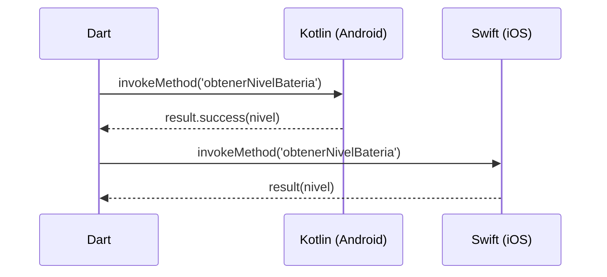
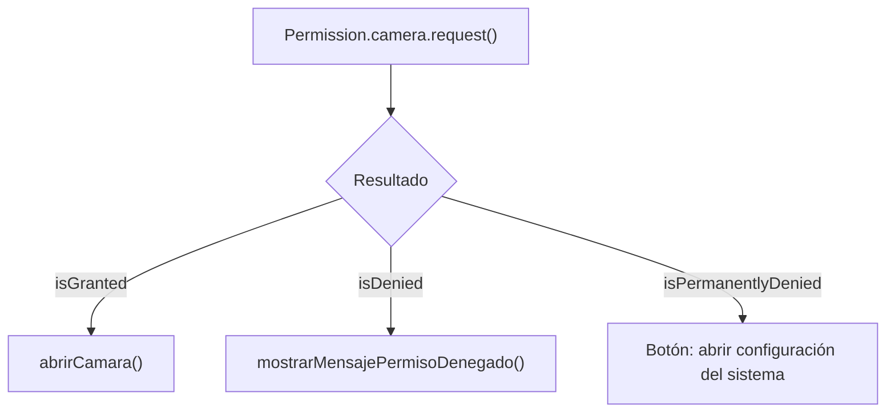
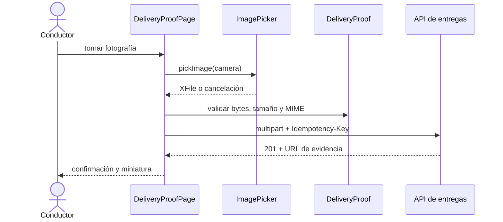
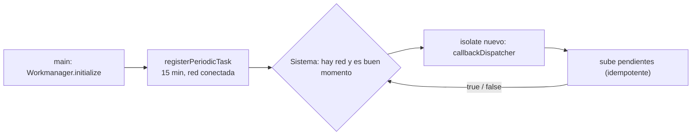
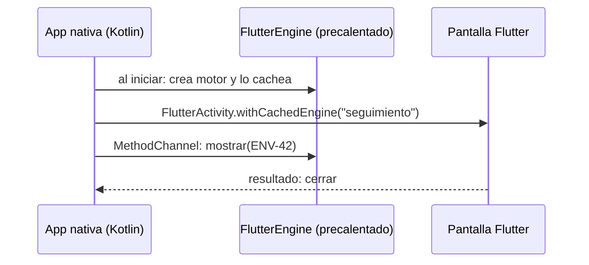

# Módulo 7: Integración con plataformas nativas


## Aprende construyendo


### Tema 1: MethodChannel · Avanzado · 45 min

<details open>
<summary><strong>Capa 1 — Lectura</strong></summary>

#### ► DE QUÉ TRATA
Al finalizar vas a crear un MethodChannel que consulte el nivel de batería del dispositivo (el Paso 3 lo introduce con un canal más simple que lee la versión del sistema operativo), implementado tanto en Android (Kotlin) como en iOS (Swift). Prerrequisitos: Módulo 6 completo.

#### ► LA ANALOGÍA
Un `MethodChannel` establece un canal bidireccional identificado por un nombre único; `invokeMethod` desde Dart envía la invocación, y `setMethodCallHandler` en el lado nativo responde.
**Conceptos clave:** puente de comunicación bidireccional entre Dart y el código nativo de cada plataforma.

```dart
// Dart
const canal = MethodChannel('com.miapp/sistema');
final version = await canal.invokeMethod<String>('obtenerVersionSO');
```

```kotlin
// Android (Kotlin)
MethodChannel(flutterEngine.dartExecutor.binaryMessenger, "com.miapp/sistema")
    .setMethodCallHandler { call, result ->
        if (call.method == "obtenerVersionSO") result.success(Build.VERSION.RELEASE)
    }
```

```swift
// iOS (Swift)
let canal = FlutterMethodChannel(name: "com.miapp/sistema", binaryMessenger: controller.binaryMessenger)
canal.setMethodCallHandler { call, result in
    if call.method == "obtenerVersionSO" { result(UIDevice.current.systemVersion) }
}
```

Un `MethodChannel` establece un canal de comunicación bidireccional identificado por un nombre único de string (`"com.miapp/sistema"`) entre el código Dart y el código nativo de cada plataforma: `invokeMethod` desde Dart envía una invocación asíncrona hacia el lado nativo correspondiente, y el `setMethodCallHandler` en Kotlin (Android) o Swift (iOS) recibe esa invocación, ejecuta la lógica nativa necesaria (aquí, leer la versión del sistema operativo mediante APIs específicas de cada plataforma) y devuelve el resultado de vuelta hacia Dart de forma asíncrona.

Este mecanismo es necesario específicamente porque Dart, aunque compila a código nativo en ambas plataformas, no tiene acceso directo a las APIs específicas de cada sistema operativo (las APIs de Android están escritas en Kotlin/Java, las de iOS en Swift/Objective-C); el `MethodChannel` es el puente explícito que permite que la lógica de la app, mayoritariamente escrita en Dart, invoque esas capacidades nativas específicas de plataforma cuando sea necesario, requiriendo implementar el lado receptor por separado en cada plataforma (Kotlin para Android, Swift para iOS), dado que cada una expone sus propias APIs de sistema con su propio lenguaje nativo.

**Analogía:** un `MethodChannel` es como un servicio de traducción e intermediación entre dos oficinas que hablan idiomas distintos (Dart y el código nativo de cada plataforma): una solicitud se traduce y transmite hacia la oficina correspondiente, se procesa allí con las herramientas específicas disponibles en esa oficina, y la respuesta se traduce de vuelta hacia el idioma original del solicitante.

**Diagrama:**

```
Dart: invokeMethod('obtenerVersionSO')
   ↓
Kotlin (Android) / Swift (iOS): setMethodCallHandler procesa y responde
   ↓
Dart: recibe el resultado de vuelta
```

**Diagrama: MethodChannel bidireccional**



En el proyecto integrador RutaFlow, practicá este patrón creando tu propio canal en tu proyecto propio antes de depender de un plugin publicado para el mismo dato.

**Límites y decisión de uso:** Un canal transmite valores compatibles con su codec y requiere una implementación nativa por plataforma. Maneja método ausente y error explícitamente; no lo uses para reglas de negocio que pueden permanecer en Dart y probarse sin dispositivo.

**¿Por qué es importante?** El `MethodChannel` es el puente explícito necesario porque Dart no tiene acceso directo a las APIs nativas de cada sistema operativo, requiriendo implementación por separado en cada plataforma.

#### ► CÓMO FUNCIONA


</details>

<details>
<summary><strong>Capa 2 — Construcción</strong></summary>

#### Código y verificación
```dart
// Dart
const canal = MethodChannel('com.miapp/sistema');
final version = await canal.invokeMethod<String>('obtenerVersionSO');
```

```kotlin
// Android (Kotlin)
MethodChannel(flutterEngine.dartExecutor.binaryMessenger, "com.miapp/sistema")
    .setMethodCallHandler { call, result ->
        if (call.method == "obtenerVersionSO") result.success(Build.VERSION.RELEASE)
    }
```

```swift
// iOS (Swift)
let canal = FlutterMethodChannel(name: "com.miapp/sistema", binaryMessenger: controller.binaryMessenger)
canal.setMethodCallHandler { call, result in
    if call.method == "obtenerVersionSO" { result(UIDevice.current.systemVersion) }
}
```

```
Dart: invokeMethod('obtenerVersionSO')
   ↓
Kotlin (Android) / Swift (iOS): setMethodCallHandler procesa y responde
   ↓
Dart: recibe el resultado de vuelta
```


```dart
import 'package:flutter/material.dart';
import 'package:flutter/services.dart';

const canal = MethodChannel('com.rutaflow/bateria');

void main() => runApp(const MaterialApp(home: PantallaBateria()));

class PantallaBateria extends StatefulWidget {
  const PantallaBateria({super.key});

  @override
  State<PantallaBateria> createState() => _PantallaBateriaState();
}

class _PantallaBateriaState extends State<PantallaBateria> {
  String texto = 'Toca el botón para leer la batería';

  Future<void> leer() async {
    String nuevo;
    try {
      final nivel = await canal.invokeMethod<int>('obtenerNivelBateria');
      nuevo = 'Batería: $nivel%';
    } on PlatformException catch (e) {
      nuevo = 'Error nativo: ${e.message}';
    } on MissingPluginException {
      nuevo = 'Esta plataforma no implementa el canal';
    }
    if (!mounted) return;
    setState(() => texto = nuevo);
  }

  @override
  Widget build(BuildContext context) => Scaffold(
        body: Center(child: Text(texto)),
        floatingActionButton: FloatingActionButton(onPressed: leer, child: const Icon(Icons.battery_std)),
      );
}
```

</details>

### Tema 2: Plugins federados · Avanzado · 35 min

<details open>
<summary><strong>Capa 1 — Lectura</strong></summary>

#### ► DE QUÉ TRATA
Al finalizar vas a evaluar la estructura de geolocator (un plugin federado real) para entender cómo RutaFlow podría agregar soporte de una plataforma nueva sin tocar el paquete principal. Prerrequisitos: Tema 1 de este módulo.

</details>

<details>
<summary><strong>Capa 2 — Construcción</strong></summary>

#### Código y verificación
```
Paquete principal (interfaz Dart)
   ├── Implementación Android (paquete separado)
   ├── Implementación iOS (paquete separado)
   └── Implementación web (paquete separado, agregable sin tocar los demás)
```

```text
geolocator (interfaz Dart pública)
  ├── geolocator_android (implementación Android, paquete separado)
  ├── geolocator_apple (implementación iOS/macOS, paquete separado)
  └── geolocator_web (implementación web, agregable sin tocar los demás)
```

```bash
flutter create demo_flutter
cd demo_flutter
flutter run
```

</details>

### Tema 3: Permisos de plataforma y cuándo escribir un platform channel propio · Avanzado · 35 min

<details open>
<summary><strong>Capa 1 — Lectura</strong></summary>

#### ► DE QUÉ TRATA
Al finalizar vas a solicitar el permiso de cámara para que el conductor pueda fotografiar una evidencia de entrega, manejando explícitamente tanto la concesión como el rechazo. Prerrequisitos: Tema 2 de este módulo.

#### ► LA ANALOGÍA
Solicitar un permiso sensible requiere manejar explícitamente ambos resultados posibles: concedido y denegado, mostrando un mensaje apropiado en el segundo caso.
**Conceptos clave:** manejo explícito del rechazo, búsqueda de un plugin existente antes de construir uno propio.

```dart
final estado = await Permission.camera.request();
if (estado.isGranted) { abrirCamara(); } else { mostrarMensajePermisoDenegado(); }
```

Solicitar un permiso de plataforma sensible (cámara, ubicación, contactos) requiere manejar explícitamente ambos resultados posibles: concedido (proceder con la funcionalidad que depende de ese permiso) y denegado (mostrar un mensaje apropiado explicando por qué la funcionalidad no está disponible, en vez de simplemente fallar silenciosamente o crashear al intentar usar una capacidad sin el permiso correspondiente); este es el mismo patrón de manejo de permisos estudiado en Android nativo (Módulo 2 de ese track) e iOS nativo, expuesto aquí a través de un plugin de Flutter que internamente usa `MethodChannel` para comunicarse con las APIs nativas de permisos de cada plataforma.

Escribir un platform channel propio solo se justifica cuando el plugin necesario no existe ya publicado en pub.dev (el repositorio central de paquetes Dart/Flutter), o cuando se requiere una integración muy específica de bajo nivel que ningún plugin genérico existente cubre adecuadamente para el caso de uso concreto de la app; buscar primero un plugin ya existente y mantenido por la comunidad ahorra el esfuerzo considerable de escribir y mantener código nativo duplicado por plataforma (Kotlin para Android, Swift para iOS) que un plugin ya publicado probablemente ya resolvió correctamente, incluyendo el manejo de casos límite que un platform channel propio recién escrito podría no haber considerado todavía.

**Analogía:** manejar explícitamente el rechazo de un permiso es como preparar de antemano una respuesta cortés para cuando alguien decline una solicitud, en vez de quedarse sin ningún plan de contingencia si la respuesta no es la esperada; escribir un platform channel propio antes de buscar un plugin existente es como construir una herramienta especializada desde cero sin verificar primero si ya existe una herramienta comercial probada que resuelve exactamente la misma necesidad.

**¿Por qué es importante?** Manejar explícitamente el caso de permiso denegado evita fallos silenciosos o crashes; escribir un platform channel propio solo se justifica cuando no existe ya un plugin publicado, dado que reescribir esa integración manualmente duplica esfuerzo que probablemente ya está resuelto y mantenido por la comunidad.

**Diagrama: flujo de solicitud de permiso**



En el proyecto integrador RutaFlow, esta solicitud de permiso vive en `lib/features/delivery_proof/presentation/delivery_proof_page.dart`.

#### ► CÓMO FUNCIONA


</details>

<details>
<summary><strong>Capa 2 — Construcción</strong></summary>

#### Código y verificación
```dart
final estado = await Permission.camera.request();
if (estado.isGranted) { abrirCamara(); } else { mostrarMensajePermisoDenegado(); }
```


```dart
import 'package:flutter/material.dart';
import 'package:permission_handler/permission_handler.dart';

void main() => runApp(const MaterialApp(home: PantallaEvidencia()));

class PantallaEvidencia extends StatefulWidget {
  const PantallaEvidencia({super.key});

  @override
  State<PantallaEvidencia> createState() => _PantallaEvidenciaState();
}

class _PantallaEvidenciaState extends State<PantallaEvidencia> {
  String mensaje = 'Toca el botón para fotografiar la evidencia';

  void abrirCamara() => setState(() => mensaje = 'Permiso concedido: aquí se abre la cámara');

  void mostrarMensajePermisoDenegado() => setState(() => mensaje =
      'Sin permiso de cámara no puedes fotografiar la evidencia. Puedes activarlo en Ajustes.');

  Future<void> pedirPermiso() async {
    final estado = await Permission.camera.request();
    if (!mounted) return;
    if (estado.isGranted) {
      abrirCamara();
    } else {
      mostrarMensajePermisoDenegado();
    }
  }

  @override
  Widget build(BuildContext context) => Scaffold(
        body: Center(child: Padding(padding: const EdgeInsets.all(24), child: Text(mensaje))),
        floatingActionButton: FloatingActionButton(onPressed: pedirPermiso, child: const Icon(Icons.camera_alt)),
      );
}
```

```bash
flutter create demo_flutter
cd demo_flutter
flutter pub add permission_handler
flutter run
```

</details>

### Tema 4: Cámara, galería y carga multipart de una evidencia · Avanzado · 45 min

<details open>
<summary><strong>Capa 1 — Lectura</strong></summary>

#### ► DE QUÉ TRATA
Al finalizar vas a construir el flujo de "evidencia de entrega": el conductor toma una fotografía, el dominio la valida (tamaño, formato) y el repositorio la sube con una clave de idempotencia. Prerrequisitos: Módulo 5 completo, image_picker instalado.

#### ► LA ANALOGÍA
El dominio no depende de `XFile` ni de Dio; valida bytes, tamaño y MIME de forma aislada; el repositorio traduce ese contrato a HTTP con una clave de idempotencia para que reintentar no duplique la evidencia.
**Conceptos clave:** `XFile`, permiso contextual, validación local, puerto de dominio, `FormData`, progreso, idempotencia y archivo temporal.

En esta app construiremos la evidencia de entrega: el conductor toma una fotografía o elige una imagen, ve una previsualización y confirma antes de subirla. Capturar, validar y transferir son responsabilidades distintas. La pantalla no debe conocer cabeceras HTTP ni construir `FormData`; pide una imagen a un adaptador de dispositivo y entrega una evidencia válida a un repositorio.

**Requisitos previos:** una app creada con `flutter create demo_driver`, el Módulo 5 para Dio y un emulador o dispositivo. Desde la raíz ejecuta:

```bash
flutter pub add image_picker dio mime http_parser
```

Agrega las descripciones de uso en `ios/Runner/Info.plist` (`NSCameraUsageDescription` y `NSPhotoLibraryUsageDescription`). En Android verifica la configuración exigida por la versión actual del plugin y prueba el flujo de recuperación cuando el sistema destruye la actividad por falta de memoria; no copies permisos antiguos sin revisar la plataforma objetivo.

```text
lib/features/delivery_proof/
├── domain/delivery_proof.dart
├── domain/delivery_proof_repository.dart
├── application/attach_delivery_proof.dart
├── infrastructure/image_picker_proof_source.dart
├── infrastructure/dio_delivery_proof_repository.dart
└── presentation/delivery_proof_page.dart
```

Primero representa la entrada válida en `lib/features/delivery_proof/domain/delivery_proof.dart`. El dominio no depende de `XFile`, widgets ni Dio:

```dart
import 'dart:typed_data';

final class DeliveryProof {
  DeliveryProof({required this.bytes, required this.fileName, required this.mimeType}) {
    if (bytes.isEmpty) throw ArgumentError('La imagen está vacía');
    if (bytes.lengthInBytes > 5 * 1024 * 1024) {
      throw ArgumentError('La imagen supera 5 MB');
    }
    if (!{'image/jpeg', 'image/png'}.contains(mimeType)) {
      throw ArgumentError('Formato no permitido: $mimeType');
    }
  }

  final Uint8List bytes;
  final String fileName;
  final String mimeType;
}
```

El adaptador `lib/features/delivery_proof/infrastructure/image_picker_proof_source.dart` convierte el resultado del plugin en un tipo propio. `pickImage` puede devolver `null`: cancelar el selector no es un error.

```dart
import 'package:image_picker/image_picker.dart';
import 'package:mime/mime.dart';

import '../domain/delivery_proof.dart';

final class ImagePickerProofSource {
  ImagePickerProofSource(this._picker);
  final ImagePicker _picker;

  Future<DeliveryProof?> capture() async {
    final file = await _picker.pickImage(
      source: ImageSource.camera,
      imageQuality: 82,
      maxWidth: 1920,
    );
    if (file == null) return null;
    final bytes = await file.readAsBytes();
    return DeliveryProof(
      bytes: bytes,
      fileName: file.name,
      mimeType: lookupMimeType(file.name, headerBytes: bytes) ?? '',
    );
  }
}
```

Define en `lib/features/delivery_proof/domain/delivery_proof_repository.dart` el contrato que necesita el caso de uso:

```dart
import 'delivery_proof.dart';

abstract interface class DeliveryProofRepository {
  Future<Uri> upload({
    required String deliveryId,
    required DeliveryProof proof,
    required String idempotencyKey,
    required void Function(double progress) onProgress,
  });
}
```

La implementación `lib/features/delivery_proof/infrastructure/dio_delivery_proof_repository.dart` traduce el contrato de dominio a HTTP. Envía un identificador de idempotencia para que reintentar después de perder la conexión no cree dos evidencias:

```dart
import 'package:dio/dio.dart';
import 'package:http_parser/http_parser.dart';

import '../domain/delivery_proof.dart';
import '../domain/delivery_proof_repository.dart';

final class DioDeliveryProofRepository implements DeliveryProofRepository {
  DioDeliveryProofRepository(this._dio);
  final Dio _dio;

  @override
  Future<Uri> upload({
    required String deliveryId,
    required DeliveryProof proof,
    required String idempotencyKey,
    required void Function(double) onProgress,
  }) async {
    final response = await _dio.post<Map<String, dynamic>>(
      '/deliveries/$deliveryId/proof',
      data: FormData.fromMap({
        'file': MultipartFile.fromBytes(
          proof.bytes,
          filename: proof.fileName,
          contentType: MediaType.parse(proof.mimeType),
        ),
      }),
      options: Options(headers: {'Idempotency-Key': idempotencyKey}),
      onSendProgress: (sent, total) => onProgress(total == 0 ? 0 : sent / total),
    );
    return Uri.parse(response.data!['url'] as String);
  }
}
```



**Analogía:** la cámara obtiene el paquete, el dominio inspecciona peso y tipo, y el repositorio es la empresa transportadora. La pantalla coordina el envío, pero no necesita conocer cómo se construye el vehículo HTTP.

**Resultado esperado:** al confirmar aparece progreso de 0 a 100 %, el servidor responde `201` con una URL y la interfaz cambia a «Evidencia guardada». Cancelar vuelve a la pantalla sin error; un PNG/JPEG mayor de 5 MB se rechaza antes de consumir red.

**Fallo deliberado:** activa modo avión cuando la carga llegue aproximadamente al 50 %. La interfaz debe conservar la fotografía para reintento, mostrar un error recuperable y reutilizar la misma clave de idempotencia. No marques la entrega como completada hasta recibir la confirmación del servidor.

**Modificación sin copiar:** agrega selección desde galería y compresión en un isolate. Decide mediante una prueba qué componente cambia y demuestra que `DeliveryProof` sigue sin importar paquetes de Flutter.

---

**Transferencia al proyecto integrador «Aplicación móvil del repartidor»:** Captura una evidencia y envíala con autorización por guía. Prueba cancelación de cámara y subida interrumpida; conserva el archivo hasta confirmar recepción y evita duplicarlo al reintentar.

**Límites y decisión de uso:** Capturar una foto no acredita que el servidor la recibió ni que el usuario estaba autorizado. Conserva referencia local, controla tamaño y tipo en el backend y ofrece recuperación si permiso, almacenamiento o red fallan.

**¿Por qué es importante?** Una foto visible en pantalla todavía no es una evidencia persistida; separar selección, validación y carga permite probar reglas sin cámara real y reintentar con seguridad.

#### ► CÓMO FUNCIONA


</details>

<details>
<summary><strong>Capa 2 — Construcción</strong></summary>

#### Código y verificación
```bash
flutter pub add image_picker dio mime http_parser
```

```text
lib/features/delivery_proof/
├── domain/delivery_proof.dart
├── domain/delivery_proof_repository.dart
├── application/attach_delivery_proof.dart
├── infrastructure/image_picker_proof_source.dart
├── infrastructure/dio_delivery_proof_repository.dart
└── presentation/delivery_proof_page.dart
```

```dart
import 'dart:typed_data';

final class DeliveryProof {
  DeliveryProof({required this.bytes, required this.fileName, required this.mimeType}) {
    if (bytes.isEmpty) throw ArgumentError('La imagen está vacía');
    if (bytes.lengthInBytes > 5 * 1024 * 1024) {
      throw ArgumentError('La imagen supera 5 MB');
    }
    if (!{'image/jpeg', 'image/png'}.contains(mimeType)) {
      throw ArgumentError('Formato no permitido: $mimeType');
    }
  }

  final Uint8List bytes;
  final String fileName;
  final String mimeType;
}
```

```dart
import 'package:image_picker/image_picker.dart';
import 'package:mime/mime.dart';

import '../domain/delivery_proof.dart';

final class ImagePickerProofSource {
  ImagePickerProofSource(this._picker);
  final ImagePicker _picker;

  Future<DeliveryProof?> capture() async {
    final file = await _picker.pickImage(
      source: ImageSource.camera,
      imageQuality: 82,
      maxWidth: 1920,
    );
    if (file == null) return null;
    final bytes = await file.readAsBytes();
    return DeliveryProof(
      bytes: bytes,
      fileName: file.name,
      mimeType: lookupMimeType(file.name, headerBytes: bytes) ?? '',
    );
  }
}
```

```dart
import 'delivery_proof.dart';

abstract interface class DeliveryProofRepository {
  Future<Uri> upload({
    required String deliveryId,
    required DeliveryProof proof,
    required String idempotencyKey,
    required void Function(double progress) onProgress,
  });
}
```

```dart
import 'package:dio/dio.dart';
import 'package:http_parser/http_parser.dart';

import '../domain/delivery_proof.dart';
import '../domain/delivery_proof_repository.dart';

final class DioDeliveryProofRepository implements DeliveryProofRepository {
  DioDeliveryProofRepository(this._dio);
  final Dio _dio;

  @override
  Future<Uri> upload({
    required String deliveryId,
    required DeliveryProof proof,
    required String idempotencyKey,
    required void Function(double) onProgress,
  }) async {
    final response = await _dio.post<Map<String, dynamic>>(
      '/deliveries/$deliveryId/proof',
      data: FormData.fromMap({
        'file': MultipartFile.fromBytes(
          proof.bytes,
          filename: proof.fileName,
          contentType: MediaType.parse(proof.mimeType),
        ),
      }),
      options: Options(headers: {'Idempotency-Key': idempotencyKey}),
      onSendProgress: (sent, total) => onProgress(total == 0 ? 0 : sent / total),
    );
    return Uri.parse(response.data!['url'] as String);
  }
}
```

</details>

### Tema 5: Trabajo en segundo plano con workmanager: sincronizar aunque la app esté cerrada · Avanzado · 45 min

<details open>
<summary><strong>Capa 1 — Lectura</strong></summary>

#### ► DE QUÉ TRATA
Agrega workmanager con flutter pub add workmanager. En iOS, sigue la configuración del paquete (Background Modes y BGTaskSchedulerPermittedIdentifiers). Prueba primero en Android, donde es más predecible.

#### ► LA ANALOGÍA
**Conceptos clave:** isolate en segundo plano, `callbackDispatcher`, `@pragma('vm:entry-point')`, tarea periódica, restricciones, WorkManager (Android), BGTaskScheduler (iOS).

El paquete `workmanager` usa **WorkManager** en Android y **BGTaskScheduler** en iOS.

- La tarea corre en un **isolate nuevo**, sin la UI ni el estado de la app: debe abrir de nuevo lo que necesite (base, cliente HTTP).
- El punto de entrada es una función de nivel superior marcada con `@pragma('vm:entry-point')`, para que el compilador no la elimine.
- Las **restricciones** (red conectada, batería no baja) le dicen al sistema cuándo conviene correr.

| | Android | iOS |
|---|---|---|
| Periodo mínimo | 15 minutos | el sistema decide, sin garantía |
| Fiabilidad | alta, sobrevive reinicios | depende del uso de la app |

Diseña la sincronización para que sea **idempotente**: si la tarea corre dos veces, no debe duplicar nada.

**Analogía:** la tarea en segundo plano es un mensajero que pasa a recoger paquetes cuando el sistema lo deja salir: en Android pasa con horario aproximado; en iOS, cuando el portero quiere. La analogía falla en que el mensajero no recuerda nada de la visita anterior: cada vez arranca de cero.

**Límite de uso:** no prometas horarios exactos. No hagas trabajo pesado: Android da unos 10 minutos e iOS unos 30 segundos para una actualización. Para avisos inmediatos usa notificaciones push desde el servidor.



#### ► CÓMO FUNCIONA


</details>

<details>
<summary><strong>Capa 2 — Construcción</strong></summary>

#### Objetivo observable
Agrega `workmanager` con `flutter pub add workmanager`. En iOS, sigue la configuración del paquete (Background Modes y `BGTaskSchedulerPermittedIdentifiers`). Prueba primero en Android, donde es más predecible.

</details>

### Tema 6: Add-to-app: integrar una pantalla Flutter en una app Android o iOS existente · Avanzado · 20 min

<details open>
<summary><strong>Capa 1 — Lectura</strong></summary>

#### ► DE QUÉ TRATA
Necesitas Flutter y Android Studio con una app Android existente (Kotlin). Crea el módulo junto a ella: flutter create --template module modulo_seguimiento.

#### ► CÓMO FUNCIONA


</details>

<details>
<summary><strong>Capa 2 — Construcción</strong></summary>

#### Código y verificación

```kotlin
// Incluye el módulo Flutter que vive junto al proyecto nativo.
val filePath = settingsDir.parentFile.toString() + "/modulo_seguimiento/.android/include_flutter.groovy"
apply(from = File(filePath))
```

```kotlin
package co.rutaflow.clientes

import android.app.Application
import io.flutter.embedding.engine.FlutterEngine
import io.flutter.embedding.engine.FlutterEngineCache
import io.flutter.embedding.engine.dart.DartExecutor

class ClientesApp : Application() {
    override fun onCreate() {
        super.onCreate()
        // Precalienta el motor para que la pantalla abra sin demora.
        val motor = FlutterEngine(this)
        motor.navigationChannel.setInitialRoute("/seguimiento")
        motor.dartExecutor.executeDartEntrypoint(DartExecutor.DartEntrypoint.createDefault())
        FlutterEngineCache.getInstance().put("seguimiento", motor)
    }
}
```

```kotlin
package co.rutaflow.clientes

import androidx.appcompat.app.AppCompatActivity
import io.flutter.embedding.android.FlutterActivity
import io.flutter.embedding.engine.FlutterEngineCache
import io.flutter.plugin.common.MethodChannel

class DetalleActivity : AppCompatActivity() {
    fun abrirSeguimiento(codigo: String) {
        val motor = FlutterEngineCache.getInstance().get("seguimiento")!!
        MethodChannel(motor.dartExecutor.binaryMessenger, "rutaflow/seguimiento").invokeMethod("mostrar", codigo)
        startActivity(FlutterActivity.withCachedEngine("seguimiento").build(this))
    }
}
```

```dart
import 'package:flutter/material.dart';
import 'package:flutter/services.dart';

const canal = MethodChannel('rutaflow/seguimiento');
final codigo = ValueNotifier<String>('sin envío');

void main() {
  WidgetsFlutterBinding.ensureInitialized();
  canal.setMethodCallHandler((llamada) async {
    if (llamada.method == 'mostrar') codigo.value = llamada.arguments as String;
  });
  runApp(MaterialApp(
    routes: {'/seguimiento': (_) => Scaffold(
      appBar: AppBar(title: const Text('Seguimiento')),
      body: Center(child: ValueListenableBuilder(valueListenable: codigo, builder: (_, c, __) => Text('Envío $c'))),
    )},
    initialRoute: '/seguimiento',
  ));
}
```

```bash
cd modulo_seguimiento && flutter pub get && cd ..
cd app-clientes && ./gradlew installDebug
```

</details>
