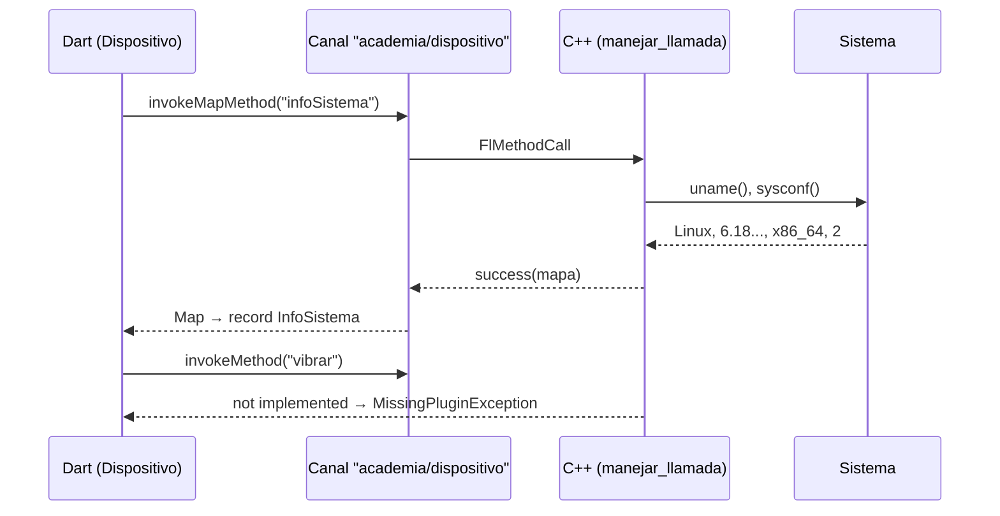
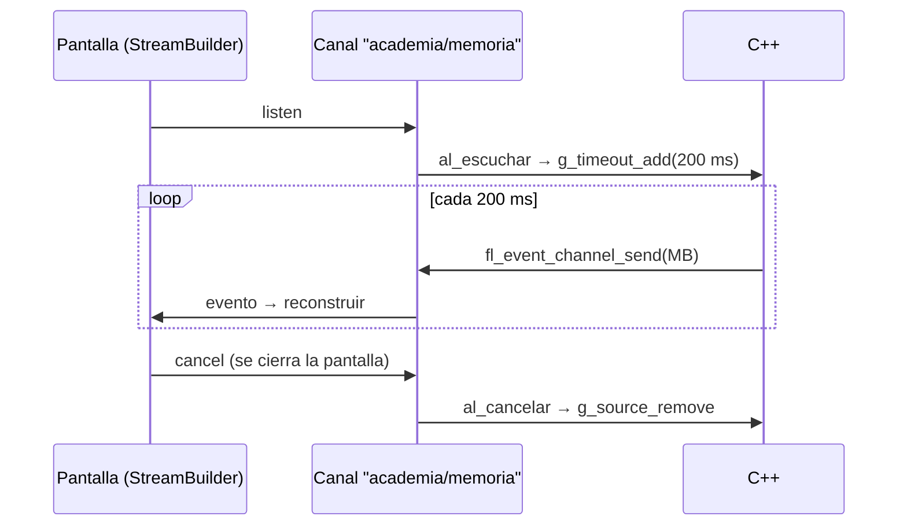
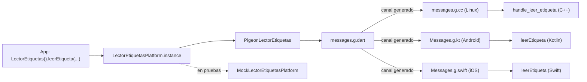
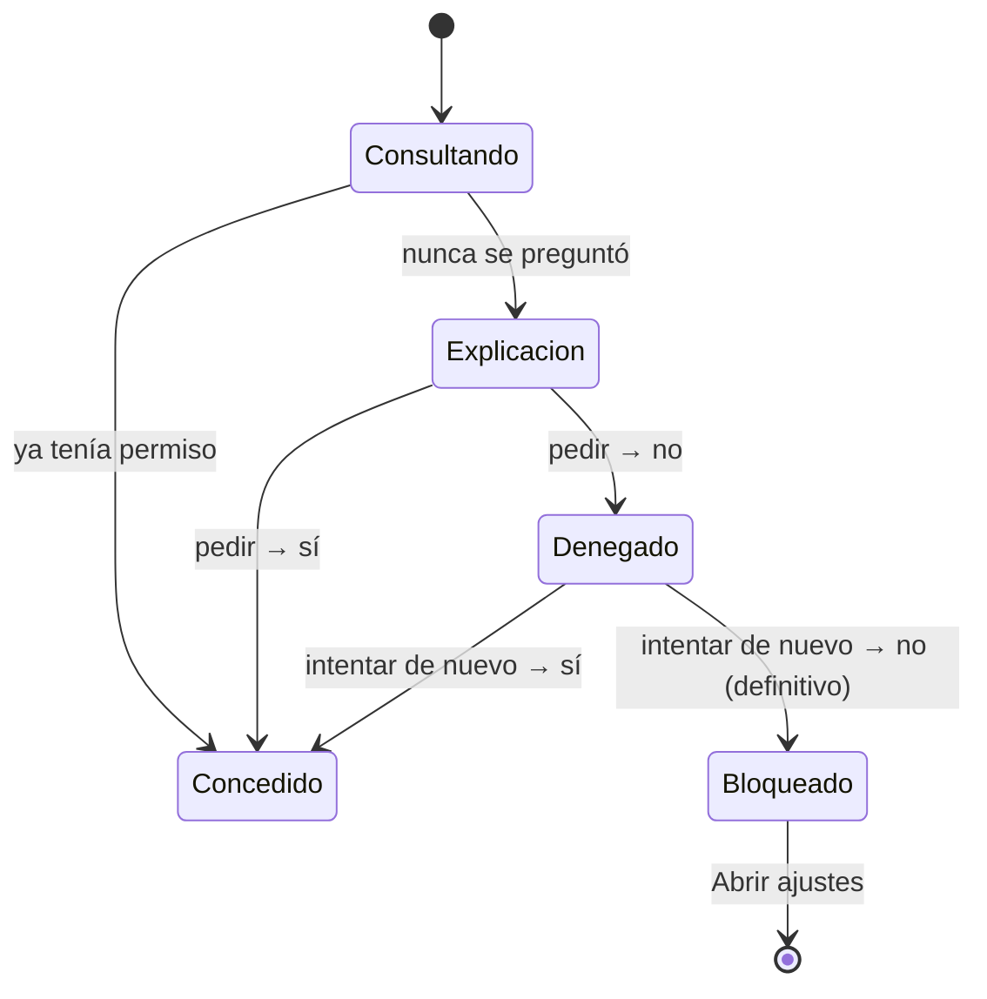
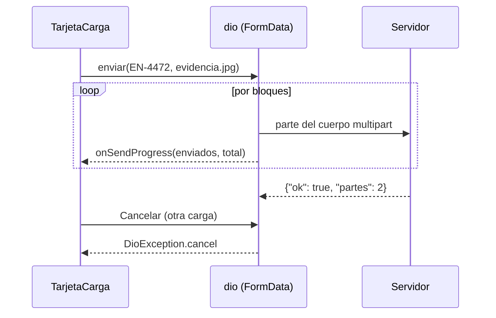

# Módulo 7: Integración con la plataforma: canales, plugins, permisos y archivos que viajan

**Entorno comprobado para esta edición (2026-11-24):** Flutter 3.50.1 (canal estable) con Dart 3.14.0 en Linux
x86_64, compilando la app de **escritorio Linux** (GTK 3.24, CMake, Clang) y ejecutándola en una pantalla virtual
(`xvfb-run`). Todo el código Dart se analizó con `flutter analyze` (`No issues found!`). **El código nativo de los
Temas 1, 2 y 3 se compiló y ejecutó de verdad**: es C++ con la API de Flutter para Linux, el mismo papel que cumplen
Kotlin en Android y Swift en iOS. El pantallazo del Tema 2 es la ventana real de la app, capturada en la pantalla
virtual; los de los Temas 4 y 5 los dibujó Flutter con la herramienta del Módulo 1. Paquetes: `pigeon` 29, `dio`
5.11.1 y `mime`. **Lo que no se ejecutó**: las implementaciones de Kotlin y Swift del plugin del Tema 3 (necesitan
Android Studio o Xcode) y los permisos reales del sistema del Tema 4 (necesitan un teléfono). Se dicen en el lugar
donde aparecen.

Flutter dibuja toda la interfaz, pero no hace todo: leer un sensor, usar la cámara, pedir permisos o hablar con una
biblioteca del sistema es trabajo del código de la plataforma. Este módulo muestra cómo cruza la información entre
Dart y ese código, cómo se empaqueta ese cruce en un plugin reutilizable, cómo se diseña la conversación con el
usuario cuando la app necesita un permiso y cómo se envía la foto de una entrega al servidor.

**Al terminar este módulo podrás:**
- llamar código nativo desde Dart con `MethodChannel`, con argumentos, resultados y errores;
- recibir un flujo de datos del código nativo con `EventChannel` y detenerlo al dejar de escuchar;
- crear un plugin federado con la plantilla de Flutter y Pigeon, y agregarle un método con tipos;
- diseñar el flujo de un permiso: explicar, pedir, aceptar un «no» y llevar a los ajustes;
- enviar un archivo grande con `multipart/form-data`, con progreso y cancelación.

**Esquema del módulo:** Tema 1 (`MethodChannel`) → Tema 2 (`EventChannel` y la pantalla real) → Tema 3 (plugins
federados con Pigeon) → Tema 4 (permisos) → Tema 5 (enviar la foto de la entrega) → Proyecto 24.

**Qué necesitas saber antes:** el Módulo 6 completo; del Módulo 5, **`dio`**, **fallos traducidos** y **mensajes
de error** (Temas 3 y 4); del Módulo 0, **`Stream`** y **records** (Temas 5 y 6). Leer C++ ayuda, pero cada bloque
nativo se explica línea por línea.

**Qué no se repite:** los fallos de red y sus mensajes (Módulo 5); el diseño de pantallas de mensaje (Módulos 2 y 4).
El trabajo en segundo plano con la app cerrada (`workmanager`) y la integración de Flutter dentro de una app nativa
existente (*add-to-app*) necesitan Android o iOS y se describen en «Del laboratorio a producción» del Tema 3, sin
ejecutarse aquí.

**Prepara el proyecto.** Esta vez la plantilla completa (no `--empty`), con la plataforma Linux, y los paquetes del
sistema para compilar escritorio:

```text
$ sudo apt-get install libgtk-3-dev xvfb            # una vez, en Ubuntu o Debian
$ cd ~/labs/flutter
$ flutter create --org com.academia --platforms=linux,web m7
$ cd m7
$ flutter pub add dio mime
$ flutter pub add 'dev:integration_test:{"sdk":"flutter"}'
$ flutter build linux --debug                       # comprueba que compila
```

Las pruebas de los Temas 1 y 2 son **pruebas de integración**: se ejecutan dentro de la app compilada, con su código
nativo. En un equipo sin pantalla se usa `xvfb-run`, que crea una pantalla virtual:

```text
$ xvfb-run -a flutter test integration_test/canales_test.dart -d linux
```

```dart
// lib/main.dart — la app del módulo: datos del sistema y memoria en vivo desde C++
import 'package:material_ui/material_ui.dart';

import 'tema2/pantalla.dart';

void main() => runApp(MaterialApp(
      debugShowCheckedModeBanner: false,
      theme: ThemeData(colorSchemeSeed: Colors.indigo),
      home: const PantallaDispositivo(),
    ));
```


## Aprende construyendo


### Tema 1: MethodChannel: preguntarle algo al código nativo · Intermedio · 50 min

<details open>
<summary><strong>Capa 1 — Lectura</strong></summary>

#### Objetivos
Al terminar este tema podrás:
- registrar un `MethodChannel` en el código nativo y responder llamadas por nombre de método;
- invocar el canal desde Dart con argumentos y leer resultados con tipos;
- responder errores con un código desde el nativo y traducirlos en Dart;
- reconocer `MissingPluginException` y saber qué la causa.

**Conceptos clave:** canal de plataforma, `MethodChannel`, códec estándar, `PlatformException`, `MissingPluginException`, prueba de integración

#### El problema
La app necesita datos que solo el sistema operativo conoce: la versión del sistema, los procesadores, el contenido de
un archivo del sistema. Dart corre en su propio motor y no puede llamar directamente a las funciones del sistema;
hace falta un puente con nombre, mensajes que crucen en los dos sentidos y una forma de saber qué salió mal del otro
lado.

Este tema usa **`Future`** y **excepciones** (Módulo 0, Tema 3), **records** (Módulo 0, Tema 6) y **los fallos del
dominio** (Módulo 5, Tema 3).

#### Glosario del tema

**canal de plataforma**
- **Definición técnica:** mecanismo de Flutter para enviar mensajes asincrónicos entre Dart y el código de la plataforma a través de un nombre compartido y un `BinaryMessenger`.
- **En palabras sencillas:** un teléfono con una extensión fija entre Dart y el sistema.
- **Dónde se rompe la comparación:** los dos lados deben usar exactamente el mismo nombre y el mismo códec; un error de escritura no da error de compilación.
- **Ejemplo:** `'academia/dispositivo'` en Dart y en C++.
- **Error típico:** nombres genéricos como `'canal'` que chocan con los de un plugin.

**`MethodChannel`**
- **Definición técnica:** canal de llamadas a método: Dart invoca un nombre con argumentos y recibe un resultado, un error o «no implementado».
- **En palabras sencillas:** una pregunta y una respuesta.
- **Dónde se rompe la comparación:** cada llamada es asincrónica aunque el nativo responda al instante.
- **Ejemplo:** `invokeMapMethod('infoSistema')`.
- **Error típico:** hacer trabajo pesado en el manejador nativo: bloquea el hilo principal de la plataforma.

**códec estándar**
- **Definición técnica:** formato binario con el que viajan los mensajes: nulos, booleanos, números, textos, listas, mapas y bytes. En C++ esos valores son `FlValue`.
- **En palabras sencillas:** el idioma común de los dos lados.
- **Dónde se rompe la comparación:** no viajan objetos propios: hay que convertirlos a mapas o usar Pigeon (Tema 3).
- **Ejemplo:** `fl_value_new_map()` en C++ llega como `Map<Object?, Object?>` en Dart.
- **Error típico:** convertir con `as Map<String, dynamic>` lo que llega como `Map<Object?, Object?>`; para eso existe `invokeMapMethod<String, Object?>`.

**`PlatformException`**
- **Definición técnica:** excepción de Dart que representa un error respondido por el código nativo, con `code`, `message` y `details`.
- **En palabras sencillas:** «el otro lado contestó que no pudo».
- **Dónde se rompe la comparación:** el `code` es un acuerdo entre los dos lados; nadie lo verifica.
- **Ejemplo:** `NO_EXISTE` al leer `/no/existe.txt`.
- **Error típico:** decidir por el `message`, que es texto para personas y puede cambiar.

**`MissingPluginException`**
- **Definición técnica:** excepción que aparece cuando nadie en el lado nativo responde ese canal, o el manejador respondió «no implementado».
- **En palabras sencillas:** marcaste y nadie contestó.
- **Dónde se rompe la comparación:** también aparece si el código nativo no está compilado en la app (por ejemplo, tras agregar un plugin y usar *hot reload*).
- **Ejemplo:** el método `vibrar`, que el C++ no implementa.
- **Error típico:** probar los canales con `flutter test` normal: ahí no hay código nativo y todo da esta excepción.

**prueba de integración**
- **Definición técnica:** prueba que se ejecuta dentro de la app compilada para una plataforma real, con su código nativo, usando `IntegrationTestWidgetsFlutterBinding`.
- **En palabras sencillas:** probar la app de verdad, no un simulacro.
- **Dónde se rompe la comparación:** es más lenta: compila la app antes de empezar.
- **Ejemplo:** `integration_test/canales_test.dart` con `-d linux`.
- **Error típico:** querer cubrirlo todo con pruebas de integración; se reservan para lo que necesita la plataforma.

#### ► CÓMO FUNCIONA

##### 1. La idea en lenguaje sencillo
En una empresa con dos oficinas que hablan idiomas distintos, nadie entra a la otra oficina a buscar papeles. Hay una
línea telefónica con una extensión fija. Uno llama y dice el nombre del trámite y los datos. El otro
contesta con el resultado, con un «no se pudo» o con un «ese trámite no lo hacemos aquí».

Flutter funciona igual. Tu código Dart corre en el motor de Flutter y no puede llamar directamente a las funciones del
sistema operativo. El código nativo, C++ en Linux, Kotlin en Android y Swift en iOS, sí puede. El canal de plataforma
es la línea telefónica entre los dos.

En este tema, Dart pregunta por la versión del sistema y por la primera línea de un archivo. El C++ consulta al
sistema y responde. Si algo falla, responde con un código de error que Dart sabe interpretar.

##### 2. Definición formal y vocabulario
Un **canal de plataforma** envía mensajes asincrónicos entre Dart y el código de la plataforma. Los dos lados lo
identifican con el mismo nombre, aquí `academia/dispositivo`, y lo transportan con un `BinaryMessenger`.

Un **`MethodChannel`** es el canal de llamadas a método. Dart invoca un nombre de método con argumentos. El lado nativo
responde con una de tres cosas: éxito con un valor, error con un código o «no implementado».

Los mensajes viajan como bytes, codificados con el **códec estándar**. Este admite nulos, booleanos, números, textos,
listas, mapas y arreglos de bytes. En C++, esos valores se construyen como `FlValue`.

Cuando el nativo responde con error, Dart recibe una **`PlatformException`** con `code`, `message` y `details`. Cuando
nadie atiende el canal o el método, Dart recibe una **`MissingPluginException`**. Para probar todo esto con el código
nativo de verdad hace falta una **prueba de integración**, que corre dentro de la app compilada.

##### 3. Cómo funciona por dentro, paso a paso
Sigue la llamada `infoSistema` de la prueba del tema:

1. Al arrancar la app de Linux, el runner llama a `registrar_canales(view)`. El C++ crea el canal y le asigna
   `manejar_llamada` como manejador.
2. En Dart, `invokeMapMethod<String, Object?>('infoSistema')` arma una llamada con el nombre del método y sin
   argumentos.
3. El códec estándar convierte esa llamada en bytes. El `BinaryMessenger` los entrega al motor con el nombre del canal.
4. El motor busca quién atiende `academia/dispositivo` y entrega los bytes al manejador de C++, ya decodificados como
   `FlMethodCall`.
5. `manejar_llamada` compara el nombre del método, llama a `uname` y `sysconf`, y arma un mapa `FlValue`.
6. `fl_method_call_respond` envía la respuesta. El códec la vuelve bytes, y el motor la devuelve a Dart.
7. En Dart, el códec reconstruye el mapa y completa el `Future`. `Dispositivo` convierte el mapa en un record con tipos.

```dart
final m = await _canal.invokeMapMethod<String, Object?>('infoSistema');   // viaja con el códec estándar
return (
  sistema: m!['sistema']! as String,
  version: m['version']! as String,
  arquitectura: m['arquitectura']! as String,
  procesadores: m['procesadores']! as int,
);
```

El paso 7 tiene una regla importante. Un mapa del códec llega como `Map<Object?, Object?>`. `invokeMapMethod` lo
convierte por ti al tipo de mapa que pides, y luego cada valor se convierte a su tipo.

En la salida, `procesadores: 2` llegó como `int` y la versión como texto. El códec conserva los tipos básicos de un
lado al otro.



##### 4. Reglas, variantes y casos límite
Las llamadas son siempre asincrónicas, aunque el nativo responda al instante. Por eso todo método del canal devuelve
un `Future`, y por eso no se puede usar uno dentro de un `build` sin esperar.

El nombre del canal y los nombres de los métodos son texto. Si un lado escribe `infoSistema` y el otro `infosistema`,
el compilador no lo detecta: Dart recibe `MissingPluginException` en tiempo de ejecución. Usa nombres con prefijo,
como `academia/...`, para no chocar con plugins.

`MissingPluginException` tiene tres causas frecuentes. El nativo respondió «no implementado», como con `vibrar`. Nadie
registró el canal. O el código nativo no está compilado en la app, por ejemplo tras un *hot reload*: el código nativo
solo cambia al recompilar.

`PlatformException` es un acuerdo entre los dos lados. El `code`, como `NO_EXISTE`, es el contrato estable; el
`message` es texto para personas y puede cambiar. Decide siempre por el código.

El manejador nativo no debe lanzar excepciones propias del lenguaje. Una excepción de C++ o de Kotlin sin atrapar
cierra la app. Responde siempre con un error del canal.

El modelo de hilos cambió en versiones recientes. Flutter unió el hilo de la interfaz y el de la plataforma por
etapas. Lo hizo en Android e iOS con la versión 3.29, en macOS y Windows con la 3.35, y en Linux con la 3.39. La
documentación indica que esto no debería afectar a tu app.

Aun con los hilos unidos, el manejador corre en el hilo principal de la plataforma. Un trabajo largo ahí congela la
app. Si el trabajo tarda, hazlo en otro hilo nativo y responde al terminar.

En `flutter test` normal no hay código nativo. Por eso los canales se prueban con `integration_test` y `-d linux`, o
se simulan en pruebas unitarias.

##### 5. Relación con lo que ya sabes y lo que viene
`Future`, `async` y las excepciones vienen del Módulo 0, Tema 3. Los records con nombre, como `InfoSistema`, vienen
del Módulo 0, Tema 6.

`Dispositivo` sigue la idea del repositorio del Módulo 5, Tema 3. Allí, `RepositorioRemoto` escondía `dio` y traducía
`DioException` a `FalloRed`. Aquí, `Dispositivo` esconde el canal y traduce `NO_EXISTE` a `null`. El resto de la app
no conoce el nombre del canal ni los mapas.

Compáralo con una petición HTTP. Las dos son asincrónicas y pueden fallar. Pero el canal no sale del teléfono: cruza
del motor de Flutter al código nativo dentro del mismo proceso.

El Tema 2 usa un `EventChannel`, donde el nativo envía datos sin que Dart pregunte cada vez. El Tema 3 reemplaza los
nombres en texto por código generado con Pigeon, que el compilador sí puede comprobar.

#### Problema resuelto 1.1
Implementa en C++ un canal con dos métodos (información del sistema y primera línea de un archivo) con su error
propio, regístralo en la app de Linux y pruébalo desde Dart con una prueba de integración.

**Razonamiento:**
1. El C++ va en un archivo propio, `canales.cc`, que el runner registra después de los plugins.
2. Cada método construye `FlValue` y responde con `fl_method_success_response_new` o `..._error_response_new`.
3. En Dart, `Dispositivo` traduce: el mapa en un record con tipos, y `NO_EXISTE` en `null`.
4. La prueba de integración compila la app con el C++ y llama a los tres casos.

```cpp
// linux/runner/canales.h — registra los canales del módulo en la vista de Flutter
#ifndef RUNNER_CANALES_H_
#define RUNNER_CANALES_H_

#include <flutter_linux/flutter_linux.h>

void registrar_canales(FlView* vista);

#endif  // RUNNER_CANALES_H_
```

```cpp
// linux/runner/canales.cc — el lado nativo (C++ con la API de Flutter para Linux) de los canales del módulo
#include "canales.h"

#include <cstring>
#include <fstream>
#include <sstream>
#include <string>
#include <sys/utsname.h>
#include <unistd.h>

static FlMethodChannel* canal_metodos = nullptr;
static FlEventChannel* canal_memoria = nullptr;
static guint temporizador = 0;

// ---------- MethodChannel: una pregunta, una respuesta ----------
static void manejar_llamada(FlMethodChannel* canal, FlMethodCall* llamada, gpointer datos) {
  const gchar* metodo = fl_method_call_get_name(llamada);
  g_autoptr(FlMethodResponse) respuesta = nullptr;

  if (strcmp(metodo, "infoSistema") == 0) {
    struct utsname u;
    uname(&u);                                                   // llamada al sistema operativo
    g_autoptr(FlValue) mapa = fl_value_new_map();
    fl_value_set_string_take(mapa, "sistema", fl_value_new_string(u.sysname));
    fl_value_set_string_take(mapa, "version", fl_value_new_string(u.release));
    fl_value_set_string_take(mapa, "arquitectura", fl_value_new_string(u.machine));
    fl_value_set_string_take(mapa, "procesadores", fl_value_new_int(sysconf(_SC_NPROCESSORS_ONLN)));
    respuesta = FL_METHOD_RESPONSE(fl_method_success_response_new(mapa));
  } else if (strcmp(metodo, "leerArchivo") == 0) {
    FlValue* args = fl_method_call_get_args(llamada);
    FlValue* ruta = args ? fl_value_lookup_string(args, "ruta") : nullptr;
    if (ruta == nullptr || fl_value_get_type(ruta) != FL_VALUE_TYPE_STRING) {
      respuesta = FL_METHOD_RESPONSE(fl_method_error_response_new("ARGUMENTO", "falta 'ruta'", nullptr));
    } else {
      std::ifstream archivo(fl_value_get_string(ruta));
      if (!archivo) {
        respuesta = FL_METHOD_RESPONSE(
            fl_method_error_response_new("NO_EXISTE", "no se pudo abrir el archivo", fl_value_new_string(fl_value_get_string(ruta))));
      } else {
        std::string primera;
        std::getline(archivo, primera);
        respuesta = FL_METHOD_RESPONSE(fl_method_success_response_new(fl_value_new_string(primera.c_str())));
      }
    }
  } else {
    respuesta = FL_METHOD_RESPONSE(fl_method_not_implemented_response_new());   // Dart recibe MissingPluginException
  }
  fl_method_call_respond(llamada, respuesta, nullptr);
}

// ---------- EventChannel: el nativo envía datos mientras alguien escuche ----------
static gboolean enviar_memoria(gpointer datos) {
  std::ifstream meminfo("/proc/meminfo");
  std::string linea;
  long disponible_kb = -1;
  while (std::getline(meminfo, linea)) {
    if (linea.rfind("MemAvailable:", 0) == 0) {
      std::istringstream(linea.substr(13)) >> disponible_kb;
      break;
    }
  }
  g_autoptr(FlValue) evento = fl_value_new_int(disponible_kb / 1024);   // MB disponibles
  fl_event_channel_send(canal_memoria, evento, nullptr, nullptr);
  return G_SOURCE_CONTINUE;
}

static FlMethodErrorResponse* al_escuchar(FlEventChannel* canal, FlValue* args, gpointer datos) {
  g_message("nativo: alguien empezó a escuchar la memoria");
  enviar_memoria(nullptr);
  temporizador = g_timeout_add(200, enviar_memoria, nullptr);   // cada 200 ms
  return nullptr;
}

static FlMethodErrorResponse* al_cancelar(FlEventChannel* canal, FlValue* args, gpointer datos) {
  g_message("nativo: nadie escucha; detengo el temporizador");
  if (temporizador != 0) g_source_remove(temporizador);
  temporizador = 0;
  return nullptr;
}

void registrar_canales(FlView* vista) {
  FlBinaryMessenger* mensajero = fl_engine_get_binary_messenger(fl_view_get_engine(vista));
  g_autoptr(FlStandardMethodCodec) codec = fl_standard_method_codec_new();
  canal_metodos = fl_method_channel_new(mensajero, "academia/dispositivo", FL_METHOD_CODEC(codec));
  fl_method_channel_set_method_call_handler(canal_metodos, manejar_llamada, nullptr, nullptr);
  canal_memoria = fl_event_channel_new(mensajero, "academia/memoria", FL_METHOD_CODEC(codec));
  fl_event_channel_set_stream_handlers(canal_memoria, al_escuchar, al_cancelar, nullptr, nullptr);
}
```

El runner generado por Flutter solo necesita dos cambios: incluir `canales.h` y llamar a `registrar_canales(view)`
después de `fl_register_plugins`, y agregar `"canales.cc"` a la lista de fuentes de `linux/runner/CMakeLists.txt`.

```dart
// lib/tema1/dispositivo.dart — el lado Dart del MethodChannel: llamadas con tipos y errores traducidos
import 'package:flutter/services.dart';

typedef InfoSistema = ({String sistema, String version, String arquitectura, int procesadores});

class Dispositivo {
  static const _canal = MethodChannel('academia/dispositivo');     // el mismo nombre que en C++

  Future<InfoSistema> infoSistema() async {
    final m = await _canal.invokeMapMethod<String, Object?>('infoSistema');   // viaja con el códec estándar
    return (
      sistema: m!['sistema']! as String,
      version: m['version']! as String,
      arquitectura: m['arquitectura']! as String,
      procesadores: m['procesadores']! as int,
    );
  }

  /// Devuelve la primera línea del archivo, o null si no existe.
  Future<String?> primeraLinea(String ruta) async {
    try {
      return await _canal.invokeMethod<String>('leerArchivo', {'ruta': ruta});
    } on PlatformException catch (e) {
      if (e.code == 'NO_EXISTE') return null;                       // el código lo decidió el lado nativo
      rethrow;
    }
  }

  Future<void> metodoQueNoExiste() => _canal.invokeMethod<void>('vibrar');
}
```

```dart
// integration_test/canales_test.dart — se ejecuta dentro de la app real de Linux, con el código C++ compilado
import 'package:flutter/services.dart';
import 'package:flutter_test/flutter_test.dart';
import 'package:integration_test/integration_test.dart';
import 'package:m7/tema1/dispositivo.dart';
import 'package:m7/tema2/memoria.dart';
import 'package:material_ui/material_ui.dart';

void main() {
  IntegrationTestWidgetsFlutterBinding.ensureInitialized();

  testWidgets('MethodChannel con el lado nativo de Linux', (tester) async {
    final d = Dispositivo();
    final info = await d.infoSistema();
    debugPrint('infoSistema → $info');
    debugPrint('primera línea de /etc/hostname → «${await d.primeraLinea('/etc/hostname')}»');
    debugPrint('archivo que no existe → ${await d.primeraLinea('/no/existe.txt')}');
    try {
      await d.metodoQueNoExiste();
    } on MissingPluginException catch (e) {
      debugPrint('método sin implementar → ${e.runtimeType}: ${e.message}');
    }
  });

  testWidgets('EventChannel: la memoria llega sola', (tester) async {
    final lecturas = <int>[];
    final suscripcion = memoriaDisponible().listen(lecturas.add);
    await tester.runAsync(() => Future<void>.delayed(const Duration(milliseconds: 700)));   // tiempo real
    await suscripcion.cancel();
    debugPrint('lecturas en 700 ms: ${lecturas.length}; todas positivas: ${lecturas.every((m) => m > 0)}');
  });
}
```

```text
$ xvfb-run -a flutter test integration_test/canales_test.dart -d linux
00:00 +0: loading /home/estudiante/labs/flutter/m7/integration_test/canales_test.dart
Building Linux application...                                   
✓ Built build/linux/x64/debug/bundle/m7
00:00 +0: MethodChannel con el lado nativo de Linux
infoSistema → (arquitectura: x86_64, procesadores: 2, sistema: Linux, version: 6.18.44-fc-v880)
primera línea de /etc/hostname → «vm»
archivo que no existe → null
método sin implementar → MissingPluginException: No implementation found for method vibrar on channel academia/dispositivo
00:00 +1: EventChannel: la memoria llega sola
lecturas en 700 ms: 4; todas positivas: true
00:01 +2: (tearDownAll)
00:01 +2: All tests passed!
```

**Explicación por partes.**
- Líneas 20–28 del C++: `uname` y `sysconf` son funciones del sistema; los resultados se guardan en un mapa `FlValue`.
- Líneas 29–44: los argumentos llegan como un mapa; si falta `ruta` o el archivo no abre, se responde un error con
  código (`ARGUMENTO`, `NO_EXISTE`) y la ruta en `details`.
- Línea 46: cualquier otro método responde «no implementado», y Dart lo recibe como `MissingPluginException`.
- En la salida, `procesadores: 2` llegó como `int` y la versión como texto: el códec estándar conserva los tipos
  básicos.
- `primera línea de /etc/hostname → «vm»`: el C++ leyó un archivo real del sistema.

> **Error común.** Usar `flutter run` con *hot reload* después de cambiar el C++, el Kotlin o el Swift. El código
> nativo solo cambia al recompilar: detén la app y ejecútala de nuevo.

> **Error común.** Lanzar excepciones de C++ (o de Kotlin) dentro del manejador sin atraparlas. La app nativa se cae;
> responde siempre con un error del canal.

> **Buena práctica.** Encapsula cada canal en una clase de Dart con métodos y tipos (`Dispositivo`), como un
> repositorio. El resto de la app no conoce el nombre del canal ni los mapas.

> **Prevenir errores.** Define los nombres de los métodos y los códigos de error en un solo lugar de cada lado, o usa
> Pigeon (Tema 3), que los genera y evita los errores de escritura.

#### Checkpoint 1.1
¿Qué recibiría Dart si el C++ respondiera `fl_value_new_int(...)` para `infoSistema` en lugar de un mapa?

Respuesta: un error de tipos en Dart: `invokeMapMethod` espera un mapa y recibe un `int`. El canal no comprueba que los
dos lados estén de acuerdo; por eso conviene Pigeon.

</details>

<details>
<summary><strong>Capa 2 — Construcción</strong></summary>

#### Paso 1 · Prepara el equipo
Instala `libgtk-3-dev` y `xvfb`, crea el proyecto y compílalo con `flutter build linux --debug`.

#### Paso 2 · Escribe el nativo
Crea `linux/runner/canales.h` y `canales.cc`, agrégalo al `CMakeLists.txt` del runner y llama a `registrar_canales`.

#### Paso 3 · Ejecuta la prueba de integración
Ejecuta `xvfb-run -a flutter test integration_test/canales_test.dart -d linux`.

#### Paso 4 · Agrega un método
Agrega `memoriaTotalMb` en C++ (lee `MemTotal:` de `/proc/meminfo`) y su método en `Dispositivo`.

#### Paso 5 · Rompe el nombre
Cambia el nombre del canal solo en Dart (`'academia/dispositivos'`) y ejecuta la prueba.

#### Resumen
- Un **canal de plataforma** une Dart y el código nativo por nombre.
- **`MethodChannel`** hace preguntas con el **códec estándar**.
- Los errores llegan como **`PlatformException`** con código; la falta de respuesta, como
  **`MissingPluginException`**.
- Los canales se prueban con una **prueba de integración** en la plataforma real.

#### Ejercicio verificable 1
Básico. ¿Qué devuelve `primeraLinea('/no/existe.txt')` y por qué no lanza?

Respuesta esperada: `null`. El C++ respondió el error `NO_EXISTE`, y `Dispositivo` lo convierte en `null`; otros
códigos se relanzan.

#### Ejercicio verificable 2
Intermedio. En el Paso 5, ¿qué excepción aparece en `infoSistema`?

Respuesta esperada: `MissingPluginException: No implementation found for method infoSistema on channel
academia/dispositivos`: nadie escucha ese nombre.

#### Ejercicio verificable 3
Reto. ¿Por qué `invokeMapMethod<String, Object?>` y no `invokeMethod<Map<String, Object?>>`?

Respuesta esperada: porque el códec entrega `Map<Object?, Object?>`, y un mapa de ese tipo no es un
`Map<String, Object?>`: la conversión directa falla. `invokeMapMethod` hace la conversión de las claves por ti.

#### En el trabajo
Los canales de plataforma están debajo de todos los plugins (cámara, mapas, pagos). Escribir uno propio es necesario
cuando una empresa tiene un SDK nativo sin plugin (un lector de códigos de barras industrial, una impresora térmica),
y es una tarea frecuente en los equipos de Flutter que trabajan con hardware.

</details>

### Tema 2: EventChannel: datos que llegan solos, y la pantalla real · Intermedio · 40 min

<details open>
<summary><strong>Capa 1 — Lectura</strong></summary>

#### Objetivos
Al terminar este tema podrás:
- emitir eventos desde el código nativo con un `EventChannel` mientras Dart escuche;
- iniciar y detener el trabajo nativo cuando Dart empieza y deja de escuchar;
- mostrar en una pantalla un dato que llega una vez (`FutureBuilder`) y otro que llega en vivo (`StreamBuilder`);
- dibujar una línea con `CustomPaint` a partir de las lecturas.

**Conceptos clave:** `EventChannel`, flujo de eventos nativo, `onListen` y `onCancel`, `StreamBuilder`, `CustomPaint`

#### El problema
Algunos datos cambian sin que nadie pregunte: la ubicación, la batería, un sensor, la memoria. Preguntar cada 200 ms
con un `MethodChannel` gasta energía aunque nadie mire la pantalla. Lo correcto es que el código nativo envíe datos
**mientras** alguien escuche, y se detenga cuando dejen de escuchar.

Este tema usa **`MethodChannel`** (Tema 1), **`Stream`** (Módulo 0, Tema 5) y **el sistema de diseño** (Módulo 2,
Tema 6).

#### Glosario del tema

**`EventChannel`**
- **Definición técnica:** canal en el que el código nativo envía una secuencia de eventos que Dart recibe como `Stream`.
- **En palabras sencillas:** una radio: el nativo transmite y Dart escucha.
- **Dónde se rompe la comparación:** la radio solo transmite cuando hay alguien escuchando.
- **Ejemplo:** `'academia/memoria'`.
- **Error típico:** crear un `Stream` nuevo con `receiveBroadcastStream()` en cada `build`: cada uno se suscribe de nuevo.

**flujo de eventos nativo**
- **Definición técnica:** valores enviados desde el nativo con `fl_event_channel_send` (C++), `EventSink.success` (Kotlin) o el `FlutterEventSink` (Swift).
- **En palabras sencillas:** los mensajes que llegan solos.
- **Dónde se rompe la comparación:** también puede enviar errores y el fin del flujo.
- **Ejemplo:** los MB disponibles cada 200 ms.
- **Error típico:** enviar desde un hilo que no es el principal de la plataforma.

**`onListen` y `onCancel`**
- **Definición técnica:** funciones del lado nativo que se llaman cuando Dart se suscribe al flujo y cuando cancela la suscripción.
- **En palabras sencillas:** «alguien encendió la radio» y «la apagaron».
- **Dónde se rompe la comparación:** con varios oyentes en Dart (`broadcast`), el nativo ve una sola suscripción.
- **Ejemplo:** `al_escuchar` crea el temporizador; `al_cancelar` lo destruye.
- **Error típico:** no detener el trabajo en `onCancel`: el sensor sigue encendido con la pantalla cerrada.

**`StreamBuilder`**
- **Definición técnica:** widget que se reconstruye con cada evento de un `Stream` y entrega el último valor en un `AsyncSnapshot`.
- **En palabras sencillas:** un pedazo de pantalla que se actualiza con cada mensaje.
- **Dónde se rompe la comparación:** se suscribe al montarse y cancela al desmontarse; el `Stream` debe ser el mismo entre reconstrucciones.
- **Ejemplo:** el número de MB y la línea.
- **Error típico:** pasarle `memoriaDisponible()` directamente en `build`: cada reconstrucción crea otro flujo.

**`CustomPaint`**
- **Definición técnica:** widget que dibuja con un `CustomPainter` sobre un `Canvas` (líneas, caminos, formas).
- **En palabras sencillas:** un lienzo para dibujar lo que no existe como widget.
- **Dónde se rompe la comparación:** `shouldRepaint` decide si se vuelve a dibujar; aquí siempre, porque los datos cambian.
- **Ejemplo:** `_Linea` con las lecturas.
- **Error típico:** dibujar con valores fijos de píxeles: se usa `tamano` para escalar.

#### ► CÓMO FUNCIONA

##### 1. La idea en lenguaje sencillo
Para saber el estado del tráfico, puedes llamar a la central cada cinco minutos y preguntar. O puedes encender la
radio, que transmite los reportes a medida que ocurren. Si apagas la radio, no gastas nada; si nadie la escucha, la
emisora puede dejar de transmitir.

El `MethodChannel` del Tema 1 es la llamada: una pregunta y una respuesta. Para datos que cambian solos, como la
memoria, la batería o un sensor, preguntar una y otra vez gasta energía aunque nadie mire. El `EventChannel` es la
radio: el código nativo envía datos mientras alguien escuche.

La parte delicada es apagar. Cuando el conductor cierra la pantalla, el código nativo debe enterarse y detener el
temporizador o el sensor. Si no, la batería se agota con la app en segundo plano.

##### 2. Definición formal y vocabulario
Un **`EventChannel`** es un canal en el que el código nativo envía una secuencia de eventos. Dart la recibe como un
`Stream`, con `receiveBroadcastStream()`. Usa el mismo códec estándar del Tema 1.

El **flujo de eventos nativo** son esos valores. En C++ se envían con `fl_event_channel_send`, en Kotlin con
`EventSink.success` y en Swift con el `FlutterEventSink`. Además de datos, el nativo puede enviar un error o el fin del
flujo.

Del lado nativo, **`onListen` y `onCancel`** son las funciones que el canal llama cuando Dart se suscribe y cuando
cancela. En este tema se llaman `al_escuchar` y `al_cancelar`.

Del lado de la pantalla, **`StreamBuilder`** se suscribe al `Stream` al montarse y se reconstruye con cada evento.
**`CustomPaint`** dibuja sobre un `Canvas` lo que ningún widget ofrece, aquí la línea de la memoria.

##### 3. Cómo funciona por dentro, paso a paso
Sigue la pantalla real desde que se abre hasta que se cierra:

1. `_PantallaDispositivoState` crea `_memoria` una sola vez, con `late final`. Todavía nadie escucha.
2. `StreamBuilder` se monta y llama a `listen`. Es el primer oyente, así que el lado Dart del canal envía al nativo un
   mensaje de suscripción.
3. El motor entrega ese mensaje al C++, que ejecuta `al_escuchar`. Este envía una lectura inmediata y crea un
   temporizador de GLib de 200 ms.
4. Cada 200 ms, `enviar_memoria` lee `/proc/meminfo` y llama a `fl_event_channel_send` con los MB disponibles.
5. Cada evento cruza al lado Dart, entra al `Stream` como `int` y reconstruye el `StreamBuilder`.
6. El `builder` agrega el valor al historial y `CustomPaint` dibuja la línea otra vez.
7. Al cerrar la pantalla, `StreamBuilder` cancela su suscripción. No quedan oyentes, y Dart envía al nativo un mensaje
   de cancelación.
8. El C++ ejecuta `al_cancelar` y destruye el temporizador con `g_source_remove`.

```dart
const _canal = EventChannel('academia/memoria');

/// Megabytes de memoria disponible, cada 200 ms, mientras alguien escuche.
Stream<int> memoriaDisponible() => _canal.receiveBroadcastStream().cast<int>();
```

`receiveBroadcastStream` devuelve un flujo de difusión: varios oyentes de Dart comparten una sola suscripción nativa.
`cast<int>()` da tipo a los eventos, que llegan del códec como valores sin tipo.

El paso 3 explica la medición de la prueba. En 700 ms llegaron 4 lecturas: una inmediata en `al_escuchar` y tres del
temporizador.



##### 4. Reglas, variantes y casos límite
La suscripción nativa sigue a la de Dart. El nativo recibe `onListen` con el primer oyente y `onCancel` cuando se va el
último. Con varios oyentes en Dart, el nativo ve una sola suscripción.

Cada llamada a `receiveBroadcastStream()` crea un flujo nuevo. Si la haces dentro de `build`, cada reconstrucción
suscribe otra vez. Por eso la pantalla guarda el `Stream` en un campo `late final`, igual que el `Future` de la tarjeta.

`StreamBuilder` tiene la misma regla que `FutureBuilder`. El `Stream` debe ser el mismo objeto entre reconstrucciones.
Si cambia, el widget cancela la suscripción vieja y abre una nueva.

Un error enviado por el nativo llega al `Stream` de Dart como `PlatformException`. Si `onListen` mismo falla, también
lo recibe el oyente. Un `StreamBuilder` lo muestra en `snapshot.error`.

El nativo envía desde el hilo principal de la plataforma. En C++, el temporizador de GLib ya corre en el bucle
principal. Si un sensor entrega datos en otro hilo, hay que pasarlos al principal antes de enviarlos.

La frecuencia es una decisión de diseño. Una línea que una persona mira no necesita más de unos pocos eventos por
segundo. Más frecuencia gasta batería y reconstruye la pantalla sin que nadie note la diferencia.

`CustomPainter` decide si repinta con `shouldRepaint`. Aquí devuelve siempre `true`, porque cada evento trae datos
nuevos. En un dibujo que cambia poco, compara los datos viejos con los nuevos.

El dibujo debe escalar con el tamaño que recibe. `_Linea` calcula cada punto a partir de `tamano.width` y
`tamano.height`, no con píxeles fijos, para verse bien en cualquier pantalla.

##### 5. Relación con lo que ya sabes y lo que viene
`Stream`, `listen` y `cancel` vienen del Módulo 0, Tema 5. Allí los flujos nacían en Dart; aquí nacen en C++, pero
la suscripción y la cancelación son las mismas.

Compáralo con el Tema 1. El `MethodChannel` responde una vez por pregunta; el `EventChannel` envía muchas respuestas a
una sola suscripción. La tarjeta de la pantalla usa el primero con `FutureBuilder`; la memoria usa el segundo con
`StreamBuilder`.

Compáralo también con el Módulo 4, Tema 2. `ChangeNotifier` avisaba cambios dentro de Dart. El `EventChannel` trae
cambios desde fuera de Dart, del sistema operativo.

El Tema 3 empaqueta estos canales en un plugin con Pigeon. Los plugins de sensores, ubicación o batería que usarás en
proyectos reales están construidos sobre este mismo mecanismo.

#### Problema resuelto 2.1
Emite desde C++ la memoria disponible cada 200 ms, compruébalo con la prueba de integración y construye la pantalla
del equipo con los datos del Tema 1 y la memoria en vivo. Captura la ventana real.

**Razonamiento:**
1. El C++ del Tema 1 ya incluye el `EventChannel` (líneas 51–79): `enviar_memoria`, `al_escuchar` y `al_cancelar`.
2. En Dart, `memoriaDisponible()` convierte el flujo en `Stream<int>`.
3. La pantalla guarda el `Future` y el `Stream` en campos `late final`: se crean una vez.
4. La ventana real se ejecuta en una pantalla virtual de 400 × 640 y se captura con `import -window root`
   (ImageMagick).

```dart
// lib/tema2/memoria.dart — el lado Dart del EventChannel: un Stream que alimenta el código nativo
import 'package:flutter/services.dart';

const _canal = EventChannel('academia/memoria');

/// Megabytes de memoria disponible, cada 200 ms, mientras alguien escuche.
Stream<int> memoriaDisponible() => _canal.receiveBroadcastStream().cast<int>();
```

```dart
// lib/tema2/pantalla.dart — una pantalla con datos que vienen del código nativo: una vez y en vivo
import 'package:material_ui/material_ui.dart';

import '../tema1/dispositivo.dart';
import 'memoria.dart';

class PantallaDispositivo extends StatefulWidget {
  const PantallaDispositivo({super.key});

  @override
  State<PantallaDispositivo> createState() => _PantallaDispositivoState();
}

class _PantallaDispositivoState extends State<PantallaDispositivo> {
  late final Future<InfoSistema> _info = Dispositivo().infoSistema();
  late final Stream<int> _memoria = memoriaDisponible();            // una sola suscripción por pantalla
  final _historial = <int>[];

  @override
  Widget build(BuildContext context) {
    final texto = Theme.of(context).textTheme;
    return Scaffold(
      appBar: AppBar(title: const Text('Este equipo')),
      body: ListView(
        padding: const EdgeInsets.all(16),
        children: [
          FutureBuilder(
            future: _info,
            builder: (context, s) => Card.outlined(
              child: Column(children: [
                ListTile(leading: const Icon(Icons.memory), title: const Text('Sistema'), subtitle: Text(s.data?.sistema ?? '…')),
                ListTile(leading: const Icon(Icons.tag), title: const Text('Versión'), subtitle: Text(s.data?.version ?? '…')),
                ListTile(
                  leading: const Icon(Icons.developer_board),
                  title: const Text('Procesadores'),
                  subtitle: Text(s.hasData ? '${s.data!.procesadores} · ${s.data!.arquitectura}' : '…'),
                ),
              ]),
            ),
          ),
          const SizedBox(height: 24),
          Text('Memoria disponible', style: texto.titleMedium),
          const SizedBox(height: 8),
          StreamBuilder<int>(
            stream: _memoria,
            builder: (context, s) {
              if (s.hasData && (_historial.isEmpty || _historial.length < 60)) _historial.add(s.data!);
              return Column(crossAxisAlignment: CrossAxisAlignment.start, children: [
                Text(s.hasData ? '${s.data} MB' : '…', style: texto.headlineMedium),
                const SizedBox(height: 8),
                SizedBox(
                  height: 80,
                  width: double.infinity,
                  child: CustomPaint(painter: _Linea(_historial, Theme.of(context).colorScheme.primary)),
                ),
                Text('${_historial.length} lecturas del código nativo, una cada 200 ms', style: texto.bodySmall),
              ]);
            },
          ),
        ],
      ),
    );
  }
}

class _Linea extends CustomPainter {
  _Linea(this.valores, this.color);
  final List<int> valores;
  final Color color;

  @override
  void paint(Canvas canvas, Size tamano) {
    if (valores.length < 2) return;
    final minimo = valores.reduce((a, b) => a < b ? a : b) - 5;
    final maximo = valores.reduce((a, b) => a > b ? a : b) + 5;
    final camino = Path();
    for (var i = 0; i < valores.length; i++) {
      final x = tamano.width * i / 59;
      final y = tamano.height * (1 - (valores[i] - minimo) / (maximo - minimo));
      i == 0 ? camino.moveTo(x, y) : camino.lineTo(x, y);
    }
    canvas.drawPath(camino, Paint()..color = color..strokeWidth = 2..style = PaintingStyle.stroke);
  }

  @override
  bool shouldRepaint(_Linea anterior) => true;
}
```

La prueba de integración es la del Tema 1; la segunda prueba mide el flujo: `lecturas en 700 ms: 4; todas positivas:
true`. Para ejecutar la app y capturar su ventana:

```text
$ flutter build linux --debug
$ xvfb-run -a -s "-screen 0 400x640x24" bash -c \
    "./build/linux/x64/debug/bundle/m7 & sleep 9; import -window root real.png; kill %1"
```

Mensaje que el C++ escribió en la terminal de la app durante esa ejecución:

```text
** Message: 00:14:23.552: nativo: alguien empezó a escuchar la memoria
```


**Explicación por partes.**
- Línea 70 del C++: el temporizador de GLib llama a `enviar_memoria` cada 200 ms mientras exista.
- Línea 76: al cancelar se destruye; sin esto, la app seguiría leyendo `/proc/meminfo` con la pantalla cerrada.
- `lecturas en 700 ms: 4`: una inmediata en `al_escuchar` y tres del temporizador.
- El pantallazo es la ventana real: los datos de la tarjeta vienen de `uname` y los de la memoria, de `/proc/meminfo`.
  `34 lecturas` corresponde a unos 7 segundos de app abierta.
- Líneas 16–17 de la pantalla: `late final` crea el `Future` y el `Stream` una sola vez, aunque `build` se ejecute en
  cada evento.

> **Error común.** Olvidar `onCancel` en el nativo. En el teléfono, eso es un GPS o un sensor encendido con la app en
> segundo plano, y la batería se agota.

> **Error común.** Llamar a `receiveBroadcastStream()` en cada `build`. Cada llamada es una suscripción nueva.

> **Buena práctica.** Envía eventos con la frecuencia que la pantalla necesita, no la máxima que da el sensor. Para
> una línea que se mira, 5 por segundo bastan.

> **Prevenir errores.** Prueba el flujo midiendo cuántos eventos llegan en un tiempo dado, como aquí, y que paren al
> cancelar.

#### Checkpoint 2.1
¿Por qué la prueba usa `tester.runAsync` para esperar 700 ms?

Respuesta: porque dentro de `testWidgets` el reloj es simulado (Módulo 1, Tema 4), y el temporizador del C++ usa el
tiempo real. `runAsync` deja pasar tiempo real para que lleguen los eventos.

</details>

<details>
<summary><strong>Capa 2 — Construcción</strong></summary>

#### Paso 1 · Escribe el Dart
Crea `lib/tema2/memoria.dart`, `lib/tema2/pantalla.dart` y el `main.dart` del módulo.

#### Paso 2 · Ejecuta la app
Si tienes escritorio, ejecuta `flutter run -d linux`; si no, captura la ventana con `xvfb-run` como arriba.

#### Paso 3 · Mide la cancelación
Agrega a la prueba una espera de 500 ms después de `cancel()` y comprueba que no llegan más lecturas.

#### Paso 4 · Cambia la frecuencia
Pasa el intervalo del C++ a 1000 ms y vuelve a ejecutar la prueba. ¿Cuántas lecturas llegan en 700 ms?

#### Paso 5 · Envía un error
Si `/proc/meminfo` no abre, envía un error con `fl_event_channel_send_error` y muéstralo en la pantalla con
`AsyncSnapshot.hasError`.

#### Resumen
- **`EventChannel`** lleva un **flujo de eventos nativo** a un `Stream` de Dart.
- **`onListen` y `onCancel`** encienden y apagan el trabajo nativo.
- **`StreamBuilder`** redibuja con cada evento; **`CustomPaint`** dibuja la línea.

#### Ejercicio verificable 1
Básico. ¿Cuántas lecturas llegan en 700 ms con el intervalo de 200 ms y por qué no son 3?

Respuesta esperada: 4: una inmediata en `al_escuchar` y tres del temporizador (a los 200, 400 y 600 ms).

#### Ejercicio verificable 2
Intermedio. Con el Paso 4, ¿cuántas lecturas llegan?

Respuesta esperada: una, la inmediata; la primera del temporizador llegaría a los 1000 ms.

#### Ejercicio verificable 3
Reto. Con el Paso 3, ¿qué debería imprimir la terminal de la app al cancelar?

Respuesta esperada: el mensaje del C++ `nativo: nadie escucha; detengo el temporizador`, escrito por `al_cancelar`.

#### En el trabajo
Los plugins de ubicación, sensores, conectividad y Bluetooth usan `EventChannel`. Saber que existe `onCancel` explica
por qué algunas apps agotan la batería: alguien olvidó detener el flujo.

</details>

### Tema 3: Plugins federados con Pigeon: el canal empaquetado y con tipos · Avanzado · 55 min

<details open>
<summary><strong>Capa 1 — Lectura</strong></summary>

#### Objetivos
Al terminar este tema podrás:
- crear un plugin con la plantilla de Flutter y reconocer sus partes;
- definir una API con Pigeon y generar el código de Dart, C++, Kotlin y Swift;
- implementar un método con tipos en la plataforma Linux y probarlo en la app de ejemplo;
- probar la parte Dart del plugin reemplazando la interfaz de plataforma.

**Conceptos clave:** plugin, plugin federado, interfaz de plataforma, Pigeon, `@HostApi`, app de ejemplo

#### El problema
El canal del Tema 1 funciona, pero tiene tres debilidades: el nombre del canal y de los métodos se escriben a mano en
cada lado, los datos viajan como mapas sin tipos y el código vive dentro de una app. La empresa quiere un lector de
etiquetas reutilizable en tres apps, con implementación para Android, iOS y Linux, y sin errores de tipos entre
lados.

Este tema usa **canales de plataforma** y **`PlatformException`** (Tema 1) y **pruebas con reemplazo** (Módulo 4,
Tema 6).

#### Glosario del tema

**plugin**
- **Definición técnica:** paquete de Dart con código nativo por plataforma, que Flutter compila y registra en la app que lo usa.
- **En palabras sencillas:** un canal empaquetado para reutilizar.
- **Dónde se rompe la comparación:** se registra solo (`fl_register_plugins` en Linux), sin tocar el runner.
- **Ejemplo:** `lector_etiquetas`.
- **Error típico:** copiar el código nativo de un plugin dentro de la app en lugar de depender del plugin.

**plugin federado**
- **Definición técnica:** plugin dividido en una API pública, una interfaz de plataforma y una implementación por plataforma, que pueden estar en paquetes distintos.
- **En palabras sencillas:** un enchufe estándar con un adaptador por país.
- **Dónde se rompe la comparación:** la plantilla pone todo en un paquete; se separa cuando otros equipos aportan plataformas.
- **Ejemplo:** `lector_etiquetas.dart` (API), `..._platform_interface.dart` (interfaz) y `..._pigeon.dart` (implementación).
- **Error típico:** llamar a la implementación directamente desde la app: se pierde la posibilidad de reemplazarla.

**interfaz de plataforma**
- **Definición técnica:** clase abstracta (`PlatformInterface`) con los métodos del plugin y una `instance` intercambiable, protegida por un token.
- **En palabras sencillas:** el contrato que cada plataforma cumple.
- **Dónde se rompe la comparación:** el token impide que alguien la «implemente» sin extenderla; las pruebas usan `MockPlatformInterfaceMixin`.
- **Ejemplo:** `LectorEtiquetasPlatform.instance = MockLectorEtiquetasPlatform()`.
- **Error típico:** agregar un método a la API sin agregarlo a la interfaz y a los falsos de prueba (pasó en este tema).

**Pigeon**
- **Definición técnica:** generador de código que, a partir de una definición en Dart, escribe las dos puntas de los canales con tipos para Dart, Kotlin, Swift, Objective-C, C++ y GObject (Linux).
- **En palabras sencillas:** un traductor que escribe el contrato en todos los idiomas a la vez.
- **Dónde se rompe la comparación:** genera los canales y las clases de datos; la lógica de cada plataforma la escribes tú.
- **Ejemplo:** `dart run pigeon --input pigeon/messages.dart`.
- **Error típico:** editar los archivos `.g.*` a mano.

**`@HostApi`**
- **Definición técnica:** anotación de Pigeon para una API que implementa la plataforma («host») y llama Dart; `@FlutterApi` es la dirección contraria.
- **En palabras sencillas:** «esto lo responde el nativo».
- **Dónde se rompe la comparación:** los métodos son sincrónicos en la definición; en Dart quedan como `Future`.
- **Ejemplo:** `Etiqueta leerEtiqueta(String texto);`.
- **Error típico:** usar tipos que Pigeon no soporta (por ejemplo, `DateTime`): hay que pasar milisegundos.

**app de ejemplo**
- **Definición técnica:** app dentro de `example/` que depende del plugin y sirve para probarlo en cada plataforma con pruebas de integración.
- **En palabras sencillas:** el banco de pruebas del plugin.
- **Dónde se rompe la comparación:** no se publica con la app; se publica con el plugin como documentación viva.
- **Ejemplo:** `example/integration_test/plugin_integration_test.dart`.
- **Error típico:** dejar la prueba de la plantilla (`getPlatformVersion`) y no probar los métodos propios.

#### ► CÓMO FUNCIONA

##### 1. La idea en lenguaje sencillo
Un electrodoméstico que se vende en varios países trae el mismo aparato y un adaptador de enchufe por país. El
fabricante no rediseña la licuadora para cada mercado: define una forma de conexión y fabrica un adaptador para cada
toma. Además, el manual viene traducido a todos los idiomas a partir de un solo texto original.

Un plugin federado aplica esa idea al código nativo. La app ve una sola API en Dart: `LectorEtiquetas`. Detrás hay un
contrato, la interfaz de plataforma, y una implementación por sistema: C++ en Linux, Kotlin en Android y Swift en iOS.

Pigeon es el traductor del manual. Escribes una vez, en Dart, qué métodos y qué datos cruzan el canal. Pigeon genera
el código de los dos lados en cada idioma, y los errores de nombre o de tipo del Tema 1 desaparecen.

##### 2. Definición formal y vocabulario
Un **plugin** es un paquete de Dart con código nativo por plataforma. Flutter lo compila dentro de la app y lo
registra solo; en Linux, con `fl_register_plugins`, sin tocar el runner.

Un **plugin federado** separa tres papeles: la API pública que usa la app, la **interfaz de plataforma** y las
implementaciones. La interfaz es una clase abstracta que extiende `PlatformInterface`, con una `instance`
intercambiable protegida por un token.

**Pigeon** es un generador de código. Lee una definición en Dart y escribe los canales con tipos para Dart, Kotlin,
Java, Swift, Objective-C, C++ y GObject para Linux.

En esa definición, **`@HostApi`** marca una API que implementa la plataforma y llama Dart. `@FlutterApi` marca la
dirección contraria. La **app de ejemplo**, en `example/`, depende del plugin y sirve para probarlo en cada plataforma.

##### 3. Cómo funciona por dentro, paso a paso
Primero, lo que pasa al generar:

1. Editas `pigeon/messages.dart`: agregas la clase `Etiqueta` y el método `leerEtiqueta` en la API `@HostApi`.
2. `dart run pigeon --input pigeon/messages.dart` lee las salidas de `PigeonOptions` y escribe un archivo por
   lenguaje.
3. En Dart, la API generada tiene `leerEtiqueta` como método que devuelve `Future<Etiqueta>`.
4. En C++, Pigeon genera la clase de datos, las funciones de respuesta y una tabla de métodos que tú llenas.

Después, lo que pasa en una llamada de la prueba de integración:

1. La app llama a `LectorEtiquetas().leerEtiqueta('EN-4472|350|F')`.
2. La API pública delega en `LectorEtiquetasPlatform.instance`. En la app real, esa instancia es la implementación con
   Pigeon.
3. El código Dart generado codifica el texto y lo envía por su canal, con un nombre que Pigeon eligió y nadie escribe a
   mano.
4. El código C++ generado recibe el mensaje, lo decodifica y llama a `handle_leer_etiqueta`, la función de la tabla.
5. Tu función valida el formato y devuelve una respuesta generada: con una `Etiqueta` o con un error con código.
6. El código generado codifica la respuesta. En Dart, llega como objeto `Etiqueta` o como `PlatformException`.

```dart
@HostApi()
abstract class LectorEtiquetasPluginApi {
  /// Returns the system version of the host platform.
  String getPlatformVersion();

  /// Interpreta el texto de una etiqueta («EN-4472|350|F»). Lanza un error si no tiene ese formato.
  Etiqueta leerEtiqueta(String texto);
}
```

Observa que el método se declara sincrónico en la definición. Pigeon lo convierte en `Future` del lado de Dart,
porque todo cruce de canal es asincrónico.

En la salida, `pesoGramos` llegó como `int` y `fragil` como `bool`. Ya no hay mapas ni conversiones con `as`: los
tipos los garantiza el código generado.



##### 4. Reglas, variantes y casos límite
Pigeon usa el códec estándar, así que admite los tipos de los canales de plataforma. Además admite clases propias,
tipos anidados y enumeraciones. Un tipo fuera de esa lista, como `DateTime`, debe viajar convertido, por ejemplo en
milisegundos.

Los errores siguen el mismo camino del Tema 1. En Kotlin lanzas `FlutterError`; en Swift, `PigeonError`; en C++
devuelves una respuesta de error. En los tres casos, Dart recibe `PlatformException` con el código que elegiste, como
`FORMATO` o `PESO`.

Si un método nativo necesita esperar, por ejemplo a la cámara, la definición lo marca con `@async`. Pigeon genera
entonces una firma asincrónica en cada lenguaje.

No todo se genera en todos los lenguajes. La documentación de Pigeon indica que `@EventChannelApi`, para flujos de
eventos, solo existe en los generadores de Swift, Kotlin y Dart. En Linux, un flujo sigue necesitando el
`EventChannel` manual del Tema 2.

Los archivos `.g` no se editan. Si cambias la definición, vuelves a ejecutar Pigeon. Si agregas una plataforma al
plugin, también debes agregar su salida a `PigeonOptions`, o esa plataforma no tendrá código generado.

La interfaz de plataforma protege su `instance` con un token. Una clase que la implemente sin extenderla falla al
asignarse. Las pruebas usan `MockPlatformInterfaceMixin` para saltar esa comprobación.

Federar no obliga a separar paquetes desde el principio. La plantilla pone todo en uno. Se separa en paquetes
distintos cuando otro equipo mantiene una plataforma, por ejemplo una implementación para web.

Las pruebas tienen dos niveles. `flutter test` prueba la parte Dart con la interfaz reemplazada, sin código nativo. La
prueba de integración de la app de ejemplo prueba el código nativo, plataforma por plataforma.

##### 5. Relación con lo que ya sabes y lo que viene
Este tema empaqueta los Temas 1 y 2. Debajo del código generado siguen habiendo canales, el códec estándar y
`PlatformException`. Lo que cambia es quién escribe los nombres y las conversiones.

Compáralo con `json_serializable` del Módulo 5, Tema 2. Los dos generan código a partir de una definición, y los dos
convierten errores de ejecución en errores de compilación. La diferencia es el alcance: Pigeon genera para varios
lenguajes a la vez.

La interfaz de plataforma reemplazable es la misma idea de los overrides del Módulo 4, Tema 6: una dependencia que la
prueba cambia sin tocar el código que la usa.

El Tema 4 usa plugins hechos así. Pedir un permiso de cámara o de ubicación es una llamada a la plataforma que alguien
empaquetó en un plugin con este mismo diseño.

#### Problema resuelto 3.1
Crea el plugin `lector_etiquetas` con la plantilla, agrega a Pigeon un método que convierta el texto de una etiqueta
(«EN-4472|350|F») en un objeto `Etiqueta`, impleméntalo en C++ y pruébalo en la app de ejemplo de Linux.

**Razonamiento:**
1. La plantilla de Flutter 3.50 ya usa Pigeon; solo hay que extender `pigeon/messages.dart` y regenerar.
2. El C++ valida el formato y el peso y responde con la clase generada o con un error con código.
3. La API pública y la interfaz de plataforma reciben el método nuevo; los falsos de las pruebas también.
4. La plantilla incluye pruebas en C++ que descargan googletest desde GitHub al compilar el ejemplo; en este
   laboratorio se desactivan (`include_lector_etiquetas_tests FALSE`), porque la descarga está bloqueada.

```text
$ cd ~/labs/flutter
$ flutter create --template=plugin --platforms=linux,android,ios --org com.academia lector_etiquetas
$ cd lector_etiquetas
$ dart run pigeon --input pigeon/messages.dart      # después de editar la definición
```

```dart
import 'package:pigeon/pigeon.dart';

// This file is where you define the interface between Dart code and host
// platform code. After editing this file, run
//   dart run pigeon --input pigeon/messages.dart
// to re-generate all of the output files.
//
// If you add new platforms to your plugin, add the corresponding output
// options in the PigeonOptions below.
//
// To learn more about Pigeon, see https://pub.dev/packages/pigeon.

@ConfigurePigeon(
  PigeonOptions(
    dartPackageName: 'lector_etiquetas',
    dartOut: 'lib/src/messages.g.dart',
    gobjectHeaderOut: 'linux/messages.g.h',
    gobjectSourceOut: 'linux/messages.g.cc',
    kotlinOut:
        'android/src/main/kotlin/com/academia/lector_etiquetas/Messages.g.kt',
    kotlinOptions: KotlinOptions(package: 'com.academia.lector_etiquetas'),
    swiftOut: [
      'ios/lector_etiquetas/Sources/lector_etiquetas/Messages.g.swift',
    ],
  ),
)
/// Lo que el lector nativo entiende de una etiqueta de envío.
class Etiqueta {
  Etiqueta({required this.guia, required this.pesoGramos, required this.fragil});
  String guia;
  int pesoGramos;
  bool fragil;
}

@HostApi()
abstract class LectorEtiquetasPluginApi {
  /// Returns the system version of the host platform.
  String getPlatformVersion();

  /// Interpreta el texto de una etiqueta («EN-4472|350|F»). Lanza un error si no tiene ese formato.
  Etiqueta leerEtiqueta(String texto);
}
```

La implementación de Linux (solo se muestran las funciones propias; el resto lo generó la plantilla):

```cpp
// Interpreta «GUIA|PESO|F»: la F final indica frágil. Devuelve un error de Pigeon si no tiene ese formato.
static LectorEtiquetasLectorEtiquetasPluginApiLeerEtiquetaResponse* handle_leer_etiqueta(const gchar* texto,
                                                                                         gpointer user_data) {
  g_auto(GStrv) partes = g_strsplit(texto, "|", -1);
  if (g_strv_length(partes) < 2 || !g_str_has_prefix(partes[0], "EN-")) {
    return lector_etiquetas_lector_etiquetas_plugin_api_leer_etiqueta_response_new_error(
        "FORMATO", "la etiqueta no tiene el formato GUIA|PESO", fl_value_new_string(texto));
  }
  gchar* fin = nullptr;
  gint64 peso = g_ascii_strtoll(partes[1], &fin, 10);
  if (fin == partes[1] || *fin != '\0' || peso <= 0) {
    return lector_etiquetas_lector_etiquetas_plugin_api_leer_etiqueta_response_new_error(
        "PESO", "el peso no es un número positivo", fl_value_new_string(partes[1]));
  }
  gboolean fragil = g_strv_length(partes) > 2 && g_strcmp0(partes[2], "F") == 0;
  g_autoptr(LectorEtiquetasEtiqueta) etiqueta = lector_etiquetas_etiqueta_new(partes[0], peso, fragil);
  return lector_etiquetas_lector_etiquetas_plugin_api_leer_etiqueta_response_new(etiqueta);
}

// ...y en la función de registro, la tabla de métodos:
  static LectorEtiquetasLectorEtiquetasPluginApiVTable api_vtable = {
    .get_platform_version = handle_get_platform_version,
    .leer_etiqueta = handle_leer_etiqueta,
  };
```

```dart

import 'lector_etiquetas_platform_interface.dart';

export 'lector_etiquetas_platform_interface.dart' show Etiqueta;

class LectorEtiquetas {
  Future<String?> getPlatformVersion() {
    return LectorEtiquetasPlatform.instance.getPlatformVersion();
  }

  /// Interpreta el texto de una etiqueta de envío con el código nativo de cada plataforma.
  Future<Etiqueta> leerEtiqueta(String texto) => LectorEtiquetasPlatform.instance.leerEtiqueta(texto);
}
```

```dart
// example/integration_test/plugin_integration_test.dart — el plugin real, con su código C++ compilado en la app
import 'package:flutter/services.dart';
import 'package:flutter/widgets.dart';
import 'package:flutter_test/flutter_test.dart';
import 'package:integration_test/integration_test.dart';
import 'package:lector_etiquetas/lector_etiquetas.dart';

void main() {
  IntegrationTestWidgetsFlutterBinding.ensureInitialized();

  testWidgets('leer etiquetas con la implementación de Linux', (tester) async {
    final lector = LectorEtiquetas();
    debugPrint('plataforma: ${await lector.getPlatformVersion()}');
    for (final texto in ['EN-4472|350|F', 'EN-4471|1200', 'PAQ-1|10', 'EN-4475|mucho']) {
      try {
        final e = await lector.leerEtiqueta(texto);
        debugPrint('«$texto» → guía ${e.guia}, ${e.pesoGramos} g, frágil: ${e.fragil}');
      } on PlatformException catch (e) {
        debugPrint('«$texto» → PlatformException ${e.code}: ${e.message} (${e.details})');
      }
    }
  });
}
```

```text
$ xvfb-run -a flutter test integration_test/plugin_integration_test.dart -d linux
00:00 +0: loading /home/estudiante/labs/flutter/lector_etiquetas/example/integration_test/plugin_integration_test.dart
Building Linux application...                                   
✓ Built build/linux/x64/debug/bundle/lector_etiquetas_example
00:00 +0: leer etiquetas con la implementación de Linux
plataforma: Linux #1 SMP PREEMPT_DYNAMIC @0
«EN-4472|350|F» → guía EN-4472, 350 g, frágil: true
«EN-4471|1200» → guía EN-4471, 1200 g, frágil: false
«PAQ-1|10» → PlatformException FORMATO: la etiqueta no tiene el formato GUIA|PESO (PAQ-1|10)
«EN-4475|mucho» → PlatformException PESO: el peso no es un número positivo (mucho)
00:00 +1: (tearDownAll)
00:00 +1: All tests passed!
```

Las pruebas unitarias del plugin (sin plataforma, con la interfaz reemplazada):

```text
$ flutter test
00:00 +0: loading /home/estudiante/labs/flutter/lector_etiquetas/test/lector_etiquetas_test.dart
00:00 +0: /home/estudiante/labs/flutter/lector_etiquetas/test/lector_etiquetas_test.dart: PigeonLectorEtiquetas is the default instance
00:00 +1: /home/estudiante/labs/flutter/lector_etiquetas/test/lector_etiquetas_test.dart: getPlatformVersion
00:00 +2: /home/estudiante/labs/flutter/lector_etiquetas/test/lector_etiquetas_test.dart: leerEtiqueta pasa por la interfaz de plataforma
00:00 +3: loading /home/estudiante/labs/flutter/lector_etiquetas/test/lector_etiquetas_pigeon_test.dart
00:00 +3: /home/estudiante/labs/flutter/lector_etiquetas/test/lector_etiquetas_pigeon_test.dart: getPlatformVersion
00:00 +4: All tests passed!
```

La implementación de Android, que **no se compiló en este entorno** (necesita el SDK de Android):

```kotlin
package com.academia.lector_etiquetas

import io.flutter.embedding.engine.plugins.FlutterPlugin

/** LectorEtiquetasPlugin */
class LectorEtiquetasPlugin :
    FlutterPlugin,
    LectorEtiquetasPluginApi {
    override fun onAttachedToEngine(flutterPluginBinding: FlutterPlugin.FlutterPluginBinding) {
        LectorEtiquetasPluginApi.setUp(flutterPluginBinding.binaryMessenger, this)
    }

    override fun getPlatformVersion(): String = "Android ${android.os.Build.VERSION.RELEASE}"

    // La misma regla que en Linux: «GUIA|PESO|F». (No se compiló en el entorno de este módulo.)
    override fun leerEtiqueta(texto: String): Etiqueta {
        val partes = texto.split("|")
        if (partes.size < 2 || !partes[0].startsWith("EN-")) {
            throw FlutterError("FORMATO", "la etiqueta no tiene el formato GUIA|PESO", texto)
        }
        val peso = partes[1].toLongOrNull()
        if (peso == null || peso <= 0) throw FlutterError("PESO", "el peso no es un número positivo", partes[1])
        return Etiqueta(partes[0], peso, partes.getOrNull(2) == "F")
    }

    override fun onDetachedFromEngine(binding: FlutterPlugin.FlutterPluginBinding) {
        LectorEtiquetasPluginApi.setUp(binding.binaryMessenger, null)
    }
}
```

**Explicación por partes.**
- La definición de Pigeon declara la clase `Etiqueta` y el método; el generador escribió los archivos `.g` para
  Dart, C++, Kotlin y Swift.
- En el C++, `lector_etiquetas_etiqueta_new` y `..._response_new_error` son funciones generadas: no hay mapas ni
  nombres de canal escritos a mano.
- En la salida, `PAQ-1|10` dio `FORMATO` y `EN-4475|mucho` dio `PESO`, con el texto en `details`; las etiquetas
  válidas llegaron como objetos con tipos (`pesoGramos` es `int`, `fragil` es `bool`).
- Al agregar el método, el analizador marcó dos errores en las pruebas: los falsos no lo implementaban. La interfaz
  de plataforma obliga a mantenerlos al día.

> **Error común.** Agregar una plataforma a un plugin sin agregarla a `PigeonOptions`: la plataforma nueva no tiene
> código generado y el plugin no compila allí.

> **Error común.** Probar el plugin solo con las pruebas unitarias. Prueban la parte Dart con un falso; los errores
> del lado nativo solo aparecen en la app de ejemplo, en cada plataforma.

> **Buena práctica.** Usa Pigeon para cualquier canal con más de un método o con datos estructurados. Los errores de
> nombre y de tipo pasan de ejecución a compilación.

> **Prevenir errores.** Ejecuta la prueba de integración del ejemplo en cada plataforma del CI (Linux, Android, iOS).
> Es la única que prueba el código nativo de verdad.

#### Del laboratorio a producción
- **Trabajo con la app cerrada:** `workmanager` registra tareas que Android (WorkManager) e iOS (BGTaskScheduler)
  ejecutan aunque la app no esté abierta, por ejemplo para la sincronización del Módulo 6. Necesita configuración en
  cada plataforma y no se ejecutó en este entorno.
- **Add-to-app:** una app nativa existente puede mostrar pantallas de Flutter con un `FlutterEngine` y comunicarse
  con ellas por los mismos canales de este módulo. Se configura en Android Studio o Xcode.

#### Checkpoint 3.1
Si en la definición de Pigeon cambias `int pesoGramos` por `double pesoGramos` y regeneras, ¿qué deja de compilar?

Respuesta: las tres implementaciones nativas y los falsos de las pruebas, porque los constructores generados piden un
`double`: `lector_etiquetas_etiqueta_new` en C++, `Etiqueta(...)` en Kotlin y Swift. El cambio se detecta al
compilar, no en el teléfono del usuario.

</details>

<details>
<summary><strong>Capa 2 — Construcción</strong></summary>

#### Paso 1 · Crea el plugin
Ejecuta el `flutter create --template=plugin` de arriba y revisa los archivos generados.

#### Paso 2 · Extiende Pigeon
Edita `pigeon/messages.dart` y regenera con `dart run pigeon --input pigeon/messages.dart`.

#### Paso 3 · Implementa en Linux
Agrega `handle_leer_etiqueta` en `linux/lector_etiquetas_plugin.cc` y regístralo en la tabla de métodos.

#### Paso 4 · Prueba
Desactiva las pruebas en C++ del ejemplo, ejecuta `flutter test` en el plugin y `xvfb-run -a flutter test
integration_test/plugin_integration_test.dart -d linux` en `example/`.

#### Paso 5 · Usa el plugin desde la app del módulo
Agrega a `m7` la dependencia `lector_etiquetas: {path: ../lector_etiquetas}` y muestra en una pantalla el resultado
de leer una etiqueta.

#### Resumen
- Un **plugin** empaqueta un canal; un **plugin federado** separa API, **interfaz de plataforma** e
  implementaciones.
- **Pigeon** genera los canales con tipos a partir de una definición con **`@HostApi`**.
- La **app de ejemplo** prueba el plugin en cada plataforma.

#### Ejercicio verificable 1
Básico. ¿Qué devuelve `leerEtiqueta('EN-4471|1200')`?

Respuesta esperada: `Etiqueta` con guía `EN-4471`, 1200 g y `fragil: false`, como en la salida.

#### Ejercicio verificable 2
Intermedio. ¿Qué código de error da `leerEtiqueta('EN-4475|-5')`?

Respuesta esperada: `PESO`: el número se lee bien, pero no es positivo (`peso <= 0`).

#### Ejercicio verificable 3
Reto. En el Paso 5, ¿hace falta tocar el runner de `m7` para registrar el plugin?

Respuesta esperada: no. Al ejecutar `flutter pub get`, Flutter regenera `generated_plugin_registrant.cc` y
`fl_register_plugins` registra el plugin solo. El runner solo se tocó en el Tema 1 porque ese canal no era un plugin.

#### En el trabajo
Los plugins oficiales de Flutter (`camera`, `image_picker`, `shared_preferences`) están federados y muchos usan
Pigeon. Leer su código es la mejor forma de aprender a escribir uno, y escribir uno es una habilidad que distingue a
los perfiles de Flutter que trabajan cerca del hardware.

</details>

### Tema 4: Permisos: explicar, pedir y aceptar un «no» · Intermedio · 40 min

<details open>
<summary><strong>Capa 1 — Lectura</strong></summary>

#### Objetivos
Al terminar este tema podrás:
- consultar el estado de un permiso antes de pedirlo;
- explicar en la pantalla para qué se necesita el permiso, antes del diálogo del sistema;
- ofrecer una alternativa cuando el usuario dice que no, y llevarlo a los ajustes cuando el «no» es definitivo;
- probar el flujo completo con un servicio de permisos reemplazado.

**Conceptos clave:** permiso en tiempo de ejecución, explicación previa, denegado, denegado para siempre, servicio de permisos

#### El problema
La foto de la entrega necesita la cámara. Si la app pide el permiso apenas abre, sin explicar, muchos usuarios dicen
que no. En Android, después de dos «no», el sistema deja de preguntar; en iOS, deja de preguntar después del primero.
A partir de ahí, si la app no lo maneja, el botón de la cámara simplemente no hace nada y el conductor no sabe por qué.

Este tema usa **`StatefulWidget`** (Módulo 1, Tema 4), **`mounted`** después de `await` (Módulo 3, Tema 1), **la pantalla de mensaje** (Módulo 5,
Tema 4) y **servicios reemplazables** (Módulo 4, Tema 6).

#### Glosario del tema

**permiso en tiempo de ejecución**
- **Definición técnica:** autorización que el sistema pide al usuario mientras la app está abierta (cámara, ubicación, notificaciones); además, la app debe declararlo en `AndroidManifest.xml` o en `Info.plist`.
- **En palabras sencillas:** la app pide la llave cuando la necesita.
- **Dónde se rompe la comparación:** el texto del diálogo lo escribe el sistema; en iOS se completa con la explicación del `Info.plist`.
- **Ejemplo:** la cámara para la foto de la entrega.
- **Error típico:** olvidar la declaración en el manifiesto: el pedido falla sin mostrar ningún diálogo.

**explicación previa**
- **Definición técnica:** pantalla propia que la app muestra antes del diálogo del sistema, con el motivo y el momento en que se usará el permiso.
- **En palabras sencillas:** decir para qué antes de pedir.
- **Dónde se rompe la comparación:** no reemplaza al diálogo del sistema; solo lo precede.
- **Ejemplo:** «La foto del paquete en la puerta es la prueba de entrega».
- **Error típico:** una explicación genérica («Esta app necesita permisos»).

**denegado**
- **Definición técnica:** estado en el que el usuario rechazó el permiso pero el sistema todavía puede volver a preguntar.
- **En palabras sencillas:** «ahora no».
- **Dónde se rompe la comparación:** en iOS no existe: el primer rechazo ya es definitivo.
- **Ejemplo:** la segunda pantalla, con una alternativa (la firma) y la opción de intentar de nuevo.
- **Error típico:** volver a pedir en un ciclo cada vez que se abre la pantalla.

**denegado para siempre**
- **Definición técnica:** estado en el que el sistema ya no muestra el diálogo (`permanentlyDenied` en `permission_handler`); solo se puede cambiar desde los ajustes del sistema.
- **En palabras sencillas:** «no, y no me vuelvas a preguntar».
- **Dónde se rompe la comparación:** la app no puede saber si el usuario lo cambió hasta que vuelve y consulta otra vez.
- **Ejemplo:** la tercera pantalla, con «Abrir ajustes».
- **Error típico:** seguir mostrando «Permitir cámara», que ya no hace nada.

**servicio de permisos**
- **Definición técnica:** interfaz propia (`ServicioPermisos`) con consultar, pedir y abrir ajustes; en la app se implementa con `permission_handler` y en las pruebas, con un falso.
- **En palabras sencillas:** un intermediario para poder probar sin teléfono.
- **Dónde se rompe la comparación:** el falso no prueba el diálogo del sistema; solo cómo responde la app a cada estado.
- **Ejemplo:** `PermisosFalsos` con la secuencia denegado, denegado para siempre.
- **Error típico:** llamar a `permission_handler` directamente en el widget: el flujo no se puede probar.

#### ► CÓMO FUNCIONA

##### 1. La idea en lenguaje sencillo
Si un desconocido toca a tu puerta y pide pasar sin decir para qué, cierras. Si primero se presenta y explica que
viene a leer el medidor de la luz, abres. Y si le dices que no, un buen visitante no insiste cada cinco minutos: deja
una nota con otra forma de hacer el trámite.

Pedir un permiso es tocar esa puerta. La cámara, la ubicación y las notificaciones son de la persona, no de la app. El
sistema operativo hace la pregunta con su propio diálogo, y la app solo decide cuándo y con qué explicación previa.

La respuesta puede ser «sí», «ahora no» o «no, y no vuelvas a preguntar». Este tema diseña una pantalla para cada caso,
de modo que el conductor siempre sepa qué está pasando y qué puede hacer.

##### 2. Definición formal y vocabulario
Un **permiso en tiempo de ejecución** es una autorización que el sistema pide al usuario mientras la app está abierta.
Además, la app debe declararlo: en Android, en `AndroidManifest.xml`; en iOS, en `Info.plist`, con un texto que explica
el uso.

La **explicación previa** es una pantalla propia, mostrada antes del diálogo del sistema. Dice para qué se usa el
permiso y cuándo. No reemplaza al diálogo: lo prepara.

El estado **denegado** significa que el usuario rechazó, pero el sistema todavía puede volver a preguntar. El estado
**denegado para siempre** significa que el sistema ya no mostrará el diálogo; solo se cambia en los ajustes del
sistema. `permission_handler` lo llama `permanentlyDenied`.

El **servicio de permisos** es la interfaz propia del tema, `ServicioPermisos`. En la app la implementa
`permission_handler`; en las pruebas, un falso que responde lo que la prueba necesita.

##### 3. Cómo funciona por dentro, paso a paso
Sigue la prueba del conductor que dice que no dos veces:

1. `initState` llama a `estado()`. Solo consulta, no pide: abrir la pantalla nunca dispara un diálogo.
2. El estado es `sinPreguntar`. El `switch` del `build` muestra la explicación con el botón «Permitir cámara».
3. El toque llama a `pedir()`. En el teléfono, aquí el plugin cruza el canal y el sistema muestra su diálogo.
4. La respuesta es `denegado`. Antes de `setState`, el código comprueba `mounted`, porque hubo un `await`.
5. La pantalla ofrece la alternativa real, la firma, y la opción de intentar otra vez.
6. El segundo pedido responde `denegadoSiempre`. La pantalla cambia la acción: ahora es «Abrir ajustes».
7. El toque llama a `abrirAjustes()`. La salida lo confirma: `pedidos al sistema: 2; ajustes abiertos: 1`.

```dart
Future<void> _pedir() async {
  final e = await widget.permisos.pedir();
  if (mounted) setState(() => _estado = e);
}
```

Este método es todo el contacto con el sistema. La pantalla no sabe si detrás hay `permission_handler` o un falso;
solo traduce un `EstadoPermiso` en una pantalla.

En el servicio real hay una sutileza del paso 2. En Android, `permission_handler` devuelve `denied` tanto si nunca se
preguntó como si se rechazó una vez. Por eso `PermisosDelSistema` recuerda con `_preguntado` si ya pidió.



##### 4. Reglas, variantes y casos límite
Cada sistema tiene sus reglas sobre cuántas veces se puede preguntar. En Android, desde la versión 11, si el usuario
rechaza dos veces el mismo permiso, el sistema deja de mostrar el diálogo. En iOS, el diálogo aparece una sola vez: el
primer rechazo ya es definitivo.

La declaración es obligatoria. En iOS, acceder a la cámara sin la clave `NSCameraUsageDescription` en `Info.plist`
hace que el sistema cierre la app. En Android, pedir un permiso no declarado en el manifiesto falla sin mostrar
diálogo.

`PermissionStatus` de `permission_handler` tiene más estados que los cuatro del tema. `limited` aparece en iOS cuando
el usuario da acceso solo a algunas fotos. `restricted` aparece cuando un control parental impide conceder el permiso.
El tema agrupa `limited` con concedido y `restricted` con bloqueado.

Android también ofrece permisos de una sola vez para cámara, micrófono y ubicación, desde la versión 11. Si el usuario
elige «Solo esta vez», el permiso se pierde después. Por eso la pantalla consulta el estado cada vez que se abre.

Al volver de los ajustes, la app no recibe un aviso de que el permiso cambió. Consulta el estado otra vez cuando la
app vuelve a primer plano, por ejemplo con `AppLifecycleListener`.

Pide cada permiso cuando se usa, no todos al abrir la app. Un pedido en contexto, después de la explicación, tiene más
probabilidades de recibir un «sí». Y nunca pidas en un ciclo: el sistema lo bloqueará y el usuario también.

Las pruebas tienen un límite claro. El falso prueba cómo responde la app a cada estado. El diálogo real solo se prueba
en un teléfono de cada sistema.

##### 5. Relación con lo que ya sabes y lo que viene
El ciclo de vida de `State`, con `initState` y `setState`, viene del Módulo 1, Tema 4. La regla de comprobar `mounted`
después de un `await` viene del Módulo 3, Tema 1.

Las pantallas de explicación siguen las reglas de los mensajes del Módulo 5, Tema 4: qué pasó, qué puedes hacer y una
sola acción. Un «no» al permiso no es un error del usuario, igual que la falta de red.

`ServicioPermisos` es otro servicio reemplazable, como el repositorio del Módulo 4, Tema 6. Y `permission_handler` es
un plugin federado como el del Tema 3: por debajo, cada consulta cruza un canal hacia el código de Android o iOS.

El Tema 5 usa el resultado de esta pantalla. Con el permiso concedido, la foto se toma y viaja al servidor.

#### Problema resuelto 4.1
Diseña la pantalla de la foto de entrega con sus cuatro estados de permiso y prueba la secuencia de un conductor que
dice que no dos veces, y la de uno que ya había dado permiso.

**Razonamiento:**
1. `ServicioPermisos` tiene tres operaciones; la pantalla solo conoce la interfaz.
2. El estado inicial se consulta en `initState`; no se pide nada al abrir.
3. Cada estado tiene título, texto y una sola acción; la denegación ofrece una alternativa real (la firma).
4. La prueba usa un falso que devuelve la secuencia que se le dé y cuenta pedidos y aperturas de ajustes.

```dart
// lib/tema4/permisos.dart — el flujo de un permiso: explicar, pedir, aceptar un «no» y llevar a ajustes
import 'package:material_ui/material_ui.dart';

enum EstadoPermiso { sinPreguntar, concedido, denegado, denegadoSiempre }

/// En la app real se implementa con permission_handler (Permission.camera.status, .request(), openAppSettings()).
abstract interface class ServicioPermisos {
  Future<EstadoPermiso> estado();
  Future<EstadoPermiso> pedir();                                     // muestra el diálogo del sistema
  Future<void> abrirAjustes();
}

class PantallaEvidencia extends StatefulWidget {
  const PantallaEvidencia(this.permisos, {super.key});
  final ServicioPermisos permisos;

  @override
  State<PantallaEvidencia> createState() => _PantallaEvidenciaState();
}

class _PantallaEvidenciaState extends State<PantallaEvidencia> {
  EstadoPermiso? _estado;

  @override
  void initState() {
    super.initState();
    widget.permisos.estado().then((e) => setState(() => _estado = e));   // primero preguntar el estado, no pedir
  }

  Future<void> _pedir() async {
    final e = await widget.permisos.pedir();
    if (mounted) setState(() => _estado = e);
  }

  @override
  Widget build(BuildContext context) => Scaffold(
        appBar: AppBar(title: const Text('Foto de la entrega')),
        body: switch (_estado) {
          null => const Center(child: CircularProgressIndicator()),
          EstadoPermiso.concedido => const _Visor(),
          EstadoPermiso.sinPreguntar => _Explicacion(
              icono: Icons.photo_camera_outlined,
              titulo: 'Necesitamos la cámara',
              texto: 'La foto del paquete en la puerta es la prueba de entrega. Solo se usa cuando tú la tomas.',
              boton: 'Permitir cámara',
              alTocar: _pedir,
            ),
          EstadoPermiso.denegado => _Explicacion(
              icono: Icons.no_photography_outlined,
              titulo: 'Sin cámara no hay foto de entrega',
              texto: 'Puedes marcar la entrega con la firma de quien recibe, o permitir la cámara ahora.',
              boton: 'Intentar de nuevo',
              alTocar: _pedir,
            ),
          EstadoPermiso.denegadoSiempre => _Explicacion(
              icono: Icons.settings_outlined,
              titulo: 'La cámara está bloqueada',
              texto: 'El sistema ya no mostrará la pregunta. Actívala en Ajustes › Permisos › Cámara.',
              boton: 'Abrir ajustes',
              alTocar: widget.permisos.abrirAjustes,
            ),
        },
      );
}

class _Explicacion extends StatelessWidget {
  const _Explicacion({required this.icono, required this.titulo, required this.texto, required this.boton, required this.alTocar});
  final IconData icono;
  final String titulo;
  final String texto;
  final String boton;
  final VoidCallback alTocar;

  @override
  Widget build(BuildContext context) {
    final estilos = Theme.of(context).textTheme;
    return Padding(
      padding: const EdgeInsets.all(32),
      child: Column(
        mainAxisAlignment: MainAxisAlignment.center,
        crossAxisAlignment: CrossAxisAlignment.stretch,
        children: [
          Icon(icono, size: 64, color: Theme.of(context).colorScheme.primary),
          const SizedBox(height: 24),
          Text(titulo, style: estilos.headlineSmall, textAlign: TextAlign.center),
          const SizedBox(height: 12),
          Text(texto, style: estilos.bodyLarge, textAlign: TextAlign.center),
          const SizedBox(height: 32),
          FilledButton(onPressed: alTocar, child: Text(boton)),
        ],
      ),
    );
  }
}

class _Visor extends StatelessWidget {
  const _Visor();

  @override
  Widget build(BuildContext context) => const ColoredBox(
        color: Colors.black,
        child: Center(child: Icon(Icons.photo_camera, color: Colors.white54, size: 64)),
      );
}
```

```dart
import 'package:flutter_test/flutter_test.dart';
import 'package:m7/tema4/permisos.dart';
import 'package:material_ui/material_ui.dart';

import 'pantallazo.dart';

/// Simula al sistema: responde con la secuencia que la prueba le dé.
class PermisosFalsos implements ServicioPermisos {
  PermisosFalsos(this.inicial, this.respuestas);
  final EstadoPermiso inicial;
  final List<EstadoPermiso> respuestas;
  var pedidos = 0;
  var ajustesAbiertos = 0;

  @override
  Future<EstadoPermiso> estado() async => inicial;
  @override
  Future<EstadoPermiso> pedir() async => respuestas[pedidos++];
  @override
  Future<void> abrirAjustes() async => ajustesAbiertos++;
}

Future<void> abrir(WidgetTester tester, PermisosFalsos p) async {
  tamanoPantalla(tester, tamano: const Size(390, 600));
  await tester.pumpWidget(MaterialApp(
    debugShowCheckedModeBanner: false,
    theme: ThemeData(colorSchemeSeed: Colors.indigo),
    home: PantallaEvidencia(p),
  ));
  await tester.pump();
}

void main() {
  setUpAll(cargarFuentes);

  testWidgets('el conductor dice que no dos veces', (tester) async {
    final p = PermisosFalsos(EstadoPermiso.sinPreguntar, [EstadoPermiso.denegado, EstadoPermiso.denegadoSiempre]);
    await abrir(tester, p);
    await pantallazo('m7-t4-explicacion');
    await tester.tap(find.text('Permitir cámara'));
    await tester.pump();
    await pantallazo('m7-t4-denegado');
    await tester.tap(find.text('Intentar de nuevo'));
    await tester.pump();
    await pantallazo('m7-t4-bloqueado');
    await tester.tap(find.text('Abrir ajustes'));
    debugPrint('pedidos al sistema: ${p.pedidos}; ajustes abiertos: ${p.ajustesAbiertos}');
  });

  testWidgets('ya estaba concedido', (tester) async {
    final p = PermisosFalsos(EstadoPermiso.concedido, []);
    await abrir(tester, p);
    debugPrint('con permiso previo: pedidos ${p.pedidos}; visor: ${find.byIcon(Icons.photo_camera).evaluate().length}');
  });
}
```

```text
$ flutter test test/tema4_test.dart
00:00 +0: loading /home/estudiante/labs/flutter/m7/test/tema4_test.dart
00:00 +0: (setUpAll)
00:00 +0: el conductor dice que no dos veces
pedidos al sistema: 2; ajustes abiertos: 1
00:01 +1: ya estaba concedido
con permiso previo: pedidos 0; visor: 1
00:01 +2: (tearDownAll)
00:01 +2: All tests passed!
```


La implementación real del servicio, con `permission_handler` (**no se ejecutó en este entorno**, porque los permisos
de cámara existen en Android e iOS):

```dart
class PermisosDelSistema implements ServicioPermisos {
  EstadoPermiso _traducir(PermissionStatus s) => switch (s) {
        PermissionStatus.granted || PermissionStatus.limited => EstadoPermiso.concedido,
        PermissionStatus.permanentlyDenied || PermissionStatus.restricted => EstadoPermiso.denegadoSiempre,
        PermissionStatus.denied when !_preguntado => EstadoPermiso.sinPreguntar,
        _ => EstadoPermiso.denegado,
      };
  var _preguntado = false;

  @override
  Future<EstadoPermiso> estado() async => _traducir(await Permission.camera.status);
  @override
  Future<EstadoPermiso> pedir() async {
    _preguntado = true;
    return _traducir(await Permission.camera.request());
  }
  @override
  Future<void> abrirAjustes() => openAppSettings();
}
```

**Explicación por partes.**
- Líneas 25–28: en `initState` solo se consulta; la explicación aparece antes de cualquier diálogo del sistema.
- Líneas 38–62: un `switch` sobre el estado decide la pantalla; cada una tiene una única acción principal.
- En la salida, `pedidos al sistema: 2; ajustes abiertos: 1`: después del segundo «no» la app no volvió a pedir,
  llevó a los ajustes.
- Con el permiso ya concedido, la pantalla fue directo al visor sin pedir nada (`pedidos 0`).
- En el servicio real, `_preguntado` distingue «nunca se preguntó» de «denegado»: `permission_handler` devuelve
  `denied` en los dos casos en Android.

> **Error común.** Pedir todos los permisos al abrir la app por primera vez. El usuario no sabe para qué son y dice
> que no a todos. Pide cada uno cuando se usa.

> **Error común.** No ofrecer alternativa. Si la foto es obligatoria y no hay cámara, el conductor no puede entregar;
> la firma (o una nota) evita el bloqueo.

> **Buena práctica.** Al volver de los ajustes, consulta el estado otra vez (por ejemplo, cuando la app vuelve a
> primer plano con `AppLifecycleListener`): el usuario pudo haber dado el permiso.

> **Prevenir errores.** Prueba los cuatro estados con un falso, como aquí, y el diálogo real en un teléfono de cada
> sistema antes de publicar.

#### Checkpoint 4.1
En iOS, ¿qué pantalla vería el conductor después del primer «no»?

Respuesta: la de «bloqueada»: en iOS el primer rechazo es definitivo y `permission_handler` informa
`permanentlyDenied`, que el servicio traduce a `denegadoSiempre`.

</details>

<details>
<summary><strong>Capa 2 — Construcción</strong></summary>

#### Paso 1 · Crea los archivos
Crea `lib/tema4/permisos.dart` y `test/tema4_test.dart`.

#### Paso 2 · Ejecuta
Ejecuta `flutter test --update-goldens test/tema4_test.dart` y compara los tres pantallazos.

#### Paso 3 · Prueba el camino feliz
Agrega una prueba con `PermisosFalsos(EstadoPermiso.sinPreguntar, [EstadoPermiso.concedido])` que toque «Permitir
cámara» y compruebe que aparece el visor.

#### Paso 4 · Agrega la alternativa
Haz que el texto «la firma de quien recibe» en la pantalla de denegado sea un `TextButton` que navegue a una pantalla
de firma.

#### Paso 5 · Prepara la plataforma
En un proyecto con Android e iOS, agrega `permission_handler`, declara `android.permission.CAMERA` en el manifiesto y
`NSCameraUsageDescription` en `Info.plist`, e implementa `PermisosDelSistema`.

#### Resumen
- Un **permiso en tiempo de ejecución** se consulta antes de pedirlo y se pide con una **explicación previa**.
- **Denegado** permite volver a pedir; **denegado para siempre** lleva a los ajustes.
- Un **servicio de permisos** permite probar el flujo sin teléfono.

#### Ejercicio verificable 1
Básico. ¿Cuántas veces se pide el permiso si el conductor ya lo había dado?

Respuesta esperada: ninguna: `con permiso previo: pedidos 0`.

#### Ejercicio verificable 2
Intermedio. En el Paso 3, ¿qué cuenta `pedidos` al final?

Respuesta esperada: 1. Un solo pedido, respondido con `concedido`, y la pantalla muestra el visor.

#### Ejercicio verificable 3
Reto. ¿Por qué `_traducir` del servicio real necesita la bandera `_preguntado`?

Respuesta esperada: porque en Android `Permission.camera.status` devuelve `denied` tanto si nunca se preguntó como si
el usuario dijo que no una vez. Sin la bandera, la pantalla no sabría si mostrar la explicación o la alternativa.

#### En el trabajo
Las tiendas rechazan apps que piden permisos sin explicar su uso, y en iOS el texto del `Info.plist` es obligatorio.
Las tasas de aceptación de permisos son una métrica de producto, y una explicación previa clara las mejora.

</details>

### Tema 5: La foto de la entrega: enviar un archivo con progreso y cancelación · Intermedio · 40 min

<details open>
<summary><strong>Capa 1 — Lectura</strong></summary>

#### Objetivos
Al terminar este tema podrás:
- enviar campos y un archivo en una sola petición `multipart/form-data` con `dio`;
- informar el progreso con `onSendProgress` y cancelar con `CancelToken`;
- recibir y validar el archivo en un servidor de prueba;
- diseñar la tarjeta de una carga: qué se envía, cuánto falta y cómo detenerla.

**Conceptos clave:** `multipart/form-data`, `FormData`, `MultipartFile`, progreso de envío, `CancelToken`, firma de archivo

#### El problema
La foto de una entrega pesa 1 o 2 MB, y la red en la calle es lenta. Sin progreso, el conductor no sabe si la app se
colgó; sin cancelación, tiene que esperar aunque se haya equivocado de foto. Además, el servidor necesita la foto y
la guía juntas, en una sola petición.

Este tema usa **`dio`** (Módulo 5, Tema 3), **la tarjeta y el sistema de diseño** (Módulo 2, Tema 6) y **la cola sin
red** (Módulo 6, Tema 3).

#### Glosario del tema

**`multipart/form-data`**
- **Definición técnica:** formato del cuerpo HTTP que envía varias partes (campos de texto y archivos) separadas por un límite (*boundary*) declarado en la cabecera `Content-Type`.
- **En palabras sencillas:** un sobre con varios documentos separados.
- **Dónde se rompe la comparación:** cada parte tiene sus propias cabeceras (nombre, nombre de archivo, tipo).
- **Ejemplo:** las partes `guia` y `foto`.
- **Error típico:** enviar la foto en JSON codificada en base64: un tercio más grande y toda en memoria.

**`FormData` y `MultipartFile`**
- **Definición técnica:** clases de `dio` que construyen el cuerpo multipart; `MultipartFile.fromFile` lee el archivo del disco mientras envía.
- **En palabras sencillas:** el sobre y el documento adjunto.
- **Dónde se rompe la comparación:** un `FormData` se puede enviar una sola vez; para reintentar hay que crearlo de nuevo.
- **Ejemplo:** `FormData.fromMap({'guia': ..., 'foto': await MultipartFile.fromFile(...)})`.
- **Error típico:** reintentar con el mismo `FormData`: `dio` lanza un error porque el archivo ya se leyó.

**progreso de envío**
- **Definición técnica:** función `onSendProgress(enviados, total)` que `dio` llama a medida que escribe el cuerpo en la conexión.
- **En palabras sencillas:** cuánto del sobre ya salió.
- **Dónde se rompe la comparación:** se informa por bloques; un archivo pequeño puede ir en un solo bloque (0 % y 100 %).
- **Ejemplo:** 0, 27, 54, 76 y 100 % para 1,4 MB.
- **Error típico:** actualizar la pantalla en cada llamada sin limitar: con archivos grandes, cientos de reconstrucciones.

**`CancelToken`**
- **Definición técnica:** objeto de `dio` que cancela una o más peticiones en curso; la petición termina con `DioException` de tipo `cancel`.
- **En palabras sencillas:** el botón de detener.
- **Dónde se rompe la comparación:** si el servidor ya recibió todo, cancelar en el cliente no deshace nada allá.
- **Ejemplo:** cancelar al pasar un tercio.
- **Error típico:** tratar la cancelación como un error y mostrar «Sin conexión».

**firma de archivo**
- **Definición técnica:** primeros bytes que identifican el tipo de un archivo (un JPEG empieza con `FF D8`, un PNG con `89 50 4E 47`).
- **En palabras sencillas:** el sello en la primera página.
- **Dónde se rompe la comparación:** comprueba el tipo, no que la imagen sea válida o segura.
- **Ejemplo:** `JPEG: true` en el servidor.
- **Error típico:** confiar en el nombre del archivo o en el tipo que declara el cliente.

#### ► CÓMO FUNCIONA

##### 1. La idea en lenguaje sencillo
Cuando envías por correo un formulario con una foto adjunta, metes las dos cosas en el mismo sobre, separadas, y cada
una con su etiqueta. Si el sobre es grande y la ventanilla es lenta, te gustaría saber cuánto falta. Y si te
equivocaste de foto, quieres poder retirarlo antes de que salga.

La foto de la entrega pesa más de un megabyte, y la red en la calle es lenta. La app debe enviar la guía y la foto
juntas, mostrar cuánto falta y permitir cancelar. Hasta ahora, todas las peticiones del curso enviaban JSON pequeño;
este tema envía un archivo grande.

La pantalla tiene su propio trabajo. Una tarjeta muestra qué se envía, cuántos megabytes van y un botón para
detenerlo. Sin ella, el conductor no sabe si la app se colgó.

##### 2. Definición formal y vocabulario
**`multipart/form-data`** es un formato del cuerpo HTTP, definido en la RFC 7578. Envía varias partes, como campos de
texto y archivos, separadas por un límite (*boundary*) que se declara en la cabecera `Content-Type`.

En `dio`, **`FormData` y `MultipartFile`** construyen ese cuerpo. `FormData.fromMap` recibe los campos, y
`MultipartFile.fromFile` agrega un archivo que se lee del disco mientras se envía, sin cargarlo entero en memoria.

El **progreso de envío** llega por `onSendProgress(enviados, total)`, una función que `dio` llama a medida que escribe
el cuerpo. **`CancelToken`** es el objeto que cancela una petición en curso; esta termina con `DioException` de tipo
`cancel`.

Del lado del servidor, la **firma de archivo** son los primeros bytes que identifican el tipo. Un JPEG empieza con
`FF D8`. Es más confiable que el nombre del archivo, que el cliente puede escribir como quiera.

##### 3. Cómo funciona por dentro, paso a paso
Sigue la primera carga del programa del tema:

1. `CargaEvidencia.enviar` arma el `FormData` con dos partes: `guia` con el texto y `foto` con el archivo.
2. `dio` genera un límite aleatorio y calcula el tamaño total del cuerpo: el archivo más las cabeceras y los límites
   de cada parte.
3. `dio` envía las cabeceras de la petición, con `Content-Type: multipart/form-data; boundary=...`.
4. Escribe el cuerpo por bloques. Para la parte `foto`, lee el archivo del disco a medida que avanza.
5. Después de cada bloque llama a `onSendProgress`. La salida muestra 0, 27, 54, 76 y 100 %.
6. El servidor lee el límite de la cabecera y separa las partes con `MimeMultipartTransformer`.
7. Para cada parte, lee `content-disposition`: `name` dice qué campo es y `filename` indica que es un archivo.
8. Comprueba la firma, responde `{"ok": true, "partes": 2}` y `dio` completa el `Future`.

```dart
final formulario = FormData.fromMap({
  'guia': guia,                                                  // campos de texto
  'foto': await MultipartFile.fromFile(rutaFoto, filename: '$guia.jpg'),   // el archivo, sin cargarlo entero en memoria
});
final r = await dio.post<Map<String, dynamic>>(
  '/evidencias',
  data: formulario,
  onSendProgress: alProgresar,                                   // dio informa cuánto ha enviado
  cancelToken: cancelacion,
);
```

El paso 2 explica una cifra de la salida. El total, 1 451 833 bytes, es mayor que la foto, de 1 451 589. La diferencia
son los límites y las cabeceras de las partes.

En la segunda carga, el `CancelToken` se activa al pasar un tercio. `dio` corta la conexión y la petición termina con
`cancel` y el motivo que se le dio.



##### 4. Reglas, variantes y casos límite
El progreso llega por bloques, no byte a byte. Un archivo pequeño puede ir en un solo bloque, y entonces solo verás 0
y 100 %. Al escribir este tema, la primera foto de prueba, de 22 KB, se comportó así.

`onSendProgress` puede llamarse muchas veces con un archivo grande. Si cada llamada reconstruye la pantalla, haces
trabajo de más. Actualiza solo cuando el porcentaje cambie de forma visible, como hace el programa cada 25 %.

Un `FormData` se envía una sola vez, porque el archivo ya se leyó. Para reintentar, crea uno nuevo. Lo mismo vale para
el `CancelToken`: una vez cancelado, sigue cancelado; usa uno nuevo para cada carga.

Cancelar en el cliente no deshace nada en el servidor. Si el servidor ya recibió el cuerpo completo, la entrega de la
foto pudo quedar registrada aunque el cliente no espere la respuesta.

Del lado del servidor, una carga cortada produce un error al leer el cuerpo. El servidor del tema atrapa ese
`HttpException`; la primera versión no lo hacía y se caía.

La cancelación no es un fallo de red. Revisa `DioExceptionType.cancel` antes de traducir el error: la pantalla no debe
mostrar «Sin conexión» cuando el conductor tocó «Cancelar». En la traducción del Módulo 5, Tema 3, ese tipo caía en
el caso general.

Enviar la foto en JSON con base64 es una variante que conviene evitar. Base64 aumenta el tamaño en un tercio y obliga a
tener todo el archivo en memoria.

La firma confirma el tipo, no que el archivo sea seguro. El servidor real también debe limitar el tamaño y validar la
imagen. La app, por su parte, puede reducir la foto antes de enviarla para ahorrar datos móviles.

##### 5. Relación con lo que ya sabes y lo que viene
`dio`, `BaseOptions`, `DioException` y su `type` vienen del Módulo 5, Tema 3. `CancelToken` apareció allí como
variante; aquí se usa para darle al conductor el control.

Compáralo con el Módulo 5, Tema 1. Allí `timeout` dejaba de esperar sin cancelar la petición. Aquí `CancelToken` sí
corta la conexión, y el servidor lo nota.

El archivo sale del disco, como los del Módulo 6, Tema 5. La tarjeta sigue el sistema de diseño del Módulo 2, Tema 6,
con `Card.outlined` y `LinearProgressIndicator`.

Este tema cierra el recorrido del módulo. El permiso del Tema 4 abre la cámara; esta carga envía su resultado. La cola
del Módulo 6, Tema 3, es el lugar natural para una foto que no pudo salir por falta de red.

#### Problema resuelto 5.1
Envía una foto de 1,4 MB con la guía en una petición multipart, imprime el progreso, valida en el servidor que es un
JPEG y cancela una segunda carga a mitad. Diseña la tarjeta que ve el conductor.

**Razonamiento:**
1. `CargaEvidencia` recibe el `Dio` (como el repositorio del Módulo 5) y expone progreso y cancelación.
2. El servidor de prueba usa `MimeMultipartTransformer` del paquete `mime` para separar las partes.
3. La foto de prueba es una imagen de 1600 × 1200 con ruido (1 451 589 bytes), del tamaño de una foto real.
4. La tarjeta recibe enviados y total; sin total, muestra una barra indeterminada.

```dart
// lib/tema5/carga_evidencia.dart — enviar la foto con multipart/form-data, con progreso y cancelación
import 'package:dio/dio.dart';

class CargaEvidencia {
  CargaEvidencia(this.dio);
  final Dio dio;

  Future<Map<String, dynamic>> enviar({
    required String guia,
    required String rutaFoto,
    required void Function(int enviados, int total) alProgresar,
    CancelToken? cancelacion,
  }) async {
    final formulario = FormData.fromMap({
      'guia': guia,                                                  // campos de texto
      'foto': await MultipartFile.fromFile(rutaFoto, filename: '$guia.jpg'),   // el archivo, sin cargarlo entero en memoria
    });
    final r = await dio.post<Map<String, dynamic>>(
      '/evidencias',
      data: formulario,
      onSendProgress: alProgresar,                                   // dio informa cuánto ha enviado
      cancelToken: cancelacion,
    );
    return r.data!;
  }
}
```

```dart
// bin/tema5.dart — un servidor que recibe la evidencia y la app que la envía, en el mismo programa
// ignore_for_file: avoid_print — es un programa de consola: imprimir es su salida
import 'dart:convert';
import 'dart:io';

import 'package:dio/dio.dart';
import 'package:m7/tema5/carga_evidencia.dart';
import 'package:mime/mime.dart';

Future<HttpServer> servidor() async {
  final s = await HttpServer.bind(InternetAddress.loopbackIPv4, 8087);
  s.listen((p) async {
    try {
      await recibir(p);
    } on HttpException catch (e) {
      print('  servidor: la carga se cortó (${e.message.split(',').first})');   // el cliente canceló a mitad
    }
  });
  return s;
}

Future<void> recibir(HttpRequest p) async {
  final limite = p.headers.contentType!.parameters['boundary']!;   // multipart separa las partes con este texto
  final recibido = <String, Object>{};
  await for (final parte in MimeMultipartTransformer(limite).bind(p)) {
    final disposicion = HeaderValue.parse(parte.headers['content-disposition']!);
    final bytes = await parte.fold<List<int>>([], (a, b) => a..addAll(b));
    final archivo = disposicion.parameters['filename'];
    recibido[disposicion.parameters['name']!] = archivo == null
        ? utf8.decode(bytes)
        : '$archivo: ${bytes.length} bytes, JPEG: ${bytes[0] == 0xFF && bytes[1] == 0xD8}';   // firma de un JPEG
  }
  print('  servidor recibió: $recibido');
  p.response.headers.contentType = ContentType.json;
  p.response.write(jsonEncode({'ok': true, 'partes': recibido.length}));
  await p.response.close();
}

Future<void> main() async {
  final s = await servidor();
  final carga = CargaEvidencia(Dio(BaseOptions(baseUrl: 'http://127.0.0.1:8087')));
  var siguiente = 0;
  final respuesta = await carga.enviar(
    guia: 'EN-4472',
    rutaFoto: 'assets/evidencia.jpg',
    alProgresar: (enviados, total) {
      final porcentaje = enviados * 100 ~/ total;
      if (porcentaje >= siguiente) {                                  // imprime aproximadamente cada 25 %
        print('  progreso: $porcentaje % ($enviados de $total bytes)');
        siguiente = porcentaje ~/ 25 * 25 + 25;
      }
    },
  );
  print('respuesta: $respuesta');

  final cancelacion = CancelToken();
  try {
    await carga.enviar(
      guia: 'EN-4475',
      rutaFoto: 'assets/evidencia.jpg',
      cancelacion: cancelacion,
      alProgresar: (enviados, total) {
        if (enviados > total ~/ 3) cancelacion.cancel('el conductor tocó Cancelar');
      },
    );
  } on DioException catch (e) {
    print('segunda carga: ${e.type.name} — ${e.error}');
  }
  await Future<void>.delayed(const Duration(milliseconds: 200));     // deja al servidor notar el corte
  await s.close(force: true);
}
```

```text
$ dart run bin/tema5.dart
  progreso: 0 % (29 de 1451833 bytes)
  progreso: 27 % (393427 de 1451833 bytes)
  progreso: 54 % (786643 de 1451833 bytes)
  progreso: 76 % (1114323 de 1451833 bytes)
  progreso: 100 % (1451833 de 1451833 bytes)
  servidor recibió: {guia: EN-4472, foto: EN-4472.jpg: 1451589 bytes, JPEG: true}
respuesta: {ok: true, partes: 2}
segunda carga: cancel — el conductor tocó Cancelar
```

```dart
// lib/tema5/tarjeta_carga.dart — cómo se ve una carga: cuánto falta, qué se está enviando y cómo detenerla
import 'package:material_ui/material_ui.dart';

class TarjetaCarga extends StatelessWidget {
  const TarjetaCarga({super.key, required this.guia, required this.enviados, required this.total, this.alCancelar});
  final String guia;
  final int enviados;
  final int total;
  final VoidCallback? alCancelar;

  String _mb(int bytes) => (bytes / 1048576).toStringAsFixed(1);

  @override
  Widget build(BuildContext context) {
    final texto = Theme.of(context).textTheme;
    final fraccion = total == 0 ? null : enviados / total;          // null: barra indeterminada
    return Card.outlined(
      child: Padding(
        padding: const EdgeInsets.all(16),
        child: Column(crossAxisAlignment: CrossAxisAlignment.start, children: [
          Row(children: [
            const Icon(Icons.image_outlined, size: 40),
            const SizedBox(width: 12),
            Expanded(
              child: Column(crossAxisAlignment: CrossAxisAlignment.start, children: [
                Text('Foto de $guia', style: texto.titleMedium),
                Text('${_mb(enviados)} de ${_mb(total)} MB', style: texto.bodySmall),
              ]),
            ),
            TextButton(onPressed: alCancelar, child: const Text('Cancelar')),
          ]),
          const SizedBox(height: 12),
          LinearProgressIndicator(value: fraccion),
          const SizedBox(height: 8),
          Text(fraccion == null ? 'Preparando…' : 'Enviando ${(fraccion * 100).round()} %', style: texto.labelMedium),
        ]),
      ),
    );
  }
}
```


**Explicación por partes.**
- El total (1 451 833 bytes) es el archivo más los límites y cabeceras de las partes: unos 244 bytes extra.
- El progreso llegó por bloques: 0, 27, 54, 76 y 100 %. Con la primera foto de prueba, de 22 KB, la salida mostró
  solo 0 % y 100 %: entró en un solo bloque.
- El servidor recibió los dos campos y comprobó la firma del JPEG: `bytes[0] == 0xFF && bytes[1] == 0xD8`. Se
  comparan los bytes uno por uno porque, en Dart, dos listas distintas no son `==` aunque tengan los mismos elementos
  (Módulo 4, Tema 3).
- La segunda carga terminó con `cancel` y el motivo. La primera versión del servidor se caía al cortarse la conexión;
  ahora atrapa el `HttpException`.
- La tarjeta del pantallazo usa los valores reales de la salida (786 643 de 1 451 833 bytes, 54 %).

> **Error común.** Cargar la foto en memoria con `readAsBytes()` para enviarla. Con varias fotos grandes, la app se
> queda sin memoria; `MultipartFile.fromFile` la lee mientras envía.

> **Error común.** Mostrar «Error de red» cuando el conductor canceló. Revisa `DioExceptionType.cancel` y no muestres
> nada (o «Carga cancelada»).

> **Buena práctica.** Encola las fotos como los cambios del Módulo 6: guarda el archivo en la carpeta de la app y
> envíalo cuando haya red. La foto de una entrega no se debe perder por un túnel.

> **Prevenir errores.** En el servidor, valida tipo y tamaño de cada archivo. En la app, reduce la foto antes de
> enviarla (por ejemplo, a 1600 píxeles de ancho): menos datos móviles y menos tiempo.

#### Checkpoint 5.1
¿Por qué `onSendProgress` no informó 25 %, 50 % y 75 % exactos?

Respuesta: porque `dio` informa al terminar cada bloque, y los bloques tienen tamaño fijo; el programa imprime la
primera lectura que pasa cada cuarto (27, 54, 76).

</details>

<details>
<summary><strong>Capa 2 — Construcción</strong></summary>

#### Paso 1 · Prepara la foto
Copia una foto tuya de 1 a 2 MB a `assets/evidencia.jpg` (o genera una con cualquier programa de imágenes).

#### Paso 2 · Ejecuta
Crea `lib/tema5/carga_evidencia.dart` y `bin/tema5.dart`, y ejecuta `dart run bin/tema5.dart`.

#### Paso 3 · Diseña la tarjeta
Crea `lib/tema5/tarjeta_carga.dart` y `test/tema5_test.dart`, y obtén el pantallazo.

#### Paso 4 · Conecta la tarjeta con la carga
Crea una pantalla con estado que llame a `enviar`, actualice `enviados` y `total` con `setState` como máximo cada
100 ms, y cancele con el botón.

#### Paso 5 · Reintenta
Haz que «Reintentar» cree un `FormData` nuevo y vuelva a enviar después de una cancelación.

#### Resumen
- **`multipart/form-data`** envía campos y archivos juntos; **`FormData` y `MultipartFile`** lo arman sin cargar el
  archivo en memoria.
- El **progreso de envío** llega por bloques; **`CancelToken`** detiene la carga.
- El servidor valida la **firma de archivo**.

#### Ejercicio verificable 1
Básico. ¿Cuántos bytes de la petición no son de la foto?

Respuesta esperada: 244: 1 451 833 − 1 451 589. Son los límites y las cabeceras de las dos partes, más el campo
`guia`.

#### Ejercicio verificable 2
Intermedio. ¿Qué tipo de `DioException` produce la cancelación?

Respuesta esperada: `cancel`, como muestra la salida: `segunda carga: cancel — el conductor tocó Cancelar`.

#### Ejercicio verificable 3
Reto. ¿Qué pasa en el Paso 5 si reutilizas el mismo `FormData`?

Respuesta esperada: la petición falla antes de salir, con `DioExceptionType.unknown` y el error `Bad state: The
FormData has already been finalized. This typically means you are using the same FormData in repeated requests.` Hay
que construir el `FormData` en cada intento.

#### En el trabajo
Las cargas de fotos, firmas y documentos son parte de casi todas las apps de campo. Las revisiones de código miran
tres cosas: que no se cargue el archivo entero en memoria, que haya progreso y cancelación, y que el servidor valide
el contenido.

</details>

### Proyecto 24: la evidencia de entrega completa

<details open>
<summary><strong>Capa 1 — Lectura</strong></summary>

Vas a construir el flujo de evidencia de entrega: leer la etiqueta del paquete con un plugin propio, pedir la cámara
con su explicación, enviar la foto con progreso y mostrar en la pantalla datos del dispositivo que ayudan a soporte.

**Qué debe cumplir:**
- Una pantalla de «Acerca del equipo» con datos del sistema por `MethodChannel` y un dato en vivo por `EventChannel`,
  probada con una prueba de integración (Temas 1 y 2).
- El plugin `lector_etiquetas` con un método nuevo definido en Pigeon e implementado al menos en la plataforma donde
  puedas ejecutarlo, con su prueba de integración en la app de ejemplo (Tema 3).
- El flujo de permiso de cámara con sus cuatro estados, probado con un falso (Tema 4).
- La carga de la foto con progreso, cancelación y reintento, con una tarjeta diseñada (Tema 5).

</details>

<details>
<summary><strong>Capa 2 — Construcción</strong></summary>

**Pruebas que debes ejecutar y su evidencia esperada:**

| Prueba | Cómo | Evidencia esperada |
|---|---|---|
| Canal de métodos | prueba de integración en la plataforma | datos del sistema, error con código y `MissingPluginException` |
| Canal de eventos | escuchar 1 s y cancelar | lecturas recibidas y ninguna después de cancelar |
| Plugin | `example/integration_test` | etiquetas válidas como objetos y errores `FORMATO` y `PESO` |
| Permisos | falso con «no», «no» | tres pantallazos y `ajustes abiertos: 1` |
| Carga | servidor de prueba con una foto de 1 MB o más | progreso por bloques, firma validada y cancelación |

**Entregables:** el proyecto y el plugin; la salida de las pruebas de integración; los pantallazos; y
`plataforma.md` con qué se ejecuta en Dart y qué en cada plataforma, y qué falta probar en un teléfono real.

</details>
