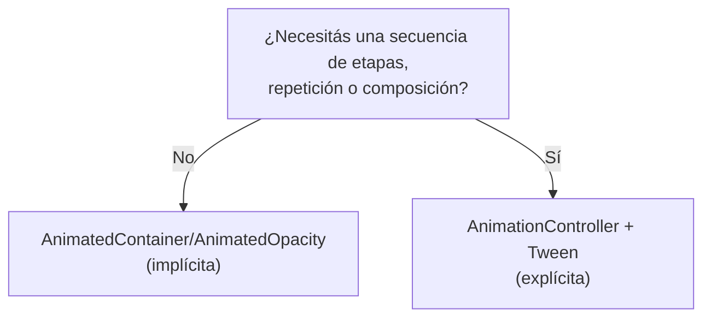
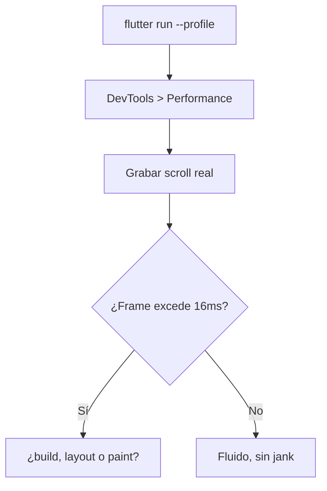
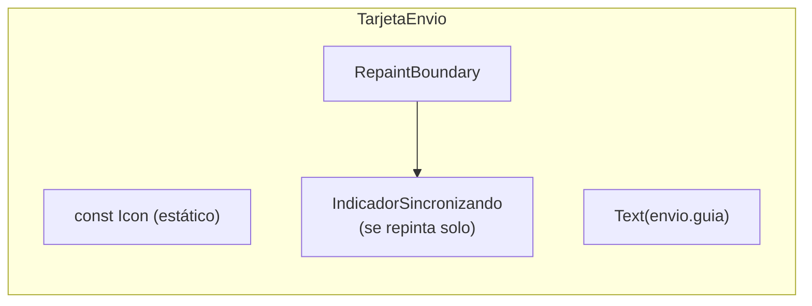
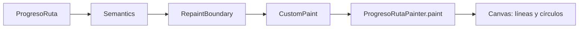

# Módulo 8: Animaciones y rendimiento


## Aprende construyendo


### Tema 1: Animaciones implícitas vs explícitas · Intermedio · 35 min

<details open>
<summary><strong>Capa 1 — Lectura</strong></summary>

#### ► DE QUÉ TRATA
Al finalizar vas a animar la expansión de TarjetaEnvio al tocarla con AnimatedContainer, y a comparar con la misma animación implementada explícitamente con AnimationController. Prerrequisitos: Módulo 7 completo.

#### ► LA ANALOGÍA
Una animación implícita interpola automáticamente entre el valor anterior y el nuevo; una explícita con `AnimationController`/`Tween` da control total sobre curvas, repetición y composición, a costa de más código.
**Conceptos clave:** interpolación automática frente a control total sobre curvas y composición.

```dart
AnimatedContainer(
  duration: Duration(milliseconds: 300),
  width: expandido ? 200 : 100,
  color: expandido ? Colors.blue : Colors.grey,
)
```

`AnimatedContainer` (una animación implícita) simplemente interpola automáticamente entre el valor anterior y el nuevo cada vez que una de sus propiedades cambia (aquí, `width` y `color`), sin que el desarrollador escriba ningún código explícito de control de la animación: cambiar el valor de entrada es suficiente para disparar una transición suave automática.

```dart
class _MiAnimacionState extends State<MiAnimacion> with SingleTickerProviderStateMixin {
  late final controller = AnimationController(duration: Duration(seconds: 1), vsync: this);
  late final animacion = Tween<double>(begin: 0, end: 1).animate(controller);

  Widget build(BuildContext context) => FadeTransition(opacity: animacion, child: Text("Hola"));
}
```

Una animación explícita con `AnimationController` y `Tween` da control total sobre curvas de interpolación no lineales, repetición (loop, reverse), y composición de múltiples animaciones sincronizadas entre sí, a cambio de considerablemente más código que una animación implícita; esta elección es apropiada cuando la animación implícita simple no puede expresar el comportamiento deseado (por ejemplo, una secuencia coreografiada de múltiples animaciones distintas disparándose en momentos relativos específicos entre sí, o una animación que debe pausarse y reanudarse programáticamente en respuesta a eventos externos).

**Analogía:** una animación implícita es como encender un regulador de luz que interpola automáticamente la intensidad entre el nivel anterior y el nuevo sin necesidad de programar manualmente esa transición; una animación explícita es como un sistema de iluminación teatral completamente programable, capaz de coreografiar secuencias complejas y sincronizadas de múltiples luces, a cambio de requerir mucho más trabajo de configuración inicial.

**¿Por qué es importante?** Una animación implícita es suficiente cuando basta con interpolar automáticamente entre dos valores; se necesita el control de una explícita para curvas no lineales, repetición controlada, o composición de múltiples animaciones coordinadas entre sí.

**Código del ejemplo:**

```dart
AnimatedContainer(duration: Duration(milliseconds: 300), width: expandido ? 200 : 100)  // implícita
AnimationController(duration: Duration(seconds: 1), vsync: this)                          // explícita
```

**Diagrama: decisión implícita vs explícita**



En el proyecto integrador RutaFlow, esta animación vive en `lib/features/deliveries/presentation/delivery_list_screen.dart`. Práctica: implementá ambas versiones (implícita y explícita) sobre un widget propio de tu proyecto propio y compará el código resultante.

#### ► CÓMO FUNCIONA


#### ► REGLA PRÁCTICA
Usa una animación implícita (`AnimatedContainer`) cuando solo necesites interpolar entre dos valores; usa una explícita (`AnimationController`/`Tween`) cuando necesites control sobre curvas, repetición o componer varias animaciones coordinadas entre sí.

</details>

<details>
<summary><strong>Capa 2 — Construcción</strong></summary>

#### Código y verificación
```dart
AnimatedContainer(
  duration: Duration(milliseconds: 300),
  width: expandido ? 200 : 100,
  color: expandido ? Colors.blue : Colors.grey,
)
```

```dart
class _MiAnimacionState extends State<MiAnimacion> with SingleTickerProviderStateMixin {
  late final controller = AnimationController(duration: Duration(seconds: 1), vsync: this);
  late final animacion = Tween<double>(begin: 0, end: 1).animate(controller);

  Widget build(BuildContext context) => FadeTransition(opacity: animacion, child: Text("Hola"));
}
```

```dart
AnimatedContainer(duration: Duration(milliseconds: 300), width: expandido ? 200 : 100)  // implícita
AnimationController(duration: Duration(seconds: 1), vsync: this)                          // explícita
```


```dart
import 'package:flutter/material.dart';

void main() => runApp(const MaterialApp(
      home: Scaffold(body: SafeArea(child: TarjetaEnvio(envio: Envio('RF-4471', 'Calle 80 #12-34')))),
    ));

class Envio {
  const Envio(this.guia, this.direccion);
  final String guia;
  final String direccion;
}

class TarjetaEnvio extends StatefulWidget {
  const TarjetaEnvio({required this.envio, super.key});
  final Envio envio;

  @override
  State<TarjetaEnvio> createState() => _TarjetaEnvioState();
}

class _TarjetaEnvioState extends State<TarjetaEnvio> {
  bool expandida = false;

  @override
  Widget build(BuildContext context) => GestureDetector(
        onTap: () => setState(() => expandida = !expandida),
        child: AnimatedContainer(
          duration: const Duration(milliseconds: 300),
          height: expandida ? 160 : 72,
          color: Colors.indigo.shade50,
          padding: const EdgeInsets.all(12),
          child: Column(crossAxisAlignment: CrossAxisAlignment.start, children: [
            Text(widget.envio.guia),
            if (expandida) Expanded(child: DetalleCompacto(envio: widget.envio)),
          ]),
        ),
      );
}

class DetalleCompacto extends StatelessWidget {
  const DetalleCompacto({required this.envio, super.key});
  final Envio envio;

  @override
  Widget build(BuildContext context) => Text('Dirección: ${envio.direccion}');
}
```

```bash
flutter create demo_flutter
cd demo_flutter
flutter run
```

</details>

### Tema 2: Flutter DevTools y detección de jank · Intermedio · 30 min

<details open>
<summary><strong>Capa 1 — Lectura</strong></summary>

#### ► DE QUÉ TRATA
Al finalizar vas a grabar con el panel de Performance de DevTools el scroll de ListaEnvios para identificar qué fase específica del renderizado causa frames perdidos. Prerrequisitos: Tema 1 de este módulo.

#### ► CÓMO FUNCIONA


</details>

<details>
<summary><strong>Capa 2 — Construcción</strong></summary>

#### Código y verificación
```
Frame a 60fps  → presupuesto ~16ms
Frame que excede ese presupuesto → jank perceptible
DevTools señala: ¿build, layout, o paint consumió el tiempo excedido?
```


```text
1. flutter run --profile (nunca en modo debug para medir performance real)
2. Abrí DevTools > pestaña Performance
3. Grabá mientras hacés scroll rápido en ListaEnvios
4. Detené la grabación y revisá los frames marcados en rojo
```

```bash
flutter create demo_flutter
cd demo_flutter
flutter run
```

</details>

### Tema 3: const widgets, RepaintBoundary y shouldRepaint · Intermedio · 35 min

<details open>
<summary><strong>Capa 1 — Lectura</strong></summary>

#### ► DE QUÉ TRATA
Al finalizar vas a marcar los íconos estáticos de TarjetaEnvio como const, y a aislar con RepaintBoundary un indicador animado de "sincronizando" para que no fuerce repintar el resto de la tarjeta. Prerrequisitos: Tema 2 de este módulo.

#### ► LA ANALOGÍA
Marcar un widget inmutable como `const` le permite a Flutter omitirlo por completo en reconstrucciones futuras; `RepaintBoundary` aísla una porción del árbol en su propia capa de pintura.
**Conceptos clave:** widgets que Flutter puede omitir por completo durante una reconstrucción.

```dart
const Text("Texto estático") // Flutter sabe que nunca cambia: lo salta en reconstrucciones futuras
```

Marcar un widget que no depende de ningún estado mutable como `const` (verificado por el compilador de Dart, que garantiza que ese widget es efectivamente inmutable en tiempo de compilación) le comunica a Flutter que ese widget específico nunca necesita reconstruirse en respuesta a cambios posteriores, permitiendo que Flutter lo omita por completo durante una reconstrucción del árbol que lo contiene, reduciendo trabajo innecesario de forma medible, especialmente en árboles de widgets grandes con muchos elementos estáticos repetidos (como iconos o textos fijos dentro de una lista larga que se reconstruye frecuentemente por otras razones).

`RepaintBoundary` aísla una porción del árbol de renderizado en su propia capa de pintura independiente, de modo que cambios visuales dentro de esa porción no fuerzan repintar el resto del árbol circundante que no cambió, útil específicamente para widgets que se animan o actualizan frecuentemente rodeados de contenido estático que no debería repintarse innecesariamente en cada frame de esa animación; `shouldRepaint` (un método que se implementa al crear un `CustomPainter` propio) permite controlar explícitamente si una repintura personalizada es realmente necesaria comparando el estado anterior contra el nuevo, evitando repinturas costosas cuando el resultado visual sería idéntico de todas formas.

**Analogía:** un widget `const` es como una pieza de decoración fija atornillada permanentemente a la pared que un equipo de mantenimiento sabe que nunca necesita revisar en cada inspección de rutina, ahorrando ese tiempo de verificación innecesario; `RepaintBoundary` es como una pared divisoria que aísla el ruido y la actividad de renovación de una habitación específica, evitando que esa actividad perturbe innecesariamente a las habitaciones adyacentes que no están siendo renovadas.

**¿Por qué es importante?** Marcar un widget como `const` permite a Flutter omitirlo por completo durante reconstrucciones futuras, reduciendo trabajo innecesario de forma medible; `RepaintBoundary` aísla repinturas frecuentes evitando que afecten innecesariamente al resto del árbol de renderizado circundante.

**Código del ejemplo:**

```dart
const Text("Texto estático")   // omitido por completo en reconstrucciones futuras
RepaintBoundary(child: WidgetQueAnimaFrecuentemente())  // aísla su repintura del resto del árbol
```

**Diagrama: aislamiento de repintura**



En el proyecto integrador RutaFlow, `TarjetaEnvio` vive en `lib/features/deliveries/presentation/delivery_list_screen.dart`. Límite de la decisión: no conviene envolver cada widget con `RepaintBoundary` "por si acaso" — cada capa de pintura adicional tiene su propio costo de memoria; usalo específicamente cuando DevTools confirma que un elemento se repinta frecuentemente dentro de contenido mayormente estático, no como optimización preventiva sin medir.

#### ► CÓMO FUNCIONA


</details>

<details>
<summary><strong>Capa 2 — Construcción</strong></summary>

#### Código y verificación
```dart
const Text("Texto estático") // Flutter sabe que nunca cambia: lo salta en reconstrucciones futuras
```

```dart
const Text("Texto estático")   // omitido por completo en reconstrucciones futuras
RepaintBoundary(child: WidgetQueAnimaFrecuentemente())  // aísla su repintura del resto del árbol
```


```dart
import 'package:flutter/material.dart';

void main() => runApp(const MaterialApp(
      home: Scaffold(body: Center(child: TarjetaEnvio(envio: Envio('RF-4471')))),
    ));

class Envio {
  const Envio(this.guia);
  final String guia;
}

class TarjetaEnvio extends StatelessWidget {
  const TarjetaEnvio({required this.envio, super.key});
  final Envio envio;

  @override
  Widget build(BuildContext context) => Row(mainAxisAlignment: MainAxisAlignment.center, children: [
        const Icon(Icons.local_shipping), // estático: Flutter lo omite en reconstrucciones futuras
        Text(envio.guia),
        const RepaintBoundary(child: IndicadorSincronizando()), // aísla su repintura del resto de la tarjeta
      ]);
}

class IndicadorSincronizando extends StatelessWidget {
  const IndicadorSincronizando({super.key});

  @override
  Widget build(BuildContext context) => const Padding(
        padding: EdgeInsets.all(8),
        child: SizedBox.square(dimension: 16, child: CircularProgressIndicator(strokeWidth: 2)),
      );
}
```

```bash
flutter create demo_flutter
cd demo_flutter
flutter run
```

</details>

### Tema 4: Isolates — trabajo pesado sin congelar la interfaz · Avanzado · 40 min

<details open>
<summary><strong>Capa 1 — Lectura</strong></summary>

#### ► DE QUÉ TRATA
Al finalizar podrás mover un cálculo pesado a un isolate con compute() para que no bloquee el hilo de UI, y explicar por qué async/await por sí solo no basta para trabajo intensivo de CPU. Prerrequisitos: Módulo 0 (Futures y async/await) y Tema 2 de este módulo (detección de jank…

</details>

<details>
<summary><strong>Capa 2 — Construcción</strong></summary>

#### Código y verificación
```dart
import 'package:flutter/foundation.dart'; // compute
import 'package:flutter/material.dart';

// Función pesada que debe correr FUERA del hilo de UI (debe ser top-level o static).
int sumaPesada(int n) {
  var total = 0;
  for (var i = 0; i < n; i++) {
    total += i % 7;
  }
  return total;
}

class PantallaEstadisticas extends StatefulWidget {
  const PantallaEstadisticas({super.key});
  @override
  State<PantallaEstadisticas> createState() => _PantallaEstadisticasState();
}

class _PantallaEstadisticasState extends State<PantallaEstadisticas> {
  String estado = 'Listo';

  Future<void> calcular() async {
    setState(() => estado = 'Calculando…');
    // compute() corre sumaPesada en un ISOLATE aparte (móvil y escritorio): la UI NO se congela.
    final resultado = await compute(sumaPesada, 500000000);
    setState(() => estado = 'Resultado: $resultado');
  }

  @override
  Widget build(BuildContext context) {
    return Scaffold(
      body: Center(
        child: Column(mainAxisSize: MainAxisSize.min, children: [
          Text(estado),
          ElevatedButton(onPressed: calcular, child: const Text('Calcular')),
        ]),
      ),
    );
  }
}

void main() => runApp(const MaterialApp(home: PantallaEstadisticas()));
```

```bash
flutter create demo_flutter
cd demo_flutter
flutter run
```

</details>

### Tema 5: CustomPainter: dibujar con Canvas sin repintar de más · Avanzado · 45 min

<details open>
<summary><strong>Capa 1 — Lectura</strong></summary>

#### ► DE QUÉ TRATA
Al finalizar podrás dibujar un componente propio con CustomPainter y Canvas, controlar cuándo se repinta con shouldRepaint, aislarlo con RepaintBoundary y hacerlo accesible con Semantics. Prerrequisitos: Temas 2 y 3 de este módulo.

#### ► LA ANALOGÍA
Un `CustomPaint` delega el dibujo a un `CustomPainter`: su método `paint(canvas, size)` recibe un **Canvas** sobre el que dibujas líneas, círculos o rutas con objetos `Paint` (color, grosor, estilo). `shouldRepaint` decide si un nuevo painter debe volver a dibujar: compararlo con el anterior evita repintar en cada reconstrucción. `RepaintBoundary` aísla el dibujo en su propia capa, y como el Canvas no es accesible por sí solo, `Semantics` describe el resultado a los lectores de pantalla. Para efectos por píxel existen los *fragment shaders* (`FragmentProgram`), un paso más avanzado.

**Analogía:** el `Canvas` es una hoja en blanco y el `Paint` es el lápiz que eliges; `shouldRepaint` es preguntarte si el dibujo cambió antes de borrar y volver a pintar.

**Diagrama:**



**¿Por qué es importante?** porque te permite construir componentes que no existen en la librería estándar sin sacrificar rendimiento ni accesibilidad.
**Fuente oficial:** [Flutter: CustomPaint](https://api.flutter.dev/flutter/widgets/CustomPaint-class.html), [Flutter: CustomPainter](https://api.flutter.dev/flutter/rendering/CustomPainter-class.html).
**Conceptos clave:** `CustomPaint`, `CustomPainter`, `Canvas`, `Paint`, `shouldRepaint`, `RepaintBoundary`, `Semantics`, fragment shaders.
**Cuándo no usarlo:** si se puede componer con widgets existentes (`Row`, `Container`, `LinearProgressIndicator`), hazlo: son accesibles por defecto y más fáciles de mantener.

**Transferencia al proyecto integrador «Aplicación móvil del repartidor»:** muestra el avance de la ruta del día en la pantalla principal con este componente y su etiqueta accesible.
Como **siguiente** paso, aplica lo aprendido en el proyecto integrador del track y compara el resultado con lo que esperabas.
**Errores comunes:** agregar un campo nuevo al painter (como `fallidas` en el Paso 5) y olvidar incluirlo en la comparación de `shouldRepaint` — Flutter sigue reutilizando el dibujo anterior porque, según esa comparación, "nada cambió", aunque el estado real sí haya cambiado.

#### ► CÓMO FUNCIONA


</details>

<details>
<summary><strong>Capa 2 — Construcción</strong></summary>

#### Código y verificación


```bash
mkdir custom-painter && cd custom-painter
flutter create repartidor_painter
cd repartidor_painter
```

```dart
// test/progreso_ruta_test.dart
import 'package:flutter/material.dart';
import 'package:flutter_test/flutter_test.dart';
import 'package:repartidor_painter/progreso_ruta.dart';

void main() {
  test('solo repinta cuando cambia el avance', () {
    final antes = ProgresoRutaPainter(paradas: 5, completadas: 2, color: Colors.teal);
    final igual = ProgresoRutaPainter(paradas: 5, completadas: 2, color: Colors.teal);
    final despues = ProgresoRutaPainter(paradas: 5, completadas: 3, color: Colors.teal);
    expect(igual.shouldRepaint(antes), isFalse);
    expect(despues.shouldRepaint(antes), isTrue);
  });

  testWidgets('dibuja y anuncia el avance a lectores de pantalla', (tester) async {
    await tester.pumpWidget(const MaterialApp(home: Scaffold(body: ProgresoRuta(paradas: 5, completadas: 3))));
    expect(find.byType(CustomPaint), findsWidgets);
    expect(find.bySemanticsLabel('3 de 5 paradas completadas'), findsOneWidget);
  });
}
```

```dart
// lib/progreso_ruta.dart — dibuja el avance de una ruta con un CustomPainter
import 'package:flutter/material.dart';

class ProgresoRutaPainter extends CustomPainter {
  ProgresoRutaPainter({required this.paradas, required this.completadas, required this.color});

  final int paradas;
  final int completadas;
  final Color color;

  @override
  void paint(Canvas canvas, Size size) {
    final y = size.height / 2;
    final paso = size.width / (paradas - 1);
    final linea = Paint()
      ..color = Colors.grey.shade300
      ..strokeWidth = 4;
    final avance = Paint()
      ..color = color
      ..strokeWidth = 4;

    canvas.drawLine(Offset(0, y), Offset(size.width, y), linea);
    canvas.drawLine(Offset(0, y), Offset(paso * (completadas - 1).clamp(0, paradas - 1), y), avance);
    for (var i = 0; i < paradas; i++) {
      final hecho = i < completadas;
      canvas.drawCircle(Offset(paso * i, y), hecho ? 9 : 7, hecho ? avance : linea);
    }
  }

  // Solo vuelve a pintar si cambió algo que afecta el dibujo
  @override
  bool shouldRepaint(ProgresoRutaPainter anterior) =>
      anterior.completadas != completadas || anterior.paradas != paradas || anterior.color != color;
}

class ProgresoRuta extends StatelessWidget {
  const ProgresoRuta({super.key, required this.paradas, required this.completadas});
  final int paradas;
  final int completadas;

  @override
  Widget build(BuildContext context) => Semantics(
        label: '$completadas de $paradas paradas completadas',
        child: RepaintBoundary(
          child: CustomPaint(
            size: const Size(double.infinity, 32),
            painter: ProgresoRutaPainter(
              paradas: paradas,
              completadas: completadas,
              color: Theme.of(context).colorScheme.primary,
            ),
          ),
        ),
      );
}
```

```bash
rm test/widget_test.dart
flutter test
```

```text
00:03 +2: All tests passed!
```

</details>
