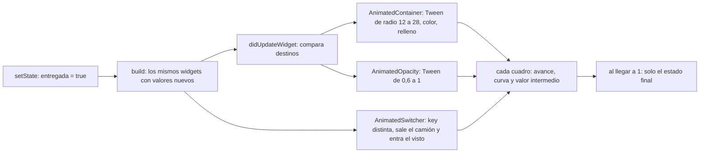
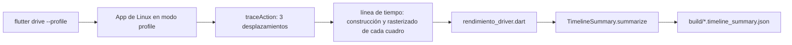
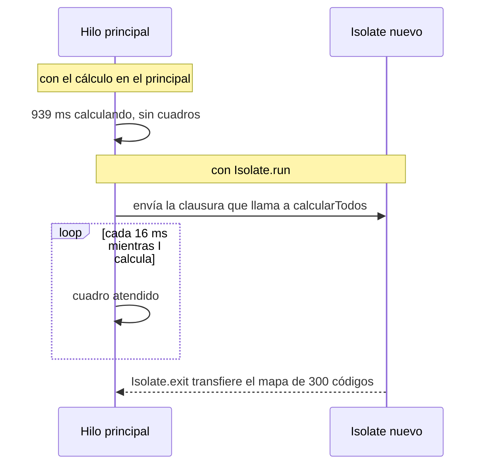
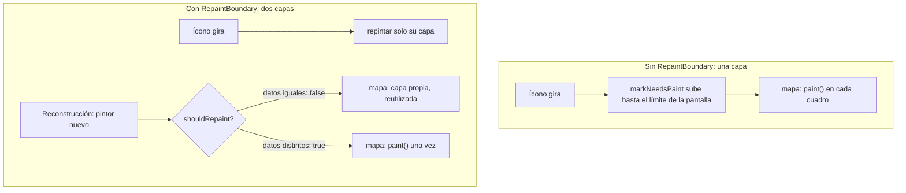

# Módulo 8: Animaciones y rendimiento: movimiento con intención y cuadros que llegan a tiempo

**Entorno comprobado para esta edición (2026-11-24):** Flutter 3.50.1 (canal estable) con Dart 3.14.0 en Linux
x86_64, con `material_ui` 1.11.1. Todo el código se analizó con `flutter analyze` (`No issues found!`) y se ejecutó
ese día, en `/home/estudiante/labs/flutter/m8` (tu `~/labs/flutter/m8`). Las animaciones se muestran **cuadro a
cuadro**: la prueba avanza el reloj y guarda un pantallazo en cada momento (los cuadros se unieron en una tira). La
medición de cuadros del Tema 3 se hizo con la app real de escritorio Linux en **modo profile**, con `flutter drive`,
en una pantalla virtual sin tarjeta gráfica: el tiempo de construcción depende del procesador y se compara bien entre
versiones; el de rasterizado (unos 19 ms) es alto porque el dibujo se hace por software, y en un teléfono es mucho
menor. Las mediciones de los Temas 4 y 5 son de la consola y de pruebas de widgets.

El movimiento bien usado explica: de dónde salió una pantalla, qué cambió en una tarjeta, cuánto falta para llegar.
Mal usado, distrae o, peor, traba la app. Y una app que traba se siente rota aunque funcione. Este módulo enseña a
animar con las dos herramientas de Flutter y a medir, con números, cuándo un cuadro no llega a tiempo y por qué.

**Al terminar este módulo podrás:**
- animar cambios de estado con widgets implícitos (`AnimatedContainer`, `AnimatedSwitcher`, `AnimatedOpacity`);
- controlar una animación con `AnimationController`, curvas e intervalos escalonados, y liberarla;
- medir los cuadros de una pantalla en modo profile y encontrar el trabajo que los retrasa;
- mover trabajo pesado a otro isolate y medir cuánto se congela el hilo principal;
- evitar repintados con `RepaintBoundary` y `shouldRepaint`, contando las pintadas.

**Esquema del módulo:** Tema 1 (animaciones implícitas) → Tema 2 (animaciones explícitas) → Tema 3 (medir los
cuadros) → Tema 4 (isolates) → Tema 5 (repintar solo lo necesario) → Proyecto 25.

**Qué necesitas saber antes:** el Módulo 7, en especial **la app de Linux y las pruebas de integración** (Temas 1 y
2); del Módulo 3, **transiciones y `Hero`** (Tema 5); del Módulo 1, **`StatefulWidget` y `dispose`** (Tema 4) y
**los tres árboles** (Tema 6); del Módulo 0, **`Future`** (Tema 3).

**Qué no se repite:** las transiciones entre pantallas y `Hero` (Módulo 3, Tema 5); `CustomPaint` básico (Módulo 7,
Tema 2). La herramienta DevTools se menciona donde ayuda; las mediciones de este módulo se hacen con pruebas para que
den números repetibles.

**Prepara el proyecto:**

```text
$ cd ~/labs/flutter
$ flutter create --org com.academia --platforms=linux,web m8
$ cd m8
$ flutter pub add 'dev:integration_test:{"sdk":"flutter"}' 'dev:flutter_driver:{"sdk":"flutter"}'
```

Copia `test/pantallazo.dart` del Módulo 1.

```dart
// lib/main.dart — el mapa animado del Tema 5; cambia conLimite y mira «Highlight repaints» en DevTools
import 'package:material_ui/material_ui.dart';

import 'tema5/mapa.dart';

void main() => runApp(MaterialApp(
      debugShowCheckedModeBanner: false,
      theme: ThemeData(colorSchemeSeed: Colors.indigo),
      home: const PantallaMapa(conLimite: true),
    ));
```


## Aprende construyendo


### Tema 1: Animaciones implícitas: cambia el valor y Flutter anima · Básico · 35 min

<details open>
<summary><strong>Capa 1 — Lectura</strong></summary>

#### Objetivos
Al terminar este tema podrás:
- animar color, relleno y forma con `AnimatedContainer` cambiando solo los valores;
- reemplazar un widget por otro con transición usando `AnimatedSwitcher` y una key;
- elegir duración y curva para que el cambio se note sin hacer esperar;
- ver una animación cuadro a cuadro en una prueba.

**Conceptos clave:** animación implícita, duración, curva, `AnimatedSwitcher`, key del hijo

#### El problema
Al marcar una entrega, la tarjeta cambia de color, de ícono y de texto de golpe. El conductor, que mira la pantalla
de reojo, no está seguro de que su toque hizo algo. Un cambio animado de 400 ms confirma la acción sin que tenga que
leer.

Este tema usa **`Container` y `BoxDecoration`** (Módulo 1, Temas 2 y 3), **keys** (Módulo 1, Tema 5) y **los roles de
color** (Módulo 2, Tema 6).

#### Glosario del tema

**animación implícita**
- **Definición técnica:** widget (`AnimatedContainer`, `AnimatedOpacity`, `AnimatedPadding`...) que, cuando cambia una de sus propiedades, interpola del valor anterior al nuevo durante una duración.
- **En palabras sencillas:** tú dices adónde ir; Flutter hace el camino.
- **Dónde se rompe la comparación:** no hay control: no se puede pausar, repetir ni sincronizar con otra animación.
- **Ejemplo:** el radio pasa de 12 a 28 en 400 ms.
- **Error típico:** usar un `AnimationController` para algo que un `AnimatedContainer` resuelve en una línea.

**duración**
- **Definición técnica:** tiempo total de la interpolación (`Duration`).
- **En palabras sencillas:** cuánto tarda el cambio.
- **Dónde se rompe la comparación:** la percepción depende del tamaño del cambio: un ícono pequeño se siente lento con 600 ms; una pantalla, no.
- **Ejemplo:** `Duration(milliseconds: 400)`.
- **Error típico:** duraciones distintas en cada componente de la app.

**curva**
- **Definición técnica:** función que reparte el avance en el tiempo (`Curves.easeInOutCubic`, `Curves.easeOutBack`...).
- **En palabras sencillas:** el ritmo: arrancar suave, frenar suave, rebotar.
- **Dónde se rompe la comparación:** con la misma duración, una curva puede hacer que el cambio «se vea» antes.
- **Ejemplo:** a los 100 ms el radio ya va en 13,4; a los 200 ms, en 20,3.
- **Error típico:** `Curves.linear` para movimientos de interfaz: se ve mecánico.

**`AnimatedSwitcher`**
- **Definición técnica:** widget que, cuando su hijo cambia por otro, anima la salida del anterior y la entrada del nuevo con un `transitionBuilder`.
- **En palabras sencillas:** un intercambio con efecto.
- **Dónde se rompe la comparación:** durante la transición los dos hijos están en el árbol a la vez.
- **Ejemplo:** el camión se encoge y el visto crece.
- **Error típico:** cambiar el contenido sin cambiar la key: para Flutter es el mismo widget y no hay transición.

**key del hijo**
- **Definición técnica:** key que `AnimatedSwitcher` usa para decidir si el hijo nuevo es otro widget (Módulo 1, Tema 5).
- **En palabras sencillas:** la etiqueta que dice «este es distinto».
- **Dónde se rompe la comparación:** si los dos hijos son de tipos distintos no hace falta; si son del mismo tipo (`Icon` e `Icon`), sí.
- **Ejemplo:** `ValueKey(entregada)`.
- **Error típico:** usar `UniqueKey()`: anima en cada reconstrucción, aunque nada haya cambiado.

#### ► CÓMO FUNCIONA

##### 1. La idea en lenguaje sencillo
Piensa en un regulador de luz de una sala. No describes cada nivel intermedio: giras la perilla hasta «más
claro» y la lámpara recorre sola el camino. Tú pones el destino; el regulador pone el recorrido.

Una animación implícita funciona así. En la tarjeta de la entrega EN-4472 no programas «a los 100 ms el radio vale
tanto». Solo dices: si `entregada` es verdadero, el radio es 28; si no, 12. Cuando el valor cambia, el widget nota la
diferencia y dibuja el paso de uno a otro durante 400 ms.

Eso resuelve el problema del conductor. Su toque produce un cambio visible y gradual: el color se aclara, la tarjeta
se redondea y el camión se convierte en un visto. No necesita leer para saber que la acción quedó registrada.

El precio de esa comodidad es el control. No decides cuándo empieza la animación ni puedes pausarla o repetirla.
Empieza sola cada vez que cambia un valor, y eso basta para la mayoría de los cambios de estado de una interfaz.

##### 2. Definición formal y vocabulario
La documentación de Flutter llama **animación implícita** a un widget derivado de `ImplicitlyAnimatedWidget`. Cuando
se reconstruye con un valor distinto en una de sus propiedades, interpola desde el valor actual hasta el nuevo. No
necesitas crear ni liberar ningún controlador: el widget lo gestiona por dentro.

Cada animación implícita recibe una **duración** obligatoria (`duration`, de tipo `Duration`) y una **curva**
opcional (`curve`). La curva es una función que recibe el tiempo normalizado, entre 0 y 1, y devuelve el avance.
Dicho en sencillo: la duración dice cuánto tarda el cambio y la curva dice a qué ritmo ocurre.

Entre el valor inicial y el final trabaja un **`Tween`** («entre», en inglés). Es un objeto con un valor `begin` y
otro `end` que calcula cualquier punto intermedio. Hay uno por tipo: `ColorTween` mezcla colores y `DecorationTween`
mezcla decoraciones, radio incluido.

**`AnimatedSwitcher`** no es un `ImplicitlyAnimatedWidget`, aunque se use igual. No anima un valor: anima el
reemplazo de un hijo por otro. Para saber si el hijo es otro, compara el tipo del widget y su **key del hijo**. Es
la misma regla de identidad que viste con las keys en el Módulo 1, Tema 5.

##### 3. Cómo funciona por dentro, paso a paso
Sigue el recorrido desde el toque hasta el último cuadro:

1. El padre llama a `setState` y vuelve a construir `TarjetaEstado(entregada: true)`. Los widgets son los mismos, con
   valores nuevos.
2. Flutter actualiza el `State` interno de `AnimatedContainer` y llama a su `didUpdateWidget`. Ahí el estado recorre
   sus propiedades animables y compara cada destino nuevo con el que tenía.
3. Por cada propiedad que cambió, crea un `Tween` cuyo `begin` es el valor que se ve en ese instante y cuyo `end` es
   el nuevo. Después reinicia su controlador interno desde 0 y lo pone en marcha.
4. En cada cuadro, el controlador avanza, la curva transforma ese avance y cada `Tween` calcula su valor intermedio.
5. El estado se reconstruye y devuelve un `Container` normal con esos valores. Por eso la prueba lee el radio en el
   `Container` que vive dentro del `AnimatedContainer`.
6. Al llegar a 1, el controlador se detiene y solo queda el estado final.

```dart
AnimatedContainer(
  duration: const Duration(milliseconds: 400),
  curve: Curves.easeInOutCubic,
  decoration: BoxDecoration(borderRadius: BorderRadius.circular(entregada ? 28 : 12)),
)
```

En este fragmento no hay ningún número intermedio. Escribes los dos extremos con un operador ternario; el estado
interno del widget calcula el resto. Si `entregada` no cambia entre dos construcciones, no se crea ninguna animación.

`AnimatedSwitcher` sigue otro camino. Guarda una lista de hijos, cada uno con su propio controlador. Cuando el hijo
nuevo tiene otra key, el viejo empieza su animación de salida y el nuevo su entrada, los dos a la vez. Por eso la
salida real muestra `iconos en pantalla 2` a los 100, 200 y 400 ms.



El hijo saliente no desaparece cuando su animación llega a 0. `AnimatedSwitcher` lo quita con un `setState` que se
aplica en el cuadro siguiente. Esa es la razón por la que la prueba necesita `pumpAndSettle` para ver `iconos en
pantalla 1`.

##### 4. Reglas, variantes y casos límite
Si el valor cambia en mitad de una animación, no hay salto. El nuevo `Tween` arranca desde el valor visible en ese
momento y va hacia el destino nuevo. Puedes tocar la tarjeta dos veces seguidas y el movimiento se invierte con
suavidad.

La curva por defecto de `AnimatedContainer` es `Curves.linear`. Por eso la tarjeta declara `Curves.easeInOutCubic`:
arranca despacio, acelera y frena. Con la misma duración, la curva cambia cuánto se ha recorrido a los 100 ms, como
comprobarás en el Ejercicio verificable 2.

Algunas propiedades no se interpolan. El texto de un `Text` cambia de golpe, porque no existe un punto medio entre
dos frases. Por eso la tarjeta anima la opacidad del texto y no su contenido.

`AnimatedOpacity` exige una opacidad entre 0 y 1. Las curvas que se pasan del destino, como `Curves.easeOutBack`,
sirven para escalas y posiciones, no para opacidades.

En `AnimatedSwitcher`, la transición por defecto es un fundido (`FadeTransition`). Con `transitionBuilder` la cambias,
como hace la tarjeta con `ScaleTransition`. También puedes fijar `switchInCurve`, `switchOutCurve` y
`reverseDuration` para que la salida dure distinto que la entrada.

Si ningún widget implícito anima la propiedad que necesitas, usa `TweenAnimationBuilder`. Recibe un `Tween` con el
destino y te entrega el valor intermedio en un `builder`. Sigue siendo implícito: cambias `end` y anima.

Desde Flutter 3.50 estos widgets llegan con el import de `material_ui`, como el resto de widgets del curso. Su forma
de funcionar no cambió con esa separación.

##### 5. Relación con lo que ya sabes y lo que viene
Este tema se apoya en tres ideas anteriores. `Container` y `BoxDecoration` (Módulo 1, Temas 2 y 3) son lo que
`AnimatedContainer` construye en cada cuadro. Las keys (Módulo 1, Tema 5) deciden si `AnimatedSwitcher` ve un hijo
nuevo. Los roles de color (Módulo 2, Tema 6) dan los dos extremos del color.

Las transiciones entre pantallas y `Hero` (Módulo 3, Tema 5) también animan, pero lo hace el `Navigator` al cambiar de
ruta. Aquí la animación nace dentro de una sola pantalla, en cuanto cambia un dato.

El Tema 2 abre la caja. Vas a crear tú el `AnimationController` que aquí permanece oculto, para coreografías que un
cambio de valor no puede expresar. El Tema 3 medirá si esos cuadros llegan a tiempo.

#### Problema resuelto 1.1
Anima el cambio de la tarjeta de «En camino» a «Entregada» y comprueba en una prueba los valores y los pantallazos a
los 0, 100, 200 y 400 ms.

**Razonamiento:**
1. Un solo `bool` decide todos los valores; los widgets animados hacen el resto.
2. `AnimatedSwitcher` recibe un `Icon` con `ValueKey(entregada)` para que cuente como hijo nuevo.
3. La prueba vuelve a construir con `entregada: true` y avanza el reloj de la prueba.
4. En cada momento lee el radio real del `Container` interno y guarda un pantallazo.

```dart
// lib/tema1/implicitas.dart — animaciones implícitas: cambias el valor y Flutter anima la transición
import 'package:material_ui/material_ui.dart';

class TarjetaEstado extends StatelessWidget {
  const TarjetaEstado({super.key, required this.entregada});
  final bool entregada;
  static const duracion = Duration(milliseconds: 400);

  @override
  Widget build(BuildContext context) {
    final colores = Theme.of(context).colorScheme;
    return AnimatedContainer(                                       // anima color, borde, relleno y radio
      duration: duracion,
      curve: Curves.easeInOutCubic,
      padding: EdgeInsets.all(entregada ? 20 : 16),
      decoration: BoxDecoration(
        color: entregada ? colores.primaryContainer : colores.surfaceContainerHighest,
        borderRadius: BorderRadius.circular(entregada ? 28 : 12),
      ),
      child: Row(children: [
        AnimatedSwitcher(                                           // reemplaza un hijo por otro con transición
          duration: duracion,
          transitionBuilder: (hijo, animacion) => ScaleTransition(scale: animacion, child: hijo),
          child: Icon(
            entregada ? Icons.check_circle : Icons.local_shipping_outlined,
            key: ValueKey(entregada),                               // la key dice que es OTRO hijo
            size: 32,
            color: entregada ? colores.primary : colores.onSurfaceVariant,
          ),
        ),
        const SizedBox(width: 16),
        Expanded(
          child: Column(crossAxisAlignment: CrossAxisAlignment.start, children: [
            Text('EN-4472', style: Theme.of(context).textTheme.titleMedium),
            AnimatedOpacity(
              duration: duracion,
              opacity: entregada ? 1 : 0.6,
              child: Text(entregada ? 'Entregada a las 10:42' : 'En camino'),
            ),
          ]),
        ),
      ]),
    );
  }
}
```

```dart
import 'package:flutter_test/flutter_test.dart';
import 'package:m8/tema1/implicitas.dart';
import 'package:material_ui/material_ui.dart';

import 'pantallazo.dart';

Widget lienzo(bool entregada) => MaterialApp(
      debugShowCheckedModeBanner: false,
      theme: ThemeData(colorSchemeSeed: Colors.indigo),
      home: Scaffold(
        body: Padding(padding: const EdgeInsets.all(16), child: Center(child: TarjetaEstado(entregada: entregada))),
      ),
    );

void main() {
  setUpAll(cargarFuentes);

  testWidgets('la tarjeta cambia de estado, cuadro a cuadro', (tester) async {
    tamanoPantalla(tester, tamano: const Size(340, 140));
    await tester.pumpWidget(lienzo(false));
    await pantallazo('m8-t1-cuadro-0');
    await tester.pumpWidget(lienzo(true));                          // solo cambia el valor
    var transcurrido = 0;
    for (final ms in [100, 200, 400]) {
      await tester.pump(Duration(milliseconds: ms - transcurrido));   // avanza el reloj de la prueba
      transcurrido = ms;
      final caja = tester.widget<Container>(find.descendant(of: find.byType(AnimatedContainer), matching: find.byType(Container)).first);
      final radio = (caja.decoration! as BoxDecoration).borderRadius! as BorderRadius;
      debugPrint('$ms ms: radio ${radio.topLeft.x.toStringAsFixed(1)}, '
          'iconos en pantalla ${find.byType(Icon).evaluate().length}');
      await pantallazo('m8-t1-cuadro-$ms');
    }
    await tester.pumpAndSettle();                                   // hasta que no quede ninguna animación
    debugPrint('al terminar: iconos en pantalla ${find.byType(Icon).evaluate().length}');
  });
}
```

```text
$ flutter test test/tema1_test.dart
00:00 +0: loading /home/estudiante/labs/flutter/m8/test/tema1_test.dart
00:00 +0: (setUpAll)
00:00 +0: la tarjeta cambia de estado, cuadro a cuadro
100 ms: radio 13.4, iconos en pantalla 2
200 ms: radio 20.3, iconos en pantalla 2
400 ms: radio 28.0, iconos en pantalla 2
al terminar: iconos en pantalla 1
00:00 +1: (tearDownAll)
00:00 +1: All tests passed!
```


**Explicación por partes.**
- Línea 12: un solo `AnimatedContainer` anima a la vez relleno, color y radio.
- Líneas 21–28: `AnimatedSwitcher` con `ScaleTransition`. La key de la línea 26 es la que hace que haya transición.
- Durante toda la animación hay dos íconos en pantalla (`iconos en pantalla 2`): el que sale y el que entra. Cuando
  todo termina (`pumpAndSettle`), queda uno.
- El texto cambia de inmediato (no es animado); la opacidad sí se anima. Por eso a los 100 ms ya dice «Entregada».

> **Error común.** Animar todo lo que cambia. Una tarjeta en la que se mueven seis cosas a la vez se ve nerviosa.
> Anima lo que confirma la acción (el ícono, el color) y deja quieto lo demás.

> **Error común.** Olvidar la key en `AnimatedSwitcher` cuando el hijo es del mismo tipo: el ícono cambia de golpe y
> parece que la animación «no funciona».

> **Buena práctica.** Define dos o tres duraciones para toda la app (por ejemplo, 150, 250 y 400 ms) y úsalas como
> *tokens*, como los espacios del Módulo 2.

> **Prevenir errores.** Prueba las animaciones cuadro a cuadro, como aquí: un valor intermedio equivocado (un color
> que salta) no se ve en el estado final.

#### Checkpoint 1.1
Si quitas `key: ValueKey(entregada)`, ¿cuántos íconos hay en pantalla a los 100 ms?

Respuesta: uno. Sin key distinta, `AnimatedSwitcher` considera que es el mismo hijo actualizado y no hace
transición: el ícono cambia de golpe.

</details>

<details>
<summary><strong>Capa 2 — Construcción</strong></summary>

#### Paso 1 · Crea los archivos
Crea `lib/tema1/implicitas.dart` y `test/tema1_test.dart`.

#### Paso 2 · Ejecuta
Ejecuta `flutter test --update-goldens test/tema1_test.dart` y mira los cuatro cuadros.

#### Paso 3 · Cambia la curva
Cambia `Curves.easeInOutCubic` por `Curves.linear` y compara el radio a los 100 ms.

#### Paso 4 · Quita la key
Quita la key del ícono y vuelve a ejecutar. Compara la cantidad de íconos.

#### Paso 5 · Úsala en la app
Pon la tarjeta en una pantalla con un botón que alterne `entregada` con `setState` y míralo en `flutter run -d linux`.

#### Resumen
- Una **animación implícita** interpola entre el valor anterior y el nuevo con una **duración** y una **curva**.
- **`AnimatedSwitcher`** intercambia hijos con transición si la **key del hijo** cambia.

#### Ejercicio verificable 1
Básico. ¿Qué radio tiene la tarjeta a los 400 ms?

Respuesta esperada: 28,0, el valor final.

#### Ejercicio verificable 2
Intermedio. Con el Paso 3, ¿el radio a los 100 ms es mayor o menor que 13,4?

Respuesta esperada: mayor: 16,0. Con la curva lineal, a un cuarto del tiempo se recorre un cuarto del camino
(12 + 16 × 0,25); `easeInOutCubic` arranca más despacio.

#### Ejercicio verificable 3
Reto. ¿Por qué la prueba tiene que usar `pumpAndSettle` para ver un solo ícono, y no basta con `pump(400 ms)`?

Respuesta esperada: porque cuando la animación de salida termina, `AnimatedSwitcher` quita el hijo viejo con un
`setState`, que se aplica en el cuadro siguiente. `pumpAndSettle` avanza hasta que no queda nada pendiente.

#### En el trabajo
Las animaciones implícitas cubren la mayoría de las microinteracciones de una app (estados de tarjetas, botones,
filtros). En las revisiones de diseño se discuten duraciones y curvas como parte del sistema de diseño, y Material 3
define las suyas (*easing and duration tokens*).

</details>

### Tema 2: Animaciones explícitas: AnimationController, curvas e intervalos · Intermedio · 50 min

<details open>
<summary><strong>Capa 1 — Lectura</strong></summary>

#### Objetivos
Al terminar este tema podrás:
- crear y liberar un `AnimationController` con `vsync`;
- aplicar curvas y dividir el tiempo en intervalos para animaciones escalonadas;
- reconstruir solo la parte que se mueve con `AnimatedBuilder` y su `child`;
- reconocer el error de no liberar un controlador.

**Conceptos clave:** `AnimationController`, `vsync` y `Ticker`, `CurvedAnimation`, `Interval`, `AnimatedBuilder`, fuga de `Ticker`

#### El problema
La pantalla de inicio del turno quiere mostrar el camión avanzando por la ruta mientras aparecen las paradas, una
tras otra. Eso no es un cambio de valor: es una coreografía con un tiempo total, partes que empiezan en distintos
momentos y la posibilidad de repetirla o detenerla. Las animaciones implícitas no alcanzan.

Este tema usa **`StatefulWidget` y `dispose`** (Módulo 1, Tema 4), **`LayoutBuilder`** (Módulo 2, Tema 1) y
**`Stack` y `Positioned`** (Módulo 1, Tema 3).

#### Glosario del tema

**`AnimationController`**
- **Definición técnica:** objeto que produce un valor de 0 a 1 a lo largo de una duración, con métodos para avanzar, retroceder, repetir y detener.
- **En palabras sencillas:** el director de la orquesta: lleva el tiempo.
- **Dónde se rompe la comparación:** solo produce números; los widgets deciden qué hacer con ellos.
- **Ejemplo:** `AnimationController(vsync: this, duration: 1200 ms)..forward()`.
- **Error típico:** crearlo en `build`: cada reconstrucción crea otro.

**`vsync` y `Ticker`**
- **Definición técnica:** el controlador usa un `Ticker` que lo llama en cada cuadro de pantalla; `vsync` (el `State` con `SingleTickerProviderStateMixin`) lo crea y lo detiene cuando la pantalla no se ve.
- **En palabras sencillas:** un metrónomo que se apaga si nadie mira.
- **Dónde se rompe la comparación:** con más de un controlador se usa `TickerProviderStateMixin`.
- **Ejemplo:** `with SingleTickerProviderStateMixin`.
- **Error típico:** no liberar el controlador: el `Ticker` queda activo.

**`CurvedAnimation`**
- **Definición técnica:** animación derivada que aplica una curva al valor de su padre.
- **En palabras sencillas:** el mismo tiempo, con otro ritmo.
- **Dónde se rompe la comparación:** algunas curvas (`easeOutBack`) se pasan de 1 y vuelven; por eso una escala llega a 1,09.
- **Ejemplo:** `_avance` con `Curves.easeInOut`.
- **Error típico:** usar una curva que se pasa de 1 en una opacidad: Flutter lanza error porque la opacidad no puede ser mayor que 1.

**`Interval`**
- **Definición técnica:** curva que ocupa solo una parte del tiempo total (de `inicio` a `fin`, entre 0 y 1) y vale 0 antes y 1 después.
- **En palabras sencillas:** «esta parte se mueve del 20 % al 60 % del tiempo».
- **Dónde se rompe la comparación:** el fin no puede pasar de 1,0; Flutter lo comprueba con una aserción.
- **Ejemplo:** `Interval(i * 0.2, i * 0.2 + 0.4)` para cada parada.
- **Error típico:** calcular el fin sin revisar el último elemento (pasó en este tema: 1,05).

**`AnimatedBuilder`**
- **Definición técnica:** widget que se reconstruye en cada cambio de una animación y recibe un `child` que se construye una sola vez.
- **En palabras sencillas:** solo se mueve lo que tiene que moverse.
- **Dónde se rompe la comparación:** si pones todo dentro del `builder`, todo se reconstruye 60 veces por segundo.
- **Ejemplo:** el `Positioned` cambia; el `Icon` del camión se construye una vez.
- **Error típico:** llamar a `setState` en un oyente del controlador para mover un widget.

**fuga de `Ticker`**
- **Definición técnica:** un `Ticker` que sigue activo después de que su `State` se destruyó, porque nadie llamó a `dispose` del controlador.
- **En palabras sencillas:** un metrónomo que sigue sonando en una sala vacía.
- **Dónde se rompe la comparación:** en la app no siempre se nota; en las pruebas, Flutter lo detecta y la prueba falla.
- **Ejemplo:** `was disposed with an active Ticker`.
- **Error típico:** liberar el controlador después de `super.dispose()`.

#### ► CÓMO FUNCIONA

##### 1. La idea en lenguaje sencillo
Imagina el director de una orquesta. No toca ningún instrumento: marca el compás, y cada músico entra cuando le
toca según la partitura. Si el director se detiene, todos se detienen; si repite, todos repiten.

Una animación explícita reparte los papeles de la misma forma. Un único objeto lleva el tiempo, de 0 a 1 en 1,2
segundos. El camión lo usa entero para recorrer la ruta; cada parada usa solo un tramo para aparecer. Todo queda
sincronizado porque todos miran el mismo reloj.

En el Tema 1, el reloj estaba escondido dentro de cada widget y arrancaba solo al cambiar un valor. Aquí lo creas tú.
Decides cuándo arranca, si va hacia atrás, si se repite y cuándo se libera. Esa responsabilidad es el precio del
control.

##### 2. Definición formal y vocabulario
Un **`AnimationController`** es una `Animation<double>` que genera valores entre un límite inferior y uno superior,
por defecto 0 y 1, durante una `duration`. Ofrece `forward`, `reverse`, `repeat`, `stop`, `reset` y `animateTo`. Su
estado se consulta con `status`: `dismissed`, `forward`, `reverse` o `completed`.

El controlador no mide el tiempo por sí mismo. Se lo da un **`Ticker`**, un objeto que llama a una función una vez por
cuadro con el tiempo transcurrido. El parámetro **`vsync`** recibe un `TickerProvider`, que fabrica ese `Ticker`. En
sencillo: `vsync` es quien conecta el metrónomo con la pantalla.

Una **`CurvedAnimation`** es una animación derivada: escucha a su padre y aplica una curva a su valor. Un
**`Interval`** es una curva especial que solo avanza entre un `begin` y un `end`, ambos entre 0 y 1. Antes del tramo
vale 0 y después vale 1.

**`AnimatedBuilder`** escucha una animación y vuelve a ejecutar su `builder` en cada cambio. El `child` que recibe se
construye una sola vez. Si olvidas liberar el controlador, ocurre una **fuga de `Ticker`**: el metrónomo sigue
activo aunque su pantalla ya no exista.

##### 3. Cómo funciona por dentro, paso a paso
Este es el recorrido completo, desde que el `State` nace hasta que se destruye:

1. Al crearse `control`, el controlador pide a `vsync: this` un `Ticker`. El `State` puede fabricarlo porque mezcla
   `SingleTickerProviderStateMixin`.
2. `initState` llama a `forward()`. El controlador arranca su `Ticker`, que se registra en el planificador de cuadros
   de Flutter.
3. Al comenzar cada cuadro, el planificador llama a los `Ticker` activos. Cada uno pasa el tiempo transcurrido a su
   controlador.
4. El controlador calcula su valor, entre 0 y 1, y avisa a sus oyentes. Las `CurvedAnimation` derivadas recalculan el
   suyo a partir de ese número.
5. `AnimatedBuilder` y `ScaleTransition`, que escuchan esas animaciones, marcan su parte del árbol para el próximo
   `build`, la maquetación y la pintura.
6. Al llegar a 1,2 s, el valor queda en 1, el estado pasa a `completed` y el `Ticker` se detiene.
7. Cuando la pantalla se cierra, `dispose` libera el controlador y su `Ticker`. Después, `super.dispose()` comprueba
   que no quede ninguno activo.

```dart
Animation<double> _parada(int i) => CurvedAnimation(
      parent: control,
      curve: Interval(i * 0.2, i * 0.2 + 0.4, curve: Curves.easeOutBack),
    );
```

Este fragmento deriva cuatro animaciones del mismo controlador. La parada `i` empieza en `i × 0,2` y dura 0,4 del
total. La cuarta (`i = 3`) va de 0,6 a 1,0: termina justo en el límite que `Interval` permite.

```mermaid
gantt
    title Tiempo del controlador, 0 a 1200 ms
    dateFormat x
    axisFormat %S.%L s
    section Camión
    avance easeInOut      :0, 1200
    section Paradas
    Parada 1 (0,0–0,4)    :0, 480
    Parada 2 (0,2–0,6)    :240, 720
    Parada 3 (0,4–0,8)    :480, 960
    Parada 4 (0,6–1,0)    :720, 1200
```



El diagrama muestra la partitura. El camión ocupa los 1200 ms; cada parada, 480 ms, con 240 ms de desfase. A los
600 ms, la cuarta parada todavía no empezó: por eso la salida real marca `0.00` en ese momento.

```dart
AnimatedBuilder(
  animation: _avance,
  builder: (context, hijo) => Positioned(left: _avance.value * (c.maxWidth - 40), top: 4, child: hijo!),
  child: Icon(Icons.local_shipping, size: 40, color: colores.primary),
)
```

Aquí está la otra mitad del truco. En cada cuadro solo se ejecuta el `builder`, que crea un `Positioned` nuevo. El
`Icon` llega como `hijo` ya construido, así que no se vuelve a crear 60 veces por segundo.

##### 4. Reglas, variantes y casos límite
`Interval` comprueba con aserciones que `begin` y `end` estén entre 0 y 1 y que `end` no sea menor que `begin`. La
primera versión de este tema terminaba la cuarta parada en 1,05 y la prueba falló con `'end <= 1.0'`. Las aserciones
solo se evalúan en modo debug, que es el modo de las pruebas.

Las curvas pueden salirse del rango 0–1 aunque el tiempo no lo haga. `Curves.easeOutBack` sube por encima de 1 y
vuelve, y por eso la Parada 1 mide 1,09 a los 300 ms. En una escala eso se ve como un rebote; en una opacidad sería
un valor inválido.

Con un solo controlador usas `SingleTickerProviderStateMixin`. Si el mismo `State` necesita dos o más, cambia a
`TickerProviderStateMixin`. El primero lanza un error si le pides un segundo `Ticker`.

El orden de `dispose` es estricto: primero `control.dispose()` y después `super.dispose()`. Al revés, el mixin
encuentra el `Ticker` activo. La prueba falla entonces con `was disposed with an active Ticker`, como en el ejemplo
de `ejemplos_que_fallan/`.

El `vsync` también ahorra trabajo. Cuando la pantalla deja de verse, por ejemplo tapada por otra ruta, Flutter
silencia sus `Ticker` con `TickerMode`. El controlador deja de recibir cuadros hasta que la pantalla vuelve.

Hay variantes para casos frecuentes. `repeat(reverse: true)` va y vuelve sin fin. `Tween<double>(begin: 0, end: 300)`
transforma el rango 0–1 en otro. `TweenSequence` encadena tramos sin calcular intervalos a mano. Las clases
`...Transition` (`FadeTransition`, `SlideTransition`, `RotationTransition`) son atajos para propiedades comunes.

Prefiere esas transiciones a un oyente con `setState`. Un `setState` reconstruye todo el `State`, mientras que una
transición solo actualiza su propio widget. `AnimatedBuilder` es hoy una subclase de `ListenableBuilder`, así que
escucha cualquier `Listenable`, no solo animaciones.

##### 5. Relación con lo que ya sabes y lo que viene
El ciclo de vida de `StatefulWidget` y `dispose` (Módulo 1, Tema 4) es la base: el controlador nace en el `State` y
muere con él. `Stack` y `Positioned` (Módulo 1, Tema 3) colocan el camión, y `LayoutBuilder` (Módulo 2, Tema 1) da el
ancho disponible.

Compara con el Tema 1. Allí el controlador existía igual, dentro de `AnimatedContainer`, pero era privado y arrancaba
al cambiar un valor. Elige la implícita para estados y la explícita para coreografías, repeticiones o control manual.

Lo que viene usa estas piezas. El Tema 3 mide si cada cuadro de una animación llega en sus 16,7 ms. El Tema 5 vuelve
a un controlador con `repeat()` y muestra que un ícono que gira puede obligar a repintar un dibujo grande.

#### Problema resuelto 2.1
Anima el recorrido del camión con las paradas escalonadas. Mide la posición del camión y la escala de cada parada en
cuatro momentos y guarda los cuadros. Después, muestra qué pasa si no se libera el controlador.

**Razonamiento:**
1. El `State` crea el controlador con `vsync: this` y lo libera en `dispose`.
2. El avance y las paradas son `CurvedAnimation` del mismo controlador.
3. `AnimatedBuilder` mueve el camión; `ScaleTransition` hace crecer cada parada.
4. La prueba busca las escalas solo de las paradas (las que envuelven un `Chip`), porque `Chip` tiene su propia
   `ScaleTransition` interna.
5. El ejemplo del error vive en `ejemplos_que_fallan/`, fuera de `test/`, para que `flutter test` siga pasando.

```dart
// lib/tema2/explicitas.dart — animación explícita: tú controlas el tiempo con un AnimationController
import 'package:material_ui/material_ui.dart';

/// Un camión que recorre la ruta, con las paradas apareciendo escalonadas.
class RecorridoAnimado extends StatefulWidget {
  const RecorridoAnimado({super.key});

  @override
  State<RecorridoAnimado> createState() => RecorridoAnimadoState();
}

class RecorridoAnimadoState extends State<RecorridoAnimado> with SingleTickerProviderStateMixin {
  late final AnimationController control = AnimationController(
    vsync: this,                                                    // se detiene si la pantalla no se ve
    duration: const Duration(milliseconds: 1200),
  );
  late final Animation<double> _avance = CurvedAnimation(parent: control, curve: Curves.easeInOut);

  /// Cada parada aparece en su propio tramo del tiempo total (animación escalonada).
  Animation<double> _parada(int i) => CurvedAnimation(
        parent: control,
        curve: Interval(i * 0.2, i * 0.2 + 0.4, curve: Curves.easeOutBack),   // el final no puede pasar de 1.0
      );

  @override
  void initState() {
    super.initState();
    control.forward();
  }

  @override
  void dispose() {
    control.dispose();                                              // obligatorio: libera el Ticker
    super.dispose();
  }

  @override
  Widget build(BuildContext context) {
    final colores = Theme.of(context).colorScheme;
    return Padding(
      padding: const EdgeInsets.all(24),
      child: Column(mainAxisSize: MainAxisSize.min, children: [
        LayoutBuilder(
          builder: (context, c) => SizedBox(
            height: 48,
            child: Stack(children: [
              Positioned(left: 0, right: 0, top: 22, child: Container(height: 4, color: colores.outlineVariant)),
              AnimatedBuilder(                                      // solo esto se reconstruye en cada cuadro
                animation: _avance,
                builder: (context, hijo) => Positioned(left: _avance.value * (c.maxWidth - 40), top: 4, child: hijo!),
                child: Icon(Icons.local_shipping, size: 40, color: colores.primary),   // se construye una vez
              ),
            ]),
          ),
        ),
        const SizedBox(height: 16),
        Row(
          mainAxisAlignment: MainAxisAlignment.spaceBetween,
          children: [
            for (var i = 0; i < 4; i++)
              ScaleTransition(
                scale: _parada(i),
                child: Chip(label: Text('Parada ${i + 1}'), visualDensity: VisualDensity.compact),
              ),
          ],
        ),
      ]),
    );
  }
}
```

```dart
import 'package:flutter_test/flutter_test.dart';
import 'package:m8/tema2/explicitas.dart';
import 'package:material_ui/material_ui.dart';

import 'pantallazo.dart';

Widget lienzo(Widget hijo) => MaterialApp(
      debugShowCheckedModeBanner: false,
      theme: ThemeData(colorSchemeSeed: Colors.indigo),
      home: Scaffold(body: Center(child: hijo)),
    );

void main() {
  setUpAll(cargarFuentes);

  testWidgets('el recorrido, cuadro a cuadro', (tester) async {
    tamanoPantalla(tester, tamano: const Size(420, 160));
    await tester.pumpWidget(lienzo(const RecorridoAnimado()));
    var transcurrido = 0;
    for (final ms in [0, 300, 600, 1200]) {
      await tester.pump(Duration(milliseconds: ms - transcurrido));
      transcurrido = ms;
      final x = tester.getTopLeft(find.byIcon(Icons.local_shipping)).dx;
      final escalas = tester.widgetList<ScaleTransition>(find.ancestor(of: find.byType(Chip), matching: find.byType(ScaleTransition))).map((s) => s.scale.value.toStringAsFixed(2));
      debugPrint('${ms.toString().padLeft(4)} ms: camión en x=${x.toStringAsFixed(0)}, paradas $escalas');
      await pantallazo('m8-t2-cuadro-$ms');
    }
  });
}
```

```text
$ flutter test test/tema2_test.dart
00:00 +0: loading /home/estudiante/labs/flutter/m8/test/tema2_test.dart
00:00 +0: (setUpAll)
00:00 +0: el recorrido, cuadro a cuadro
   0 ms: camión en x=24, paradas (0.00, 0.00, 0.00, 0.00)
 300 ms: camión en x=67, paradas (1.09, 0.54, 0.00, 0.00)
 600 ms: camión en x=190, paradas (1.00, 1.08, 0.85, 0.00)
1200 ms: camión en x=356, paradas (1.00, 1.00, 1.00, 1.00)
00:00 +1: (tearDownAll)
00:00 +1: All tests passed!
```


```dart
// ejemplos_que_fallan/olvido_dispose_test.dart — FALLA A PROPÓSITO: muestra el error de no liberar un controlador.
// Ejecútalo solo con: flutter test ejemplos_que_fallan/olvido_dispose_test.dart
import 'package:flutter_test/flutter_test.dart';
import 'package:material_ui/material_ui.dart';

void main() {
  testWidgets('olvidar dispose', (tester) async {
    await tester.pumpWidget(const MaterialApp(home: SinDispose()));
    await tester.pumpWidget(const MaterialApp(home: SizedBox()));   // la pantalla se cierra
  });
}

/// Crea un controlador que se repite y nunca lo libera.
class SinDispose extends StatefulWidget {
  const SinDispose({super.key});
  @override
  State<SinDispose> createState() => _SinDisposeState();
}

class _SinDisposeState extends State<SinDispose> with SingleTickerProviderStateMixin {
  late final control = AnimationController(vsync: this, duration: const Duration(seconds: 1))..repeat();
  @override
  Widget build(BuildContext context) => FadeTransition(opacity: control, child: const Text('cargando'));
}
```

```text
$ flutter test ejemplos_que_fallan/olvido_dispose_test.dart
...
The following assertion was thrown while finalizing the widget tree:
_SinDisposeState#02933(ticker active) was disposed with an active Ticker.
_SinDisposeState created a Ticker via its SingleTickerProviderStateMixin, but at the time dispose()
was called on the mixin, that Ticker was still active. The Ticker must be disposed before calling
super.dispose().
Tickers used by AnimationControllers should be disposed by calling dispose() on the
AnimationController itself. Otherwise, the ticker will leak.
...
00:00 +0 -1: olvidar dispose [E]
00:00 +0 -1: Some tests failed.
```

**Explicación por partes.**
- Línea 14: `vsync: this` conecta el controlador con el `State`; línea 33, su liberación.
- Línea 22: el intervalo de cada parada. **La primera versión usaba `Interval(i * 0.25, i * 0.25 + 0.3)`**, y la
  cuarta parada terminaba en 1,05: la prueba falló con `Failed assertion: ... 'end <= 1.0'`.
- Líneas 48–52: el camión (`child`) se construye una vez; en cada cuadro solo cambia el `Positioned`.
- En la salida, la Parada 1 llega a 1,09 a los 300 ms: `easeOutBack` se pasa del tamaño final y vuelve (se ve en la
  tira, segunda imagen).
- El ejemplo sin `dispose` falla con el mensaje de Flutter, que explica la causa y la solución.

> **Error común.** Un `AnimationController` por elemento cuando todos siguen el mismo tiempo. Un solo controlador con
> intervalos es más simple y queda sincronizado.

> **Error común.** Animar con `setState` desde un `Timer`. No se sincroniza con la pantalla, sigue corriendo cuando la
> pantalla no se ve y reconstruye todo.

> **Buena práctica.** Respeta la preferencia de reducir movimiento: si `MediaQuery.disableAnimationsOf(context)` es
> verdadero, llama a `control.value = 1` en lugar de `forward()`.

> **Prevenir errores.** Las pruebas de widgets detectan las fugas de `Ticker`. Si una prueba falla con «active
> Ticker», falta un `dispose`.

#### Checkpoint 2.1
¿Por qué la cuarta parada vale 0,00 a los 600 ms?

Respuesta: porque su intervalo empieza en 0,6 del tiempo total, es decir, a los 720 ms; antes de eso, `Interval` vale
0.

</details>

<details>
<summary><strong>Capa 2 — Construcción</strong></summary>

#### Paso 1 · Crea los archivos
Crea `lib/tema2/explicitas.dart`, `test/tema2_test.dart` y `ejemplos_que_fallan/olvido_dispose_test.dart`.

#### Paso 2 · Ejecuta
Ejecuta `flutter test --update-goldens test/tema2_test.dart` y, aparte,
`flutter test ejemplos_que_fallan/olvido_dispose_test.dart`.

#### Paso 3 · Repite
Cambia `forward()` por `repeat(reverse: true)` y ejecuta la app con `flutter run -d linux`.

#### Paso 4 · Reduce el movimiento
Implementa la buena práctica de `disableAnimationsOf` y pruébala con `tester.platformDispatcher.accessibilityFeaturesTestValue`.

#### Paso 5 · Rompe el intervalo
Vuelve a `Interval(i * 0.25, i * 0.25 + 0.3)` y lee el error.

#### Resumen
- Un **`AnimationController`** lleva el tiempo con un **`Ticker`** creado por **`vsync`**.
- **`CurvedAnimation`** e **`Interval`** dan ritmo y escalonan.
- **`AnimatedBuilder`** reconstruye solo lo que se mueve.
- Sin `dispose`, hay **fuga de `Ticker`**.

#### Ejercicio verificable 1
Básico. ¿En qué momento empieza a crecer la Parada 3?

Respuesta esperada: a los 480 ms (0,4 × 1200).

#### Ejercicio verificable 2
Intermedio. ¿Dónde está el camión a los 1200 ms y por qué ese valor?

Respuesta esperada: en x=356. El `Positioned` va de 0 a `maxWidth − 40` (el ancho del ícono) dentro del relleno de 24:
24 + (420 − 48 − 40) = 356.

#### Ejercicio verificable 3
Reto. Con el Paso 5, ¿cuál es el mensaje exacto?

Respuesta esperada: `Failed assertion: line 180 pos 12: 'end <= 1.0': is not true.`, lanzado al construir la cuarta
`ScaleTransition`.

#### En el trabajo
Las animaciones explícitas se usan para coreografías (pantallas de bienvenida, indicadores de progreso con forma,
gráficos que se dibujan). En las revisiones de código se mira siempre el `dispose` y si la animación reconstruye más
de lo necesario.

</details>

### Tema 3: Medir los cuadros: encontrar el trabajo que traba la app · Avanzado · 55 min

<details open>
<summary><strong>Capa 1 — Lectura</strong></summary>

#### Objetivos
Al terminar este tema podrás:
- explicar el presupuesto de un cuadro y qué partes lo consumen (construcción y rasterizado);
- medir los cuadros de una interacción en modo profile con `traceAction` y `flutter drive`;
- leer un resumen de línea de tiempo: promedio, percentil 90, peor cuadro y cuadros fuera de presupuesto;
- comparar dos versiones de la misma pantalla con números.

**Conceptos clave:** cuadro, presupuesto de cuadro, construcción y rasterizado, modo profile, línea de tiempo, *jank*

#### El problema
El conductor dice que la lista de la ruta «se traba» al desplazarla rápido. En el escritorio del desarrollador, en
modo debug, todo se ve lento, así que no sirve para comparar; y «se siente mejor» no es una medición. Hace falta medir
en el modo correcto y con un número que se pueda comparar después de un cambio.

Este tema usa **`ListView.builder`** (Módulo 1, Tema 5) y **las pruebas de integración en Linux** (Módulo 7, Tema 1).

#### Glosario del tema

**cuadro**
- **Definición técnica:** una imagen completa de la interfaz que Flutter produce y la pantalla muestra; a 60 Hz hay uno cada 16,7 ms.
- **En palabras sencillas:** una página del folioscopio.
- **Dónde se rompe la comparación:** en pantallas de 120 Hz el presupuesto es la mitad.
- **Ejemplo:** `frame_count: 56` durante tres desplazamientos.
- **Error típico:** medir «cuánto tarda la pantalla en cargar» en lugar de cuánto tarda cada cuadro.

**presupuesto de cuadro**
- **Definición técnica:** tiempo máximo para preparar un cuadro sin perder el siguiente refresco de la pantalla (16,7 ms a 60 Hz).
- **En palabras sencillas:** el tiempo antes de que pase el próximo autobús.
- **Dónde se rompe la comparación:** construcción y rasterizado corren en hilos distintos; cada uno tiene su presupuesto.
- **Ejemplo:** `missed_frame_build_budget_count: 7`.
- **Error típico:** fijarse solo en el promedio: la traba la causan los peores cuadros.

**construcción y rasterizado**
- **Definición técnica:** la construcción (hilo de la interfaz) ejecuta `build`, maquetación y pintura de la lista de dibujo; el rasterizado (hilo de rasterizado) convierte esa lista en píxeles con la GPU.
- **En palabras sencillas:** decidir qué dibujar y dibujarlo.
- **Dónde se rompe la comparación:** un `build` lento afecta la construcción; muchas sombras o capas afectan el rasterizado.
- **Ejemplo:** el cálculo dentro de `build` sube la construcción de 2 a 7 ms en promedio; el rasterizado no cambia.
- **Error típico:** «optimizar» el dibujo cuando el problema está en `build`, o al revés.

**modo profile**
- **Definición técnica:** compilación optimizada como la de producción, pero con las herramientas de medición activas.
- **En palabras sencillas:** la app de verdad, con cronómetro.
- **Dónde se rompe la comparación:** el modo debug es mucho más lento y no sirve para medir; el de release no permite medir.
- **Ejemplo:** `flutter drive ... --profile`.
- **Error típico:** concluir que «Flutter es lento» a partir del modo debug.

**línea de tiempo**
- **Definición técnica:** registro de eventos con su duración (construcción y rasterizado de cada cuadro) que `traceAction` graba y `TimelineSummary` resume.
- **En palabras sencillas:** el cronómetro de cada cuadro.
- **Dónde se rompe la comparación:** se guarda entera (`.timeline.json`) y se puede abrir en las herramientas de Chrome.
- **Ejemplo:** `build/calculo_en_build.timeline_summary.json`.
- **Error típico:** grabar toda la sesión en lugar de solo la acción que se quiere medir.

**jank**
- **Definición técnica:** cuadros que no llegan a tiempo y hacen que la pantalla repita la imagen anterior, lo que se percibe como un tirón.
- **En palabras sencillas:** la traba.
- **Dónde se rompe la comparación:** un solo cuadro de 33 ms en un desplazamiento ya se nota.
- **Ejemplo:** el peor cuadro de 31,7 ms con el cálculo en `build`.
- **Error típico:** buscarlo a ojo, en el emulador y en modo debug.

#### ► CÓMO FUNCIONA

##### 1. La idea en lenguaje sencillo
Piensa en un folioscopio, esa libreta que parece animarse cuando pasas sus páginas rápido. Si una página se pega y
tarda en pasar, el movimiento da un tirón, aunque todas las demás pasen bien. El ojo nota la página atrasada, no el
promedio.

Una pantalla funciona igual. A 60 Hz muestra una imagen nueva cada 16,7 ms. Si Flutter no tiene lista la siguiente a
tiempo, la pantalla repite la anterior. El conductor que desplaza la lista de la ruta siente ese tirón como «se traba».

Para arreglarlo no basta con mirar. Necesitas una cifra por cuadro, tomada en condiciones parecidas a las del teléfono,
que puedas comparar antes y después de un cambio. Este tema convierte «se siente lento» en «7 cuadros fuera de
presupuesto».

##### 2. Definición formal y vocabulario
Un **cuadro** es una imagen completa de la interfaz entregada a la pantalla. El **presupuesto de cuadro** es el tiempo
disponible para prepararlo antes del siguiente refresco: 1000 ms divididos entre la frecuencia, 16,7 ms a 60 Hz y
8,3 ms a 120 Hz.

Flutter reparte cada cuadro en dos etapas que corren en hilos distintos. La **construcción y rasterizado** se miden por
separado. La construcción, en el hilo de la interfaz, ejecuta tu código Dart. El rasterizado, en otro hilo, convierte
el resultado en píxeles.

El **modo profile** es una compilación anticipada (AOT, código máquina generado antes de ejecutar) como la de
producción. Conserva lo justo para medir: la **línea de tiempo**, un registro de eventos con su inicio y su duración.
El ***jank*** es el síntoma visible: cuadros que no llegan a tiempo.

##### 3. Cómo funciona por dentro, paso a paso
Observa qué ocurre en cada cuadro mientras el dedo desplaza la lista:

1. La pantalla emite la señal de sincronía vertical (*vsync*) y el motor de Flutter la pasa al planificador de Dart.
2. El planificador ejecuta los `Ticker` activos, como los de las animaciones del Tema 2 y la inercia del desplazamiento.
3. Después reconstruye los widgets marcados. Aquí `ListView.builder` llama a `itemBuilder` para cada fila que entra en
   pantalla.
4. Siguen la maquetación, que calcula tamaños y posiciones, y la pintura, que registra las instrucciones de dibujo en
   capas.
5. El árbol de capas pasa al hilo de rasterizado. Hasta aquí llega la construcción del cuadro.
6. El hilo de rasterizado convierte las capas en píxeles con el motor gráfico y entrega la imagen a la pantalla.

Los dos hilos trabajan en cadena. Mientras se rasteriza un cuadro, el hilo de la interfaz ya construye el siguiente.
Por eso cada etapa tiene su propio presupuesto, y por eso el resumen las separa.

```dart
final codigo = calcularEnBuild ? codigoVerificacion(guia) : _codigos[guia]!;
```

Esta línea decide en qué etapa cae el costo. Con `calcularEnBuild`, cada fila nueva ejecuta 1.200.000 vueltas dentro
del paso 3. Si en un cuadro entran varias filas, ese cuadro se pasa del presupuesto.

Para medirlo, la prueba envuelve los tres `fling` en `binding.traceAction`. Mientras dura la acción, Flutter graba la
línea de tiempo del proceso y la guarda bajo una clave (`reportKey`). Al terminar, el *driver* recibe esos datos.



El *driver* es un programa aparte, que corre en tu equipo y controla la app. Con `TimelineSummary.summarize` calcula
los campos del resumen y `writeTimelineToFile` los guarda en `build/`. Así obtienes `frame_count: 56` y
`missed_frame_build_budget_count: 7`.

##### 4. Reglas, variantes y casos límite
Mide siempre en modo profile. El modo debug compila al vuelo (JIT), evalúa aserciones y activa comprobaciones extra:
es mucho más lento y deforma las proporciones. El modo release es el más rápido, pero no expone la línea de tiempo.

En móviles, el modo profile solo funciona en dispositivos físicos, no en emuladores ni simuladores. Por eso este
módulo mide en la app de escritorio Linux, como declara la cabecera.

Lee los campos en este orden: cuadros fuera de presupuesto, peor cuadro y percentil 90. El **percentil 90** es el valor
que no supera el 90 % de los cuadros. Un promedio de 7,36 ms puede esconder un peor cuadro de 31,74 ms.

Separa siempre las dos etapas. Si sube la construcción, busca trabajo en `build`, maquetación o pintura. Si sube el
rasterizado, busca efectos caros: sombras, recortes, opacidades sobre grupos o capas grandes.

El rasterizado de esta medición ronda los 19 ms porque la pantalla virtual dibuja sin GPU. Ese valor no se compara con
un teléfono; sí se compara entre las dos versiones, donde casi no cambia.

Hay variantes según la pregunta. DevTools, en su pestaña Performance, muestra lo mismo en vivo y marca los cuadros
lentos. En producción, `SchedulerBinding.instance.addTimingsCallback` entrega objetos `FrameTiming` con la duración
de cada etapa, útiles para enviar métricas.

La línea de tiempo también se guarda completa en `build/<clave>.timeline.json`. Ese archivo se abre en Perfetto o en
`chrome://tracing` para ver qué función ocupó cada cuadro largo.

##### 5. Relación con lo que ya sabes y lo que viene
Este tema reutiliza `ListView.builder` (Módulo 1, Tema 5), que construye filas solo cuando entran en pantalla. Esa
construcción perezosa explica por qué el costo aparece al desplazar y no al abrir. También usa las pruebas de
integración en Linux (Módulo 7, Tema 1).

Las pruebas de widgets del Tema 1 avanzaban un reloj falso con `pump`. Aquí el reloj es real: la app compilada corre
de verdad y cada milisegundo cuenta. Por eso las pruebas de widgets no sirven para medir rendimiento.

Lo que viene parte de esta medición. Calcular antes elimina el *jank*, pero congela la app casi un segundo al abrir la
lista; el Tema 4 lo resuelve con un isolate. El Tema 5 ataca el otro frente: pintar menos.

#### Problema resuelto 3.1
Mide el desplazamiento de una lista de 300 entregas en dos versiones: con un cálculo caro dentro de `build` de cada
fila y con el cálculo hecho antes. Compara los resúmenes.

**Razonamiento:**
1. `codigoVerificacion` es un cálculo caro a propósito; vive en un archivo sin Flutter para usarlo también en el
   Tema 4.
2. La lista decide con `calcularEnBuild` dónde se calcula; todo lo demás es igual.
3. La prueba de integración graba cada versión con su propia clave.
4. El *driver* escribe un resumen por clave. Al escribir este tema, la primera versión del cálculo (diez veces más
   liviana) daba 3,0 y 1,7 ms de construcción promedio y ningún cuadro fuera de presupuesto: no alcanzaba a mostrar
   el problema. La versión final tiene un costo comparable al de formatear un historial largo por fila.

```dart
// lib/tema3/calculo.dart — el cálculo caro, sin Flutter: se puede usar en la app, en un isolate y en la consola
/// Un cálculo caro a propósito (como validar una firma o formatear un historial largo).
int codigoVerificacion(String guia) {
  var h = 0;
  for (var i = 0; i < 1200000; i++) {
    h = (h * 31 + guia.codeUnitAt(i % guia.length) + i) & 0x7fffffff;
  }
  return h % 10000;
}

final guias = [for (var i = 0; i < 300; i++) 'EN-${4400 + i}'];
```

```dart
// lib/tema3/lista.dart — la misma lista, con trabajo pesado dentro de build o calculado antes
import 'package:material_ui/material_ui.dart';

import 'calculo.dart';

class ListaRuta extends StatelessWidget {
  const ListaRuta({super.key, required this.calcularEnBuild});
  final bool calcularEnBuild;
  static final _codigos = {for (final g in guias) g: codigoVerificacion(g)};   // calculado una vez, antes

  @override
  Widget build(BuildContext context) => ListView.builder(
        key: const Key('lista'),
        itemCount: guias.length,
        itemBuilder: (context, i) {
          final guia = guias[i];
          final codigo = calcularEnBuild ? codigoVerificacion(guia) : _codigos[guia]!;   // aquí está la diferencia
          return ListTile(title: Text(guia), subtitle: Text('Código $codigo'), leading: const Icon(Icons.inventory_2_outlined));
        },
      );
}
```

```dart
// integration_test/rendimiento_test.dart — mide los cuadros al desplazar la lista, en modo profile
import 'package:flutter_test/flutter_test.dart';
import 'package:integration_test/integration_test.dart';
import 'package:m8/tema3/lista.dart';
import 'package:material_ui/material_ui.dart';

void main() {
  final binding = IntegrationTestWidgetsFlutterBinding.ensureInitialized();

  for (final enBuild in [true, false]) {
    final nombre = enBuild ? 'calculo_en_build' : 'calculo_previo';
    testWidgets('desplazar: $nombre', (tester) async {
      await tester.pumpWidget(MaterialApp(home: Scaffold(body: ListaRuta(calcularEnBuild: enBuild))));
      await tester.pumpAndSettle();
      await binding.traceAction(() async {                          // graba la línea de tiempo de esta acción
        for (var i = 0; i < 3; i++) {
          await tester.fling(find.byKey(const Key('lista')), const Offset(0, -1500), 4000);
          await tester.pumpAndSettle();
        }
      }, reportKey: nombre);
    });
  }
}
```

```dart
// test_driver/rendimiento_driver.dart — recibe las líneas de tiempo y escribe un resumen por medición
import 'package:flutter_driver/flutter_driver.dart' as driver;
import 'package:integration_test/integration_test_driver.dart';

Future<void> main() => integrationDriver(
      responseDataCallback: (datos) async {
        for (final clave in ['calculo_en_build', 'calculo_previo']) {
          final resumen = driver.TimelineSummary.summarize(driver.Timeline.fromJson(datos![clave] as Map<String, dynamic>));
          await resumen.writeTimelineToFile(clave, pretty: true, includeSummary: true);   // build/<clave>.timeline_summary.json
        }
      },
    );
```

```text
$ xvfb-run -a flutter drive --driver=test_driver/rendimiento_driver.dart \
    --target=integration_test/rendimiento_test.dart -d linux --profile
...
All tests passed.
```

Los dos resúmenes (campos principales de `build/*.timeline_summary.json`):

```text
== calculo_en_build
  frame_count: 56
  average_frame_build_time_millis: 7.36
  90th_percentile_frame_build_time_millis: 16.79
  worst_frame_build_time_millis: 31.74
  missed_frame_build_budget_count: 7
  average_frame_rasterizer_time_millis: 18.65
== calculo_previo
  frame_count: 60
  average_frame_build_time_millis: 2.04
  90th_percentile_frame_build_time_millis: 4.36
  worst_frame_build_time_millis: 9.24
  missed_frame_build_budget_count: 0
  average_frame_rasterizer_time_millis: 18.95
```

**Explicación por partes.**
- Con el cálculo en `build`: 7 cuadros fuera de presupuesto, percentil 90 de 16,8 ms y el peor de 31,7 ms. Ese peor
  cuadro es un tirón visible.
- Con el cálculo previo: 0 cuadros fuera de presupuesto y el peor de 9,2 ms.
- El rasterizado es casi igual en las dos (unos 19 ms): el problema estaba en la construcción, no en el dibujo. Ese
  valor es alto porque la pantalla virtual dibuja sin GPU; en un teléfono es de pocos milisegundos.
- Línea 9 de la lista: calcular antes no es gratis. Los 300 códigos se calculan la primera vez que se usa la lista, y
  eso congela la app casi un segundo (Tema 4).

> **Error común.** Medir en modo debug. Allí todo es varias veces más lento, y una optimización puede no notarse o
> parecer enorme.

> **Error común.** Mirar solo el promedio. Un promedio de 7 ms puede esconder un cuadro de 32 ms, que es el que el
> usuario siente.

> **Buena práctica.** Guarda los resúmenes de las pantallas principales en el CI y compara cada versión con la
> anterior: así una regresión de rendimiento se detecta en el pull request.

> **Prevenir errores.** Nada caro en `build`: ni cálculos, ni lecturas de archivos, ni conversiones de JSON. `build`
> puede ejecutarse 60 veces por segundo.

#### Checkpoint 3.1
Si el percentil 90 de construcción es 16,8 ms, ¿qué proporción de los cuadros está cerca o por encima del
presupuesto?

Respuesta: al menos uno de cada diez: el 10 % de los cuadros tarda 16,8 ms o más en construirse, que es el presupuesto
completo de un cuadro a 60 Hz.

</details>

<details>
<summary><strong>Capa 2 — Construcción</strong></summary>

#### Paso 1 · Crea los archivos
Crea `lib/tema3/calculo.dart`, `lib/tema3/lista.dart`, `integration_test/rendimiento_test.dart` y
`test_driver/rendimiento_driver.dart`.

#### Paso 2 · Mide
Ejecuta el `flutter drive` de arriba y lee los dos resúmenes.

#### Paso 3 · Mira la línea de tiempo
Abre `build/calculo_en_build.timeline.json` en Chrome (`chrome://tracing` o Perfetto) y busca los cuadros largos.

#### Paso 4 · Mide en modo debug
Ejecuta lo mismo sin `--profile` (el *driver* lo permite con una advertencia) y compara los números.

#### Paso 5 · Usa DevTools
Ejecuta `flutter run -d linux --profile`, abre DevTools, pestaña Performance, y desplaza la lista con el cálculo en
`build`.

#### Resumen
- Cada **cuadro** tiene un **presupuesto** de 16,7 ms, repartido entre **construcción y rasterizado**.
- Se mide en **modo profile** con una **línea de tiempo** grabada por `traceAction`.
- El ***jank*** se ve en el percentil 90, el peor cuadro y los cuadros fuera de presupuesto.

#### Ejercicio verificable 1
Básico. ¿Cuántos cuadros fuera de presupuesto tuvo cada versión?

Respuesta esperada: 7 con el cálculo en `build` y 0 con el cálculo previo.

#### Ejercicio verificable 2
Intermedio. ¿Por qué el rasterizado casi no cambia entre versiones?

Respuesta esperada: porque las dos listas dibujan exactamente lo mismo; la diferencia está en el trabajo de `build`,
que se mide en la construcción.

#### Ejercicio verificable 3
Reto. ¿Por qué la medición usa `fling` y `pumpAndSettle` dentro de `traceAction`, y no solo `drag`?

Respuesta esperada: `fling` desplaza con velocidad y genera muchos cuadros seguidos, como un desplazamiento real
rápido; `pumpAndSettle` deja que la inercia termine dentro de la medición. Un `drag` corto mediría pocos cuadros.

#### En el trabajo
Los equipos de Flutter que cuidan el rendimiento tienen pruebas como esta en el CI, y el propio Flutter mide así sus
regresiones. En las entrevistas se pide explicar la diferencia entre construcción y rasterizado y cómo medir en modo
profile.

</details>

### Tema 4: Isolates: trabajo pesado sin congelar la interfaz · Avanzado · 40 min

<details open>
<summary><strong>Capa 1 — Lectura</strong></summary>

#### Objetivos
Al terminar este tema podrás:
- explicar por qué un cálculo largo congela la interfaz aunque sea `async`;
- ejecutar un cálculo en otro isolate con `Isolate.run` y recibir el resultado;
- medir cuánto se congela el hilo principal con y sin isolate;
- decidir qué trabajo conviene mover a un isolate y qué no.

**Conceptos clave:** isolate, hilo principal, `Isolate.run`, copia de mensajes, trabajo de CPU frente a espera

#### El problema
El Tema 3 sacó el cálculo de `build`, pero ahora los 300 códigos se calculan de una vez al abrir la lista: casi un
segundo en el que la app no responde, no anima y no dibuja. Marcar la función como `async` no ayuda: un cálculo largo
ocupa el hilo aunque esté dentro de un `Future`.

Este tema usa **`Future` y la cola de eventos** (Módulo 0, Tema 3) y **el cálculo del Tema 3**.

#### Glosario del tema

**isolate**
- **Definición técnica:** unidad de ejecución de Dart con su propia memoria y su propio ciclo de eventos; los isolates no comparten variables y se comunican con mensajes.
- **En palabras sencillas:** otro trabajador con su propia mesa.
- **Dónde se rompe la comparación:** no puede tocar los widgets ni el estado del isolate principal.
- **Ejemplo:** `Isolate.run(() => calcularTodos(guias))`.
- **Error típico:** pasarle un objeto con conexiones abiertas (un `Dio`, una base de datos): no se puede copiar.

**hilo principal**
- **Definición técnica:** el isolate donde corren la interfaz, los `build`, los eventos y las animaciones de la app.
- **En palabras sencillas:** el trabajador que atiende al público.
- **Dónde se rompe la comparación:** `async` no crea otro hilo: reparte el tiempo del mismo.
- **Ejemplo:** con el cálculo en el principal, la mayor espera entre cuadros fue 943 ms.
- **Error típico:** creer que `Future(() => calculoLargo())` lo saca del hilo principal.

**`Isolate.run`**
- **Definición técnica:** función que crea un isolate, ejecuta en él una función y devuelve su resultado en un `Future`; el isolate se cierra al terminar.
- **En palabras sencillas:** «hazme esto en otra mesa y avísame».
- **Dónde se rompe la comparación:** crear un isolate cuesta unos milisegundos; para trabajos cortos no compensa.
- **Ejemplo:** `calcularEnOtroIsolate()`.
- **Error típico:** usar `compute` de Flutter en código nuevo: hace lo mismo, y `Isolate.run` es la API de Dart.

**copia de mensajes**
- **Definición técnica:** lo que se envía a otro isolate (la función y lo que captura) viaja copiado; el resultado de `Isolate.run` vuelve por `Isolate.exit`, que lo transfiere al isolate que llamó sin copiarlo.
- **En palabras sencillas:** a la otra mesa se envía una fotocopia; el resultado vuelve en mano, sin fotocopiar.
- **Dónde se rompe la comparación:** copiar estructuras enormes al enviarlas también cuesta.
- **Ejemplo:** el mapa de 300 códigos se transfiere al principal sin copiarse.
- **Error típico:** enviar al isolate un objeto enorme para hacer un cálculo pequeño.

**trabajo de CPU frente a espera**
- **Definición técnica:** el trabajo de CPU (calcular, convertir JSON grande, comprimir) ocupa el hilo; la espera (red, disco) no lo ocupa, porque el sistema avisa cuando termina.
- **En palabras sencillas:** hacer cuentas frente a esperar el correo.
- **Dónde se rompe la comparación:** convertir la respuesta de la red sí es CPU, aunque la red sea espera.
- **Ejemplo:** el cálculo es CPU; las peticiones del Módulo 5 eran espera.
- **Error típico:** mover peticiones HTTP a un isolate «para que no se trabe»: no se trababan.

#### ► CÓMO FUNCIONA

##### 1. La idea en lenguaje sencillo
Piensa en una ventanilla de envíos con un solo empleado. Si se pone a cuadrar la caja del mes, la fila deja de
avanzar, aunque nadie se queje en voz alta. Decirle «hazlo después» no ayuda: cuando empiece, la fila se detendrá
igual. La solución es que otra persona, en otra mesa, haga las cuentas.

Tu app tiene ese único empleado: el **hilo principal**. Atiende los toques, ejecuta `build`, avanza las animaciones y
pide cada cuadro. Mientras calcula los 300 códigos de verificación, no atiende nada más. La salida real lo muestra:
`mayor espera entre cuadros: 943 ms`.

Un isolate es la segunda mesa. El cálculo dura lo mismo, pero el hilo principal sigue libre. Con `Isolate.run`, la
espera máxima entre cuadros baja a 16 ms, el valor normal de un temporizador de 16 ms.

##### 2. Definición formal y vocabulario
Un **isolate** es la unidad de ejecución de Dart. Tiene su propia memoria y su propio ciclo de eventos, con una cola de
eventos y otra de microtareas. Dos isolates no comparten variables: se comunican enviándose mensajes.

El **hilo principal** de una app de Flutter es su isolate principal. En él viven los widgets, el estado y el
planificador de cuadros. Un `Future` o una función `async` no crean otro hilo. Solo ordenan el trabajo dentro de la
misma cola.

**`Isolate.run`** crea un isolate, ejecuta en él una función y devuelve su resultado en un `Future`. Al terminar, el
isolate se cierra solo. Existe desde Dart 2.19 y forma parte de `dart:isolate`.

La **copia de mensajes** es la regla de comunicación. Lo que envías al isolate se copia en su memoria. La
documentación de `Isolate.run` precisa un detalle: el resultado vuelve por `Isolate.exit`, que lo transfiere al
isolate que llamó sin copiarlo.

Por último, distingue el **trabajo de CPU frente a espera**. Calcular ocupa el procesador. Esperar una respuesta de red
no lo ocupa: el sistema operativo avisa cuando llega, y el isolate atiende otras cosas mientras tanto.

##### 3. Cómo funciona por dentro, paso a paso
Primero mira por qué `async` no basta. Un isolate ejecuta un evento de su cola de principio a fin, sin
interrupciones. Si un evento tarda 939 ms, los eventos siguientes esperan, incluido el cuadro que pide la pantalla.

```dart
Future<Map<String, int>> calcularEnOtroIsolate() => Isolate.run(() => calcularTodos(guias));
```

Esta línea desencadena la siguiente secuencia:

1. `Isolate.run` crea un isolate nuevo. Comparte el código ya cargado del programa, pero no su memoria.
2. Envía la función, junto con lo que captura, al isolate nuevo. Antes del envío, Dart comprueba que todo se pueda
   enviar.
3. La clausura no captura `guias`, porque es una variable de nivel superior. Cada isolate tiene su propia copia de
   esas variables: el isolate nuevo crea su lista `guias` la primera vez que la lee.
4. El isolate nuevo ejecuta `calcularTodos` en otro hilo del sistema operativo. Con dos procesadores, corre en
   paralelo con el principal.
5. Mientras tanto, el principal sigue atendiendo su cola: temporizadores, toques y cuadros. La salida cuenta 62 cuadros
   en ese tiempo.
6. Al terminar, el isolate nuevo sale con `Isolate.exit` y transfiere el mapa de 300 códigos al principal.
7. En el principal, el resultado llega como un evento más y completa el `Future`. El `await` continúa con el mapa.



El diagrama compara las dos versiones. Arriba, una sola franja ocupa el hilo principal. Abajo, el cálculo pasa a la
otra columna y el principal sigue atendiendo cuadros.

##### 4. Reglas, variantes y casos límite
No todo se puede enviar. La documentación de `SendPort.send` excluye los objetos con recursos nativos, `ReceivePort`,
`DynamicLibrary`, los `Finalizable` y las clases marcadas como no enviables. Un archivo abierto o una conexión de red
tampoco viajan.

Cuidado con las clausuras. Una función anónima puede capturar más estado del que usa. Si captura algo no enviable, el
envío falla en ejecución. La documentación recomienda llamar a una función de nivel superior y pasarle solo los datos
necesarios.

Un isolate secundario no puede tocar widgets ni el estado del principal. Además, `dart:ui` no existe en un programa de
consola: por eso `dart run` falló cuando el cálculo importaba Flutter. Mantén la función en un archivo de Dart puro.

Si la función lanza una excepción, el isolate termina y `Isolate.run` lanza el mismo error en el principal. Lo atrapas
con `try` y `catch` alrededor del `await`, como cualquier otro error asíncrono.

Crear un isolate tiene un costo fijo de unos milisegundos. Para tareas cortas no compensa. Para tareas repetidas sin
pausa existe `Isolate.spawn` con un `ReceivePort`, que mantiene un isolate vivo y le envía mensajes.

En la web, Flutter no ejecuta varios isolates. El `compute` de Flutter, que cumple el mismo papel que `Isolate.run`,
ejecuta allí el trabajo en el hilo principal. El curso usa `Isolate.run`, la API de Dart.

Desde Flutter 3.7, un isolate secundario puede llamar a canales de plataforma si registra
`BackgroundIsolateBinaryMessenger`. Este tema no lo necesita, porque el cálculo es Dart puro.

##### 5. Relación con lo que ya sabes y lo que viene
El Módulo 0, Tema 3 presentó `Future` y la cola de eventos. Este tema muestra su límite: la cola ordena el trabajo,
pero no lo reparte entre procesadores. Esa diferencia explica el Ejercicio verificable 2.

Conecta también con las peticiones del Módulo 5. Esperar la red es espera, no CPU; por eso esas pantallas no se
trababan. Convertir una respuesta JSON de varios megabytes sí es CPU, y ahí un isolate tiene sentido.

El Tema 3 midió el costo dentro de `build`; este tema lo saca del hilo principal. El Tema 5 cierra el módulo con el
último frente: evitar que un dibujo grande se pinte cuando no cambió.

#### Problema resuelto 4.1
Calcula los 300 códigos en el hilo principal y en otro isolate. Mide con un temporizador de 16 ms (un «cuadro») la
mayor espera entre cuadros mientras se calcula.

**Razonamiento:**
1. El cálculo vive en `lib/tema3/calculo.dart`, sin Flutter, para poder enviarlo a otro isolate y ejecutarlo en la
   consola.
2. `medir` arranca un temporizador que anota la mayor espera entre dos ejecuciones.
3. Las dos versiones devuelven el mismo mapa; solo cambia dónde se calcula.

```dart
// lib/tema4/codigos.dart — calcular los 300 códigos en el hilo principal o en otro isolate
import 'dart:isolate';

import '../tema3/calculo.dart' show codigoVerificacion, guias;

Map<String, int> calcularTodos(List<String> lista) => {for (final g in lista) g: codigoVerificacion(g)};

/// Isolate.run ejecuta la función en un isolate nuevo y devuelve el resultado copiado al principal.
Future<Map<String, int>> calcularEnOtroIsolate() => Isolate.run(() => calcularTodos(guias));
```

```dart
// bin/tema4.dart — mide cuánto se congela el hilo principal con y sin isolate
// ignore_for_file: avoid_print — es un programa de consola: imprimir es su salida
import 'dart:async';

import 'package:m8/tema3/calculo.dart' show guias;
import 'package:m8/tema4/codigos.dart';

/// Un «cuadro» cada 16 ms; anota la mayor espera entre dos cuadros mientras corre `trabajo`.
Future<void> medir(String nombre, Future<Object?> Function() trabajo) async {
  var ultimo = DateTime.now();
  var peor = Duration.zero;
  var cuadros = 0;
  final reloj = Timer.periodic(const Duration(milliseconds: 16), (_) {
    final ahora = DateTime.now();
    final espera = ahora.difference(ultimo);
    if (espera > peor) peor = espera;
    ultimo = ahora;
    cuadros++;
  });
  final inicio = DateTime.now();
  final resultado = await trabajo();
  final total = DateTime.now().difference(inicio);
  await Future<void>.delayed(const Duration(milliseconds: 50));     // deja correr un cuadro más
  reloj.cancel();
  print('$nombre: ${(resultado! as Map).length} códigos en ${total.inMilliseconds} ms; '
      'cuadros: $cuadros; mayor espera entre cuadros: ${peor.inMilliseconds} ms');
}

Future<void> main() async {
  await medir('hilo principal', () async => calcularTodos(guias));
  await medir('Isolate.run   ', calcularEnOtroIsolate);
}
```

```text
$ dart run bin/tema4.dart
hilo principal: 300 códigos en 939 ms; cuadros: 4; mayor espera entre cuadros: 943 ms
Isolate.run   : 300 códigos en 942 ms; cuadros: 62; mayor espera entre cuadros: 16 ms
```

**Explicación por partes.**
- Hilo principal: 4 cuadros en casi un segundo y una espera de 943 ms. En la app, eso es una pantalla congelada: ni
  el indicador de carga gira.
- `Isolate.run`: el mismo tiempo total (942 ms), pero 62 cuadros y una espera máxima de 16 ms, el valor normal.
- El trabajo no se hizo más rápido: se hizo en otro lugar. Por eso el indicador de carga y las animaciones siguen.
- Al escribir este tema, la primera versión importaba el cálculo desde `lista.dart`, que importa Flutter, y `dart run`
  falló: *Dart library 'dart:ui' is not available on this platform*. Separar el cálculo en un archivo sin Flutter lo
  resolvió y, además, es lo que permite enviarlo a otro isolate sin arrastrar la interfaz.

> **Error común.** Envolver un cálculo largo en `Future(() => ...)` o `async` y esperar que la interfaz no se trabe.
> Sigue en el hilo principal.

> **Error común.** Mover a un isolate trabajos de menos de unos milisegundos: crear el isolate y copiar los datos cuesta
> más que el trabajo.

> **Buena práctica.** Candidatos claros para un isolate: convertir JSON de varios megabytes, procesar imágenes, cifrar,
> calcular rutas o estadísticas sobre miles de registros.

> **Prevenir errores.** Mantén las funciones que irán a un isolate en archivos sin Flutter y sin estado global: se
> pueden probar en la consola y enviar sin sorpresas.

#### Checkpoint 4.1
¿Por qué el tiempo total es casi el mismo en las dos versiones?

Respuesta: porque el cálculo es el mismo y usa un procesador en cualquiera de los dos casos. El isolate no lo acelera;
evita que ocupe el hilo de la interfaz.

</details>

<details>
<summary><strong>Capa 2 — Construcción</strong></summary>

#### Paso 1 · Crea los archivos
Crea `lib/tema4/codigos.dart` y `bin/tema4.dart`.

#### Paso 2 · Ejecuta
Ejecuta `dart run bin/tema4.dart`.

#### Paso 3 · Pruébalo con async
Agrega una tercera medición con `() => Future(() => calcularTodos(guias))` y compara la mayor espera.

#### Paso 4 · Divide el trabajo
Calcula los 300 códigos en dos isolates de 150 a la vez con `Future.wait` y compara el tiempo total.

#### Paso 5 · Úsalo en la lista
Haz que la lista muestre un esqueleto (Módulo 4) mientras `calcularEnOtroIsolate()` termina.

#### Resumen
- Un **isolate** tiene su propia memoria; el **hilo principal** atiende la interfaz.
- **`Isolate.run`** ejecuta trabajo de CPU en otro isolate con **copia de mensajes**.
- Se mueve el **trabajo de CPU**, no la **espera**.

#### Ejercicio verificable 1
Básico. ¿Cuántos cuadros se atendieron con el cálculo en el hilo principal?

Respuesta esperada: 4, en unos 940 ms.

#### Ejercicio verificable 2
Intermedio. Con el Paso 3, ¿cuál es la mayor espera entre cuadros?

Respuesta esperada: la misma congelación que en el hilo principal: en una ejecución de prueba dio `mayor espera entre
cuadros: 1016 ms`. `Future(...)` solo programa el cálculo para más tarde en la misma cola; cuando empieza, la ocupa
entera.

#### Ejercicio verificable 3
Reto. Con el Paso 4, ¿cuánto tarda en este equipo de 2 procesadores?

Respuesta esperada: algo más de la mitad: en una ejecución de prueba, 543 ms frente a unos 970, con una espera máxima
de 19 ms. Los dos isolates corren en paralelo en los dos procesadores; la diferencia con la mitad exacta es lo que
cuesta crearlos y copiar los resultados. Con más isolates que procesadores no mejora.

#### En el trabajo
El rendimiento percibido depende de que el hilo principal esté libre. Los equipos de Flutter revisan con DevTools qué
trabajo corre en él y mueven a isolates las conversiones grandes de JSON y el procesamiento de imágenes; es una
pregunta habitual en entrevistas de nivel medio.

</details>

### Tema 5: Repintar solo lo necesario: RepaintBoundary y shouldRepaint · Avanzado · 45 min

<details open>
<summary><strong>Capa 1 — Lectura</strong></summary>

#### Objetivos
Al terminar este tema podrás:
- dibujar un mapa de ruta con `CustomPainter`;
- explicar por qué una animación pequeña puede repintar un dibujo grande que no cambió;
- aislar el dibujo con `RepaintBoundary`;
- implementar `shouldRepaint` para no repintar cuando los datos no cambian, y contar las pintadas.

**Conceptos clave:** pintura, capa, `RepaintBoundary`, `shouldRepaint`, contador de pintadas

#### El problema
La pantalla del mapa dibuja la ruta con cientos de manzanas y, debajo, un ícono de sincronización que gira sin parar.
El ícono es pequeño, pero cada vez que gira, Flutter vuelve a pintar el mapa completo, 60 veces por segundo, aunque el
mapa no haya cambiado. Además, cada vez que llega una nueva hora estimada, la pantalla se reconstruye y el mapa se
pinta otra vez.

Este tema usa **`CustomPaint`** (Módulo 7, Tema 2), **`AnimationController`** (Tema 2) y **el árbol de render**
(Módulo 1, Tema 6).

#### Glosario del tema

**pintura**
- **Definición técnica:** fase en la que cada objeto de render escribe sus instrucciones de dibujo en una capa; ocurre después de la maquetación.
- **En palabras sencillas:** pasar el diseño a tinta.
- **Dónde se rompe la comparación:** pintar no es rasterizar: produce instrucciones, que después se convierten en píxeles.
- **Ejemplo:** `PintorRuta.paint` dibuja manzanas, línea y paradas.
- **Error típico:** hacer cálculos caros dentro de `paint`, que puede llamarse en cada cuadro.

**capa**
- **Definición técnica:** grupo de instrucciones de dibujo que Flutter puede reutilizar entre cuadros; los objetos que comparten capa se repintan juntos.
- **En palabras sencillas:** una hoja de acetato: si algo cambia en la hoja, se rehace toda la hoja.
- **Dónde se rompe la comparación:** muchas capas también cuestan; no conviene una por widget.
- **Ejemplo:** sin límite, el mapa y el ícono que gira están en la misma capa.
- **Error típico:** asumir que dibujar algo pequeño cuesta poco: cuesta lo que cuesta su capa.

**`RepaintBoundary`**
- **Definición técnica:** widget que pone a su hijo en una capa propia; los repintados de afuera no lo repintan y los suyos no repintan a los demás.
- **En palabras sencillas:** una hoja de acetato aparte.
- **Dónde se rompe la comparación:** si el hijo mismo cambia, se repinta igual; solo se aísla de los vecinos.
- **Ejemplo:** `RepaintBoundary(child: mapa)`.
- **Error típico:** ponerlo en todas partes «por rendimiento»: cada capa usa memoria.

**`shouldRepaint`**
- **Definición técnica:** método de `CustomPainter` que Flutter llama cuando llega un pintor nuevo (por una reconstrucción) para decidir si hay que volver a pintar.
- **En palabras sencillas:** «¿cambió algo de lo que dibujo?».
- **Dónde se rompe la comparación:** no evita los repintados causados por vecinos de la misma capa; para eso está `RepaintBoundary`.
- **Ejemplo:** compara color y paradas; si son iguales, devuelve `false`.
- **Error típico:** `return true;` siempre: cada reconstrucción repinta el mapa.

**contador de pintadas**
- **Definición técnica:** variable que el pintor incrementa en `paint`, usada solo para medir en el laboratorio.
- **En palabras sencillas:** contar cuántas veces se pasa a tinta.
- **Dónde se rompe la comparación:** en la app real se usa DevTools («Highlight repaints») en lugar de un contador.
- **Ejemplo:** `pintadasDelMapa`.
- **Error típico:** dejarlo en el código de producción.

#### ► CÓMO FUNCIONA

##### 1. La idea en lenguaje sencillo
Piensa en los dibujos animados clásicos, hechos con hojas de acetato superpuestas. El fondo del paisaje se pinta una
vez en su propia hoja. El personaje que se mueve va en otra. Si el personaje estuviera pintado sobre el fondo, habría
que repintar el paisaje entero en cada movimiento.

La pantalla del mapa tiene ese problema. El ícono de sincronización gira sin parar y comparte hoja con el mapa de la
ruta. Cada giro obliga a repintar cientos de manzanas que no cambiaron. La salida real lo cuenta: 60 pintadas en 60
cuadros.

Hay un segundo problema, distinto. Cada vez que llega una nueva hora estimada, la pantalla se reconstruye y crea un
pintor nuevo para el mapa. Si nadie pregunta «¿cambió algo?», el mapa se vuelve a pintar con datos idénticos.

##### 2. Definición formal y vocabulario
La **pintura** es la fase del cuadro en la que cada objeto de render registra sus instrucciones de dibujo. Ocurre
después de la maquetación y antes del rasterizado del Tema 3. Pintar no produce píxeles: produce una lista de
órdenes que después se convierten en píxeles.

Esas órdenes se guardan en una **capa**, un grupo de instrucciones que Flutter puede reutilizar entre cuadros. En
sencillo, la capa es la hoja de acetato. Todo lo que comparte capa se repinta junto.

**`RepaintBoundary`** es el widget que crea un límite de repintado: su hijo se pinta en una capa propia. Por dentro,
su objeto de render responde `true` a `isRepaintBoundary`. Ese límite funciona en las dos direcciones.

**`shouldRepaint`** es el método de `CustomPainter` que responde si el pintor nuevo dibujaría algo distinto del
anterior. El **contador de pintadas** de este tema es una variable global que `paint` incrementa. Solo existe para
medir en el laboratorio.

##### 3. Cómo funciona por dentro, paso a paso
Sigue primero un giro del ícono, sin límite:

1. El `AnimationController` del giro avanza y `RotationTransition` cambia la transformación del ícono.
2. El objeto de render del ícono llama a `markNeedsPaint`, que significa «mi dibujo ya no vale».
3. Como no es un límite de repintado, la marca sube por sus ancestros hasta encontrar el primer límite.
4. Sin `RepaintBoundary` propio, ese límite envuelve la pantalla entera, mapa incluido.
5. En la fase de pintura, Flutter vuelve a pintar todo lo que cuelga de ese límite. `PintorRuta.paint` se ejecuta y
   el contador sube.

Con el límite, el paso 3 se detiene antes. La marca del ícono llega a un límite que no contiene el mapa. En la fase de
pintura, la capa del mapa sigue limpia: Flutter la reutiliza tal cual y `paint` no se llama.

```dart
widget.conLimite ? RepaintBoundary(child: mapa) : mapa,
```

Esta línea es toda la diferencia entre 60 pintadas y 0. No cambia lo que se dibuja: cambia en qué capa queda.

Ahora sigue una reconstrucción, cuando `actualizarEta` llama a `setState`:

1. `build` crea un `PintorRuta` nuevo con las mismas paradas y el mismo color.
2. El objeto de render de `CustomPaint` recibe el pintor nuevo y lo compara con el anterior.
3. Si son el mismo objeto, no hace nada. Si son de tipos distintos, repinta.
4. Si son del mismo tipo, llama a `nuevo.shouldRepaint(anterior)`. Solo si devuelve `true`, marca la pintura.

```dart
@override
bool shouldRepaint(PintorRuta anterior) =>
    !compararDatos || anterior.color != color || !_iguales(anterior.paradas, paradas);
```

El fragmento compara contenidos, no identidad. Cada `build` crea un pintor distinto, así que `identical` siempre
daría falso. Con `compararDatos: false`, la expresión vale siempre `true` y vuelven las 5 pintadas.



##### 4. Reglas, variantes y casos límite
Las dos herramientas no se sustituyen. `RepaintBoundary` protege de los vecinos que se repintan. `shouldRepaint`
protege de las reconstrucciones con datos iguales. La tercera medición lo demuestra: con límite y sin comparar, quedan
0 pintadas por la animación y 5 por las reconstrucciones.

`shouldRepaint` solo se consulta cuando llega un pintor nuevo. Si el `CustomPaint` cambia de tamaño, se repinta igual,
porque la maquetación cambió. Y si el pintor es de otro tipo, Flutter repinta sin preguntar.

Un límite no es gratis. Cada capa propia guarda su contenido y suma trabajo al componer el cuadro. Ponlo donde un área
grande y estable convive con algo pequeño que cambia, no alrededor de cada widget.

Flutter ya pone límites en algunos sitios. `ListView` envuelve cada fila en un `RepaintBoundary` por defecto, con
`addRepaintBoundaries: true`. Cada ruta del `Navigator` también tiene el suyo.

Hay una variante para dibujos que cambian solos. El constructor de `CustomPainter` acepta un `Listenable` en
`repaint`. Cuando ese objeto avisa, el pintor se repinta sin reconstruir widgets. Así se anima un dibujo sin `setState`.

`CustomPaint` también acepta las pistas `isComplex` y `willChange`. Le indican al motor si conviene guardar en caché
el resultado rasterizado. Son pistas: el motor decide.

Para ver las capas en vivo, DevTools ofrece «Highlight repaints». En código existe `debugRepaintRainbowEnabled`, que
cambia el color del borde de cada capa al repintarse.

##### 5. Relación con lo que ya sabes y lo que viene
Este tema completa los tres árboles del Módulo 1, Tema 6. Los widgets describen, los elementos conservan y los objetos
de render maquetan y pintan. Las capas son un cuarto nivel que solo ve la pintura.

`CustomPaint` (Módulo 7, Tema 2) ya dibujaba; aquí aprendes cuándo vuelve a dibujar. El `AnimationController` con
`repeat()` es el del Tema 2, y el Tema 3 explica la diferencia entre pintar y rasterizar.

Compara con el Tema 4. Allí sacaste trabajo de CPU del hilo principal. Aquí evitas trabajo de pintura que no hacía
falta. El Proyecto 25 combina las dos técnicas, y el Módulo 9 te enseña a fijar estos comportamientos con pruebas.

#### Problema resuelto 5.1
Dibuja el mapa de la ruta con un ícono girando debajo. Cuenta las pintadas del mapa durante 60 cuadros de animación y
5 reconstrucciones, en tres versiones: sin límite, con `RepaintBoundary`, y con límite pero `shouldRepaint` que
siempre dice que sí.

**Razonamiento:**
1. `PintorRuta` cuenta sus pintadas y compara datos en `shouldRepaint` (salvo que se le pida no comparar).
2. La pantalla crea un pintor nuevo en cada `build`, como en cualquier app.
3. La prueba avanza 60 cuadros de 16 ms (el ícono gira) y después reconstruye 5 veces con `actualizarEta`.

```dart
// lib/tema5/mapa.dart — un mapa dibujado con CustomPainter junto a algo que se anima
import 'package:material_ui/material_ui.dart';

/// Cuenta cuántas veces se pinta el mapa (solo para medir en el laboratorio).
var pintadasDelMapa = 0;

class PintorRuta extends CustomPainter {
  PintorRuta(this.paradas, this.color, {this.compararDatos = true});
  final List<Offset> paradas;                                      // posiciones relativas (0 a 1)
  final Color color;
  final bool compararDatos;

  @override
  void paint(Canvas canvas, Size tamano) {
    pintadasDelMapa++;
    final puntos = [for (final p in paradas) Offset(p.dx * tamano.width, p.dy * tamano.height)];
    final cuadra = Paint()..color = color.withValues(alpha: 0.08);
    for (var x = 0.0; x < tamano.width; x += 24) {
      for (var y = 0.0; y < tamano.height; y += 24) {
        canvas.drawRect(Rect.fromLTWH(x + 2, y + 2, 20, 20), cuadra);   // manzanas de fondo
      }
    }
    canvas.drawPath(Path()..addPolygon(puntos, false), Paint()
      ..color = color
      ..strokeWidth = 4
      ..style = PaintingStyle.stroke
      ..strokeJoin = StrokeJoin.round);
    for (final (i, p) in puntos.indexed) {
      canvas.drawCircle(p, 9, Paint()..color = i == 0 ? Colors.green.shade600 : color);
      canvas.drawCircle(p, 4, Paint()..color = Colors.white);
    }
  }

  @override
  bool shouldRepaint(PintorRuta anterior) =>
      !compararDatos || anterior.color != color || !_iguales(anterior.paradas, paradas);   // solo si cambió algo

  static bool _iguales(List<Offset> a, List<Offset> b) =>
      a.length == b.length && [for (var i = 0; i < a.length; i++) a[i] == b[i]].every((x) => x);
}

const paradas = [Offset(0.1, 0.85), Offset(0.3, 0.6), Offset(0.35, 0.3), Offset(0.65, 0.25), Offset(0.85, 0.55)];

class PantallaMapa extends StatefulWidget {
  const PantallaMapa({super.key, required this.conLimite, this.compararDatos = true});
  final bool conLimite;
  final bool compararDatos;

  @override
  State<PantallaMapa> createState() => PantallaMapaState();
}

class PantallaMapaState extends State<PantallaMapa> with SingleTickerProviderStateMixin {
  late final _giro = AnimationController(vsync: this, duration: const Duration(seconds: 1))..repeat();
  var minutos = 18;

  void actualizarEta() => setState(() => minutos--);                // reconstruye la pantalla, el mapa no cambia

  @override
  void dispose() {
    _giro.dispose();
    super.dispose();
  }

  @override
  Widget build(BuildContext context) {
    final colores = Theme.of(context).colorScheme;
    final mapa = CustomPaint(
      size: const Size.fromHeight(260),
      painter: PintorRuta(paradas, colores.primary, compararDatos: widget.compararDatos),   // pintor nuevo en cada build
    );
    return Scaffold(
      appBar: AppBar(title: const Text('Ruta en el mapa')),
      body: Column(children: [
        widget.conLimite ? RepaintBoundary(child: mapa) : mapa,      // aísla el mapa en su propia capa
        ListTile(
          leading: RotationTransition(turns: _giro, child: Icon(Icons.sync, color: colores.primary)),   // se anima siempre
          title: const Text('Sincronizando posición'),
          subtitle: Text('Llegada a la parada 5 en $minutos min'),
        ),
      ]),
    );
  }
}
```

```dart
import 'package:flutter_test/flutter_test.dart';
import 'package:m8/tema5/mapa.dart';
import 'package:material_ui/material_ui.dart';

import 'pantallazo.dart';

Future<void> medir(WidgetTester tester, String nombre, {required bool conLimite, bool compararDatos = true}) async {
  await tester.pumpWidget(MaterialApp(
    debugShowCheckedModeBanner: false,
    theme: ThemeData(colorSchemeSeed: Colors.indigo),
    home: PantallaMapa(conLimite: conLimite, compararDatos: compararDatos),
  ));
  pintadasDelMapa = 0;
  for (var i = 0; i < 60; i++) {
    await tester.pump(const Duration(milliseconds: 16));             // un segundo de animación del ícono
  }
  final porAnimacion = pintadasDelMapa;
  pintadasDelMapa = 0;
  final estado = tester.state<PantallaMapaState>(find.byType(PantallaMapa));
  for (var i = 0; i < 5; i++) {
    estado.actualizarEta();                                          // cinco reconstrucciones de la pantalla
    await tester.pump();
  }
  debugPrint('$nombre: el mapa se pintó $porAnimacion veces en 60 cuadros de animación '
      'y $pintadasDelMapa en 5 reconstrucciones');
}

void main() {
  setUpAll(cargarFuentes);

  testWidgets('sin RepaintBoundary', (tester) => medir(tester, 'sin límite               ', conLimite: false));
  testWidgets('con RepaintBoundary', (tester) => medir(tester, 'con RepaintBoundary      ', conLimite: true));
  testWidgets('con límite, sin comparar', (tester) =>
      medir(tester, 'límite, shouldRepaint=true', conLimite: true, compararDatos: false));

  testWidgets('pantallazo', (tester) async {
    tamanoPantalla(tester, tamano: const Size(390, 420));
    await tester.pumpWidget(MaterialApp(
      debugShowCheckedModeBanner: false,
      theme: ThemeData(colorSchemeSeed: Colors.indigo),
      home: const PantallaMapa(conLimite: true),
    ));
    await tester.pump(const Duration(milliseconds: 300));
    await pantallazo('m8-t5-mapa');
  });
}
```

```text
$ flutter test test/tema5_test.dart
00:00 +0: loading /home/estudiante/labs/flutter/m8/test/tema5_test.dart
00:00 +0: (setUpAll)
00:00 +0: sin RepaintBoundary
sin límite               : el mapa se pintó 60 veces en 60 cuadros de animación y 5 en 5 reconstrucciones
00:00 +1: con RepaintBoundary
con RepaintBoundary      : el mapa se pintó 0 veces en 60 cuadros de animación y 0 en 5 reconstrucciones
00:01 +2: con límite, sin comparar
límite, shouldRepaint=true: el mapa se pintó 0 veces en 60 cuadros de animación y 5 en 5 reconstrucciones
00:01 +3: pantallazo
00:01 +4: (tearDownAll)
00:01 +4: All tests passed!
```


**Explicación por partes.**
- Sin límite: 60 pintadas en 60 cuadros, una por cada giro del ícono, y 5 en 5 reconstrucciones.
- Con `RepaintBoundary` (línea 75): 0 y 0. El giro repinta otra capa y `shouldRepaint` (líneas 35–36) dice que los
  datos son iguales.
- Con límite pero sin comparar: 0 por la animación (el límite funciona) y 5 por las reconstrucciones (el pintor
  siempre pide repintar). Las dos herramientas resuelven problemas distintos.
- Línea 70: el pintor es nuevo en cada `build`; por eso `shouldRepaint` compara contenidos, no identidad.

> **Error común.** `shouldRepaint => true` por costumbre. Funciona, pero repinta en cada reconstrucción del padre.

> **Error común.** Poner `RepaintBoundary` alrededor de la animación pequeña y no del dibujo grande. También funciona
> (separa las capas), pero si hay varias animaciones, aislar el dibujo caro es más simple y más claro.

> **Buena práctica.** Busca primero con DevTools («Highlight repaints» pinta un borde de color en cada capa que se
> repinta) y agrega límites donde un área grande se repinta por algo pequeño.

> **Prevenir errores.** Para pintores con muchos datos, compara listas por contenido (como `_iguales`) o usa objetos
> inmutables con `==` (Módulo 4, Tema 3).

#### Checkpoint 5.1
Con `RepaintBoundary` y `shouldRepaint` correcto, ¿qué pasa si cambias el color del tema mientras la pantalla está
abierta?

Respuesta: el mapa se repinta una vez: la pantalla se reconstruye con un pintor de otro color, `shouldRepaint`
detecta `anterior.color != color` y devuelve `true`.

</details>

<details>
<summary><strong>Capa 2 — Construcción</strong></summary>

#### Paso 1 · Crea los archivos
Crea `lib/tema5/mapa.dart` y `test/tema5_test.dart`.

#### Paso 2 · Ejecuta
Ejecuta `flutter test --update-goldens test/tema5_test.dart`.

#### Paso 3 · Mira las capas en vivo
Ejecuta `flutter run -d linux --profile`, abre DevTools y activa «Highlight repaints» con y sin `conLimite`.

#### Paso 4 · Agrega una parada
Agrega a la prueba una reconstrucción con una parada más y comprueba que el mapa se pinta una vez.

#### Paso 5 · Mide el costo
Envuelve `paint` con un `Stopwatch` y suma el tiempo de pintado en las tres versiones.

#### Resumen
- La **pintura** se hace por **capas**: lo que comparte capa se repinta junto.
- **`RepaintBoundary`** da una capa propia; **`shouldRepaint`** evita repintar si los datos no cambiaron.
- Un **contador de pintadas** (o DevTools) muestra el efecto.

#### Ejercicio verificable 1
Básico. ¿Cuántas pintadas evita `RepaintBoundary` en un segundo de animación?

Respuesta esperada: 60, de 60 a 0.

#### Ejercicio verificable 2
Intermedio. Con el Paso 4, ¿cuántas veces se pinta el mapa?

Respuesta esperada: una: las paradas son distintas, `shouldRepaint` devuelve `true` una sola vez.

#### Ejercicio verificable 3
Reto. Sin `RepaintBoundary` pero con `shouldRepaint` correcto, ¿cuántas pintadas hay en los 60 cuadros?

Respuesta esperada: 60. `shouldRepaint` solo se consulta cuando llega un pintor nuevo; el giro del ícono no crea un
pintor nuevo, repinta la capa compartida.

#### En el trabajo
Mapas, gráficos y firmas dibujadas suelen convivir con animaciones (indicadores, ubicación en vivo). Un límite bien
puesto puede ser la diferencia entre una pantalla fluida y una que agota la batería, y es de lo primero que se mira
cuando una pantalla con `CustomPaint` va lenta.

</details>

### Proyecto 25: la ruta animada y fluida

<details open>
<summary><strong>Capa 1 — Lectura</strong></summary>

Vas a pulir la experiencia de la ruta del día con movimiento que explica y con mediciones que demuestran que la app no
se traba.

**Qué debe cumplir:**
- Marcar una entrega anima la tarjeta con widgets implícitos y duraciones del sistema de diseño (Tema 1).
- El inicio del turno muestra el recorrido con un `AnimationController`, intervalos escalonados y respeto por la
  opción de reducir movimiento (Tema 2).
- La lista de la ruta se mide en modo profile, sin cuadros fuera de presupuesto al desplazarla (Tema 3).
- Los cálculos pesados (por ejemplo, ordenar la ruta por cercanía) corren en un isolate, con un esqueleto mientras
  tanto (Tema 4).
- El mapa de la ruta tiene su capa y un `shouldRepaint` que compara datos (Tema 5).

</details>

<details>
<summary><strong>Capa 2 — Construcción</strong></summary>

**Pruebas que debes ejecutar y su evidencia esperada:**

| Prueba | Cómo | Evidencia esperada |
|---|---|---|
| Tarjeta animada | cuadros a 0, 100, 200 y 400 ms | tira de pantallazos y valores intermedios |
| Recorrido | cuadros a 0, 300, 600 y 1200 ms; reducir movimiento | tira; con reducción, el estado final en el primer cuadro |
| Sin fugas | todas las pruebas de widgets | ninguna falla por «active Ticker» |
| Lista | `flutter drive --profile` | `missed_frame_build_budget_count: 0` |
| Isolate | medición de la mayor espera entre cuadros | menos de 20 ms durante el cálculo |
| Mapa | contador de pintadas | 0 por la animación y 1 por cada cambio de datos |

**Entregables:** el proyecto; los resúmenes de línea de tiempo antes y después de tus cambios; las tiras de cuadros; y
`rendimiento.md` con cada medición, el cambio que la mejoró y el número de antes y después.

</details>
