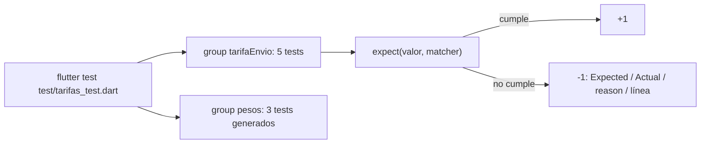
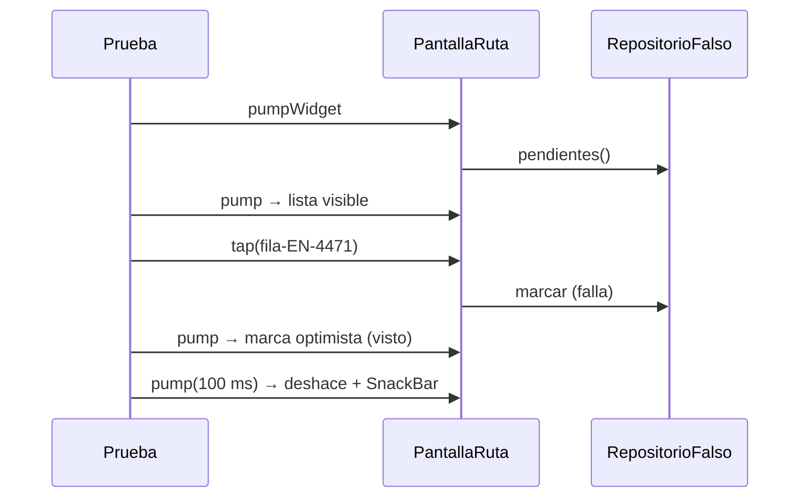
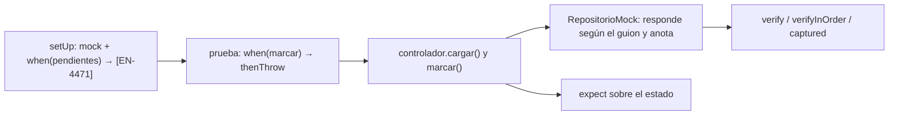
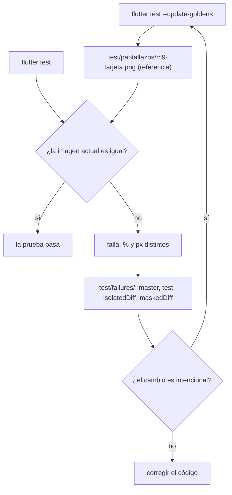
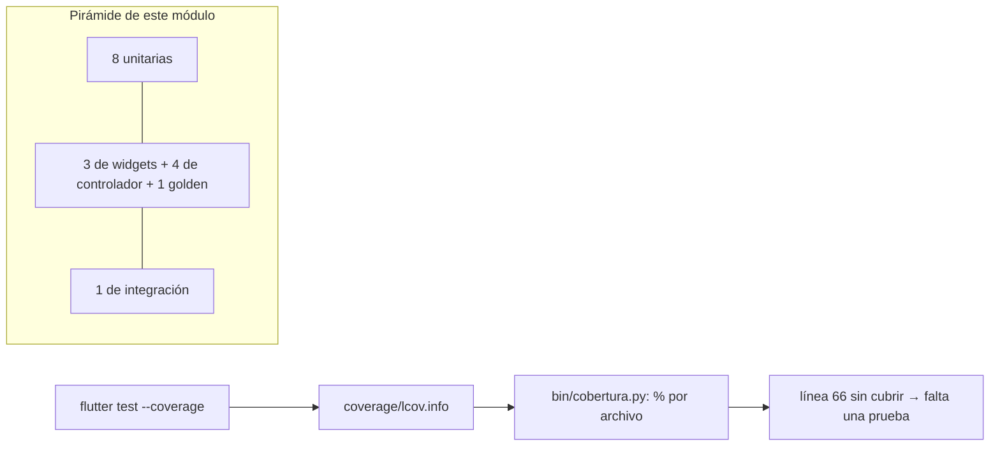

# Módulo 9: Pruebas en Flutter: unitarias, de widgets, con dobles, golden y de integración

**Entorno comprobado para esta edición (2026-11-24):** Flutter 3.50.1 (canal estable) con Dart 3.14.0 en Linux
x86_64, con `material_ui` 1.11.1 y `mocktail` 1.0.5. Todo el código se analizó con `flutter analyze` (`No issues
found!`) y todas las pruebas se ejecutaron ese día, en `/home/estudiante/labs/flutter/m9` (tu `~/labs/flutter/m9`):
las unitarias, de widgets y golden con `flutter test`, y la de integración con la app real de escritorio Linux en una
pantalla virtual. Las imágenes del Tema 4 son las que genera Flutter cuando una prueba golden falla.

Los módulos anteriores usaron pruebas para medir y para obtener pantallazos. Este módulo las ordena: qué tipo de
prueba sirve para qué, cómo se escribe cada una para que falle cuando debe y diga por qué, y cómo saber qué parte del
código no está probada. Todas las pruebas son sobre la misma pantalla de la ruta, con su tarifa y su marcado
optimista.

**Al terminar este módulo podrás:**
- escribir pruebas unitarias con `group`, `test`, `expect` y casos límite, y leer un fallo;
- probar una pantalla con `WidgetTester`: construir, buscar, tocar y comprobar;
- reemplazar dependencias con dobles de prueba: falsos hechos a mano y mocks con `mocktail`;
- proteger el diseño con pruebas golden y leer las imágenes de diferencia;
- probar un flujo completo en la app compilada y medir la cobertura.

**Esquema del módulo:** Tema 1 (pruebas unitarias) → Tema 2 (pruebas de widgets) → Tema 3 (dobles de prueba con
`mocktail`) → Tema 4 (pruebas golden) → Tema 5 (integración y cobertura) → Proyecto 26.

**Qué necesitas saber antes:** el Módulo 8; del Módulo 4, **`ChangeNotifier`** y **reemplazar dependencias** (Temas
2 y 6); del Módulo 7, **las pruebas de integración en Linux** (Tema 1); del Módulo 1, **la herramienta de
pantallazos**.

**Qué no se repite:** las pruebas de medición de rendimiento (Módulo 8, Tema 3) y de restauración (Módulo 6, Tema 4);
aquí se usan las mismas herramientas para comprobar comportamiento.

**Prepara el proyecto:**

```text
$ cd ~/labs/flutter
$ flutter create --org com.academia --platforms=linux,web m9
$ cd m9
$ flutter pub add dev:mocktail 'dev:integration_test:{"sdk":"flutter"}'
```

El código que se prueba en todo el módulo: la regla de la tarifa, el controlador de la ruta y la pantalla.

```dart
// lib/tarifas.dart — la regla de la tarifa de envío: lógica pura, ideal para pruebas unitarias
int tarifaEnvio({required int pesoGramos, required int distanciaKm, bool urgente = false}) {
  if (pesoGramos <= 0) throw ArgumentError.value(pesoGramos, 'pesoGramos', 'debe ser positivo');
  if (distanciaKm < 0) throw ArgumentError.value(distanciaKm, 'distanciaKm', 'no puede ser negativa');
  final kilosExtra = ((pesoGramos - 1) ~/ 1000);                    // el primer kilo va en la base
  var tarifa = 5000 + kilosExtra * 1000;
  if (distanciaKm > 20) tarifa += 2000;
  if (urgente) tarifa = ((tarifa * 1.5) / 100).ceil() * 100;         // redondea hacia arriba a la centena
  return tarifa;
}

/// «$ 6.500»: separador de miles con punto, como se escribe en Colombia.
String pesos(int valor) {
  final texto = valor.toString();
  final grupos = <String>[];
  for (var fin = texto.length; fin > 0; fin -= 3) {
    grupos.insert(0, texto.substring(fin - 3 < 0 ? 0 : fin - 3, fin));
  }
  return '\$ ${grupos.join('.')}';
}
```

```dart
// lib/ruta.dart — el repositorio (interfaz) y el controlador de la ruta, que la pantalla usa
import 'package:material_ui/material_ui.dart';

class Entrega {
  const Entrega(this.guia, this.pesoGramos, this.distanciaKm, {this.entregada = false});
  final String guia;
  final int pesoGramos;
  final int distanciaKm;
  final bool entregada;
  Entrega marcada() => Entrega(guia, pesoGramos, distanciaKm, entregada: true);
}

abstract interface class RepositorioEntregas {
  Future<List<Entrega>> pendientes();
  Future<void> marcar(String guia);
}

enum EstadoRuta { cargando, lista, error }

class ControladorRuta extends ChangeNotifier {
  ControladorRuta(this._repo);
  final RepositorioEntregas _repo;
  var estado = EstadoRuta.cargando;
  var entregas = <Entrega>[];
  String? aviso;

  Future<void> cargar() async {
    estado = EstadoRuta.cargando;
    notifyListeners();
    try {
      entregas = await _repo.pendientes();
      estado = EstadoRuta.lista;
    } catch (_) {
      estado = EstadoRuta.error;
    }
    notifyListeners();
  }

  /// Optimista: marca en pantalla de inmediato y deshace si el servidor falla.
  Future<void> marcar(String guia) async {
    final antes = entregas;
    entregas = [for (final e in entregas) e.guia == guia ? e.marcada() : e];
    aviso = null;
    notifyListeners();
    try {
      await _repo.marcar(guia);
    } catch (_) {
      entregas = antes;                                             // vuelve al estado anterior
      aviso = 'No se pudo marcar $guia. Inténtalo de nuevo.';
      notifyListeners();
    }
  }
}
```

```dart
// lib/pantalla_ruta.dart — la pantalla que prueban los Temas 2, 4 y 5
import 'package:material_ui/material_ui.dart';

import 'ruta.dart';
import 'tarifas.dart';

class TarjetaEntrega extends StatelessWidget {
  const TarjetaEntrega(this.entrega, {super.key, this.alMarcar});
  final Entrega entrega;
  final VoidCallback? alMarcar;

  @override
  Widget build(BuildContext context) {
    final texto = Theme.of(context).textTheme;
    final colores = Theme.of(context).colorScheme;
    return Card.outlined(
      child: ListTile(
        key: Key('fila-${entrega.guia}'),
        leading: Icon(entrega.entregada ? Icons.check_circle : Icons.inventory_2_outlined,
            color: entrega.entregada ? colores.primary : null),
        title: Text(entrega.guia),
        subtitle: Text('${(entrega.pesoGramos / 1000).toStringAsFixed(1)} kg · ${entrega.distanciaKm} km'),
        trailing: Text(pesos(tarifaEnvio(pesoGramos: entrega.pesoGramos, distanciaKm: entrega.distanciaKm)),
            style: texto.titleMedium),
        onTap: entrega.entregada ? null : alMarcar,
      ),
    );
  }
}

class PantallaRuta extends StatefulWidget {
  const PantallaRuta(this.controlador, {super.key});
  final ControladorRuta controlador;

  @override
  State<PantallaRuta> createState() => _PantallaRutaState();
}

class _PantallaRutaState extends State<PantallaRuta> {
  @override
  void initState() {
    super.initState();
    widget.controlador.addListener(_alCambiar);
    widget.controlador.cargar();
  }

  void _alCambiar() {
    final aviso = widget.controlador.aviso;
    if (aviso != null) ScaffoldMessenger.of(context).showSnackBar(SnackBar(content: Text(aviso)));
  }

  @override
  void dispose() {
    widget.controlador.removeListener(_alCambiar);
    super.dispose();
  }

  @override
  Widget build(BuildContext context) => Scaffold(
        appBar: AppBar(title: const Text('Ruta de hoy')),
        body: ListenableBuilder(
          listenable: widget.controlador,
          builder: (context, _) => switch (widget.controlador.estado) {
            EstadoRuta.cargando => const Center(child: CircularProgressIndicator()),
            EstadoRuta.error => Center(
                child: FilledButton(onPressed: widget.controlador.cargar, child: const Text('Reintentar')),
              ),
            EstadoRuta.lista => ListView(
                padding: const EdgeInsets.all(8),
                children: [
                  for (final e in widget.controlador.entregas)
                    TarjetaEntrega(e, alMarcar: () => widget.controlador.marcar(e.guia)),
                ],
              ),
          },
        ),
      );
}
```

```dart
// lib/main.dart — la pantalla con un repositorio de demostración
import 'package:material_ui/material_ui.dart';

import 'pantalla_ruta.dart';
import 'ruta.dart';

class RepositorioDemo implements RepositorioEntregas {
  @override
  Future<List<Entrega>> pendientes() async => const [Entrega('EN-4471', 1200, 8), Entrega('EN-4472', 350, 25)];
  @override
  Future<void> marcar(String guia) async {}
}

void main() => runApp(MaterialApp(
      debugShowCheckedModeBanner: false,
      theme: ThemeData(colorSchemeSeed: Colors.indigo),
      home: PantallaRuta(ControladorRuta(RepositorioDemo())),
    ));
```


## Aprende construyendo


### Tema 1: Pruebas unitarias: reglas, casos límite y fallos que se entienden · Básico · 40 min

<details open>
<summary><strong>Capa 1 — Lectura</strong></summary>

#### Objetivos
Al terminar este tema podrás:
- organizar pruebas con `group` y `test`, y comprobar con `expect` y *matchers*;
- elegir casos límite (el valor justo antes y justo después de una regla);
- comprobar que una función rechaza datos imposibles;
- leer un fallo: valor esperado, valor obtenido y motivo.

**Conceptos clave:** prueba unitaria, `expect` y *matcher*, caso límite, prueba parametrizada, mensaje de fallo

#### El problema
La tarifa tiene cuatro reglas: base, kilos adicionales, distancia y urgencia. Un cambio pequeño («el primer kilo va
en la base») puede romper otra regla sin que nadie lo note hasta que un cliente reclama un cobro. Las reglas de
negocio necesitan pruebas que corran en milisegundos y digan exactamente qué se rompió.

Este tema usa **funciones con parámetros con nombre** (Módulo 0, Tema 2), **excepciones** (Módulo 0, Tema 3) y
**records** (Módulo 0, Tema 6).

#### Glosario del tema

**prueba unitaria**
- **Definición técnica:** prueba de una función o clase aislada, sin interfaz ni red, que se ejecuta con `test()` en milisegundos.
- **En palabras sencillas:** comprobar una pieza suelta.
- **Dónde se rompe la comparación:** una pieza puede funcionar sola y fallar al unirse con otras; para eso están los otros tipos de prueba.
- **Ejemplo:** `tarifaEnvio(pesoGramos: 350, distanciaKm: 8)` debe dar 5000.
- **Error típico:** probar la regla de la tarifa a través de la pantalla: lento y frágil.

**`expect` y *matcher***
- **Definición técnica:** `expect(valor, matcher)` comprueba un valor contra un *matcher* (`equals`, `isTrue`, `contains`, `throwsArgumentError`, `isA<T>().having(...)`); un valor simple equivale a `equals`.
- **En palabras sencillas:** «espero que esto sea así».
- **Dónde se rompe la comparación:** los *matchers* compuestos describen qué esperaban; por eso los fallos se entienden.
- **Ejemplo:** `throwsA(isA<ArgumentError>().having((e) => e.name, 'name', 'distanciaKm'))`.
- **Error típico:** `expect(a == b, isTrue)`: si falla, solo dice «esperaba true».

**caso límite**
- **Definición técnica:** entrada en el borde de una regla: el último valor que no la activa y el primero que sí.
- **En palabras sencillas:** probar justo en la raya.
- **Dónde se rompe la comparación:** los errores de «mayor que» frente a «mayor o igual» solo aparecen en la raya.
- **Ejemplo:** 1000 g y 1001 g; 20 km y 21 km.
- **Error típico:** probar solo valores «típicos» (350 g, 8 km).

**prueba parametrizada**
- **Definición técnica:** varias pruebas generadas a partir de una lista de casos, cada una con su nombre.
- **En palabras sencillas:** la misma prueba con distintos datos.
- **Dónde se rompe la comparación:** cada caso es una prueba aparte: si falla uno, los demás siguen.
- **Ejemplo:** el `for` con records `(valor, esperado)` en el grupo `pesos`.
- **Error típico:** un solo `test` con muchos `expect`: el primer fallo oculta los siguientes.

**mensaje de fallo**
- **Definición técnica:** lo que imprime una prueba que falla: `Expected`, `Actual`, el `reason` y la línea.
- **En palabras sencillas:** la explicación del error.
- **Dónde se rompe la comparación:** el `reason` es tuyo: escríbelo para quien lea el fallo dentro de seis meses.
- **Ejemplo:** `Expected: <13450>  Actual: <13500>`.
- **Error típico:** nombres de prueba como «test 1».

#### ► CÓMO FUNCIONA
`flutter test` busca los archivos `*_test.dart` en `test/`, ejecuta cada `test` y muestra un contador (`+8`) de
pruebas que pasaron y uno (`-1`) de las que fallaron. Cada `expect` que falla detiene su prueba y muestra el valor
esperado, el obtenido y la línea.



#### Problema resuelto 1.1
Escribe las pruebas de la tarifa y del formato de pesos, con casos límite y datos imposibles. Después, lee el fallo
de una prueba con una expectativa equivocada.

**Razonamiento:**
1. Un grupo por función; dentro, una prueba por regla.
2. Cada regla se prueba en su raya: 1000 y 1001 g, 20 y 21 km.
3. Los datos imposibles se prueban con `throwsArgumentError` y con `having` para comprobar qué parámetro falló.
4. El formato de pesos se prueba con una lista de casos.
5. La prueba que falla a propósito está en `ejemplos_que_fallan/`, fuera de `test/`.

```dart
// test/tarifas_test.dart — pruebas unitarias: entradas, salida esperada y casos límite
import 'package:flutter_test/flutter_test.dart';
import 'package:m9/tarifas.dart';

void main() {
  group('tarifaEnvio', () {
    test('un paquete liviano y cercano paga la base', () {
      expect(tarifaEnvio(pesoGramos: 350, distanciaKm: 8), 5000);
    });

    test('cada kilo empezado después del primero suma 1000', () {
      expect(tarifaEnvio(pesoGramos: 1000, distanciaKm: 0), 5000, reason: 'exactamente 1 kg sigue en la base');
      expect(tarifaEnvio(pesoGramos: 1001, distanciaKm: 0), 6000, reason: 'un gramo más ya es otro kilo');
      expect(tarifaEnvio(pesoGramos: 2300, distanciaKm: 0), 7000);
    });

    test('más de 20 km suma 2000; 20 km exactos no', () {
      expect(tarifaEnvio(pesoGramos: 500, distanciaKm: 20), 5000);
      expect(tarifaEnvio(pesoGramos: 500, distanciaKm: 21), 7000);
    });

    test('urgente: por 1,5 y redondeado hacia arriba a la centena', () {
      expect(tarifaEnvio(pesoGramos: 1200, distanciaKm: 25, urgente: true), 12000);   // (6000 + 2000) × 1,5
      expect(tarifaEnvio(pesoGramos: 4100, distanciaKm: 0, urgente: true), 13500);    // 9000 × 1,5
    });

    test('rechaza datos imposibles', () {
      expect(() => tarifaEnvio(pesoGramos: 0, distanciaKm: 5), throwsArgumentError);
      expect(
        () => tarifaEnvio(pesoGramos: 100, distanciaKm: -1),
        throwsA(isA<ArgumentError>().having((e) => e.name, 'name', 'distanciaKm')),
      );
    });
  });

  group('pesos', () {
    for (final (valor, esperado) in [(500, r'$ 500'), (6500, r'$ 6.500'), (1234567, r'$ 1.234.567')]) {
      test('$valor → $esperado', () => expect(pesos(valor), esperado));
    }
  });
}
```

```text
$ flutter test test/tarifas_test.dart
00:00 +0: loading /home/estudiante/labs/flutter/m9/test/tarifas_test.dart
00:00 +0: tarifaEnvio un paquete liviano y cercano paga la base
00:00 +1: tarifaEnvio cada kilo empezado después del primero suma 1000
00:00 +2: tarifaEnvio más de 20 km suma 2000; 20 km exactos no
00:00 +3: tarifaEnvio urgente: por 1,5 y redondeado hacia arriba a la centena
00:00 +4: tarifaEnvio rechaza datos imposibles
00:00 +5: pesos 500 → $ 500
00:00 +6: pesos 6500 → $ 6.500
00:00 +7: pesos 1234567 → $ 1.234.567
00:00 +8: All tests passed!
```

```dart
// ejemplos_que_fallan/tarifa_mal_test.dart — FALLA A PROPÓSITO: la expectativa supone que «urgente» suma 50 %
// sin redondear. Ejecútalo con: flutter test ejemplos_que_fallan/tarifa_mal_test.dart
import 'package:flutter_test/flutter_test.dart';
import 'package:m9/tarifas.dart';

void main() {
  test('urgente con un valor que no termina en centena', () {
    expect(tarifaEnvio(pesoGramos: 100, distanciaKm: 0, urgente: true), 7500);
    expect(tarifaEnvio(pesoGramos: 1100, distanciaKm: 30, urgente: true), 12000,
        reason: '(6000 + 2000) × 1,5 = 12000');
    expect(tarifaEnvio(pesoGramos: 1100, distanciaKm: 30, urgente: true) % 100, 0);
    expect(tarifaEnvio(pesoGramos: 2100, distanciaKm: 30, urgente: true), 13450,
        reason: 'creí que 1,5 × 9000 = 13450');
  });
}
```

```text
$ flutter test ejemplos_que_fallan/tarifa_mal_test.dart
00:00 +0: loading /home/estudiante/labs/flutter/m9/ejemplos_que_fallan/tarifa_mal_test.dart
00:00 +0: urgente con un valor que no termina en centena
00:00 +0 -1: urgente con un valor que no termina en centena [E]
  Expected: <13450>
    Actual: <13500>
  creí que 1,5 × 9000 = 13450
  
  package:matcher                                     expect
  package:flutter_test/src/widget_tester.dart 473:18  expect
  ejemplos_que_fallan/tarifa_mal_test.dart 12:5       main.<fn>
  
00:00 +0 -1: Some tests failed.

Failing tests:
  /home/estudiante/labs/flutter/m9/ejemplos_que_fallan/tarifa_mal_test.dart: urgente con un valor que no termina en centena
[código de salida: 1]
```

**Explicación por partes.**
- `reason:` en la prueba de kilos explica la regla en el mismo lugar donde se comprueba.
- La salida muestra 8 pruebas: 5 de la tarifa y 3 generadas para `pesos`, cada una con su nombre.
- En el ejemplo que falla, los tres primeros `expect` pasan y el cuarto da `Expected: <13450>  Actual: <13500>`, con
  el `reason` y la línea 12: la expectativa olvidaba que el urgente se redondea hacia arriba a la centena.
- El fallo dice exactamente qué valor y dónde; no hace falta depurar.

> **Error común.** Copiar el resultado de la función en la prueba («salió 13500, pongo 13500»). La prueba queda
> comprobando lo que el código hace, no lo que debería hacer. Calcula el esperado a mano, desde la regla.

> **Error común.** Probar solo el caso feliz. Los errores de cobro están en los límites y en los datos raros.

> **Buena práctica.** Nombra cada prueba con la regla que comprueba («más de 20 km suma 2000; 20 km exactos no»): la
> lista de pruebas se convierte en la documentación de la regla.

> **Prevenir errores.** Ejecuta las pruebas unitarias en cada guardado (`flutter test` es rápido) y en el CI en cada
> pull request.

#### Checkpoint 1.1
¿Qué tarifa da 1000 g a 21 km, urgente?

Respuesta: 10 500. Base 5000 (1000 g está en el primer kilo), más 2000 por la distancia: 7000; por 1,5: 10 500, que ya
termina en centena.

</details>

<details>
<summary><strong>Capa 2 — Construcción</strong></summary>

#### Paso 1 · Crea los archivos
Crea `lib/tarifas.dart` y `test/tarifas_test.dart`.

#### Paso 2 · Ejecuta
Ejecuta `flutter test test/tarifas_test.dart` y después el ejemplo que falla.

#### Paso 3 · Agrega un caso
Agrega una prueba para 1000 g a 21 km, urgente, con el valor del Checkpoint.

#### Paso 4 · Rompe la regla
Cambia en `tarifaEnvio` el `> 20` por `>= 20` y ejecuta. ¿Qué prueba falla y qué dice?

#### Paso 5 · Agrega una regla
Agrega «los domingos +30 %» con un parámetro `domingo` y escribe sus pruebas antes de implementarla.

#### Resumen
- Una **prueba unitaria** comprueba una pieza aislada con **`expect` y un *matcher***.
- Los **casos límite** encuentran los errores de comparación.
- Una **prueba parametrizada** genera una prueba por caso.
- Un buen **mensaje de fallo** dice qué, cuánto y dónde.

#### Ejercicio verificable 1
Básico. ¿Cuántas pruebas ejecuta `test/tarifas_test.dart`?

Respuesta esperada: 8 (`All tests passed!` con `+8`).

#### Ejercicio verificable 2
Intermedio. En el Paso 4, ¿qué prueba falla?

Respuesta esperada: «más de 20 km suma 2000; 20 km exactos no», con `Expected: <5000>  Actual: <7000>` para 500 g a
20 km.

#### Ejercicio verificable 3
Reto. ¿Por qué el ejemplo que falla usa `pesoGramos: 2100` para el caso de 9000?

Respuesta esperada: porque 2100 g son 2 kilos extra (5000 + 2000), más 2000 por 30 km: 9000. Por 1,5 son 13 500, y
la expectativa de 13 450 es el error.

#### En el trabajo
Las pruebas unitarias son la base de cualquier estrategia de pruebas: muchas, rápidas y precisas. En los equipos
maduros, una regla de negocio no se fusiona sin sus pruebas, y los nombres de las pruebas se leen como
especificación.

</details>

### Tema 2: Pruebas de widgets: construir, buscar, tocar y comprobar · Intermedio · 45 min

<details open>
<summary><strong>Capa 1 — Lectura</strong></summary>

#### Objetivos
Al terminar este tema podrás:
- construir una pantalla en una prueba con `pumpWidget` y avanzar con `pump`;
- encontrar widgets con `find.text`, `find.byKey`, `find.byIcon` y `find.descendant`;
- simular toques y comprobar el resultado con `findsOneWidget` y `findsNothing`;
- probar un flujo con error usando un repositorio falso hecho a mano.

**Conceptos clave:** `WidgetTester`, *finder*, `pump`, `findsOneWidget`, falso hecho a mano

#### El problema
La regla de la tarifa está probada, pero ¿la pantalla muestra la tarifa correcta en cada fila? ¿Tocar una fila la
marca? ¿Si el servidor falla, la marca se deshace y aparece un aviso? Son preguntas sobre la interfaz, y probarlas a
mano en cada cambio no escala.

Este tema usa **pruebas de widgets** (Módulo 1), **keys** (Módulo 1, Tema 5) y **el controlador con
`ChangeNotifier`** (Módulo 4, Tema 2).

#### Glosario del tema

**`WidgetTester`**
- **Definición técnica:** objeto que `testWidgets` entrega para construir widgets, avanzar el reloj, simular gestos e inspeccionar el árbol, sin abrir una ventana.
- **En palabras sencillas:** un usuario de mentira con cronómetro.
- **Dónde se rompe la comparación:** no hay código nativo ni red real; es un entorno controlado.
- **Ejemplo:** `tester.pumpWidget(...)`, `tester.tap(...)`.
- **Error típico:** usar `Future.delayed` real dentro de `testWidgets`: el reloj es simulado.

***finder***
- **Definición técnica:** descripción de qué widgets buscar (`find.text`, `find.byKey`, `find.byType`, `find.byIcon`, `find.descendant`), que se evalúa contra el árbol actual.
- **En palabras sencillas:** la forma de señalar algo en la pantalla.
- **Dónde se rompe la comparación:** un *finder* no busca hasta que se usa; si el árbol cambia, el resultado cambia.
- **Ejemplo:** `find.descendant(of: find.byKey(Key('fila-EN-4472')), matching: find.byIcon(Icons.check_circle))`.
- **Error típico:** buscar por texto algo que se traduce o cambia; para eso están las keys.

**`pump`**
- **Definición técnica:** avanza el reloj de la prueba y construye un cuadro; `pumpAndSettle` repite hasta que no queden animaciones.
- **En palabras sencillas:** pasar a la página siguiente.
- **Dónde se rompe la comparación:** un `Future` resuelto termina en el siguiente `pump`; uno con espera real, no.
- **Ejemplo:** después de tocar, un `pump` muestra la marca optimista y `pump(100 ms)`, el error que la deshace.
- **Error típico:** comprobar justo después de `tap` sin `pump`: la pantalla todavía no cambió.

**`findsOneWidget`**
- **Definición técnica:** *matcher* que exige que el *finder* encuentre exactamente un widget; también existen `findsNothing`, `findsNWidgets(n)` y `findsWidgets`.
- **En palabras sencillas:** «hay exactamente uno».
- **Dónde se rompe la comparación:** «exactamente uno» falla si hay dos; a veces eso es lo que se quiere detectar.
- **Ejemplo:** `expect(find.text(r'$ 6.000'), findsOneWidget)`.
- **Error típico:** `findsWidgets` cuando se espera uno: no detecta duplicados.

**falso hecho a mano**
- **Definición técnica:** implementación simple de una interfaz, escrita para las pruebas, con datos fijos y comportamiento configurable.
- **En palabras sencillas:** un repositorio de utilería.
- **Dónde se rompe la comparación:** no comprueba cómo se usa; para eso están los mocks (Tema 3).
- **Ejemplo:** `RepositorioFalso(fallarAlMarcar: true)` y su lista `marcadas`.
- **Error típico:** falsos tan complejos que necesitan sus propias pruebas.

#### ► CÓMO FUNCIONA
La prueba construye la pantalla con un repositorio falso, avanza un cuadro para que termine la carga, busca y toca, y
avanza otra vez para ver el efecto. Cada paso es sincrónico desde el punto de vista de la prueba: nada ocurre si no
se llama a `pump`.



#### Problema resuelto 2.1
Prueba la pantalla de la ruta: que muestre las tarifas, que tocar una fila la marque y que un fallo del servidor
deshaga la marca y muestre un aviso.

**Razonamiento:**
1. El falso devuelve dos entregas fijas y registra las guías marcadas; puede fallar a pedido.
2. `abrir` construye la pantalla y avanza un cuadro; las tres pruebas lo reutilizan.
3. Las filas tienen keys (`fila-EN-4471`) para buscarlas sin depender del texto.
4. El falso tarda 100 ms en responder, como un servidor. La prueba del error avanza un cuadro para ver la marca
   optimista y después 100 ms para ver la respuesta con error. **La primera versión del falso fallaba de inmediato**,
   y la marca optimista y la reversión ocurrían en el mismo cuadro: la prueba no podía ver el estado intermedio.

```dart
// test/pantalla_test.dart — pruebas de widgets: construir, buscar, tocar y comprobar lo que se ve
import 'package:flutter_test/flutter_test.dart';
import 'package:m9/pantalla_ruta.dart';
import 'package:m9/ruta.dart';
import 'package:material_ui/material_ui.dart';

/// Un repositorio falso hecho a mano: devuelve datos fijos y puede fallar a pedido.
class RepositorioFalso implements RepositorioEntregas {
  RepositorioFalso({this.fallarAlMarcar = false});
  final bool fallarAlMarcar;
  final marcadas = <String>[];

  @override
  Future<List<Entrega>> pendientes() async => const [Entrega('EN-4471', 1200, 8), Entrega('EN-4472', 350, 25)];

  @override
  Future<void> marcar(String guia) async {
    await Future<void>.delayed(const Duration(milliseconds: 100));   // como un servidor real: tarda
    if (fallarAlMarcar) throw Exception('sin red');
    marcadas.add(guia);
  }
}

Future<RepositorioFalso> abrir(WidgetTester tester, {bool fallar = false}) async {
  final repo = RepositorioFalso(fallarAlMarcar: fallar);
  await tester.pumpWidget(MaterialApp(home: PantallaRuta(ControladorRuta(repo))));
  await tester.pump();                                              // termina la carga (Future ya resuelto)
  return repo;
}

void main() {
  testWidgets('muestra cada entrega con su tarifa', (tester) async {
    await abrir(tester);
    expect(find.text('EN-4471'), findsOneWidget);
    expect(find.text(r'$ 6.000'), findsOneWidget);                  // 1,2 kg a 8 km
    expect(find.text(r'$ 7.000'), findsOneWidget);                  // 0,35 kg a 25 km
    expect(find.byIcon(Icons.check_circle), findsNothing);
  });

  testWidgets('tocar una fila la marca', (tester) async {
    final repo = await abrir(tester);
    await tester.tap(find.byKey(const Key('fila-EN-4472')));
    await tester.pump(const Duration(milliseconds: 100));          // la respuesta del servidor
    expect(repo.marcadas, ['EN-4472']);
    expect(
      find.descendant(of: find.byKey(const Key('fila-EN-4472')), matching: find.byIcon(Icons.check_circle)),
      findsOneWidget,
    );
  });

  testWidgets('si el servidor falla, deshace y avisa', (tester) async {
    await abrir(tester, fallar: true);
    await tester.tap(find.byKey(const Key('fila-EN-4471')));
    await tester.pump();                                            // marca optimista: ya se ve el visto
    expect(find.byIcon(Icons.check_circle), findsOneWidget);
    await tester.pump(const Duration(milliseconds: 100));          // llega el error y deshace
    expect(find.byIcon(Icons.check_circle), findsNothing);
    expect(find.text('No se pudo marcar EN-4471. Inténtalo de nuevo.'), findsOneWidget);
  });
}
```

```text
$ flutter test test/pantalla_test.dart
00:00 +0: loading /home/estudiante/labs/flutter/m9/test/pantalla_test.dart
00:00 +0: muestra cada entrega con su tarifa
00:00 +1: tocar una fila la marca
00:00 +2: si el servidor falla, deshace y avisa
00:01 +3: All tests passed!
```

**Explicación por partes.**
- La primera prueba comprueba lo que ve el usuario: las guías y las tarifas formateadas, que salen de la regla del
  Tema 1.
- La segunda comprueba los dos lados: el falso registró `EN-4472` y la fila muestra el visto.
- La tercera prueba el camino del error, que es el que más se olvida: primero se ve el visto (marca optimista) y,
  cuando llega el error, desaparece y el aviso explica qué pasó.
- Ninguna prueba usa la red ni el reloj real; las tres corren en menos de un segundo.

> **Error común.** Probar widgets por su estructura interna («hay un `Padding` dentro de un `Row`»). Cualquier
> rediseño rompe la prueba sin que haya un error. Prueba lo que el usuario ve y hace.

> **Error común.** Olvidar el segundo `pump` en flujos asíncronos y concluir que «la pantalla no se actualiza».

> **Buena práctica.** Pon keys estables en los elementos con los que se interactúa (filas, botones principales).
> Hacen las pruebas legibles y resistentes a cambios de texto y de traducción.

> **Prevenir errores.** Por cada pantalla, prueba al menos: el estado con datos, la acción principal y el camino de
> error.

#### Checkpoint 2.1
¿Qué pasaría en la tercera prueba con un solo `pump` después de tocar?

Respuesta: la prueba fallaría en `findsNothing`: el falso todavía no respondió (tarda 100 ms), así que la fila sigue
con la marca optimista. Con un falso que falla de inmediato, en cambio, no se podría ver la marca optimista: por eso
el falso de este tema tarda.

</details>

<details>
<summary><strong>Capa 2 — Construcción</strong></summary>

#### Paso 1 · Crea el archivo
Crea `test/pantalla_test.dart`.

#### Paso 2 · Ejecuta
Ejecuta `flutter test test/pantalla_test.dart`.

#### Paso 3 · Quita la espera
En la prueba del error, quita la línea `await tester.pump(const Duration(milliseconds: 100));` y lee el fallo.

#### Paso 4 · Prueba el estado de error
Agrega un falso cuyo `pendientes()` lance una excepción y comprueba que aparece «Reintentar»; tócalo y comprueba que
se vuelve a llamar a `pendientes()`.

#### Paso 5 · Prueba una entrega ya marcada
Haz que el falso devuelva una entrega con `entregada: true` y comprueba que tocarla no llama a `marcar`.

#### Resumen
- **`WidgetTester`** construye y opera la pantalla; los ***finders*** señalan widgets.
- **`pump`** avanza el reloj; **`findsOneWidget`** y sus parientes comprueban cuántos hay.
- Un **falso hecho a mano** controla los datos y los errores.

#### Ejercicio verificable 1
Básico. ¿Por qué la tarifa de `EN-4472` es `$ 7.000` si pesa solo 350 g?

Respuesta esperada: porque está a 25 km: base 5000 más 2000 por pasar de 20 km.

#### Ejercicio verificable 2
Intermedio. En el Paso 3, ¿qué mensaje da la prueba?

Respuesta esperada: `Expected: no matching candidates`, `Actual: _IconWidgetFinder:<Found 1 widget with icon
"IconData(U+0E159)": ...>` y `Which: means one was found but none were expected`: todavía hay un visto en pantalla.

#### Ejercicio verificable 3
Reto. En el Paso 5, ¿por qué no se llama a `marcar`?

Respuesta esperada: porque `TarjetaEntrega` pone `onTap: null` cuando la entrega ya está marcada; el toque no hace
nada y la lista `marcadas` del falso queda vacía.

#### En el trabajo
Las pruebas de widgets son la mayor parte de las pruebas de una app Flutter: corren rápido, sin dispositivo, y cubren
la lógica de presentación. En las revisiones de código se pide al menos una prueba por pantalla nueva con su camino
de error.

</details>

### Tema 3: Dobles de prueba con mocktail: qué responde y qué se llamó · Intermedio · 45 min

<details open>
<summary><strong>Capa 1 — Lectura</strong></summary>

#### Objetivos
Al terminar este tema podrás:
- crear un mock de una interfaz con `mocktail`;
- decir qué debe responder con `when(...).thenAnswer` y `thenThrow`;
- comprobar qué se llamó, cuántas veces y con qué argumentos con `verify`, `captureAny` y `verifyInOrder`;
- elegir entre un falso, un *stub* y un mock.

**Conceptos clave:** doble de prueba, mock, *stub*, `verify`, captura de argumentos, `setUp`

#### El problema
El falso del Tema 2 sirvió para la pantalla, pero para probar el controlador hacen falta preguntas que el falso no
responde con facilidad: ¿se llamó al repositorio una sola vez?, ¿con qué guía?, ¿en qué orden?, ¿nunca se intentó
marcar al cargar? Escribir un falso para cada combinación se vuelve inmanejable.

Este tema usa **el controlador de la ruta** (código del módulo), **interfaces** (Módulo 4, Tema 4) y **funciones
anónimas** (Módulo 0, Tema 2).

#### Glosario del tema

**doble de prueba**
- **Definición técnica:** objeto que reemplaza a una dependencia real en una prueba; los tipos más comunes son falsos, *stubs* y mocks.
- **En palabras sencillas:** el doble de riesgo de una película.
- **Dónde se rompe la comparación:** un doble demasiado distinto del real hace que la prueba pase y la app falle.
- **Ejemplo:** `RepositorioFalso` (Tema 2) y `RepositorioMock`.
- **Error típico:** usar dobles para todo, también para la lógica que se quiere probar.

**mock**
- **Definición técnica:** doble que registra las llamadas que recibe para comprobarlas después; con `mocktail` se crea extendiendo `Mock` e implementando la interfaz.
- **En palabras sencillas:** un doble que toma nota de todo.
- **Dónde se rompe la comparación:** si no se le dice qué responder, devuelve `null` (y con tipos no nulos, falla).
- **Ejemplo:** `class RepositorioMock extends Mock implements RepositorioEntregas {}`.
- **Error típico:** verificar cada llamada interna: la prueba se rompe con cualquier refactorización.

***stub***
- **Definición técnica:** respuesta programada para una llamada: `when(() => repo.pendientes()).thenAnswer(...)`.
- **En palabras sencillas:** el guion del doble.
- **Dónde se rompe la comparación:** para `Future` se usa `thenAnswer((_) async => ...)`, no `thenReturn`.
- **Ejemplo:** `thenThrow(Exception('503'))` para el camino de error.
- **Error típico:** `thenReturn(Future.value(...))`: `mocktail` lo rechaza porque reutilizaría el mismo `Future`.

**`verify`**
- **Definición técnica:** comprueba que una llamada ocurrió (`.called(n)` para la cantidad); `verifyNever` comprueba que no ocurrió; `verifyInOrder`, el orden.
- **En palabras sencillas:** revisar las notas del doble.
- **Dónde se rompe la comparación:** comprueba interacción, no resultado; las dos cosas se complementan.
- **Ejemplo:** `verifyNever(() => repo.marcar(any()))`.
- **Error típico:** usar `verify` cuando basta con comprobar el estado final.

**captura de argumentos**
- **Definición técnica:** `captureAny()` dentro de `verify` guarda los argumentos con que se llamó, en `.captured`.
- **En palabras sencillas:** guardar lo que se le pasó al doble.
- **Dónde se rompe la comparación:** para argumentos con nombre se usa `captureAny(named: 'x')`.
- **Ejemplo:** `verify(() => repo.marcar(captureAny())).captured.single`.
- **Error típico:** usar `any()` sin registrar un valor de respaldo para tipos propios (`registerFallbackValue`).

**`setUp`**
- **Definición técnica:** función que se ejecuta antes de cada prueba de su grupo para crear un estado limpio; `tearDown` se ejecuta después.
- **En palabras sencillas:** preparar la mesa antes de cada comida.
- **Dónde se rompe la comparación:** `setUpAll` se ejecuta una sola vez; compartir mocks entre pruebas mezcla las llamadas.
- **Ejemplo:** un mock y un controlador nuevos por prueba.
- **Error típico:** crear el mock una vez para todo el archivo: `verify(...).called(1)` cuenta las llamadas de todas las pruebas.

#### ► CÓMO FUNCIONA
En `setUp` se crea un mock nuevo con su guion por defecto. Cada prueba puede cambiar el guion, ejecuta el
controlador y después verifica el estado y las llamadas. `mocktail` intercepta cada llamada al mock: si hay un guion
que coincide, responde con él; además, la anota.



#### Problema resuelto 3.1
Prueba el controlador de la ruta con un mock: la secuencia de estados al cargar, el error al cargar, el argumento con
que se marca y el orden de las llamadas cuando marcar falla.

**Razonamiento:**
1. El mock se declara en una línea; la interfaz `RepositorioEntregas` hace todo posible.
2. `setUp` crea todo nuevo y registra los estados que avisa el controlador.
3. Cada prueba cambia solo el guion que necesita.
4. Se comprueban estado (`expect`) e interacciones (`verify`) en la misma prueba.

```dart
// test/controlador_test.dart — dobles de prueba con mocktail: decir qué responde y comprobar qué se llamó
import 'package:flutter_test/flutter_test.dart';
import 'package:m9/ruta.dart';
import 'package:mocktail/mocktail.dart';

class RepositorioMock extends Mock implements RepositorioEntregas {}

void main() {
  late RepositorioMock repo;
  late ControladorRuta controlador;
  late List<EstadoRuta> estados;

  setUp(() {                                                        // antes de cada prueba: todo nuevo
    repo = RepositorioMock();
    controlador = ControladorRuta(repo);
    estados = [];
    controlador.addListener(() => estados.add(controlador.estado));
    when(() => repo.pendientes()).thenAnswer((_) async => const [Entrega('EN-4471', 1200, 8)]);
  });

  test('cargar pasa por «cargando» y termina en «lista»', () async {
    await controlador.cargar();
    expect(estados, [EstadoRuta.cargando, EstadoRuta.lista]);
    verify(() => repo.pendientes()).called(1);
    verifyNever(() => repo.marcar(any()));
  });

  test('un error al cargar deja el estado en «error»', () async {
    when(() => repo.pendientes()).thenThrow(Exception('503'));
    await controlador.cargar();
    expect(controlador.estado, EstadoRuta.error);
  });

  test('marcar llama al repositorio con la guía', () async {
    when(() => repo.marcar(any())).thenAnswer((_) async {});
    await controlador.cargar();
    await controlador.marcar('EN-4471');
    final guia = verify(() => repo.marcar(captureAny())).captured.single;   // captura el argumento
    expect(guia, 'EN-4471');
    expect(controlador.entregas.single.entregada, isTrue);
  });

  test('si marcar falla, se deshace y hay aviso', () async {
    when(() => repo.marcar(any())).thenThrow(Exception('sin red'));
    await controlador.cargar();
    await controlador.marcar('EN-4471');
    expect(controlador.entregas.single.entregada, isFalse);
    expect(controlador.aviso, contains('EN-4471'));
    verifyInOrder([() => repo.pendientes(), () => repo.marcar('EN-4471')]);
  });
}
```

```text
$ flutter test test/controlador_test.dart
00:00 +0: loading /home/estudiante/labs/flutter/m9/test/controlador_test.dart
00:00 +0: cargar pasa por «cargando» y termina en «lista»
00:00 +1: un error al cargar deja el estado en «error»
00:00 +2: marcar llama al repositorio con la guía
00:00 +3: si marcar falla, se deshace y hay aviso
00:00 +4: All tests passed!
```

**Explicación por partes.**
- Primera prueba: la lista de estados avisados es `[cargando, lista]`, y `verifyNever` confirma que cargar no marca
  nada.
- Segunda: `thenThrow` reemplaza el guion de `setUp` solo para esta prueba.
- Tercera: `captureAny()` recupera la guía con que se llamó a `marcar`.
- Cuarta: el estado vuelve atrás y hay aviso; `verifyInOrder` comprueba que primero se cargó y después se intentó
  marcar.

> **Error común.** Verificar detalles que no importan («`notifyListeners` se llamó exactamente 3 veces»). Una mejora
> interna rompe la prueba. Verifica lo que define el comportamiento.

> **Error común.** Usar mocks para clases de datos (`Entrega`). Se crean instancias reales; los dobles son para
> dependencias con efectos (red, disco, hora).

> **Buena práctica.** Falso hecho a mano para pruebas de pantalla (más legible) y mock con `mocktail` cuando importa
> cómo se llamó a la dependencia.

> **Prevenir errores.** Todo nuevo en `setUp`: mocks compartidos entre pruebas son la causa de pruebas que pasan
> solas y fallan juntas.

#### Checkpoint 3.1
¿Qué pasa si quitas el `when(() => repo.marcar(any())).thenAnswer((_) async {})` de la tercera prueba?

Respuesta: el mock devuelve `null` para `marcar`, que debía devolver un `Future<void>`, y `mocktail` lanza un error de
tipo; el controlador lo atrapa como un fallo, deshace la marca, y la prueba falla en `isTrue`.

</details>

<details>
<summary><strong>Capa 2 — Construcción</strong></summary>

#### Paso 1 · Crea el archivo
Crea `test/controlador_test.dart`.

#### Paso 2 · Ejecuta
Ejecuta `flutter test test/controlador_test.dart`.

#### Paso 3 · Cuenta llamadas
Agrega una prueba que llame dos veces a `cargar` y compruebe `verify(() => repo.pendientes()).called(2)`.

#### Paso 4 · Rompe el orden
En la cuarta prueba, invierte el orden de la lista de `verifyInOrder` y lee el fallo.

#### Paso 5 · Usa `thenReturn` con un Future
Cambia el guion de `setUp` a `when(() => repo.pendientes()).thenReturn(Future.value(const [...]))` y ejecuta.

#### Resumen
- Un **doble de prueba** reemplaza una dependencia; un **mock** anota sus llamadas y un ***stub*** define sus
  respuestas.
- **`verify`** y la **captura de argumentos** comprueban la interacción.
- **`setUp`** da un estado limpio a cada prueba.

#### Ejercicio verificable 1
Básico. ¿Qué lista de estados registra la primera prueba?

Respuesta esperada: `[EstadoRuta.cargando, EstadoRuta.lista]`.

#### Ejercicio verificable 2
Intermedio. En el Paso 4, ¿qué tipo de fallo aparece?

Respuesta esperada: `Matching call #1 not found. All calls: RepositorioMock.pendientes(),
RepositorioMock.marcar(EN-4471)`. `mocktail` muestra todas las llamadas que sí ocurrieron, en orden, para comparar.

#### Ejercicio verificable 3
Reto. En el Paso 5, ¿qué pasa?

Respuesta esperada: fallan todas las pruebas, con este mensaje de `mocktail`:

```text
Invalid argument(s): `thenReturn` should not be used to return a Future. Instead, use `thenAnswer((_) => future)`.
```

Un `Future` es un resultado de un solo uso; con `thenAnswer`, cada llamada recibe uno nuevo.

#### En el trabajo
`mocktail` es la biblioteca de mocks más usada en Flutter porque no necesita generación de código. En las revisiones
se busca el equilibrio: pocos `verify`, enfocados en lo que importa, y pruebas que sigan pasando después de
refactorizar.

</details>

### Tema 4: Pruebas golden: el diseño también se prueba · Intermedio · 40 min

<details open>
<summary><strong>Capa 1 — Lectura</strong></summary>

#### Objetivos
Al terminar este tema podrás:
- escribir una prueba golden que compare una pantalla con una imagen de referencia aprobada;
- actualizar la referencia cuando un cambio de diseño es intencional;
- leer el fallo de una prueba golden y las imágenes de diferencia que genera Flutter;
- evitar las causas comunes de goldens inestables (fuentes, tamaño, sombras, animaciones).

**Conceptos clave:** prueba golden, imagen de referencia, `--update-goldens`, imágenes de diferencia, golden
inestable

#### El problema
Alguien cambia el estilo de la tarifa de `titleMedium` a `titleSmall` «porque se veía grande». Todas las pruebas de
los Temas 1 a 3 pasan: la tarifa sigue siendo correcta y se sigue mostrando. Pero el diseño cambió en todas las
tarjetas de la app, y nadie lo revisó. Las pruebas de comportamiento no ven el diseño; las golden, sí.

Este tema usa **la herramienta de pantallazos** (Módulo 1), que ya era una prueba golden, y **el sistema de diseño**
(Módulo 2, Tema 6).

#### Glosario del tema

**prueba golden**
- **Definición técnica:** prueba de widgets que renderiza un widget y compara la imagen, píxel a píxel, con un archivo de referencia (`matchesGoldenFile`).
- **En palabras sencillas:** comparar con una foto aprobada.
- **Dónde se rompe la comparación:** compara píxeles, no intención: un cambio bueno y uno malo fallan igual; una persona decide.
- **Ejemplo:** `pantallazo('m9-tarjeta')`.
- **Error típico:** una golden de la pantalla completa con datos que cambian (fechas, horas): falla siempre.

**imagen de referencia**
- **Definición técnica:** el archivo PNG aprobado (*golden file*) que se guarda en el repositorio junto a la prueba.
- **En palabras sencillas:** la foto oficial.
- **Dónde se rompe la comparación:** depende de las fuentes y del motor de render: generada en Linux, puede diferir en macOS.
- **Ejemplo:** `test/pantallazos/m9-tarjeta.png`.
- **Error típico:** generar las referencias en un equipo y compararlas en otro con otro sistema.

**`--update-goldens`**
- **Definición técnica:** opción de `flutter test` que, en lugar de comparar, escribe la imagen actual como nueva referencia.
- **En palabras sencillas:** «la nueva foto es la oficial».
- **Dónde se rompe la comparación:** aprueba cualquier cosa; la revisión ocurre al mirar la imagen en el pull request.
- **Ejemplo:** `flutter test --update-goldens test/golden_test.dart`.
- **Error típico:** usarlo cada vez que una golden falla, sin mirar por qué.

**imágenes de diferencia**
- **Definición técnica:** archivos que Flutter escribe en `test/failures/` cuando una golden falla: la referencia (`masterImage`), la actual (`testImage`) y las diferencias (`isolatedDiff`, `maskedDiff`).
- **En palabras sencillas:** la foto vieja, la nueva y dónde cambian.
- **Dónde se rompe la comparación:** no se versionan: se miran y se borran.
- **Ejemplo:** las tres imágenes de este tema.
- **Error típico:** subir la carpeta `failures/` al repositorio.

**golden inestable**
- **Definición técnica:** golden que falla sin cambios de diseño por diferencias de entorno: fuentes no cargadas, tamaño de pantalla distinto, animaciones a medias, sombras o datos variables.
- **En palabras sencillas:** una foto que nunca sale igual.
- **Dónde se rompe la comparación:** la solución no es subir la tolerancia, sino fijar el entorno.
- **Ejemplo:** `cargarFuentes()`, `tamanoPantalla(...)` y datos fijos.
- **Error típico:** goldens con la fuente de prueba de Flutter (cuadros grises), que no muestran el texto real.

#### ► CÓMO FUNCIONA
La prueba fija el entorno (fuentes, tamaño, densidad), construye el widget y compara. La primera vez, o cuando el
cambio es intencional, `--update-goldens` escribe la referencia. Después, cada ejecución compara: si un píxel cambia,
la prueba falla, dice qué porcentaje cambió y deja las imágenes para revisar.



#### Problema resuelto 4.1
Protege con una golden el diseño de la tarjeta de entrega en sus dos estados. Después, cambia el estilo de la tarifa y
lee el fallo y las imágenes de diferencia.

**Razonamiento:**
1. La prueba usa la herramienta de pantallazos: fuentes reales, tamaño fijo y sombras encendidas.
2. Una sola imagen con las dos tarjetas (pendiente y entregada) cubre los dos estados.
3. El cambio de `titleMedium` a `titleSmall` se hizo en el laboratorio solo para provocar el fallo y después se
   revirtió.
4. **La primera versión usaba una pantalla de 360 × 170**: las dos tarjetas no cabían y la prueba falló con `A
   RenderFlex overflowed by 6.0 pixels on the bottom`. Con 200 de alto, cabe.

```dart
// test/golden_test.dart — prueba golden: la tarjeta debe verse igual que la imagen de referencia aprobada
import 'package:flutter_test/flutter_test.dart';
import 'package:m9/pantalla_ruta.dart';
import 'package:m9/ruta.dart';
import 'package:material_ui/material_ui.dart';

import 'pantallazo.dart';

void main() {
  setUpAll(cargarFuentes);                                          // fuentes reales: sin ellas, cuadros grises

  testWidgets('tarjeta de entrega pendiente y entregada', (tester) async {
    tamanoPantalla(tester, tamano: const Size(360, 200));
    await tester.pumpWidget(MaterialApp(
      debugShowCheckedModeBanner: false,
      theme: ThemeData(colorSchemeSeed: Colors.indigo),
      home: const Scaffold(
        body: Padding(
          padding: EdgeInsets.all(8),
          child: Column(children: [
            TarjetaEntrega(Entrega('EN-4471', 1200, 8)),
            TarjetaEntrega(Entrega('EN-4472', 350, 25, entregada: true)),
          ]),
        ),
      ),
    ));
    await pantallazo('m9-tarjeta');                                 // compara con test/pantallazos/m9-tarjeta.png
  });
}
```

```text
$ flutter test test/golden_test.dart
00:00 +0: loading /home/estudiante/labs/flutter/m9/test/golden_test.dart
00:00 +0: (setUpAll)
00:00 +0: tarjeta de entrega pendiente y entregada
00:00 +1: (tearDownAll)
00:00 +1: All tests passed!
```

Con el estilo de la tarifa cambiado a `titleSmall`:

```text
$ flutter test test/golden_test.dart
00:00 +0: loading /home/estudiante/labs/flutter/m9/test/golden_test.dart
00:00 +0: (setUpAll)
00:00 +0: tarjeta de entrega pendiente y entregada
══╡ EXCEPTION CAUGHT BY FLUTTER TEST FRAMEWORK ╞════════════════════════════════════════════════════
The following assertion was thrown while running async test code:
Golden "pantallazos/m9-tarjeta.png": Pixel test failed, 1.15%, 3315px diff detected.
Failure feedback can be found at /home/estudiante/labs/flutter/m9/test/failures
...
00:00 +0 -1: tarjeta de entrega pendiente y entregada [E]
00:00 +0 -1: Some tests failed.
```


**Explicación por partes.**
- `Pixel test failed, 1.15%, 3315px diff detected`: cambió poco más del 1 % de la imagen, y la prueba lo detectó.
- La diferencia aislada (derecha) muestra exactamente qué cambió: solo los dos importes. Es lo que se mira en una
  revisión.
- Si el cambio era intencional, se ejecuta `--update-goldens`, se revisa la imagen nueva y se sube junto con el
  código; si no, se corrige el estilo.
- Las pruebas de los Temas 1 a 3 siguieron pasando con el cambio: solo la golden lo vio.

> **Error común.** Aceptar con `--update-goldens` sin abrir `failures/`. La prueba existe para que una persona mire la
> diferencia.

> **Error común.** Goldens de pantallas completas para todo. Una golden por componente (tarjeta, botón, estado vacío)
> es más estable y su diferencia se entiende mejor.

> **Buena práctica.** Genera y compara las goldens siempre en el mismo entorno (el contenedor del CI, por ejemplo), con
> las fuentes reales cargadas.

> **Prevenir errores.** Agrega `test/failures/` al `.gitignore` y haz que el CI suba esa carpeta como artefacto cuando
> una golden falla: así el revisor ve las imágenes sin descargar nada.

#### Checkpoint 4.1
¿Por qué la diferencia aislada no muestra nada en las guías ni en los íconos?

Respuesta: porque no cambiaron. El cambio afectó solo al estilo de la tarifa; el resto de los píxeles es idéntico a
la referencia.

</details>

<details>
<summary><strong>Capa 2 — Construcción</strong></summary>

#### Paso 1 · Crea la prueba
Crea `test/golden_test.dart` y genera la referencia con `--update-goldens`.

#### Paso 2 · Provoca el fallo
Cambia el estilo de la tarifa a `titleSmall`, ejecuta sin `--update-goldens` y abre las cuatro imágenes de
`test/failures/`.

#### Paso 3 · Revierte
Vuelve a `titleMedium`, ejecuta y borra `test/failures/`.

#### Paso 4 · Agrega el modo oscuro
Agrega una segunda golden con `ThemeData(brightness: Brightness.dark, ...)`.

#### Paso 5 · Quita las fuentes
Quita `setUpAll(cargarFuentes)`, genera la referencia y mírala. ¿Sirve para revisar el diseño?

#### Resumen
- Una **prueba golden** compara contra una **imagen de referencia**.
- **`--update-goldens`** aprueba el cambio; las **imágenes de diferencia** ayudan a decidir.
- Una **golden inestable** se corrige fijando el entorno, no subiendo la tolerancia.

#### Ejercicio verificable 1
Básico. ¿Qué porcentaje de la imagen cambió con `titleSmall`?

Respuesta esperada: 1,15 % (3315 píxeles).

#### Ejercicio verificable 2
Intermedio. ¿Cuáles son las cuatro imágenes de `test/failures/`?

Respuesta esperada: `m9-tarjeta_masterImage.png` (referencia), `m9-tarjeta_testImage.png` (actual),
`m9-tarjeta_isolatedDiff.png` (solo diferencias) y `m9-tarjeta_maskedDiff.png` (la referencia con las diferencias
marcadas).

#### Ejercicio verificable 3
Reto. En el Paso 5, ¿qué se ve en la imagen?

Respuesta esperada: el texto aparece como rectángulos (la fuente de prueba de Flutter dibuja así cada letra) y los
íconos tampoco se ven como deben: la golden detectaría cambios de tamaño, pero no sirve para revisar la tipografía.

#### En el trabajo
Las goldens son la red de seguridad de los sistemas de diseño: los equipos con bibliotecas de componentes tienen una
golden por componente y por tema. En los pull requests, las imágenes de diferencia se revisan como cualquier otro
cambio.

</details>

### Tema 5: Integración y cobertura: la app completa y lo que falta probar · Intermedio · 40 min

<details open>
<summary><strong>Capa 1 — Lectura</strong></summary>

#### Objetivos
Al terminar este tema podrás:
- escribir una prueba de integración que abra la app con su `main` y recorra un flujo;
- ejecutarla en la app compilada para Linux;
- medir la cobertura de las pruebas con `flutter test --coverage`;
- leer el informe y decidir qué falta probar.

**Conceptos clave:** prueba de integración de flujo, pirámide de pruebas, cobertura, `lcov.info`, línea sin cubrir

#### El problema
Las pruebas de los Temas 1 a 4 prueban piezas: una regla, una pantalla con un falso, un controlador con un mock, una
tarjeta. ¿Funciona la app completa, con su `main`, su repositorio y la plataforma real? ¿Y qué parte del código no
recorre ninguna prueba?

Este tema usa **las pruebas de integración en Linux** (Módulo 7, Tema 1) y **todas las pruebas del módulo**.

#### Glosario del tema

**prueba de integración de flujo**
- **Definición técnica:** prueba que arranca la app real (`app.main()`) en un dispositivo o en el escritorio y recorre un flujo de usuario de principio a fin.
- **En palabras sencillas:** usar la app como un usuario, pero automático.
- **Dónde se rompe la comparación:** usa la configuración real (aquí, el repositorio de demostración); para la red real se necesita un servidor de pruebas.
- **Ejemplo:** abrir la ruta y marcar `EN-4471`.
- **Error típico:** querer cubrir cada caso con integración: lento y frágil.

**pirámide de pruebas**
- **Definición técnica:** proporción recomendada: muchas pruebas unitarias, bastantes de widgets y pocas de integración.
- **En palabras sencillas:** la base ancha es rápida y barata; la punta, lenta y cara.
- **Dónde se rompe la comparación:** en Flutter, las pruebas de widgets son tan rápidas que ocupan la mayor parte de la pirámide.
- **Ejemplo:** 8 unitarias, 3 de widgets, 4 de controlador, 1 golden y 1 de integración.
- **Error típico:** solo pruebas de integración («prueban todo»): tardan minutos y fallan por cosas ajenas.

**cobertura**
- **Definición técnica:** proporción de líneas del código que se ejecutaron durante las pruebas.
- **En palabras sencillas:** qué parte del código pisaron las pruebas.
- **Dónde se rompe la comparación:** una línea ejecutada no es una línea comprobada: una prueba sin `expect` también «cubre».
- **Ejemplo:** 98,6 % en este módulo.
- **Error típico:** exigir 100 % y escribir pruebas sin valor para llegar.

**`lcov.info`**
- **Definición técnica:** archivo de texto en formato LCOV que `flutter test --coverage` escribe en `coverage/`, con las líneas ejecutadas de cada archivo.
- **En palabras sencillas:** la planilla de qué líneas se visitaron.
- **Dónde se rompe la comparación:** solo incluye archivos que alguna prueba importó; un archivo nunca importado no aparece (aquí, `main.dart`).
- **Ejemplo:** `SF:lib/tarifas.dart`, `LF:13`, `LH:13`.
- **Error típico:** leer el porcentaje sin notar los archivos que faltan.

**línea sin cubrir**
- **Definición técnica:** línea con contador 0 en el informe: ninguna prueba la ejecutó.
- **En palabras sencillas:** una puerta que nadie abrió.
- **Dónde se rompe la comparación:** algunas no valen la pena (registros de depuración); otras esconden caminos importantes.
- **Ejemplo:** la línea 66 de `pantalla_ruta.dart`: el botón «Reintentar» del estado de error.
- **Error típico:** ignorar las líneas sin cubrir de los caminos de error.

#### ► CÓMO FUNCIONA
La prueba de integración compila la app para Linux y la ejecuta en una pantalla virtual: el mismo `main` que vería el
usuario. Aparte, `flutter test --coverage` ejecuta todas las pruebas de `test/` y anota qué líneas recorrieron. Un
pequeño programa resume el informe por archivo.



#### Problema resuelto 5.1
Prueba el flujo «abrir la ruta y marcar una entrega» en la app compilada. Mide la cobertura de todas las pruebas y
encuentra qué línea no recorre ninguna.

**Razonamiento:**
1. La prueba de integración importa `main.dart` y llama a `app.main()`.
2. Se ejecuta con `xvfb-run` en la app de Linux, como en el Módulo 7.
3. `flutter test --coverage` corre las 16 pruebas de `test/` (sin la de integración).
4. El resumen se hace con un programa de Python de 15 líneas, para no depender de herramientas extra.

```dart
// integration_test/flujo_test.dart — la app completa, compilada para Linux, con su main y su repositorio
import 'package:flutter_test/flutter_test.dart';
import 'package:integration_test/integration_test.dart';
import 'package:m9/main.dart' as app;
import 'package:material_ui/material_ui.dart';

void main() {
  IntegrationTestWidgetsFlutterBinding.ensureInitialized();

  testWidgets('el conductor abre la ruta y marca una entrega', (tester) async {
    app.main();                                                     // la app real, como al abrirla
    await tester.pumpAndSettle();
    expect(find.text('Ruta de hoy'), findsOneWidget);
    expect(find.text('EN-4471'), findsOneWidget);

    await tester.tap(find.text('EN-4471'));
    await tester.pumpAndSettle();
    expect(find.byIcon(Icons.check_circle), findsOneWidget);
    debugPrint('flujo completo: ${find.byType(Card).evaluate().length} tarjetas, 1 marcada');
  });
}
```

```text
$ xvfb-run -a flutter test integration_test/flujo_test.dart -d linux
...
00:00 +0: el conductor abre la ruta y marca una entrega
flujo completo: 2 tarjetas, 1 marcada
00:02 +1: (tearDownAll)
00:02 +1: All tests passed!
```

```text
# bin/cobertura.py — resume coverage/lcov.info: líneas cubiertas por archivo (sin herramientas extra)
import sys
archivo, total, cubiertas, resumen = None, 0, 0, []
for linea in open(sys.argv[1] if len(sys.argv) > 1 else 'coverage/lcov.info'):
    if linea.startswith('SF:'):
        archivo, lf, lh = linea[3:].strip(), 0, 0
    elif linea.startswith('LF:'):
        lf = int(linea[3:])
    elif linea.startswith('LH:'):
        lh = int(linea[3:])
    elif linea.startswith('end_of_record'):
        resumen.append((archivo, lh, lf)); total += lf; cubiertas += lh
for a, h, f in sorted(resumen):
    print(f'{a:28} {h:3}/{f:<3} {100 * h / f:5.1f} %')
print(f'{"total":28} {cubiertas:3}/{total:<3} {100 * cubiertas / total:5.1f} %')
```

```text
$ flutter test --coverage
...
00:07 +16: All tests passed!
$ python3 bin/cobertura.py
lib/pantalla_ruta.dart        39/40   97.5 %
lib/ruta.dart                 19/19  100.0 %
lib/tarifas.dart              13/13  100.0 %
total                         71/72   98.6 %
```

**Explicación por partes.**
- La prueba de integración usó el `main` real, con el repositorio de demostración, en la app compilada.
- La cobertura es alta (98,6 %), pero el informe muestra la única línea que ninguna prueba ejecutó: la 66 de
  `pantalla_ruta.dart`, el botón «Reintentar» del estado de error. Es exactamente el Paso 4 del Tema 2.
- `main.dart` no aparece en el informe: ninguna prueba de `test/` lo importa. La prueba de integración lo recorre,
  pero no se incluye en este informe.
- 16 pruebas en 7 segundos: la base de la pirámide es rápida.

> **Error común.** Celebrar el porcentaje. Un 98,6 % con el camino de error sin probar es peor que un 90 % con todos los
> errores cubiertos.

> **Error común.** Pruebas de integración que dependen de un servidor compartido. Fallan cuando otro equipo cambia
> datos. Usa un servidor de pruebas propio o un repositorio de demostración.

> **Buena práctica.** Revisa en cada pull request las líneas nuevas sin cubrir, no el total: ahí está lo que se olvidó
> probar.

> **Prevenir errores.** Ejecuta en el CI, en este orden: análisis, pruebas unitarias y de widgets con cobertura,
> goldens y, por último, integración. El orden falla rápido con lo barato.

#### Checkpoint 5.1
Si agregas la prueba del Paso 4 del Tema 2 («Reintentar»), ¿cuánto queda la cobertura de `pantalla_ruta.dart`?

Respuesta: 40/40, 100 %: la línea 66 era la única sin cubrir.

</details>

<details>
<summary><strong>Capa 2 — Construcción</strong></summary>

#### Paso 1 · Crea la prueba de integración
Crea `integration_test/flujo_test.dart` y ejecútala con `xvfb-run -a flutter test ... -d linux`.

#### Paso 2 · Mide la cobertura
Ejecuta `flutter test --coverage` y `python3 bin/cobertura.py`.

#### Paso 3 · Cubre la línea 66
Agrega la prueba del Paso 4 del Tema 2 y vuelve a medir.

#### Paso 4 · Cobertura de la integración
Ejecuta la prueba de integración con `--coverage` y compara el informe.

#### Paso 5 · Arma el CI
Escribe un `ci.sh` que ejecute `flutter analyze`, `flutter test --coverage`, las goldens y la integración, y se
detenga en el primero que falle.

#### Resumen
- Una **prueba de integración de flujo** usa la app real; va en la punta de la **pirámide de pruebas**.
- La **cobertura** (en `lcov.info`) muestra qué no se ejecutó; la **línea sin cubrir** importa más que el total.

#### Ejercicio verificable 1
Básico. ¿Cuántas pruebas ejecuta `flutter test --coverage`?

Respuesta esperada: 16 (`+16: All tests passed!`): 8 unitarias, 3 de pantalla, 4 de controlador y 1 golden.

#### Ejercicio verificable 2
Intermedio. Con el Paso 3, ¿cuál es el total?

Respuesta esperada: 72/72, 100 %, con `pantalla_ruta.dart` en 40/40.

#### Ejercicio verificable 3
Reto. ¿Por qué `main.dart` no aparece en el informe del Paso 2?

Respuesta esperada: porque ninguna prueba de `test/` lo importa, y `flutter test --coverage` solo informa los archivos
que se cargaron. Un archivo que ninguna prueba toca no aparece como 0 %, simplemente no aparece.

#### En el trabajo
Los equipos publican la cobertura en cada pull request (con Codecov o similares) y miran las líneas nuevas sin
cubrir. Las pruebas de integración se ejecutan en dispositivos reales o en granjas de dispositivos (Firebase Test Lab)
antes de cada versión.

</details>

### Proyecto 26: la red de pruebas de la ruta

<details open>
<summary><strong>Capa 1 — Lectura</strong></summary>

Vas a proteger la ruta del día con una estrategia de pruebas completa: reglas de negocio, pantallas, interacción con
dependencias, diseño y flujo real, con un CI que falle en el primer problema.

**Qué debe cumplir:**
- Toda regla de negocio (tarifa, formato de pesos, validaciones) tiene pruebas unitarias con casos límite (Tema 1).
- Cada pantalla tiene pruebas de widgets de su estado con datos, su acción principal y su camino de error (Tema 2).
- Los controladores se prueban con mocks y verifican solo las interacciones que importan (Tema 3).
- Los componentes del sistema de diseño tienen goldens en modo claro y oscuro (Tema 4).
- Un flujo de usuario completo se prueba en la app compilada, y la cobertura no tiene líneas sin cubrir en los caminos
  de error (Tema 5).

</details>

<details>
<summary><strong>Capa 2 — Construcción</strong></summary>

**Pruebas que debes ejecutar y su evidencia esperada:**

| Prueba | Cómo | Evidencia esperada |
|---|---|---|
| Unitarias | `flutter test test/tarifas_test.dart` | todos los límites de cada regla |
| Widgets | pantalla con falso que tarda y falla | marca optimista visible y después deshecha |
| Controlador | `mocktail` con `verifyInOrder` | estados y llamadas esperadas |
| Golden | cambio de estilo provocado | fallo con porcentaje e imágenes en `failures/` |
| Integración | `xvfb-run ... -d linux` | el flujo completo pasa |
| Cobertura | `flutter test --coverage` | 100 % en los caminos de error |

**Entregables:** el proyecto; `ci.sh`; el informe de cobertura; las imágenes de una diferencia golden; y
`pruebas.md` con la pirámide del proyecto (cuántas pruebas de cada tipo y por qué).

</details>
