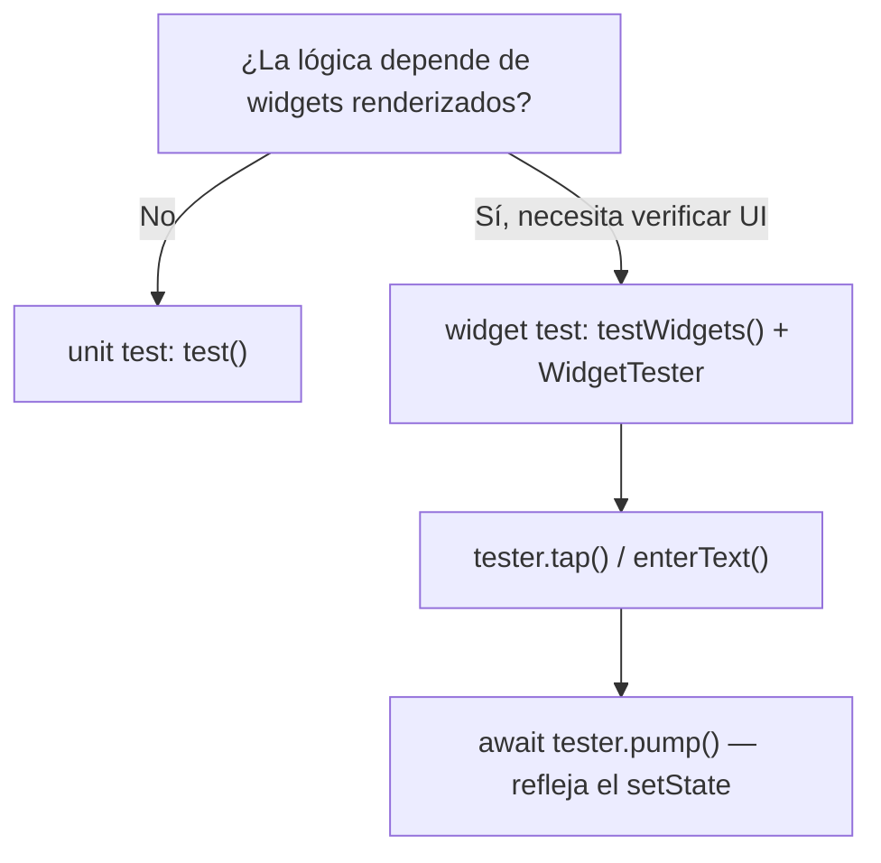
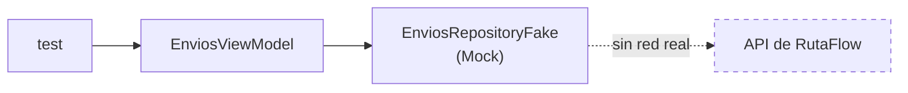
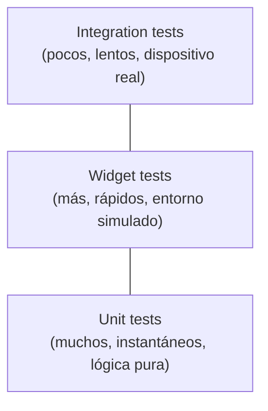

# Módulo 9: Testing en Flutter


## Aprende construyendo


### Tema 1: Unit tests y widget tests · Intermedio · 35 min

<details open>
<summary><strong>Capa 1 — Lectura</strong></summary>

#### ► DE QUÉ TRATA
Al finalizar vas a escribir un unit test de la regla "envío atrasado" y un widget test que confirme que TarjetaEnvio muestra la guía correcta. Prerrequisitos: Módulo 8 completo.

#### ► CÓMO FUNCIONA


</details>

<details>
<summary><strong>Capa 2 — Construcción</strong></summary>

#### Código y verificación
```dart
test('valida un email correcto', () {
  expect(esEmailValido('ana@ejemplo.com'), isTrue);
});
```

```dart
testWidgets('muestra el título de la tarea', (tester) async {
  await tester.pumpWidget(MaterialApp(home: TarjetaTarea(titulo: 'Comprar leche')));
  expect(find.text('Comprar leche'), findsOneWidget);
});

testWidgets('incrementa el contador al tocar el botón', (tester) async {
  await tester.pumpWidget(MaterialApp(home: Contador()));
  await tester.tap(find.byType(ElevatedButton));
  await tester.pump(); // reconstruye tras el setState
  expect(find.text('1'), findsOneWidget);
});
```


```bash
flutter create demo_flutter
cd demo_flutter
rm test/widget_test.dart
```

```dart
import 'package:flutter/material.dart';

class Envio {
  Envio({required this.fechaEstimada});
  final DateTime fechaEstimada;
}

bool estaAtrasado(Envio envio) => DateTime.now().isAfter(envio.fechaEstimada);

class TarjetaEnvio extends StatelessWidget {
  const TarjetaEnvio({required this.guia, required this.estado, super.key});
  final String guia;
  final String estado;

  @override
  Widget build(BuildContext context) => ListTile(title: Text(guia), subtitle: Text(estado));
}
```

```dart
import 'package:demo_flutter/envios.dart';
import 'package:flutter/material.dart';
import 'package:flutter_test/flutter_test.dart';

void main() {
  test('un envío con fecha estimada pasada está atrasado', () {
    expect(estaAtrasado(Envio(fechaEstimada: DateTime.now().subtract(const Duration(hours: 1)))), isTrue);
  });

  testWidgets('TarjetaEnvio muestra la guía', (tester) async {
    // ListTile necesita un Material ancestro: Scaffold lo aporta.
    await tester.pumpWidget(const MaterialApp(home: Scaffold(body: TarjetaEnvio(guia: 'RF-4471', estado: 'en_ruta'))));
    expect(find.text('RF-4471'), findsOneWidget);
  });
}
```

</details>

### Tema 2: Mocking con mocktail · Intermedio · 30 min

<details open>
<summary><strong>Capa 1 — Lectura</strong></summary>

#### ► DE QUÉ TRATA
Al finalizar vas a mockear EnviosRepository con mocktail para testear EnviosViewModel sin hacer ninguna llamada de red real. Prerrequisitos: Tema 1 de este módulo.

#### ► LA ANALOGÍA
`mocktail` genera un mock de una dependencia, permitiendo configurar exactamente qué debe devolver un método específico sin una implementación real completa.
**Conceptos clave:** aislar el widget bajo prueba de sus dependencias reales.

```dart
class RepositorioFake extends Mock implements TareaRepository {}

test('el ViewModel carga tareas del repositorio', () async {
  final repo = RepositorioFake();
  when(() => repo.obtenerTodas()).thenAnswer((_) async => [tareaDePrueba]);
  // ...
});
```

`mocktail` genera un mock (una implementación simulada dinámicamente) de una dependencia como `TareaRepository`, permitiendo configurar exactamente qué debe devolver un método específico cuando se invoque (`when(...).thenAnswer(...)`) sin necesidad de una implementación real completa; esto aísla el widget o la lógica bajo prueba de sus dependencias externas reales (una API real, una base de datos real), haciendo el test más rápido (sin latencia de red o disco real) y más confiable (sin depender de la disponibilidad de un servidor externo o el estado de una base de datos real que podría variar entre ejecuciones del test).

Esta necesidad de aislar dependencias externas para hacer los tests más rápidos y confiables es exactamente el mismo principio ya estudiado con repositorios fake en Android (Módulo 9 de ese track) y Kotlin Multiplatform (Módulo 9 de ese track), aunque `mocktail` usa mocks generados dinámicamente en vez de fakes escritos manualmente como implementación completa; ambos enfoques cumplen la misma función de aislamiento, con `mocktail` requiriendo menos código escrito manualmente a cambio de una capa adicional de "magia" en tiempo de ejecución que un fake explícito no tiene.

**Analogía:** mockear una dependencia con `mocktail` es como usar un maniquí programable que responde exactamente como se le indique ante una acción específica de práctica, sin necesidad de contar con la persona o el sistema real completo para ese ensayo puntual, permitiendo repetir el ensayo tantas veces como sea necesario de forma rápida y predecible.

**¿Por qué es importante?** Aislar dependencias externas con `mocktail` hace los widget tests más rápidos (sin latencia real de red/disco) y más confiables (sin depender de la disponibilidad de servicios externos reales que podrían fallar o variar entre ejecuciones del test).

**Diagrama: aislamiento con mock**



En el proyecto integrador RutaFlow, el mock vive en `test/envios_viewmodel_test.dart` sobre `lib/features/deliveries/domain/delivery_providers.dart`. Límite de la decisión: no conviene mockear una dependencia que no tiene efectos externos reales (una función pura de cálculo, por ejemplo) — ahí llamarla directamente en el test es más simple y claro; reservá `mocktail` específicamente para dependencias con red, disco o estado externo real.

#### ► CÓMO FUNCIONA


</details>

<details>
<summary><strong>Capa 2 — Construcción</strong></summary>

#### Código y verificación
```dart
class RepositorioFake extends Mock implements TareaRepository {}

test('el ViewModel carga tareas del repositorio', () async {
  final repo = RepositorioFake();
  when(() => repo.obtenerTodas()).thenAnswer((_) async => [tareaDePrueba]);
  // ...
});
```


```bash
flutter create demo_flutter
cd demo_flutter
rm test/widget_test.dart
flutter pub add dev:mocktail
```

```dart
import 'package:flutter/foundation.dart';

class Envio {
  const Envio(this.guia);
  final String guia;
}

abstract class EnviosRepository {
  Future<List<Envio>> obtenerEnvios();
}

class EnviosViewModel extends ChangeNotifier {
  EnviosViewModel(this._repo);
  final EnviosRepository _repo;
  List<Envio> envios = const [];

  Future<void> cargar() async {
    envios = await _repo.obtenerEnvios();
    notifyListeners();
  }
}
```

```dart
import 'package:demo_flutter/envios_view_model.dart';
import 'package:flutter_test/flutter_test.dart';
import 'package:mocktail/mocktail.dart';

class EnviosRepositoryFake extends Mock implements EnviosRepository {}

const envioDePrueba = Envio('RF-4471');

void main() {
  test('el ViewModel carga envíos del repositorio', () async {
    final repo = EnviosRepositoryFake();
    when(() => repo.obtenerEnvios()).thenAnswer((_) async => [envioDePrueba]);
    final vm = EnviosViewModel(repo);
    await vm.cargar();
    expect(vm.envios, [envioDePrueba]);
  });
}
```

</details>

### Tema 3: Integration tests · Avanzado · 40 min

<details open>
<summary><strong>Capa 1 — Lectura</strong></summary>

#### ► DE QUÉ TRATA
Al finalizar vas a escribir un integration test que confirme en un dispositivo o emulador real el flujo completo de confirmar una entrega. Prerrequisitos: Tema 2 de este módulo.

#### ► CÓMO FUNCIONA


</details>

<details>
<summary><strong>Capa 2 — Construcción</strong></summary>

#### Código y verificación
```dart
testWidgets('flujo completo: crear y ver una tarea', (tester) async {
  await tester.pumpWidget(MiApp());
  await tester.tap(find.byIcon(Icons.add));
  await tester.enterText(find.byType(TextField), 'Nueva tarea');
  await tester.tap(find.text('Guardar'));
  await tester.pumpAndSettle();
  expect(find.text('Nueva tarea'), findsOneWidget);
});
```

```
Unit tests        → lógica pura, sin UI, más rápidos
Widget tests       → entorno simulado, con UI, rápidos
Integration tests   → dispositivo/emulador real, lentos, flujos completos críticos
```


```bash
flutter test integration_test/confirmar_entrega_test.dart
```

```dart
// integration_test/confirmar_entrega_test.dart (archivo completo)
import 'package:flutter/material.dart';
import 'package:flutter_test/flutter_test.dart';
import 'package:integration_test/integration_test.dart';
import 'package:rutaflow_flutter/main.dart'; // define RutaFlowApp

void main() {
  IntegrationTestWidgetsFlutterBinding.ensureInitialized();

  testWidgets('flujo completo: confirmar una entrega', (tester) async {
    await tester.pumpWidget(const RutaFlowApp());
    await tester.tap(find.text('RF-4471'));
    await tester.pumpAndSettle();
    await tester.enterText(find.byType(TextField), '837201');
    await tester.tap(find.text('Confirmar'));
    await tester.pumpAndSettle();
    expect(find.text('Entrega confirmada'), findsOneWidget);
  });
}
```

```bash
cd rutaflow_flutter
flutter pub add "dev:integration_test:{sdk: flutter}"
flutter devices
flutter test integration_test/confirmar_entrega_test.dart -d <id-del-dispositivo>
```

</details>
