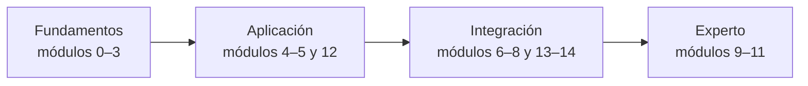
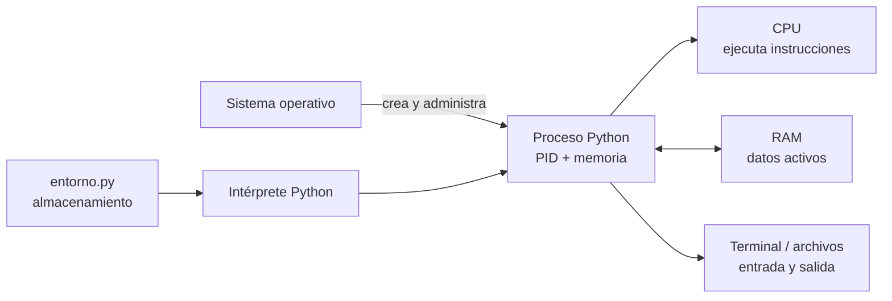
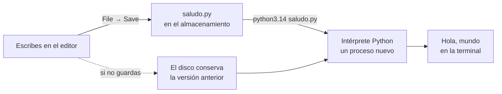
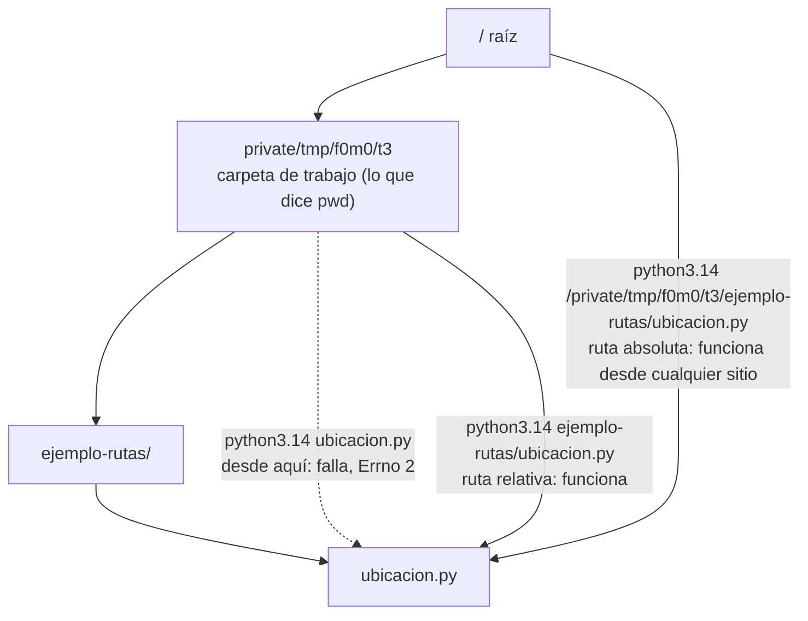
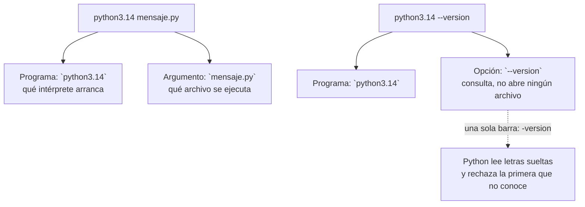
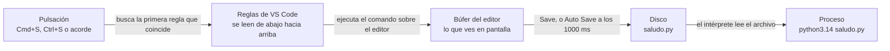

# Módulo 0: Cómo funciona tu entorno de desarrollo

## Antes de comenzar: prepara tu primera sesión

Hoy vas a crear un archivo, ejecutar un programa y corregir un error. Puedes trabajar por temas y volver después: el objetivo es poder repetir el procedimiento y explicar lo que observaste.

Una **carpeta** reúne archivos. Un **archivo** guarda contenido con un nombre, como `saludo.py`. El **editor** permite escribir ese contenido; la **terminal** permite pedirle acciones al computador escribiendo comandos. No pegues comandos en el archivo Python ni código Python directamente en la terminal.

Las siete palabras que se usan todo el capítulo, con la acción que te piden:

| Palabra | Qué es | Qué haces con ella |
|---|---|---|
| `mkdir nombre` | crear una carpeta vacía | `mkdir primera-sesion` |
| `cd nombre` | entrar en una carpeta | `cd primera-sesion` |
| `pwd` | imprimir la carpeta donde estás | `pwd` |
| `cat archivo` | imprimir el contenido de un archivo | `cat saludo.py` |
| `.py` | extensión de un archivo de Python | `saludo.py` |
| `.md` | extensión de un archivo de texto con formato ligero (Markdown) | `README.md` |

La **tubería** se escribe con el carácter `|` y conecta dos comandos: lo que el de la izquierda escribe en la
salida entra por la entrada estándar del de la derecha, sin que nadie teclee nada. `echo Ana | python3.14
entrada.py` significa «escribe `Ana` y pásaselo a `entrada.py` como si lo hubiera escrito yo». Se usa en las
capturas de este capítulo para que el resultado no dependa de que alguien teclee en el momento exacto.

Un **`README.md`** es solo un archivo de texto con esas tres letras en mayúscula: se abre en cualquier editor
y sirve para dejar apuntado lo que hiciste. No es un programa y no se ejecuta; lo escribes tú. Para crear
cualquier archivo en VS Code: **File → New File** (Archivo → Nuevo archivo), escribe el nombre completo con
su extensión (`saludo.py`, `README.md`) y guarda con **File → Save**.

### Instala y comprueba

1. Instala [Visual Studio Code](https://code.visualstudio.com/) y [Python 3.14](https://www.python.org/downloads/) desde sus sitios oficiales (la línea de versiones de la academia fija Python 3.14 para todo el curso). En Windows, sigue las indicaciones del instalador para habilitar los comandos de Python. Git se usará más adelante; no hace falta para esta práctica.
2. Abre VS Code. Elige **File → Open Folder** (Archivo → Abrir carpeta), crea una carpeta llamada `primera-sesion` dentro de Documentos y ábrela. Si VS Code pregunta por la confianza, confirma solo si es la carpeta que acabas de crear.
3. Abre **Terminal → New Terminal** (Terminal → Nueva terminal). El panel inferior es donde escribirás los comandos. Pulsa Enter después de cada uno.
4. Comprueba Python con el comando de tu sistema:

| Sistema | Comando de comprobación | Comando para ejecutar un archivo |
|---|---|---|
| Windows / PowerShell | `py -3.14 --version` | `py -3.14 saludo.py` |
| macOS / Terminal | `python3.14 --version` | `python3.14 saludo.py` |
| Linux / terminal | `python3.14 --version` | `python3.14 saludo.py` |

**Resultado esperado:** una línea que empieza por `Python 3.14` (en esta máquina, `Python 3.14.10`). Los
ejemplos del curso se comprobaron con Python 3.14 y no necesitan instalar paquetes. Escribe siempre
`python3.14`, no `python3`: un equipo puede tener varios intérpretes a la vez y `python3` es el nombre que
cada instalación eligió para uno u otro. Aquí está medido: `python3` pelado responde 3.15.2, `/usr/bin/python3`
responde 3.9.6 y solo `python3.14` garantiza la versión que fija el curso. En Windows, el lanzador usa el
guion: `py -3.14`.

Comprobado hoy en esta máquina con los cuatro intérpretes instalados: los mensajes de error que el capítulo
cita (`TypeError: posix.getpid() takes no arguments`, `can't open file … [Errno 2]`, el de opción inexistente
y `unterminated f-string literal`) salen **idénticos** en 3.14.10 y en 3.15.2, así que no hace falta
desinstalar nada si tu `python3` es más nuevo. Bajar de la 3.14 sí cambia lo que ves: en 3.12.16 y en 3.9.6 el
error de opción se escribe `unknown option --opcion-inexistente`, con minúscula y sin dos puntos, y en 3.9.6
además el archivo roto avisa `SyntaxError: EOL while scanning string literal` y un nombre mal escrito no
sugiere la alternativa con `Did you mean:`. Por eso el curso fija 3.14 y no «cualquiera».

En Ubuntu/Debian, si Python falta, puedes instalarlo con `sudo apt update` y después `sudo apt install python3`;
son comandos del sistema y pueden pedir la contraseña de administrador. Comprueba después la versión: si tu
distribución trae una anterior a la 3.14, instala la 3.14 desde python.org o con el gestor que use tu equipo.

Si aparece «comando no encontrado» o «no se reconoce», cierra y vuelve a abrir la terminal después de instalar. En Windows prueba `python --version` si `py` no está disponible; si funciona, usa `python` en lugar de `py` durante el capítulo. Si aparece `>>>`, abriste Python en modo interactivo: escribe `exit()` y pulsa Enter para volver a la terminal. No avances hasta ver la versión.

**Comprobación de esta edición (2026-11-21):** la línea de referencia es Python 3.14 (`docs/VERSIONES.md`) y
en esta máquina esa línea es 3.14.10. Las seis capturas del capítulo se generaron con `python3.14` ejecutado aquí,
macOS 27.2 arm64. El registro anterior (2026-11-18) decía 3.14.6 en Linux; se conserva como historial, pero
los números que aparecen en las transcripciones de este capítulo son los de hoy. Las instrucciones de Windows
y PowerShell siguen contrastadas solo contra la documentación: **no se ejecutaron en esos sistemas**.

**Al terminar conservarás:** `saludo.py`, `presentacion.py` y un `README.md` con tus comandos, resultados y diagnóstico. Serán el primer registro de trabajo de tu futuro gestor de tareas por terminal. No necesitas construir ese gestor todavía.

## Mapa de la ruta

«Fundamentos de Ingeniería de Software» tiene 15 módulos en 4 etapas. Cada etapa se apoya en la anterior; usa la tabla para saltar a un módulo concreto.



| Módulo | Etapa | Qué aprendes |
|---|---|---|
| 0 | Fundamentos | [Cómo funciona tu entorno de desarrollo](/curso/foundations/0) |
| 1 | Fundamentos | [Pensamiento computacional y programación](/curso/foundations/1) |
| 2 | Fundamentos | [Estructuras de datos, algoritmos y complejidad](/curso/foundations/2) |
| 3 | Fundamentos | [Fundamentos de web, redes y accesibilidad](/curso/foundations/3) |
| 4 | Aplicación | [Modelado de datos, SQL y persistencia](/curso/foundations/4) |
| 5 | Aplicación | [Testing, depuración, Git y CI](/curso/foundations/5) |
| 6 | Integración | [Seguridad, privacidad y modelado de amenazas](/curso/foundations/6) |
| 7 | Integración | [Requisitos, diseño, arquitectura y mantenimiento](/curso/foundations/7) |
| 8 | Integración | [Sistemas operativos, concurrencia, Linux y contenedores](/curso/foundations/8) |
| 9 | Experto | [Matemáticas discretas, lógica y probabilidad para software](/curso/foundations/9) |
| 10 | Experto | [Sistemas distribuidos, resiliencia y observabilidad](/curso/foundations/10) |
| 11 | Experto | [Ciencias de la Computación: mapa de especializaciones](/curso/foundations/11) |
| 12 | Aplicación | [Algoritmos clásicos](/curso/foundations/12) |
| 13 | Integración | [Catálogo de patrones de diseño](/curso/foundations/13) |
| 14 | Integración | [Código limpio](/curso/foundations/14) |

Los 17 temas de Electrónica, sensores y control para software e IoT que hasta el 2026-11-21 formaban parte de este curso pertenecen ahora al curso **Control 1**, como su módulo 29 (`/curso/control-1/29`). No eran fundamentos de ingeniería de software: eran circuitería, señales, DSP, potencia, PCB y PLC.

## Aprende construyendo

### Tema 1: Computador, sistema operativo, programa y proceso · Básico · 45 min

#### Paso 1 · Objetivo y preparación

Al finalizar podrás distinguir CPU, memoria, almacenamiento, periféricos, sistema operativo, programa, intérprete y proceso; además observarás desde un archivo real qué sistema ejecuta Python y qué identificador recibe cada ejecución. **Prerrequisitos:** ninguno de programación; sólo la instalación y comprobación de Python descritas al inicio del módulo.

#### Paso 2 · Contexto y caso real

**¿Por qué es importante?** Cuando una aplicación se congela, pierde datos o no encuentra un archivo, necesitas distinguir si el problema pertenece al código, al proceso activo, a la memoria, al almacenamiento o al sistema operativo. RutaFlow terminará ejecutándose como procesos que leen archivos, usan memoria y solicitan recursos al sistema; primero construiremos ese vocabulario con evidencia observable.

#### Paso 3 · Teoría, modelo mental y mapa de subtemas

| Subtema crítico | Papel | Evidencia observable |
|---|---|---|
| CPU, núcleo y CPU lógica | Fundamento | `os.cpu_count()` informa capacidad lógica visible, no velocidad |
| RAM frente a almacenamiento | Fundamento | una variable vive durante el proceso; el archivo permanece después |
| Entrada y salida | Fundamento | teclado/archivo aportan datos; terminal/archivo reciben resultados |
| Sistema operativo | Núcleo | `platform.system()` identifica la plataforma que ofrece servicios |
| Programa y archivo fuente | Núcleo | `entorno.py` permanece guardado antes y después de ejecutarse |
| Intérprete | Núcleo | `sys.executable` muestra qué Python ejecuta el archivo |
| Proceso y PID | Núcleo | dos ejecuciones pueden recibir identificadores distintos |
| Memoria virtual y aislamiento | Límite | un PID no permite leer directamente variables de otro proceso |
| Arquitectura y bits | Variante | `platform.machine()` describe la máquina reportada, no su rendimiento |
| Recursos, concurrencia y planificación | Profundización | tener varias CPU lógicas no vuelve paralelo cualquier programa |
| Código de salida | Diagnóstico | `0` indica terminación normal; otro valor comunica un fallo |

La **CPU** (unidad central de procesamiento) ejecuta instrucciones; sus núcleos y procesadores lógicos permiten trabajo concurrente, pero el sistema operativo decide cuándo se ejecuta cada hilo. La **RAM** (memoria de acceso aleatorio) mantiene instrucciones y datos del trabajo activo y es volátil: se borra al apagarse. El **almacenamiento** conserva archivos sin energía. SSD y RAM no son intercambiables: difieren en persistencia, tiempo de acceso (**latencia**: cuánto tarda en responder), capacidad y función.

El **sistema operativo** administra procesos, memoria, dispositivos, archivos, permisos y red, y ofrece interfaces que los programas utilizan. Un **programa** es el conjunto persistente de instrucciones y recursos; un **proceso** es una instancia activa con PID, memoria y recursos propios. Ejecutar dos veces el mismo archivo crea ejecuciones distintas aunque el programa guardado sea uno.

Python es aquí el **intérprete**: abre el archivo fuente, analiza su sintaxis y ejecuta sus instrucciones dentro de un proceso. Esto no significa que cada línea se traduzca ingenuamente una sola vez ni que Python ignore compilación interna; por ahora la distinción útil es archivo persistente frente a proceso activo.

**Analogía con límite:** el programa es una partitura guardada, el proceso es una interpretación concreta y el sistema operativo organiza el escenario. La analogía no describe memoria virtual, planificación ni permisos; esos mecanismos pertenecen al sistema y deben observarse con herramientas reales.



**Texto alternativo:** diagrama de flujo con seis cajas. A la izquierda, `entorno.py` dentro del
almacenamiento; una flecha lo conecta con la caja «Intérprete Python». Arriba, la caja «Sistema
operativo» tiene una flecha etiquetada «crea y administra» que baja a «Proceso Python (PID + memoria)».
El intérprete también apunta a ese proceso. Del proceso salen tres flechas: una a «CPU, ejecuta
instrucciones», una doble hacia «RAM, datos activos» y una a «Terminal / archivos, entrada y salida». El
archivo queda persistido; el proceso es lo único que se ejecuta, y la CPU, la RAM y la terminal son
recursos que el sistema operativo le asigna.

#### Paso 4 · Demostración guiada desde cero

Crea una carpeta `fundamentos-entorno` y entra en ella desde la terminal con `mkdir fundamentos-entorno` y `cd fundamentos-entorno` (el Tema 3 explica carpetas y rutas con calma). Dentro, crea con VS Code el archivo `entorno.py`:

```python
import os
import platform
import sys

mensaje_temporal = "Este valor existe mientras vive el proceso"

print(f"sistema={platform.system()}")
print(f"arquitectura={platform.machine()}")
print(f"python={sys.executable}")
print(f"pid={os.getpid()}")
print(f"cpu_logicas={os.cpu_count()}")
print(f"memoria_proceso={mensaje_temporal}")
```

Ejecuta desde `fundamentos-entorno`:

```bash
python3.14 entorno.py
python3.14 entorno.py
```

En Windows sustituye `python3.14` por `py -3.14`.


**Resultado esperado:** salida literal de `entorno.py` obtenida con `scripts/render_terminal_capture.py`
en esta máquina (macOS 27.2, arm64) el 2026-11-21, con la línea 10 de `entorno.py` cambiada a
`print(f"pid={os.getpid(1)}")` (esa variante guardada es `roto.py`):

```text
$ python3.14 --version
Python 3.14.10
$ python3.14 entorno.py
sistema=Darwin
arquitectura=arm64
python=/opt/homebrew/opt/python@3.14/bin/python3.14
pid=60920
cpu_logicas=10
memoria_proceso=Este valor existe mientras vive el proceso
$ python3.14 entorno.py
sistema=Darwin
arquitectura=arm64
python=/opt/homebrew/opt/python@3.14/bin/python3.14
pid=60923
cpu_logicas=10
memoria_proceso=Este valor existe mientras vive el proceso
$ python3.14 roto.py; echo "codigo_de_salida=$?"
sistema=Darwin
arquitectura=arm64
python=/opt/homebrew/opt/python@3.14/bin/python3.14
codigo_de_salida=1
Traceback (most recent call last):
  File "/private/tmp/f0m0/t1/fundamentos-entorno/roto.py", line 10, in <module>
    print(f"pid={os.getpid(1)}")
                 ~~~~~~~~~^^^
TypeError: posix.getpid() takes no arguments (1 given)
```

Tres lecturas de esa captura, y ninguna es un número que debas copiar:

- `pid=60920` en la primera ejecución y `pid=60923` en la segunda. El archivo no cambió; lo que cambió fue
  el proceso. El identificador lo asigna el sistema operativo en cada arranque, así que en tu equipo serán
  otros dos números y no tienes por qué esperar que crezcan de uno en uno.
- `python=/opt/homebrew/opt/python@3.14/bin/python3.14` es la ruta real del intérprete que ejecutó el
  archivo aquí. En Windows con el instalador oficial verás una ruta distinta, algo como
  `C:\Users\tu-usuario\AppData\Local\Programs\Python\Python314\python.exe`, y en Linux algo como
  `/usr/bin/python3`. La línea responde «qué Python corrió mi archivo», que es la pregunta que resuelve un
  entorno con varias versiones instaladas.
- En la tercera ejecución la captura escribe `codigo_de_salida=1` **antes** del `Traceback`. Eso es un
  efecto de la herramienta, que pega la salida estándar y después el error; en tu terminal el `Traceback`
  aparece primero. El dato que cuenta es el valor: `1`, no `0`.

`cpu_logicas=10` es lo que `os.cpu_count()` informó aquí. La función puede devolver `None` si el sistema no
puede determinarlo y no mide velocidad ni núcleos físicos.

**Explicación por bloques:** `import os`, `import platform` y `import sys` traen tres módulos de la
biblioteca estándar; no hay que instalar nada. `mensaje_temporal` vive solo mientras corre el proceso:
nuestro programa nunca la escribe a disco, así que al terminar desaparece. El bloque de `print` con prefijo
`f` convierte cada llamada en texto: `platform.system()` pregunta a la plataforma qué sistema es,
`platform.machine()` qué arquitectura reporta, `sys.executable` qué ejecutable inició el proceso,
`os.getpid()` qué identificador le dio el sistema operativo y `os.cpu_count()` cuántas CPU lógicas ve.

**Fallo deliberado:** cambia `os.getpid()` por `os.getpid(1)` en la línea 10, guarda y ejecuta. El error
literal que produjo en esta máquina es `TypeError: posix.getpid() takes no arguments (1 given)`, con
`roto.py`, `line 10` y el marcador `~~~~~~~~^^^` bajo la llamada; el código de salida fue `1`. Léete el
mensaje entero: dice el tipo de error, el archivo, la línea y la función. Restaurar la llamada vacía
devuelve el `0`. El fallo pertenece al contrato de la función, no a la cantidad de CPU ni al sistema
operativo: `os.getpid()` no recibe argumentos nunca, en cualquier sistema.

Después de una ejecución normal comprueba el código de salida: `echo $?` en macOS/Linux o `$LASTEXITCODE`
en PowerShell. Debe ser `0`. Tras el `TypeError` debe ser distinto de cero; aquí dio `1`. El valor exacto
puede variar entre lanzadores y sistemas, así que la regla que te llevas es «cero = terminó bien», no «uno
= este error».

#### Paso 5 · Práctica guiada

Añade `print(f"carpeta={os.getcwd()}")` al final de `entorno.py`. Predice la ruta, ejecuta desde la carpeta
del proyecto y luego sube a su carpeta superior con `cd ..` y ejecuta
`python3.14 fundamentos-entorno/entorno.py` (en Windows, `py -3.14 fundamentos-entorno\entorno.py`). **Pista:**
cambia la carpeta de trabajo del proceso, no la ubicación del archivo fuente.

**Comprobado en esta máquina el 2026-11-21:** ejecutado desde `fundamentos-entorno`, la línea nueva imprime
`carpeta=/private/tmp/f0m0/t1/fundamentos-entorno`; ejecutado desde la carpeta de arriba con la ruta
relativa, el archivo corre igual pero `carpeta=` cambia a la carpeta superior. Ese es exactamente el fallo
que diagnosticarás en el Tema 3: un comando bien escrito puede fallar por el sitio desde el que lo dices.

#### Paso 6 · Práctica independiente

Crea `informe_equipo.py` sin copiar el ejemplo completo. Debe producir un informe con sistema,
arquitectura, intérprete, PID, carpeta y CPU lógicas. Ejecútalo dos veces y registra en `README.md` qué
valores permanecen, cuáles pueden cambiar y por qué. Incluye un error de contrato distinto y su
diagnóstico.

**Reto:** añade al informe la versión de Python que está ejecutando el archivo
(`platform.python_version()`) y la arquitectura que reporta la plataforma
(`platform.architecture()`). Después, en la terminal, haz que un programa termine con un código que
elijas tú y compruébalo con `echo $?`.

<details>
<summary>Solución comprobada en esta máquina el 2026-11-21</summary>

Con `platform.python_version()`, `sys.version_info` y `platform.architecture()` al final del informe:

```text
python_version=3.14.10
version_info=sys.version_info(major=3, minor=14, micro=10, releaselevel='final', serial=0)
arquitectura_plataforma=('64bit', 'Mach-O')
```

Los dos primeros coinciden con el `Python 3.14.10` que declaró `python3.14 --version`: en este equipo el
archivo y el comando usan el mismo intérprete. Cuando no coincidan, no hay error en Python: tienes dos
intérpretes instalados y el comando `python3` no es el que creías. Esa comprobación es la que evita pasar
una tarde persiguiendo «mi código no cambia» en un entorno con varias versiones.

Un código de salida elegido por ti, `python3.14 -c "import sys; sys.exit(3)"`, deja `codigo_de_salida=3` en
`echo "codigo_de_salida=$?"`. Un error de contrato distinto, `python3.14 -c "import os; os.cpu_count(1)"`, produce
`TypeError: posix.cpu_count() takes no arguments (1 given)`: la familia `os.getpid`/`os.cpu_count` es
`posix.*` y ninguna de esas dos recibe argumentos.

</details>

Transfiere el modelo al **proyecto integrador**: dibuja qué partes de un futuro gestor de tareas estarán
en almacenamiento, cuáles existirán sólo en RAM y qué proceso ejecutará el código. Ese dibujo es la
primera página del `README.md` de RutaFlow: el archivo `tareas.csv` vive en almacenamiento, la lista de
tareas que ves en pantalla vive en RAM del proceso, y `python3.14 rutas.py` es el proceso que une las dos.

#### Paso 7 · Cierre

**Checklist de salida**

- [ ] Distingues hardware, sistema operativo, programa, intérprete y proceso.
- [ ] Explicas por qué RAM y almacenamiento no son sinónimos.
- [ ] Identificas PID, ejecutable, carpeta y código de salida con evidencia.
- [ ] No interpretas CPU lógicas como velocidad o paralelismo garantizado.
- [ ] Conservas `informe_equipo.py`, resultados y fallo diagnosticado.

**Errores comunes:** esperar el PID de la captura (es de otra ejecución); leer `cpu_logicas=10` como
«mi programa va diez veces más rápido»; interpretar `python=/opt/homebrew/...` como un dato del curso
cuando es un dato de tu equipo; y concluir que un `1` en `echo $?` es «grave» en vez de «no terminó bien».

**Cuándo este modelo no basta:** diagnosticar consumo real de memoria, hilos, E/S o rendimiento requiere
perfiladores y herramientas del sistema; este tema sólo establece el modelo verificable inicial.

**Siguiente paso:** Tema 2, *Del archivo fuente al programa en ejecución*, donde el archivo que acabas de
ejecutar se escribe desde una carpeta vacía y se vuelve a ejecutar después de cambiarlo.

**Fuentes oficiales consultadas el 2026-11-21:** [Python `os`](https://docs.python.org/3/library/os.html),
[Python `platform`](https://docs.python.org/3/library/platform.html),
[Python `sys`](https://docs.python.org/3/library/sys.html) y
[uso del intérprete](https://docs.python.org/3/tutorial/interpreter.html). Las cuatro URLs se abrieron hoy
desde esta máquina con `python3 scripts/validate_official_sources.py --red`, que guarda el código de
respuesta en `docs/auditoria/fuentes-oficiales.json`.

**Registro de ejecución:** el 2026-11-18 se ejecutó `entorno.py` con Python 3.14.6 en Linux: imprimió las
seis líneas, `echo $?` dio `0`, y con `os.getpid(1)` apareció
`TypeError: posix.getpid() takes no arguments (1 given)` con código de salida `1`. El 2026-11-21 se volvió
a ejecutar en macOS 27.2 arm64 con Python 3.14.10: misma forma de salida, PID `60920` y `60923`,
`cpu_logicas=10`, `codigo_de_salida=1` en la variante rota (captura versionada en
`content/figures/foundations/proceso-e-interprete.svg`). No se ejecutó en Windows.

### Tema 2: Del archivo fuente al programa en ejecución · Básico · 45 min

#### Paso 1 · Objetivo y preparación

Al finalizar podrás guardar `saludo.py`, ejecutarlo dos veces, cambiar su contenido y explicar qué
diferencia hay entre el archivo y su ejecución. **Prerrequisitos:** Python responde con su versión y tienes
abierta una carpeta vacía en VS Code. Si entraste directamente, sigue la preparación anterior.

#### Paso 2 · Contexto y caso real

**¿Por qué es importante?** Poder ejecutar un cambio pequeño te permite comprobar que estás trabajando
sobre el archivo correcto.

El primer paso de cualquier herramienta, incluido nuestro proyecto integrador de gestor de tareas, es
conseguir que el computador ejecute una instrucción que escribiste. Vamos a mostrar un mensaje; después
añadiremos entrada de datos. Cada cambio tendrá un resultado visible.

#### Paso 3 · Teoría, modelo mental y analogía

Un **programa** es un conjunto de instrucciones. Aquí lo guardarás en un archivo de texto terminado en
`.py`. Python es el **intérprete**: lee esas instrucciones y las ejecuta. `print` es una función de Python
que muestra un valor en la terminal.

El sistema operativo coordina la ejecución. La CPU realiza operaciones, la RAM mantiene datos del trabajo
activo y el almacenamiento conserva el archivo guardado. Llamamos **proceso** al programa mientras se
ejecuta. Por ahora basta con distinguir el archivo que queda guardado de la ejecución que empieza y
termina; estudiarás memoria y persistencia más adelante.

**Analogía:** el archivo se parece a una receta y ejecutarlo se parece a cocinarla. Puedes conservar la
receta y usarla varias veces. El límite de la analogía es que Python necesita instrucciones con una sintaxis
precisa: una persona puede entender una receta mal escrita; el intérprete puede rechazarla.



**Texto alternativo:** diagrama de flujo de izquierda a derecha con cinco cajas. La caja «Escribes en el
editor» manda, por una flecha etiquetada «File → Save», a «`saludo.py` en el almacenamiento». De esa caja,
una flecha etiquetada «`python3.14 saludo.py`» va a «Intérprete Python (un proceso nuevo)», que saca la última
caja: «Hola, mundo en la terminal». Desde la primera caja sale también una flecha discontinua, «si no
guardas», hacia «El disco conserva la versión anterior», y esa caja vuelve al intérprete con una línea
continua. Lo que se lee en la terminal siempre viene del disco, nunca de lo que está sin guardar en el
editor.

#### Paso 4 · Demostración guiada desde cero

Si todavía no tienes carpeta de trabajo, puedes crearla desde la terminal con `mkdir primera-sesion` y
entrar con `cd primera-sesion`; abre esa carpeta en VS Code. Si ya la creaste en la preparación, no la
crees de nuevo.

En la carpeta vacía `primera-sesion`, pulsa **New File** (Nuevo archivo) en el explorador de VS Code. Crea
`saludo.py` con este contenido completo y guárdalo con **File → Save**:

```python
# Muestra un mensaje en la terminal.
print("Hola, mundo")
```

En la terminal de VS Code, situada en `primera-sesion`, ejecuta **solo el comando de tu sistema**:

```bash
python3.14 saludo.py
python3.14 saludo.py
```

En Windows / PowerShell, `py -3.14 saludo.py`.


**Resultado esperado:** salida literal recogida en esta máquina con
`scripts/render_terminal_capture.py` el 2026-11-21, en la carpeta `primera-sesion`:

```text
$ python3.14 saludo.py
Hola, mundo
$ python3.14 saludo.py
Hola, mundo
$ python3.14 saludo-inexistente.py; echo "codigo_de_salida=$?"
codigo_de_salida=2
/opt/homebrew/Cellar/python@3.14/3.14.10/Frameworks/Python.framework/Versions/3.14/Resources/Pyt
hon.app/Contents/MacOS/Python: can't open file '/private/tmp/f0m0/t2/primera-sesion/saludo-inexi
stente.py': [Errno 2] No such file or directory
$ cp saludo2.py saludo.py && python3.14 saludo.py
Mi primera práctica funciona
$ python3.14 presentacion.py
Ana Torres
Estoy aprendiendo a ejecutar programas
```

Lo que va antes de los dos puntos es la **ruta del ejecutable** que informó el error, no el nombre corto del
programa: aquí es una ruta larguísima de Homebrew (`/opt/homebrew/Cellar/python@3.14/.../MacOS/Python`) y la
herramienta de captura parte las líneas en 96 caracteres, por eso la reads troceada en la imagen. En Windows
suele ser `python.exe` y en Linux `python3`, pero ninguna de las dos se comprobó en esta máquina. La parte que
resuelve tu problema es la que viene después de los dos puntos: **qué archivo** no pudo abrir
(`saludo-inexistente.py`) y **por qué** (`[Errno 2] No such file or directory`). El comando que simula el
guardado, `cp saludo2.py saludo.py`, corresponde al Paso 5: ahí creas `saludo2.py` con el mensaje nuevo antes
de copiarlo; en tu equipo con editor eso es escribir el mensaje y pulsar **File → Save**. `presentacion.py`
aparece al final de la captura porque la imagen recoge el tema completo: ese archivo lo creas tú en el
Paso 6, todavía no existe cuando lees esto.

**Explicación por bloques:** la primera línea empieza por `#` y es un comentario para quien lee; no produce
salida. La segunda llama a `print`. Los paréntesis contienen lo que se mostrará y las comillas delimitan el
texto: las comillas no forman parte del mensaje final. Ejecutar dos veces el mismo archivo no crea un
segundo archivo: crea dos procesos que leen el mismo contenido, y por eso la salida se repite idéntica.

**Fallo deliberado:** ejecuta `python3.14 saludo-inexistente.py` (`py -3.14 saludo-inexistente.py` en Windows). El
error literal que produjo aquí es
`can't open file '…/primera-sesion/saludo-inexistente.py': [Errno 2] No such file or directory` con código
de salida `2`. Comprueba el nombre en el explorador: existe `saludo.py`, no el nombre pedido. Corrige el
argumento del comando y ejecútalo otra vez. No reinstales Python: ya arrancó y te informó del archivo que
falta, así que el fallo está en tu comando, no en la instalación. Fíjate en la diferencia con el Tema 1:
allí el `1` venía de un error dentro del programa; aquí el `2` viene de que el programa ni siquiera empezó.

#### Paso 5 · Práctica guiada

Antes de tocar el código, predice qué aparecerá si cambias `Hola, mundo` por `Mi primera práctica
funciona`. **Pista:** cambia solo el contenido entre comillas; guarda y repite el mismo comando.

`cp ORIGEN DESTINO` copia el contenido de ORIGEN encima de DESTINO. Es destructivo con DESTINO: lo que hubo
antes se pierde, así que solo lo usas sobre archivos que puedes volver a escribir. Es el equivalente por
terminal de lo que hace **File → Save**: el texto nuevo que tienes en el editor pasa a ocupar la misma ruta
de siempre. Aquí no abrimos el editor para que el paso sea verificable sin interfaz: creamos un archivo con
el texto nuevo y lo copiamos encima de `saludo.py`.

Crea `saludo2.py` en la misma carpeta `primera-sesion` con este contenido completo y guárdalo:

```python
# Muestra un mensaje en la terminal.
print("Mi primera práctica funciona")
```

Ejecuta los dos comandos, en este orden:

```bash
cp saludo2.py saludo.py && python3.14 saludo.py
python3.14 saludo.py
```

En Windows / PowerShell, `py -3.14 saludo.py` con el mismo `cp`.

**Resultado esperado:** `Mi primera práctica funciona`, exactamente una línea, las dos veces. Cambió el
archivo, no el comando. Si aún aparece `Hola, mundo`, casi siempre es porque no guardaste `saludo2.py` antes
del `cp` (el editor muestra un punto junto al nombre de la pestaña cuando hay cambios sin guardar) o porque
copiaste al revés: `cp saludo.py saludo2.py` écras el archivo nuevo con el viejo. Abre `saludo.py` y
comprueba su contenido línea por línea con `cat saludo.py`.

#### Paso 6 · Práctica independiente

Crea `presentacion.py` en la misma carpeta, sin copiar el archivo completo anterior. Debe mostrar dos
líneas: tu nombre y `Estoy aprendiendo a ejecutar programas`. Usa dos llamadas a `print`; ejecuta
`python3.14 presentacion.py` o `py -3.14 presentacion.py`. **Resultado esperado:** las dos líneas aparecen en ese
orden, como en la última parte de la captura del Paso 4. Cambiar este archivo no debe cambiar la salida de
`saludo.py`.

Crea `README.md` en `primera-sesion`. Registra el sistema operativo, el comando que funcionó, la salida de
ambos programas y el error de nombre con su corrección.

**Reto:** borra el archivo `saludo.py` de la carpeta (o muévelo a otra carpeta) y vuelve a ejecutar el
mismo comando. ¿Cambia el mensaje de error?

<details>
<summary>Solución comprobada en esta máquina el 2026-11-21</summary>

No cambia el *tipo* de error, y eso es lo interesante: `can't open file '…/saludo.py': [Errno 2] No such
file or directory`, código de salida `2`. El intérprete no distingue «nunca existió» de «ya no está»; los
dos casos se ven igual desde la terminal. Por eso el Paso 4 te pedía mirar el nombre del archivo en el
mensaje antes que nada: el error dice qué buscó, no por qué no lo encontró.

</details>

#### Paso 7 · Cierre

**Errores comunes:** guardar como `saludo.py.txt` (comprueba el nombre completo), ejecutar sin guardar
(usa **File → Save**) o pegar el comando dentro del archivo (el comando va en la terminal).

**Límites y decisión de uso:** `print` sirve para observar un valor; mostrarlo no lo guarda en un archivo
de datos.

**Checklist de salida**

- [ ] Creas un archivo `.py` desde una carpeta vacía y lo ejecutas con el comando de tu sistema.
- [ ] Repites la ejecución y explicas por qué la salida es idéntica.
- [ ] Distingues «no encuentro el archivo» de «el archivo falla por dentro».
- [ ] Tu `README.md` guarda comandos, salidas y el error con su corrección.

**Siguiente paso:** Tema 3, *Archivos, carpetas y rutas sin perderse*, donde el mismo archivo se ejecuta
desde dos lugares distintos y aprendes a mirar dónde estás parado antes de culpar al programa.

**Aporte al proyecto integrador:** el `README.md` de `primera-sesion` es la primera página del registro de
RutaFlow. A partir de aquí cada tema añade al menos un comando que funcionó y una salida real, para que
cualquier persona (incluida tú dentro de un mes) pueda repetir el procedimiento.

**Fuentes oficiales consultadas el 2026-11-21:** [Ejecución con el intérprete
Python](https://docs.python.org/3/tutorial/interpreter.html), [ejecutar Python en VS
Code](https://code.visualstudio.com/docs/python/run) y [descargas oficiales de
Python](https://www.python.org/downloads/). Las tres URLs respondieron `200` hoy al comprobarlas con
`python3 scripts/validate_official_sources.py --red`.

**Registro de ejecución:** el 2026-11-21 se ejecutaron `saludo.py`, el nombre inexistente y
`presentacion.py` con Python 3.14.10 en macOS 27.2 arm64, con la captura versionada en
`content/figures/foundations/saludo-py-desde-cero.svg`. No se ejecutó en Windows ni en Linux en esta
edición.


### Tema 3: Archivos, carpetas y rutas sin perderse · Básico · 45 min

#### Paso 1 · Objetivo y preparación

Al finalizar podrás ejecutar el mismo archivo desde dos carpetas usando la ruta adecuada y diagnosticar un
archivo no encontrado. **Prerrequisitos:** distinguir editor y terminal; disponer del comando de Python
comprobado al inicio. El ejemplo es independiente y puede hacerse desde cero.

#### Paso 2 · Contexto y caso real

**¿Por qué es importante?** Comprobar tu ubicación evita confundir una ruta equivocada con un archivo perdido.

Una herramienta necesita encontrar sus archivos. Un comando puede estar bien escrito y fallar porque la terminal está en otra carpeta. Vamos a cambiar de lugar de forma controlada para observar ese caso real antes de trabajar con datos del gestor de tareas.

#### Paso 3 · Teoría, modelo mental y analogía

La **carpeta de trabajo** es el lugar desde el que la terminal interpreta una ruta. Una **ruta relativa**, como `ejemplo-rutas/ubicacion.py`, describe cómo llegar desde ese lugar. Una **ruta absoluta** incluye el recorrido completo desde la raíz; en Windows normalmente incluye una unidad, como `C:\Users\Ana\Documents\primera-sesion`.

**Analogía:** una dirección completa se parece a una ruta absoluta; «entra en la siguiente puerta» se
parece a una relativa. La analogía deja de servir si ignoras la sintaxis: debes respetar nombres,
separadores y comillas cuando hay espacios. `cd` cambia de carpeta; `..` significa la carpeta superior.



**Texto alternativo:** diagrama en árbol. La raíz `/` está arriba; de ella baja
`private/tmp/f0m0/t3`, marcada como «carpeta de trabajo (lo que dice `pwd`)», y de esa carpeta baja
`ejemplo-rutas/`, que contiene `ubicacion.py`. Tres caminos llegan al mismo archivo: una flecha discontinua
que sale de la carpeta de trabajo y dice «`python3.14 ubicacion.py` desde aquí: falla, Errno 2» porque el
archivo está un nivel más abajo; una flecha continua con la ruta relativa
`python3.14 ejemplo-rutas/ubicacion.py`, que funciona; y un camino largo desde la raíz con la ruta absoluta,
que funciona desde cualquier sitio. El archivo no se mueve: lo que cambia es el punto desde el que lo nombras.

#### Paso 4 · Demostración guiada desde cero

Abre una carpeta vacía en VS Code. En su terminal ejecuta estos comandos, uno por uno; funcionan en PowerShell y en la terminal de macOS/Linux:

```bash
mkdir ejemplo-rutas
cd ejemplo-rutas
pwd
```

`mkdir` crea la carpeta; `cd` entra en ella; `pwd` muestra dónde estás. En el explorador, crea `ejemplo-rutas/ubicacion.py` con este contenido completo:

```python
# Este mensaje permite comprobar qué archivo ejecutamos.
print("Encontraste ubicacion.py")
```

**Explicación por bloques:** el comentario identifica el propósito del archivo y `print` muestra el mensaje.
El comando `python3.14 ubicacion.py` no contiene ninguna carpeta, así que Python busca el archivo **en la
carpeta de trabajo**, ni un nivel más arriba ni más abajo. `pwd` es la forma de saber cuál es esa carpeta
antes de culpar al archivo. Guarda y ejecuta desde `ejemplo-rutas`:

```bash
pwd
python3.14 ubicacion.py
cd .. && python3.14 ubicacion.py; echo "codigo_de_salida=$?"; cd ejemplo-rutas
cd .. && python3.14 ejemplo-rutas/ubicacion.py; cd ejemplo-rutas
```

Cada línea termina volviendo a `ejemplo-rutas` con `cd ejemplo-rutas`. Se escribe a propósito: el `cd ..` de
una línea cambiaría la carpeta de la siguiente, y entonces la segunda falla por una razón distinta de la que
se quiere ver. El `;` separa comandos y los ejecuta **aunque el anterior haya fallado**; el `&&` solo
encadena si el anterior fue bien. Ahí está la diferencia entre `cd .. && python3.14 ubicacion.py` (entra y
ejecuta) y `cd ..; python3.14 ubicacion.py` (entra pase lo que pase).

En Windows usa `py -3.14 ubicacion.py`; el cuarto comando equivale a `py -3.14 ejemplo-rutas\ubicacion.py`.


**Resultado esperado:** salida literal recogida en esta máquina con
`scripts/render_terminal_capture.py` el 2026-11-21:

```text
$ pwd
/private/tmp/f0m0/t3/ejemplo-rutas
$ python3.14 ubicacion.py
Encontraste ubicacion.py
$ cd .. && python3.14 ubicacion.py; echo "codigo_de_salida=$?"; cd ejemplo-rutas
codigo_de_salida=2
/opt/homebrew/Cellar/python@3.14/3.14.10/Frameworks/Python.framework/Versions/3.14/Resources/Pyt
hon.app/Contents/MacOS/Python: can't open file '/private/tmp/f0m0/t3/ubicacion.py': [Errno 2] No
 such file or directory
$ cd .. && python3.14 ejemplo-rutas/ubicacion.py; cd ejemplo-rutas
Encontraste ubicacion.py
```

Lee la ruta del error: dice `/private/tmp/f0m0/t3/ubicacion.py`, sin el tramo `ejemplo-rutas`. Python no
dice «no existe»; dice **dónde lo buscó**, y esa es la información que te dice qué camino escribir. Lo que
precede a los dos puntos es la ruta del ejecutable, no el nombre del programa, y la imagen la parte en 96
caracteres por eso la ves troceada: `/opt/homebrew/Cellar/python@3.14/.../MacOS/Python` es el archivo que
informó, igual que `codigo_de_salida=2` es el dato. En tu terminal esa misma línea sale corrida y el prefijo
puede ser otro según cómo instalaste Python.

**Fallo deliberado:** ejecuta `cd ..` y repite el mismo comando. Python informa que no encuentra el archivo
porque ahora buscas en la carpeta superior (código de salida `2`). Comprueba la ubicación con `pwd` y
confirma en el explorador que el archivo sigue dentro de `ejemplo-rutas`.

#### Paso 5 · Práctica guiada

El último comando del Paso 4 terminó con `cd ejemplo-rutas`, así que ahora estás **dentro** de la carpeta. Desde
ahí prueba las dos formas que usan `.` y `..`:

```bash
python3.14 ./ubicacion.py
python3.14 ../ejemplo-rutas/ubicacion.py
```

En Windows son `py -3.14 .\ubicacion.py` y `py -3.14 ..\ejemplo-rutas\ubicacion.py`. **Pista:** `.` es la carpeta
de trabajo y `..` su superior, así que `../ejemplo-rutas/ubicacion.py` sube a `t3` y vuelve a bajar: apunta al
mismo archivo que el tercer comando del Paso 4.

**Resultado esperado:** `Encontraste ubicacion.py` dos veces, con código de salida `0` en ambas, medido aquí el
2026-11-21. Luego ejecuta `cd ..` y repite `python3.14 ./ubicacion.py`: falla con código `2` y el mensaje dice que
buscó `/private/tmp/f0m0/t3/./ubicacion.py`. El `.` se resolvió en la carpeta donde estabas, no en la que creías
estar —el punto no fija el archivo, fija el punto de partida.

#### Paso 6 · Práctica independiente

Estés dentro o fuera de `ejemplo-rutas`, ejecuta el archivo con su ruta absoluta. En VS Code, haz clic derecho en
`ubicacion.py` y elige **Copy Path** (Copiar ruta); pégala **entre comillas** como argumento de `python3.14`
(o `py -3.14` en Windows). Se verificó desde la raíz del disco, el lugar más incómodo posible:

```bash
cd / && python3.14 "/private/tmp/f0m0/t3/ejemplo-rutas/ubicacion.py"
```

**Resultado esperado:** `Encontraste ubicacion.py` con código `0`, igual que en los pasos anteriores, aunque la
carpeta de trabajo no tenía nada que ver con el archivo. Guarda los dos comandos —la ruta relativa del Paso 5 y la
absoluta de este paso— en `README.md` y explica cuál depende de la carpeta actual.

**Reto:** renombras la carpeta a `ejemplo rutas`, con espacio, y desde su carpeta superior ejecutas
`python3.14 ejemplo rutas/ubicacion.py` sin comillas. ¿Falla? ¿Qué parte del mensaje de error te dice
exactamente por qué?

<details>
<summary>Solución comprobada en esta máquina el 2026-11-21</summary>

Falló con código de salida `2`, y el error es más revelador que un «no existe». Salida literal recogida en esta
máquina el 2026-11-21, envuelta a 96 caracteres por la imagen:

```text
$ python3.14 ejemplo rutas/ubicacion.py
/opt/homebrew/Cellar/python@3.14/3.14.10/Frameworks/Python.framework/Versions/3.14/Resources/Pyt
hon.app/Contents/MacOS/Python: can't open file '/private/tmp/f0m0/t3/ejemplo': [Errno 2] No such
 file or directory
$ python3.14 "ejemplo rutas/ubicacion.py"
Encontraste ubicacion.py
```

La terminal parte el argumento en los espacios que no van entrecomillados, así que Python recibió solo
`ejemplo` y buscó `/private/tmp/f0m0/t3/ejemplo`, un archivo que no existe y que tú nunca escribiste. Con
comillas, el argumento llega entero y el código de salida vuelve a ser `0`. La regla que te llevas no es
«pon comillas por si acaso»: es que el mensaje te dice **qué buscó**, y si lo que buscó se corta donde
había un espacio, el problema era el espacio. En un proyecto real esto aparece con rutas tipo
`Mis Documentos/proyecto final/`, y por eso los proyectos suelen nombrarse con guiones.

</details>

#### Paso 7 · Cierre

**Checklist de salida**

- [ ] Sabes qué es la carpeta de trabajo y cómo comprobarla con `pwd`.
- [ ] Escribes rutas relativas de al menos dos tramos y sabes desde dónde empiezan a contar.
- [ ] Obtienes una ruta absoluta desde el editor y la entrecomillas.
- [ ] Cuando falta un archivo, lees en el error qué ruta buscó antes de tocar el código.

En el proyecto integrador revisarás primero la carpeta y la ruta cuando falte un archivo. **Errores
comunes:** omitir un tramo de la ruta o no entrecomillar una ruta con espacios. **Límites y decisión de
uso:** una ruta absoluta de tu equipo no es portable a otro computador; una relativa requiere conocer su
punto de partida.

**Siguiente paso:** Tema 4, *Cómo leer un comando antes de ejecutarlo*, donde separas el programa, sus
opciones y sus argumentos para poder cambiar una sola cosa cada vez.

**Fuentes oficiales consultadas el 2026-11-21:** [Python: línea de
comandos](https://docs.python.org/3/using/cmdline.html) y [terminal integrada de VS
Code](https://code.visualstudio.com/docs/terminal/basics). Ambas respondieron `200` hoy al comprobarlas con
`python3 scripts/validate_official_sources.py --red`.

**Registro de ejecución:** el 2026-11-21 se ejecutaron `pwd`, el nombre suelto (correcto dentro, roto arriba),
`ejemplo-rutas/ubicacion.py`, `./ubicacion.py` dentro y fuera, `../ejemplo-rutas/ubicacion.py`, la ruta absoluta
entrecomillada desde `/` y el caso de la carpeta con espacio, todos con Python 3.14.10 en macOS 27.2 arm64; la
captura del Paso 4 está versionada en `content/figures/foundations/rutas-relativas-y-absoluta.svg`. La ruta
`/private/tmp/f0m0/t3/...` es la de esta máquina: en tu equipo será otra y eso no invalida el ejercicio, porque
lo que se compara es el tramo que falta, no el prefijo.

### Tema 4: Cómo leer un comando antes de ejecutarlo · Básico · 45 min

#### Paso 1 · Objetivo y preparación

Al finalizar podrás identificar qué programa ejecuta un comando y qué archivo recibe. **Prerrequisitos:** comprobar
Python y localizar la carpeta de trabajo (Temas 1 y 3). Trabajarás en un ejemplo independiente desde una carpeta
vacía, sin necesitar archivos de los temas anteriores.

#### Paso 2 · Contexto y caso real

**¿Por qué es importante?** Distinguir las partes de un comando permite cambiar una sola cosa y diagnosticar
su efecto.

En el futuro gestor de tareas usarás comandos para ejecutar programas y herramientas. Copiarlos sin
distinguir sus partes dificulta saber qué corregir. Vamos a comparar una opción que consulta información con
un argumento que selecciona un archivo.

#### Paso 3 · Teoría, modelo mental y analogía

En `python3.14 --version`, `python3.14` elige el programa y `--version` es una **opción** que pide su versión. En `python3.14 mensaje.py`, `mensaje.py` es un **argumento** que indica qué archivo ejecutar. Las opciones no son universales: cada herramienta define las suyas.

**Analogía:** el programa es la persona a quien haces un pedido; los argumentos son los detalles. El límite
es que una terminal no interpreta una intención ambigua: un carácter distinto puede cambiar el pedido. No
copies el indicador `$` ni las marcas de formato de una guía; escribe solo el comando.



**Texto alternativo:** diagrama con dos comandos arriba y un desvío abajo. A la izquierda,
`python3.14 mensaje.py` se parte en dos cajas: «Programa: `python3.14`» y «Argumento: `mensaje.py`, qué archivo
se ejecuta». A la derecha, `python3.14 --version` se parte igual en «Programa: `python3.14`» y
«Opción: `--version`, consulta, no abre ningún archivo». Desde la caja de la opción sale una flecha
discontinua etiquetada «una sola barra: `-version`» que llega a una caja de aviso: «Python lee letras
sueltas y rechaza la primera que no conoce». Las dos primeras cajas de cada par se distinguen solo por el
prefijo: `--` es una opción y un nombre de archivo sin guiones es un argumento.

#### Paso 4 · Demostración guiada desde cero

En una carpeta vacía abierta en VS Code, crea la carpeta del tema y entra en ella:

```bash
mkdir ejemplo-comandos
cd ejemplo-comandos
```

La terminal ya está dentro de `ejemplo-comandos`, así que ahí creas **los dos archivos** con **File → New File**
y los guardas con **Save**. Primero `mensaje.py`:

```python
# El argumento del comando seleccionará este archivo.
print("Ejecutaste mensaje.py")
```

Después `segundo.py`, que es la misma forma con otro texto:

```python
# Segundo archivo: cambia solo el nombre del argumento.
print("Elegiste otro archivo")
```

**Explicación por bloques:** en cada archivo el comentario dice para qué existe y `print` escribe el mensaje. Los
dos listados son la misma forma con un texto distinto, y eso es justo lo que vas a comparar: el programa no cambia,
cambia el argumento. Ejecuta los cuatro comandos de la captura, en este orden:

```bash
python3.14 --version
python3.14 mensaje.py
python3.14 --opcion-inexistente; echo "codigo_de_salida=$?"
python3.14 segundo.py
```

En Windows son `py -3.14 --version`, `py -3.14 mensaje.py`, `py -3.14 --opcion-inexistente` y
`py -3.14 segundo.py`. El `echo "codigo_de_salida=$?"` es de bash y de zsh; en PowerShell el código de salida se
lee con `$LASTEXITCODE`, así que ahí ejecutas solo el comando y lo demás lo haces en el Paso 5.

`python3.14 --version` es programa + opción: pregunta y se va, sin abrir ningún archivo. `python3.14 mensaje.py` es
programa + argumento: arranca el mismo programa pero le entrega una ruta, y ese archivo es el que corre. La única
pieza que cambia entre los dos comandos es la segunda.


**Resultado esperado:** salida literal recogida en esta máquina con
`scripts/render_terminal_capture.py` el 2026-11-21:

```text
$ python3.14 --version
Python 3.14.10
$ python3.14 mensaje.py
Ejecutaste mensaje.py
$ python3.14 --opcion-inexistente; echo "codigo_de_salida=$?"
codigo_de_salida=2
Unknown option: --opcion-inexistente
usage: /opt/homebrew/Cellar/python@3.14/3.14.10/Frameworks/Python.framework/Versions/3.14/Resour
ces/Python.app/Contents/MacOS/Python [option] ... [-c cmd | -m mod | file | -] [arg] ...
Try `python -h' for more information.
$ python3.14 segundo.py
Elegiste otro archivo
```

La primera consulta mostró la versión y no ejecutó el archivo; la segunda mostró el mensaje del archivo.
En la línea `usage:` el nombre largo es la ruta del ejecutable de esta máquina, partida aquí en dos renglones
de 96 caracteres igual que en la imagen; en tu terminal será otra ruta y puede salir corrida. Lo útil es el
esquema `[option] ... [-c cmd | -m mod | file | -] [arg] ...`, que es la gramática del comando que acabas de
escribir, escrita por la propia herramienta.

#### Paso 5 · Práctica guiada

**Fallo deliberado:** ejecuta tú solo `python3.14 --opcion-inexistente` (en Windows, `py -3.14 --opcion-inexistente`)
sin el `echo` del Paso 4 y lee las tres líneas que salen: la primera dice `Unknown option: --opcion-inexistente`, la
segunda empieza por `usage:` y la tercera te remite a `python -h`. El código de salida es `2`. **Pista:** el problema
está en el pedido, no en `mensaje.py`: fíjate en que Python ni siquiera menciona tu archivo. Ahora consulta la ayuda
con `python3.14 --help` —aquí respondió con código `0` en 43 renglones— y busca la línea que empieza por `-V`:

```text
-V     : print the Python version number and exit (also --version)
```

Ese renglón te da dos datos a la vez: que `-V` con una barra y `--version` con dos son el mismo pedido, y que su
efecto es imprimir la versión y salir sin abrir ningún archivo. Compruébalo: `python3.14 -V` respondió
`Python 3.14.10` con código `0`, exactamente igual que `python3.14 --version`.

#### Paso 6 · Práctica independiente

Crea `tercero.py` en `ejemplo-comandos` con **tu propio** mensaje y, antes de ejecutarlo, predice qué parte de
`python3.14 segundo.py` tienes que sustituir. Aquí el archivo quedó así:

```python
# Tercer archivo: lo escribe quien estudia.
print("Cambié solo el argumento")
```

**Resultado esperado:** tu mensaje al ejecutar `python3.14 tercero.py` (o `py -3.14 tercero.py`) con código de
salida `0`. Aquí salió literalmente `Cambié solo el argumento`, y la versión del intérprete no cambió en ningún
momento: la única pieza que sustituiste fue el argumento. Guarda en `README.md` los tres comandos `--version`,
`mensaje.py` y `tercero.py` y anota al lado de cada uno si abrió un archivo.

**Reto:** quita una barra y ejecuta `python3.14 -version` (una sola barra). ¿Dice `-version`? Después ejecuta
`python3.14 -xversion` y compara la letra que te informa.

<details>
<summary>Solución comprobada en esta máquina el 2026-11-21</summary>

No. Dice otra letra, y la misma letra en los dos comandos. Salida literal escrita en la terminal el 2026-11-21;
fíjate en que aquí el mensaje de error llega **antes** del `echo`, mientras que en la imagen del Paso 4 sale después
porque el renderizador primero guarda la salida normal y luego la de error:

```text
$ python3.14 -version; echo "codigo_de_salida=$?"
Unknown option: -e
usage: /opt/homebrew/Cellar/python@3.14/3.14.10/Frameworks/Python.framework/Versions/3.14/Resour
ces/Python.app/Contents/MacOS/Python [option] ... [-c cmd | -m mod | file | -] [arg] ...
Try `python -h' for more information.
codigo_de_salida=2
$ python3.14 -xversion; echo "codigo_de_salida=$?"
Unknown option: -e
usage: /opt/homebrew/Cellar/python@3.14/3.14.10/Frameworks/Python.framework/Versions/3.14/Resour
ces/Python.app/Contents/MacOS/Python [option] ... [-c cmd | -m mod | file | -] [arg] ...
Try `python -h' for more information.
codigo_de_salida=2
```

Con una sola barra Python no ve «la opción version»: ve un racimo de opciones cortas y va letra por letra. La `v`
sí existe —renglón 26 de la ayuda: `-v : verbose (trace import statements)`—, y la `e` no existe en ninguna parte,
así que el mensaje informa de `-e`, un nombre que tú no escribiste. La segunda prueba lo confirma por otro camino:
la `x` también existe (renglón 32: `-x : skip first line of source`), así que `-xversion` también se detiene en la
misma `e`. La regla que te llevas no es «rechaza la primera letra», sino «rechaza la primera letra que no conoce»,
y de las que sí conoce no te avisa. Que esas letras se apliquen de verdad se comprueba con
`python3.14 -v mensaje.py`: aquí escribió 147 renglones de trazas de importación y en medio, en el renglón 46, el
`Ejecutaste mensaje.py` de siempre. Dos barras significan «una palabra»; una barra significa «varias letras», y
algunas de esas letras pueden estar cambiando lo que hace el comando sin decirte nada.

</details>

#### Paso 7 · Cierre

**Checklist de salida**

- [ ] Separas en cualquier comando la parte programa de la parte opción y de la parte argumento.
- [ ] Sabes que una opción no es universal: la define la herramienta que la recibe.
- [ ] Lees `usage:` como la gramática del comando, no como ruido.
- [ ] Un error de opción te dice qué letra o palabra rechazó; no culpates a tu archivo por ello.

Esto te prepara para leer las instrucciones del proyecto integrador sin ejecutarlas a ciegas. **Errores
comunes:** confundir una opción con el nombre de archivo, pegar varias líneas como un solo comando o asumir
que todas las herramientas comparten opciones. **Límites y decisión de uso:** antes de usar comandos que
modifican archivos, consulta su ayuda y el directorio donde operan.

**Siguiente paso:** Tema 5, *Primer programa, primer error y primera evidencia*, donde el error ya no está
en tu comando sino dentro del programa, y aprendes a usar el archivo y la línea que Python informa.

**Fuentes oficiales consultadas el 2026-11-21:** [Opciones del intérprete
Python](https://docs.python.org/3/using/cmdline.html). Respondió `200` hoy con
`python3 scripts/validate_official_sources.py --red`; en esa página están la forma `--opción` y la sintaxis
`-c`, `-m` y `[arg]` que aparecen en el `usage:` de la captura.

**Registro de ejecución:** el 2026-11-21 se ejecutaron `--version`, `mensaje.py`, `--opcion-inexistente`,
`segundo.py`, `tercero.py`, `--help` (43 renglones, renglón 28 la línea de `-V`), `-V`, `-version`, `-xversion` y
`-v mensaje.py` (147 renglones) con Python 3.14.10 en macOS 27.2 arm64; la captura del Paso 4 está en
`content/figures/foundations/partes-de-un-comando.svg`. La variante de una barra no se comprobó en Windows
ni en Linux: allí el lanzador `py` puede responder con su propio texto, y en esas versiones antiguas del intérprete
el mensaje cambia a `unknown option --opcion-inexistente`.


### Tema 5: Primer programa, primer error y primera evidencia · Básico · 45 min

#### Paso 1 · Objetivo y preparación

Al finalizar podrás pedir un nombre, mostrar un saludo y localizar un error de sintaxis usando el archivo y
la línea informados por Python. **Prerrequisitos:** guardar un `.py`, ejecutarlo y encontrar la carpeta de
trabajo (Temas 2 y 3). No se necesita ningún archivo de los temas anteriores; empezamos en una carpeta nueva.

#### Paso 2 · Contexto y caso real

**¿Por qué es importante?** Leer el error antes de cambiar código te permite corregir su causa y comprobar
la recuperación.

El proyecto integrador de gestor de tareas necesitará recibir información, procesarla y mostrar un resultado.
Antes de gestionar listas, vamos a recorrer ese ciclo con un nombre: una entrada pequeña que puedes
comprobar sin herramientas adicionales.

#### Paso 3 · Teoría, modelo mental y analogía

`input` muestra una pregunta y espera texto hasta que pulses Enter. Una **variable** es un nombre asociado a
un valor; aquí `nombre` permite reutilizar el texto recibido. Una cadena con prefijo `f` inserta el valor de
una variable donde hay llaves. **Analogía:** una etiqueta permite encontrar lo que guardaste; el límite es
que una variable pertenece a la ejecución y no guarda por sí sola un archivo para la próxima sesión.

El mecanismo será entrada → valor asociado a `nombre` → saludo en la salida. La terminal seguirá esperando
mientras no respondas; eso es parte del programa, no un fallo.

```mermaid
flowchart LR
    T["Terminal<br/>escribes Ana y pulsas Enter"] --> I["entrada.py<br/>`input(\"¿Cómo te llamas? \")`"]
    I --> V["variable `nombre`<br/>valor durante esta ejecución"]
    V --> F["cadena `f`<br/>sustituye `{nombre}`"]
    F --> S["`print`<br/>Hola, Ana en la terminal"]
    X["texto sin comilla de cierre"] -.->|"Python lo detecta antes de ejecutar"| E["SyntaxError<br/>archivo y línea señalados"]
    E -.->|"corriges, guardas, vuelves a ejecutar"| I
```

**Texto alternativo:** diagrama de izquierda a derecha con cinco cajas encadenadas: «Terminal: escribes
`Ana` y pulsas Enter», «entrada.py: `input("¿Cómo te llamas? ")`», «variable `nombre`: valor durante esta
ejecución», «cadena `f`: sustituye `{nombre}`» y «`print`: Hola, Ana en la terminal». Debajo hay una sexta
caja, «SyntaxError: archivo y línea señalados», que recibe una flecha discontinua desde «texto sin comilla
de cierre» y devuelve otra flecha discontinua a la segunda caja, etiquetada «corriges, guardas, vuelves a
ejecutar». La diferencia entre las dos filas es el momento: la primera cadena ocurre *durante* la ejecución;
el error de la segunda ocurre *antes*, en el análisis del texto.

#### Paso 4 · Demostración guiada desde cero

En una carpeta vacía abierta en VS Code, usa la terminal para crear la carpeta de práctica y entrar en ella:

```bash
mkdir ejemplo-entrada
cd ejemplo-entrada
```

Como la terminal ya está dentro de `ejemplo-entrada`, crea ahí el archivo `entrada.py` y guárdalo:

```python
# Recibe texto y lo asocia al nombre de variable.
nombre = input("¿Cómo te llamas? ")
# Inserta ese texto en el saludo.
print(f"Hola, {nombre}")
```

**Explicación por bloques:** la primera línea es un comentario. La segunda llama a `input`, que escribe la
pregunta y espera; el `=` asocia el texto recibido a `nombre`. La tercera es otro comentario. La cuarta
empieza con `f`, así que Python sustituye `{nombre}` por el valor guardado y `print` lo escribe seguido de
un salto de línea. Ejecuta el archivo guardado; en macOS y Linux, el comando es:

```bash
python3.14 entrada.py
```

En Windows, `py -3.14 entrada.py`. Cuando escribes a mano, el programa se detiene en la pregunta y espera tu
Enter. En la captura de abajo el texto llega por una tubería (`echo Ana | python3.14 entrada.py`), así que la
pregunta y el saludo aparecen en la misma línea y no hay pausa: es la diferencia entre dar la entrada por
el teclado y pasársela ya escrita.


**Resultado esperado:** salida literal recogida en esta máquina con
`scripts/render_terminal_capture.py` el 2026-11-21 usando `python3.14`:

```text
$ echo Ana | python3.14 entrada.py
¿Cómo te llamas? Hola, Ana
$ printf 'Bogotá\n' | python3.14 destino.py
¿A dónde enviamos? Destino registrado: Bogotá
$ echo Cali | python3.14 destino.py
¿A dónde enviamos? Destino registrado: Cali
$ python3.14 roto.py; echo "codigo_de_salida=$?"
codigo_de_salida=1
  File "/private/tmp/f0m0/t5/ejemplo-entrada/roto.py", line 4
    print(f"Hola, {nombre}
          ^
SyntaxError: unterminated f-string literal (detected at line 4)
```

La línea que empieza con `/private/tmp/...` es la ruta del archivo en esta máquina; en tu equipo será
distinta y eso no cambia el diagnóstico: lo que importa son el tipo de error y el número de línea. Dos
cosas más sobre esa captura. `destino.py` aparece antes de que tú lo crees (en los Pasos 5 y 6): la
herramienta graba el tema completo en orden, así que adelanta archivos que todavía no has escrito. Y en el
último bloque, `codigo_de_salida=1` se imprime **antes** del `SyntaxError`, no después: la herramienta pega
primero la salida estándar y después el error. Si lo haces tú, verás primero el `SyntaxError` y el `1` solo
si lo consultas.

**Fallo deliberado:** crea `roto.py` como copia de `entrada.py` pero sin la comilla de cierre de la última
línea y ejecútalo (`python3.14 roto.py` o `py -3.14 roto.py`). Python no ejecuta nada: detiene el archivo en el
análisis, señala la línea 4 y dice `SyntaxError: unterminated f-string literal (detected at line 4)`. La
`^` marca dónde empezó la cadena que nunca cerró. Repón la comilla, guarda y vuelve a ejecutar: el saludo
aparece.

#### Paso 5 · Práctica guiada

Crea `destino.py` con la misma estructura y ejecútalo escribiendo tú la ciudad:

```python
# Pide un destino.
ciudad = input("¿A dónde enviamos? ")
print(f"Destino registrado: {ciudad}")
```

**Explicación por bloques:** `input` devuelve texto y `=` lo asocia a `ciudad`; la cadena `f` coloca ese
texto dentro del mensaje y `print` lo saca. Ejecuta `python3.14 destino.py` (en Windows, `py -3.14 destino.py`) y
responde `Bogotá`. **Salida esperada:** `¿A dónde enviamos? Destino registrado: Bogotá`. Fíjate en la
segunda y tercera líneas de la captura del Paso 4: `destino.py` se ejecutó con `Bogotá` y con `Cali` y en
cada ejecución apareció la ciudad de *esa* ejecución. El acento de `Bogotá` se conservó; no hay que
configurar nada para escribirlo en la terminal.

#### Paso 6 · Práctica independiente

Crea en `README.md` una tabla con dos columnas: «qué escribí» y «qué respondió Python», y llena dos filas:
una con una ejecución correcta de `destino.py` y otra con un error a propósito. **Resultado esperado:** la
fila del error conserva el archivo, el número de línea y el tipo de error, porque eso es lo que te permite
corregirlo sin adivinar. Ese formato es el mismo que usarás en el registro del proyecto integrador.

**Reto:** ejecuta `destino.py` y pulsa Enter sin escribir nada. ¿Qué aparece? Después, revisa qué pasa si en
`entrada.py` escribes el saludo **sin** la `f` (`print("Hola, {nombre}")`) y qué pasa si la variable se
guarda como `Nombre` y se lee como `nombre`.

<details>
<summary>Solución comprobada en esta máquina el 2026-11-21</summary>

Con Enter sin texto, `input` devuelve la cadena vacía y el programa **no falla**. Medido aquí con
`printf '\n' | python3.14 destino.py`:

```text
$ printf '\n' | python3.14 destino.py; echo "codigo_de_salida=$?"
¿A dónde enviamos? Destino registrado: 
codigo_de_salida=0
```

Fíjate en el hueco después de los dos puntos: la respuesta lleva **un espacio al final** y código de salida `0`.
No se ve en la pantalla, así que se comprobó con `od -c`, que de esa línea imprime
`i s t r a d o :   \n`: dos puntos, un blanco y el salto de línea. El archivo medido son 42 bytes y el byte 40 es
el blanco. No hay error porque una cadena
vacía es texto válido: el problema no es de sintaxis, es de datos, y Python no valida lo que tú pediste.

Sin la `f`, el programa también corre y devuelve el texto literal. El archivo es `entrada.py` sin la `f` en la
última línea:

```python
# Pide un nombre.
nombre = input("¿Cómo te llamas? ")
print("Hola, {nombre}")
```

Medido con `echo Ana | python3.14 sin-f.py`:

```text
$ echo Ana | python3.14 sin-f.py; echo "codigo_de_salida=$?"
¿Cómo te llamas? Hola, {nombre}
codigo_de_salida=0
```

Con `Nombre` en la asignación y `nombre` en el saludo, la ejecución cambia de clase de error. El archivo es
`mayuscula.py`, y no usa `input`: asigna el valor directamente para que el fallo se vea sin escribir nada:

```python
# Variable en mayúscula, saludo en minúscula.
Nombre = "Ana"
print(f"Hola, {nombre}")
```

Medido con `python3.14 mayuscula.py`, y por eso la transcripción no tiene ninguna pregunta antes:

```text
$ python3.14 mayuscula.py; echo "codigo_de_salida=$?"
Traceback (most recent call last):
  File "/private/tmp/f0m0/t5/ejemplo-entrada/mayuscula.py", line 3, in <module>
    print(f"Hola, {nombre}")
                   ^^^^^^
NameError: name 'nombre' is not defined. Did you mean: 'Nombre'?
codigo_de_salida=1
```

Tres fallos, tres diagnósticos: la cadena vacía no produce ningún error (debes validar tú el dato), la
`f` ausente produce un programa que hace otra cosa pero no falla (el más difícil de ver de los tres), y el
nombre mal escrito sí se detiene y además sugiere la alternativa. En estas dos últimas transcripciones el
`codigo_de_salida=1` va **después** del error, porque corrieron los comandos en la terminal y el `echo`
consultó `$?` al terminar. En la captura del Paso 4 aparece **antes**: ahí los corre
`scripts/render_terminal_capture.py`, que pega primero la salida estándar y después la de error. El orden
cambia por la herramienta, no por Python; lo que no cambia es el tipo de error ni su línea.

</details>

#### Paso 7 · Cierre

**Checklist de salida**

- [ ] Escribes un programa que pide un dato, lo guarda en una variable y lo devuelve en un mensaje.
- [ ] Identificas en un `SyntaxError` el archivo, la línea y el símbolo señalado.
- [ ] Sabes que `input` puede devolver texto vacío sin dar ningún error.
- [ ] Tu `README.md` tiene al menos una fila con error y su corrección.

**Errores comunes:** olvidar guardar, escribir `Nombre` cuando definiste `nombre` (son distintos), o dejar
fuera la `f` y ver `{nombre}` literalmente. **Límites y decisión de uso:** `input` devuelve texto; aquí no
convertimos números ni validamos datos. **Cuándo este modelo no basta:** cuando el valor debe usarse en la
sesión siguiente, porque una variable vive solo dentro del proceso; ahí necesitarás escribir un archivo.
**Siguiente paso:** Tema 6, *VS Code, comandos y atajos comprobables*, donde el mismo ciclo de guardar y
ejecutar se hace con los comandos nombrados del editor.

**Aporte al proyecto integrador:** la pregunta de `input` y el mensaje de salida son el esqueleto del futuro
`estimar.py`: ahí la entrada será una ciudad o un peso y la salida una estimación. El formato de
«qué escribí / qué respondió Python» que acabas de usar en `README.md` es el mismo que se registrará en
cada paso del proyecto; la diferencia es que el proyecto leerá datos desde un archivo y tendrá que validar
lo que falte.

**Fuentes oficiales consultadas el 2026-11-21:** [Entrada y salida en el tutorial de
Python](https://docs.python.org/3/tutorial/inputoutput.html), [funciones
`input` y `print`](https://docs.python.org/3/library/functions.html) y [cadenas de formato (`f-strings`) en
el análisis
léxico](https://docs.python.org/3/reference/lexical_analysis.html#f-strings). Las tres URLs respondieron
`200` hoy al comprobarlas con `python3 scripts/validate_official_sources.py --red`.

**Registro de ejecución:** el 2026-11-21 se ejecutaron `entrada.py`, `destino.py`, `roto.py`, `sin-f.py` y
`mayuscula.py` con Python 3.14.10 en macOS 27.2 arm64. La entrada se pasó por tubería (`echo`, `printf`)
para que la captura no dependa de alguien escribiendo en vivo. La captura está versionada en
`content/figures/foundations/entrada-y-error-de-sintaxis.svg`. No se comprobó el comportamiento
interactivo real con teclado en esta edición, ni en Windows.

### Tema 6: VS Code, comandos y atajos comprobables · Básico · 45 min

#### Paso 1 · Objetivo y preparación

Al finalizar podrás nombrar la acción que realiza un comando de VS Code, buscar en tu instalación el atajo
que esa acción tiene realmente, y explicar por qué la terminal ejecutó el contenido del disco y no lo que
tú ves en el editor. **Prerrequisitos:** Tema 2 (escribir y guardar `saludo.py`), Tema 3 (saber en qué
carpeta estás) y Tema 5 (leer un `SyntaxError`). Ningún archivo de los temas anteriores hace falta: la
práctica de este tema empieza en una carpeta nueva. **Materiales:** VS Code instalado, Python 3.14 y una
terminal.

Dos palabras que el curso usará siempre separadas:

- **Comando:** la acción. Tiene un nombre visible (**Save**, **Go to File**) y un identificador
  (`workbench.action.files.save`). El identificador es lo que va escrito en un `README`.
- **Atajo** (*keybinding*): la combinación de teclas que invoca ese comando. Es una ruta hacia la acción,
  no la acción.

#### Paso 2 · Contexto y caso real

**¿Por qué es importante?** El proyecto integrador de Fundamentos se va a repetir en otros equipos. Si el
`README.md` dice «pulsa Ctrl+E para copiar», el procedimiento falla en cuanto cambia el sistema, el teclado
o las extensiones instaladas, porque la frase describe una pulsación y no una acción.

**Analogía:** el comando es una dirección y el atajo es una ruta rápida hasta ella. Puedes cambiar la ruta
sin cambiar el sitio, y dos rutas distintas pueden llevarte al mismo sitio. Documentar la ruta de otra
persona no te lleva a tu destino.

El contexto manda también al leer la documentación: la propia página de atajos avisa de que las teclas que
ves dependen de dónde las lees — «If you visit this page on a Mac, you will see the keyboard shortcuts for
the Mac. If you visit using Windows or Linux, you will see the keys for that platform». Una tabla de atajos
que circula por internet no es una regla universal: es la foto de un equipo.

#### Paso 3 · Teoría, modelo mental y analogía

**Tres capas, y el nombre va en la primera.**

1. La **acción**, identificada por un `command` (`editor.action.clipboardCopyAction`).
2. La **regla**, que asocia una tecla (`key`) con la acción y, si hace falta, una condición (`when`).
3. La **pulsación** física, que depende del teclado, del sistema y de lo que esté enfocado en ese momento.

Una regla, tal como se escribe en `keybindings.json`:

```json
{ "key": "ctrl+shift+k", "command": "editor.action.deleteLines", "when": "editorTextFocus" }
```

**Explicación por bloques:** en `key` van los modificadores y la tecla; en `command` está el identificador
de la acción; en `when` está la condición que debe cumplirse para que la regla aplique, aquí que el foco
esté en el texto del editor. Si `when` falta, la regla está disponible siempre. La documentación enumera
los modificadores aceptados por sistema, y son distintos: macOS admite `Ctrl+`, `Shift+`, `Alt+` y `Cmd+`;
Windows `Ctrl+`, `Shift+`, `Alt+` y `Win+`; Linux `Ctrl+`, `Shift+`, `Alt+` y `Meta+`. Un **acorde**
(*chord*) son dos pulsaciones sucesivas separadas por un espacio, por ejemplo `Ctrl+K Ctrl+C`.

Cuando pulsas una tecla, VS Code recorre las reglas con tres reglas de evaluación literales: «Rules are
evaluated from **bottom** to **top**», «The first rule that matches both the `key` and `when` clause, is
accepted» e «If a rule is found, no more rules are processed». Tus reglas personales se añaden al final de
la lista: «The additional `keybindings.json` rules are appended at runtime to the bottom of the default
rules, thus allowing them to overwrite the default rules». Por eso una regla tuya gana: se evalúa primero.

**El guardado es una capa aparte de la ejecución.** La documentación lo dice en seco: «By default, VS Code
requires an explicit action to save your changes to disk». Mientras un archivo no está guardado hay un punto
en su pestaña y el Explorador muestra un contador de archivos sin guardar. Ese comportamiento se cambia con
`files.autoSave`, que acepta `off`, `afterDelay`, `onFocusChange` y `onWindowChange`; con `afterDelay` el
retardo lo fija `files.autoSaveDelay` y «The default is 1000 ms».



**Texto alternativo:** diagrama de izquierda a derecha con cinco cajas y cuatro flechas. Arriba: «Búfer del
editor: lo que ves en pantalla», que se conecta con «Disco: `saludo.py`» por una flecha etiquetada «Save, o
Auto Save a los 1000 ms», y el disco se conecta con «Proceso: `python3.14 saludo.py`» por una flecha
etiquetada «el intérprete lee el archivo». Debajo, «Pulsación: Cmd+S, Ctrl+S o acorde» se conecta con
«Reglas de VS Code: se leen de abajo hacia arriba», y esa caja vuelve con una flecha etiquetada «ejecuta el
comando sobre el editor» a la primera caja. Los dos pares forman un ciclo: la pulsación llega al búfer por
las reglas; el proceso llega al disco, nunca al búfer.

#### Paso 4 · Demostración guiada desde cero

Abre tu carpeta de trabajo y crea la carpeta de práctica desde la terminal:

```bash
mkdir practica-editor
cd practica-editor
```

En el Explorador de VS Code crea `saludo.py` dentro de `practica-editor` con la versión 1 y guárdalo: el
punto de la pestaña debe desaparecer.

```python
# La salida identifica la versión realmente guardada del archivo.
print("Archivo guardado: versión 1")
```

**Explicación por bloques:** la primera línea es un comentario y no se ejecuta. `print(...)` escribe en la
salida estándar el texto entre comillas, y ese texto es el testigo del experimento: te dice qué contenido
del disco corrió, no qué contenido ves en pantalla.

Crea ahora el archivo `sin-guardar.py` con la versión 2, y todavía no lo copies sobre `saludo.py`:

```python
# La salida identifica la versión realmente guardada del archivo.
print("Archivo guardado: versión 2")
```

Un aviso sobre el montaje, porque si no lo lees el experimento parece trampa: `sin-guardar.py` **sí está en el
disco**, lo acabas de crear con **Save**. Lo que representa es el contenido que tú ya escribiste en el editor pero
que todavía no ha llegado a `saludo.py`, y la terminal no puede fotografiar el búfer del editor, así que se
guarda ese contenido en una ruta aparte. La copia con `cp` hace el papel de pulsar **Save**: es el mismo efecto —
reemplazar el disco de `saludo.py`— obtenido por otro camino. Ejecuta los tres comandos, en este orden, desde la
terminal situada en `practica-editor`:

```bash
python3.14 --version
python3.14 saludo.py
cp sin-guardar.py saludo.py && python3.14 saludo.py
```


**Resultado esperado:** salida literal recogida en esta máquina con `scripts/render_terminal_capture.py` el
2026-11-21 usando `python3.14`:

```text
$ python3.14 --version
Python 3.14.10
$ python3.14 saludo.py
Archivo guardado: versión 1
$ cp sin-guardar.py saludo.py && python3.14 saludo.py
Archivo guardado: versión 2
```

Compara el segundo bloque con el tercero. Antes de la copia, el disco decía versión 1 y esa fue la salida,
aunque tú ya tenías escrito el texto de la versión 2. `cp sin-guardar.py saludo.py` es el equivalente en terminal
de pulsar **Save**: escribe el contenido nuevo en la misma ruta, y después el mismo comando imprime versión 2.

Que la copia quedó idéntica se comprueba sin abrir los archivos, con el hash del contenido:

```bash
shasum -a 256 saludo.py sin-guardar.py
```

Medido aquí antes de la copia, los dos archivos daban números distintos:

```text
dc56666b8b6be61c58f71b4926bf2fc6849f84e852eecb28ac1cacfc4b5c7463  saludo.py
27baa08cb43b98a03517969dd422e722c9603518c3c6091297c70a10b5c6c8fe  sin-guardar.py
```

Después de `cp`, los dos renglones empiezan por `27baa08cb43b98a03517969dd422e722c9603518c3c6091297c70a10b5c6c8fe`:
el hash de la versión 2. Ese número no identifica «la versión 2» ni el nombre del archivo, identifica el
**contenido** byte a byte; por eso dos rutas distintas pueden compartirlo. En esta misma máquina `/sbin/sha256sum`
devolvió exactamente los mismos dos digestos, así que la diferencia de nombre entre `shasum -a 256` (macOS) y
`sha256sum` (Linux) no cambia el resultado. En Windows PowerShell existe `Get-FileHash`, pero **aquí no hay
PowerShell instalado y no lo medí**: trátalo como documentación, no como evidencia de esta edición.

**Fallo deliberado:** cambia el texto de `saludo.py` a «versión 3» en el editor y, **sin guardarlo**, ejecuta
`python3.14 saludo.py` en la terminal integrada. Sale la versión que estaba en el disco, no la 3. Para
descartar que la culpa sea de Python, imprime el archivo desde la misma terminal: `cat saludo.py` muestra
línea por línea lo que hay en el disco. `cat` es una herramienta del sistema, no de Python ni de VS Code;
si tu sistema no la tiene, abre el archivo con otro programa y comprueba lo mismo.

¿Y si tienes `files.autoSave` en `afterDelay`? Entonces el guardado ocurre solo, pero 1000 ms después de
dejar de escribir, que es el retardo por defecto documentado. Si ejecutas dentro de ese retardo, la terminal
vuelve a ver el contenido viejo. **En esta edición no medí ese temporizador dentro de la interfaz**; lo que
sí medí en esta máquina es que su archivo de ajustes de usuario contiene `"files.autoSave": "afterDelay"`,
así que el caso es real aquí. La prueba que sí puedes hacer tú es la anterior: escribir, ejecutar de
inmediato y comparar con `cat`.

**El paso que en este equipo falta.** Para abrir el editor desde la terminal existe el comando `code`, pero
en esta máquina aún no está en el `PATH`. Medido hoy:

```text
$ code --version
zsh:1: command not found: code
codigo_de_salida=127
```

La documentación de macOS dice que se habilita ejecutando **Shell Command: Install 'code' command in PATH**
desde la paleta de comandos; en otra página del mismo sitio el título aparece más largo, «Shell Command:
Install 'code' and optionally 'copilot' commands in PATH», así que busca por las palabras *Shell Command*.
Que el comando no exista no significa que el programa no esté instalado: en esta instalación el ejecutable
empaquetado sí responde, y `/Applications/Visual Studio Code.app/Contents/Resources/app/bin/code --version`
devuelve `1.147.0`, el identificador de commit `8a14f0cc1b08d531eb83255ea3764ae22aa932b5` y `arm64`: los tres
datos que la documentación atribuye a `-v` / `--version` (versión, commit de GitHub y arquitectura).

#### Paso 5 · Práctica guiada

Abre la paleta de comandos y anota tres filas en `atajos.md` con el nombre del comando, su identificador y
el atajo que **tu instalación** muestra:

1. **Save** (`workbench.action.files.save`)
2. **Go to File** (`workbench.action.quickOpen`)
3. **Toggle Integrated Terminal** (`workbench.action.terminal.toggleTerminal`)

La paleta es el propio buscador de comandos: la tabla de referencia lista **Show All Commands**
(`workbench.action.showCommands`) con la tecla `F1`, y el texto de la documentación muestra
`Ctrl+Shift+P` para ese mismo comando. Los dos son pistas; el valor que vale es el que te da el editor de
atajos en tu máquina.

Después abre **Preferences: Open Keyboard Shortcuts** y comprueba si alguna de tus tres teclas está ocupada
por más de una acción: con un item seleccionado, el menú contextual ofrece **Show Same Keybindings** y
lista todas las entradas con esa tecla. Y para saber si tú ya habías cambiado algo, mira si existe tu
`keybindings.json`: en macOS la ruta de usuario es `~/Library/Application Support/Code/User/` y en esta
máquina ese archivo no existía hoy (comprobado con `ls`), así que todo lo que veas aquí son atajos
predeterminados, sin ninguna regla personal que los sobrescriba.

#### Paso 6 · Práctica independiente

Escribe en el `README.md` del proyecto integrador tres instrucciones usando el **nombre del comando** y,
entre paréntesis, el atajo que tu instalación muestra. **Resultado esperado:** un texto que otra persona
puede seguir aunque tenga otro teclado o otro sistema, porque va de la acción a la tecla y no al revés.

**Reto:** tres preguntas con respuesta medible en tu equipo. (a) Escribe la versión 3 dentro de `saludo.py` en el
editor, **no lo guardes**, y ejecuta `python3.14 saludo.py`; después pulsa **Save** y vuelve a ejecutar. ¿Qué salió
en cada caso y qué muestra `cat saludo.py` en el primero? (b) ¿Qué comando guarda de golpe todos los archivos
abiertos, qué identificador tiene en tu instalación y qué tecla lo invoca? (c) ¿Cómo descubres qué extensión te
quitó una tecla?

<details>
<summary>Solución comprobada en esta máquina el 2026-11-21</summary>

(a) Sale la versión anterior, la que estaba en el disco, y `cat saludo.py` lo confirma: muestra lo que se guardó por
última vez, no lo que tienes en pantalla. Aquí está medido con los dos listados del Paso 4: mientras el texto de la
versión 2 vivía aparte en `sin-guardar.py`, `python3.14 saludo.py` respondió `Archivo guardado: versión 1` y el hash
de `saludo.py` seguía siendo el de la versión 1 (`dc56666b8b6b…`, completo más arriba); respondió `versión 2` solo
después de `cp sin-guardar.py saludo.py`, cuando el hash de `saludo.py` pasó al `27baa08cb43b…` de la versión 2. Lo
que **no** medí en esta edición es el temporizador de `files.autoSave`: los 1000 ms son el valor por defecto que
documenta VS Code, y aquí no se cronometró la interfaz. La predicción que sí puedes comprobar tú es la del caso sin
guardar: escribir, ejecutar y ver que el programa repite el contenido viejo hasta que pulsas **Save**.

(b) El comando es **Save All**. Su identificador completo, `workbench.action.files.saveAll`, está verificado hoy
dentro del paquete instalado de esta máquina: la cadena aparece en
`/Applications/Visual Studio Code.app/Contents/Resources/app/out/vs/workbench/workbench.desktop.main.js`. La tecla
**no la medí en esta edición** y no se traslada igual de plataforma en plataforma: se lee en tu editor de atajos,
que es el valor que va escrito en un `README`. La diferencia de modificadores sí está documentada (`Cmd+` en macOS,
`Ctrl+` en Windows y Linux), y por eso la respuesta correcta a «¿cuál es el atajo de Guardar todo?» es «depende;
míralo».

(c) Con **Developer: Toggle Keyboard Shortcuts Troubleshooting**: activa el registro de teclas y abre el
panel de salida. La documentación muestra el ejemplo de pulsar `Cmd+/` en macOS, donde el registro dice
«From 2 keybinding entries, matched editor.action.commentLine, when: editorTextFocus &&
!editorReadonly, source: built-in»: te dice cuántas reglas coincidían, cuál ganó, en qué contexto y de qué
origen (built-in, usuario o extensión). Si tus cambios no hacen efecto, la documentación apunta en primer
lugar a un error de sintaxis en `keybindings.json`. Para quitar una asignación hay dos formas documentadas:
escribir la regla con `-` delante del comando, o dejar el `command` vacío.

</details>

#### Paso 7 · Cierre

**Checklist de salida**

- [ ] Distingues el nombre de un comando de su atajo y sabes en qué capa documentas el proyecto.
- [ ] Predices qué versión se ejecuta cuando el editor tiene cambios sin guardar.
- [ ] Sabes qué significa `key`, `command` y `when` en una regla de `keybindings.json`.
- [ ] Tu `atajos.md` tiene el nombre del comando y el binding real de tu instalación, no una tabla copiada.
- [ ] Explicas por qué `cat saludo.py` es la prueba de lo que hay en el disco.

**Errores comunes:** documentar la tecla y no la acción; creer que «el archivo que veo» es el archivo que
corre; esperar que `code` exista sin haberlo añadido al `PATH` (aquí devuelve `127`); y trasladar la tabla
de atajos de otra plataforma. **Límites y decisión de uso:** este tema cubre nombres de comando, reglas de
atajos y el momento del guardado; no configura perfiles, no instala extensiones y no sincroniza ajustes
entre máquinas. **Cuándo este modelo no basta:** cuando una extensión redefine la tecla que tú anotaste, o
cuando el teclado físico no produce la pulsación que esperas; ahí la prueba es el registro de
troubleshooting, no la tabla. **Siguiente paso:** el capítulo termina aquí; el módulo 1 abre el curso de
programación y usa desde el primer tema las cuatro nociones que acabas de comprobar (archivo, disco,
intérprete y comando nombrado).

**Aporte al proyecto integrador:** `atajos.md` y la regla «lo que corre es lo que está en el disco» entran
en la primera página del `README.md` de RutaFlow. Cuando el proyecto tenga su `estimar.py`, la comprobación
será la misma de este tema: ejecutar, leer la salida y contrastarla con el archivo guardado.

**Fuentes oficiales consultadas el 2026-11-21:** [Atajos de teclado de
VS Code](https://code.visualstudio.com/docs/configure/keybindings), [Edición básica y
Auto Save](https://code.visualstudio.com/docs/editing/codebasics), [Referencia de atajos
predeterminados](https://code.visualstudio.com/docs/reference/default-keybindings) y [Interfaz de línea de
comandos](https://code.visualstudio.com/docs/configure/command-line). Las cuatro URLs respondieron `200` hoy
al comprobarlas con `python3 scripts/validate_official_sources.py --red`.

**Registro de ejecución:** el 2026-11-21 se ejecutaron en esta máquina (macOS 27.2, arm64) los tres comandos
del Paso 4 con `python3.14` (Python 3.14.10) y el `shasum -a 256` del Paso 4: antes de la copia los digestos eran
`dc56666b8b6b…` y `27baa08cb43b…`, y después ambos archivos dieron `27baa08cb43b98a03517969dd422e722c9603518c3c6091297c70a10b5c6c8fe`;
`/sbin/sha256sum` coincidió con `shasum`. `code --version` devolvió `command not found` con código `127` y el
ejecutable empaquetado del mismo comando devolvió `1.147.0`. La cadena `workbench.action.files.saveAll` se encontró
hoy en el paquete instalado, pero su tecla no se midió. La captura está versionada en
`content/figures/foundations/guardar-o-no-guardar.svg`. En esta edición **no** se manipuló la interfaz
gráfica: los nombres de comando, los valores de `files.autoSave`, las reglas de resolución de atajos y el
comando de paleta se citan de la documentación y cada uno queda como comprobación para el lector. Tampoco se
ejecutó en Windows ni en Linux, y no hay PowerShell instalado para comprobar `Get-FileHash`.
