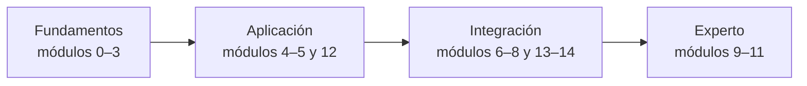
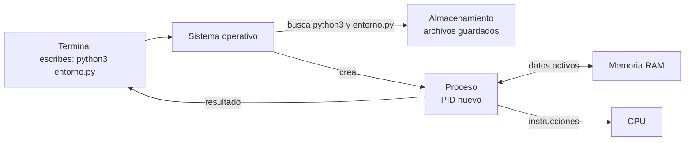
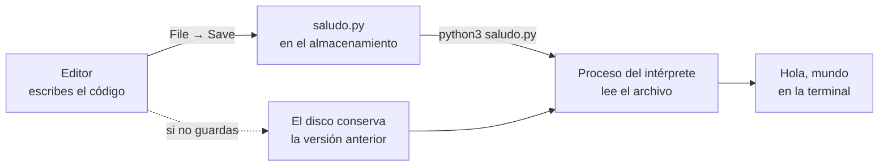
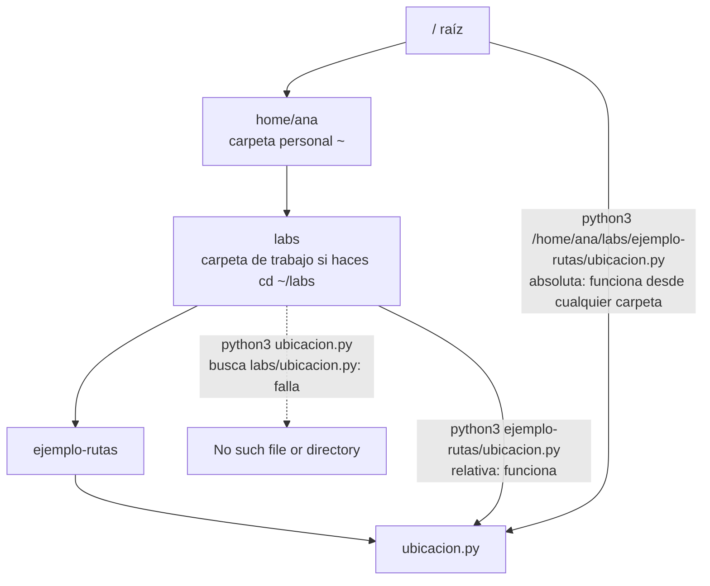
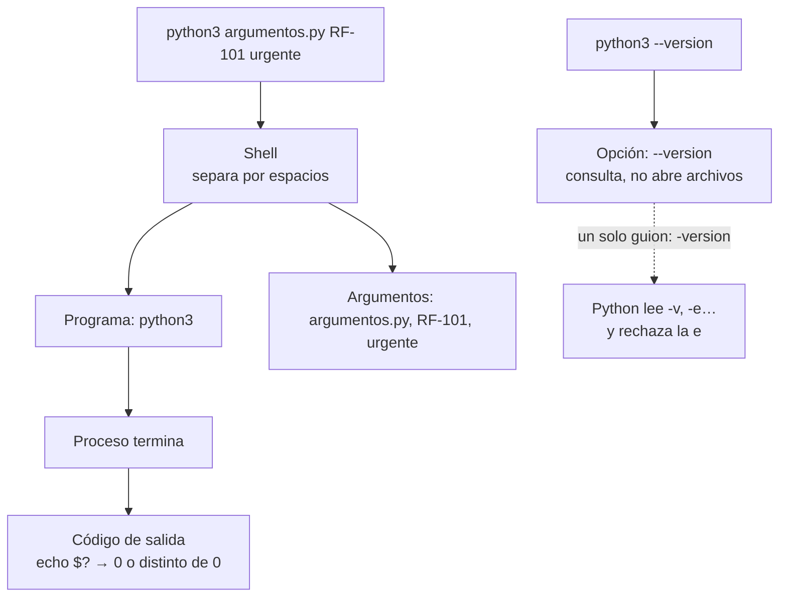
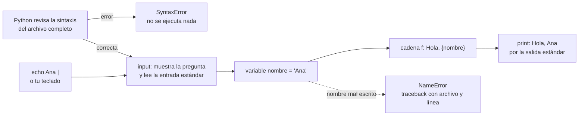
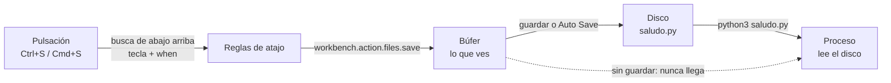

# Módulo 0: Cómo funciona tu entorno de desarrollo

**Entorno comprobado para esta edición (2026-11-24):** Python 3.13.18 y bash 5.2 en Linux (Ubuntu 24.04, x86_64). Todas las capturas de este módulo se obtuvieron ejecutando los comandos en ese equipo; los números que cambian en cada máquina (PID, núcleos, almacenamiento) serán distintos en la tuya. En macOS la terminal usa `zsh` y algunos mensajes cambian de forma, por ejemplo `zsh: command not found: pyhton3`. Las indicaciones para Windows se contrastaron solo con la documentación: **no se ejecutaron en Windows**.

## Antes de comenzar: prepara tu primera sesión

Hoy vas a crear un archivo, ejecutar un programa y corregir un error. Puedes trabajar por temas y volver después:
el objetivo es poder repetir el procedimiento y explicar lo que observaste.

Cuatro palabras aparecen desde la primera página. Cada una tiene su ficha completa más adelante; por ahora basta con
esta idea:

- Una **carpeta** reúne archivos (ficha en el Tema 3).
- Un **archivo** guarda contenido con un nombre, como `saludo.py` (ficha en el Tema 2).
- El **editor** es el programa donde escribes ese contenido (ficha en el Tema 2).
- La **terminal** es la ventana donde le pides acciones al computador escribiendo comandos (ficha en el Tema 1).

No pegues comandos dentro de un archivo Python ni código Python directamente en la terminal: son dos idiomas
distintos para dos destinatarios distintos.

Estas son las órdenes que usarás en todo el módulo, con la acción que te piden:

| Palabra | Qué es | Qué haces con ella |
|---|---|---|
| `python3 archivo.py` | ejecutar un archivo de Python | `python3 saludo.py` |
| `mkdir nombre` | crear una carpeta vacía | `mkdir primera-sesion` |
| `cd nombre` | entrar en una carpeta | `cd primera-sesion` |
| `pwd` | imprimir la carpeta donde estás | `pwd` |
| `ls` | listar lo que hay en la carpeta donde estás | `ls` |
| `cat archivo` | imprimir el contenido de un archivo | `cat saludo.py` |
| `.py` | extensión de un archivo de Python | `saludo.py` |
| `.md` | extensión de un archivo de texto con formato ligero (Markdown) | `README.md` |

Un **`README.md`** es solo un archivo de texto con ese nombre: se abre en cualquier editor y sirve para dejar
apuntado lo que hiciste. No es un programa y no se ejecuta; lo escribes tú. Para crear cualquier archivo en VS Code:
**File → New File** (Archivo → Nuevo archivo), escribe el nombre completo con su extensión (`saludo.py`,
`README.md`) y guarda con **File → Save**.

En Windows, el comando de Python suele ser `py` en lugar de `python3`. Donde leas `python3`, escribe `py`.


### Instala y comprueba

<details open>
<summary><strong>Capa 1 — Lectura</strong></summary>

Necesitas dos programas: **Python 3** (el que ejecuta tus archivos `.py`) y **Visual Studio Code** (el editor).
Descárgalos de sus sitios oficiales, `python.org` y `code.visualstudio.com`. En Windows, marca la casilla
«Add python.exe to PATH» durante la instalación de Python.

Para abrir una terminal:

- **macOS:** abre la aplicación **Terminal** (búscala con Cmd+Espacio).
- **Linux:** abre **Terminal** desde el menú de aplicaciones.
- **Windows:** abre **PowerShell** desde el menú Inicio.
- **En cualquier sistema:** dentro de VS Code, menú **Terminal → New Terminal**.

Este módulo es la puerta de entrada al curso de Fundamentos. El curso avanza en cuatro etapas:



</details>

<details>
<summary><strong>Capa 2 — Construcción</strong></summary>

#### Comprueba la instalación
Abre una terminal, escribe `python3 --version` y pulsa Enter. Debes ver una línea que empieza por `Python 3.`:

```text
$ python3 --version
Python 3.13.18
```

El número exacto puede ser otro (3.13, 3.14…): cualquier Python 3 reciente sirve para este módulo. Si ves
`command not found` o `no se reconoce como nombre de un cmdlet`, Python no quedó instalado o la terminal no lo
encuentra. Cierra la terminal, ábrela de nuevo y repite; si sigue igual, reinstala Python.

</details>

### Tema 1: Computador, sistema operativo, programa y proceso · Básico · 50 min

<details open>
<summary><strong>Capa 1 — Lectura</strong></summary>

#### Objetivos
Al terminar este tema podrás:
- distinguir CPU, memoria RAM y almacenamiento, y decir qué papel cumple cada uno;
- explicar qué hace el sistema operativo cuando ejecutas un programa;
- diferenciar un programa guardado de un proceso en ejecución, usando su PID como prueba;
- escribir tu primer comando en la terminal y leer el mensaje `command not found`.

**Conceptos clave:** computador, CPU, memoria RAM, almacenamiento, sistema operativo, programa, proceso, PID, terminal, comando

#### El problema
RutaFlow es la empresa de envíos que acompaña todo el curso. Su primer técnico llega con un portátil nuevo y le
piden «ejecutar el programa de rutas». Él pregunta: ¿qué parte del equipo hace el trabajo?, ¿dónde queda guardado
el programa?, ¿qué cambia mientras se ejecuta? Sin esas respuestas, cualquier error parece magia.

#### Glosario del tema

**computador**
- **Definición técnica:** máquina que recibe datos, los procesa siguiendo instrucciones almacenadas y entrega resultados; se compone de CPU, memoria, almacenamiento y periféricos de entrada y salida.
- **En palabras sencillas:** una máquina que sigue instrucciones al pie de la letra, muy rápido y sin cansarse.
- **Dónde se rompe la comparación:** no «entiende» lo que hace: ejecuta instrucciones aunque estén equivocadas.
- **Ejemplo:** tu portátil, un teléfono o el servidor donde vive la web de RutaFlow son computadores.
- **Error típico:** creer que el computador adivina la intención: si la instrucción dice otra cosa, hace otra cosa.

**CPU**
- **Definición técnica:** unidad central de procesamiento; circuito que lee instrucciones de la memoria y las ejecuta una tras otra, a miles de millones de pasos por segundo.
- **En palabras sencillas:** el cerebro de cálculo del equipo: hace las cuentas y toma las decisiones pequeñas.
- **Dónde se rompe la comparación:** un cerebro recuerda; la CPU no guarda nada a largo plazo, todo lo lee de la memoria.
- **Ejemplo:** `os.cpu_count()` en el Problema resuelto 1.1 informa cuántos núcleos lógicos tiene la CPU.
- **Error típico:** pensar que más núcleos acelera cualquier programa; un programa simple usa uno solo.

**memoria RAM**
- **Definición técnica:** memoria de acceso aleatorio; almacena las instrucciones y los datos de los procesos activos, y se borra al apagar el equipo.
- **En palabras sencillas:** la mesa de trabajo: lo que estás usando ahora mismo está encima, a mano.
- **Dónde se rompe la comparación:** una mesa conserva las cosas si te vas; la RAM pierde todo al cortar la energía.
- **Ejemplo:** mientras `entorno.py` se ejecuta, sus textos viven en la RAM; cuando termina, ese espacio se libera.
- **Error típico:** confundir RAM con almacenamiento: «tengo 512 GB de memoria» suele referirse al disco.

**almacenamiento**
- **Definición técnica:** dispositivo no volátil (SSD o disco duro) donde se guardan archivos y programas aunque el equipo esté apagado.
- **En palabras sencillas:** el archivador: lo que guardas ahí sigue al día siguiente.
- **Dónde se rompe la comparación:** buscar en un archivador es lento para ti; para el computador también, comparado con la RAM.
- **Ejemplo:** `shutil.disk_usage(".")` en el Problema resuelto 1.1 informa el tamaño del almacenamiento.
- **Error típico:** creer que un programa en ejecución trabaja directamente sobre el disco; primero se carga en RAM.

**sistema operativo**
- **Definición técnica:** programa base que administra el hardware y ofrece servicios a los demás programas: crea procesos, reparte CPU y RAM y controla el acceso a archivos.
- **En palabras sencillas:** el administrador del edificio: decide quién usa cada sala y cuándo.
- **Dónde se rompe la comparación:** cambia de tarea miles de veces por segundo; ningún administrador humano hace eso.
- **Ejemplo:** Linux, macOS y Windows; `platform.system()` devuelve `Linux` en la captura de este tema.
- **Error típico:** pensar que un comando funciona igual en todos: `pwd` existe en Linux y macOS, pero no en el `cmd` clásico de Windows.

**programa**
- **Definición técnica:** conjunto de instrucciones guardado en un archivo, listo para que el sistema operativo lo cargue y lo ejecute.
- **En palabras sencillas:** una receta escrita y guardada en el cajón.
- **Dónde se rompe la comparación:** una receta no cambia sola; un programa tampoco, pero cada ejecución puede dar resultados distintos.
- **Ejemplo:** `python3` es un programa; `entorno.py` es un archivo con instrucciones que `python3` sabe leer.
- **Error típico:** decir «el programa se cayó» cuando lo que terminó fue una ejecución; el archivo sigue intacto.

**proceso**
- **Definición técnica:** programa en ejecución; el sistema operativo le asigna memoria, un identificador y tiempo de CPU mientras dura.
- **En palabras sencillas:** la receta mientras alguien la cocina; si la cocinas dos veces, son dos cocciones distintas.
- **Dónde se rompe la comparación:** el sistema operativo puede tener cientos de procesos «cocinando» a la vez y alternarlos.
- **Ejemplo:** ejecutar `python3 entorno.py` dos veces crea dos procesos distintos, con PID distinto.
- **Error típico:** buscar en el archivo un dato que solo existió mientras el proceso vivía.

**PID**
- **Definición técnica:** identificador de proceso; número entero que el sistema operativo asigna a cada proceso para administrarlo.
- **En palabras sencillas:** el número de turno que te dan en el banco: identifica tu visita, no a ti.
- **Dónde se rompe la comparación:** los números de turno avanzan en orden; los PID suelen crecer, pero se reutilizan.
- **Ejemplo:** `os.getpid()` devolvió `699` en la primera ejecución y `700` en la segunda.
- **Error típico:** anotar un PID para usarlo mañana: cuando el proceso termina, ese número deja de significar algo.

**terminal**
- **Definición técnica:** programa que muestra una ventana de texto, envía lo que escribes a un intérprete de comandos y te muestra su respuesta.
- **En palabras sencillas:** un chat con el computador: escribes una orden, pulsas Enter y te responde.
- **Dónde se rompe la comparación:** no entiende frases libres; solo órdenes con una forma exacta.
- **Ejemplo:** la línea `$ python3 --version` es lo que escribes; `Python 3.13.18` es la respuesta.
- **Error típico:** copiar también el `$` del inicio; ese símbolo solo indica que la terminal espera una orden.

**comando**
- **Definición técnica:** línea de texto que la terminal interpreta como una orden: el nombre de un programa seguido de lo que ese programa necesita.
- **En palabras sencillas:** una orden escrita: «programa, haz esto con esto».
- **Dónde se rompe la comparación:** una orden hablada tolera errores; un comando con una letra cambiada no se ejecuta.
- **Ejemplo:** en `python3 entorno.py`, `python3` es el programa y `entorno.py` el archivo que debe leer.
- **Error típico:** escribir mal el nombre del programa: `pyhton3` produce `command not found`.

#### ► CÓMO FUNCIONA
Cuando escribes `python3 entorno.py` y pulsas Enter, ocurren cuatro cosas en orden:

1. La terminal entrega la orden al sistema operativo.
2. El sistema operativo busca el programa `python3` en el almacenamiento y crea un **proceso** con un PID nuevo.
3. El proceso carga en la RAM las instrucciones de `entorno.py` y la CPU las ejecuta una por una.
4. El proceso escribe su resultado en la terminal, termina y el sistema operativo libera su memoria.



#### Problema resuelto 1.1
El técnico de RutaFlow quiere saber, desde un archivo, en qué sistema operativo y con qué CPU trabaja, cuánto
almacenamiento tiene y qué PID recibe cada ejecución.

**Razonamiento:**
1. Python trae herramientas para preguntarle cosas al sistema operativo; no hace falta instalar nada.
2. Cada pregunta se muestra en una línea con `print`, con una etiqueta que diga qué es.
3. Para probar que un proceso es distinto del programa, se ejecuta el mismo archivo dos veces y se comparan los PID.

```python
# entorno.py — pregunta al sistema operativo por el computador y por este proceso
import os
import platform
import shutil
import sys

print("sistema operativo:", platform.system())
print("arquitectura de la CPU:", platform.machine())
print("núcleos lógicos de la CPU:", os.cpu_count())
print("almacenamiento total (GB):", shutil.disk_usage(".").total // 1_000_000_000)
print("programa que me ejecuta:", sys.executable)
print("PID de este proceso:", os.getpid())
```

```text
$ python3 --version
Python 3.13.18
$ python3 entorno.py
sistema operativo: Linux
arquitectura de la CPU: x86_64
núcleos lógicos de la CPU: 2
almacenamiento total (GB): 270
programa que me ejecuta: /usr/local/bin/python3
PID de este proceso: 699
$ python3 entorno.py
sistema operativo: Linux
arquitectura de la CPU: x86_64
núcleos lógicos de la CPU: 2
almacenamiento total (GB): 270
programa que me ejecuta: /usr/local/bin/python3
PID de este proceso: 700
```

**Explicación por partes.**
- Línea 1: empieza con `#`, así que es un comentario. Python lo ignora; sirve para quien lee el archivo.
- Líneas 2–5: `import` trae cuatro cajas de herramientas incluidas en Python: `os` (sistema operativo), `platform` (plataforma), `shutil` (archivos y discos) y `sys` (el propio Python).
- Línea 7: `print` muestra en la terminal una etiqueta y, separado por un espacio, el valor que devuelve `platform.system()`.
- Línea 8: `x86_64` es la familia de la CPU; en un Mac reciente verás `arm64`.
- Línea 10: el tamaño llega en bytes; `// 1_000_000_000` lo divide para expresarlo en gigabytes enteros.
- Línea 11: la ruta del programa `python3` que creó el proceso.
- Línea 12: el PID cambia de `699` a `700` entre ejecuciones. El archivo es el mismo; el proceso, no.

> **Error común.** Escribir mal el nombre del programa. `pyhton3 entorno.py` responde
> `bash: pyhton3: command not found`. Léelo de izquierda a derecha: `bash` (quien interpreta tus comandos) no
> encontró ningún programa llamado `pyhton3`. El problema está en la primera palabra, no en tu archivo.

```text
$ pyhton3 entorno.py
bash: pyhton3: command not found
```

> **Buena práctica.** Antes de ejecutar cualquier archivo, comprueba que el programa existe con
> `python3 --version`. Si esa línea falla, ningún archivo `.py` va a funcionar todavía.

#### Problema resuelto 1.2
Demuestra que la terminal también es un proceso y que es ella quien pide al sistema operativo crear cada proceso
de Python.

**Razonamiento:**
1. Todo proceso tiene un **proceso padre**: el que pidió crearlo.
2. En `bash`, `echo $$` muestra el PID de la propia terminal.
3. Si un programa de Python muestra el PID de su padre y coincide con el de la terminal, queda demostrado.

```python
# padre.py — muestra el PID de este proceso y el de quien lo pidió
import os

print("PID de este proceso:", os.getpid())
print("PID del proceso padre (la terminal):", os.getppid())
```

```text
$ echo $$
704
$ python3 padre.py
PID de este proceso: 707
PID del proceso padre (la terminal): 704
$ python3 padre.py
PID de este proceso: 708
PID del proceso padre (la terminal): 704
```

**Explicación por partes.**
- Línea 4: `os.getpid()` devuelve el PID del proceso de Python, distinto en cada ejecución.
- Línea 5: `os.getppid()` (con doble `p`, de *parent*) devuelve el PID del padre: siempre `704`, el de la terminal.
- La terminal sigue viva entre ejecuciones; los procesos de Python nacen y terminan en cada comando.

> **Prevenir errores.** Si un programa «se queda pegado», el problema es el proceso, no el archivo. Cerrar la
> terminal termina sus procesos hijos; el archivo `.py` sigue guardado e intacto.

#### Checkpoint 1.1
Ejecutas `python3 entorno.py` tres veces seguidas. ¿Cuántos programas y cuántos procesos intervinieron, sin contar
la terminal?

Respuesta: un programa (`python3`, que lee siempre el mismo `entorno.py`) y tres procesos, uno por ejecución, cada
uno con su PID.

</details>

<details>
<summary><strong>Capa 2 — Construcción</strong></summary>

#### Paso 1 · Abre la terminal y comprueba Python
Abre una terminal y escribe `python3 --version`. Anota el número que aparece.

#### Paso 2 · Crea la carpeta de trabajo
Escribe `mkdir -p ~/labs/sistema` y luego `cd ~/labs/sistema`. El Tema 3 explica estas órdenes en detalle.

#### Paso 3 · Escribe y ejecuta entorno.py
Crea `entorno.py` en esa carpeta con VS Code, copia el código del Problema resuelto 1.1, guarda y ejecuta
`python3 entorno.py` dos veces. Comprueba que solo cambia la última línea.

#### Paso 4 · Busca al padre
Escribe `padre.py`, ejecuta `echo $$` y luego `python3 padre.py`. El PID del padre debe coincidir con el número de
`echo $$`. En PowerShell, el equivalente de `echo $$` es `$PID`.

#### Paso 5 · Provoca el error
Escribe `pyhton3 entorno.py` a propósito y lee el mensaje completo.

#### Resumen
- El **computador** procesa datos con su **CPU**, guarda lo activo en la **memoria RAM** y lo permanente en el **almacenamiento**.
- El **sistema operativo** administra el hardware: crea procesos y les reparte CPU y memoria.
- Un **programa** es un archivo con instrucciones; un **proceso** es una ejecución de ese programa.
- Cada proceso recibe un **PID** distinto; el mismo archivo ejecutado dos veces da dos PID.
- La **terminal** recibe **comandos**: la primera palabra es el programa que debe ejecutarse.
- `command not found` significa que la primera palabra del comando no corresponde a ningún programa.

#### Ejercicio verificable 1
Básico. Ejecuta `entorno.py` en tu equipo y escribe, con tus palabras, qué es cada una de las seis líneas.

Respuesta esperada: sistema operativo (`Linux`, `Darwin` en macOS o `Windows`), tipo de CPU, número de núcleos,
tamaño del almacenamiento, ruta de `python3` y PID. Solo el PID cambia al repetir.

#### Ejercicio verificable 2
Intermedio. Agrega a `entorno.py` una línea que muestre la versión de Python con `platform.python_version()`.

Respuesta esperada: `print("versión de Python:", platform.python_version())` muestra, en el equipo de referencia,
`versión de Python: 3.13.18`. Debe coincidir con `python3 --version`.

#### Ejercicio verificable 3
Reto. Ejecuta `python3 padre.py` desde dos terminales distintas. ¿Qué número cambia y cuál se mantiene en cada una?

Respuesta esperada: cada terminal tiene su propio PID, así que el «PID del proceso padre» es distinto en cada
ventana. Dentro de una misma ventana, el padre se mantiene y el PID del proceso cambia en cada ejecución.

#### En el trabajo
En un servidor de RutaFlow corren decenas de procesos a la vez: la web, la base de datos, tareas programadas. Cuando
algo falla, el equipo de operaciones busca el proceso por su PID, revisa cuánta CPU y RAM consume y lo reinicia sin
tocar los archivos. Saber separar programa y proceso es la base de ese diagnóstico.

</details>

### Tema 2: Del archivo fuente al programa en ejecución · Básico · 45 min

<details open>
<summary><strong>Capa 1 — Lectura</strong></summary>

#### Objetivos
Al terminar este tema podrás:
- crear un archivo de código fuente con su extensión correcta y guardarlo desde el editor;
- explicar qué hace el intérprete de Python cuando ejecutas un archivo;
- mostrar el contenido de un archivo con `cat` y comprobar que la salida cambia solo después de guardar;
- leer el error `[Errno 2] No such file or directory` y corregir el nombre del archivo.

**Conceptos clave:** archivo, código fuente, extensión, editor, intérprete, ejecutar, cat

#### El problema
El técnico de RutaFlow ya sabe que un programa se convierte en proceso. Ahora debe escribir el suyo: un archivo que
muestre un mensaje. ¿Dónde se escribe?, ¿cómo se guarda?, ¿quién lo lee y lo convierte en acciones? Si cambia una
palabra, ¿cuándo se nota el cambio?

#### Glosario del tema

**Proceso**, **programa** y **comando** ya tienen su ficha en el Tema 1; aquí se usan sin repetirla.

**archivo**
- **Definición técnica:** secuencia de bytes guardada en el almacenamiento, identificada por un nombre dentro de una carpeta.
- **En palabras sencillas:** un documento con nombre, guardado para que siga ahí mañana.
- **Dónde se rompe la comparación:** un documento en papel tiene un solo lugar; un archivo puede copiarse sin límite y en un instante.
- **Ejemplo:** `saludo.py` es un archivo de 71 bytes con dos líneas de texto.
- **Error típico:** cambiar una mayúscula: en Linux `Saludo.py` y `saludo.py` son archivos distintos; macOS y Windows suelen tratarlos como iguales.

**código fuente**
- **Definición técnica:** texto escrito por una persona en un lenguaje de programación, que un intérprete o un compilador traduce a acciones del computador.
- **En palabras sencillas:** las instrucciones escritas en un idioma que tú puedes leer y el computador también.
- **Dónde se rompe la comparación:** un idioma humano tolera faltas; el código fuente no admite ni una comilla de menos.
- **Ejemplo:** `print("Hola, mundo")` es una línea de código fuente en Python.
- **Error típico:** escribir el código en un procesador de textos (Word): agrega formato y comillas tipográficas que Python no entiende.

**extensión**
- **Definición técnica:** sufijo del nombre de un archivo, después del último punto, que indica por convención qué tipo de contenido tiene.
- **En palabras sencillas:** el apellido del archivo: `.py` dice «soy Python», `.md` dice «soy texto con formato».
- **Dónde se rompe la comparación:** es solo una convención: `python3` ejecuta un archivo `.txt` si su contenido es Python válido.
- **Ejemplo:** en `saludo.py`, la extensión es `.py`; el editor la usa para colorear el código.
- **Error típico:** que el sistema oculte la extensión y el archivo quede como `saludo.py.txt` sin que lo notes.

**editor**
- **Definición técnica:** programa que abre un archivo de texto, permite modificarlo y lo guarda de nuevo en el almacenamiento; un editor de código agrega colores, autocompletado y una terminal integrada.
- **En palabras sencillas:** la hoja donde escribes el código; en este curso es Visual Studio Code (VS Code).
- **Dónde se rompe la comparación:** lo que ves en la hoja no está guardado hasta que pulsas **Save**; el Tema 6 lo explica a fondo.
- **Ejemplo:** abres `saludo.py` en VS Code, cambias el mensaje y guardas con **File → Save**.
- **Error típico:** editar, no guardar y ejecutar: la terminal muestra el mensaje viejo.

**intérprete**
- **Definición técnica:** programa que lee código fuente y ejecuta sus instrucciones una por una, sin generar antes un archivo ejecutable aparte.
- **En palabras sencillas:** un traductor simultáneo: lee una frase de tu código y la convierte en acción al momento.
- **Dónde se rompe la comparación:** antes de ejecutar, Python revisa que todo el archivo esté bien escrito; un traductor simultáneo no espera.
- **Ejemplo:** en `python3 saludo.py`, el intérprete es `python3` y el código fuente es `saludo.py`.
- **Error típico:** escribir `saludo.py` solo, sin `python3` delante; la terminal no sabe quién debe leerlo.

**ejecutar**
- **Definición técnica:** pedir al sistema operativo que cree un proceso a partir de un programa, con los archivos y datos que necesita.
- **En palabras sencillas:** poner a funcionar las instrucciones, no solo tenerlas escritas.
- **Dónde se rompe la comparación:** «abrir» un archivo en el editor no lo ejecuta; solo lo muestra para editarlo.
- **Ejemplo:** `python3 saludo.py` ejecuta el archivo y muestra `Hola, mundo`.
- **Error típico:** ejecutar desde otra carpeta y obtener `No such file or directory`, aunque el archivo exista.

**cat**
- **Definición técnica:** comando de Linux y macOS que lee uno o varios archivos y escribe su contenido en la terminal.
- **En palabras sencillas:** «enséñame qué hay dentro de este archivo, tal como está guardado».
- **Dónde se rompe la comparación:** muestra lo guardado en el disco, no lo que ves en el editor sin guardar.
- **Ejemplo:** `cat saludo.py` imprime las dos líneas del archivo.
- **Error típico:** usarlo en PowerShell esperando lo mismo en todos los casos; allí `cat` es un alias de `Get-Content`.

#### ► CÓMO FUNCIONA
El camino de una línea de código tiene cuatro estaciones:

1. Escribes el código en el **editor**.
2. Al guardar, el editor lo escribe en un **archivo** del almacenamiento.
3. Al ejecutar `python3 saludo.py`, el sistema operativo crea un proceso del **intérprete**.
4. El intérprete lee el archivo **guardado** de arriba abajo y ejecuta cada instrucción.

La clave está en la estación 2: el intérprete nunca ve el editor, solo el archivo en el disco.



#### Problema resuelto 2.1
Crea `saludo.py`, comprueba su contenido, ejecútalo dos veces, cambia el mensaje y comprueba que la salida cambia.

**Razonamiento:**
1. El archivo necesita la extensión `.py` y una instrucción que muestre texto: `print`.
2. `cat` confirma qué quedó guardado; así sabes qué leerá el intérprete.
3. Para ver un cambio, hay que editar **y guardar**; luego se ejecuta de nuevo.

```python
# saludo.py — muestra un mensaje en la terminal
print("Hola, mundo")
```

```text
$ cat saludo.py
# saludo.py — muestra un mensaje en la terminal
print("Hola, mundo")
$ python3 saludo.py
Hola, mundo
$ python3 saludo.py
Hola, mundo
```

Ahora cambia el mensaje en el editor, guarda y repite:

```python
# saludo.py — muestra un mensaje en la terminal
print("Mi primera práctica funciona")
```

```text
$ cat saludo.py
# saludo.py — muestra un mensaje en la terminal
print("Mi primera práctica funciona")
$ python3 saludo.py
Mi primera práctica funciona
```

**Explicación por partes.**
- Línea 1: comentario. Empieza con `#` y Python lo salta; dice qué hace el archivo.
- Línea 2: `print(...)` muestra en la terminal el texto que va entre comillas. Las comillas no aparecen en la salida.
- Las dos ejecuciones iguales prueban que el archivo no se gasta: cada ejecución es un proceso nuevo que lo lee otra vez.
- Tras guardar el cambio, `cat` y la ejecución coinciden: el intérprete lee lo que está en el disco.

> **Error común.** Pedir un archivo que no existe con ese nombre. `python3 saludo-inexistente.py` responde
> `python3: can't open file '/home/ana/labs/primera-sesion/saludo-inexistente.py': [Errno 2] No such file or directory`.
> Lee la ruta completa: Python te dice dónde buscó. Revisa el nombre letra por letra o la carpeta donde estás.

```text
$ python3 saludo-inexistente.py
python3: can't open file '/home/ana/labs/primera-sesion/saludo-inexistente.py': [Errno 2] No such file or directory
$ python3 Saludo.py
python3: can't open file '/home/ana/labs/primera-sesion/Saludo.py': [Errno 2] No such file or directory
```

> **Buena práctica.** Nombra los archivos en minúscula, sin espacios ni tildes, con guion o guion bajo:
> `primera_practica.py`. Evitas errores de mayúsculas y problemas al escribir el nombre en la terminal.

#### Problema resuelto 2.2
Escribe `presentacion.py` con tres mensajes y comprueba que el intérprete los ejecuta en el orden escrito.

**Razonamiento:**
1. Cada `print` es una instrucción; van una por línea.
2. El intérprete lee de arriba abajo, así que la salida debe salir en el mismo orden.

```python
# presentacion.py — tres líneas, tres instrucciones, en orden
print("Ana Torres")
print("Estoy aprendiendo a ejecutar programas")
print("Fin de la presentación")
```

```text
$ python3 presentacion.py
Ana Torres
Estoy aprendiendo a ejecutar programas
Fin de la presentación
```

**Explicación por partes.**
- Líneas 2–4: tres instrucciones independientes. Cada `print` termina su línea de salida con un salto de línea.
- Si intercambias las líneas 2 y 3 y guardas, la salida cambia de orden: el intérprete no reordena nada.

> **Prevenir errores.** Antes de ejecutar, mira la pestaña del archivo en VS Code: un punto `●` junto al nombre
> significa que hay cambios sin guardar. Guarda primero y la salida coincidirá con lo que ves.

#### Checkpoint 2.1
Copias `saludo.py` con el nombre `saludo.txt` y ejecutas `python3 saludo.txt`. ¿Qué ocurre?

Respuesta: funciona y muestra `Mi primera práctica funciona`. La extensión es una convención; al intérprete le
importa que el contenido sea Python válido.

```text
$ python3 saludo.txt
Mi primera práctica funciona
```

</details>

<details>
<summary><strong>Capa 2 — Construcción</strong></summary>

#### Paso 1 · Prepara la carpeta
Escribe `mkdir -p ~/labs/primera-sesion` y `cd ~/labs/primera-sesion`. En VS Code, abre esa carpeta con
**File → Open Folder**.

#### Paso 2 · Crea y guarda saludo.py
Crea `saludo.py` con el código del Problema resuelto 2.1 y guarda. Ejecuta `cat saludo.py` para comprobarlo.

#### Paso 3 · Ejecuta dos veces
Ejecuta `python3 saludo.py` dos veces. Las dos salidas deben ser `Hola, mundo`.

#### Paso 4 · Cambia, guarda y vuelve a ejecutar
Cambia el mensaje, **no guardes** y ejecuta: verás el mensaje viejo. Guarda y ejecuta otra vez: verás el nuevo.

#### Paso 5 · Provoca el error
Ejecuta `python3 saludo-inexistente.py` y lee la ruta que muestra el mensaje. Prueba también `python3 Saludo.py`: en Linux falla; en macOS y Windows suele funcionar, porque allí las mayúsculas no distinguen nombres.

#### Resumen
- Un **archivo** guarda contenido con un nombre; su **extensión** indica por convención qué contiene.
- El **código fuente** es texto en un lenguaje de programación; se escribe en un **editor** y se guarda.
- El **intérprete** `python3` lee el archivo guardado y **ejecuta** sus instrucciones de arriba abajo.
- `cat` muestra lo que hay en el disco: lo mismo que leerá el intérprete.
- `[Errno 2] No such file or directory` significa que en esa ruta no hay un archivo con ese nombre exacto.

#### Ejercicio verificable 1
Básico. Crea `ciudad.py` que muestre `Envío a Medellín` y ejecútalo.

Respuesta esperada: `print("Envío a Medellín")` y la salida `Envío a Medellín`.

#### Ejercicio verificable 2
Intermedio. Sin ejecutarlo, ¿qué muestra un archivo con `print("A")`, `print("B")` y `print("A")`, en ese orden?

Respuesta esperada: tres líneas: `A`, `B` y `A`. El intérprete ejecuta cada instrucción en orden, aunque se repita.

#### Ejercicio verificable 3
Reto. Cambia el mensaje de `saludo.py`, no guardes y ejecuta `cat saludo.py` y `python3 saludo.py`. ¿Coinciden con
lo que ves en el editor? ¿Por qué?

Respuesta esperada: no coinciden. `cat` y `python3` leen el archivo guardado; el editor muestra cambios que todavía
no llegaron al disco. Tras guardar, los tres coinciden.

#### En el trabajo
En una empresa, el código fuente vive en archivos que varias personas editan. Cuando alguien dice «en mi equipo
funciona», una de las primeras preguntas es «¿guardaste y ejecutaste el archivo correcto?». Revisar el contenido
real del disco, como haces con `cat`, ahorra horas de buscar errores en el lugar equivocado.

</details>

### Tema 3: Archivos, carpetas y rutas sin perderse · Básico · 45 min

<details open>
<summary><strong>Capa 1 — Lectura</strong></summary>

#### Objetivos
Al terminar este tema podrás:
- saber en qué carpeta estás con `pwd`, ver su contenido con `ls`, crear carpetas con `mkdir` y moverte con `cd`;
- distinguir una ruta absoluta de una relativa y escribir las dos para un mismo archivo;
- predecir si `python3 archivo.py` encontrará el archivo según la carpeta de trabajo;
- diagnosticar `No such file or directory` leyendo la ruta que muestra el mensaje.

**Conceptos clave:** carpeta, ruta, ruta absoluta, ruta relativa, carpeta de trabajo, carpeta personal, carpeta padre, pwd, ls, mkdir, cd

#### El problema
El técnico de RutaFlow tiene `ubicacion.py` dentro de una carpeta. Desde una terminal funciona; desde otra, el mismo
comando dice que el archivo no existe. El archivo no se movió. ¿Qué cambió entre una terminal y otra, y cómo se
escribe el comando para que funcione desde cualquier lugar?

#### Glosario del tema

**Archivo** y **ejecutar** tienen su ficha en el Tema 2; **comando** y **terminal**, en el Tema 1.

**carpeta**
- **Definición técnica:** entrada del sistema de archivos que contiene otros archivos y carpetas; también se llama directorio.
- **En palabras sencillas:** un cajón con nombre donde guardas archivos y otros cajones.
- **Dónde se rompe la comparación:** una carpeta puede contener carpetas sin límite práctico de profundidad; un cajón físico no.
- **Ejemplo:** `ejemplo-rutas` es una carpeta que contiene `ubicacion.py`.
- **Error típico:** crear la carpeta con espacios (`mis labs`) y luego olvidar las comillas al escribir `cd "mis labs"`.

**ruta**
- **Definición técnica:** texto que indica la ubicación de un archivo o carpeta, con los nombres de las carpetas separados por `/` (en Windows, `\`).
- **En palabras sencillas:** la dirección de un archivo: barrio, calle y número.
- **Dónde se rompe la comparación:** una dirección postal se entiende igual desde cualquier lugar; una ruta relativa no.
- **Ejemplo:** `ejemplo-rutas/ubicacion.py` dice «entra en `ejemplo-rutas` y busca `ubicacion.py`».
- **Error típico:** escribir `\` en Linux o macOS: allí el separador es `/`.

**ruta absoluta**
- **Definición técnica:** ruta que empieza en la raíz del sistema de archivos (`/` en Linux y macOS; una letra como `C:\` en Windows).
- **En palabras sencillas:** la dirección completa, con país y ciudad: funciona desde cualquier punto de partida.
- **Dónde se rompe la comparación:** si mueves la carpeta, la dirección completa deja de servir.
- **Ejemplo:** `/home/ana/labs/ejemplo-rutas/ubicacion.py`.
- **Error típico:** copiar la ruta absoluta de otra persona: en tu equipo el usuario no se llama `ana`.

**ruta relativa**
- **Definición técnica:** ruta que no empieza en la raíz; se resuelve a partir de la carpeta de trabajo del proceso.
- **En palabras sencillas:** una indicación del tipo «desde aquí, segunda puerta a la derecha».
- **Dónde se rompe la comparación:** si cambias el «aquí», la misma indicación lleva a otro lugar o a ninguno.
- **Ejemplo:** desde `/home/ana/labs`, la ruta `ejemplo-rutas/ubicacion.py` llega al archivo.
- **Error típico:** ejecutar `python3 ubicacion.py` desde la carpeta de arriba y recibir `No such file or directory`.

**carpeta de trabajo**
- **Definición técnica:** carpeta asociada a cada proceso desde la cual se resuelven las rutas relativas; la terminal la cambia con `cd`.
- **En palabras sencillas:** el «aquí» de la terminal: el lugar donde estás parado.
- **Dónde se rompe la comparación:** no la ves en pantalla salvo que la pidas con `pwd` o que tu terminal la muestre.
- **Ejemplo:** después de `cd ejemplo-rutas`, `pwd` muestra `/home/ana/labs/ejemplo-rutas`.
- **Error típico:** suponer que la terminal está en la carpeta que tienes abierta en VS Code.

**carpeta personal (`~`)**
- **Definición técnica:** carpeta propia de cada usuario; la terminal reemplaza el símbolo `~` por su ruta absoluta.
- **En palabras sencillas:** tu casa dentro del computador; `~` es el atajo para volver a ella.
- **Dónde se rompe la comparación:** `~` lo entiende la terminal, no Python: dentro de un programa, `"~/labs"` no se expande solo.
- **Ejemplo:** `cd ~` y luego `pwd` muestra `/home/ana` en la captura del tema.
- **Error típico:** escribir `~` con un espacio después (`cd ~ /labs`): son dos argumentos distintos.

**carpeta padre (`..`)**
- **Definición técnica:** nombre especial `..` que toda carpeta tiene y que apunta a la carpeta que la contiene; `.` apunta a la carpeta actual.
- **En palabras sencillas:** `..` es «un nivel más arriba»; `.` es «aquí mismo».
- **Dónde se rompe la comparación:** en la raíz `/` no hay más arriba: `..` vuelve a `/`.
- **Ejemplo:** desde `/home/ana/labs/ejemplo-rutas`, `cd ..` te lleva a `/home/ana/labs`.
- **Error típico:** escribir `cd..` sin espacio en Linux o macOS: `bash` no lo reconoce como comando.

**pwd, ls, mkdir y cd**
- **Definición técnica:** comandos de la terminal: `pwd` imprime la carpeta de trabajo, `ls` lista su contenido, `mkdir` crea una carpeta y `cd` cambia la carpeta de trabajo.
- **En palabras sencillas:** «¿dónde estoy?», «¿qué hay aquí?», «crea un cajón» y «muévete a ese cajón».
- **Dónde se rompe la comparación:** `cd` no mueve archivos: solo cambia desde dónde miras.
- **Ejemplo:** `mkdir labs/practica-rutas`, `cd labs/practica-rutas` y `pwd` muestra `/home/ana/labs/practica-rutas`.
- **Error típico:** `cd` a una carpeta mal escrita: `bash: cd: labs/ejemplo-ruta: No such file or directory`.

#### ► CÓMO FUNCIONA
El sistema de archivos es un árbol. Arriba está la raíz `/`; dentro, carpetas que contienen carpetas y archivos.
Cuando escribes una ruta:

1. Si empieza con `/`, el sistema operativo la recorre desde la raíz: es **absoluta**.
2. Si no, la pega a la **carpeta de trabajo** y recorre el resultado: es **relativa**.
3. Si en algún tramo no existe la carpeta o el archivo, responde `No such file or directory`.



#### Problema resuelto 3.1
Ejecuta `ubicacion.py` desde tres carpetas de trabajo distintas y explica por qué falla en un caso.

**Razonamiento:**
1. El archivo vive en `/home/ana/labs/ejemplo-rutas/ubicacion.py`.
2. Para que el programa delate desde dónde se ejecutó, muestra su carpeta de trabajo con `os.getcwd()`.
3. Se prueba desde `labs` (con ruta relativa incorrecta y correcta), desde `ejemplo-rutas` y desde la raíz.

```python
# ubicacion.py — dice dónde está parado el proceso que lo ejecuta
import os

print("Encontraste ubicacion.py")
print("carpeta de trabajo:", os.getcwd())
```

```text
$ pwd
/home/ana/labs
$ ls
ejemplo-rutas
primera-sesion
sistema
$ python3 ubicacion.py
python3: can't open file '/home/ana/labs/ubicacion.py': [Errno 2] No such file or directory
$ python3 ejemplo-rutas/ubicacion.py
Encontraste ubicacion.py
carpeta de trabajo: /home/ana/labs
$ cd ejemplo-rutas
$ pwd
/home/ana/labs/ejemplo-rutas
$ python3 ubicacion.py
Encontraste ubicacion.py
carpeta de trabajo: /home/ana/labs/ejemplo-rutas
$ python3 ../ejemplo-rutas/ubicacion.py
Encontraste ubicacion.py
carpeta de trabajo: /home/ana/labs/ejemplo-rutas
$ cd /
$ python3 /home/ana/labs/ejemplo-rutas/ubicacion.py
Encontraste ubicacion.py
carpeta de trabajo: /
$ cd ~
$ pwd
/home/ana
```

**Explicación por partes.**
- Línea 2: `import os` trae las herramientas del sistema operativo, como en el Tema 1.
- Línea 5: `os.getcwd()` (*get current working directory*) devuelve la carpeta de trabajo del proceso.
- Primer intento: la ruta relativa `ubicacion.py` se pegó a `/home/ana/labs`; ahí no hay tal archivo.
- Segundo intento: `ejemplo-rutas/ubicacion.py` sí llega. La carpeta de trabajo sigue siendo `labs`.
- `../ejemplo-rutas/ubicacion.py` sube un nivel y vuelve a bajar: un rodeo que llega al mismo archivo.
- Desde `/`, solo la ruta absoluta sirve, y el programa informa que su carpeta de trabajo es `/`.

> **Error común.** Ejecutar desde la carpeta equivocada. El mensaje
> `python3: can't open file '/home/ana/labs/ubicacion.py': [Errno 2] No such file or directory` muestra la ruta
> **que Python intentó**, no la que tú querías. Compárala con `pwd` y `ls`: la diferencia te dice qué falta.

> **Error común.** Entrar a una carpeta mal escrita. `cd labs/ejemplo-ruta` responde
> `bash: cd: labs/ejemplo-ruta: No such file or directory`. Falta la `s` final; usa `ls` para ver los nombres reales.

> **Buena práctica.** Pulsa la tecla **Tab** después de escribir las primeras letras de una carpeta o archivo. La
> terminal completa el nombre si existe y te evita errores de escritura.

#### Problema resuelto 3.2
Crea una carpeta nueva dentro de `labs`, entra en ella y vuelve a la carpeta de arriba, comprobando cada paso.

**Razonamiento:**
1. Se parte de la carpeta personal, así que la ruta relativa a `labs` es `labs/…`.
2. Después de cada `cd`, `pwd` confirma dónde quedaste.
3. `cd ..` debe dejarte en la carpeta que contiene a la nueva.

```text
$ cd labs/ejemplo-ruta
bash: cd: labs/ejemplo-ruta: No such file or directory
$ cd Labs
bash: cd: Labs: No such file or directory
$ mkdir labs/practica-rutas
$ cd labs/practica-rutas
$ pwd
/home/ana/labs/practica-rutas
$ cd ..
$ pwd
/home/ana/labs
```

**Explicación por partes.**
- Los dos primeros `cd` fallan: uno por una letra de menos y otro por la mayúscula en `Labs`.
- `mkdir` no muestra nada cuando funciona: en la terminal, el silencio suele significar éxito.
- `cd ..` sube exactamente un nivel, de `practica-rutas` a `labs`.

> **Prevenir errores.** Antes de ejecutar un programa, escribe `pwd` y `ls`. Si el archivo no aparece en la lista
> de `ls`, una ruta relativa con solo su nombre va a fallar.

#### Checkpoint 3.1
Estás en `/home/ana/labs/primera-sesion`. ¿Qué ruta relativa usas para ejecutar `ubicacion.py` sin moverte?

Respuesta: `python3 ../ejemplo-rutas/ubicacion.py`. `..` sube a `labs` y desde ahí se baja a `ejemplo-rutas`. La
carpeta de trabajo que mostrará el programa será `/home/ana/labs/primera-sesion`.

</details>

<details>
<summary><strong>Capa 2 — Construcción</strong></summary>

#### Paso 1 · Ubícate
Abre una terminal y escribe `pwd`. Anota la ruta: es tu carpeta personal.

#### Paso 2 · Crea la carpeta del ejemplo
Escribe `mkdir -p ~/labs/ejemplo-rutas`. La opción `-p` crea también `labs` si todavía no existe y no se queja si
ya existe.

#### Paso 3 · Escribe ubicacion.py
Crea `ubicacion.py` dentro de `ejemplo-rutas` con el código del Problema resuelto 3.1 y guarda.

#### Paso 4 · Ejecuta desde tres lugares
Desde `~/labs`, ejecuta `python3 ubicacion.py` (falla) y `python3 ejemplo-rutas/ubicacion.py` (funciona). Entra con
`cd ejemplo-rutas` y ejecútalo de nuevo. Por último, ve a `cd /` y usa la ruta absoluta que te dio `pwd`.

#### Paso 5 · Vuelve a casa
Escribe `cd ~` y `pwd`. En Windows PowerShell también funcionan `cd ~`, `pwd` y `ls`, con `\` como separador.

#### Resumen
- Una **carpeta** contiene archivos y carpetas; juntas forman un árbol que empieza en la raíz `/`.
- Una **ruta absoluta** empieza en la raíz y funciona desde cualquier lugar.
- Una **ruta relativa** se resuelve desde la **carpeta de trabajo**; cambia de significado si te mueves.
- `~` es la **carpeta personal**; `..` es la **carpeta padre**; `.` es la carpeta actual.
- `pwd`, `ls`, `mkdir` y `cd` responden «dónde estoy», «qué hay», «crea» y «muévete».
- `No such file or directory` muestra la ruta que se intentó: compárala con `pwd` y `ls`.

#### Ejercicio verificable 1
Básico. Desde tu carpeta personal, crea la carpeta `academia`, entra en ella y comprueba la ruta actual.

Respuesta esperada: `mkdir academia`, `cd academia` y `pwd`, que muestra tu carpeta personal seguida de
`/academia` (en la captura del tema sería `/home/ana/academia`).

#### Ejercicio verificable 2
Intermedio. Estás en `/home/ana`. Escribe la ruta relativa y la absoluta de `saludo.py` del Tema 2.

Respuesta esperada: relativa `labs/primera-sesion/saludo.py`; absoluta `/home/ana/labs/primera-sesion/saludo.py`.

#### Ejercicio verificable 3
Reto. Estás en `/home/ana/labs/ejemplo-rutas` y ejecutas `python3 ../primera-sesion/saludo.py`. ¿Qué carpeta de
trabajo tiene ese proceso y por qué el archivo se encuentra?

Respuesta esperada: la carpeta de trabajo es `/home/ana/labs/ejemplo-rutas`, porque no te moviste. El archivo se
encuentra porque `..` sube a `labs` y desde ahí se baja a `primera-sesion/saludo.py`.

#### En el trabajo
En un proyecto real, un programa lee configuración, datos y plantillas desde rutas. El error «funciona en mi equipo
pero no en el servidor» es muchas veces una ruta: absoluta con el usuario de otra persona, o relativa ejecutada desde
otra carpeta. Por eso los equipos fijan la carpeta desde la que se ejecuta cada comando y lo dejan escrito.

</details>

### Tema 4: Cómo leer un comando antes de ejecutarlo · Básico · 45 min

<details open>
<summary><strong>Capa 1 — Lectura</strong></summary>

#### Objetivos
Al terminar este tema podrás:
- separar un comando en programa, opciones y argumentos antes de pulsar Enter;
- predecir qué archivo recibe un programa y comprobarlo con `sys.argv`;
- consultar el código de salida con `echo $?` y decir si el comando terminó bien;
- leer el mensaje de uso que Python muestra ante una opción desconocida.

**Conceptos clave:** shell, argumento, opción, código de salida, echo, sys.argv

#### El problema
Un compañero de RutaFlow le pasa al técnico un comando para copiar y pegar. El técnico no sabe qué hace, qué
archivos toca ni cómo saber si salió bien. Pegar a ciegas es peligroso: un comando puede borrar o sobrescribir.
¿Cómo se lee un comando antes de ejecutarlo y cómo se confirma, después, que terminó bien?

#### Glosario del tema

**Terminal** y **comando** tienen su ficha en el Tema 1; **intérprete** y **ejecutar**, en el Tema 2; **ruta**, en el Tema 3.

**shell**
- **Definición técnica:** intérprete de comandos; programa que lee la línea escrita en la terminal, la separa en palabras, busca el programa y le pide al sistema operativo ejecutarlo.
- **En palabras sencillas:** el recepcionista de la terminal: lee tu orden y llama al programa indicado.
- **Dónde se rompe la comparación:** la terminal es la ventana; el shell es quien entiende lo que escribes dentro de ella.
- **Ejemplo:** `bash` en Linux, `zsh` en macOS y PowerShell en Windows son shells.
- **Error típico:** copiar un comando de un shell a otro: `echo $?` funciona en `bash` y `zsh`, pero PowerShell usa `$LASTEXITCODE`.

**argumento**
- **Definición técnica:** cada palabra que sigue al nombre del programa en un comando; el shell la separa por espacios y se la entrega al programa.
- **En palabras sencillas:** el «con qué» de la orden: el archivo o dato sobre el que debe trabajar el programa.
- **Dónde se rompe la comparación:** un espacio parte un dato en dos argumentos; para mantenerlo unido van comillas: `"Ana Torres"`.
- **Ejemplo:** en `python3 mensaje.py`, el argumento es `mensaje.py`.
- **Error típico:** cambiar el argumento sin darte cuenta: `python3 segundo.py` ejecuta otro archivo con el mismo programa.

**opción**
- **Definición técnica:** argumento que empieza con `-` o `--` y modifica el comportamiento del programa en lugar de indicar un dato.
- **En palabras sencillas:** un ajuste de la orden: «hazlo, pero de esta manera».
- **Dónde se rompe la comparación:** cada programa decide sus opciones; `--version` existe en Python, pero no en todos los programas.
- **Ejemplo:** `python3 --version` muestra la versión y no ejecuta ningún archivo.
- **Error típico:** escribir un solo guion: `python3 -version` se lee como letras sueltas `-v -e …` y falla en la `e`.

**código de salida**
- **Definición técnica:** número entero que un proceso entrega al sistema operativo al terminar; `0` indica éxito y cualquier otro valor, un fallo.
- **En palabras sencillas:** la nota que deja el programa al irse: `0` es «todo bien»; otro número, «algo salió mal».
- **Dónde se rompe la comparación:** no aparece en pantalla; hay que pedirlo justo después del comando.
- **Ejemplo:** tras `python3 --opcion-inexistente`, `echo $?` muestra `2`.
- **Error típico:** ejecutar otro comando antes de consultar: `$?` siempre es del último.

**echo**
- **Definición técnica:** comando que escribe en la terminal los argumentos que recibe, después de que el shell reemplaza las variables como `$?`.
- **En palabras sencillas:** «repite esto en voz alta».
- **Dónde se rompe la comparación:** no repite literal `$?`: el shell lo reemplaza por un número antes de que `echo` lo vea.
- **Ejemplo:** `echo $?` justo después de un comando correcto muestra `0`.
- **Error típico:** escribir `echo ?$` o dejar un espacio en `$ ?`: ya no es la variable del código de salida.

**sys.argv**
- **Definición técnica:** lista de Python con las palabras del comando que inició el proceso; el elemento 0 es el nombre del archivo y los siguientes son los argumentos.
- **En palabras sencillas:** la forma en que un programa de Python «lee» lo que escribiste después de `python3`.
- **Dónde se rompe la comparación:** no incluye `python3`: empieza en el nombre del archivo.
- **Ejemplo:** `python3 argumentos.py RF-101 urgente` produce `['argumentos.py', 'RF-101', 'urgente']`.
- **Error típico:** contar el nombre del archivo como un argumento más; por eso se resta 1 a su longitud.

#### ► CÓMO FUNCIONA
Antes de pulsar Enter, lee el comando de izquierda a derecha en tres preguntas:

1. **¿Qué programa?** La primera palabra. Si no existe, el shell responde `command not found`.
2. **¿Con qué opciones?** Las palabras que empiezan con `-` o `--`: cambian *cómo* trabaja.
3. **¿Sobre qué argumentos?** El resto: los archivos o datos que recibe.

Después de ejecutar, una cuarta pregunta: **¿terminó bien?** La responde `echo $?`.



#### Problema resuelto 4.1
Ejecuta dos archivos distintos con el mismo programa, consulta la versión y provoca una opción desconocida. Después
de cada caso importante, consulta el código de salida.

**Razonamiento:**
1. `python3 mensaje.py` y `python3 segundo.py` comparten programa; solo cambia el argumento.
2. `--version` es una opción: no necesita archivo.
3. Una opción inventada debe fallar con un código distinto de `0`.

```python
# mensaje.py — el argumento del comando eligió este archivo
print("Ejecutaste mensaje.py")
```

```python
# segundo.py — mismo programa python3, otro argumento
print("Elegiste otro archivo")
```

```text
$ python3 --version
Python 3.13.18
$ echo $?
0
$ python3 mensaje.py
Ejecutaste mensaje.py
$ python3 segundo.py
Elegiste otro archivo
$ python3 --opcion-inexistente
unknown option --opcion-inexistente
usage: python3 [option] ... [-c cmd | -m mod | file | -] [arg] ...
Try `python -h' for more information.
$ echo $?
2
$ python3 -version
Unknown option: -e
usage: python3 [option] ... [-c cmd | -m mod | file | -] [arg] ...
Try `python -h' for more information.
$ echo $?
2
```

**Explicación por partes.**
- `python3 --version` termina con código `0`: la consulta funcionó.
- Los dos archivos tienen una sola instrucción (línea 2). El argumento decidió cuál se ejecutó.
- La línea `usage:` es el **mensaje de uso**: resume la forma válida del comando. Lo que va entre `[ ]` es opcional.
- `-version` con un guion se leyó como letras sueltas. `-v` existe (modo detallado); `-e` no, y ahí se detuvo.
- Las dos opciones inválidas terminan con código `2`, el que Python usa para errores en la línea de comandos.

> **Error común.** Escribir una opción que el programa no conoce. `python3 --opcion-inexistente` responde
> `unknown option --opcion-inexistente` y el mensaje de uso. Lee primero la palabra rechazada, después la línea
> `usage:`. Para ver todas las opciones válidas, usa `python3 -h`.

> **Buena práctica.** Ante un comando ajeno, léelo en voz alta en las tres preguntas antes de pulsar Enter. Si
> no sabes qué hace una opción, consulta la ayuda del programa (`-h` o `--help`) antes de ejecutarlo.

#### Problema resuelto 4.2
Comprueba qué recibe exactamente un programa de Python cuando le pasas argumentos, y cómo informa un fallo con
su código de salida.

**Razonamiento:**
1. `sys.argv` muestra la lista de palabras que el shell entregó.
2. Las comillas deben unir dos palabras en un solo argumento.
3. `sys.exit(3)` termina el programa con el código que elijas; `echo $?` debe mostrarlo.

```python
# argumentos.py — muestra las palabras que recibió del comando
import sys

print("palabras recibidas:", sys.argv)
print("cantidad de argumentos:", len(sys.argv) - 1)
```

```python
# termina.py — informa al sistema operativo cómo terminó
import sys

print("Revisando la ruta del día...")
sys.exit(3)
```

```text
$ python3 argumentos.py
palabras recibidas: ['argumentos.py']
cantidad de argumentos: 0
$ python3 argumentos.py RF-101 urgente
palabras recibidas: ['argumentos.py', 'RF-101', 'urgente']
cantidad de argumentos: 2
$ python3 argumentos.py "Ana Torres"
palabras recibidas: ['argumentos.py', 'Ana Torres']
cantidad de argumentos: 1
$ python3 termina.py
Revisando la ruta del día...
$ echo $?
3
$ python3 mensaje.py
Ejecutaste mensaje.py
$ echo $?
0
```

**Explicación por partes.**
- `argumentos.py`, línea 4: los corchetes `[ ]` encierran una **lista**, varios valores en orden. El primero siempre es el nombre del archivo.
- `argumentos.py`, línea 5: `len` cuenta los elementos de la lista; se resta 1 para no contar el nombre del archivo.
- Con comillas, `"Ana Torres"` llega como un solo argumento; sin ellas serían dos.
- `termina.py`, línea 5: `sys.exit(3)` termina el proceso con código `3`. La terminal no muestra error, pero `echo $?` lo revela.
- Un programa que termina normalmente, como `mensaje.py`, deja código `0`.

> **Prevenir errores.** Consulta `echo $?` inmediatamente después del comando que te interesa. Cualquier comando
> intermedio, incluso otro `echo`, reemplaza el valor.

#### Checkpoint 4.1
En `python3 argumentos.py --ruta norte "RF 7"`, ¿cuál es el programa, cuántos argumentos recibe `argumentos.py` y
cuáles son?

Respuesta: el programa es `python3`. `argumentos.py` recibe tres argumentos: `--ruta`, `norte` y `RF 7`. Las
opciones que van **después** del nombre del archivo son para tu programa, no para Python.

```text
$ python3 argumentos.py --ruta norte "RF 7"
palabras recibidas: ['argumentos.py', '--ruta', 'norte', 'RF 7']
cantidad de argumentos: 3
```

</details>

<details>
<summary><strong>Capa 2 — Construcción</strong></summary>

#### Paso 1 · Prepara la carpeta
Escribe `mkdir -p ~/labs/ejemplo-comandos` y `cd ~/labs/ejemplo-comandos`.

#### Paso 2 · Un programa, dos argumentos
Crea `mensaje.py` y `segundo.py`. Ejecuta ambos con `python3` y comprueba que solo cambió el argumento.

#### Paso 3 · Consulta y provoca
Ejecuta `python3 --version`, luego `python3 --opcion-inexistente` y, después de cada uno, `echo $?`. En PowerShell,
usa `$LASTEXITCODE` en lugar de `$?`.

#### Paso 4 · Mira lo que recibe tu programa
Crea `argumentos.py` y pruébalo sin argumentos, con dos palabras y con una frase entre comillas.

#### Paso 5 · Termina con un código propio
Crea `termina.py`, ejecútalo y consulta `echo $?`. Cambia el `3` por `0` y repite.

#### Resumen
- El **shell** lee la línea, la separa en palabras y ejecuta el programa de la primera palabra.
- Un comando tiene programa, **opciones** (con `-` o `--`) y **argumentos** (archivos o datos).
- Las comillas unen palabras con espacios en un solo argumento.
- `sys.argv` muestra en Python los argumentos recibidos; el primero es el nombre del archivo.
- El **código de salida** `0` indica éxito; otro número, fallo. Se consulta con **`echo $?`** justo después.
- Ante una opción desconocida, el programa muestra un mensaje de uso y termina con código distinto de `0`.

#### Ejercicio verificable 1
Básico. Separa en programa, opciones y argumentos: `python3 -h`.

Respuesta esperada: programa `python3`; opción `-h` (ayuda); ningún argumento de archivo. Muestra la ayuda y termina
con código `0`.

#### Ejercicio verificable 2
Intermedio. Ejecuta `python3 argumentos.py uno dos tres` y luego `echo $?`. ¿Qué cantidad y qué código esperas?

Respuesta esperada: `cantidad de argumentos: 3` y código `0`, porque el programa terminó sin errores.

#### Ejercicio verificable 3
Reto. Ejecuta `python3 archivo-que-no-existe.py` y consulta `echo $?`. ¿Qué código aparece y qué parte del comando
causó el fallo?

Respuesta esperada: el mensaje `[Errno 2] No such file or directory` y el código `2`. El programa `python3` sí
existe; falló el argumento, porque no hay un archivo con ese nombre en la carpeta de trabajo.

#### En el trabajo
Las herramientas de integración continua, que verás en el Módulo 5, deciden si un cambio de código se acepta
mirando el código de salida de cada comando: `0` deja pasar, cualquier otro detiene todo. Por eso un programa
profesional termina con código distinto de `0` cuando falla, y nadie pega en un servidor un comando que no sabe leer.

</details>

### Tema 5: Primer programa, primer error y primera evidencia · Básico · 45 min

<details open>
<summary><strong>Capa 1 — Lectura</strong></summary>

#### Objetivos
Al terminar este tema podrás:
- escribir un programa que pida un dato con `input`, lo guarde en una variable y lo use en un saludo;
- pasar datos a un programa con una tubería `|` para obtener siempre la misma salida;
- distinguir un error de sintaxis de un error de ejecución y localizar ambos por archivo y línea;
- dejar evidencia de tu práctica en un `README.md` con comandos y resultados reales.

**Conceptos clave:** entrada estándar, salida estándar, input, variable, cadena f, tubería, error de sintaxis, error de ejecución, traceback, evidencia

#### El problema
RutaFlow necesita registrar a qué ciudad va cada envío. Hasta ahora tus programas mostraban siempre lo mismo. Ahora
el programa debe **preguntar** y **responder** con lo que la persona escriba. Además, la coordinadora pide una prueba
de que funciona: no le basta con «a mí me corrió». ¿Cómo recibe datos un programa y cómo se demuestra que funcionó?

#### Glosario del tema

**Intérprete** tiene su ficha en el Tema 2; **shell**, **argumento** y **código de salida**, en el Tema 4.

**entrada estándar y salida estándar**
- **Definición técnica:** canales de texto que el sistema operativo conecta a cada proceso: por la entrada estándar (*stdin*) recibe datos y por la salida estándar (*stdout*) los entrega; por defecto ambos son la terminal.
- **En palabras sencillas:** el oído y la boca del programa: por uno escucha lo que tecleas y por la otra te responde.
- **Dónde se rompe la comparación:** se pueden reconectar: el «oído» puede escuchar a otro programa en vez de a ti.
- **Ejemplo:** `input` lee de la entrada estándar; `print` escribe en la salida estándar.
- **Error típico:** pensar que el programa ve el teclado directamente; solo ve el texto que llega por su entrada.

**input**
- **Definición técnica:** función integrada de Python que muestra un texto opcional, lee una línea de la entrada estándar y la devuelve como texto, sin el salto de línea final.
- **En palabras sencillas:** «pregunta esto y espera a que te respondan».
- **Dónde se rompe la comparación:** lo que devuelve siempre es texto, aunque la persona escriba un número; el Módulo 1 enseña a convertirlo.
- **Ejemplo:** `input("¿Cómo te llamas? ")` muestra la pregunta y espera a que escribas y pulses Enter.
- **Error típico:** creer que el programa se colgó: está esperando tu respuesta en la terminal.

**variable**
- **Definición técnica:** nombre asociado a un valor guardado en la memoria del proceso; al usar el nombre, el intérprete obtiene ese valor.
- **En palabras sencillas:** una etiqueta pegada a una caja: la etiqueta es el nombre y lo de adentro es el dato.
- **Dónde se rompe la comparación:** la caja solo existe mientras el proceso vive; al terminar, el dato desaparece.
- **Ejemplo:** en `nombre = input("¿Cómo te llamas? ")`, la variable `nombre` guarda lo que escribiste.
- **Error típico:** escribir mal el nombre al usarla: `nombe` en lugar de `nombre` produce `NameError`.

**cadena f (f-string)**
- **Definición técnica:** texto de Python precedido por `f` en el que cada expresión entre llaves `{ }` se reemplaza por su valor al ejecutarse.
- **En palabras sencillas:** una plantilla con huecos: Python rellena cada hueco con el valor de la variable.
- **Dónde se rompe la comparación:** sin la `f` delante no hay relleno: `"Hola, {nombre}"` se imprime tal cual, con llaves.
- **Ejemplo:** si `nombre` vale `Ana`, `f"Hola, {nombre}"` produce `Hola, Ana`.
- **Error típico:** olvidar la comilla de cierre: `SyntaxError: unterminated f-string literal`.

**tubería**
- **Definición técnica:** mecanismo del shell, escrito con `|`, que conecta la salida estándar del comando de la izquierda con la entrada estándar del de la derecha.
- **En palabras sencillas:** un tubo entre dos programas: lo que dice el primero lo escucha el segundo, sin que tú teclees.
- **Dónde se rompe la comparación:** lo que pasa por el tubo no aparece en pantalla; por eso tu respuesta no se ve escrita después de la pregunta.
- **Ejemplo:** `echo Ana | python3 entrada.py` responde «Ana» a la pregunta de `input`.
- **Error típico:** confundir `|` con la letra `l` o con `I` mayúscula al copiar el comando.

**error de sintaxis (`SyntaxError`)**
- **Definición técnica:** error que el intérprete detecta al leer el archivo, antes de ejecutar ninguna instrucción, porque el texto no respeta las reglas del lenguaje.
- **En palabras sencillas:** una falta de ortografía tan grave que Python se niega a empezar.
- **Dónde se rompe la comparación:** una falta de ortografía no impide leer; un error de sintaxis impide ejecutar **todo** el archivo.
- **Ejemplo:** `print(f"Hola, {nombre})` sin la comilla de cierre.
- **Error típico:** buscar el fallo solo en la línea señalada; a veces está antes, como un paréntesis abierto en la línea anterior.

**error de ejecución**
- **Definición técnica:** error que ocurre mientras el proceso ya está ejecutando instrucciones; las líneas anteriores sí se ejecutaron.
- **En palabras sencillas:** el programa empezó bien y tropezó a mitad del camino.
- **Dónde se rompe la comparación:** no todo tropiezo detiene el programa: el Módulo 1 enseña a atrapar errores con `try`.
- **Ejemplo:** `NameError: name 'nombe' is not defined` aparece después de que la pregunta ya se mostró.
- **Error típico:** creer que nada se ejecutó; mira la salida: todo lo anterior al error sí ocurrió.

**traceback**
- **Definición técnica:** informe que Python imprime cuando un error de ejecución detiene el programa: archivo, línea, código de esa línea y tipo de error con su mensaje.
- **En palabras sencillas:** el rastro de migas que lleva hasta el punto exacto donde el programa se cayó.
- **Dónde se rompe la comparación:** se lee de abajo arriba: la última línea dice **qué** pasó; las de arriba, **dónde**.
- **Ejemplo:** `File ".../roto2.py", line 3, in <module>` seguido de `NameError: ...`.
- **Error típico:** asustarse por la longitud y no leer la última línea, que casi siempre basta.

**evidencia**
- **Definición técnica:** registro verificable de lo que se hizo: comandos ejecutados, salidas obtenidas, fecha y versiones usadas, de modo que otra persona pueda repetirlo.
- **En palabras sencillas:** la foto del recibo: demuestra lo que pasó sin que tengan que creerte.
- **Dónde se rompe la comparación:** una foto no se puede repetir; una buena evidencia sí: quien la lee ejecuta lo mismo y obtiene lo mismo.
- **Ejemplo:** un `README.md` con el comando `echo Ana | python3 entrada.py` y la salida copiada de la terminal.
- **Error típico:** escribir la salida de memoria en lugar de copiarla; un acento o un espacio de diferencia ya no es evidencia.

#### ► CÓMO FUNCIONA
Un programa interactivo tiene tres momentos:

1. `input` escribe la pregunta por la salida estándar y espera una línea por la entrada estándar.
2. La respuesta queda guardada en una variable.
3. `print` arma el mensaje con una cadena f y lo escribe por la salida estándar.

Antes de todo eso, el intérprete revisa la sintaxis del archivo completo. Si encuentra un error de sintaxis, no
ejecuta ni la primera línea. Si la sintaxis está bien, ejecuta línea por línea hasta el final o hasta un error de
ejecución.



#### Problema resuelto 5.1
Escribe un programa que pida el nombre y salude, y otro que registre la ciudad de destino de un envío. Pruébalos con
una tubería para que la salida no dependa de teclear a tiempo.

**Razonamiento:**
1. La pregunta se hace con `input` y la respuesta se guarda en una variable.
2. El saludo se arma con una cadena f para insertar la variable en el texto.
3. `echo Ana |` entrega `Ana` a la entrada estándar del programa, igual que si lo escribieras tú.

```python
# entrada.py — pide un nombre y saluda
nombre = input("¿Cómo te llamas? ")
print(f"Hola, {nombre}")
```

```python
# destino.py — registra a dónde va un envío de RutaFlow
ciudad = input("¿A dónde enviamos? ")
print(f"Destino registrado: {ciudad}")
```

```text
$ echo Ana | python3 entrada.py
¿Cómo te llamas? Hola, Ana
$ echo Cali | python3 destino.py
¿A dónde enviamos? Destino registrado: Cali
$ printf "Bogotá\n" | python3 destino.py
¿A dónde enviamos? Destino registrado: Bogotá
```

**Explicación por partes.**
- Línea 2: `input` muestra la pregunta y espera. Lo que llega se guarda en la variable de la izquierda del `=`.
- Línea 3: la `f` antes de las comillas activa la plantilla; `{nombre}` se reemplaza por `Ana`.
- La respuesta `Ana` no aparece después de la pregunta porque llegó por la tubería, no por el teclado. Por eso `Hola, Ana` queda en la misma línea.
- Si ejecutas `python3 entrada.py` sin tubería, el programa espera: escribe tu nombre y pulsa Enter.
- `printf "Bogotá\n"` hace lo mismo que `echo`, con el salto de línea escrito de forma explícita.

> **Error común.** Olvidar la comilla de cierre. Con `print(f"Hola, {nombre})`, Python responde
> `SyntaxError: unterminated f-string literal (detected at line 3)` y no muestra ni la pregunta. Lee el archivo y
> la línea que señala, y busca qué abriste sin cerrar.

```python
# roto.py — falta la comilla de cierre en la línea 3
nombre = input("¿Cómo te llamas? ")
print(f"Hola, {nombre})
```

```text
$ echo Ana | python3 roto.py
  File "/home/ana/labs/ejemplo-entrada/roto.py", line 3
    print(f"Hola, {nombre})
          ^
SyntaxError: unterminated f-string literal (detected at line 3)
$ echo $?
1
```

> **Buena práctica.** Cuando un programa pide datos, pruébalo también con una tubería. Así la salida es siempre
> la misma y puedes copiarla como evidencia sin depender de lo que tecleaste.

#### Problema resuelto 5.2
Provoca un error de ejecución escribiendo mal el nombre de la variable y compáralo con el error de sintaxis.

**Razonamiento:**
1. La sintaxis de `roto2.py` es correcta, así que Python empieza a ejecutar.
2. La línea 2 funciona: la pregunta debe aparecer.
3. En la línea 3, `nombe` no existe: Python debe detenerse con un traceback.

```python
# roto2.py — el nombre de la variable está mal escrito en la línea 3
nombre = input("¿Cómo te llamas? ")
print(f"Hola, {nombe}")
```

```text
$ echo Ana | python3 roto2.py
¿Cómo te llamas? Traceback (most recent call last):
  File "/home/ana/labs/ejemplo-entrada/roto2.py", line 3, in <module>
    print(f"Hola, {nombe}")
                   ^^^^^
NameError: name 'nombe' is not defined. Did you mean: 'nombre'?
$ echo $?
1
```

**Explicación por partes.**
- Primera línea de salida: la pregunta sí se mostró. La línea 2 se ejecutó; es un error **de ejecución**.
- `Traceback (most recent call last):` anuncia el informe. Debajo, archivo y línea: `roto2.py`, `line 3`.
- Los `^^^^^` subrayan el nombre que falló.
- Última línea: el tipo (`NameError`), el mensaje y una sugerencia: `Did you mean: 'nombre'?`.
- En los dos errores el código de salida es `1`: el proceso terminó mal.

> **Error común.** Leer el traceback de arriba abajo y perderse. Empieza por la última línea
> (`NameError: name 'nombe' is not defined. Did you mean: 'nombre'?`), después sube a `line 3` y corrige ahí.

> **Prevenir errores.** Cambia una sola cosa por vez y ejecuta. Si cambias cinco líneas y aparece un error, no
> sabrás cuál lo causó.

#### Problema resuelto 5.3
Deja evidencia de la práctica en un `README.md` que otra persona pueda seguir.

**Razonamiento:**
1. La evidencia necesita fecha, versión, comandos y salidas copiadas de la terminal.
2. Incluir el error provocado y su corrección demuestra que entiendes el fallo, no solo el caso que funciona.

```markdown
# Primera sesión: entrada, saludo y errores

Fecha: 2026-11-24 · Python 3.13.18

**Qué hice**
1. Creé `entrada.py`, que pide un nombre y saluda.
2. Lo ejecuté con `echo Ana | python3 entrada.py`.
3. Rompí la comilla de cierre a propósito (`roto.py`) y leí el error.

**Qué observé**
- Salida correcta: `¿Cómo te llamas? Hola, Ana`
- Error: `SyntaxError: unterminated f-string literal (detected at line 3)`
- Corrección: cerré la comilla después de `}` y volví a ejecutar.
```

```text
$ cat README.md
# Primera sesión: entrada, saludo y errores

Fecha: 2026-11-24 · Python 3.13.18

**Qué hice**
1. Creé `entrada.py`, que pide un nombre y saluda.
2. Lo ejecuté con `echo Ana | python3 entrada.py`.
3. Rompí la comilla de cierre a propósito (`roto.py`) y leí el error.

**Qué observé**
- Salida correcta: `¿Cómo te llamas? Hola, Ana`
- Error: `SyntaxError: unterminated f-string literal (detected at line 3)`
- Corrección: cerré la comilla después de `}` y volví a ejecutar.
```

**Explicación por partes.**
- En Markdown, `#` marca el título, `**…**` pone texto en negrita y las comillas invertidas `` ` `` marcan comandos y código.
- Cada salida se copió de la terminal, no se escribió de memoria.
- `cat README.md` confirma que el archivo quedó guardado con ese contenido.

#### Checkpoint 5.1
Un archivo tiene en la línea 2 `print("Inicio")` y en la línea 5 un paréntesis sin cerrar. ¿Se muestra `Inicio`?

Respuesta: no. Es un error de sintaxis: Python revisa el archivo completo antes de ejecutar y no corre ni la línea 2.
Si en cambio la línea 5 tuviera un nombre mal escrito, sí verías `Inicio` antes del traceback.

</details>

<details>
<summary><strong>Capa 2 — Construcción</strong></summary>

#### Paso 1 · Prepara la carpeta
Escribe `mkdir -p ~/labs/ejemplo-entrada` y `cd ~/labs/ejemplo-entrada`.

#### Paso 2 · Pide y saluda
Crea `entrada.py`. Ejecútalo primero sin tubería y escribe tu nombre; después con `echo Ana | python3 entrada.py`.

#### Paso 3 · Registra un destino
Crea `destino.py` y pruébalo con dos ciudades distintas usando una tubería.

#### Paso 4 · Provoca los dos errores
Crea `roto.py` y `roto2.py`. Ejecútalos, lee cada mensaje desde la última línea y corrígelos.

#### Paso 5 · Escribe la evidencia
Crea `README.md` con fecha, versión de Python (`python3 --version`), comandos y salidas copiadas. Muéstralo con
`cat README.md`.

#### Resumen
- Un proceso recibe datos por la **entrada estándar** y responde por la **salida estándar**.
- **`input`** pregunta y devuelve lo escrito como texto; una **variable** lo guarda con un nombre.
- Una **cadena f** rellena los huecos `{ }` con valores de variables.
- La **tubería** `|` conecta la salida de un comando con la entrada del siguiente.
- Un **error de sintaxis** impide ejecutar todo el archivo; un **error de ejecución** detiene el programa a mitad.
- El **traceback** se lee desde la última línea: tipo de error, mensaje y, arriba, archivo y línea.
- La **evidencia** reúne comandos, salidas reales, fecha y versión para que otro pueda repetir tu práctica.

#### Ejercicio verificable 1
Básico. Escribe `paquete.py` que pregunte `¿Qué contiene el paquete? ` y responda `Contenido: ` seguido de la
respuesta. Pruébalo con `echo libros | python3 paquete.py`.

Respuesta esperada: `contenido = input("¿Qué contiene el paquete? ")` y `print(f"Contenido: {contenido}")`. La
salida es `¿Qué contiene el paquete? Contenido: libros`.

#### Ejercicio verificable 2
Intermedio. Quita la `f` de la línea 3 de `entrada.py` y ejecútalo con `echo Ana |`. ¿Qué se muestra y es un error?

Respuesta esperada: `¿Cómo te llamas? Hola, {nombre}`. No es un error para Python: sin la `f`, las llaves son texto
normal. Es un error de lógica que solo detectas leyendo la salida.

#### Ejercicio verificable 3
Reto. En `roto2.py`, ¿qué código de salida esperas antes y después de corregir `nombe`? Compruébalo con `echo $?`.

Respuesta esperada: `1` con el error y `0` después de corregirlo, cuando la salida es `¿Cómo te llamas? Hola, Ana`.

#### En el trabajo
Cuando un programa falla en producción, lo primero que pide el equipo es el traceback completo, no «salió un error».
Y cuando entregas una tarea, el revisor quiere evidencia: qué comando ejecutaste, qué salió y con qué versión. Un
buen `README.md` es la primera pieza de documentación que cualquier repositorio profesional tiene.

</details>

### Tema 6: VS Code, comandos y atajos comprobables · Básico · 45 min

<details open>
<summary><strong>Capa 1 — Lectura</strong></summary>

#### Objetivos
Al terminar este tema podrás:
- explicar por qué la terminal ejecuta lo guardado en el disco y no lo que ves en el editor;
- encontrar cualquier acción de VS Code por su nombre en la paleta de comandos;
- buscar en tu instalación el atajo real de una acción en lugar de memorizar listas ajenas;
- escribir una regla de atajo en `keybindings.json` y comprobar que el archivo es JSON válido.

**Conceptos clave:** VS Code, búfer, guardar, Auto Save, paleta de comandos, comando de VS Code, atajo de teclado, acorde, JSON, cláusula when

#### El problema
El técnico de RutaFlow cambia un mensaje en VS Code, ejecuta y ve el texto viejo. Un compañero le dice «pulsa
Ctrl+S», pero en su Mac no pasa nada; otro le pasa una lista de atajos que no coincide con su equipo. ¿Qué
ve exactamente la terminal y cómo se averigua qué tecla hace qué en **tu** instalación?

#### Glosario del tema

**Editor** y **archivo** tienen su ficha en el Tema 2; **comando** de la terminal, en el Tema 1.

**VS Code**
- **Definición técnica:** Visual Studio Code, editor de código gratuito de Microsoft para Windows, macOS y Linux, ampliable con extensiones y con terminal integrada.
- **En palabras sencillas:** el taller donde escribes, ordenas y ejecutas tus archivos sin cambiar de ventana.
- **Dónde se rompe la comparación:** no es Python ni ejecuta Python por sí mismo: usa el intérprete que tengas instalado.
- **Ejemplo:** **File → Open Folder** abre una carpeta; **Terminal → New Terminal** abre una terminal en esa carpeta.
- **Error típico:** abrir un archivo suelto en vez de la carpeta: la terminal integrada puede quedar en otra carpeta de trabajo.

**búfer**
- **Definición técnica:** copia del contenido de un archivo que el editor mantiene en memoria RAM mientras lo modificas.
- **En palabras sencillas:** el borrador en tu mesa: puedes tachar y reescribir sin tocar el original archivado.
- **Dónde se rompe la comparación:** si el editor se cierra sin guardar, el borrador puede perderse; VS Code suele recuperarlo, pero no confíes en eso.
- **Ejemplo:** cambias `versión 1` por `versión 2`; la pestaña muestra `●` porque el búfer difiere del disco.
- **Error típico:** ejecutar con el `●` visible y creer que Python leyó tu última versión.

**guardar**
- **Definición técnica:** acción que escribe el contenido del búfer en el archivo del almacenamiento, reemplazando la versión anterior.
- **En palabras sencillas:** pasar el borrador en limpio al archivador.
- **Dónde se rompe la comparación:** pasar en limpio deja el borrador; guardar reemplaza el archivo y la versión anterior desaparece.
- **Ejemplo:** **File → Save**; el `●` de la pestaña desaparece.
- **Error típico:** guardar con otro nombre por accidente (**Save As**) y seguir ejecutando el archivo viejo.

**Auto Save**
- **Definición técnica:** ajuste de VS Code (`files.autoSave`) que guarda el búfer automáticamente; con `afterDelay`, lo hace tras `files.autoSaveDelay` milisegundos sin escribir.
- **En palabras sencillas:** alguien que pasa tu borrador en limpio cada vez que dejas de escribir un segundo.
- **Dónde se rompe la comparación:** guarda también los errores a medio escribir; no reemplaza revisar antes de ejecutar.
- **Ejemplo:** `"files.autoSave": "afterDelay"` con `"files.autoSaveDelay": 1000` guarda tras 1 segundo de pausa.
- **Error típico:** activarlo en un equipo y suponer que está activo en otro.

**paleta de comandos**
- **Definición técnica:** cuadro de búsqueda de VS Code que lista todas las acciones disponibles por su nombre y muestra al lado el atajo asignado, si existe.
- **En palabras sencillas:** el buscador de «qué puedo hacer»: escribes lo que quieres y VS Code te lo ofrece.
- **Dónde se rompe la comparación:** no busca dentro de tus archivos; busca acciones del editor.
- **Ejemplo:** **View → Command Palette…**, escribe `save` y aparece **File: Save** con su atajo.
- **Error típico:** borrar el `>` inicial: sin él, el cuadro pasa a buscar archivos por nombre.

**comando de VS Code**
- **Definición técnica:** acción del editor con un nombre visible (por ejemplo, **File: Save**) y un identificador interno único (por ejemplo, `workbench.action.files.save`).
- **En palabras sencillas:** cada cosa que el editor sabe hacer, con un nombre para personas y otro para la configuración.
- **Dónde se rompe la comparación:** no es un comando de la terminal: no se escribe después de `$`, se ejecuta dentro del editor.
- **Ejemplo:** **Delete Line** tiene el identificador `editor.action.deleteLines`.
- **Error típico:** escribir el nombre visible en `keybindings.json`; allí va el identificador.

**atajo de teclado**
- **Definición técnica:** regla que asocia una combinación de teclas a un comando de VS Code, opcionalmente limitada por una condición.
- **En palabras sencillas:** un botón invisible: pulsas unas teclas y se ejecuta una acción.
- **Dónde se rompe la comparación:** el mismo botón cambia según el sistema: Ctrl en Windows y Linux suele ser Cmd en macOS.
- **Ejemplo:** **File: Save** es Ctrl+S en Windows y Linux, y Cmd+S en macOS.
- **Error típico:** copiar atajos de una lista de otro sistema operativo y concluir que «no funcionan».

**acorde**
- **Definición técnica:** atajo de dos pasos: una primera combinación deja el editor esperando y la segunda completa la orden.
- **En palabras sencillas:** como marcar una extensión telefónica: primero el número general, luego la extensión.
- **Dónde se rompe la comparación:** entre los dos pasos no se escribe nada en el archivo; VS Code espera la segunda combinación.
- **Ejemplo:** **Preferences: Open Keyboard Shortcuts** es Ctrl+K seguido de Ctrl+S (Cmd+K, Cmd+S en macOS).
- **Error típico:** pulsar las cuatro teclas a la vez; son dos combinaciones seguidas.

**JSON**
- **Definición técnica:** formato de texto para datos estructurados: objetos entre `{ }` con pares `"clave": valor`, listas entre `[ ]` y elementos separados por comas.
- **En palabras sencillas:** una ficha de datos con reglas estrictas de puntuación que cualquier programa puede leer.
- **Dónde se rompe la comparación:** VS Code tolera comentarios y comas finales en sus archivos de ajustes; el JSON estricto no.
- **Ejemplo:** `settings.json` y `keybindings.json` de VS Code están escritos en JSON.
- **Error típico:** olvidar la coma entre dos objetos: `Expecting ',' delimiter`.

**cláusula when**
- **Definición técnica:** condición escrita en una regla de atajo (`"when"`) que indica en qué contexto la regla está activa.
- **En palabras sencillas:** «este botón solo funciona cuando…».
- **Dónde se rompe la comparación:** sin `when`, la regla aplica en todos lados y puede quitarle la tecla a otra acción.
- **Ejemplo:** `"when": "editorTextFocus"` activa la regla solo cuando el cursor está dentro del texto de un archivo.
- **Error típico:** probar el atajo con el foco en la terminal o en el explorador: la condición no se cumple y no pasa nada.

#### ► CÓMO FUNCIONA
Hay dos caminos separados dentro de VS Code:

1. **Del búfer al disco.** Lo que escribes vive en el búfer. Solo al guardar (a mano o con Auto Save) llega al
   archivo. La terminal y Python leen el archivo, nunca el búfer.
2. **De la tecla al comando.** Cuando pulsas una combinación, VS Code recorre sus reglas de atajo **de abajo hacia
   arriba** y ejecuta la primera cuya tecla coincide y cuya cláusula `when` se cumple. Tus reglas personales van
   después de las de fábrica, así que se evalúan primero y ganan.



#### Problema resuelto 6.1
Demuestra que la terminal ejecuta la versión guardada y no la que ves en pantalla.

**Razonamiento:**
1. La salida del programa debe decir qué versión del archivo leyó.
2. Se guarda la versión 1 y se ejecuta.
3. Se cambia a versión 2 **sin guardar** y se ejecuta: debe salir la versión 1.
4. Se guarda y se ejecuta: ahora sale la versión 2.

```python
# saludo.py — la salida dice qué versión del archivo está en el disco
print("Archivo guardado: versión 1")
```

Con la versión 1 guardada, y también después de cambiar el texto a `versión 2` sin guardar (pestaña con `●`), la
terminal muestra:

```text
$ python3 saludo.py
Archivo guardado: versión 1
```

Después de **File → Save** (el `●` desaparece), el archivo en disco contiene:

```python
# saludo.py — la salida dice qué versión del archivo está en el disco
print("Archivo guardado: versión 2")
```

```text
$ python3 saludo.py
Archivo guardado: versión 2
```

**Explicación por partes.**
- Línea 2: el número en el mensaje funciona como sello: dice qué contenido había en el disco al ejecutar.
- La primera captura es la misma antes y después de editar sin guardar, porque el disco no cambió.
- La segunda aparece solo tras guardar: el intérprete leyó el archivo nuevo.

> **Error común.** Ejecutar con cambios sin guardar. No hay mensaje de error: la terminal muestra
> `Archivo guardado: versión 1` mientras en pantalla lees `versión 2`. La única pista es el `●` en la pestaña.
> Guarda y ejecuta de nuevo.

> **Buena práctica.** Si activas Auto Save, ajusta `files.autoSaveDelay` a un valor corto (1000 ms) y sigue
> mirando la pestaña antes de ejecutar. Lo profesional es que el disco y la pantalla coincidan siempre.

#### Problema resuelto 6.2
Crea una regla de atajo para borrar la línea actual y otra para ejecutar el archivo abierto en la terminal.
Comprueba que el archivo es JSON válido antes de copiarlo a VS Code.

**Razonamiento:**
1. Primero se busca el identificador de cada acción: en **Preferences: Open Keyboard Shortcuts** (Ctrl+K Ctrl+S),
   clic derecho sobre la acción → **Copy Command ID**.
2. Cada regla es un objeto con `key`, `command` y, si conviene, `when`.
3. Python trae `json.tool`, que lee un archivo JSON y lo muestra ordenado, o señala el error con línea y columna.

```json
[
  {
    "key": "ctrl+shift+k",
    "command": "editor.action.deleteLines",
    "when": "editorTextFocus"
  },
  {
    "key": "ctrl+alt+r",
    "command": "workbench.action.terminal.runActiveFile",
    "when": "editorTextFocus"
  }
]
```

```json
{
  "files.autoSave": "afterDelay",
  "files.autoSaveDelay": 1000
}
```

```text
$ python3 -m json.tool settings.json
{
    "files.autoSave": "afterDelay",
    "files.autoSaveDelay": 1000
}
$ python3 -m json.tool keybindings.json
[
    {
        "key": "ctrl+shift+k",
        "command": "editor.action.deleteLines",
        "when": "editorTextFocus"
    },
    {
        "key": "ctrl+alt+r",
        "command": "workbench.action.terminal.runActiveFile",
        "when": "editorTextFocus"
    }
]
```

**Explicación por partes.**
- `keybindings.json`, líneas 1 y 12: los corchetes encierran la lista de reglas.
- Líneas 3–5: Ctrl+Shift+K ejecuta **Delete Line** solo con el cursor en el texto. Es el atajo de fábrica en Windows y Linux, escrito aquí de forma explícita.
- Líneas 8–10: Ctrl+Alt+R ejecuta **Terminal: Run Active File In Active Terminal**, que corre el archivo abierto en la terminal integrada.
- Línea 6: la coma separa los dos objetos; sin ella el archivo deja de ser JSON válido.
- `settings.json` activa Auto Save con un retardo de 1000 ms.
- `python3 -m json.tool` ejecuta una herramienta incluida en Python: `-m` es la opción que indica qué herramienta usar.

> **Error común.** Olvidar la coma entre dos reglas. Con el archivo `keybindings-roto.json`, `json.tool` responde
> `Expecting ',' delimiter: line 6 column 3 (char 82)`: en la línea 6 esperaba una coma antes del `{`. En VS Code,
> el mismo archivo se subraya en rojo y la regla no se carga.

```json
[
  {
    "key": "ctrl+shift+k",
    "command": "editor.action.deleteLines"
  }
  {
    "key": "ctrl+alt+r",
    "command": "workbench.action.terminal.runActiveFile"
  }
]
```

```text
$ python3 -m json.tool keybindings-roto.json
Expecting ',' delimiter: line 6 column 3 (char 82)
$ echo $?
1
```

> **Prevenir errores.** No memorices listas de atajos ajenas. Abre la paleta de comandos, busca la acción por su
> nombre y lee el atajo que muestra **tu** instalación. En macOS, Ctrl suele ser Cmd en los atajos de fábrica.

#### Checkpoint 6.1
Agregas a tus reglas `{ "key": "ctrl+s", "command": "editor.action.deleteLines", "when": "editorTextFocus" }` al
final de `keybindings.json`. ¿Qué pasa al pulsar Ctrl+S con el cursor en el texto?

Respuesta: se borra la línea en lugar de guardar. Las reglas se evalúan de abajo hacia arriba y la tuya, que va
después de las de fábrica, coincide primero. Por eso conviene revisar si una tecla ya está ocupada antes de usarla.

</details>

<details>
<summary><strong>Capa 2 — Construcción</strong></summary>

#### Paso 1 · Prepara la carpeta
Escribe `mkdir -p ~/labs/practica-editor` y ábrela en VS Code con **File → Open Folder**. Abre la terminal
integrada con **Terminal → New Terminal** y comprueba con `pwd` que estás en esa carpeta.

#### Paso 2 · Búfer contra disco
Crea `saludo.py` con la versión 1, guarda y ejecuta. Cambia a versión 2 sin guardar, ejecuta, observa el `●`,
guarda y ejecuta otra vez.

#### Paso 3 · Encuentra tus atajos
Abre la paleta de comandos (**View → Command Palette…**) y busca `File: Save`, `Delete Line` y
`Terminal: Run Active File`. Anota el atajo que muestra tu instalación para cada uno.

#### Paso 4 · Escribe y valida una regla
Crea en la carpeta un `keybindings.json` de práctica con las reglas del Problema resuelto 6.2. Valídalo con
`python3 -m json.tool keybindings.json`. Después cópialo en VS Code con **Preferences: Open Keyboard Shortcuts
(JSON)** desde la paleta.

#### Paso 5 · Prueba la regla
Abre `saludo.py`, pon el cursor en el texto y pulsa Ctrl+Alt+R. La terminal integrada debe ejecutar el archivo.

#### Resumen
- **VS Code** edita archivos; lo que ves vive en el **búfer** hasta que lo **guardas** en el disco.
- La terminal y Python leen el disco: con `●` en la pestaña, ejecutas la versión anterior.
- **Auto Save** guarda solo tras una pausa; `files.autoSaveDelay` fija cuántos milisegundos.
- Cada **comando de VS Code** tiene nombre visible e identificador; la **paleta de comandos** los busca por nombre.
- Un **atajo de teclado** asocia teclas a un comando; un **acorde** son dos combinaciones seguidas.
- Las reglas se evalúan de abajo hacia arriba; la **cláusula when** limita dónde aplican.
- `keybindings.json` es **JSON**: una coma de menos produce `Expecting ',' delimiter`.

#### Ejercicio verificable 1
Básico. En la paleta de comandos, busca **View: Toggle Terminal**. ¿Qué identificador tiene y qué atajo muestra tu
instalación?

Respuesta esperada: el identificador es `workbench.action.terminal.toggleTerminal`. Su atajo de fábrica es
Ctrl+\` (la tecla del acento grave) en Windows, Linux y macOS; si tu teclado no tiene esa tecla, la paleta muestra
la combinación real.

#### Ejercicio verificable 2
Intermedio. Escribe un `settings.json` que active Auto Save con un retardo de medio segundo y valídalo con
`json.tool`.

Respuesta esperada: `{"files.autoSave": "afterDelay", "files.autoSaveDelay": 500}`. `json.tool` lo muestra ordenado y
el código de salida es `0`.

#### Ejercicio verificable 3
Reto. Sin ejecutarlo, ¿qué responde `json.tool` si escribes `"files.autoSaveDelay": 1000,` con una coma final antes
de `}`? ¿Lo acepta VS Code?

Respuesta esperada: `json.tool` lo rechaza con `Illegal trailing comma before end of object: line 3 column 30 (char 65)`.
VS Code sí lo acepta, porque sus archivos de ajustes admiten comas finales y comentarios.

#### En el trabajo
En un equipo profesional, varias personas comparten la configuración del editor dentro del repositorio
(`.vscode/settings.json`) para formatear y guardar igual. Y cuando alguien reporta «cambié el código y no pasó
nada», la primera revisión es la más simple: ¿el archivo estaba guardado? Comprobar lo que hay en el disco antes de
culpar al programa ahorra horas.

</details>
