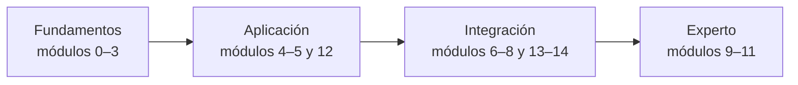
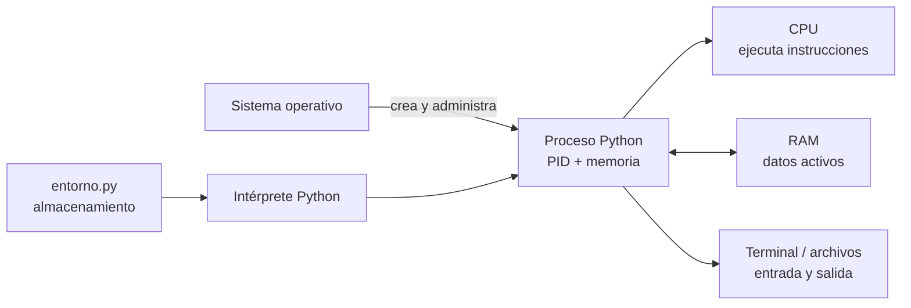
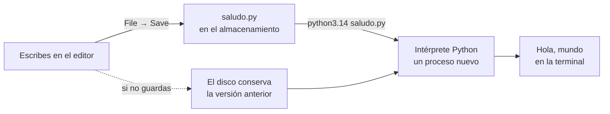
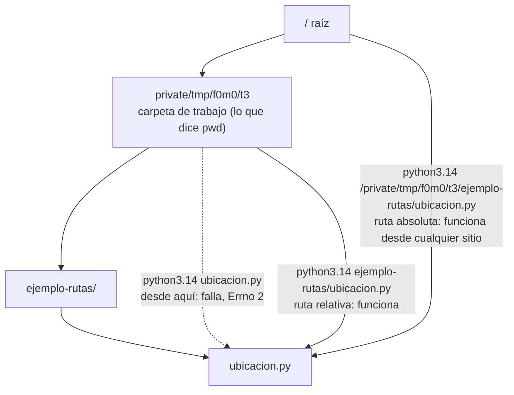
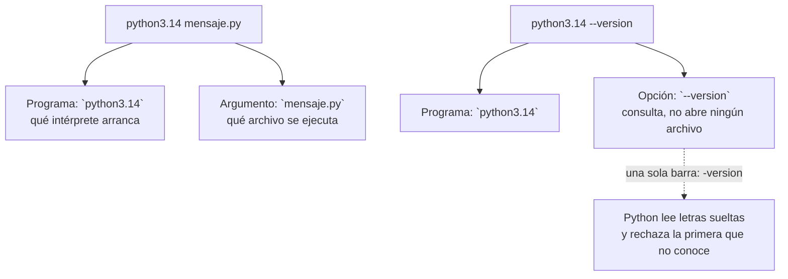
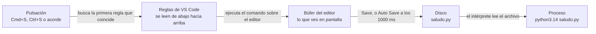

# Módulo 0: Cómo funciona tu entorno de desarrollo

## Antes de comenzar: prepara tu primera sesión

Hoy vas a crear un archivo, ejecutar un programa y corregir un error. Puedes trabajar por temas y volver después: el objetivo es poder repetir el procedimiento y explicar lo que observaste.

Una **carpeta** reúne archivos. Un **archivo** guarda contenido con un nombre, como `saludo.py`. El **editor** permite escribir ese contenido; la **terminal** permite pedirle acciones al computador escribiendo comandos. No pegues comandos en el archivo Python ni código Python directamente en la terminal.

Las siete palabras que se usan todo el capítulo, con la acción que te piden:

| Palabra | Qué es | Qué haces con ella |
|---|---|---|
| `mkdir nombre` | crear una carpeta vacía | `mkdir primera-sesion` |
| `cd nombre` | entrar en una carpeta | `cd primera-sesion` |
| `pwd` | imprimir la carpeta donde estás | `pwd` |
| `cat archivo` | imprimir el contenido de un archivo | `cat saludo.py` |
| `.py` | extensión de un archivo de Python | `saludo.py` |
| `.md` | extensión de un archivo de texto con formato ligero (Markdown) | `README.md` |

La **tubería** se escribe con el carácter `|` y conecta dos comandos: lo que el de la izquierda escribe en la
salida entra por la entrada estándar del de la derecha, sin que nadie teclee nada. `echo Ana | python3.14
entrada.py` significa «escribe `Ana` y pásaselo a `entrada.py` como si lo hubiera escrito yo». Se usa en las
capturas de este capítulo para que el resultado no dependa de que alguien teclee en el momento exacto.

Un **`README.md`** es solo un archivo de texto con esas tres letras en mayúscula: se abre en cualquier editor
y sirve para dejar apuntado lo que hiciste. No es un programa y no se ejecuta; lo escribes tú. Para crear
cualquier archivo en VS Code: **File → New File** (Archivo → Nuevo archivo), escribe el nombre completo con
su extensión (`saludo.py`, `README.md`) y guarda con **File → Save**.


### Instala y comprueba

<details open>
<summary><strong>Capa 1 — Lectura</strong></summary>

#### ► CÓMO FUNCIONA


</details>

<details>
<summary><strong>Capa 2 — Construcción</strong></summary>

#### Código y verificación

</details>

### Tema 1: Computador, sistema operativo, programa y proceso · Básico · 45 min

<details open>
<summary><strong>Capa 1 — Lectura</strong></summary>

#### ► DE QUÉ TRATA
Al finalizar podrás distinguir CPU, memoria, almacenamiento, periféricos, sistema operativo, programa, intérprete y proceso; además observarás desde un archivo real qué sistema ejecuta Python y qué identificador recibe cada ejecución. Prerrequisitos: ninguno de programación; sólo…

#### ► CÓMO FUNCIONA


</details>

<details>
<summary><strong>Capa 2 — Construcción</strong></summary>

#### Código y verificación


```python
import os
import platform
import sys

mensaje_temporal = "Este valor existe mientras vive el proceso"

print(f"sistema={platform.system()}")
print(f"arquitectura={platform.machine()}")
print(f"python={sys.executable}")
print(f"pid={os.getpid()}")
print(f"cpu_logicas={os.cpu_count()}")
print(f"memoria_proceso={mensaje_temporal}")
```

```bash
python3.14 entorno.py
python3.14 entorno.py
```

```text
$ python3.14 --version
Python 3.14.10
$ python3.14 entorno.py
sistema=Darwin
arquitectura=arm64
python=/opt/homebrew/opt/python@3.14/bin/python3.14
pid=60920
cpu_logicas=10
memoria_proceso=Este valor existe mientras vive el proceso
$ python3.14 entorno.py
sistema=Darwin
arquitectura=arm64
python=/opt/homebrew/opt/python@3.14/bin/python3.14
pid=60923
cpu_logicas=10
memoria_proceso=Este valor existe mientras vive el proceso
$ python3.14 roto.py; echo "codigo_de_salida=$?"
sistema=Darwin
arquitectura=arm64
python=/opt/homebrew/opt/python@3.14/bin/python3.14
codigo_de_salida=1
Traceback (most recent call last):
  File "/private/tmp/f0m0/t1/fundamentos-entorno/roto.py", line 10, in <module>
    print(f"pid={os.getpid(1)}")
                 ~~~~~~~~~^^^
TypeError: posix.getpid() takes no arguments (1 given)
```

```text
python_version=3.14.10
version_info=sys.version_info(major=3, minor=14, micro=10, releaselevel='final', serial=0)
arquitectura_plataforma=('64bit', 'Mach-O')
```

</details>

### Tema 2: Del archivo fuente al programa en ejecución · Básico · 45 min

<details open>
<summary><strong>Capa 1 — Lectura</strong></summary>

#### ► DE QUÉ TRATA
Al finalizar podrás guardar saludo.py, ejecutarlo dos veces, cambiar su contenido y explicar qué diferencia hay entre el archivo y su ejecución. Prerrequisitos: Python responde con su versión y tienes abierta una carpeta vacía en VS Code. Si entraste directamente, sigue la prepar…

#### ► CÓMO FUNCIONA


</details>

<details>
<summary><strong>Capa 2 — Construcción</strong></summary>

#### Código y verificación


```python
# Muestra un mensaje en la terminal.
print("Hola, mundo")
```

```bash
python3.14 saludo.py
python3.14 saludo.py
```

```text
$ python3.14 saludo.py
Hola, mundo
$ python3.14 saludo.py
Hola, mundo
$ python3.14 saludo-inexistente.py; echo "codigo_de_salida=$?"
codigo_de_salida=2
/opt/homebrew/Cellar/python@3.14/3.14.10/Frameworks/Python.framework/Versions/3.14/Resources/Pyt
hon.app/Contents/MacOS/Python: can't open file '/private/tmp/f0m0/t2/primera-sesion/saludo-inexi
stente.py': [Errno 2] No such file or directory
$ cp saludo2.py saludo.py && python3.14 saludo.py
Mi primera práctica funciona
$ python3.14 presentacion.py
Ana Torres
Estoy aprendiendo a ejecutar programas
```

```python
# Muestra un mensaje en la terminal.
print("Mi primera práctica funciona")
```

```bash
cp saludo2.py saludo.py && python3.14 saludo.py
python3.14 saludo.py
```

</details>

### Tema 3: Archivos, carpetas y rutas sin perderse · Básico · 45 min

<details open>
<summary><strong>Capa 1 — Lectura</strong></summary>

#### ► DE QUÉ TRATA
Al finalizar podrás ejecutar el mismo archivo desde dos carpetas usando la ruta adecuada y diagnosticar un archivo no encontrado. Prerrequisitos: distinguir editor y terminal; disponer del comando de Python comprobado al inicio. El ejemplo es independiente y puede hacerse desde c…

#### ► CÓMO FUNCIONA


</details>

<details>
<summary><strong>Capa 2 — Construcción</strong></summary>

#### Código y verificación


```bash
mkdir ejemplo-rutas
cd ejemplo-rutas
pwd
```

```python
# Este mensaje permite comprobar qué archivo ejecutamos.
print("Encontraste ubicacion.py")
```

```bash
pwd
python3.14 ubicacion.py
cd .. && python3.14 ubicacion.py; echo "codigo_de_salida=$?"; cd ejemplo-rutas
cd .. && python3.14 ejemplo-rutas/ubicacion.py; cd ejemplo-rutas
```

```text
$ pwd
/private/tmp/f0m0/t3/ejemplo-rutas
$ python3.14 ubicacion.py
Encontraste ubicacion.py
$ cd .. && python3.14 ubicacion.py; echo "codigo_de_salida=$?"; cd ejemplo-rutas
codigo_de_salida=2
/opt/homebrew/Cellar/python@3.14/3.14.10/Frameworks/Python.framework/Versions/3.14/Resources/Pyt
hon.app/Contents/MacOS/Python: can't open file '/private/tmp/f0m0/t3/ubicacion.py': [Errno 2] No
 such file or directory
$ cd .. && python3.14 ejemplo-rutas/ubicacion.py; cd ejemplo-rutas
Encontraste ubicacion.py
```

```bash
python3.14 ./ubicacion.py
python3.14 ../ejemplo-rutas/ubicacion.py
```

</details>

### Tema 4: Cómo leer un comando antes de ejecutarlo · Básico · 45 min

<details open>
<summary><strong>Capa 1 — Lectura</strong></summary>

#### ► DE QUÉ TRATA
Al finalizar podrás identificar qué programa ejecuta un comando y qué archivo recibe. Prerrequisitos: comprobar Python y localizar la carpeta de trabajo (Temas 1 y 3). Trabajarás en un ejemplo independiente desde una carpeta vacía, sin necesitar archivos de los temas anteriores.

#### ► CÓMO FUNCIONA


</details>

<details>
<summary><strong>Capa 2 — Construcción</strong></summary>

#### Código y verificación


```bash
mkdir ejemplo-comandos
cd ejemplo-comandos
```

```python
# El argumento del comando seleccionará este archivo.
print("Ejecutaste mensaje.py")
```

```python
# Segundo archivo: cambia solo el nombre del argumento.
print("Elegiste otro archivo")
```

```bash
python3.14 --version
python3.14 mensaje.py
python3.14 --opcion-inexistente; echo "codigo_de_salida=$?"
python3.14 segundo.py
```

```text
$ python3.14 --version
Python 3.14.10
$ python3.14 mensaje.py
Ejecutaste mensaje.py
$ python3.14 --opcion-inexistente; echo "codigo_de_salida=$?"
codigo_de_salida=2
Unknown option: --opcion-inexistente
usage: /opt/homebrew/Cellar/python@3.14/3.14.10/Frameworks/Python.framework/Versions/3.14/Resour
ces/Python.app/Contents/MacOS/Python [option] ... [-c cmd | -m mod | file | -] [arg] ...
Try `python -h' for more information.
$ python3.14 segundo.py
Elegiste otro archivo
```

</details>

### Tema 5: Primer programa, primer error y primera evidencia · Básico · 45 min

<details open>
<summary><strong>Capa 1 — Lectura</strong></summary>

#### ► DE QUÉ TRATA
Al finalizar podrás pedir un nombre, mostrar un saludo y localizar un error de sintaxis usando el archivo y la línea informados por Python. Prerrequisitos: guardar un .py, ejecutarlo y encontrar la carpeta de trabajo (Temas 2 y 3). No se necesita ningún archivo de los temas anter…

#### ► CÓMO FUNCIONA
```mermaid
flowchart LR
    T["Terminal<br/>escribes Ana y pulsas Enter"] --> I["entrada.py<br/>`input(\"¿Cómo te llamas? \")`"]
    I --> V["variable `nombre`<br/>valor durante esta ejecución"]
    V --> F["cadena `f`<br/>sustituye `{nombre}`"]
    F --> S["`print`<br/>Hola, Ana en la terminal"]
    X["texto sin comilla de cierre"] -.->|"Python lo detecta antes de ejecutar"| E["SyntaxError<br/>archivo y línea señalados"]
    E -.->|"corriges, guardas, vuelves a ejecutar"| I
```

</details>

<details>
<summary><strong>Capa 2 — Construcción</strong></summary>

#### Código y verificación
```mermaid
flowchart LR
    T["Terminal<br/>escribes Ana y pulsas Enter"] --> I["entrada.py<br/>`input(\"¿Cómo te llamas? \")`"]
    I --> V["variable `nombre`<br/>valor durante esta ejecución"]
    V --> F["cadena `f`<br/>sustituye `{nombre}`"]
    F --> S["`print`<br/>Hola, Ana en la terminal"]
    X["texto sin comilla de cierre"] -.->|"Python lo detecta antes de ejecutar"| E["SyntaxError<br/>archivo y línea señalados"]
    E -.->|"corriges, guardas, vuelves a ejecutar"| I
```

```bash
mkdir ejemplo-entrada
cd ejemplo-entrada
```

```python
# Recibe texto y lo asocia al nombre de variable.
nombre = input("¿Cómo te llamas? ")
# Inserta ese texto en el saludo.
print(f"Hola, {nombre}")
```

```bash
python3.14 entrada.py
```

```text
$ echo Ana | python3.14 entrada.py
¿Cómo te llamas? Hola, Ana
$ printf 'Bogotá\n' | python3.14 destino.py
¿A dónde enviamos? Destino registrado: Bogotá
$ echo Cali | python3.14 destino.py
¿A dónde enviamos? Destino registrado: Cali
$ python3.14 roto.py; echo "codigo_de_salida=$?"
codigo_de_salida=1
  File "/private/tmp/f0m0/t5/ejemplo-entrada/roto.py", line 4
    print(f"Hola, {nombre}
          ^
SyntaxError: unterminated f-string literal (detected at line 4)
```

```python
# Pide un destino.
ciudad = input("¿A dónde enviamos? ")
print(f"Destino registrado: {ciudad}")
```

</details>

### Tema 6: VS Code, comandos y atajos comprobables · Básico · 45 min

<details open>
<summary><strong>Capa 1 — Lectura</strong></summary>

#### ► DE QUÉ TRATA
Al finalizar podrás nombrar la acción que realiza un comando de VS Code, buscar en tu instalación el atajo que esa acción tiene realmente, y explicar por qué la terminal ejecutó el contenido del disco y no lo que tú ves en el editor. Prerrequisitos: Tema 2 (escribir y guardar sal…

#### ► LA IDEA EN UNA FRASE
****Comando:** la acción. Tiene un nombre visible (**Save**, **Go to File**) y un identificador**

#### ► CÓMO FUNCIONA


</details>

<details>
<summary><strong>Capa 2 — Construcción</strong></summary>

#### Código y verificación
```json
{ "key": "ctrl+shift+k", "command": "editor.action.deleteLines", "when": "editorTextFocus" }
```


```bash
mkdir practica-editor
cd practica-editor
```

```python
# La salida identifica la versión realmente guardada del archivo.
print("Archivo guardado: versión 1")
```

```python
# La salida identifica la versión realmente guardada del archivo.
print("Archivo guardado: versión 2")
```

```bash
python3.14 --version
python3.14 saludo.py
cp sin-guardar.py saludo.py && python3.14 saludo.py
```

</details>
