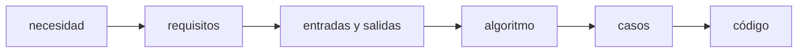
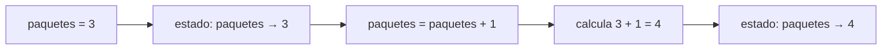
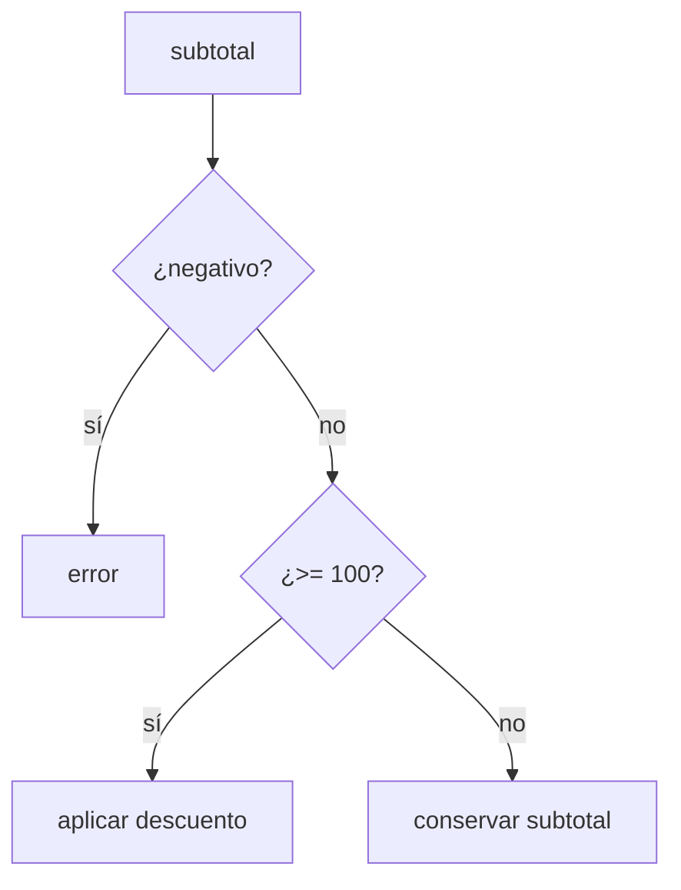
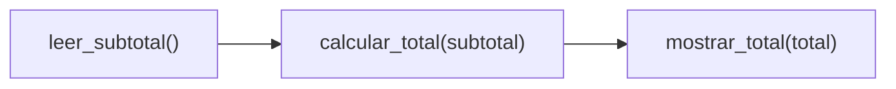
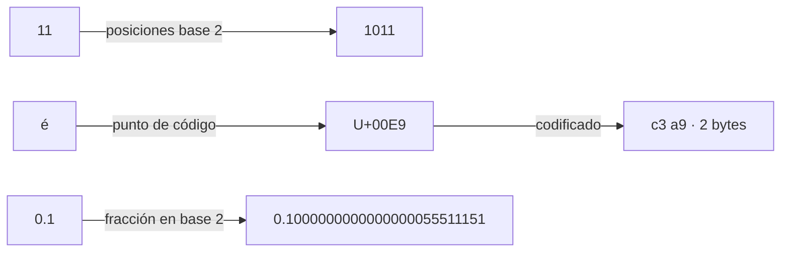
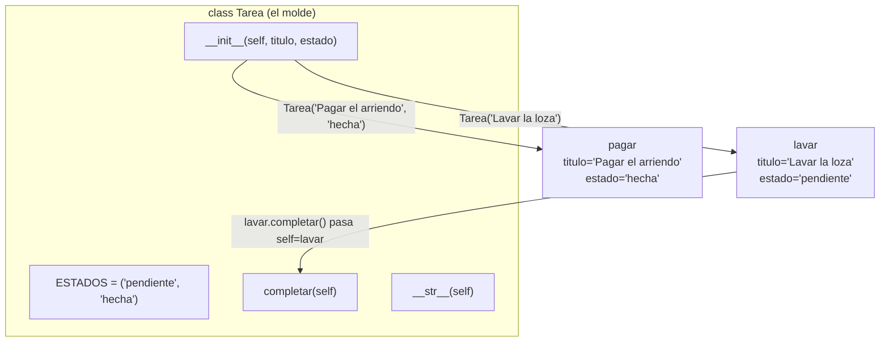
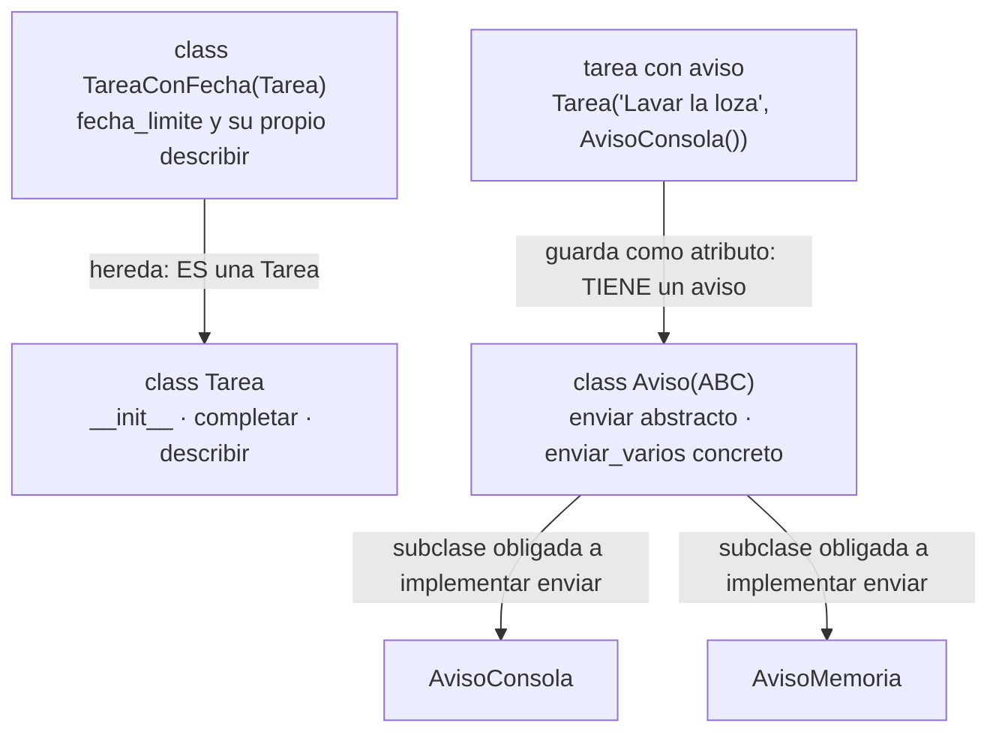

# Módulo 1: Pensamiento computacional y programación

**Entorno comprobado para esta edición (2026-11-21):** Python 3.14.10 en macOS 27.2 arm64, la línea de referencia del curso (`docs/VERSIONES.md`). Las cinco capturas de los temas 1 a 5 se generaron con `python3.14` ejecutado aquí y las transcripciones son literales de esa ejecución. Los ejemplos no requieren paquetes externos. El registro anterior (2026-11-18) decía 3.14.6 en Linux: se conserva como historial, pero los números de las transcripciones son las de hoy. Las instrucciones para Windows y PowerShell siguen contrastadas solo contra la documentación: **no se ejecutaron en esos sistemas**.


## Aprende construyendo


### Tema 1: Del problema al algoritmo y a los casos de prueba · Básico · 30 min

<details open>
<summary><strong>Capa 1 — Lectura</strong></summary>

#### ► DE QUÉ TRATA
Al finalizar vas a convertir un problema informal ("¿cuántas tareas están pendientes?") en un algoritmo explícito, implementarlo en Python y diseñar casos que incluyan una lista vacía y un estado no admitido. Prerrequisitos: Python instalado y el Tema 4 de Fundamentos módulo 0 (l…

#### ► CÓMO FUNCIONA


</details>

<details>
<summary><strong>Capa 2 — Construcción</strong></summary>

#### Código y verificación
```text
CONTAR_PENDIENTES(tareas):
  contador = 0
  estados_admitidos = {"pendiente", "hecho"}
  PARA cada numero, tarea en tareas:
    SI tarea.estado no está en estados_admitidos:
      LANZAR ValueError con numero y estado
    SI tarea.estado es "pendiente": contador = contador + 1
  DEVOLVER contador
```

```text
LEER subtotal
SI subtotal < 0
    MOSTRAR "valor inválido"
SI NO, SI subtotal >= 100
    total = subtotal * 0.90
SI NO
    total = subtotal
MOSTRAR total
```


```
0.1 + 0.1 + 0.1 en Python: _________
Casos diseñados: _________, _________, _________
Función validadora: redondea_a_centavos(resultado) _________
99.99 * 0.90 imprime: _________
```

```python
> from decimal import Decimal
> precio = Decimal('99.99') * Decimal('0.90')
> ```

```bash
mkdir ejemplo-algoritmo
cd ejemplo-algoritmo
mkdir src
```

</details>

### Tema 2: Variables, tipos, expresiones y cambios de estado · Básico · 45 min

<details open>
<summary><strong>Capa 1 — Lectura</strong></summary>

#### Objetivos
Al terminar este tema podrás:
- crear variables y explicar qué guarda cada una;
- reconocer los tipos `str`, `int`, `float` y `bool` y comprobarlos con `type()`;
- cambiar el valor de una variable y predecir lo que imprime el programa;
- convertir texto escrito por una persona en un número con `int()` y `float()`;
- leer los errores `NameError`, `TypeError` y `ValueError` y corregirlos.

**Conceptos clave:** valor, variable, asignación, tipo de dato, print, type, reasignación, estado, conversión de tipo, input

#### El problema
RutaFlow registra cada envío con su número de guía, su peso, cuántos paquetes lleva y si ya se entregó. El programa
necesita **recordar** esos datos mientras trabaja y **cambiarlos** cuando algo pasa: por ejemplo, cuando el cliente
agrega un paquete. Además, cuando una persona escribe la cantidad en el teclado, el programa recibe **texto**, no un
número. ¿Cómo guarda un programa un dato, cómo lo cambia y cómo convierte lo que escribe una persona?

#### Glosario del tema

**valor**
- **Definición técnica:** dato concreto que el programa manipula, como `3`, `2.5` o `"RF-4471"`.
- **En palabras sencillas:** la información en sí: un número, un texto, un sí o un no.
- **Dónde se rompe la comparación:** para el computador `3` y `"3"` son valores distintos: uno es número y el otro es texto.
- **Ejemplo:** en `paquetes = 3`, el valor es `3`.
- **Error típico:** escribir texto sin comillas (`guia = RF-4471`): Python lo lee como una resta entre dos nombres.

**variable**
- **Definición técnica:** nombre asociado a un valor guardado en la memoria del programa; al usar el nombre, el intérprete obtiene ese valor.
- **En palabras sencillas:** una etiqueta pegada a una caja: la etiqueta es el nombre y lo que hay adentro es el valor.
- **Dónde se rompe la comparación:** en Python la etiqueta apunta al valor; dos nombres pueden apuntar al mismo valor.
- **Ejemplo:** `peso_kg = 2.5` crea el nombre `peso_kg` y lo asocia a `2.5`.
- **Error típico:** usar el nombre con otra mayúscula: `Peso_kg` no es `peso_kg`.

**asignación (`=`)**
- **Definición técnica:** instrucción que evalúa la expresión de la derecha y asocia el resultado al nombre de la izquierda.
- **En palabras sencillas:** «guarda esto con este nombre». No es el «igual» de matemáticas.
- **Dónde se rompe la comparación:** `paquetes = paquetes + 1` es imposible en matemáticas y normal al programar.
- **Ejemplo:** `entregado = False`.
- **Error típico:** escribirla al revés: `2.5 = peso_kg` produce `SyntaxError`.

**tipo de dato**
- **Definición técnica:** categoría de un valor que define qué operaciones admite: `str` (texto), `int` (número entero), `float` (número con decimales) y `bool` (`True` o `False`).
- **En palabras sencillas:** la clase de dato; dice qué puedes hacer con él, como sumar números o unir textos.
- **Dónde se rompe la comparación:** Python decide el tipo por el valor que escribes, no porque tú lo declares.
- **Ejemplo:** `type(2.5)` devuelve `<class 'float'>`.
- **Error típico:** mezclar tipos: `"Paquetes: " + 3` produce `TypeError`.

**print y type**
- **Definición técnica:** funciones integradas de Python; `print` escribe valores en la salida estándar y `type` devuelve el tipo de un valor.
- **En palabras sencillas:** `print` muestra algo en la terminal; `type` te dice qué clase de dato tienes.
- **Dónde se rompe la comparación:** `print` no devuelve el valor que muestra: solo lo escribe.
- **Ejemplo:** `print(type(3))` muestra `<class 'int'>`.
- **Error típico:** olvidar los paréntesis: `print "hola"` produce `SyntaxError` en Python 3.

**reasignación y estado**
- **Definición técnica:** reasignar es asociar un nombre existente a un valor nuevo; el **estado** del programa es el conjunto de valores de todas sus variables en un instante.
- **En palabras sencillas:** cambiar lo que hay en la caja; el estado es la foto de todas las cajas en un momento.
- **Dónde se rompe la comparación:** el valor viejo no se guarda en ningún lado: si lo necesitas, guárdalo antes con otro nombre.
- **Ejemplo:** después de `paquetes = paquetes + 1`, el estado tiene `paquetes` en `4`.
- **Error típico:** creer que el valor anterior sigue disponible con el mismo nombre.

**conversión de tipo e input**
- **Definición técnica:** `input()` lee una línea del teclado y siempre devuelve un `str`; `int()` y `float()` crean un número a partir de ese texto, o lanzan `ValueError` si el texto no representa un número.
- **En palabras sencillas:** lo que escribe una persona llega como letras; para hacer cuentas hay que traducirlo a número.
- **Dónde se rompe la comparación:** la traducción puede fallar: `int("dos")` no sabe leer palabras.
- **Ejemplo:** `int("3")` devuelve el número `3`.
- **Error típico:** sumar sin convertir: `input() + 1` produce `TypeError`.

#### ► CÓMO FUNCIONA
Python ejecuta el archivo de arriba abajo, una línea a la vez. En cada asignación, primero calcula el lado derecho y
después pega el nombre del lado izquierdo al resultado. Cuando un nombre se usa más adelante, Python busca a qué
valor está pegado **en ese momento**.



#### Problema resuelto 2.1
Registra un envío con sus cuatro datos, muéstralos con su tipo y agrega un paquete.

**Razonamiento:**
1. Cada dato necesita un nombre y un tipo: la guía es texto, el peso lleva decimales, los paquetes se cuentan y la entrega es sí o no.
2. Para mostrar valores se usa `print`; para comprobar el tipo, `type`.
3. Agregar un paquete es reasignar: calcular `paquetes + 1` y guardar el resultado con el mismo nombre.

```python
# variables.py — registra un envío de RutaFlow
guia = "RF-4471"      # str: texto, siempre entre comillas
peso_kg = 2.5         # float: número con parte decimal
paquetes = 3          # int: número entero
entregado = False     # bool: solo puede ser True o False

print(guia, peso_kg, paquetes, entregado)
print(type(guia), type(peso_kg), type(paquetes), type(entregado))

paquetes = paquetes + 1   # reasignación: el estado cambia
print("paquetes ahora:", paquetes)
```

```text
$ python3 variables.py
RF-4471 2.5 3 False
<class 'str'> <class 'float'> <class 'int'> <class 'bool'>
paquetes ahora: 4
```

**Explicación por partes.**
- Líneas 2–5: cuatro asignaciones. Cada una crea un nombre y le pega un valor de distinto tipo.
- Línea 7: `print` recibe cuatro valores separados por comas y los muestra separados por espacios.
- Línea 8: `type` confirma los tipos que dedujimos en el razonamiento.
- Línea 10: Python calcula primero `paquetes + 1` (da `4`) y luego reasigna `paquetes`.

> **Error común.** Escribir el nombre con otra mayúscula. `print(Guia)` termina el programa con
> `NameError: name 'Guia' is not defined. Did you mean: 'guia'?`. Lee el mensaje de derecha a izquierda: Python no
> encontró `Guia` y te sugiere el nombre que sí existe.

> **Error común.** Unir texto y número con `+`. `print("Paquetes: " + 3)` produce
> `TypeError: can only concatenate str (not "int") to str`. Usa una coma: `print("Paquetes:", 3)`.

> **Buena práctica.** Los nombres dicen qué guardan y en qué unidad: `peso_kg` en vez de `p` o `dato1`. Se escriben
> en minúscula con guion bajo (*snake_case*), la convención oficial de Python (PEP 8).

#### Problema resuelto 2.2
El cliente escribe en el teclado cuántos paquetes trae. Suma uno más y muestra el total.

**Razonamiento:**
1. `input` devuelve siempre texto, aunque la persona escriba un número.
2. Para sumar hay que convertir ese texto a `int` con `int()`.
3. Si el texto no es un número, `int()` falla: hay que saber leer ese error.

```python
# cantidad.py — lee cuántos paquetes trae el cliente
texto = input("Paquetes: ")
print(type(texto))
cantidad = int(texto)
print(type(cantidad))
print("total de paquetes:", cantidad + 1)
```

```text
$ echo 3 | python3 cantidad.py
Paquetes: <class 'str'>
<class 'int'>
total de paquetes: 4
```

**Explicación por partes.**
- Línea 2: `input` muestra `Paquetes: ` y espera una línea. Aquí `echo 3 |` escribe `3` por ti, así la salida no depende de teclear a tiempo.
- Línea 3: confirma que lo leído es `str`, aunque parezca un número.
- Línea 4: `int(texto)` convierte `"3"` en `3`.
- Línea 6: ahora sí se puede sumar.

> **Error común.** Escribir una palabra donde se espera un número. Con `echo dos | python3 cantidad.py` el
> programa termina con `ValueError: invalid literal for int() with base 10: 'dos'`. Significa: «el texto `'dos'` no
> se puede leer como entero en base 10».

> **Prevenir errores.** Antes de convertir, decide qué hará el programa con una entrada inválida. En el Tema 3
> aprenderás a comprobarla con `if` y a pedirla de nuevo.

#### Checkpoint 2.1
Si después del Problema resuelto 2.1 escribes `paquetes = paquetes * 2`, ¿qué valor queda en `paquetes`?

Respuesta: `8`. Antes de esa línea `paquetes` vale `4` por la reasignación anterior, y `4 * 2 = 8`.

</details>

<details>
<summary><strong>Capa 2 — Construcción</strong></summary>

#### Paso 1 · Prepara la carpeta
Crea la carpeta `~/labs/variables` y entra con `cd ~/labs/variables`.

#### Paso 2 · Registra el envío
Escribe `variables.py` (Problema resuelto 2.1) y ejecútalo con `python3 variables.py`. Compara tu salida con la del tema.

#### Paso 3 · Lee datos del teclado
Escribe `cantidad.py` (Problema resuelto 2.2) y pruébalo con `echo 3 | python3 cantidad.py` y con `echo dos | python3 cantidad.py`.

#### Paso 4 · Provoca y corrige los errores
Provoca a propósito el `NameError` y el `TypeError` del tema, lee cada mensaje y corrígelo.

#### Resumen
- Una **variable** es un nombre asociado a un **valor**.
- La **asignación** `=` calcula la derecha y guarda el resultado con el nombre de la izquierda.
- Cada valor tiene un **tipo de dato** (`str`, `int`, `float`, `bool`) que define qué operaciones admite.
- **Reasignar** cambia el **estado** del programa; el valor anterior deja de estar disponible con ese nombre.
- `input` siempre devuelve texto; **convertir** con `int()` o `float()` permite hacer cuentas.
- `NameError`: ese nombre no existe. `TypeError`: esa operación no sirve para esos tipos. `ValueError`: ese texto no se puede convertir.

#### Ejercicio verificable 1
Básico. Calcula el costo de un envío: tarifa de 4200 por kg, peso de 2.5 kg y recargo urgente de 3000. Guarda cada
dato en una variable y muestra el total.

Respuesta esperada: `13500.0`. Es `float` porque multiplicar un `int` por un `float` da `float`; con `int(total)` se muestra `13500`.

#### Ejercicio verificable 2
Intermedio. Sin ejecutarlo, escribe qué muestran `print("3" * 2)` y `print(3 * 2)`. Luego compruébalo.

Respuesta esperada: `33` y `6`. Con texto, `*` repite el texto; con números, multiplica.

#### Ejercicio verificable 3
Reto. Lee el peso con `input` (por ejemplo `echo 2.5 | python3 costo.py`) y calcula el costo del Ejercicio 1.

Respuesta esperada: `13500.0`. El peso tiene decimales, así que se convierte con `float()`, no con `int()`: `int("2.5")` lanza `ValueError`.

#### En el trabajo
En un backend real, estos datos llegan en una petición o en un archivo y terminan en una base de datos. Los mismos
errores aparecen a otra escala: un `TypeError` por recibir el peso como texto (`"2.5"`) o un `ValueError` por una
celda vacía son de los fallos más comunes al leer formularios y archivos CSV.

</details>

### Tema 3: Decisiones, repeticiones y trazado de ejecución · Básico · 35 min

<details open>
<summary><strong>Capa 1 — Lectura</strong></summary>

#### ► DE QUÉ TRATA
Al finalizar vas a recorrer una lista de tareas con un bucle y una condición para detectar cuáles están vencidas, y vas a trazar a mano la ejecución para encontrar un error de "uno de más, uno de menos" que deja afuera la última tarea sin que se note a simple vista. Prerrequisito…

#### ► CÓMO FUNCIONA


</details>

<details>
<summary><strong>Capa 2 — Construcción</strong></summary>

#### Código y verificación
```python
total = 0
for numero in [12, 8, 5]:
    total = total + numero
print(total)
```

```python
subtotal = 100
if subtotal < 0:
    print("El subtotal no puede ser negativo")
elif subtotal >= 100:
    print(subtotal * 0.90)
else:
    print(subtotal)
```


```
for tarea in []: cuerpo ejecuta _________ vez(ces)
Si lista vacía: if _________ (not tareas vs len(tareas)==0)
Mejor opción: _________ (¿por qué?)
for i in range(0): entra _________ vez(ces)
```

```python
> if tareas:
>     for tarea in tareas:
>         print(tarea)
> else:
>     print("Sin tareas pendientes")
> ```

```bash
mkdir ejemplo-control-flujo
cd ejemplo-control-flujo
mkdir src
```

</details>

### Tema 4: Funciones y descomposición de problemas · Básico · 35 min

<details open>
<summary><strong>Capa 1 — Lectura</strong></summary>

#### ► DE QUÉ TRATA
Al finalizar vas a dividir el problema de "contar tareas pendientes" en varias funciones chicas, cada una con una sola responsabilidad, y vas a descubrir por qué una función que hace más de lo que su nombre promete puede sorprender a quien la usa. Prerrequisitos: el Tema 3 de est…

#### ► CÓMO FUNCIONA


</details>

<details>
<summary><strong>Capa 2 — Construcción</strong></summary>

#### Código y verificación
```python
def calcular_total(subtotal):
    if subtotal < 0:
        raise ValueError("El subtotal no puede ser negativo")
    if subtotal >= 100:
        return subtotal * 0.90
    return subtotal
```

```python
print(calcular_total(50))
print(calcular_total(100))
print(calcular_total(100.01))
```

```python
def calcular_total(subtotal):
    if subtotal < 0:
        raise ValueError("El subtotal no puede ser negativo")
    if subtotal >= 100:
        return subtotal * 0.90
    return subtotal

def leer_subtotal():
    return float(input("Subtotal: "))

def mostrar_total(total):
    print(f"Total: {total:.2f}")

subtotal = leer_subtotal()
total = calcular_total(subtotal)
mostrar_total(total)
```


```
Funciones nivel 3: _________, _________, _________
Tamaño ideal: _________ líneas máximo
Responsabilidad de editar_tarea(): _________ (¿guarda disco?)
Función más fácil de testear: _________ (¿por qué?)
```

```bash
mkdir ejemplo-funciones
cd ejemplo-funciones
mkdir src
```

</details>

### Tema 5: Cómo la computadora representa los datos — binario, texto y decimales · Básico · 40 min

<details open>
<summary><strong>Capa 1 — Lectura</strong></summary>

#### ► DE QUÉ TRATA
Al finalizar podrás explicar cómo un número, una letra y un decimal se guardan realmente como ceros y unos, convertir entre binario y decimal, y entender por qué 0.1 + 0.2 no da exactamente 0.3. Prerrequisitos: los Temas 1 y 2 de este módulo (variables y tipos); comprueba python3…

#### ► CÓMO FUNCIONA


</details>

<details>
<summary><strong>Capa 2 — Construcción</strong></summary>

#### Código y verificación

```bash
mkdir ejemplo
cd ejemplo
```

```python
# Enteros en binario
print("11 en binario:", bin(11))          # 0b1011
print("0b1011 en decimal:", 0b1011)        # 11

# Texto: cada carácter es un número (code point), codificado en bytes UTF-8
print("Código de 'A':", ord("A"))          # 65
acento_bytes = "é".encode("utf-8")
print("'é' en bytes UTF-8:", acento_bytes, len(acento_bytes), "bytes")
emoji_bytes = "🚚".encode("utf-8")
print("'🚚' en bytes UTF-8:", emoji_bytes, len(emoji_bytes), "bytes")

# Punto flotante: la suma NO es exacta
resultado = 0.1 + 0.2
print("0.1 + 0.2 =", resultado)            # 0.30000000000000004
print("¿Es igual a 0.3?", resultado == 0.3)   # False
# Forma correcta de comparar decimales:
print("¿Casi igual?", abs(resultado - 0.3) < 1e-9)   # True
```

```bash
python3.14 representacion.py
```

```text
$ python3.14 representacion.py
11 en binario: 0b1011
0b1011 en decimal: 11
Código de 'A': 65
'é' en bytes UTF-8: b'\xc3\xa9' 2 bytes
'🚚' en bytes UTF-8: b'\xf0\x9f\x9a\x9a' 4 bytes
0.1 + 0.2 = 0.30000000000000004
¿Es igual a 0.3? False
¿Casi igual? True
```

```python
resultado = 0.1 + 0.2

if resultado == 0.3:
    print("descuento aplicado")
```

</details>

### Tema 6: Clases y objetos: atributos, métodos e `__init__` · Básico · 35 min

<details open>
<summary><strong>Capa 1 — Lectura</strong></summary>

#### ► DE QUÉ TRATA
Al terminar vas a poder escribir una clase con init, crear objetos con esa clase, leer sus atributos desde el objeto, y explicar por qué una regla («una tarea solo pasa de pendiente a hecha») vive dentro de un método del objeto en lugar de copiarse en cada bucle del programa. Pre…

#### ► CÓMO FUNCIONA


</details>

<details>
<summary><strong>Capa 2 — Construcción</strong></summary>

#### Código y verificación


```bash
mkdir ejemplo-clases
cd ejemplo-clases
mkdir src
```

```python
class Tarea:
    def __init__(self, titulo, estado="pendiente"):
        self.titulo = titulo
        self.estado = estado


lavar = Tarea("Lavar la loza")
pagar = Tarea("Pagar el arriendo", "hecha")

print(lavar.titulo, "-", lavar.estado)
print(pagar.titulo, "-", pagar.estado)
print(type(lavar).__name__)
print(lavar is pagar)
```

```bash
python3.14 src/tarea.py
```

```python
class Tarea:
    def __init__(self, titulo, estado="pendiente"):
        self.titulo = titulo
        self.estado = estado


lavar = Tarea()
print(lavar.titulo)
```

```text
Traceback (most recent call last):
  File "/private/tmp/f1m1/t6/src/tarea-sin-titulo.py", line 7, in <module>
    lavar = Tarea()
TypeError: Tarea.__init__() missing 1 required positional argument: 'titulo'
```

</details>

### Tema 7: Herencia, composición y clases abstractas con `abc` · Intermedio · 40 min

<details open>
<summary><strong>Capa 1 — Lectura</strong></summary>

#### ► DE QUÉ TRATA
Al terminar vas a poder decidir si una clase nueva es un caso especial de otra (herencia con super()) o tiene otra a la que le encarga trabajo (composición), y convertir esa decisión en un contrato que el intérprete comprueba con abc. Prerrequisitos: el Tema 6 de este módulo (cla…

#### ► CÓMO FUNCIONA


</details>

<details>
<summary><strong>Capa 2 — Construcción</strong></summary>

#### Código y verificación


```bash
mkdir ejemplo-clases
cd ejemplo-clases
mkdir src
```

```python
class Tarea:
    def __init__(self, titulo):
        self.titulo = titulo
        self.estado = "pendiente"

    def completar(self):
        self.estado = "hecha"

    def describir(self):
        return f"{self.titulo} ({self.estado})"


class TareaConFecha(Tarea):
    def __init__(self, titulo, fecha_limite):
        super().__init__(titulo)
        self.fecha_limite = fecha_limite

    def describir(self):
        return f"{super().describir()} vence {self.fecha_limite}"


tareas = [Tarea("Lavar la loza"), TareaConFecha("Pagar el arriendo", "2026-12-05")]
tareas[1].completar()
for tarea in tareas:
    print(tarea.describir())
print("¿es una Tarea?", isinstance(tareas[1], Tarea))
print("¿es una TareaConFecha?", isinstance(tareas[0], TareaConFecha))
```

```text
Lavar la loza (pendiente)
Pagar el arriendo (hecha) vence 2026-12-05
¿es una Tarea? True
¿es una TareaConFecha? False
```

```python
class TareaConFecha(Tarea):
    def __init__(self, titulo, fecha_limite):
        self.fecha_limite = fecha_limite
```

```text
Lavar la loza (pendiente)
Traceback (most recent call last):
  File "/private/tmp/f1m1/t7/src/herencia-sin-super.py", line 24, in <module>
    print(tarea.describir())
          ~~~~~~~~~~~~~~~^^
  File "/private/tmp/f1m1/t7/src/herencia-sin-super.py", line 18, in describir
    return f"{super().describir()} vence {self.fecha_limite}"
              ~~~~~~~~~~~~~~~~~^^
  File "/private/tmp/f1m1/t7/src/herencia-sin-super.py", line 10, in describir
    return f"{self.titulo} ({self.estado})"
              ^^^^^^^^^^^
AttributeError: 'TareaConFecha' object has no attribute 'titulo'
```

</details>

### Proyecto 1: calculadora de presupuesto desde carpeta vacía

<details open>
<summary><strong>Capa 1 — Lectura</strong></summary>

</details>

<details>
<summary><strong>Capa 2 — Construcción</strong></summary>

#### Nota de construcción
Este tema es principalmente conceptual en esta versión. La verificación se realiza con las preguntas de comprensión y el criterio de cuándo NO usar proyecto 1: calculadora de presupuesto desde carpeta vacía.

</details>
