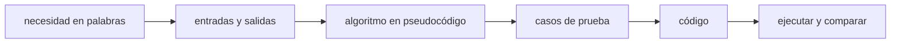
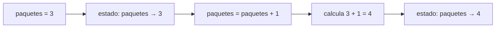
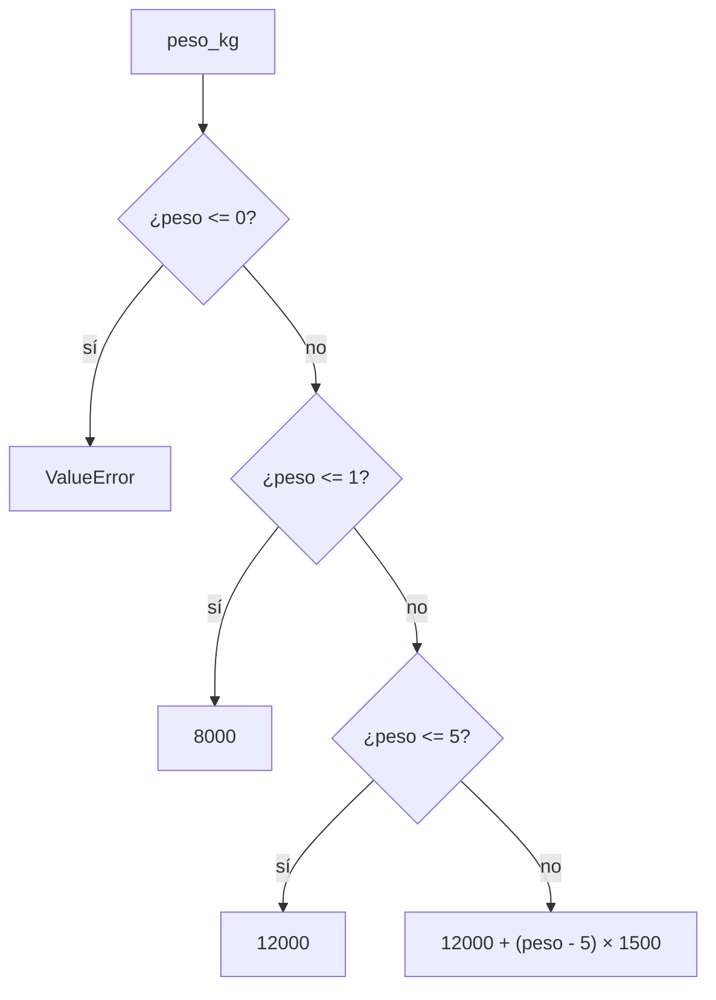
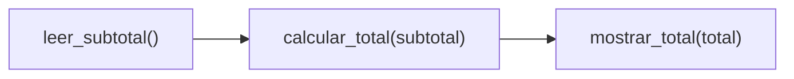
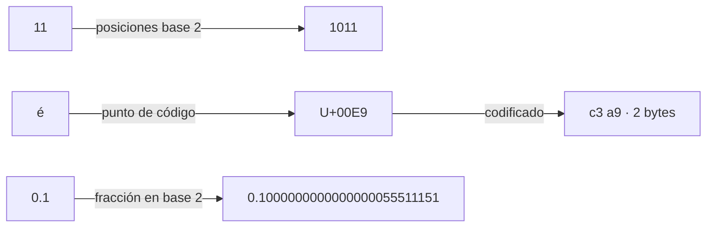
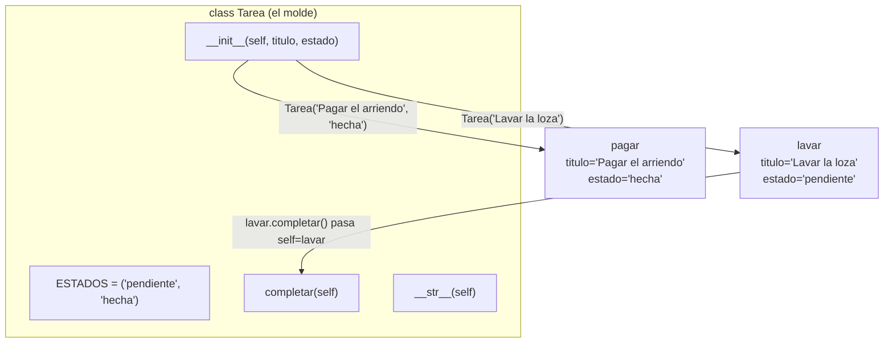
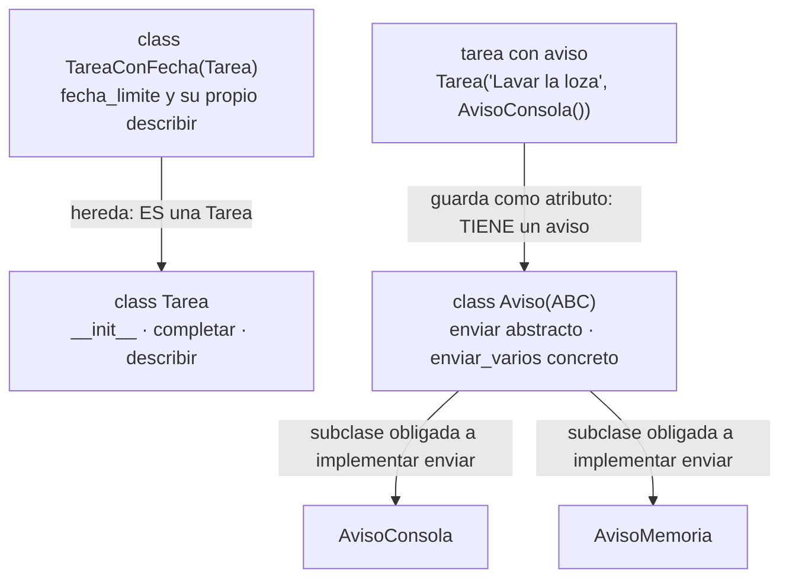

# Módulo 1: Pensamiento computacional y programación

**Entorno comprobado para esta edición (2026-11-21):** Python 3.14.10 en macOS 27.2 arm64, la línea de referencia del curso (`docs/VERSIONES.md`). Las cinco capturas de los temas 1 a 5 se generaron con `python3.14` ejecutado aquí y las transcripciones son literales de esa ejecución. Los ejemplos no requieren paquetes externos. El registro anterior (2026-11-18) decía 3.14.6 en Linux: se conserva como historial, pero los números de las transcripciones son las de hoy. Las instrucciones para Windows y PowerShell siguen contrastadas solo contra la documentación: **no se ejecutaron en esos sistemas**.


## Aprende construyendo


### Tema 1: Del problema al algoritmo y a los casos de prueba · Básico · 45 min

<details open>
<summary><strong>Capa 1 — Lectura</strong></summary>

#### Objetivos
Al terminar este tema podrás:
- convertir una necesidad escrita en palabras en entradas, salidas y reglas claras;
- escribir un algoritmo en pseudocódigo y traducirlo a Python;
- diseñar casos de prueba que incluyan casos límite y datos inválidos;
- comprobar tu programa con `assert` y leer un `ValueError` provocado a propósito.

**Conceptos clave:** algoritmo, pseudocódigo, entrada y salida, caso de prueba, caso límite, excepción, assert

#### El problema
La coordinadora de RutaFlow pregunta cada mañana: «¿cuántos envíos de la ruta siguen pendientes?». Es una pregunta
en palabras, no un programa. Antes de escribir código hay que responder tres cosas: ¿qué datos entran?, ¿qué
resultado sale? y ¿qué hacer con un dato raro, como un envío con estado «perdido»?

#### Glosario del tema

**algoritmo**
- **Definición técnica:** secuencia finita y ordenada de pasos no ambiguos que transforma unas entradas en una salida.
- **En palabras sencillas:** una receta tan precisa que cualquiera, incluso una máquina, llega al mismo resultado siguiéndola.
- **Dónde se rompe la comparación:** una receta admite «sal al gusto»; un algoritmo no admite pasos que dependan del gusto.
- **Ejemplo:** «empieza el contador en 0; por cada envío pendiente, súmale 1; al final, entrega el contador».
- **Error típico:** dejar un caso sin decidir (¿qué pasa si la lista está vacía?) y descubrirlo cuando el programa falla.

**pseudocódigo**
- **Definición técnica:** descripción de un algoritmo con estructura de programa (pasos, condiciones, repeticiones) pero en lenguaje natural, sin reglas de un lenguaje concreto.
- **En palabras sencillas:** un borrador del programa escrito en español, para pensar sin pelear con la sintaxis.
- **Dónde se rompe la comparación:** el computador no ejecuta pseudocódigo; sirve para pensar y para explicar, no para correr.
- **Ejemplo:** `SI estado es "pendiente": contador = contador + 1`.
- **Error típico:** escribirlo tan vago («revisa los envíos») que no dice qué hacer en cada paso.

**entrada y salida**
- **Definición técnica:** la entrada son los datos que recibe un algoritmo o función; la salida es el resultado que entrega.
- **En palabras sencillas:** lo que le das y lo que te devuelve.
- **Dónde se rompe la comparación:** una función también puede «salir» lanzando un error en lugar de devolver un resultado.
- **Ejemplo:** entrada: lista de envíos; salida: número de pendientes.
- **Error típico:** mezclar mostrar con devolver: `print` muestra, `return` entrega el resultado a quien llamó.

**caso de prueba**
- **Definición técnica:** combinación concreta de entrada y salida esperada que se usa para comprobar que un programa cumple su especificación.
- **En palabras sencillas:** un ejemplo con la respuesta correcta anotada, para comparar con lo que hace el programa.
- **Dónde se rompe la comparación:** que pasen todos tus casos no prueba que el programa sea correcto, solo que no falla en esos.
- **Ejemplo:** entrada `[]` (ruta vacía) → salida esperada `0`.
- **Error típico:** probar solo el caso feliz, el que ya sabes que funciona.

**caso límite**
- **Definición técnica:** caso de prueba en el borde de lo permitido: vacío, uno solo, el máximo, el primer valor inválido.
- **En palabras sencillas:** los ejemplos extremos, donde los programas suelen romperse.
- **Dónde se rompe la comparación:** «extremo» depende del problema: en una ruta es la lista vacía; en un peso, el 0 o un negativo.
- **Ejemplo:** una ruta sin envíos.
- **Error típico:** suponer que «nadie mandará una lista vacía».

**excepción**
- **Definición técnica:** señal que interrumpe el flujo normal del programa cuando ocurre una situación que no puede manejarse ahí; en Python se lanza con `raise` y, si nadie la captura, termina el programa con un mensaje.
- **En palabras sencillas:** una alarma: «aquí pasó algo que no sé resolver».
- **Dónde se rompe la comparación:** a diferencia de una alarma, una excepción puede atraparse con `try` y `except` para reaccionar.
- **Ejemplo:** `raise ValueError("estado no admitido")`.
- **Error típico:** devolver un valor inventado (como `0`) cuando el dato es inválido, y esconder el problema.

**assert**
- **Definición técnica:** instrucción que evalúa una condición y lanza `AssertionError` si es falsa; se usa para expresar lo que debe cumplirse.
- **En palabras sencillas:** «compruébame que esto es cierto; si no, detente y avísame».
- **Dónde se rompe la comparación:** no sirve para validar datos de usuarios: se puede desactivar al ejecutar Python con `-O`.
- **Ejemplo:** `assert contar_pendientes([]) == 0`.
- **Error típico:** escribir `assert` sin comparar (`assert contar_pendientes([])`), que comprueba otra cosa.

#### ► CÓMO FUNCIONA
Programar empieza antes del código. Primero se aclara la **necesidad**; luego se fijan **entradas y salidas**; después
se escribe el **algoritmo** y los **casos de prueba**, y solo al final el **código**. Los casos se diseñan antes del
código para no ajustarlos a lo que el programa ya hace.



#### Problema resuelto 1.1
Cuenta los envíos pendientes de una ruta. Cada envío tiene un estado: `pendiente` o `entregado`. Cualquier otro
estado es un error.

**Razonamiento:**
1. Entrada: una lista de envíos. Salida: un número entero.
2. Algoritmo: recorrer la lista una vez, sumar 1 por cada pendiente y rechazar los estados desconocidos.
3. Pseudocódigo antes del código:

```text
CONTAR_PENDIENTES(envios):
  contador = 0
  PARA cada envío (con su número de orden):
    SI su estado no es "pendiente" ni "entregado":
      LANZAR error con el número y el estado
    SI su estado es "pendiente":
      contador = contador + 1
  DEVOLVER contador
```

```python
# pendientes.py — cuenta los envíos pendientes de una ruta
ESTADOS_ADMITIDOS = {"pendiente", "entregado"}


def contar_pendientes(envios):
    contador = 0
    for numero, envio in enumerate(envios, start=1):
        estado = envio["estado"]
        if estado not in ESTADOS_ADMITIDOS:
            raise ValueError(f"envío {numero}: estado no admitido '{estado}'")
        if estado == "pendiente":
            contador = contador + 1
    return contador


ruta = [
    {"guia": "RF-101", "estado": "pendiente"},
    {"guia": "RF-102", "estado": "entregado"},
    {"guia": "RF-103", "estado": "pendiente"},
]
print("pendientes:", contar_pendientes(ruta))
```

```text
$ python3 pendientes.py
pendientes: 2
```

**Explicación por partes.**
- Línea 2: el conjunto de estados válidos se escribe una sola vez, con nombre en mayúsculas porque no cambia.
- Línea 5: `def` define la función; `envios` es su entrada.
- Línea 7: `enumerate(..., start=1)` entrega cada envío junto a su número (1, 2, 3…), útil para el mensaje de error.
- Líneas 9–10: un estado desconocido detiene todo con `ValueError`, en vez de contarse en silencio.
- Línea 13: `return` entrega la salida a quien llamó la función.
- Líneas 16–21: una ruta de ejemplo con 2 pendientes; la salida coincide con lo esperado.

> **Error común.** Un envío sin la clave `"estado"` termina con `KeyError: 'estado'`. El mensaje dice qué clave
> faltó en el diccionario. Revisa de dónde vienen los datos antes de culpar a la función.

> **Buena práctica.** Escribe el pseudocódigo como comentario o en papel antes del código. Si no puedes explicar el
> algoritmo en español, todavía no estás listo para escribirlo en Python.

#### Problema resuelto 1.2
Comprueba la función con casos de prueba: ruta vacía, ninguno pendiente, todos pendientes y un estado inválido.

**Razonamiento:**
1. La ruta vacía es el caso límite: debe dar `0`, no fallar.
2. Cada `assert` compara la salida real con la esperada.
3. El estado inválido debe producir `ValueError`; `try` y `except` lo atrapan para mostrar el mensaje.

```python
# prueba_pendientes.py — casos de prueba de contar_pendientes
from pendientes import contar_pendientes

assert contar_pendientes([]) == 0                                   # caso límite: ruta vacía
assert contar_pendientes([{"estado": "entregado"}]) == 0            # ninguno pendiente
assert contar_pendientes([{"estado": "pendiente"}] * 3) == 3        # todos pendientes

try:
    contar_pendientes([{"estado": "perdido"}])                      # caso inválido
    print("ERROR: debía rechazar 'perdido'")
except ValueError as error:
    print("rechazado:", error)

print("todas las pruebas pasaron")
```

```text
$ python3 prueba_pendientes.py
pendientes: 2
rechazado: envío 1: estado no admitido 'perdido'
todas las pruebas pasaron
```

**Explicación por partes.**
- Línea 2: `from pendientes import contar_pendientes` trae la función del otro archivo.
- Primera línea de la salida: al importar, Python ejecuta `pendientes.py` completo, incluido su `print`. En el Tema 4 verás cómo evitarlo.
- Líneas 4–6: si un `assert` fallara, el programa terminaría con `AssertionError` en esa línea.
- Líneas 8–12: el caso inválido se atrapa y se muestra el mensaje de la excepción.

> **Prevenir errores.** Diseña los casos de prueba antes de escribir la función. Si los inventas después, tiendes a
> probar solo lo que el código ya hace bien.

#### Checkpoint 1.1
¿Qué devuelve `contar_pendientes([{"estado": "pendiente"}, {"estado": "Pendiente"}])`?

Respuesta: no devuelve nada: lanza `ValueError` en el envío 2, porque `"Pendiente"` con mayúscula no está en `ESTADOS_ADMITIDOS`. Para el computador son textos distintos.

</details>

<details>
<summary><strong>Capa 2 — Construcción</strong></summary>

#### Paso 1 · Prepara la carpeta
Crea `~/labs/algoritmo` y entra con `cd ~/labs/algoritmo`.

#### Paso 2 · Escribe el algoritmo
Copia el pseudocódigo del Problema resuelto 1.1 en un archivo `algoritmo.txt`, con tus palabras.

#### Paso 3 · Tradúcelo a Python
Escribe `pendientes.py` y ejecútalo. La salida debe ser `pendientes: 2`.

#### Paso 4 · Prueba los casos
Escribe `prueba_pendientes.py`, ejecútalo y luego cambia `== 3` por `== 4` para ver un `AssertionError` real.

#### Resumen
- Un **algoritmo** es una secuencia finita de pasos sin ambigüedad; el **pseudocódigo** lo describe sin sintaxis de un lenguaje.
- Antes de programar se fijan la **entrada**, la **salida** y qué hacer con datos inválidos.
- Un **caso de prueba** une una entrada con su salida esperada; los **casos límite** están en los bordes.
- Una **excepción** (`raise ValueError`) detiene el flujo ante un dato que no se puede manejar.
- `assert` comprueba que una condición se cumple y falla con `AssertionError` si no.

#### Ejercicio verificable 1
Básico. Escribe en pseudocódigo un algoritmo que cuente los envíos **entregados**.

Respuesta esperada: igual al de pendientes, pero sumando 1 cuando el estado es `"entregado"`. Debe seguir rechazando estados desconocidos.

#### Ejercicio verificable 2
Intermedio. Agrega a `prueba_pendientes.py` un caso con un envío pendiente y uno entregado. ¿Qué valor esperas?

Respuesta esperada: `assert contar_pendientes([{"estado": "pendiente"}, {"estado": "entregado"}]) == 1`.

#### Ejercicio verificable 3
Reto. Modifica la función para que acepte `"Pendiente"` y `"PENDIENTE"` como pendientes, sin aceptar `"perdido"`.

Respuesta esperada: normalizar antes de comparar con `estado = envio["estado"].lower()`. El checkpoint deja de lanzar error y devuelve `2`.

#### En el trabajo
En un equipo profesional este proceso se repite en cada tarea: la necesidad llega en un ticket, se acuerdan entradas
y salidas, y los casos de prueba se escriben como pruebas automáticas que se ejecutan en cada cambio (lo verás en el
Módulo 5 con `pytest` y CI). Rechazar datos inválidos con un error claro, en lugar de adivinar, evita reportes
equivocados que nadie nota hasta que es tarde.

</details>

### Tema 2: Variables, tipos, expresiones y cambios de estado · Básico · 45 min

<details open>
<summary><strong>Capa 1 — Lectura</strong></summary>

#### Objetivos
Al terminar este tema podrás:
- crear variables y explicar qué guarda cada una;
- reconocer los tipos `str`, `int`, `float` y `bool` y comprobarlos con `type()`;
- cambiar el valor de una variable y predecir lo que imprime el programa;
- convertir texto escrito por una persona en un número con `int()` y `float()`;
- leer los errores `NameError`, `TypeError` y `ValueError` y corregirlos.

**Conceptos clave:** valor, variable, asignación, tipo de dato, print, type, reasignación, estado, conversión de tipo, input

#### El problema
RutaFlow registra cada envío con su número de guía, su peso, cuántos paquetes lleva y si ya se entregó. El programa
necesita **recordar** esos datos mientras trabaja y **cambiarlos** cuando algo pasa: por ejemplo, cuando el cliente
agrega un paquete. Además, cuando una persona escribe la cantidad en el teclado, el programa recibe **texto**, no un
número. ¿Cómo guarda un programa un dato, cómo lo cambia y cómo convierte lo que escribe una persona?

#### Glosario del tema

**valor**
- **Definición técnica:** dato concreto que el programa manipula, como `3`, `2.5` o `"RF-4471"`.
- **En palabras sencillas:** la información en sí: un número, un texto, un sí o un no.
- **Dónde se rompe la comparación:** para el computador `3` y `"3"` son valores distintos: uno es número y el otro es texto.
- **Ejemplo:** en `paquetes = 3`, el valor es `3`.
- **Error típico:** escribir texto sin comillas (`guia = RF-4471`): Python lo lee como una resta entre dos nombres.

**variable**
- **Definición técnica:** nombre asociado a un valor guardado en la memoria del programa; al usar el nombre, el intérprete obtiene ese valor.
- **En palabras sencillas:** una etiqueta pegada a una caja: la etiqueta es el nombre y lo que hay adentro es el valor.
- **Dónde se rompe la comparación:** en Python la etiqueta apunta al valor; dos nombres pueden apuntar al mismo valor.
- **Ejemplo:** `peso_kg = 2.5` crea el nombre `peso_kg` y lo asocia a `2.5`.
- **Error típico:** usar el nombre con otra mayúscula: `Peso_kg` no es `peso_kg`.

**asignación (`=`)**
- **Definición técnica:** instrucción que evalúa la expresión de la derecha y asocia el resultado al nombre de la izquierda.
- **En palabras sencillas:** «guarda esto con este nombre». No es el «igual» de matemáticas.
- **Dónde se rompe la comparación:** `paquetes = paquetes + 1` es imposible en matemáticas y normal al programar.
- **Ejemplo:** `entregado = False`.
- **Error típico:** escribirla al revés: `2.5 = peso_kg` produce `SyntaxError`.

**tipo de dato**
- **Definición técnica:** categoría de un valor que define qué operaciones admite: `str` (texto), `int` (número entero), `float` (número con decimales) y `bool` (`True` o `False`).
- **En palabras sencillas:** la clase de dato; dice qué puedes hacer con él, como sumar números o unir textos.
- **Dónde se rompe la comparación:** Python decide el tipo por el valor que escribes, no porque tú lo declares.
- **Ejemplo:** `type(2.5)` devuelve `<class 'float'>`.
- **Error típico:** mezclar tipos: `"Paquetes: " + 3` produce `TypeError`.

**print y type**
- **Definición técnica:** funciones integradas de Python; `print` escribe valores en la salida estándar y `type` devuelve el tipo de un valor.
- **En palabras sencillas:** `print` muestra algo en la terminal; `type` te dice qué clase de dato tienes.
- **Dónde se rompe la comparación:** `print` no devuelve el valor que muestra: solo lo escribe.
- **Ejemplo:** `print(type(3))` muestra `<class 'int'>`.
- **Error típico:** olvidar los paréntesis: `print "hola"` produce `SyntaxError` en Python 3.

**reasignación y estado**
- **Definición técnica:** reasignar es asociar un nombre existente a un valor nuevo; el **estado** del programa es el conjunto de valores de todas sus variables en un instante.
- **En palabras sencillas:** cambiar lo que hay en la caja; el estado es la foto de todas las cajas en un momento.
- **Dónde se rompe la comparación:** el valor viejo no se guarda en ningún lado: si lo necesitas, guárdalo antes con otro nombre.
- **Ejemplo:** después de `paquetes = paquetes + 1`, el estado tiene `paquetes` en `4`.
- **Error típico:** creer que el valor anterior sigue disponible con el mismo nombre.

**conversión de tipo e input**
- **Definición técnica:** `input()` lee una línea del teclado y siempre devuelve un `str`; `int()` y `float()` crean un número a partir de ese texto, o lanzan `ValueError` si el texto no representa un número.
- **En palabras sencillas:** lo que escribe una persona llega como letras; para hacer cuentas hay que traducirlo a número.
- **Dónde se rompe la comparación:** la traducción puede fallar: `int("dos")` no sabe leer palabras.
- **Ejemplo:** `int("3")` devuelve el número `3`.
- **Error típico:** sumar sin convertir: `input() + 1` produce `TypeError`.

#### ► CÓMO FUNCIONA
Python ejecuta el archivo de arriba abajo, una línea a la vez. En cada asignación, primero calcula el lado derecho y
después pega el nombre del lado izquierdo al resultado. Cuando un nombre se usa más adelante, Python busca a qué
valor está pegado **en ese momento**.



#### Problema resuelto 2.1
Registra un envío con sus cuatro datos, muéstralos con su tipo y agrega un paquete.

**Razonamiento:**
1. Cada dato necesita un nombre y un tipo: la guía es texto, el peso lleva decimales, los paquetes se cuentan y la entrega es sí o no.
2. Para mostrar valores se usa `print`; para comprobar el tipo, `type`.
3. Agregar un paquete es reasignar: calcular `paquetes + 1` y guardar el resultado con el mismo nombre.

```python
# variables.py — registra un envío de RutaFlow
guia = "RF-4471"      # str: texto, siempre entre comillas
peso_kg = 2.5         # float: número con parte decimal
paquetes = 3          # int: número entero
entregado = False     # bool: solo puede ser True o False

print(guia, peso_kg, paquetes, entregado)
print(type(guia), type(peso_kg), type(paquetes), type(entregado))

paquetes = paquetes + 1   # reasignación: el estado cambia
print("paquetes ahora:", paquetes)
```

```text
$ python3 variables.py
RF-4471 2.5 3 False
<class 'str'> <class 'float'> <class 'int'> <class 'bool'>
paquetes ahora: 4
```

**Explicación por partes.**
- Líneas 2–5: cuatro asignaciones. Cada una crea un nombre y le pega un valor de distinto tipo.
- Línea 7: `print` recibe cuatro valores separados por comas y los muestra separados por espacios.
- Línea 8: `type` confirma los tipos que dedujimos en el razonamiento.
- Línea 10: Python calcula primero `paquetes + 1` (da `4`) y luego reasigna `paquetes`.

> **Error común.** Escribir el nombre con otra mayúscula. `print(Guia)` termina el programa con
> `NameError: name 'Guia' is not defined. Did you mean: 'guia'?`. Lee el mensaje de derecha a izquierda: Python no
> encontró `Guia` y te sugiere el nombre que sí existe.

> **Error común.** Unir texto y número con `+`. `print("Paquetes: " + 3)` produce
> `TypeError: can only concatenate str (not "int") to str`. Usa una coma: `print("Paquetes:", 3)`.

> **Buena práctica.** Los nombres dicen qué guardan y en qué unidad: `peso_kg` en vez de `p` o `dato1`. Se escriben
> en minúscula con guion bajo (*snake_case*), la convención oficial de Python (PEP 8).

#### Problema resuelto 2.2
El cliente escribe en el teclado cuántos paquetes trae. Suma uno más y muestra el total.

**Razonamiento:**
1. `input` devuelve siempre texto, aunque la persona escriba un número.
2. Para sumar hay que convertir ese texto a `int` con `int()`.
3. Si el texto no es un número, `int()` falla: hay que saber leer ese error.

```python
# cantidad.py — lee cuántos paquetes trae el cliente
texto = input("Paquetes: ")
print(type(texto))
cantidad = int(texto)
print(type(cantidad))
print("total de paquetes:", cantidad + 1)
```

```text
$ echo 3 | python3 cantidad.py
Paquetes: <class 'str'>
<class 'int'>
total de paquetes: 4
```

**Explicación por partes.**
- Línea 2: `input` muestra `Paquetes: ` y espera una línea. Aquí `echo 3 |` escribe `3` por ti, así la salida no depende de teclear a tiempo.
- Línea 3: confirma que lo leído es `str`, aunque parezca un número.
- Línea 4: `int(texto)` convierte `"3"` en `3`.
- Línea 6: ahora sí se puede sumar.

> **Error común.** Escribir una palabra donde se espera un número. Con `echo dos | python3 cantidad.py` el
> programa termina con `ValueError: invalid literal for int() with base 10: 'dos'`. Significa: «el texto `'dos'` no
> se puede leer como entero en base 10».

> **Prevenir errores.** Antes de convertir, decide qué hará el programa con una entrada inválida. En el Tema 3
> aprenderás a comprobarla con `if` y a pedirla de nuevo.

#### Checkpoint 2.1
Si después del Problema resuelto 2.1 escribes `paquetes = paquetes * 2`, ¿qué valor queda en `paquetes`?

Respuesta: `8`. Antes de esa línea `paquetes` vale `4` por la reasignación anterior, y `4 * 2 = 8`.

</details>

<details>
<summary><strong>Capa 2 — Construcción</strong></summary>

#### Paso 1 · Prepara la carpeta
Crea la carpeta `~/labs/variables` y entra con `cd ~/labs/variables`.

#### Paso 2 · Registra el envío
Escribe `variables.py` (Problema resuelto 2.1) y ejecútalo con `python3 variables.py`. Compara tu salida con la del tema.

#### Paso 3 · Lee datos del teclado
Escribe `cantidad.py` (Problema resuelto 2.2) y pruébalo con `echo 3 | python3 cantidad.py` y con `echo dos | python3 cantidad.py`.

#### Paso 4 · Provoca y corrige los errores
Provoca a propósito el `NameError` y el `TypeError` del tema, lee cada mensaje y corrígelo.

#### Resumen
- Una **variable** es un nombre asociado a un **valor**.
- La **asignación** `=` calcula la derecha y guarda el resultado con el nombre de la izquierda.
- Cada valor tiene un **tipo de dato** (`str`, `int`, `float`, `bool`) que define qué operaciones admite.
- **Reasignar** cambia el **estado** del programa; el valor anterior deja de estar disponible con ese nombre.
- `input` siempre devuelve texto; **convertir** con `int()` o `float()` permite hacer cuentas.
- `NameError`: ese nombre no existe. `TypeError`: esa operación no sirve para esos tipos. `ValueError`: ese texto no se puede convertir.

#### Ejercicio verificable 1
Básico. Calcula el costo de un envío: tarifa de 4200 por kg, peso de 2.5 kg y recargo urgente de 3000. Guarda cada
dato en una variable y muestra el total.

Respuesta esperada: `13500.0`. Es `float` porque multiplicar un `int` por un `float` da `float`; con `int(total)` se muestra `13500`.

#### Ejercicio verificable 2
Intermedio. Sin ejecutarlo, escribe qué muestran `print("3" * 2)` y `print(3 * 2)`. Luego compruébalo.

Respuesta esperada: `33` y `6`. Con texto, `*` repite el texto; con números, multiplica.

#### Ejercicio verificable 3
Reto. Lee el peso con `input` (por ejemplo `echo 2.5 | python3 costo.py`) y calcula el costo del Ejercicio 1.

Respuesta esperada: `13500.0`. El peso tiene decimales, así que se convierte con `float()`, no con `int()`: `int("2.5")` lanza `ValueError`.

#### En el trabajo
En un backend real, estos datos llegan en una petición o en un archivo y terminan en una base de datos. Los mismos
errores aparecen a otra escala: un `TypeError` por recibir el peso como texto (`"2.5"`) o un `ValueError` por una
celda vacía son de los fallos más comunes al leer formularios y archivos CSV.

</details>

### Tema 3: Decisiones, repeticiones y trazado de ejecución · Básico · 50 min

<details open>
<summary><strong>Capa 1 — Lectura</strong></summary>

#### Objetivos
Al terminar este tema podrás:
- escribir condiciones con operadores de comparación y decidir con `if`, `elif` y `else`;
- repetir instrucciones con `for` sobre una lista y con `while` mientras se cumpla una condición;
- trazar a mano la ejecución de un programa en una tabla y predecir su salida;
- reconocer y corregir un bucle infinito, un `IndexError` y los errores de sintaxis más comunes.

**Conceptos clave:** condición, operador de comparación, if, elif, else, bucle, for, while, iteración, trazado de ejecución

#### El problema
La tarifa de RutaFlow cambia según el peso: hasta 1 kg cuesta 8000; hasta 5 kg, 12000; y por encima de 5 kg se
cobran 1500 por cada kilo adicional. Además, el conductor avanza parada por parada hasta llegar a un destino. El
programa tiene que **elegir** entre caminos y **repetir** pasos. Hasta ahora los programas iban en línea recta, de
arriba abajo. ¿Cómo hace un programa para decidir y para repetir?

#### Glosario del tema

**condición**
- **Definición técnica:** expresión que se evalúa a un valor booleano, `True` o `False`, y que decide qué instrucciones se ejecutan.
- **En palabras sencillas:** una pregunta de sí o no que el programa se hace, como «¿el peso es menor o igual a 1?».
- **Dónde se rompe la comparación:** en Python casi cualquier valor puede usarse como condición: una lista vacía o el `0` cuentan como «no».
- **Ejemplo:** `peso_kg <= 1` vale `True` si el peso es 0.5.
- **Error típico:** escribir la condición al revés (`>` en vez de `<`) y obtener justo el resultado contrario.

**operador de comparación**
- **Definición técnica:** operador que compara dos valores y devuelve un booleano: `==` igual, `!=` distinto, `<`, `<=`, `>`, `>=`.
- **En palabras sencillas:** los signos que preguntan si algo es igual, distinto, mayor o menor que otra cosa.
- **Dónde se rompe la comparación:** `==` compara; `=` asigna. Se parecen, pero hacen cosas totalmente distintas.
- **Ejemplo:** `estado == "pendiente"`.
- **Error típico:** escribir `if x = 5:`, que produce `SyntaxError: invalid syntax. Maybe you meant '==' or ':=' instead of '='?`.

**if, elif y else**
- **Definición técnica:** instrucciones de selección; `if` ejecuta su bloque si la condición es verdadera, cada `elif` prueba otra condición solo si las anteriores fueron falsas, y `else` se ejecuta si ninguna lo fue.
- **En palabras sencillas:** «si pasa esto, haz aquello; si no, prueba esto otro; y si nada se cumple, haz lo último».
- **Dónde se rompe la comparación:** solo se ejecuta **un** camino: el primero cuya condición se cumple, aunque las siguientes también fueran ciertas.
- **Ejemplo:** `if peso_kg <= 1: return 8000`.
- **Error típico:** olvidar los dos puntos `:` al final: `SyntaxError: expected ':'`.

**bloque e indentación**
- **Definición técnica:** grupo de instrucciones que pertenece a un `if`, un bucle o una función; en Python se marca con la indentación (los espacios al inicio de la línea), por convención 4 espacios.
- **En palabras sencillas:** las líneas corridas hacia la derecha «viven dentro» de la instrucción que está encima.
- **Dónde se rompe la comparación:** la indentación no es decoración: cambiarla cambia lo que hace el programa.
- **Ejemplo:** el `return 8000` va corrido 4 espacios más que su `elif`.
- **Error típico:** mezclar tabuladores y espacios, o correr mal una línea, que produce `IndentationError`.

**bucle e iteración**
- **Definición técnica:** un bucle es una instrucción que repite un bloque; cada repetición se llama iteración.
- **En palabras sencillas:** una vuelta que se repite; cada vuelta es una iteración.
- **Dónde se rompe la comparación:** un bucle mal hecho no se cansa: puede repetirse para siempre.
- **Ejemplo:** recorrer 4 pesos son 4 iteraciones.
- **Error típico:** cambiar dentro del bucle la variable equivocada y nunca avanzar.

**for**
- **Definición técnica:** bucle que toma, uno a uno, cada elemento de una secuencia (lista, texto, `range`) y ejecuta el bloque para cada uno.
- **En palabras sencillas:** «para cada cosa de esta lista, haz esto».
- **Dónde se rompe la comparación:** si la lista está vacía, el bloque se ejecuta **cero** veces y no hay error.
- **Ejemplo:** `for peso in [0.5, 1, 3, 8]:`.
- **Error típico:** modificar la lista mientras la recorres; el resultado es difícil de predecir.

**while**
- **Definición técnica:** bucle que repite su bloque mientras una condición sea verdadera; la condición se revisa antes de cada iteración.
- **En palabras sencillas:** «sigue haciendo esto mientras pase aquello».
- **Dónde se rompe la comparación:** si nada dentro del bloque hace que la condición deje de cumplirse, el bucle no termina nunca (**bucle infinito**).
- **Ejemplo:** `while paradas[indice] != destino:`.
- **Error típico:** olvidar avanzar el índice: el programa se queda «pegado». Se detiene con Ctrl + C.

**trazado de ejecución**
- **Definición técnica:** técnica de seguir a mano, instrucción por instrucción, los valores de las variables en una tabla para predecir qué hará un programa.
- **En palabras sencillas:** hacer de computador con lápiz y papel, anotando cómo cambia cada variable en cada vuelta.
- **Dónde se rompe la comparación:** el computador no se equivoca al trazar; tú sí, y por eso sirve: muestra dónde tu idea del programa no coincide con lo que hace.
- **Ejemplo:** la tabla del Problema resuelto 3.2.
- **Error típico:** saltarse una iteración y concluir que el programa «está mal» cuando el error estaba en el trazado.

#### ► CÓMO FUNCIONA
Un `if` divide el camino en ramas y Python sigue solo una. Un bucle hace que el camino vuelva hacia atrás y repita un
bloque. Combinando ambas cosas se puede describir casi cualquier algoritmo.



#### Problema resuelto 3.1
Escribe una función que devuelva la tarifa de un envío según su peso y muéstrala para 0.5, 1, 3 y 8 kg.

**Razonamiento:**
1. Primero se descarta el dato inválido (peso 0 o negativo): así las demás reglas no tienen que preocuparse por él.
2. Las reglas se escriben de la más pequeña a la más grande, porque `elif` solo se prueba si la anterior falló.
3. Un `for` recorre los pesos de prueba y llama a la función en cada iteración.

```python
# tarifa.py — decide la tarifa de un envío según su peso
def tarifa(peso_kg):
    if peso_kg <= 0:
        raise ValueError("el peso debe ser mayor que 0")
    elif peso_kg <= 1:
        return 8000
    elif peso_kg <= 5:
        return 12000
    else:
        return 12000 + (peso_kg - 5) * 1500


for peso in [0.5, 1, 3, 8]:
    print(peso, "kg ->", tarifa(peso))
```

```text
$ python3 tarifa.py
0.5 kg -> 8000
1 kg -> 8000
3 kg -> 12000
8 kg -> 16500
```

**Explicación por partes.**
- Líneas 3–4: la primera condición rechaza pesos inválidos con una excepción (Tema 1).
- Línea 5: `elif peso_kg <= 1` solo se evalúa si el peso es mayor que 0. Con `1`, la condición se cumple: el límite está incluido.
- Línea 7: con `3`, falla `<= 1` y se cumple `<= 5`.
- Línea 10: con `8`, se cobran 3 kg adicionales: `12000 + 3 × 1500 = 16500`.
- Líneas 13–14: el `for` da 4 iteraciones, una por peso.

> **Error común.** Ordenar mal las condiciones. Si pones `elif peso_kg <= 5` antes que `elif peso_kg <= 1`, un envío
> de 0.5 kg cae en la regla de 5 kg y cobra 12000: no hay error, solo un resultado equivocado. Por eso se prueban los
> límites (1 y 5) como casos de prueba.

> **Buena práctica.** Pon primero las validaciones que rechazan datos inválidos («cláusulas de guarda»). El resto de
> la función puede suponer que el dato ya es válido.

#### Problema resuelto 3.2
El conductor recorre las paradas en orden hasta llegar a Chapinero. Muestra cada parada por la que pasa y en qué
posición está el destino. Traza la ejecución a mano antes de correrlo.

**Razonamiento:**
1. No sabemos de antemano cuántas paradas faltan: eso pide `while`, que repite mientras no lleguemos.
2. Un índice indica la parada actual; hay que avanzarlo en cada iteración o el bucle no termina.
3. La tabla de trazado anota el valor de `indice` y la condición en cada vuelta.

```python
# recorrido.py — avanza parada por parada hasta llegar al destino
paradas = ["Bodega", "Calle 26", "Chapinero", "Usaquén"]
destino = "Chapinero"
indice = 0
while paradas[indice] != destino:
    print("paso por", paradas[indice])
    indice = indice + 1
print("llegué a", paradas[indice], "en la parada", indice)
```

Trazado a mano:

| Iteración | `indice` | `paradas[indice]` | ¿`!= destino`? | Acción |
|---|---|---|---|---|
| 1 | 0 | Bodega | sí | imprime «paso por Bodega», `indice` → 1 |
| 2 | 1 | Calle 26 | sí | imprime «paso por Calle 26», `indice` → 2 |
| — | 2 | Chapinero | no | sale del bucle e imprime «llegué a…» |

```text
$ python3 recorrido.py
paso por Bodega
paso por Calle 26
llegué a Chapinero en la parada 2
```

**Explicación por partes.**
- Línea 5: la condición se revisa antes de cada vuelta; cuando deja de cumplirse, el bucle termina.
- Línea 7: avanzar `indice` es lo que garantiza que el bucle termine.
- Línea 8: ya fuera del bucle (sin indentación), se muestra el resultado. Las posiciones empiezan en 0, por eso Chapinero es la parada `2`.

> **Error común.** Si el destino no está en la lista (por ejemplo `"Suba"`), el índice sigue creciendo hasta pasarse
> del final y el programa termina con `IndexError: list index out of range`: pediste una posición que no existe.

> **Prevenir errores.** Antes de escribir un `while`, responde dos preguntas: ¿qué hace que la condición deje de
> cumplirse? y ¿qué pasa si eso nunca ocurre? Si no tienes respuesta, usa `for` o agrega un límite.

#### Checkpoint 3.1
¿Cuántas veces se ejecuta el bloque de `for tarea in []:`? ¿Y el de `while False:`?

Respuesta: cero veces en ambos casos. El `for` no tiene elementos que recorrer y el `while` revisa la condición antes de entrar, y ya es falsa. Ninguno produce error.

</details>

<details>
<summary><strong>Capa 2 — Construcción</strong></summary>

#### Paso 1 · Prepara la carpeta
Crea `~/labs/control` y entra con `cd ~/labs/control`.

#### Paso 2 · Decide con if
Escribe `tarifa.py` y ejecútalo. Agrega `tarifa(5)` y `tarifa(5.5)` al `for` y explica cada resultado antes de correrlo.

#### Paso 3 · Traza y repite con while
Copia la tabla de trazado en papel, complétala para `destino = "Usaquén"` y luego ejecuta `recorrido.py` con ese destino para comprobarla.

#### Paso 4 · Provoca los errores
Cambia el destino a `"Suba"` y observa el `IndexError`. Luego borra los `:` de un `if` y observa el `SyntaxError`.

#### Resumen
- Una **condición** se evalúa a `True` o `False`; se construye con **operadores de comparación** (`==`, `!=`, `<`, `<=`, `>`, `>=`).
- `if`, `elif` y `else` eligen **un solo** camino: el primero cuya condición se cumple.
- La **indentación** define qué líneas pertenecen a cada bloque.
- `for` recorre cada elemento de una secuencia; `while` repite mientras una condición sea verdadera.
- Cada repetición es una **iteración**; un `while` sin avance es un **bucle infinito**.
- El **trazado de ejecución** en una tabla permite predecir la salida y encontrar errores de lógica.

#### Ejercicio verificable 1
Básico. Escribe un `if` que muestre `"urgente"` si `horas_restantes` es menor que 4 y `"normal"` en otro caso. ¿Qué muestra con `horas_restantes = 4`?

Respuesta esperada: `"normal"`, porque `4 < 4` es falso. Si quisieras incluir el 4, la condición sería `horas_restantes <= 4`.

#### Ejercicio verificable 2
Intermedio. Con un `for`, suma los pesos `[2.5, 1, 3.5]` en una variable `total` que empieza en 0. Traza las tres iteraciones.

Respuesta esperada: `total` pasa por `2.5`, `3.5` y `7.0`; se imprime `7.0`.

#### Ejercicio verificable 3
Reto. Modifica `recorrido.py` para que, si el destino no existe, muestre `"destino no encontrado"` en vez de fallar.

Respuesta esperada: agregar a la condición del `while` que el índice siga dentro de la lista (`indice < len(paradas) and paradas[indice] != destino`) y, después del bucle, usar `if indice == len(paradas):` para mostrar el mensaje.

#### En el trabajo
Las reglas de tarifas, descuentos y permisos de cualquier empresa son cadenas de `if` como la de este tema, y sus
errores más caros no lanzan excepciones: cobran mal en silencio porque una condición quedó en el orden equivocado.
Por eso los equipos prueban siempre los **límites** de cada regla, y los procesos que esperan algo (una respuesta,
un archivo) llevan un límite de tiempo o de intentos para no convertirse en un bucle infinito en producción.

</details>

### Tema 4: Funciones y descomposición de problemas · Básico · 35 min

<details open>
<summary><strong>Capa 1 — Lectura</strong></summary>

#### ► DE QUÉ TRATA
Al finalizar vas a dividir el problema de "contar tareas pendientes" en varias funciones chicas, cada una con una sola responsabilidad, y vas a descubrir por qué una función que hace más de lo que su nombre promete puede sorprender a quien la usa. Prerrequisitos: el Tema 3 de est…

#### ► CÓMO FUNCIONA


</details>

<details>
<summary><strong>Capa 2 — Construcción</strong></summary>

#### Código y verificación
```python
def calcular_total(subtotal):
    if subtotal < 0:
        raise ValueError("El subtotal no puede ser negativo")
    if subtotal >= 100:
        return subtotal * 0.90
    return subtotal
```

```python
print(calcular_total(50))
print(calcular_total(100))
print(calcular_total(100.01))
```

```python
def calcular_total(subtotal):
    if subtotal < 0:
        raise ValueError("El subtotal no puede ser negativo")
    if subtotal >= 100:
        return subtotal * 0.90
    return subtotal

def leer_subtotal():
    return float(input("Subtotal: "))

def mostrar_total(total):
    print(f"Total: {total:.2f}")

subtotal = leer_subtotal()
total = calcular_total(subtotal)
mostrar_total(total)
```


```
Funciones nivel 3: _________, _________, _________
Tamaño ideal: _________ líneas máximo
Responsabilidad de editar_tarea(): _________ (¿guarda disco?)
Función más fácil de testear: _________ (¿por qué?)
```

```bash
mkdir ejemplo-funciones
cd ejemplo-funciones
mkdir src
```

</details>

### Tema 5: Cómo la computadora representa los datos — binario, texto y decimales · Básico · 40 min

<details open>
<summary><strong>Capa 1 — Lectura</strong></summary>

#### ► DE QUÉ TRATA
Al finalizar podrás explicar cómo un número, una letra y un decimal se guardan realmente como ceros y unos, convertir entre binario y decimal, y entender por qué 0.1 + 0.2 no da exactamente 0.3. Prerrequisitos: los Temas 1 y 2 de este módulo (variables y tipos); comprueba python3…

#### ► CÓMO FUNCIONA


</details>

<details>
<summary><strong>Capa 2 — Construcción</strong></summary>

#### Código y verificación

```bash
mkdir ejemplo
cd ejemplo
```

```python
# Enteros en binario
print("11 en binario:", bin(11))          # 0b1011
print("0b1011 en decimal:", 0b1011)        # 11

# Texto: cada carácter es un número (code point), codificado en bytes UTF-8
print("Código de 'A':", ord("A"))          # 65
acento_bytes = "é".encode("utf-8")
print("'é' en bytes UTF-8:", acento_bytes, len(acento_bytes), "bytes")
emoji_bytes = "🚚".encode("utf-8")
print("'🚚' en bytes UTF-8:", emoji_bytes, len(emoji_bytes), "bytes")

# Punto flotante: la suma NO es exacta
resultado = 0.1 + 0.2
print("0.1 + 0.2 =", resultado)            # 0.30000000000000004
print("¿Es igual a 0.3?", resultado == 0.3)   # False
# Forma correcta de comparar decimales:
print("¿Casi igual?", abs(resultado - 0.3) < 1e-9)   # True
```

```bash
python3.14 representacion.py
```

```text
$ python3.14 representacion.py
11 en binario: 0b1011
0b1011 en decimal: 11
Código de 'A': 65
'é' en bytes UTF-8: b'\xc3\xa9' 2 bytes
'🚚' en bytes UTF-8: b'\xf0\x9f\x9a\x9a' 4 bytes
0.1 + 0.2 = 0.30000000000000004
¿Es igual a 0.3? False
¿Casi igual? True
```

```python
resultado = 0.1 + 0.2

if resultado == 0.3:
    print("descuento aplicado")
```

</details>

### Tema 6: Clases y objetos: atributos, métodos e `__init__` · Básico · 35 min

<details open>
<summary><strong>Capa 1 — Lectura</strong></summary>

#### ► DE QUÉ TRATA
Al terminar vas a poder escribir una clase con init, crear objetos con esa clase, leer sus atributos desde el objeto, y explicar por qué una regla («una tarea solo pasa de pendiente a hecha») vive dentro de un método del objeto en lugar de copiarse en cada bucle del programa. Pre…

#### ► CÓMO FUNCIONA


</details>

<details>
<summary><strong>Capa 2 — Construcción</strong></summary>

#### Código y verificación


```bash
mkdir ejemplo-clases
cd ejemplo-clases
mkdir src
```

```python
class Tarea:
    def __init__(self, titulo, estado="pendiente"):
        self.titulo = titulo
        self.estado = estado


lavar = Tarea("Lavar la loza")
pagar = Tarea("Pagar el arriendo", "hecha")

print(lavar.titulo, "-", lavar.estado)
print(pagar.titulo, "-", pagar.estado)
print(type(lavar).__name__)
print(lavar is pagar)
```

```bash
python3.14 src/tarea.py
```

```python
class Tarea:
    def __init__(self, titulo, estado="pendiente"):
        self.titulo = titulo
        self.estado = estado


lavar = Tarea()
print(lavar.titulo)
```

```text
Traceback (most recent call last):
  File "/private/tmp/f1m1/t6/src/tarea-sin-titulo.py", line 7, in <module>
    lavar = Tarea()
TypeError: Tarea.__init__() missing 1 required positional argument: 'titulo'
```

</details>

### Tema 7: Herencia, composición y clases abstractas con `abc` · Intermedio · 40 min

<details open>
<summary><strong>Capa 1 — Lectura</strong></summary>

#### ► DE QUÉ TRATA
Al terminar vas a poder decidir si una clase nueva es un caso especial de otra (herencia con super()) o tiene otra a la que le encarga trabajo (composición), y convertir esa decisión en un contrato que el intérprete comprueba con abc. Prerrequisitos: el Tema 6 de este módulo (cla…

#### ► CÓMO FUNCIONA


</details>

<details>
<summary><strong>Capa 2 — Construcción</strong></summary>

#### Código y verificación


```bash
mkdir ejemplo-clases
cd ejemplo-clases
mkdir src
```

```python
class Tarea:
    def __init__(self, titulo):
        self.titulo = titulo
        self.estado = "pendiente"

    def completar(self):
        self.estado = "hecha"

    def describir(self):
        return f"{self.titulo} ({self.estado})"


class TareaConFecha(Tarea):
    def __init__(self, titulo, fecha_limite):
        super().__init__(titulo)
        self.fecha_limite = fecha_limite

    def describir(self):
        return f"{super().describir()} vence {self.fecha_limite}"


tareas = [Tarea("Lavar la loza"), TareaConFecha("Pagar el arriendo", "2026-12-05")]
tareas[1].completar()
for tarea in tareas:
    print(tarea.describir())
print("¿es una Tarea?", isinstance(tareas[1], Tarea))
print("¿es una TareaConFecha?", isinstance(tareas[0], TareaConFecha))
```

```text
Lavar la loza (pendiente)
Pagar el arriendo (hecha) vence 2026-12-05
¿es una Tarea? True
¿es una TareaConFecha? False
```

```python
class TareaConFecha(Tarea):
    def __init__(self, titulo, fecha_limite):
        self.fecha_limite = fecha_limite
```

```text
Lavar la loza (pendiente)
Traceback (most recent call last):
  File "/private/tmp/f1m1/t7/src/herencia-sin-super.py", line 24, in <module>
    print(tarea.describir())
          ~~~~~~~~~~~~~~~^^
  File "/private/tmp/f1m1/t7/src/herencia-sin-super.py", line 18, in describir
    return f"{super().describir()} vence {self.fecha_limite}"
              ~~~~~~~~~~~~~~~~~^^
  File "/private/tmp/f1m1/t7/src/herencia-sin-super.py", line 10, in describir
    return f"{self.titulo} ({self.estado})"
              ^^^^^^^^^^^
AttributeError: 'TareaConFecha' object has no attribute 'titulo'
```

</details>

### Proyecto 1: calculadora de presupuesto desde carpeta vacía

<details open>
<summary><strong>Capa 1 — Lectura</strong></summary>

</details>

<details>
<summary><strong>Capa 2 — Construcción</strong></summary>

#### Nota de construcción
Este tema es principalmente conceptual en esta versión. La verificación se realiza con las preguntas de comprensión y el criterio de cuándo NO usar proyecto 1: calculadora de presupuesto desde carpeta vacía.

</details>
