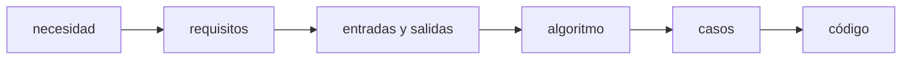
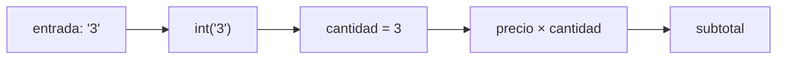
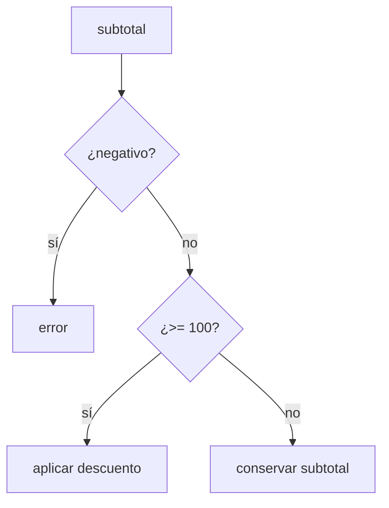
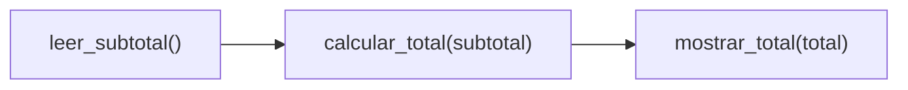
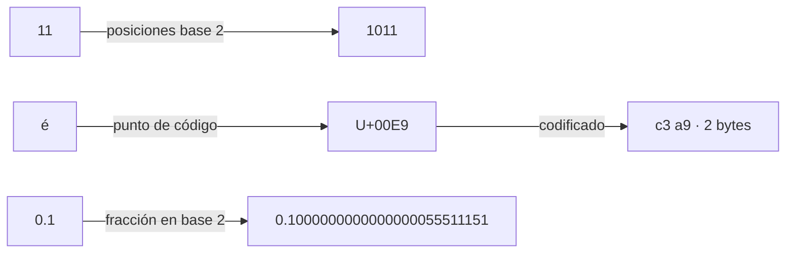
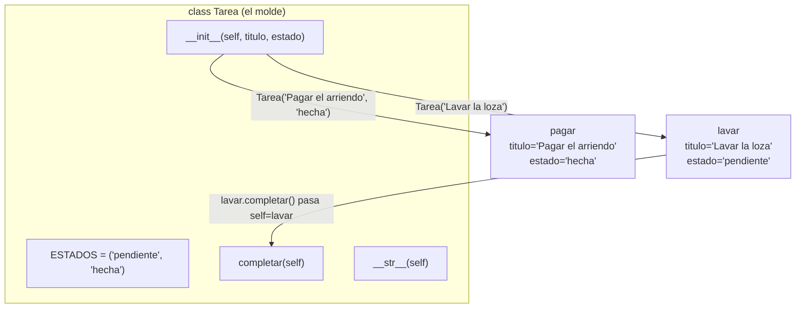
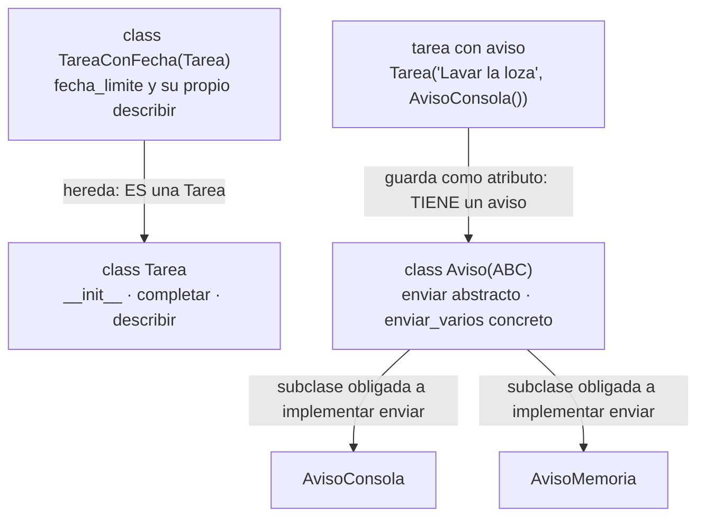

# Módulo 1: Pensamiento computacional y programación

**Entorno comprobado para esta edición (2026-11-21):** Python 3.14.10 en macOS 27.2 arm64, la línea de referencia del curso (`docs/VERSIONES.md`). Las cinco capturas de los temas 1 a 5 se generaron con `python3.14` ejecutado aquí y las transcripciones son literales de esa ejecución. Los ejemplos no requieren paquetes externos. El registro anterior (2026-11-18) decía 3.14.6 en Linux: se conserva como historial, pero los números de las transcripciones son las de hoy. Las instrucciones para Windows y PowerShell siguen contrastadas solo contra la documentación: **no se ejecutaron en esos sistemas**.


## Aprende construyendo


### Tema 1: Del problema al algoritmo y a los casos de prueba · Básico · 30 min

<details open>
<summary><strong>Capa 1 — Lectura</strong></summary>

#### ► DE QUÉ TRATA
Al finalizar vas a convertir un problema informal ("¿cuántas tareas están pendientes?") en un algoritmo explícito, implementarlo en Python y diseñar casos que incluyan una lista vacía y un estado no admitido. Prerrequisitos: Python instalado y el Tema 4 de Fundamentos módulo 0 (l…

#### ► CÓMO FUNCIONA


</details>

<details>
<summary><strong>Capa 2 — Construcción</strong></summary>

#### Código y verificación
```text
CONTAR_PENDIENTES(tareas):
  contador = 0
  estados_admitidos = {"pendiente", "hecho"}
  PARA cada numero, tarea en tareas:
    SI tarea.estado no está en estados_admitidos:
      LANZAR ValueError con numero y estado
    SI tarea.estado es "pendiente": contador = contador + 1
  DEVOLVER contador
```

```text
LEER subtotal
SI subtotal < 0
    MOSTRAR "valor inválido"
SI NO, SI subtotal >= 100
    total = subtotal * 0.90
SI NO
    total = subtotal
MOSTRAR total
```


```
0.1 + 0.1 + 0.1 en Python: _________
Casos diseñados: _________, _________, _________
Función validadora: redondea_a_centavos(resultado) _________
99.99 * 0.90 imprime: _________
```

```python
> from decimal import Decimal
> precio = Decimal('99.99') * Decimal('0.90')
> ```

```bash
mkdir ejemplo-algoritmo
cd ejemplo-algoritmo
mkdir src
```

</details>

### Tema 2: Variables, tipos, expresiones y cambios de estado · Básico · 30 min

<details open>
<summary><strong>Capa 1 — Lectura</strong></summary>

#### ► DE QUÉ TRATA
Al finalizar vas a ver cómo Python distingue tipos en tiempo de ejecución, y vas a reproducir un bug silencioso —sin ningún error ni traceback— que aparece al comparar dos textos como si fueran números. Prerrequisitos: el Tema 1 de este módulo y el Tema 2 de Fundamentos módulo 0…

#### ► CÓMO FUNCIONA


</details>

<details>
<summary><strong>Capa 2 — Construcción</strong></summary>

#### Código y verificación
```python
precio = 25.50
cantidad = 3
subtotal = precio * cantidad
print(subtotal)
```

```python
texto = input("Cantidad: ")
cantidad = int(texto)
print("cantidad leida:", cantidad)
```


```
int("1e10") → _________
Rango válido: 1 a 1000. Si entra 10000: _________
Ruta segura: float() o Decimal() antes de int()? _________
"3,14" vs "3.14": El mismo número? _________ (¿por qué?)
```

```python
> texto = "1e10"           # lo que escribió la persona
> numero = float(texto)    # "1e10" → 10000000000.0
> if numero.is_integer() and 1 <= numero <= 1000:
>     cantidad = int(numero)
>     print("cantidad válida:", cantidad)
> else:
>     print("cantidad rechazada:", texto)
> ```

```bash
mkdir ejemplo-variables
cd ejemplo-variables
mkdir src
```

</details>

### Tema 3: Decisiones, repeticiones y trazado de ejecución · Básico · 35 min

<details open>
<summary><strong>Capa 1 — Lectura</strong></summary>

#### ► DE QUÉ TRATA
Al finalizar vas a recorrer una lista de tareas con un bucle y una condición para detectar cuáles están vencidas, y vas a trazar a mano la ejecución para encontrar un error de "uno de más, uno de menos" que deja afuera la última tarea sin que se note a simple vista. Prerrequisito…

#### ► CÓMO FUNCIONA


</details>

<details>
<summary><strong>Capa 2 — Construcción</strong></summary>

#### Código y verificación
```python
total = 0
for numero in [12, 8, 5]:
    total = total + numero
print(total)
```

```python
subtotal = 100
if subtotal < 0:
    print("El subtotal no puede ser negativo")
elif subtotal >= 100:
    print(subtotal * 0.90)
else:
    print(subtotal)
```


```
for tarea in []: cuerpo ejecuta _________ vez(ces)
Si lista vacía: if _________ (not tareas vs len(tareas)==0)
Mejor opción: _________ (¿por qué?)
for i in range(0): entra _________ vez(ces)
```

```python
> if tareas:
>     for tarea in tareas:
>         print(tarea)
> else:
>     print("Sin tareas pendientes")
> ```

```bash
mkdir ejemplo-control-flujo
cd ejemplo-control-flujo
mkdir src
```

</details>

### Tema 4: Funciones y descomposición de problemas · Básico · 35 min

<details open>
<summary><strong>Capa 1 — Lectura</strong></summary>

#### ► DE QUÉ TRATA
Al finalizar vas a dividir el problema de "contar tareas pendientes" en varias funciones chicas, cada una con una sola responsabilidad, y vas a descubrir por qué una función que hace más de lo que su nombre promete puede sorprender a quien la usa. Prerrequisitos: el Tema 3 de est…

#### ► CÓMO FUNCIONA


</details>

<details>
<summary><strong>Capa 2 — Construcción</strong></summary>

#### Código y verificación
```python
def calcular_total(subtotal):
    if subtotal < 0:
        raise ValueError("El subtotal no puede ser negativo")
    if subtotal >= 100:
        return subtotal * 0.90
    return subtotal
```

```python
print(calcular_total(50))
print(calcular_total(100))
print(calcular_total(100.01))
```

```python
def calcular_total(subtotal):
    if subtotal < 0:
        raise ValueError("El subtotal no puede ser negativo")
    if subtotal >= 100:
        return subtotal * 0.90
    return subtotal

def leer_subtotal():
    return float(input("Subtotal: "))

def mostrar_total(total):
    print(f"Total: {total:.2f}")

subtotal = leer_subtotal()
total = calcular_total(subtotal)
mostrar_total(total)
```


```
Funciones nivel 3: _________, _________, _________
Tamaño ideal: _________ líneas máximo
Responsabilidad de editar_tarea(): _________ (¿guarda disco?)
Función más fácil de testear: _________ (¿por qué?)
```

```bash
mkdir ejemplo-funciones
cd ejemplo-funciones
mkdir src
```

</details>

### Tema 5: Cómo la computadora representa los datos — binario, texto y decimales · Básico · 40 min

<details open>
<summary><strong>Capa 1 — Lectura</strong></summary>

#### ► DE QUÉ TRATA
Al finalizar podrás explicar cómo un número, una letra y un decimal se guardan realmente como ceros y unos, convertir entre binario y decimal, y entender por qué 0.1 + 0.2 no da exactamente 0.3. Prerrequisitos: los Temas 1 y 2 de este módulo (variables y tipos); comprueba python3…

#### ► CÓMO FUNCIONA


</details>

<details>
<summary><strong>Capa 2 — Construcción</strong></summary>

#### Código y verificación

```bash
mkdir ejemplo
cd ejemplo
```

```python
# Enteros en binario
print("11 en binario:", bin(11))          # 0b1011
print("0b1011 en decimal:", 0b1011)        # 11

# Texto: cada carácter es un número (code point), codificado en bytes UTF-8
print("Código de 'A':", ord("A"))          # 65
acento_bytes = "é".encode("utf-8")
print("'é' en bytes UTF-8:", acento_bytes, len(acento_bytes), "bytes")
emoji_bytes = "🚚".encode("utf-8")
print("'🚚' en bytes UTF-8:", emoji_bytes, len(emoji_bytes), "bytes")

# Punto flotante: la suma NO es exacta
resultado = 0.1 + 0.2
print("0.1 + 0.2 =", resultado)            # 0.30000000000000004
print("¿Es igual a 0.3?", resultado == 0.3)   # False
# Forma correcta de comparar decimales:
print("¿Casi igual?", abs(resultado - 0.3) < 1e-9)   # True
```

```bash
python3.14 representacion.py
```

```text
$ python3.14 representacion.py
11 en binario: 0b1011
0b1011 en decimal: 11
Código de 'A': 65
'é' en bytes UTF-8: b'\xc3\xa9' 2 bytes
'🚚' en bytes UTF-8: b'\xf0\x9f\x9a\x9a' 4 bytes
0.1 + 0.2 = 0.30000000000000004
¿Es igual a 0.3? False
¿Casi igual? True
```

```python
resultado = 0.1 + 0.2

if resultado == 0.3:
    print("descuento aplicado")
```

</details>

### Tema 6: Clases y objetos: atributos, métodos e `__init__` · Básico · 35 min

<details open>
<summary><strong>Capa 1 — Lectura</strong></summary>

#### ► DE QUÉ TRATA
Al terminar vas a poder escribir una clase con init, crear objetos con esa clase, leer sus atributos desde el objeto, y explicar por qué una regla («una tarea solo pasa de pendiente a hecha») vive dentro de un método del objeto en lugar de copiarse en cada bucle del programa. Pre…

#### ► CÓMO FUNCIONA


</details>

<details>
<summary><strong>Capa 2 — Construcción</strong></summary>

#### Código y verificación


```bash
mkdir ejemplo-clases
cd ejemplo-clases
mkdir src
```

```python
class Tarea:
    def __init__(self, titulo, estado="pendiente"):
        self.titulo = titulo
        self.estado = estado


lavar = Tarea("Lavar la loza")
pagar = Tarea("Pagar el arriendo", "hecha")

print(lavar.titulo, "-", lavar.estado)
print(pagar.titulo, "-", pagar.estado)
print(type(lavar).__name__)
print(lavar is pagar)
```

```bash
python3.14 src/tarea.py
```

```python
class Tarea:
    def __init__(self, titulo, estado="pendiente"):
        self.titulo = titulo
        self.estado = estado


lavar = Tarea()
print(lavar.titulo)
```

```text
Traceback (most recent call last):
  File "/private/tmp/f1m1/t6/src/tarea-sin-titulo.py", line 7, in <module>
    lavar = Tarea()
TypeError: Tarea.__init__() missing 1 required positional argument: 'titulo'
```

</details>

### Tema 7: Herencia, composición y clases abstractas con `abc` · Intermedio · 40 min

<details open>
<summary><strong>Capa 1 — Lectura</strong></summary>

#### ► DE QUÉ TRATA
Al terminar vas a poder decidir si una clase nueva es un caso especial de otra (herencia con super()) o tiene otra a la que le encarga trabajo (composición), y convertir esa decisión en un contrato que el intérprete comprueba con abc. Prerrequisitos: el Tema 6 de este módulo (cla…

#### ► CÓMO FUNCIONA


</details>

<details>
<summary><strong>Capa 2 — Construcción</strong></summary>

#### Código y verificación


```bash
mkdir ejemplo-clases
cd ejemplo-clases
mkdir src
```

```python
class Tarea:
    def __init__(self, titulo):
        self.titulo = titulo
        self.estado = "pendiente"

    def completar(self):
        self.estado = "hecha"

    def describir(self):
        return f"{self.titulo} ({self.estado})"


class TareaConFecha(Tarea):
    def __init__(self, titulo, fecha_limite):
        super().__init__(titulo)
        self.fecha_limite = fecha_limite

    def describir(self):
        return f"{super().describir()} vence {self.fecha_limite}"


tareas = [Tarea("Lavar la loza"), TareaConFecha("Pagar el arriendo", "2026-12-05")]
tareas[1].completar()
for tarea in tareas:
    print(tarea.describir())
print("¿es una Tarea?", isinstance(tareas[1], Tarea))
print("¿es una TareaConFecha?", isinstance(tareas[0], TareaConFecha))
```

```text
Lavar la loza (pendiente)
Pagar el arriendo (hecha) vence 2026-12-05
¿es una Tarea? True
¿es una TareaConFecha? False
```

```python
class TareaConFecha(Tarea):
    def __init__(self, titulo, fecha_limite):
        self.fecha_limite = fecha_limite
```

```text
Lavar la loza (pendiente)
Traceback (most recent call last):
  File "/private/tmp/f1m1/t7/src/herencia-sin-super.py", line 24, in <module>
    print(tarea.describir())
          ~~~~~~~~~~~~~~~^^
  File "/private/tmp/f1m1/t7/src/herencia-sin-super.py", line 18, in describir
    return f"{super().describir()} vence {self.fecha_limite}"
              ~~~~~~~~~~~~~~~~~^^
  File "/private/tmp/f1m1/t7/src/herencia-sin-super.py", line 10, in describir
    return f"{self.titulo} ({self.estado})"
              ^^^^^^^^^^^
AttributeError: 'TareaConFecha' object has no attribute 'titulo'
```

</details>

### Proyecto 1: calculadora de presupuesto desde carpeta vacía

<details open>
<summary><strong>Capa 1 — Lectura</strong></summary>

</details>

<details>
<summary><strong>Capa 2 — Construcción</strong></summary>

#### Nota de construcción
Este tema es principalmente conceptual en esta versión. La verificación se realiza con las preguntas de comprensión y el criterio de cuándo NO usar proyecto 1: calculadora de presupuesto desde carpeta vacía.

</details>
