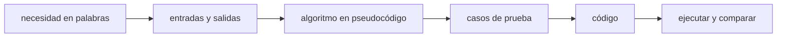
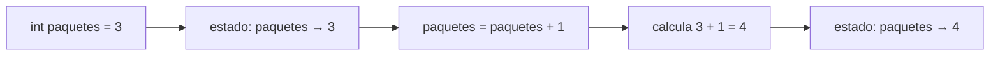
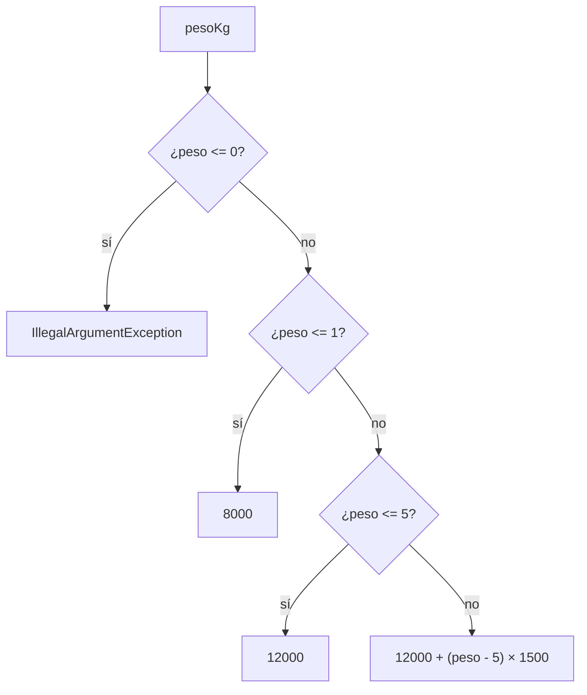
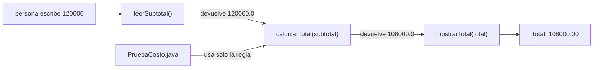
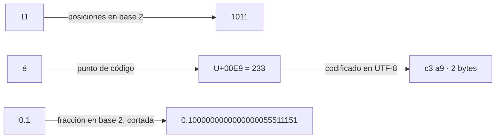
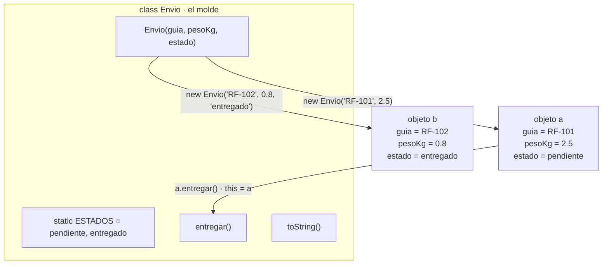
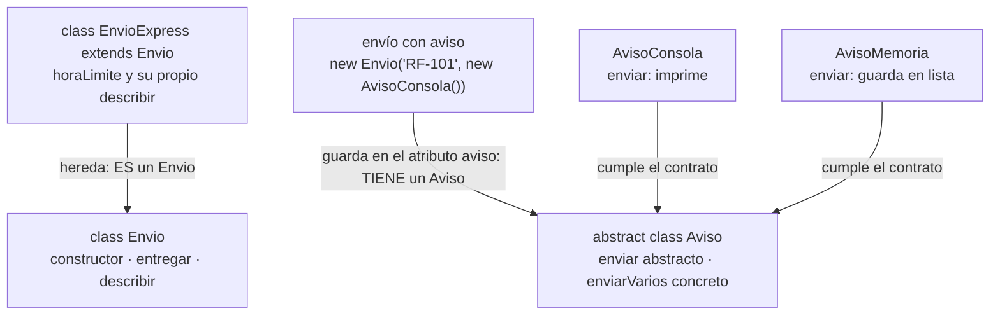

# Módulo 1: Pensamiento computacional y programación

**Entorno comprobado para esta edición (2026-11-24):** OpenJDK 25.0.5.1 en Linux x86_64. Todas las capturas se generaron ejecutando los programas con `java Archivo.java` y las transcripciones son literales. Los ejemplos solo usan la biblioteca estándar de Java. En macOS y Windows los comandos son los mismos; los números que dependen del equipo (direcciones, tiempos) cambian.


## Aprende construyendo


### Tema 1: Del problema al algoritmo y a los casos de prueba · Básico · 45 min

<details open>
<summary><strong>Capa 1 — Lectura</strong></summary>

#### Objetivos
Al terminar este tema podrás:
- convertir una necesidad escrita en palabras en entradas, salidas y reglas claras;
- escribir un algoritmo en pseudocódigo y traducirlo a Java;
- diseñar casos de prueba que incluyan casos límite y datos inválidos;
- comprobar tu programa con `assert` y leer una `IllegalArgumentException` provocada a propósito.

**Conceptos clave:** algoritmo, pseudocódigo, entrada y salida, caso de prueba, caso límite, excepción, assert

#### El problema
La coordinadora de RutaFlow pregunta cada mañana: «¿cuántos envíos de la ruta siguen pendientes?». Es una pregunta
en palabras, no un programa. Antes de escribir código hay que responder tres cosas: ¿qué datos entran?, ¿qué
resultado sale? y ¿qué hacer con un dato raro, como un envío con estado «perdido»?

#### Glosario del tema

**algoritmo**
- **Definición técnica:** secuencia finita y ordenada de pasos no ambiguos que transforma unas entradas en una salida.
- **En palabras sencillas:** una receta tan precisa que cualquiera, incluso una máquina, llega al mismo resultado siguiéndola.
- **Dónde se rompe la comparación:** una receta admite «sal al gusto»; un algoritmo no admite pasos que dependan del gusto.
- **Ejemplo:** «empieza el contador en 0; por cada envío pendiente, súmale 1; al final, entrega el contador».
- **Error típico:** dejar un caso sin decidir (¿qué pasa si la lista está vacía?) y descubrirlo cuando el programa falla.

**pseudocódigo**
- **Definición técnica:** descripción de un algoritmo con estructura de programa (pasos, condiciones, repeticiones) pero en lenguaje natural, sin reglas de un lenguaje concreto.
- **En palabras sencillas:** un borrador del programa escrito en español, para pensar sin pelear con la sintaxis.
- **Dónde se rompe la comparación:** el computador no ejecuta pseudocódigo; sirve para pensar y para explicar, no para correr.
- **Ejemplo:** `SI estado es "pendiente": contador = contador + 1`.
- **Error típico:** escribirlo tan vago («revisa los envíos») que no dice qué hacer en cada paso.

**entrada y salida**
- **Definición técnica:** la entrada son los datos que recibe un algoritmo o función; la salida es el resultado que entrega.
- **En palabras sencillas:** lo que le das y lo que te devuelve.
- **Dónde se rompe la comparación:** una función también puede «salir» lanzando un error en lugar de devolver un resultado.
- **Ejemplo:** entrada: lista de envíos; salida: número de pendientes.
- **Error típico:** mezclar mostrar con devolver: `System.out.println` muestra, `return` entrega el resultado a quien llamó.

**caso de prueba**
- **Definición técnica:** combinación concreta de entrada y salida esperada que se usa para comprobar que un programa cumple su especificación.
- **En palabras sencillas:** un ejemplo con la respuesta correcta anotada, para comparar con lo que hace el programa.
- **Dónde se rompe la comparación:** que pasen todos tus casos no prueba que el programa sea correcto, solo que no falla en esos.
- **Ejemplo:** entrada `[]` (ruta vacía) → salida esperada `0`.
- **Error típico:** probar solo el caso feliz, el que ya sabes que funciona.

**caso límite**
- **Definición técnica:** caso de prueba en el borde de lo permitido: vacío, uno solo, el máximo, el primer valor inválido.
- **En palabras sencillas:** los ejemplos extremos, donde los programas suelen romperse.
- **Dónde se rompe la comparación:** «extremo» depende del problema: en una ruta es la lista vacía; en un peso, el 0 o un negativo.
- **Ejemplo:** una ruta sin envíos.
- **Error típico:** suponer que «nadie mandará una lista vacía».

**excepción**
- **Definición técnica:** señal que interrumpe el flujo normal del programa cuando ocurre una situación que no puede manejarse ahí; en Java se lanza con `throw` y, si nadie la captura, termina el programa con una traza.
- **En palabras sencillas:** una alarma: «aquí pasó algo que no sé resolver».
- **Dónde se rompe la comparación:** a diferencia de una alarma, una excepción puede atraparse con `try` y `except` para reaccionar.
- **Ejemplo:** `throw new IllegalArgumentException("estado no admitido");`.
- **Error típico:** devolver un valor inventado (como `0`) cuando el dato es inválido, y esconder el problema.

**assert**
- **Definición técnica:** instrucción que evalúa una condición y lanza `AssertionError` si es falsa; se usa para expresar lo que debe cumplirse.
- **En palabras sencillas:** «compruébame que esto es cierto; si no, detente y avísame».
- **Dónde se rompe la comparación:** no sirve para validar datos de usuarios: Java **ignora** los `assert` salvo que ejecutes con `-ea` (*enable assertions*).
- **Ejemplo:** `assert Pendientes.contarPendientes(List.of()) == 0;`.
- **Error típico:** ejecutar las pruebas sin `-ea`: un `assert` falso pasa en silencio y crees que todo está bien.

#### ► CÓMO FUNCIONA
Programar empieza antes del código. Primero se aclara la **necesidad**; luego se fijan **entradas y salidas**; después
se escribe el **algoritmo** y los **casos de prueba**, y solo al final el **código**. Los casos se diseñan antes del
código para no ajustarlos a lo que el programa ya hace.



#### Problema resuelto 1.1
Cuenta los envíos pendientes de una ruta. Cada envío tiene un estado: `pendiente` o `entregado`. Cualquier otro
estado es un error.

**Razonamiento:**
1. Entrada: una lista de envíos. Salida: un número entero.
2. Algoritmo: recorrer la lista una vez, sumar 1 por cada pendiente y rechazar los estados desconocidos.
3. Pseudocódigo antes del código:

```text
CONTAR_PENDIENTES(envios):
  contador = 0
  PARA cada envío (con su número de orden):
    SI su estado no es "pendiente" ni "entregado":
      LANZAR error con el número y el estado
    SI su estado es "pendiente":
      contador = contador + 1
  DEVOLVER contador
```

Un envío tiene dos datos: guía y estado. En Java eso se declara una vez con un `record`, un molde con campos
(el Tema 6 lo explica a fondo). Cada tipo va en su propio archivo. Cuando un programa se reparte en varios
archivos, cada uno declara su clase con nombre (`class Pendientes { ... }`) y, si se puede ejecutar, su `main`
completo: `public static void main(String[] args)`. Para mostrar texto se usa `System.out.println`, que hace lo
mismo que `IO.println`. El Tema 4 explica estas piezas:

```java
// Envio.java — un envío con su guía y su estado
record Envio(String guia, String estado) {}
```

```java
// Pendientes.java — cuenta los envíos pendientes de una ruta
import java.util.List;
import java.util.Set;

class Pendientes {
    static final Set<String> ESTADOS_ADMITIDOS = Set.of("pendiente", "entregado");

    static int contarPendientes(List<Envio> envios) {
        int contador = 0;
        for (int numero = 1; numero <= envios.size(); numero++) {
            String estado = envios.get(numero - 1).estado();
            if (!ESTADOS_ADMITIDOS.contains(estado)) {
                throw new IllegalArgumentException("envío " + numero + ": estado no admitido '" + estado + "'");
            }
            if (estado.equals("pendiente")) {
                contador = contador + 1;
            }
        }
        return contador;
    }

    public static void main(String[] args) {
        List<Envio> ruta = List.of(
                new Envio("RF-101", "pendiente"),
                new Envio("RF-102", "entregado"),
                new Envio("RF-103", "pendiente"));
        System.out.println("pendientes: " + contarPendientes(ruta));
    }
}
```

```text
$ java Pendientes.java
pendientes: 2
```

**Explicación por partes.**
- `Envio.java`: `record Envio(String guia, String estado)` define el molde; `new Envio("RF-101", "pendiente")` crea
  un envío y `.estado()` lee su estado.
- Línea 6: el conjunto de estados válidos se escribe una sola vez, con nombre en mayúsculas porque no cambia
  (`static final`).
- Línea 8: `static int contarPendientes(List<Envio> envios)` define la función: recibe una lista de envíos y devuelve
  un número entero.
- Líneas 10–11: el `for` recorre los envíos con su número de orden (1, 2, 3…), útil para el mensaje de error.
- Líneas 12–14: un estado desconocido detiene todo con `throw new IllegalArgumentException(...)`, en vez de
  contarse en silencio.
- Línea 19: `return` entrega la salida a quien llamó la función.
- Líneas 22–27: `main` arma una ruta de ejemplo con 2 pendientes; la salida coincide con lo esperado.

> **Error común.** Un envío creado con estado `null` (`new Envio("RF-104", null)`) termina con
> `NullPointerException: Cannot invoke "Object.equals(Object)" because "o" is null`, señalando
> `Pendientes.java:12`. El dato faltó antes de llegar a la función: revisa de dónde viene antes de culpar al conteo.

> **Buena práctica.** Escribe el pseudocódigo como comentario o en papel antes del código. Si no puedes explicar el
> algoritmo en español, todavía no estás listo para escribirlo en Java.

#### Problema resuelto 1.2
Comprueba la función con casos de prueba: ruta vacía, ninguno pendiente, todos pendientes y un estado inválido.

**Razonamiento:**
1. La ruta vacía es el caso límite: debe dar `0`, no fallar.
2. Cada `assert` compara la salida real con la esperada.
3. El estado inválido debe producir `IllegalArgumentException`; `try` y `catch` la atrapan para mostrar el mensaje.

```java
// PruebaPendientes.java — casos de prueba de contarPendientes
import java.util.Collections;
import java.util.List;

class PruebaPendientes {
    public static void main(String[] args) {
        assert Pendientes.contarPendientes(List.of()) == 0;                                     // caso límite: ruta vacía
        assert Pendientes.contarPendientes(List.of(new Envio("A", "entregado"))) == 0;          // ninguno pendiente
        assert Pendientes.contarPendientes(Collections.nCopies(3, new Envio("A", "pendiente"))) == 3; // todos pendientes

        try {
            Pendientes.contarPendientes(List.of(new Envio("A", "perdido")));                    // caso inválido
            System.out.println("ERROR: debía rechazar 'perdido'");
        } catch (IllegalArgumentException error) {
            System.out.println("rechazado: " + error.getMessage());
        }

        System.out.println("todas las pruebas pasaron");
    }
}
```

```text
$ java -ea PruebaPendientes.java
rechazado: envío 1: estado no admitido 'perdido'
todas las pruebas pasaron
```

**Explicación por partes.**
- `java PruebaPendientes.java` encuentra solo `Pendientes.java` y `Envio.java` porque están en la misma carpeta.
  A diferencia de otros lenguajes, usar una clase de otro archivo **no** ejecuta su `main`: por eso no aparece
  `pendientes: 2`.
- Líneas 7–9: si un `assert` fallara, el programa terminaría con `AssertionError` en esa línea.
- `-ea` activa los `assert`. Sin esa opción, Java los salta: cambia `== 3` por `== 4` y compara.
- Líneas 11–16: el caso inválido se atrapa con `catch` y se muestra el mensaje de la excepción.

```text
$ java -ea PruebaPendientes.java        # con == 4 en la línea 9
Exception in thread "main" java.lang.AssertionError
	at PruebaPendientes.main(PruebaPendientes.java:9)
$ java PruebaPendientes.java            # el mismo archivo, sin -ea
rechazado: envío 1: estado no admitido 'perdido'
todas las pruebas pasaron
```

> **Prevenir errores.** Diseña los casos de prueba antes de escribir la función. Si los inventas después, tiendes a
> probar solo lo que el código ya hace bien.

#### Checkpoint 1.1
¿Qué devuelve `contarPendientes(List.of(new Envio("A", "pendiente"), new Envio("B", "Pendiente")))`?

Respuesta: no devuelve nada: lanza `IllegalArgumentException` en el envío 2, porque `"Pendiente"` con mayúscula no está en `ESTADOS_ADMITIDOS`. Para el computador son textos distintos.

</details>

<details>
<summary><strong>Capa 2 — Construcción</strong></summary>

#### Paso 1 · Prepara la carpeta
Crea `~/labs/algoritmo` y entra con `cd ~/labs/algoritmo`.

#### Paso 2 · Escribe el algoritmo
Copia el pseudocódigo del Problema resuelto 1.1 en un archivo `algoritmo.txt`, con tus palabras.

#### Paso 3 · Tradúcelo a Java
Escribe `Envio.java` y `Pendientes.java`, y ejecuta `java Pendientes.java`. La salida debe ser `pendientes: 2`.

#### Paso 4 · Prueba los casos
Escribe `PruebaPendientes.java` y ejecútalo con `java -ea PruebaPendientes.java`. Luego cambia `== 3` por `== 4`
para ver un `AssertionError` real, y ejecútalo otra vez **sin** `-ea`.

#### Resumen
- Un **algoritmo** es una secuencia finita de pasos sin ambigüedad; el **pseudocódigo** lo describe sin sintaxis de un lenguaje.
- Antes de programar se fijan la **entrada**, la **salida** y qué hacer con datos inválidos.
- Un **caso de prueba** une una entrada con su salida esperada; los **casos límite** están en los bordes.
- Una **excepción** (`throw new IllegalArgumentException`) detiene el flujo ante un dato que no se puede manejar.
- `assert` comprueba que una condición se cumple y falla con `AssertionError` si no, pero solo con `java -ea`.

#### Ejercicio verificable 1
Básico. Escribe en pseudocódigo un algoritmo que cuente los envíos **entregados**.

Respuesta esperada: igual al de pendientes, pero sumando 1 cuando el estado es `"entregado"`. Debe seguir rechazando estados desconocidos.

#### Ejercicio verificable 2
Intermedio. Agrega a `PruebaPendientes.java` un caso con un envío pendiente y uno entregado. ¿Qué valor esperas?

Respuesta esperada: `assert Pendientes.contarPendientes(List.of(new Envio("A", "pendiente"), new Envio("B", "entregado"))) == 1;`.

#### Ejercicio verificable 3
Reto. Modifica la función para que acepte `"Pendiente"` y `"PENDIENTE"` como pendientes, sin aceptar `"perdido"`.

Respuesta esperada: normalizar antes de comparar con `String estado = envios.get(numero - 1).estado().toLowerCase();`. El checkpoint deja de lanzar error y devuelve `2`.

#### En el trabajo
En un equipo profesional este proceso se repite en cada tarea: la necesidad llega en un ticket, se acuerdan entradas
y salidas, y los casos de prueba se escriben como pruebas automáticas que se ejecutan en cada cambio (lo verás en el
Módulo 5 con JUnit y CI). Rechazar datos inválidos con un error claro, en lugar de adivinar, evita reportes
equivocados que nadie nota hasta que es tarde.

</details>

### Tema 2: Variables, tipos, expresiones y cambios de estado · Básico · 45 min

<details open>
<summary><strong>Capa 1 — Lectura</strong></summary>

#### Objetivos
Al terminar este tema podrás:
- crear variables y explicar qué guarda cada una;
- declarar variables con los tipos `String`, `int`, `double` y `boolean`;
- cambiar el valor de una variable y predecir lo que imprime el programa;
- convertir texto escrito por una persona en un número con `Integer.parseInt` y `Double.parseDouble`;
- leer los errores `cannot find symbol`, `incompatible types` y `NumberFormatException` y corregirlos.

**Conceptos clave:** valor, variable, asignación, tipo de dato, declaración, concatenación, reasignación, estado, conversión de tipo, IO.readln

#### El problema
RutaFlow registra cada envío con su número de guía, su peso, cuántos paquetes lleva y si ya se entregó. El programa
necesita **recordar** esos datos mientras trabaja y **cambiarlos** cuando algo pasa: por ejemplo, cuando el cliente
agrega un paquete. Además, cuando una persona escribe la cantidad en el teclado, el programa recibe **texto**, no un
número. ¿Cómo guarda un programa un dato, cómo lo cambia y cómo convierte lo que escribe una persona?

#### Glosario del tema

**valor**
- **Definición técnica:** dato concreto que el programa manipula, como `3`, `2.5` o `"RF-4471"`.
- **En palabras sencillas:** la información en sí: un número, un texto, un sí o un no.
- **Dónde se rompe la comparación:** para el computador `3` y `"3"` son valores distintos: uno es número y el otro es texto.
- **Ejemplo:** en `int paquetes = 3;`, el valor es `3`.
- **Error típico:** escribir texto sin comillas (`String guia = RF-4471;`): Java lo lee como una resta entre dos nombres que no existen.

**variable**
- **Definición técnica:** nombre asociado a un valor guardado en la memoria del programa; en Java cada variable se declara con un tipo y solo puede guardar valores de ese tipo.
- **En palabras sencillas:** una caja con etiqueta: la etiqueta es el nombre, el tipo dice qué cabe y lo de adentro es el valor.
- **Dónde se rompe la comparación:** una caja de verdad acepta cualquier cosa; una variable `int` rechaza un texto antes de que el programa arranque.
- **Ejemplo:** `double pesoKg = 2.5;` crea la variable `pesoKg`, de tipo `double`, con el valor `2.5`.
- **Error típico:** usar el nombre con otra mayúscula: `PesoKg` no es `pesoKg`.

**asignación (`=`)**
- **Definición técnica:** instrucción que evalúa la expresión de la derecha y guarda el resultado en la variable de la izquierda.
- **En palabras sencillas:** «guarda esto en esta caja». No es el «igual» de matemáticas.
- **Dónde se rompe la comparación:** `paquetes = paquetes + 1` es imposible en matemáticas y normal al programar.
- **Ejemplo:** `entregado = false;`.
- **Error típico:** escribirla al revés: `2.5 = pesoKg;` no compila.

**tipo de dato**
- **Definición técnica:** categoría de un valor que define qué operaciones admite: `String` (texto), `int` (número entero), `double` (número con decimales) y `boolean` (`true` o `false`).
- **En palabras sencillas:** la clase de dato; dice qué puedes hacer con él, como sumar números o unir textos.
- **Dónde se rompe la comparación:** en Java tú declaras el tipo y el compilador lo vigila: un error de tipo aparece antes de ejecutar, no a mitad del programa.
- **Ejemplo:** `int paquetes = "3";` no compila: `incompatible types: String cannot be converted to int`.
- **Error típico:** escribir `string` en minúscula: el tipo de texto es `String`, con mayúscula.

**declaración y concatenación**
- **Definición técnica:** declarar es escribir el tipo antes del nombre la primera vez (`int paquetes`); concatenar es unir textos con `+`, y si un lado es texto, el otro se convierte a texto.
- **En palabras sencillas:** declarar es rotular la caja una vez; concatenar es pegar pedazos de texto.
- **Dónde se rompe la comparación:** `+` suma o une según los tipos, y se evalúa de izquierda a derecha: `"Total: " + 3 + 1` produce `Total: 31`.
- **Ejemplo:** `IO.println("paquetes ahora: " + paquetes);` muestra `paquetes ahora: 4`.
- **Error típico:** declarar dos veces el mismo nombre (`int paquetes = 3;` y luego `int paquetes = 4;`): `variable paquetes is already defined`.

**reasignación y estado**
- **Definición técnica:** reasignar es guardar un valor nuevo en una variable existente; el **estado** del programa es el conjunto de valores de todas sus variables en un instante.
- **En palabras sencillas:** cambiar lo que hay en la caja; el estado es la foto de todas las cajas en un momento.
- **Dónde se rompe la comparación:** el valor viejo no se guarda en ningún lado: si lo necesitas, guárdalo antes en otra variable.
- **Ejemplo:** después de `paquetes = paquetes + 1;`, el estado tiene `paquetes` en `4`.
- **Error típico:** creer que el valor anterior sigue disponible con el mismo nombre.

**conversión de tipo e IO.readln**
- **Definición técnica:** `IO.readln()` lee una línea y siempre devuelve un `String`; `Integer.parseInt` y `Double.parseDouble` crean un número a partir de ese texto, o lanzan `NumberFormatException` si el texto no representa un número.
- **En palabras sencillas:** lo que escribe una persona llega como letras; para hacer cuentas hay que traducirlo a número.
- **Dónde se rompe la comparación:** la traducción puede fallar: `Integer.parseInt("dos")` no sabe leer palabras.
- **Ejemplo:** `Integer.parseInt("3")` devuelve el número `3`.
- **Error típico:** guardar el texto en un `int` sin convertir: `int cantidad = IO.readln();` no compila.

#### ► CÓMO FUNCIONA
Antes de ejecutar, el compilador revisa que cada valor quepa en el tipo de su variable. Después, `main` se ejecuta
de arriba abajo, una línea a la vez. En cada asignación, primero calcula el lado derecho y después guarda el
resultado en la variable de la izquierda. Cuando una variable se usa más adelante, Java toma el valor que tiene
**en ese momento**.



#### Problema resuelto 2.1
Registra un envío con sus cuatro datos, muéstralos con su tipo y agrega un paquete.

**Razonamiento:**
1. Cada dato necesita un nombre y un tipo: la guía es `String`, el peso lleva decimales (`double`), los paquetes se
   cuentan (`int`) y la entrega es sí o no (`boolean`).
2. Para mostrar valores se usa `IO.println`, uniendo textos y valores con `+`.
3. Agregar un paquete es reasignar: calcular `paquetes + 1` y guardar el resultado con el mismo nombre.

```java
// Variables.java — registra un envío de RutaFlow
void main() {
    String guia = "RF-4471";     // String: texto, siempre entre comillas dobles
    double pesoKg = 2.5;         // double: número con parte decimal
    int paquetes = 3;            // int: número entero
    boolean entregado = false;   // boolean: solo puede ser true o false

    IO.println(guia + " " + pesoKg + " " + paquetes + " " + entregado);

    paquetes = paquetes + 1;     // reasignación: el estado cambia
    IO.println("paquetes ahora: " + paquetes);
}
```

```text
$ java Variables.java
RF-4471 2.5 3 false
paquetes ahora: 4
```

**Explicación por partes.**
- Líneas 3–6: cuatro declaraciones. Cada una escribe el tipo, el nombre y el valor inicial.
- Línea 8: `+` une los valores con espacios en un solo texto; `IO.println` lo muestra.
- Línea 10: Java calcula primero `paquetes + 1` (da `4`) y luego lo guarda en `paquetes`. Ya no se escribe el tipo:
  la variable existe.

> **Error común.** Escribir el nombre con otra mayúscula. `IO.println(Guia);` no compila:
> `Variables.java:11: error: cannot find symbol` y, debajo, `symbol: variable Guia`. Java no encontró `Guia`; la
> variable que existe es `guia`.

> **Error común.** Guardar un valor del tipo equivocado. `int paquetes = "3";` no compila:
> `incompatible types: String cannot be converted to int`. Las comillas hacen de `"3"` un texto.

> **Error común.** Confiar en que `+` suma. `IO.println("Total: " + 3 + 1);` muestra `Total: 31`: Java une de
> izquierda a derecha y, una vez que hay texto, todo lo que sigue se une como texto. Con paréntesis,
> `"Total: " + (3 + 1)` muestra `Total: 4`.

> **Buena práctica.** Los nombres dicen qué guardan y en qué unidad: `pesoKg` en vez de `p` o `dato1`. Se escriben
> en minúscula y cada palabra nueva empieza con mayúscula (*camelCase*), la convención de Java.

#### Problema resuelto 2.2
El cliente escribe en el teclado cuántos paquetes trae. Suma uno más y muestra el total.

**Razonamiento:**
1. `IO.readln` devuelve siempre texto, aunque la persona escriba un número.
2. Para sumar hay que convertir ese texto a `int` con `Integer.parseInt`.
3. Si el texto no es un número, `Integer.parseInt` falla: hay que saber leer ese error.

```java
// Cantidad.java — lee cuántos paquetes trae el cliente y suma uno
void main() {
    String texto = IO.readln("Paquetes: ");
    int cantidad = Integer.parseInt(texto);
    IO.println("total de paquetes: " + (cantidad + 1));
}
```

```text
$ echo 3 | java Cantidad.java
Paquetes: total de paquetes: 4
```

**Explicación por partes.**
- Línea 3: `IO.readln` muestra `Paquetes: ` y espera una línea. Aquí `echo 3 |` escribe `3` por ti, así la salida no depende de teclear a tiempo. Lo leído es un `String`.
- Línea 4: `Integer.parseInt(texto)` convierte `"3"` en `3` y lo guarda en un `int`.
- Línea 5: ahora sí se puede sumar. Los paréntesis hacen que `cantidad + 1` se calcule antes de unirlo al texto.

> **Error común.** Escribir una palabra donde se espera un número. Con `echo dos | java Cantidad.java` el
> programa termina con `NumberFormatException: For input string: "dos"`. Significa: «el texto `"dos"` no se puede
> leer como número entero».

> **Prevenir errores.** Antes de convertir, decide qué hará el programa con una entrada inválida. En el Tema 3
> aprenderás a comprobarla y a pedirla de nuevo.

#### Checkpoint 2.1
Si después del Problema resuelto 2.1 escribes `paquetes = paquetes * 2;`, ¿qué valor queda en `paquetes`?

Respuesta: `8`. Antes de esa línea `paquetes` vale `4` por la reasignación anterior, y `4 * 2 = 8`.

</details>

<details>
<summary><strong>Capa 2 — Construcción</strong></summary>

#### Paso 1 · Prepara la carpeta
Crea la carpeta `~/labs/variables` y entra con `cd ~/labs/variables`.

#### Paso 2 · Registra el envío
Escribe `Variables.java` (Problema resuelto 2.1) y ejecútalo con `java Variables.java`. Compara tu salida con la del tema.

#### Paso 3 · Lee datos del teclado
Escribe `Cantidad.java` (Problema resuelto 2.2) y pruébalo con `echo 3 | java Cantidad.java` y con `echo dos | java Cantidad.java`.

#### Paso 4 · Provoca y corrige los errores
Provoca a propósito el `cannot find symbol` y el `incompatible types` del tema, lee cada mensaje y corrígelo.

#### Resumen
- Una **variable** es un nombre con un tipo, asociado a un **valor**.
- La **asignación** `=` calcula la derecha y guarda el resultado con el nombre de la izquierda.
- Cada valor tiene un **tipo de dato** (`String`, `int`, `double`, `boolean`) que define qué operaciones admite.
- **Reasignar** cambia el **estado** del programa; el valor anterior deja de estar disponible con ese nombre.
- `IO.readln` siempre devuelve texto; **convertir** con `Integer.parseInt` o `Double.parseDouble` permite hacer cuentas.
- `cannot find symbol`: ese nombre no existe. `incompatible types`: ese valor no cabe en ese tipo. Ambos aparecen al
  compilar. `NumberFormatException`: ese texto no se puede convertir, y aparece al ejecutar.

#### Ejercicio verificable 1
Básico. Calcula el costo de un envío: tarifa de 4200 por kg, peso de 2.5 kg y recargo urgente de 3000. Guarda cada
dato en una variable y muestra el total.

Respuesta esperada: `13500.0`. Es `double` porque multiplicar un `int` por un `double` da `double`; con `(int) total` se muestra `13500`.

#### Ejercicio verificable 2
Intermedio. Sin ejecutarlo, escribe qué pasa con `IO.println("3" * 2);` y con `IO.println(3 * 2);`. Luego compruébalo.

Respuesta esperada: el primero no compila (`bad operand types for binary operator '*'`): en Java `*` no sirve con
texto; para repetirlo se usa `"3".repeat(2)`, que da `33`. El segundo muestra `6`.

#### Ejercicio verificable 3
Reto. Lee el peso con `IO.readln` (por ejemplo `echo 2.5 | java Costo.java`) y calcula el costo del Ejercicio 1.

Respuesta esperada: `13500.0`. El peso tiene decimales, así que se convierte con `Double.parseDouble`, no con
`Integer.parseInt`: `Integer.parseInt("2.5")` lanza `NumberFormatException: For input string: "2.5"`.

#### En el trabajo
En un backend real, estos datos llegan en una petición o en un archivo y terminan en una base de datos. Los mismos
errores aparecen a otra escala: un peso que llega como texto (`"2.5"`) y hay que convertir, o una `NumberFormatException` por una
celda vacía son de los fallos más comunes al leer formularios y archivos CSV.

</details>

### Tema 3: Decisiones, repeticiones y trazado de ejecución · Básico · 50 min

<details open>
<summary><strong>Capa 1 — Lectura</strong></summary>

#### Objetivos
Al terminar este tema podrás:
- escribir condiciones con operadores de comparación y decidir con `if`, `else if` y `else`;
- repetir instrucciones con `for` sobre un arreglo y con `while` mientras se cumpla una condición;
- trazar a mano la ejecución de un programa en una tabla y predecir su salida;
- reconocer y corregir un bucle infinito, un `ArrayIndexOutOfBoundsException` y los errores de compilación más comunes.

**Conceptos clave:** condición, operador de comparación, if, else if, else, bloque, bucle, for, while, iteración, trazado de ejecución

#### El problema
La tarifa de RutaFlow cambia según el peso: hasta 1 kg cuesta 8000; hasta 5 kg, 12000; y por encima de 5 kg se
cobran 1500 por cada kilo adicional. Además, el conductor avanza parada por parada hasta llegar a un destino. El
programa tiene que **elegir** entre caminos y **repetir** pasos. Hasta ahora los programas iban en línea recta, de
arriba abajo. ¿Cómo hace un programa para decidir y para repetir?

#### Glosario del tema

**condición**
- **Definición técnica:** expresión de tipo `boolean`, que vale `true` o `false`, y que decide qué instrucciones se ejecutan.
- **En palabras sencillas:** una pregunta de sí o no que el programa se hace, como «¿el peso es menor o igual a 1?».
- **Dónde se rompe la comparación:** en Java la pregunta tiene que ser de sí o no de verdad: `if (0)` o `if (texto)` no compilan.
- **Ejemplo:** `pesoKg <= 1` vale `true` si el peso es 0.5.
- **Error típico:** escribir la condición al revés (`>` en vez de `<`) y obtener justo el resultado contrario.

**operador de comparación**
- **Definición técnica:** operador que compara dos valores y devuelve un booleano: `==` igual, `!=` distinto, `<`, `<=`, `>`, `>=`.
- **En palabras sencillas:** los signos que preguntan si algo es igual, distinto, mayor o menor que otra cosa.
- **Dónde se rompe la comparación:** `==` compara; `=` asigna. Se parecen, pero hacen cosas totalmente distintas.
- **Ejemplo:** `paquetes == 3`. Para comparar textos se usa `.equals`: `estado.equals("pendiente")`.
- **Error típico:** escribir `if (pesoKg = 0)`, que no compila: `incompatible types: double cannot be converted to boolean`.

**if, else if y else**
- **Definición técnica:** instrucciones de selección; `if` ejecuta su bloque si la condición es verdadera, cada `else if` prueba otra condición solo si las anteriores fueron falsas, y `else` se ejecuta si ninguna lo fue.
- **En palabras sencillas:** «si pasa esto, haz aquello; si no, prueba esto otro; y si nada se cumple, haz lo último».
- **Dónde se rompe la comparación:** solo se ejecuta **un** camino: el primero cuya condición se cumple, aunque las siguientes también fueran ciertas.
- **Ejemplo:** `else if (pesoKg <= 1) { return 8000; }`.
- **Error típico:** olvidar los paréntesis de la condición: `if pesoKg <= 1 {` no compila (`'(' expected`).

**bloque y llaves**
- **Definición técnica:** grupo de instrucciones que pertenece a un `if`, un bucle o un método; en Java empieza con `{` y termina con `}`.
- **En palabras sencillas:** lo que está entre llaves «vive dentro» de la instrucción que está encima.
- **Dónde se rompe la comparación:** la sangría (los espacios al inicio) no cambia lo que hace Java, pero sin ella nadie puede leer qué llave cierra qué bloque.
- **Ejemplo:** el `return 8000;` va entre las llaves de su `else if`, corrido 4 espacios.
- **Error típico:** olvidar una llave de cierre: el compilador avisa al final del archivo con `reached end of file while parsing`.

**bucle e iteración**
- **Definición técnica:** un bucle es una instrucción que repite un bloque; cada repetición se llama iteración.
- **En palabras sencillas:** una vuelta que se repite; cada vuelta es una iteración.
- **Dónde se rompe la comparación:** un bucle mal hecho no se cansa: puede repetirse para siempre.
- **Ejemplo:** recorrer 4 pesos son 4 iteraciones.
- **Error típico:** cambiar dentro del bucle la variable equivocada y nunca avanzar.

**for**
- **Definición técnica:** bucle que toma, uno a uno, cada elemento de un arreglo o una lista y ejecuta el bloque para cada uno (`for (tipo nombre : coleccion)`).
- **En palabras sencillas:** «para cada cosa de esta lista, haz esto».
- **Dónde se rompe la comparación:** si el arreglo está vacío, el bloque se ejecuta **cero** veces y no hay error.
- **Ejemplo:** `for (double peso : new double[] {0.5, 1, 3, 8})`.
- **Error típico:** modificar la lista mientras la recorres; el resultado es difícil de predecir.

**while**
- **Definición técnica:** bucle que repite su bloque mientras una condición sea verdadera; la condición se revisa antes de cada iteración.
- **En palabras sencillas:** «sigue haciendo esto mientras pase aquello».
- **Dónde se rompe la comparación:** si nada dentro del bloque hace que la condición deje de cumplirse, el bucle no termina nunca (**bucle infinito**).
- **Ejemplo:** `while (!paradas[indice].equals(destino))`.
- **Error típico:** olvidar avanzar el índice: el programa se queda «pegado». Se detiene con Ctrl + C.

**trazado de ejecución**
- **Definición técnica:** técnica de seguir a mano, instrucción por instrucción, los valores de las variables en una tabla para predecir qué hará un programa.
- **En palabras sencillas:** hacer de computador con lápiz y papel, anotando cómo cambia cada variable en cada vuelta.
- **Dónde se rompe la comparación:** el computador no se equivoca al trazar; tú sí, y por eso sirve: muestra dónde tu idea del programa no coincide con lo que hace.
- **Ejemplo:** la tabla del Problema resuelto 3.2.
- **Error típico:** saltarse una iteración y concluir que el programa «está mal» cuando el error estaba en el trazado.

#### ► CÓMO FUNCIONA
Un `if` divide el camino en ramas y Java sigue solo una. Un bucle hace que el camino vuelva hacia atrás y repita un
bloque. Combinando ambas cosas se puede describir casi cualquier algoritmo.



#### Problema resuelto 3.1
Escribe una función que devuelva la tarifa de un envío según su peso y muéstrala para 0.5, 1, 3 y 8 kg.

**Razonamiento:**
1. Primero se descarta el dato inválido (peso 0 o negativo): así las demás reglas no tienen que preocuparse por él.
2. Las reglas se escriben de la más pequeña a la más grande, porque `else if` solo se prueba si la anterior falló.
3. Un `for` recorre los pesos de prueba y llama a la función en cada iteración. En un archivo compacto, la función
   `tarifa` se escribe al lado de `main`, fuera de sus llaves.

```java
// Tarifa.java — decide la tarifa de un envío según su peso
double tarifa(double pesoKg) {
    if (pesoKg <= 0) {
        throw new IllegalArgumentException("el peso debe ser mayor que 0");
    } else if (pesoKg <= 1) {
        return 8000;
    } else if (pesoKg <= 5) {
        return 12000;
    } else {
        return 12000 + (pesoKg - 5) * 1500;
    }
}

void main() {
    for (double peso : new double[] {0.5, 1, 3, 8}) {
        IO.println(peso + " kg -> " + tarifa(peso));
    }
}
```

```text
$ java Tarifa.java
0.5 kg -> 8000.0
1.0 kg -> 8000.0
3.0 kg -> 12000.0
8.0 kg -> 16500.0
```

**Explicación por partes.**
- Línea 2: `double tarifa(double pesoKg)` recibe un peso con decimales y devuelve un `double`. Por eso las tarifas se
  muestran con `.0`.
- Líneas 3–4: la primera condición rechaza pesos inválidos con una excepción (Tema 1).
- Línea 5: `else if (pesoKg <= 1)` solo se evalúa si el peso es mayor que 0. Con `1`, la condición se cumple: el límite está incluido.
- Línea 7: con `3`, falla `<= 1` y se cumple `<= 5`.
- Línea 10: con `8`, se cobran 3 kg adicionales: `12000 + 3 × 1500 = 16500`.
- Líneas 15–17: el `for` da 4 iteraciones, una por peso.

> **Error común.** Ordenar mal las condiciones. Si pones `else if (pesoKg <= 5)` antes que `else if (pesoKg <= 1)`, un envío
> de 0.5 kg cae en la regla de 5 kg y cobra 12000: no hay error, solo un resultado equivocado. Por eso se prueban los
> límites (1 y 5) como casos de prueba.

> **Error común.** Olvidar el `;`. Sin él, `return 8000` no compila: `Tarifa.java:6: error: ';' expected`. El `^`
> señala el final de la línea: ahí falta el cierre de la instrucción.

> **Buena práctica.** Pon primero las validaciones que rechazan datos inválidos («cláusulas de guarda»). El resto de
> la función puede suponer que el dato ya es válido.

#### Problema resuelto 3.2
El conductor recorre las paradas en orden hasta llegar a Chapinero. Muestra cada parada por la que pasa y en qué
posición está el destino. Traza la ejecución a mano antes de correrlo.

**Razonamiento:**
1. No sabemos de antemano cuántas paradas faltan: eso pide `while`, que repite mientras no lleguemos.
   Los textos se comparan con `.equals`; `!` niega la condición: «mientras la parada **no** sea el destino».
2. Un índice indica la parada actual; hay que avanzarlo en cada iteración o el bucle no termina.
3. La tabla de trazado anota el valor de `indice` y la condición en cada vuelta.

```java
// Recorrido.java — avanza parada por parada hasta llegar al destino
void main() {
    String[] paradas = {"Bodega", "Calle 26", "Chapinero", "Usaquén"};
    String destino = "Chapinero";
    int indice = 0;
    while (!paradas[indice].equals(destino)) {
        IO.println("paso por " + paradas[indice]);
        indice = indice + 1;
    }
    IO.println("llegué a " + paradas[indice] + " en la parada " + indice);
}
```

Trazado a mano:

| Iteración | `indice` | `paradas[indice]` | ¿`!= destino`? | Acción |
|---|---|---|---|---|
| 1 | 0 | Bodega | sí | imprime «paso por Bodega», `indice` → 1 |
| 2 | 1 | Calle 26 | sí | imprime «paso por Calle 26», `indice` → 2 |
| — | 2 | Chapinero | no | sale del bucle e imprime «llegué a…» |

```text
$ java Recorrido.java
paso por Bodega
paso por Calle 26
llegué a Chapinero en la parada 2
```

**Explicación por partes.**
- Línea 6: la condición se revisa antes de cada vuelta; cuando deja de cumplirse, el bucle termina.
- Línea 8: avanzar `indice` es lo que garantiza que el bucle termine.
- Línea 10: ya fuera del bucle (después de su `}`), se muestra el resultado. Las posiciones empiezan en 0, por eso Chapinero es la parada `2`.

> **Error común.** Si el destino no está en la lista (por ejemplo `"Suba"`), el índice sigue creciendo hasta pasarse
> del final y el programa termina con `ArrayIndexOutOfBoundsException: Index 4 out of bounds for length 4`, en
> `Recorrido.java:6`: pediste la posición 4 de un arreglo que solo tiene las posiciones 0 a 3.

> **Prevenir errores.** Antes de escribir un `while`, responde dos preguntas: ¿qué hace que la condición deje de
> cumplirse? y ¿qué pasa si eso nunca ocurre? Si no tienes respuesta, usa `for` o agrega un límite.

#### Checkpoint 3.1
¿Cuántas veces se ejecuta el bloque de `for (String tarea : new String[0])`? ¿Y el de `while (seguir)` si antes
escribiste `boolean seguir = false;`?

Respuesta: cero veces en ambos casos. El `for` no tiene elementos que recorrer y el `while` revisa la condición antes de entrar, y ya es falsa. Ninguno produce error.
(Ojo: `while (false)` escrito así, literal, no compila: Java avisa `unreachable statement` porque ese bloque nunca podría ejecutarse.)

</details>

<details>
<summary><strong>Capa 2 — Construcción</strong></summary>

#### Paso 1 · Prepara la carpeta
Crea `~/labs/control` y entra con `cd ~/labs/control`.

#### Paso 2 · Decide con if
Escribe `Tarifa.java` y ejecútalo. Agrega `5` y `5.5` al arreglo del `for` y explica cada resultado antes de correrlo.

#### Paso 3 · Traza y repite con while
Copia la tabla de trazado en papel, complétala para `destino = "Usaquén"` y luego ejecuta `Recorrido.java` con ese destino para comprobarla.

#### Paso 4 · Provoca los errores
Cambia el destino a `"Suba"` y observa el `ArrayIndexOutOfBoundsException`. Luego borra el `;` de un `return` y
observa el `';' expected`.

#### Resumen
- Una **condición** se evalúa a `true` o `false`; se construye con **operadores de comparación** (`==`, `!=`, `<`, `<=`, `>`, `>=`).
- `if`, `else if` y `else` eligen **un solo** camino: el primero cuya condición se cumple.
- Las **llaves** `{ }` definen qué líneas pertenecen a cada bloque; la sangría hace que se vea.
- `for` recorre cada elemento de un arreglo o una lista; `while` repite mientras una condición sea verdadera.
- Cada repetición es una **iteración**; un `while` sin avance es un **bucle infinito**.
- El **trazado de ejecución** en una tabla permite predecir la salida y encontrar errores de lógica.

#### Ejercicio verificable 1
Básico. Escribe un `if` que muestre `"urgente"` si `horasRestantes` es menor que 4 y `"normal"` en otro caso. ¿Qué muestra con `horasRestantes = 4`?

Respuesta esperada: `"normal"`, porque `4 < 4` es falso. Si quisieras incluir el 4, la condición sería `horasRestantes <= 4`.

#### Ejercicio verificable 2
Intermedio. Con un `for`, suma los pesos `{2.5, 1, 3.5}` en una variable `double total` que empieza en 0. Traza las tres iteraciones.

Respuesta esperada: `total` pasa por `2.5`, `3.5` y `7.0`; se imprime `7.0`.

#### Ejercicio verificable 3
Reto. Modifica `Recorrido.java` para que, si el destino no existe, muestre `"destino no encontrado"` en vez de fallar.

Respuesta esperada: agregar a la condición del `while` que el índice siga dentro del arreglo
(`indice < paradas.length && !paradas[indice].equals(destino)`) y, después del bucle, usar
`if (indice == paradas.length)` para mostrar el mensaje. El orden importa: `&&` no evalúa la segunda parte si la
primera ya es falsa, y así nunca se pide la posición 4.

#### En el trabajo
Las reglas de tarifas, descuentos y permisos de cualquier empresa son cadenas de `if` como la de este tema, y sus
errores más caros no lanzan excepciones: cobran mal en silencio porque una condición quedó en el orden equivocado.
Por eso los equipos prueban siempre los **límites** de cada regla, y los procesos que esperan algo (una respuesta,
un archivo) llevan un límite de tiempo o de intentos para no convertirse en un bucle infinito en producción.

</details>

### Tema 4: Funciones y descomposición de problemas · Básico · 45 min

<details open>
<summary><strong>Capa 1 — Lectura</strong></summary>

#### Objetivos
Al terminar este tema podrás:
- definir funciones con parámetros y `return`, y llamarlas con argumentos;
- dividir un programa en funciones pequeñas, cada una con una sola responsabilidad;
- usar funciones de otro archivo y explicar por qué solo corre el `main` del archivo que ejecutas;
- leer los errores de compilación por argumentos faltantes y por un `return` olvidado, y corregirlos.

**Conceptos clave:** función (método), parámetro, argumento, valor de retorno, `void`, variable local, descomposición, clase como módulo, punto de entrada

Ya los conoces y no se repiten: *entrada y salida*, *excepción*, *caso de prueba*, *caso límite* y *assert* (Tema 1);
*variable*, *valor* y *conversión de tipo* (Tema 2); *condición*, *if* y *bloque* (Tema 3).

#### El problema
RutaFlow le cobra a cada cliente el subtotal de sus envíos y le da un 10 % de descuento desde 100000. Ese programa
hace tres cosas distintas: leer el subtotal, aplicar la regla y mostrar el total. Si todo va en un solo bloque, no
puedes probar la regla sin teclear un número cada vez. Además, en el Tema 1 viste que `PruebaPendientes.java`
usaba una función de otro archivo sin ejecutar su `main`. ¿Cómo partes un programa en piezas que se pueden probar
y reutilizar por separado?

#### Glosario del tema

**función (método)**
- **Definición técnica:** bloque de código con nombre que recibe datos, hace un trabajo y puede devolver un resultado; en Java las funciones viven dentro de una clase y se llaman **métodos**. Las de este tema llevan `static`: se usan con el nombre de la clase, sin crear objetos (eso llega en el Tema 6).
- **En palabras sencillas:** una receta con nombre que puedes usar las veces que quieras.
- **Dónde se rompe la comparación:** escribir la receta no cocina nada; la función solo se ejecuta cuando alguien la llama.
- **Ejemplo:** `static void mostrarTotal(double total) { ... }` define la función; `mostrarTotal(90000)` la llama.
- **Error típico:** llamar una función de otro archivo sin el nombre de su clase: `calcularTotal(5)` desde `PruebaCosto` no compila; es `Costo.calcularTotal(5)`.

**parámetro**
- **Definición técnica:** variable, con su tipo, declarada entre los paréntesis de la definición; recibe el valor que llega en cada llamada.
- **En palabras sencillas:** el hueco que la receta deja para un ingrediente.
- **Dónde se rompe la comparación:** el hueco tiene forma: un parámetro `double` no acepta un texto.
- **Ejemplo:** en `static double calcularTotal(double subtotal)`, el parámetro es `subtotal`.
- **Error típico:** llamar la función sin darle valor: no compila (`required: double` / `found: no arguments`).

**argumento**
- **Definición técnica:** valor concreto que se escribe entre los paréntesis al llamar una función; Java lo copia en el parámetro de la misma posición.
- **En palabras sencillas:** el ingrediente real que pones en el hueco.
- **Dónde se rompe la comparación:** el argumento puede ser una expresión; Java la calcula antes de entrar a la función.
- **Ejemplo:** en `calcularTotal(120000)`, el argumento es `120000`.
- **Error típico:** pasar los argumentos en otro orden: si los dos son del mismo tipo, la función recibe los datos cambiados y no avisa.

**valor de retorno (`return`) y `void`**
- **Definición técnica:** el tipo escrito antes del nombre dice qué devuelve la función; `return` entrega ese valor a quien la llamó y termina la función. Una función `void` no devuelve nada.
- **En palabras sencillas:** lo que la receta te entrega al final; `void` es una receta que hace algo pero no te entrega nada.
- **Dónde se rompe la comparación:** el compilador revisa todos los caminos: si alguno termina sin `return`, el archivo no compila.
- **Ejemplo:** `return subtotal * 0.90;`.
- **Error típico:** querer usar el resultado de una función `void`: `double mostrado = mostrarTotal(total);` no compila (`void cannot be converted to double`).

**variable local**
- **Definición técnica:** variable declarada dentro de una función (incluidos sus parámetros); existe mientras la función se ejecuta y no se ve desde fuera.
- **En palabras sencillas:** una nota que la receta usa mientras cocina y que tira al terminar.
- **Dónde se rompe la comparación:** dos funciones pueden tener variables con el mismo nombre sin chocar: cada una tiene las suyas.
- **Ejemplo:** `total` dentro de `main` no tiene nada que ver con el parámetro `total` de `mostrarTotal`.
- **Error típico:** usar fuera de la función una variable local: `cannot find symbol`.

**descomposición**
- **Definición técnica:** técnica de diseño que divide un problema en subproblemas más pequeños, cada uno resuelto por una función con una sola responsabilidad.
- **En palabras sencillas:** partir una tarea grande en tareas chicas que se pueden hacer y revisar una por una.
- **Dónde se rompe la comparación:** partir de más también estorba: una función de una línea que solo llama a otra no aclara nada.
- **Ejemplo:** leer, calcular y mostrar quedan en tres funciones distintas.
- **Error típico:** una función que calcula **y** muestra **y** guarda: no se puede probar una parte sin las otras.

**clase como módulo**
- **Definición técnica:** archivo `.java` cuya clase agrupa funciones `static` que otros archivos de la misma carpeta usan escribiendo `NombreDeClase.funcion(...)`.
- **En palabras sencillas:** un cajón con recetas, etiquetado con el nombre de la clase.
- **Dónde se rompe la comparación:** usar una receta del cajón no ejecuta el `main` de ese archivo: solo trae la receta pedida.
- **Ejemplo:** `Costo.calcularTotal(50000)` desde `PruebaCosto.java`.
- **Error típico:** guardar la clase `Costo` en un archivo con otro nombre: `java PruebaCosto.java` no la encuentra.

**punto de entrada (`main`)**
- **Definición técnica:** el método `public static void main(String[] args)` por el que Java empieza a ejecutar; solo se usa el del archivo que pones en el comando `java`.
- **En palabras sencillas:** la puerta principal: aunque el edificio tenga varias puertas, entras por la que eliges.
- **Dónde se rompe la comparación:** cada archivo puede tener su `main`, y los demás se ignoran mientras no los ejecutes directamente.
- **Ejemplo:** `java Costo.java` corre `Costo.main`; `java PruebaCosto.java` corre `PruebaCosto.main` y usa `Costo` sin correr su `main`.
- **Error típico:** escribir `main` sin `static` o con otros parámetros: Java dice que no encuentra el punto de entrada.

#### ► CÓMO FUNCIONA
Cuando Java compila, guarda cada función pero no la ejecuta. Al llamarla, copia cada argumento en su parámetro,
ejecuta el cuerpo y, con `return`, entrega el resultado a quien llamó. Antes de eso, el compilador comprueba que cada
llamada tenga los argumentos del tipo correcto y que cada camino de la función devuelva lo que promete.



Cada archivo puede tener su `main`, pero solo corre el del archivo que ejecutas. Estos dos archivos lo muestran:

```java
// Saludo.java — tiene su propio main
class Saludo {
    static String saludar(String nombre) {
        return "Hola, " + nombre;
    }

    public static void main(String[] args) {
        System.out.println("main de Saludo.java");
    }
}
```

```java
// UsaSaludo.java — usa una función de Saludo.java
class UsaSaludo {
    public static void main(String[] args) {
        System.out.println("main de UsaSaludo.java");
        System.out.println(Saludo.saludar("Ana"));
    }
}
```

```text
$ java Saludo.java
main de Saludo.java
$ java UsaSaludo.java
main de UsaSaludo.java
Hola, Ana
```

`UsaSaludo` usó `Saludo.saludar`, pero el `main` de `Saludo.java` no se ejecutó: el punto de entrada lo elige el
comando `java`.

#### Problema resuelto 4.1
Calcula el total que paga un cliente: lee el subtotal, aplica el 10 % de descuento desde 100000 y muestra el total con
dos decimales. Rechaza un subtotal negativo.

**Razonamiento:**
1. Hay tres responsabilidades: leer, calcular y mostrar. Cada una será una función.
2. La regla es la única parte con decisiones; debe recibir un número y devolver un número, sin leer ni imprimir.
3. Pseudocódigo de la regla:

```text
CALCULAR_TOTAL(subtotal):
  SI subtotal < 0: LANZAR error
  SI subtotal >= 100000: DEVOLVER subtotal × 0.90
  DEVOLVER subtotal
```

```java
// Costo.java — lee un subtotal, aplica el descuento y muestra el total
class Costo {
    static double leerSubtotal() {
        return Double.parseDouble(IO.readln("Subtotal: "));
    }

    static double calcularTotal(double subtotal) {
        if (subtotal < 0) {
            throw new IllegalArgumentException("el subtotal no puede ser negativo");
        }
        if (subtotal >= 100000) {
            return subtotal * 0.90;
        }
        return subtotal;
    }

    static void mostrarTotal(double total) {
        System.out.printf("Total: %.2f%n", total);
    }

    public static void main(String[] args) {
        double subtotal = leerSubtotal();
        double total = calcularTotal(subtotal);
        mostrarTotal(total);
    }
}
```

```text
$ echo 50000 | java Costo.java
Subtotal: Total: 50000.00
$ echo 120000 | java Costo.java
Subtotal: Total: 108000.00
```

**Explicación por partes.**
- Líneas 3–5: `leerSubtotal` no tiene parámetros. Lee texto, lo convierte con `Double.parseDouble` (Tema 2) y lo devuelve.
- Línea 7: `calcularTotal` recibe el subtotal en su parámetro `subtotal` y promete devolver un `double`.
- Líneas 8–10: cláusula de guarda; un subtotal negativo lanza `IllegalArgumentException` (Tema 1).
- Líneas 11–14: el primer `return` que se ejecuta termina la función. Con `120000` sale por la línea 12.
- Líneas 17–19: `mostrarTotal` es `void`: muestra, no devuelve. `%.2f` escribe el número con dos decimales y `%n`
  termina la línea. En un equipo configurado en español verás `Total: 50000,00`: `printf` usa la coma decimal del
  idioma del sistema.
- Líneas 21–25: `main` solo coordina: lee, calcula y muestra, en ese orden.

> **Error común.** Llamar una función sin sus argumentos. `calcularTotal()` no compila:
> `method calcularTotal in class Costo cannot be applied to given types;`, con `required: double` y
> `found: no arguments`. Se lee: «`calcularTotal` pide un `double` y no le diste nada».

> **Error común.** Olvidar el último `return subtotal;`. El archivo no compila: `Costo.java:14: error: missing return
> statement`. Si el subtotal es menor que 100000, la función no tendría qué devolver, y Java no deja pasar ese camino.

#### Problema resuelto 4.2
Prueba la regla de descuento desde otro archivo, sin teclear ningún subtotal.

**Razonamiento:**
1. Las pruebas van en otro archivo que llama a `Costo.calcularTotal`.
2. Como solo corre el `main` del archivo que ejecutas, nadie pedirá el subtotal.
3. Los casos límite son `100000` (justo donde empieza el descuento) y `0`; el caso inválido es `-1`.

```java
// PruebaCosto.java — prueba la regla sin teclado: Costo.main no se ejecuta
class PruebaCosto {
    public static void main(String[] args) {
        assert Costo.calcularTotal(50000) == 50000;      // por debajo del límite
        assert Costo.calcularTotal(100000) == 90000;     // caso límite: justo en 100000
        assert Costo.calcularTotal(0) == 0;              // caso límite: subtotal vacío
        try {
            Costo.calcularTotal(-1);
            System.out.println("ERROR: debía rechazar -1");
        } catch (IllegalArgumentException error) {
            System.out.println("rechazado: " + error.getMessage());
        }
        System.out.println("todas las pruebas pasaron");
    }
}
```

```text
$ java -ea PruebaCosto.java
rechazado: el subtotal no puede ser negativo
todas las pruebas pasaron
```

**Explicación por partes.**
- Línea 2: el comentario lo dice: `Costo.main` no se ejecuta y la prueba no espera nada del teclado.
- Líneas 4–6: tres `assert` comprueban la regla, incluido el límite: con `100000` ya hay descuento.
- Líneas 7–12: el caso inválido se atrapa y se muestra su mensaje.
- Con `-ea`, cualquier `assert` falso detendría la prueba con `AssertionError` y su línea.

> **Prevenir errores.** Deja en `main` solo la coordinación: leer, llamar y mostrar. Las reglas van en funciones que
> reciben datos y devuelven resultados, sin leer ni imprimir. Así cualquier archivo puede probarlas.

#### Checkpoint 4.1
¿Compila `IO.println(Costo.mostrarTotal(90000));`?

Respuesta: no. `mostrarTotal` es `void`: no devuelve nada que `IO.println` pueda mostrar. El compilador lo rechaza
con `'void' type not allowed here`. Para mostrar el total basta llamar `Costo.mostrarTotal(90000);`.

</details>

<details>
<summary><strong>Capa 2 — Construcción</strong></summary>

#### Paso 1 · Prepara la carpeta
Crea `~/labs/funciones` y entra con `cd ~/labs/funciones`. Escribe `Saludo.java` y `UsaSaludo.java` y comprueba qué
`main` corre en cada caso.

#### Paso 2 · Divide el programa
Escribe el `Costo.java` del Problema resuelto 4.1. Pruébalo con `echo 50000 | java Costo.java` y con
`echo 120000 | java Costo.java`.

#### Paso 3 · Prueba sin teclado
Escribe `PruebaCosto.java` y ejecútalo con `java -ea PruebaCosto.java`. Debe terminar en `todas las pruebas pasaron`
sin pedir ningún subtotal.

#### Paso 4 · Provoca los errores
Borra el último `return subtotal;` y ejecuta `java Costo.java`. Lee el `missing return statement` y restaura la
línea. Después llama `calcularTotal()` sin argumento y lee el mensaje.

#### Resumen
- Una **función** se define con `def` y se ejecuta solo cuando se llama con paréntesis.
- Los **parámetros** son los huecos de la definición; los **argumentos**, los valores de cada llamada.
- `return` entrega el **valor de retorno** y termina la función; una función `void` no devuelve nada.
- Las **variables locales** existen solo dentro de su función.
- La **descomposición** separa leer, calcular y mostrar; la parte que calcula se prueba sin teclado.
- Una **clase** agrupa funciones que otros archivos usan con `Clase.funcion(...)`.
- Solo corre el **`main`** del archivo que ejecutas; los demás archivos aportan funciones sin ejecutar su `main`.

#### Ejercicio verificable 1
Básico. Escribe `static int recargoUrgente(boolean urgente)`: devuelve `3000` si `urgente` es `true` y `0` si es
`false`. ¿Qué muestra `IO.println(recargoUrgente(true) + recargoUrgente(false));`?

Respuesta esperada: `3000`. Las dos llamadas devuelven `3000` y `0`. Si la función fuera `void` y mostrara el valor
en vez de devolverlo, la suma no compilaría.

#### Ejercicio verificable 2
Intermedio. Agrega a `PruebaCosto.java` un `assert` para un subtotal de `200000`. ¿Qué valor esperas?

Respuesta esperada: `assert Costo.calcularTotal(200000) == 180000;`. Java devuelve `180000.0`; al comparar con
`180000`, convierte el entero a `double` y la comparación da `true`.

#### Ejercicio verificable 3
Reto. Escribe `static double costoRuta(double[] pesos)`: suma la `tarifa` de cada peso (Tema 3) y aplica
`calcularTotal` al subtotal. Calcula `costoRuta(new double[] {0.5, 3})` y `costoRuta(new double[] {8, 8, 8, 8, 8, 8, 8})`.

Respuesta esperada: `20000.0` (8000 + 12000, sin descuento) y `103950.0` (7 × 16500 = 115500, menos el 10 %).
`costoRuta` reutiliza dos funciones ya probadas en lugar de repetir sus reglas.

#### En el trabajo
En un proyecto profesional, la lógica de negocio vive en clases con métodos que no leen ni imprimen, y solo unas
pocas clases tienen `main`. Así las pruebas automáticas (Módulo 5, con JUnit) llaman a las reglas y
las comprueban cientos de veces por minuto. Un servicio web reutiliza esas mismas funciones; solo cambia quién las
llama.

</details>

### Tema 5: Cómo la computadora representa los datos — binario, texto y decimales · Básico · 45 min

<details open>
<summary><strong>Capa 1 — Lectura</strong></summary>

#### Objetivos
Al terminar este tema podrás:
- convertir enteros entre decimal y binario, a mano y con `Integer.toBinaryString` e `Integer.parseInt(texto, 2)`;
- explicar por qué un texto con tildes ocupa más bytes que caracteres en UTF-8;
- predecir que `0.1 + 0.2` no da exactamente `0.3` y comparar decimales de forma segura;
- reconocer un texto leído con la codificación equivocada y elegir entre tolerancia, `BigDecimal` o enteros para cantidades exactas.

**Conceptos clave:** bit, byte, sistema binario, carácter, punto de código, codificación, UTF-8, punto flotante, error de redondeo, `BigDecimal`

Ya los conoces y no se repiten: *valor*, *tipo de dato* y *conversión de tipo* (Tema 2); *condición* y *operador de
comparación* (Tema 3); *módulo* y *función* (Tema 4).

#### El problema
RutaFlow tiene una categoría barata, «sobre», para envíos de hasta 0.3 kg. Un cliente manda una carta de 0.1 kg y un
folleto de 0.2 kg. El programa suma 0.3 kg y, aun así, le cobra como paquete. En otro reporte, el barrio «Usaquén»
aparece como «Usaqu�n». Nada de esto es un error de lógica en tus `if`. ¿Qué guarda realmente el computador cuando
escribes un número o una letra?

#### Glosario del tema

**bit y byte**
- **Definición técnica:** un bit es la unidad mínima de información: vale 0 o 1. Un byte es un grupo de 8 bits y puede tomar 256 valores (0 a 255).
- **En palabras sencillas:** un bit es un interruptor apagado o prendido; un byte es una fila de 8 interruptores.
- **Dónde se rompe la comparación:** el byte no «sabe» si es número o letra; eso lo decide el programa que lo lee.
- **Ejemplo:** el byte `01000001` vale 65, y 65 es también el código de la letra `A`.
- **Error típico:** confundir caracteres con bytes: «Usaquén» tiene 7 caracteres pero ocupa 8 bytes en UTF-8.

**sistema binario**
- **Definición técnica:** sistema de numeración en base 2; cada posición vale el doble de la anterior (1, 2, 4, 8…) y solo usa los dígitos 0 y 1.
- **En palabras sencillas:** contar usando solo dos dígitos, igual que el decimal usa diez.
- **Dónde se rompe la comparación:** en decimal la posición vale ×10; en binario vale ×2, así que los números se alargan rápido.
- **Ejemplo:** `1011` en binario es 8 + 0 + 2 + 1 = `11`; en Java, `Integer.toBinaryString(11)` devuelve `"1011"`.
- **Error típico:** usar un dígito que no existe en base 2: `Integer.parseInt("12", 2)` produce `NumberFormatException: For input string: "12" under radix 2`.

**carácter y punto de código**
- **Definición técnica:** un carácter es la unidad mínima de texto (una letra, un signo, un emoji); el estándar Unicode le asigna a cada uno un número único llamado punto de código.
- **En palabras sencillas:** cada letra tiene un número de cédula, el mismo en cualquier computador del mundo.
- **Dónde se rompe la comparación:** la cédula dice **quién** es la letra, no **cómo** se guarda en bytes: eso lo decide la codificación.
- **Ejemplo:** `(int) 'é'` vale `233` (en hexadecimal, `0xe9`, que se escribe `U+00E9`); `(char) 233` vale `'é'`.
- **Error típico:** creer que `"Pendiente"` y `"pendiente"` son iguales: `P` y `p` tienen puntos de código distintos (Tema 1).

**codificación y UTF-8**
- **Definición técnica:** una codificación es la regla que convierte puntos de código en bytes y viceversa; UTF-8 usa de 1 a 4 bytes por carácter y es el estándar de la web.
- **En palabras sencillas:** el idioma en que se escriben las letras como bytes; quien guarda y quien lee deben usar el mismo.
- **Dónde se rompe la comparación:** con dos idiomas distintos no siempre hay error visible: a veces salen letras raras como `�` o `é`.
- **Ejemplo:** `"é".getBytes(StandardCharsets.UTF_8)` da dos bytes (`c3 a9`); `"A"` da uno solo.
- **Error típico:** leer con UTF-8 un archivo guardado en otra codificación: Java no falla, cambia cada byte inválido por `�`.

**punto flotante y error de redondeo**
- **Definición técnica:** el tipo `double` guarda los números en base 2 con 64 bits (estándar IEEE 754); las fracciones sin representación exacta en base 2 se guardan aproximadas, y esa diferencia es el error de redondeo.
- **En palabras sencillas:** igual que 1/3 en decimal es 0.3333… sin fin, 0.1 en binario no termina nunca y se corta.
- **Dónde se rompe la comparación:** el corte es diminuto, pero `==` compara exacto, así que una diferencia de 0.00000000000000004 basta para dar `false`.
- **Ejemplo:** `0.1 + 0.2` da `0.30000000000000004`.
- **Error típico:** comparar decimales con `==` o con un límite exacto (`<= 0.3`) y obtener un resultado equivocado sin ningún error.

**`BigDecimal`**
- **Definición técnica:** clase de la biblioteca estándar (`java.math.BigDecimal`) que representa números en base 10 con la precisión que se pida; las sumas de valores como `0.1` son exactas.
- **En palabras sencillas:** una calculadora que hace las cuentas como en el cuaderno, con decimales de verdad.
- **Dónde se rompe la comparación:** si lo creas desde un `double`, heredas el error: `new BigDecimal(0.1)` ya trae los decimales de sobra.
- **Ejemplo:** `new BigDecimal("0.1").add(new BigDecimal("0.2"))` da `0.3`.
- **Error típico:** sumarlo con `+`: `new BigDecimal("0.1") + 0.2` no compila (`bad operand types for binary operator '+'`). Se usan sus métodos: `add`, `subtract`, `multiply`, `compareTo`.

#### ► CÓMO FUNCIONA
Todo lo que guarda el computador son bytes. Lo que cambia es la **regla** para leerlos. Un entero se lee por
posiciones en base 2. Un texto se lee carácter por carácter: cada uno tiene un punto de código y UTF-8 lo convierte
en uno o más bytes. Un `double` guarda una aproximación en base 2 de 64 bits.



Para convertir 11 a binario a mano, busca las potencias de 2 que suman 11: 8 + 2 + 1. Marca 1 en esas posiciones
y 0 en las demás: `8 4 2 1` → `1 0 1 1`.

#### Problema resuelto 5.1
Muestra cómo guarda Java el número 11, la letra `A`, la letra `é` y el barrio «Usaquén». Comprueba cuántos
caracteres y cuántos bytes ocupa el nombre del barrio.

**Razonamiento:**
1. `Integer.toBinaryString` muestra un entero en binario e `Integer.parseInt(texto, 2)` hace el camino inverso.
2. `(int) 'é'` da el punto de código de un carácter; `Integer.toHexString` lo muestra en hexadecimal.
3. `.length()` cuenta las unidades de un texto; para contar bytes, primero se codifica con
   `.getBytes(StandardCharsets.UTF_8)`.

```java
// Representacion.java — cómo guarda Java números y textos
void main() {
    IO.println("11 en binario: " + Integer.toBinaryString(11));
    IO.println("0b1011 en decimal: " + 0b1011);
    IO.println("\"1011\" leído en base 2: " + Integer.parseInt("1011", 2));

    IO.println("Código de 'A': " + (int) 'A');
    IO.println("Código de 'é': " + (int) 'é' + " = 0x" + Integer.toHexString('é'));

    String barrio = "Usaquén";
    IO.println(barrio + " tiene " + barrio.length() + " caracteres");
    IO.println(barrio + " ocupa " + barrio.getBytes(StandardCharsets.UTF_8).length + " bytes en UTF-8");
    String camion = "🚚";
    IO.println("'🚚': length() = " + camion.length() + ", caracteres reales = " + camion.codePointCount(0, camion.length())
            + ", bytes UTF-8 = " + camion.getBytes(StandardCharsets.UTF_8).length);
}
```

```text
$ java Representacion.java
11 en binario: 1011
0b1011 en decimal: 11
"1011" leído en base 2: 11
Código de 'A': 65
Código de 'é': 233 = 0xe9
Usaquén tiene 7 caracteres
Usaquén ocupa 8 bytes en UTF-8
'🚚': length() = 2, caracteres reales = 1, bytes UTF-8 = 4
```

**Explicación por partes.**
- Línea 3: `Integer.toBinaryString(11)` devuelve el texto `"1011"`.
- Línea 4: `0b1011` escrito en el código es un `int` normal; el prefijo `0b` avisa que está en base 2, y se muestra en decimal.
- Línea 5: `Integer.parseInt("1011", 2)` lee un texto como número en base 2: es la conversión inversa.
- Líneas 7–8: `(int) 'A'` convierte el carácter en su punto de código: 65. La `é` es 233 (`0xe9` en hexadecimal).
- Líneas 10–12: «Usaquén» tiene 7 caracteres, pero la `é` ocupa 2 bytes en UTF-8: en total, 8 bytes.
- Líneas 13–15: un emoji ocupa 4 bytes, y `length()` dice `2`: Java guarda los textos en unidades de 16 bits, y los
  caracteres que no caben en una usan dos. `codePointCount` cuenta caracteres de verdad.

> **Error común.** Leer bytes con la codificación equivocada. Si «Usaquén» se guardó en Latin-1 (la `é` es un solo
> byte, `e9`) y se lee como UTF-8 con `new String(bytes, StandardCharsets.UTF_8)`, Java no lanza ningún error: muestra
> `Usaqu�n`. El byte `e9` no es UTF-8 válido y se reemplaza por `�`. Es el reporte del problema de este tema. La
> solución es leer con la codificación con que se guardó.

> **Buena práctica.** Declara siempre la codificación al leer o escribir texto:
> `Files.readString(Path.of("rutas.csv"), StandardCharsets.UTF_8)`. Desde Java 18 la codificación por defecto ya es
> UTF-8, pero escribirla deja claro qué espera el programa cuando el archivo viene de otro sistema.

#### Problema resuelto 5.2
Decide si la carta (0.1 kg) y el folleto (0.2 kg) caben juntos en la categoría «sobre», de hasta 0.3 kg. Muestra el
fallo y tres formas de evitarlo.

**Razonamiento:**
1. Primero se reproduce el error: sumar con `double` y comparar con el límite.
2. Solución 1: aceptar una diferencia mínima (tolerancia) en vez de exigir igualdad exacta.
3. Solución 2: usar `BigDecimal` creado desde texto. Solución 3: guardar gramos como `int`, que siempre es exacto.

```java
// Sobre.java — ¿caben 0.1 kg y 0.2 kg en la categoría «sobre», de hasta 0.3 kg?
void main() {
    double cartaKg = 0.1;
    double folletoKg = 0.2;
    double total = cartaKg + folletoKg;
    IO.println("total en kg: " + total);
    IO.println("¿cabe como sobre? " + (total <= 0.3));

    // Solución 1: comparar con tolerancia
    IO.println("¿casi igual a 0.3? " + (Math.abs(total - 0.3) < 1e-9));

    // Solución 2: BigDecimal, construido desde texto
    BigDecimal totalDecimal = new BigDecimal("0.1").add(new BigDecimal("0.2"));
    IO.println("con BigDecimal: " + totalDecimal + " " + (totalDecimal.compareTo(new BigDecimal("0.3")) <= 0));

    // Solución 3: enteros en la unidad más pequeña
    int totalG = 100 + 200;
    IO.println("en gramos: " + totalG + " " + (totalG <= 300));
}
```

```text
$ java Sobre.java
total en kg: 0.30000000000000004
¿cabe como sobre? false
¿casi igual a 0.3? true
con BigDecimal: 0.3 true
en gramos: 300 true
```

**Explicación por partes.**
- Líneas 3–7: la suma da `0.30000000000000004`, un poco más que 0.3. Por eso `<= 0.3` es `false` y se cobra mal.
- Línea 10: `Math.abs` devuelve la distancia sin signo; si es menor que `1e-9` (0.000000001), se consideran iguales.
- Líneas 13–14: con `BigDecimal` creado desde texto, `0.1 + 0.2` da exactamente `0.3`. `compareTo` devuelve un
  número negativo, cero o positivo; `<= 0` significa «menor o igual».
- Líneas 17–18: en gramos todo es `int`; la suma es exacta y la regla queda en 300 g.

> **Error común.** Crear un `BigDecimal` desde un `double`. `new BigDecimal(0.1)` muestra
> `0.1000000000000000055511151231257827021181583404541015625`: el error de redondeo ya venía en el `double`. Créalo
> siempre desde texto: `new BigDecimal("0.1")`.

> **Prevenir errores.** Para pesos y dinero, guarda enteros en la unidad más pequeña (gramos, centavos) y convierte
> solo al mostrar. Si necesitas decimales exactos, usa `BigDecimal`. Reserva `double` para medidas donde una diferencia
> mínima no cambia ninguna decisión.

#### Checkpoint 5.1
¿Cuántos caracteres y cuántos bytes en UTF-8 tiene `"Bogotá"`? ¿Qué devuelve `Integer.parseInt("101", 2)`?

Respuesta: 6 caracteres y 7 bytes, porque la `á` ocupa 2 bytes. `Integer.parseInt("101", 2)` devuelve `5` (4 + 0 + 1).

</details>

<details>
<summary><strong>Capa 2 — Construcción</strong></summary>

#### Paso 1 · Prepara la carpeta
Crea `~/labs/representacion` y entra con `cd ~/labs/representacion`.

#### Paso 2 · Convierte a mano y comprueba
Convierte 6 y 13 a binario en papel con la tabla `8 4 2 1`. Comprueba con un programa de una línea: `IO.println(Integer.toBinaryString(6) + " " + Integer.toBinaryString(13));`
muestra `110 1101`.

#### Paso 3 · Cuenta caracteres y bytes
Escribe `Representacion.java`, ejecútalo y agrega una línea con tu barrio. Antes de correrlo, predice cuántos bytes ocupará.

#### Paso 4 · Reproduce el error de redondeo
Escribe `Sobre.java` y ejecútalo. Luego cambia `new BigDecimal("0.1")` por `new BigDecimal(0.1)` y observa cómo
cambia la línea `con BigDecimal`.

#### Resumen
- Todo dato se guarda como **bits**; 8 bits forman un **byte**, con 256 valores posibles.
- El **sistema binario** usa base 2: `Integer.toBinaryString` convierte a binario e `Integer.parseInt(texto, 2)` vuelve a decimal.
- Cada **carácter** tiene un **punto de código** Unicode (`(int) 'é'`, `(char) 233`); la **codificación** **UTF-8** lo guarda en 1 a 4 bytes.
- Guardar y leer con codificaciones distintas produce letras raras como `�` o `é`.
- Un **double** es **punto flotante** en base 2: muchas fracciones decimales quedan aproximadas y aparece el **error de redondeo**.
- Para decidir con decimales usa tolerancia, `BigDecimal` creado desde texto, o enteros en la unidad más pequeña.

#### Ejercicio verificable 1
Básico. Convierte 6 a binario a mano y comprueba con `Integer.toBinaryString(6)`. Luego lee `"110"` en base 2 con
`Integer.parseInt`.

Respuesta esperada: `Integer.toBinaryString(6)` devuelve `"110"` (4 + 2) e `Integer.parseInt("110", 2)` devuelve `6`.

#### Ejercicio verificable 2
Intermedio. Predice `"Engativá".length()` y `"Engativá".getBytes(StandardCharsets.UTF_8).length`. Luego compruébalo.

Respuesta esperada: `8` caracteres y `9` bytes. Solo la `á` ocupa 2 bytes; las demás letras ocupan 1.

#### Ejercicio verificable 3
Reto. Con un `for` que se repite 10 veces, suma `0.1` a un `double total` que empieza en `0`. Muestra `total` y `total == 1.0`.
Después reescríbelo en gramos para que la comparación sea exacta.

Respuesta esperada: `0.9999999999999999` y `false`. En gramos se suma `100` diez veces a un `int`: `total` vale
`1000` y `total == 1000` es `true`.

#### En el trabajo
Los sistemas de cobro guardan el dinero en centavos como enteros o con tipos decimales exactos, y las bases de datos
tienen tipos para eso (`NUMERIC`, Módulo 4). Los errores de codificación aparecen cada vez que se importa un CSV
exportado desde otra herramienta: nombres de clientes con `é` o con `�` en la primera tilde. Por eso
los equipos acuerdan UTF-8 en todo el sistema y lo declaran en cada lectura.

</details>

### Tema 6: Clases y objetos: atributos, métodos y constructores · Básico · 50 min

<details open>
<summary><strong>Capa 1 — Lectura</strong></summary>

#### Objetivos
Al terminar este tema podrás:
- escribir una clase con constructor y crear varios objetos a partir de ella con `new`;
- leer y cambiar los atributos de un objeto, y explicar qué es `this`;
- poner una regla del negocio dentro de un método y proteger los atributos con `private`;
- leer los errores típicos de las clases (constructor que no existe, atributo privado o mal escrito) y corregirlos.

**Conceptos clave:** clase, objeto, instancia, atributo, atributo de clase, método, constructor, this, `private`, `toString`

Ya los conoces y no se repiten: *variable* y *estado* (Tema 2); *condición*, *if* y *for* (Tema 3); *función*,
*parámetro*, *valor de retorno* y *punto de entrada* (Tema 4); *excepción* y *record* (Tema 1).

#### El problema
En el Tema 1 un envío de RutaFlow era un `record`: guía y estado, sin reglas. Nada impide crear un envío con estado
`"perdido"` ni marcar dos veces como entregado el mismo envío. Si la regla «un envío solo pasa de pendiente a
entregado» se copia en cada parte del programa, tarde o temprano una copia queda mal. ¿Cómo juntas los datos de un
envío con las reglas que los protegen?

#### Glosario del tema

**clase**
- **Definición técnica:** definición, escrita con `class`, de un tipo de dato nuevo: qué datos guarda cada objeto de ese tipo y qué operaciones admite.
- **En palabras sencillas:** el molde o el formulario en blanco; dice qué casillas tiene cada envío.
- **Dónde se rompe la comparación:** un molde no guarda datos de nadie; cada objeto guarda los suyos.
- **Ejemplo:** `class Envio { ... }` define el tipo `Envio`.
- **Error típico:** escribir el nombre de la clase con minúscula: compila, pero rompe la convención (`Envio`, no `envio`) y confunde clases con variables.

**objeto e instancia**
- **Definición técnica:** un objeto es un valor concreto creado a partir de una clase con `new`; se dice que es una instancia de esa clase.
- **En palabras sencillas:** un formulario ya lleno: el envío RF-101 con su peso y su estado.
- **Dónde se rompe la comparación:** dos objetos con los mismos datos siguen siendo dos objetos distintos; `==` compara si son **el mismo**.
- **Ejemplo:** `Envio a = new Envio("RF-101", 2.5);` crea una instancia de `Envio`.
- **Error típico:** olvidar `new`: `Envio a = Envio("RF-101", 2.5);` no compila (`cannot find symbol`), porque busca un método llamado `Envio`.

**atributo**
- **Definición técnica:** variable que pertenece a un objeto, declarada en la clase; cada objeto tiene su propia copia.
- **En palabras sencillas:** una casilla del formulario: la guía, el peso, el estado.
- **Dónde se rompe la comparación:** se lee y se cambia con un punto: `a.estado` es el estado **de a**.
- **Ejemplo:** `a.guia` vale `"RF-101"` y `b.guia` vale `"RF-102"`.
- **Error típico:** escribir mal el nombre: `a.gia` no compila (`cannot find symbol` / `symbol: variable gia`).

**atributo de clase (`static`)**
- **Definición técnica:** variable declarada con `static` en la clase; la comparten todos los objetos y existe aunque no se haya creado ninguno.
- **En palabras sencillas:** un dato impreso en el molde, igual para todos los formularios.
- **Dónde se rompe la comparación:** si alguien cambia un `static` que no es `final`, el cambio se ve en todos los objetos a la vez.
- **Ejemplo:** `static final List<String> ESTADOS = List.of("pendiente", "entregado");`.
- **Error típico:** guardar en un `static` un dato que debería ser propio de cada objeto, como el peso.

**método**
- **Definición técnica:** función definida dentro de una clase **sin** `static`; trabaja sobre el objeto con el que se llama.
- **En palabras sencillas:** una acción que el objeto sabe hacer consigo mismo.
- **Dónde se rompe la comparación:** el mismo método, llamado con objetos distintos, cambia datos distintos.
- **Ejemplo:** `a.entregar()` cambia el estado de `a` y no toca el de `b`.
- **Error típico:** olvidar los paréntesis: `a.entregar;` no compila (`not a statement`).

**constructor**
- **Definición técnica:** bloque con el mismo nombre de la clase y sin tipo de retorno que Java ejecuta al hacer `new`; recibe los argumentos y asigna los atributos iniciales. Puede haber varios, con parámetros distintos.
- **En palabras sencillas:** quien llena el formulario recién impreso con los datos que le das.
- **Dónde se rompe la comparación:** el constructor no crea el objeto: Java ya lo creó y se lo entrega en `this` para que lo llenes.
- **Ejemplo:** `new Envio("RF-101", 2.5)` usa el constructor de dos parámetros, que llama al de tres con `"pendiente"`.
- **Error típico:** crear el objeto con argumentos que no encajan en ningún constructor: `new Envio()` no compila (`no suitable constructor found for Envio(no arguments)`).

**this**
- **Definición técnica:** referencia al objeto sobre el que se está ejecutando un constructor o un método.
- **En palabras sencillas:** la forma en que el objeto dice «yo mismo»: `this.estado` es «mi estado».
- **Dónde se rompe la comparación:** solo hace falta escribirlo cuando un parámetro se llama igual que el atributo: `this.guia = guia;`.
- **Ejemplo:** en `a.entregar()`, dentro del método `this` es `a`.
- **Error típico:** escribir `guia = guia;` en el constructor: asigna el parámetro a sí mismo y el atributo queda en `null`.

**`private` y `toString`**
- **Definición técnica:** `private` hace que un atributo solo se pueda usar dentro de su clase; `toString` es el método que Java llama para convertir un objeto en texto, por ejemplo al imprimirlo.
- **En palabras sencillas:** `private` es la casilla que solo la propia clase puede tocar; `toString` es cómo se presenta el objeto.
- **Dónde se rompe la comparación:** sin `toString`, Java muestra algo como `Envio@3d299e3`, que no dice nada útil.
- **Ejemplo:** `System.out.println(envio)` muestra `RF-101 (2.5 kg) - entregado`.
- **Error típico:** leer desde otra clase un atributo privado: `guia has private access in Envio`.

#### ► CÓMO FUNCIONA
Una clase se define una vez y se usa para crear muchos objetos. Al escribir `new Envio("RF-101", 2.5)`, Java crea un
objeto vacío, ejecuta el constructor con ese objeto en `this` y devuelve el objeto lleno. Cada objeto guarda sus
propios atributos; los métodos viven en la clase y trabajan sobre el objeto con el que se llaman.



#### Problema resuelto 6.1
Define la clase `Envio` con guía, peso y estado. Crea dos envíos, muestra sus atributos y comprueba que son objetos
distintos.

**Razonamiento:**
1. Los tres datos de cada envío serán atributos, asignados en el constructor.
2. El estado casi siempre empieza en `"pendiente"`: un segundo constructor, de dos parámetros, lo pone por defecto.
3. `getClass().getSimpleName()` confirma que la clase creó un tipo nuevo; `==` comprueba si dos variables apuntan al
   mismo objeto.

En un archivo compacto, la clase se escribe al lado de `main`:

```java
// EnvioBasico.java — la clase Envio solo con sus datos
class Envio {
    String guia;
    double pesoKg;
    String estado;

    Envio(String guia, double pesoKg, String estado) {
        this.guia = guia;
        this.pesoKg = pesoKg;
        this.estado = estado;
    }

    Envio(String guia, double pesoKg) {
        this(guia, pesoKg, "pendiente");
    }
}

void main() {
    Envio a = new Envio("RF-101", 2.5);
    Envio b = new Envio("RF-102", 0.8, "entregado");

    IO.println(a.guia + " - " + a.pesoKg + " kg - " + a.estado);
    IO.println(b.guia + " - " + b.pesoKg + " kg - " + b.estado);
    IO.println(a.getClass().getSimpleName());
    IO.println(a == b);
}
```

```text
$ java EnvioBasico.java
RF-101 - 2.5 kg - pendiente
RF-102 - 0.8 kg - entregado
Envio
false
```

**Explicación por partes.**
- Línea 2: `class Envio` crea el tipo. Los nombres de clase empiezan con mayúscula (*PascalCase*).
- Líneas 3–5: los tres atributos, cada uno con su tipo.
- Líneas 7–11: el constructor. `this.guia = guia` copia el parámetro `guia` en el atributo `guia` del objeto.
- Líneas 13–15: un segundo constructor con dos parámetros; `this(...)` llama al primero con `"pendiente"`.
- Líneas 19–20: sin tercer argumento, `a` queda `pendiente`; `b` recibe `"entregado"`.
- Línea 24: `getClass().getSimpleName()` es el nombre del tipo: `Envio`.
- Línea 25: `a == b` es `false`: son dos objetos distintos, cada uno con sus atributos.

> **Error común.** Crear un objeto con argumentos que no encajan en ningún constructor. `new Envio()` no compila:
> `no suitable constructor found for Envio(no arguments)`. Debajo, Java lista los constructores que sí existen y por
> qué ninguno sirve.

> **Buena práctica.** Asigna **todos** los atributos en el constructor. Así ningún objeto queda a medio llenar, con
> atributos en `null` o en `0` que nadie eligió.

#### Problema resuelto 6.2
Haz que el envío proteja su regla: solo acepta los estados `pendiente` y `entregado`, y no se puede entregar dos
veces. Además, que imprimir un envío muestre algo legible.

**Razonamiento:**
1. Los estados válidos son iguales para todos los envíos: van en un atributo `static`.
2. El constructor rechaza un estado desconocido; el método `entregar` rechaza una segunda entrega.
3. Los atributos son `private`: nadie de afuera puede escribir `envio.estado = "perdido"`.
4. `toString` devuelve el texto que verá quien imprima el objeto.

```java
// Envio.java — el envío protege su propia regla de estados
import java.util.List;

class Envio {
    static final List<String> ESTADOS = List.of("pendiente", "entregado");

    private final String guia;
    private final double pesoKg;
    private String estado;

    Envio(String guia, double pesoKg, String estado) {
        if (!ESTADOS.contains(estado)) {
            throw new IllegalArgumentException("estado no admitido: '" + estado + "'");
        }
        this.guia = guia;
        this.pesoKg = pesoKg;
        this.estado = estado;
    }

    Envio(String guia, double pesoKg) {
        this(guia, pesoKg, "pendiente");
    }

    String estado() {
        return estado;
    }

    void entregar() {
        if (estado.equals("entregado")) {
            throw new IllegalStateException(guia + " ya estaba entregado");
        }
        estado = "entregado";
    }

    @Override
    public String toString() {
        return guia + " (" + pesoKg + " kg) - " + estado;
    }

    public static void main(String[] args) {
        List<Envio> ruta = List.of(new Envio("RF-101", 2.5), new Envio("RF-102", 0.8, "entregado"));
        ruta.get(0).entregar();
        for (Envio envio : ruta) {
            System.out.println(envio);
        }
        try {
            ruta.get(1).entregar();
        } catch (IllegalStateException error) {
            System.out.println("rechazado: " + error.getMessage());
        }
    }
}
```

```text
$ java Envio.java
RF-101 (2.5 kg) - entregado
RF-102 (0.8 kg) - entregado
rechazado: RF-102 ya estaba entregado
```

**Explicación por partes.**
- Línea 5: `ESTADOS` es un atributo de clase; `List.of` crea una lista que no se puede modificar.
- Líneas 7–9: `private` protege los atributos; `final` en `guia` y `pesoKg` impide cambiarlos después de crear el
  objeto. `estado` no es `final` porque cambia al entregar.
- Líneas 12–14: la validación ocurre al crear el objeto: no puede existir un `Envio` con estado `"perdido"`.
- Líneas 24–26: como `estado` es privado, quien quiera leerlo usa el método `estado()`.
- Líneas 28–33: `entregar` lee y cambia el estado de **ese** envío. Una segunda entrega lanza
  `IllegalStateException`: el dato es válido, pero el objeto no está en un estado que lo permita.
- Líneas 35–38: `toString` devuelve un texto; no lo imprime. `@Override` avisa que reemplaza el `toString` que toda
  clase trae de fábrica.
- Líneas 41–50: `main` entrega el primer envío, imprime los dos (cada `println` llama a `toString`) y comprueba que
  la segunda entrega se rechaza.

> **Error común.** Leer desde otra clase un atributo privado. `System.out.println(new Envio("RF-104", 1).guia);`
> no compila: `guia has private access in Envio`. No es un error que haya que esquivar: es la clase defendiendo su
> regla. Usa los métodos que la clase ofrece.

> **Error común.** Escribir mal un atributo. `new Envio("RF-104", 1).gia` no compila: `cannot find symbol` con
> `symbol: variable gia`. Igual que en el Tema 2, el compilador lo detecta antes de ejecutar.

> **Ingeniería de software.** La regla vive en un solo lugar: el método `entregar`. Ningún otro código puede escribir
> `envio.estado = "entregado"` porque el atributo es privado. Si la regla cambia, se cambia un método, no veinte bucles.

#### Checkpoint 6.1
Con la clase de `Envio.java`, ¿qué muestra este código: `Envio a = new Envio("RF-101", 2.5);`, `Envio b = a;`,
`b.entregar();`, `System.out.println(a.estado());`?

Respuesta: `entregado`. `Envio b = a;` no copia el envío: las dos variables apuntan al **mismo** objeto, así que
`a == b` es `true` y el cambio se ve por ambas.

</details>

<details>
<summary><strong>Capa 2 — Construcción</strong></summary>

#### Paso 1 · Prepara la carpeta
Crea `~/labs/clases` y entra con `cd ~/labs/clases`.

#### Paso 2 · Define la clase con sus datos
Escribe `EnvioBasico.java` y ejecútalo. Agrega `IO.println(a);` al final y observa un texto como `EnvioBasico$Envio@3d299e3`
(el número cambia en cada ejecución): es el `toString` de fábrica.

#### Paso 3 · Agrega la regla y la presentación
En otra carpeta, escribe `Envio.java` (Problema resuelto 6.2) y ejecútalo. Comprueba que ahora imprimir un envío
muestra la guía, el peso y el estado.

#### Paso 4 · Provoca los errores
En la carpeta de `Envio.java`, crea `Pruebas.java` con un `main` que pruebe `new Envio()`,
`new Envio("RF-103", 1, "perdido")` y `new Envio("RF-104", 1).gia`. Lee cada mensaje: dos son de compilación y uno
es una excepción en ejecución.

#### Resumen
- Una **clase** define un tipo nuevo; cada **objeto** (o **instancia**) creado con `new` tiene su propio estado.
- El **constructor** asigna los **atributos** iniciales del objeto, que recibe en `this`.
- Un **método** es una función de la clase; `objeto.metodo()` trabaja sobre ese objeto.
- Un **atributo de clase** (`static`) lo comparten todos los objetos, como la lista de estados válidos.
- `private` impide tocar un atributo desde afuera; `toString` define cómo se muestra el objeto.
- Las reglas del negocio van en métodos: así ningún programa crea un objeto inválido ni salta un paso.

#### Ejercicio verificable 1
Básico. Con `Envio.java`, crea `new Envio("RF-200", 4)` y muéstralo con `System.out.println`.

Respuesta esperada: `RF-200 (4.0 kg) - pendiente`. El estado no se pasó y tomó el valor del constructor de dos
parámetros; el `4` se convirtió en `double` y se muestra como `4.0`.

#### Ejercicio verificable 2
Intermedio. Agrega el método `boolean esPesado()`, que devuelve `true` si el peso supera 5 kg. ¿Qué devuelven
`new Envio("RF-201", 8).esPesado()` y `new Envio("RF-202", 5).esPesado()`?

Respuesta esperada: `true` y `false`. El cuerpo es `return pesoKg > 5;`; con 5 kg la condición es falsa porque el límite no se incluye.

#### Ejercicio verificable 3
Reto. Haz que el constructor rechace pesos de 0 o menos con `IllegalArgumentException("el peso debe ser mayor que 0")`.
¿Qué pasa con `new Envio("RF-203", 0)`?

Respuesta esperada: el programa termina con `IllegalArgumentException: el peso debe ser mayor que 0`. La validación
va en el constructor de tres parámetros, antes de asignar los atributos, igual que la de `estado`; el de dos
parámetros la hereda porque llama a ese con `this(...)`.

#### En el trabajo
En un backend, cada entidad del negocio (envío, cliente, factura) es una clase cuyos métodos cuidan sus reglas.
Frameworks como Spring construyen sobre esta idea: guardan los atributos en la base de datos, pero la regla
«no se entrega dos veces» sigue viviendo en un método. Las fallas más caras aparecen cuando alguien cambia el
atributo directamente y se salta el método; `private` existe para impedirlo.

</details>

### Tema 7: Herencia, composición y clases abstractas · Intermedio · 50 min

<details open>
<summary><strong>Capa 1 — Lectura</strong></summary>

#### Objetivos
Al terminar este tema podrás:
- crear una subclase que reutiliza y amplía otra con `extends`, `super(...)` y `@Override`;
- decidir entre herencia («ES un») y composición («TIENE un») para una clase nueva;
- definir un contrato con una clase `abstract` y comprobar que el compilador lo hace cumplir;
- leer los errores de compilación de un `super(...)` olvidado y de una subclase que no cumple el contrato.

**Conceptos clave:** herencia, superclase, subclase, `super`, sobrescritura, `instanceof`, composición, clase abstracta, método abstracto, polimorfismo

Ya los conoces y no se repiten: *clase*, *objeto*, *atributo*, *método*, *constructor*, *this* y `private` (Tema 6);
*función* y *valor de retorno* (Tema 4); *excepción* y *assert* (Tema 1).

#### El problema
RutaFlow lanza el envío **express**: es un envío normal con una hora límite de entrega. Copiar la clase `Envio` entera
y agregarle un atributo duplicaría todas sus reglas. Además, al entregar un envío hay que avisarle al cliente: hoy por
consola, mañana por SMS o correo. Si `Envio` sabe imprimir, mandar SMS y enviar correos, cada canal nuevo obliga a
tocarla. ¿Cómo reutilizas una clase sin copiarla y cómo cambias una pieza sin tocar el resto?

#### Glosario del tema

**herencia**
- **Definición técnica:** mecanismo por el que una clase se define a partir de otra y recibe sus atributos y métodos; se escribe `class Nueva extends Base`.
- **En palabras sencillas:** un molde nuevo que parte de otro y le agrega o cambia algo.
- **Dónde se rompe la comparación:** en una familia los hijos no cambian lo heredado; en Java la subclase puede reemplazar cualquier método que no sea `final`.
- **Ejemplo:** `class EnvioExpress extends Envio`.
- **Error típico:** heredar solo para reutilizar código cuando la nueva clase no «es un» caso de la otra.

**superclase y subclase**
- **Definición técnica:** la superclase (o clase base) es la clase de la que se hereda; la subclase (o clase derivada) es la que hereda. En Java una clase hereda de una sola superclase.
- **En palabras sencillas:** la superclase es el molde general; la subclase, el molde especial que parte de él.
- **Dónde se rompe la comparación:** «super» no significa «mejor»: la superclase es la más general y suele tener menos detalles.
- **Ejemplo:** `Envio` es superclase de `EnvioExpress`; `EnvioExpress` es subclase de `Envio`.
- **Error típico:** escribir la herencia al revés (`class Envio extends EnvioExpress`), con lo que el caso general depende del especial.

**`super`**
- **Definición técnica:** palabra que da acceso a la superclase sobre el mismo objeto: `super(...)` llama a su constructor y `super.metodo()` a su versión de un método.
- **En palabras sencillas:** «haz primero lo que haría el molde general».
- **Dónde se rompe la comparación:** en un constructor, `super(...)` tiene que ser la primera instrucción.
- **Ejemplo:** `super(guia, pesoKg);` llena la guía y el peso antes de agregar la hora límite.
- **Error típico:** olvidarlo cuando la superclase no tiene constructor sin parámetros: no compila (`constructor Envio ... cannot be applied to given types`).

**sobrescritura (`@Override`)**
- **Definición técnica:** definir en la subclase un método con el mismo nombre y parámetros que uno de la superclase; para los objetos de la subclase, Java usa la versión nueva. `@Override` pide al compilador que compruebe que de verdad reemplaza uno.
- **En palabras sencillas:** la subclase dice «esto lo hago a mi manera».
- **Dónde se rompe la comparación:** la versión vieja no se borra: sigue disponible con `super.metodo()`.
- **Ejemplo:** `EnvioExpress` sobrescribe `describir()` para agregar la hora límite.
- **Error típico:** escribir el nombre distinto (`describe` en vez de `describir`): sin `@Override` no sobrescribe nada y se sigue usando el original; con `@Override`, el compilador avisa `method does not override or implement a method from a supertype`.

**`instanceof`**
- **Definición técnica:** operador que devuelve `true` si un objeto es instancia de una clase o de cualquiera de sus subclases.
- **En palabras sencillas:** pregunta «¿este objeto es un envío?», contando también los envíos especiales.
- **Dónde se rompe la comparación:** la relación va en un solo sentido: todo express es un envío, pero no todo envío es express.
- **Ejemplo:** `new EnvioExpress("RF-102", 0.8, "11:00") instanceof Envio` vale `true`.
- **Error típico:** comparar con `x.getClass() == Envio.class`, que da `false` para las subclases.

**composición**
- **Definición técnica:** diseño en el que un objeto guarda otro objeto en un atributo y le delega una parte del trabajo.
- **En palabras sencillas:** el envío no sabe avisar; **tiene** un aviso y le pide que avise.
- **Dónde se rompe la comparación:** la pieza se puede cambiar sin tocar la clase: basta pasar otro objeto al crear el envío.
- **Ejemplo:** `new Envio("RF-101", new AvisoConsola())` guarda el aviso en el atributo `aviso`.
- **Error típico:** pasar `null` como aviso: al entregar, `NullPointerException` porque no hay objeto al que pedirle `enviar`.

**clase abstracta y método abstracto**
- **Definición técnica:** una clase `abstract` no se puede instanciar; un método `abstract` se declara sin cuerpo y toda subclase concreta está obligada a escribirlo.
- **En palabras sencillas:** un contrato: «quien quiera ser un aviso tiene que saber enviar».
- **Dónde se rompe la comparación:** el contrato puede traer partes ya hechas: métodos con cuerpo que usan los abstractos.
- **Ejemplo:** `abstract class Aviso` con `abstract void enviar(String mensaje);`.
- **Error típico:** crear una subclase sin el método: no compila (`AvisoSMS is not abstract and does not override abstract method enviar(String) in Aviso`).

**polimorfismo**
- **Definición técnica:** capacidad de usar objetos de clases distintas a través del mismo tipo, de modo que la misma llamada ejecute la versión de cada clase.
- **En palabras sencillas:** a todos los avisos se les dice lo mismo, «envía», y cada uno lo hace a su manera.
- **Dónde se rompe la comparación:** solo funciona con lo que el tipo declara: a un `Aviso` solo se le pueden pedir los métodos de `Aviso`.
- **Ejemplo:** `aviso.enviar(...)` imprime con `AvisoConsola` y guarda en una lista con `AvisoMemoria`.
- **Error típico:** llenar el código de `if (aviso instanceof AvisoConsola) ... else if ...` en lugar de llamar al método común.

#### ► CÓMO FUNCIONA
La herencia responde «ES un»: un envío express **es** un envío, así que extiende `Envio`. La composición responde
«TIENE un»: un envío **tiene** un aviso, así que lo guarda en un atributo. La clase abstracta `Aviso` fija qué debe
saber hacer cualquier aviso, y el compilador lo comprueba antes de ejecutar.



Una regla práctica: si dudas, empieza por composición. La herencia ata la subclase a cada detalle de la superclase;
la composición solo depende del contrato.

#### Problema resuelto 7.1
Crea `EnvioExpress`: un envío con hora límite que se describe agregando esa hora. Debe reutilizar todo lo de `Envio`.

**Razonamiento:**
1. Un express **es** un envío: herencia con `extends`.
2. Su constructor llama primero a `super(guia, pesoKg)` y luego agrega `horaLimite`.
3. `describir` se sobrescribe y reutiliza la versión de la superclase con `super.describir()`.
4. `entregar` no se escribe: se hereda tal cual.

```java
// Herencia.java — un envío express ES un envío, con una hora límite
class Envio {
    protected final String guia;
    protected final double pesoKg;
    protected String estado = "pendiente";

    Envio(String guia, double pesoKg) {
        this.guia = guia;
        this.pesoKg = pesoKg;
    }

    void entregar() {
        estado = "entregado";
    }

    String describir() {
        return guia + " (" + estado + ")";
    }
}

class EnvioExpress extends Envio {
    private final String horaLimite;

    EnvioExpress(String guia, double pesoKg, String horaLimite) {
        super(guia, pesoKg);
        this.horaLimite = horaLimite;
    }

    @Override
    String describir() {
        return super.describir() + " antes de las " + horaLimite;
    }
}

void main() {
    List<Envio> ruta = List.of(new Envio("RF-101", 2.5), new EnvioExpress("RF-102", 0.8, "11:00"));
    ruta.get(1).entregar();
    for (Envio envio : ruta) {
        IO.println(envio.describir());
    }
    IO.println("¿RF-102 es un Envio? " + (ruta.get(1) instanceof Envio));
    IO.println("¿RF-101 es un EnvioExpress? " + (ruta.get(0) instanceof EnvioExpress));
}
```

```text
$ java Herencia.java
RF-101 (pendiente)
RF-102 (entregado) antes de las 11:00
¿RF-102 es un Envio? true
¿RF-101 es un EnvioExpress? false
```

**Explicación por partes.**
- Líneas 3–5: `protected` deja que las subclases usen el atributo; para el resto del código se comporta casi como
  `private`.
- Línea 21: `extends Envio` declara la herencia: `EnvioExpress` recibe `entregar` y `describir` sin escribirlos.
- Línea 25: `super(guia, pesoKg)` ejecuta el constructor de `Envio` (líneas 7–10) sobre el mismo objeto.
- Línea 26: después, la subclase agrega su atributo propio.
- Líneas 29–32: sobrescritura; la primera parte del texto la arma `Envio.describir`.
- Línea 37: `entregar` no está en `EnvioExpress`; Java lo busca en la superclase y lo encuentra.
- Líneas 38–40: la variable es de tipo `Envio`, pero cada objeto usa **su** `describir`: polimorfismo.
- Líneas 41–42: `instanceof` confirma que la relación va en un solo sentido.

> **Error común.** Olvidar `super(guia, pesoKg);` (línea 25). El archivo no compila:
> `constructor Envio in class Herencia.Envio cannot be applied to given types;` con `required: String,double` y
> `found: no arguments`. Sin `super(...)`, Java intenta llamar a un constructor de `Envio` sin parámetros, y no existe.

> **Buena práctica.** Pon `super(...)` en la primera línea del constructor de la subclase (Java lo exige). Así los
> atributos de la superclase existen antes de que la subclase los use o los amplíe.

#### Problema resuelto 7.2
Al entregar un envío, avisa al cliente. Debe funcionar con un aviso por consola y con uno que guarda los mensajes en
memoria para las pruebas, sin cambiar la clase `Envio`.

**Razonamiento:**
1. El envío **tiene** un aviso: composición. Lo recibe en el constructor y lo guarda en un atributo.
2. Todos los avisos deben saber `enviar(mensaje)`: eso es un contrato, una clase abstracta `Aviso`.
3. `enviarVarios` es igual para todos: se escribe una vez en `Aviso` y usa el `enviar` de cada subclase.

```java
// Avisos.java — el envío TIENE un aviso; el aviso cumple un contrato
abstract class Aviso {
    /** Cada tipo de aviso decide cómo entregar el mensaje. */
    abstract void enviar(String mensaje);

    void enviarVarios(List<String> mensajes) {
        for (String mensaje : mensajes) {
            enviar(mensaje);
        }
    }
}

class AvisoConsola extends Aviso {
    @Override
    void enviar(String mensaje) {
        IO.println("[aviso] " + mensaje);
    }
}

class AvisoMemoria extends Aviso {
    final List<String> enviados = new ArrayList<>();

    @Override
    void enviar(String mensaje) {
        enviados.add(mensaje);
    }
}

class Envio {
    private final String guia;
    private final Aviso aviso;
    private String estado = "pendiente";

    Envio(String guia, Aviso aviso) {
        this.guia = guia;
        this.aviso = aviso;
    }

    void entregar() {
        estado = "entregado";
        aviso.enviar(guia + " entregado");
    }
}

void main() {
    new Envio("RF-101", new AvisoConsola()).entregar();

    AvisoMemoria memoria = new AvisoMemoria();
    new Envio("RF-102", memoria).entregar();
    memoria.enviarVarios(List.of("ruta cerrada", "conductor en bodega"));
    IO.println("guardados: " + memoria.enviados);
}
```

```text
$ java Avisos.java
[aviso] RF-101 entregado
guardados: [RF-102 entregado, ruta cerrada, conductor en bodega]
```

**Explicación por partes.**
- Líneas 2–4: `abstract class Aviso` no se puede instanciar; `abstract void enviar(...)` no tiene cuerpo: cada
  subclase debe escribirlo. El comentario `/** ... */` documenta el método.
- Líneas 6–10: `enviarVarios` es concreto; llama al `enviar` de la subclase que corresponda.
- Líneas 13–18 y 20–27: dos subclases cumplen el contrato. `new ArrayList<>()` crea una lista vacía que sí se puede
  ampliar; `.add` agrega un elemento al final.
- Líneas 29–43: `Envio` no sabe qué aviso tiene; solo llama a `aviso.enviar(...)`.
- Línea 46: con `AvisoConsola`, la entrega imprime en pantalla.
- Líneas 48–51: con `AvisoMemoria`, nada se imprime al entregar; los mensajes quedan en la lista y se pueden comprobar.

> **Error común.** Crear una subclase que no implementa el método del contrato. Si `AvisoSMS extends Aviso` define
> `mandar` en vez de `enviar`, el archivo no compila:
> `AvisoSMS is not abstract and does not override abstract method enviar(String) in Aviso`. El error aparece antes de
> ejecutar, no horas después, cuando un cliente esperaba su aviso.

> **Prevenir errores.** Instanciar la clase abstracta tampoco compila: `new Aviso()` produce
> `Aviso is abstract; cannot be instantiated`. Ese control es la razón de declarar el contrato: el compilador lo
> revisa por ti.

> **Ingeniería de software.** Para agregar avisos por correo basta una clase nueva `AvisoCorreo extends Aviso`.
> `Envio` no se toca. Y en las pruebas se usa `AvisoMemoria`, que no manda nada real pero deja ver qué se habría
> enviado. Cuando el contrato no necesita partes ya hechas, Java ofrece las **interfaces** (`interface Aviso`), que
> verás en el curso de Java.

#### Checkpoint 7.1
¿Qué devuelve `new EnvioExpress("RF-300", 1, "09:00").describir()` con las clases de `Herencia.java`? ¿Un camión de
RutaFlow debería heredar de `Envio` o tener una lista de envíos?

Respuesta: `RF-300 (pendiente) antes de las 09:00`. El camión no **es** un envío: **tiene** envíos. Corresponde
composición, un atributo con la lista de envíos que transporta.

</details>

<details>
<summary><strong>Capa 2 — Construcción</strong></summary>

#### Paso 1 · Prepara la carpeta
Crea `~/labs/herencia` y entra con `cd ~/labs/herencia`.

#### Paso 2 · Hereda y sobrescribe
Escribe `Herencia.java` y ejecútalo. Luego borra la línea 25 (`super(guia, pesoKg);`), ejecútalo de nuevo y lee el
error de compilación. Restaura la línea.

#### Paso 3 · Compón con un contrato
En otra carpeta, escribe `Avisos.java` y ejecútalo. Comprueba que la entrega de `RF-102` no imprime nada y que su
mensaje aparece en `guardados`.

#### Paso 4 · Rompe el contrato
Agrega a `Avisos.java` una clase `AvisoSMS extends Aviso` con un método `mandar` y crea un `new AvisoSMS()` en `main`.
Lee el error y corrígelo renombrando el método a `enviar`.

#### Resumen
- La **herencia** expresa «ES un»: la **subclase** (`extends`) recibe atributos y métodos de la **superclase**.
- `super(...)` llama al constructor de la superclase y va primero; `super.metodo()` usa su versión de un método.
- La **sobrescritura** (`@Override`) reemplaza un método en la subclase; `instanceof` reconoce también las subclases.
- La **composición** expresa «TIENE un»: un objeto guarda otro en un atributo y le delega trabajo.
- Una **clase abstracta** con **métodos abstractos** es un contrato que el compilador revisa.
- El **polimorfismo** permite que la misma llamada (`aviso.enviar`) funcione con cualquier clase que cumpla el contrato.

#### Ejercicio verificable 1
Básico. Sin ejecutarlo, ¿qué valen `new Envio("RF-1", 1) instanceof EnvioExpress` y
`new EnvioExpress("RF-2", 1, "10:00") instanceof Envio`?

Respuesta esperada: `false` y `true`. Todo express es un envío; un envío normal no es express.

#### Ejercicio verificable 2
Intermedio. Escribe `AvisoMayusculas extends Aviso`, cuyo `enviar` imprime el mensaje en mayúsculas con
`mensaje.toUpperCase()`. ¿Qué muestra `new Envio("RF-101", new AvisoMayusculas()).entregar();`?

Respuesta esperada: `RF-101 ENTREGADO`. `Envio` no cambió: solo recibió otro objeto que cumple el contrato.

#### Ejercicio verificable 3
Reto. Escribe una prueba con `assert` que compruebe que entregar `RF-500` produce exactamente un aviso con el texto
`"RF-500 entregado"`, sin imprimir nada.

Respuesta esperada: `AvisoMemoria memoria = new AvisoMemoria();`, `new Envio("RF-500", memoria).entregar();` y
`assert memoria.enviados.equals(List.of("RF-500 entregado"));`, ejecutado con `java -ea`. La prueba pasa en silencio;
con `AvisoConsola` habría que leer la pantalla para comprobarlo.

#### En el trabajo
Los equipos usan la composición para cambiar piezas sin tocar el núcleo: el mismo servicio de envíos manda SMS en
producción y guarda los mensajes en memoria durante las pruebas. Las clases abstractas y las interfaces de Java son
los contratos entre esas piezas. La herencia se reserva para relaciones «ES un» estables; las jerarquías profundas
son de lo primero que se simplifica al revisar código.

</details>

### Proyecto 1: calculadora de presupuesto desde carpeta vacía

<details open>
<summary><strong>Capa 1 — Lectura</strong></summary>

</details>

<details>
<summary><strong>Capa 2 — Construcción</strong></summary>

#### Nota de construcción
Este tema es principalmente conceptual en esta versión. La verificación se realiza con las preguntas de comprensión y el criterio de cuándo NO usar proyecto 1: calculadora de presupuesto desde carpeta vacía.

</details>
