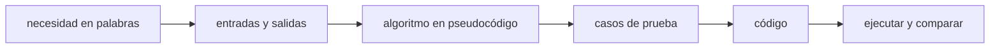
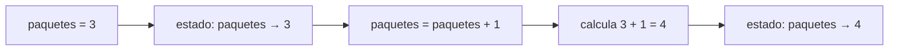
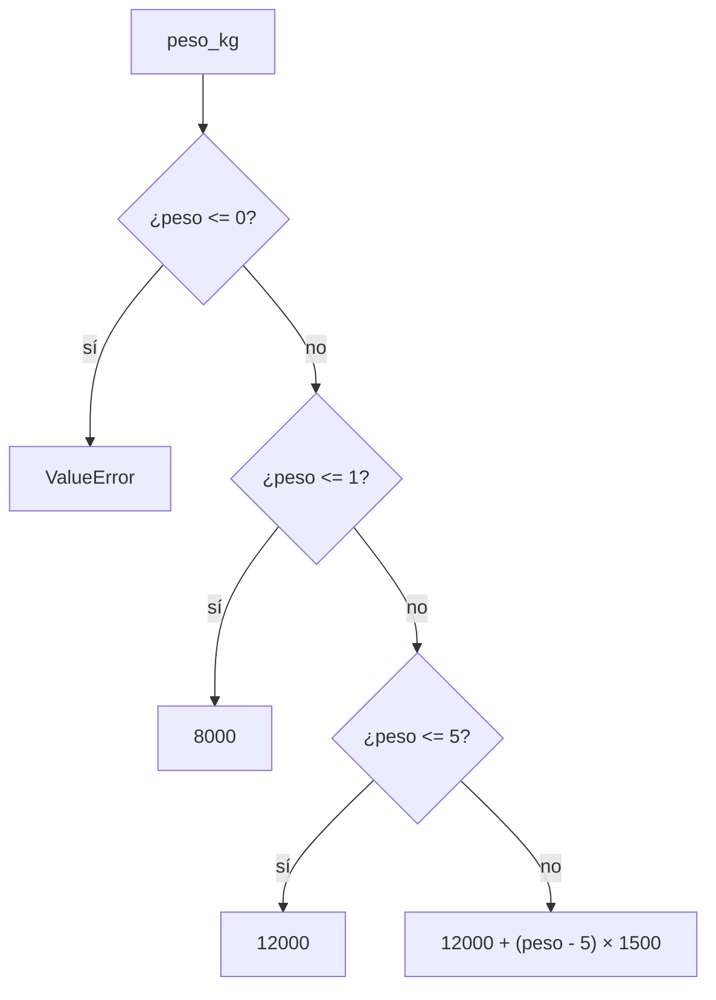
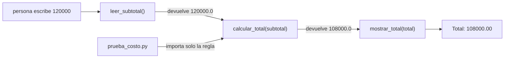
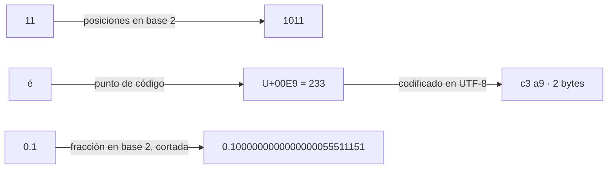
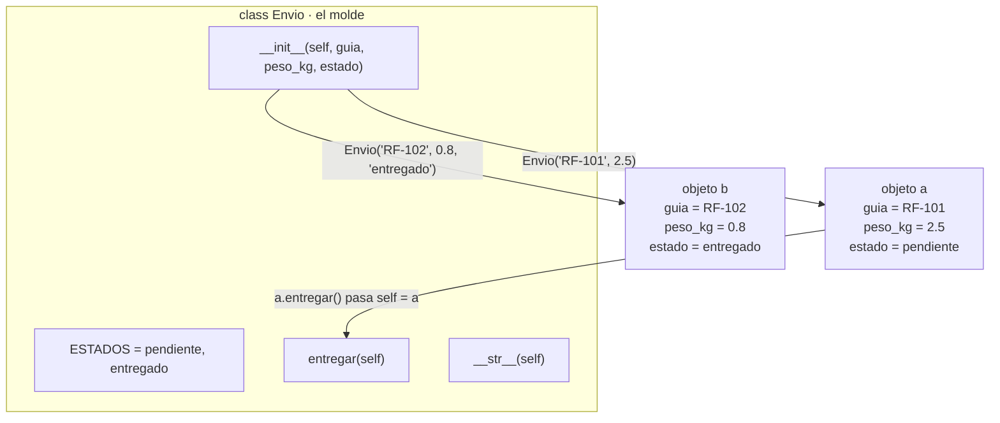
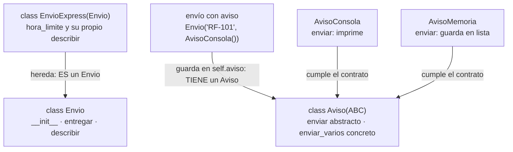

# Módulo 1: Pensamiento computacional y programación

**Entorno comprobado para esta edición (2026-11-21):** Python 3.14.10 en macOS 27.2 arm64, la línea de referencia del curso (`docs/VERSIONES.md`). Las cinco capturas de los temas 1 a 5 se generaron con `python3.14` ejecutado aquí y las transcripciones son literales de esa ejecución. Los ejemplos no requieren paquetes externos. El registro anterior (2026-11-18) decía 3.14.6 en Linux: se conserva como historial, pero los números de las transcripciones son las de hoy. Las instrucciones para Windows y PowerShell siguen contrastadas solo contra la documentación: **no se ejecutaron en esos sistemas**.


## Aprende construyendo


### Tema 1: Del problema al algoritmo y a los casos de prueba · Básico · 45 min

<details open>
<summary><strong>Capa 1 — Lectura</strong></summary>

#### Objetivos
Al terminar este tema podrás:
- convertir una necesidad escrita en palabras en entradas, salidas y reglas claras;
- escribir un algoritmo en pseudocódigo y traducirlo a Python;
- diseñar casos de prueba que incluyan casos límite y datos inválidos;
- comprobar tu programa con `assert` y leer un `ValueError` provocado a propósito.

**Conceptos clave:** algoritmo, pseudocódigo, entrada y salida, caso de prueba, caso límite, excepción, assert

#### El problema
La coordinadora de RutaFlow pregunta cada mañana: «¿cuántos envíos de la ruta siguen pendientes?». Es una pregunta
en palabras, no un programa. Antes de escribir código hay que responder tres cosas: ¿qué datos entran?, ¿qué
resultado sale? y ¿qué hacer con un dato raro, como un envío con estado «perdido»?

#### Glosario del tema

**algoritmo**
- **Definición técnica:** secuencia finita y ordenada de pasos no ambiguos que transforma unas entradas en una salida.
- **En palabras sencillas:** una receta tan precisa que cualquiera, incluso una máquina, llega al mismo resultado siguiéndola.
- **Dónde se rompe la comparación:** una receta admite «sal al gusto»; un algoritmo no admite pasos que dependan del gusto.
- **Ejemplo:** «empieza el contador en 0; por cada envío pendiente, súmale 1; al final, entrega el contador».
- **Error típico:** dejar un caso sin decidir (¿qué pasa si la lista está vacía?) y descubrirlo cuando el programa falla.

**pseudocódigo**
- **Definición técnica:** descripción de un algoritmo con estructura de programa (pasos, condiciones, repeticiones) pero en lenguaje natural, sin reglas de un lenguaje concreto.
- **En palabras sencillas:** un borrador del programa escrito en español, para pensar sin pelear con la sintaxis.
- **Dónde se rompe la comparación:** el computador no ejecuta pseudocódigo; sirve para pensar y para explicar, no para correr.
- **Ejemplo:** `SI estado es "pendiente": contador = contador + 1`.
- **Error típico:** escribirlo tan vago («revisa los envíos») que no dice qué hacer en cada paso.

**entrada y salida**
- **Definición técnica:** la entrada son los datos que recibe un algoritmo o función; la salida es el resultado que entrega.
- **En palabras sencillas:** lo que le das y lo que te devuelve.
- **Dónde se rompe la comparación:** una función también puede «salir» lanzando un error en lugar de devolver un resultado.
- **Ejemplo:** entrada: lista de envíos; salida: número de pendientes.
- **Error típico:** mezclar mostrar con devolver: `print` muestra, `return` entrega el resultado a quien llamó.

**caso de prueba**
- **Definición técnica:** combinación concreta de entrada y salida esperada que se usa para comprobar que un programa cumple su especificación.
- **En palabras sencillas:** un ejemplo con la respuesta correcta anotada, para comparar con lo que hace el programa.
- **Dónde se rompe la comparación:** que pasen todos tus casos no prueba que el programa sea correcto, solo que no falla en esos.
- **Ejemplo:** entrada `[]` (ruta vacía) → salida esperada `0`.
- **Error típico:** probar solo el caso feliz, el que ya sabes que funciona.

**caso límite**
- **Definición técnica:** caso de prueba en el borde de lo permitido: vacío, uno solo, el máximo, el primer valor inválido.
- **En palabras sencillas:** los ejemplos extremos, donde los programas suelen romperse.
- **Dónde se rompe la comparación:** «extremo» depende del problema: en una ruta es la lista vacía; en un peso, el 0 o un negativo.
- **Ejemplo:** una ruta sin envíos.
- **Error típico:** suponer que «nadie mandará una lista vacía».

**excepción**
- **Definición técnica:** señal que interrumpe el flujo normal del programa cuando ocurre una situación que no puede manejarse ahí; en Python se lanza con `raise` y, si nadie la captura, termina el programa con un mensaje.
- **En palabras sencillas:** una alarma: «aquí pasó algo que no sé resolver».
- **Dónde se rompe la comparación:** a diferencia de una alarma, una excepción puede atraparse con `try` y `except` para reaccionar.
- **Ejemplo:** `raise ValueError("estado no admitido")`.
- **Error típico:** devolver un valor inventado (como `0`) cuando el dato es inválido, y esconder el problema.

**assert**
- **Definición técnica:** instrucción que evalúa una condición y lanza `AssertionError` si es falsa; se usa para expresar lo que debe cumplirse.
- **En palabras sencillas:** «compruébame que esto es cierto; si no, detente y avísame».
- **Dónde se rompe la comparación:** no sirve para validar datos de usuarios: se puede desactivar al ejecutar Python con `-O`.
- **Ejemplo:** `assert contar_pendientes([]) == 0`.
- **Error típico:** escribir `assert` sin comparar (`assert contar_pendientes([])`), que comprueba otra cosa.

#### ► CÓMO FUNCIONA
Programar empieza antes del código. Primero se aclara la **necesidad**; luego se fijan **entradas y salidas**; después
se escribe el **algoritmo** y los **casos de prueba**, y solo al final el **código**. Los casos se diseñan antes del
código para no ajustarlos a lo que el programa ya hace.



#### Problema resuelto 1.1
Cuenta los envíos pendientes de una ruta. Cada envío tiene un estado: `pendiente` o `entregado`. Cualquier otro
estado es un error.

**Razonamiento:**
1. Entrada: una lista de envíos. Salida: un número entero.
2. Algoritmo: recorrer la lista una vez, sumar 1 por cada pendiente y rechazar los estados desconocidos.
3. Pseudocódigo antes del código:

```text
CONTAR_PENDIENTES(envios):
  contador = 0
  PARA cada envío (con su número de orden):
    SI su estado no es "pendiente" ni "entregado":
      LANZAR error con el número y el estado
    SI su estado es "pendiente":
      contador = contador + 1
  DEVOLVER contador
```

```python
# pendientes.py — cuenta los envíos pendientes de una ruta
ESTADOS_ADMITIDOS = {"pendiente", "entregado"}


def contar_pendientes(envios):
    contador = 0
    for numero, envio in enumerate(envios, start=1):
        estado = envio["estado"]
        if estado not in ESTADOS_ADMITIDOS:
            raise ValueError(f"envío {numero}: estado no admitido '{estado}'")
        if estado == "pendiente":
            contador = contador + 1
    return contador


ruta = [
    {"guia": "RF-101", "estado": "pendiente"},
    {"guia": "RF-102", "estado": "entregado"},
    {"guia": "RF-103", "estado": "pendiente"},
]
print("pendientes:", contar_pendientes(ruta))
```

```text
$ python3 pendientes.py
pendientes: 2
```

**Explicación por partes.**
- Línea 2: el conjunto de estados válidos se escribe una sola vez, con nombre en mayúsculas porque no cambia.
- Línea 5: `def` define la función; `envios` es su entrada.
- Línea 7: `enumerate(..., start=1)` entrega cada envío junto a su número (1, 2, 3…), útil para el mensaje de error.
- Líneas 9–10: un estado desconocido detiene todo con `ValueError`, en vez de contarse en silencio.
- Línea 13: `return` entrega la salida a quien llamó la función.
- Líneas 16–21: una ruta de ejemplo con 2 pendientes; la salida coincide con lo esperado.

> **Error común.** Un envío sin la clave `"estado"` termina con `KeyError: 'estado'`. El mensaje dice qué clave
> faltó en el diccionario. Revisa de dónde vienen los datos antes de culpar a la función.

> **Buena práctica.** Escribe el pseudocódigo como comentario o en papel antes del código. Si no puedes explicar el
> algoritmo en español, todavía no estás listo para escribirlo en Python.

#### Problema resuelto 1.2
Comprueba la función con casos de prueba: ruta vacía, ninguno pendiente, todos pendientes y un estado inválido.

**Razonamiento:**
1. La ruta vacía es el caso límite: debe dar `0`, no fallar.
2. Cada `assert` compara la salida real con la esperada.
3. El estado inválido debe producir `ValueError`; `try` y `except` lo atrapan para mostrar el mensaje.

```python
# prueba_pendientes.py — casos de prueba de contar_pendientes
from pendientes import contar_pendientes

assert contar_pendientes([]) == 0                                   # caso límite: ruta vacía
assert contar_pendientes([{"estado": "entregado"}]) == 0            # ninguno pendiente
assert contar_pendientes([{"estado": "pendiente"}] * 3) == 3        # todos pendientes

try:
    contar_pendientes([{"estado": "perdido"}])                      # caso inválido
    print("ERROR: debía rechazar 'perdido'")
except ValueError as error:
    print("rechazado:", error)

print("todas las pruebas pasaron")
```

```text
$ python3 prueba_pendientes.py
pendientes: 2
rechazado: envío 1: estado no admitido 'perdido'
todas las pruebas pasaron
```

**Explicación por partes.**
- Línea 2: `from pendientes import contar_pendientes` trae la función del otro archivo.
- Primera línea de la salida: al importar, Python ejecuta `pendientes.py` completo, incluido su `print`. En el Tema 4 verás cómo evitarlo.
- Líneas 4–6: si un `assert` fallara, el programa terminaría con `AssertionError` en esa línea.
- Líneas 8–12: el caso inválido se atrapa y se muestra el mensaje de la excepción.

> **Prevenir errores.** Diseña los casos de prueba antes de escribir la función. Si los inventas después, tiendes a
> probar solo lo que el código ya hace bien.

#### Checkpoint 1.1
¿Qué devuelve `contar_pendientes([{"estado": "pendiente"}, {"estado": "Pendiente"}])`?

Respuesta: no devuelve nada: lanza `ValueError` en el envío 2, porque `"Pendiente"` con mayúscula no está en `ESTADOS_ADMITIDOS`. Para el computador son textos distintos.

</details>

<details>
<summary><strong>Capa 2 — Construcción</strong></summary>

#### Paso 1 · Prepara la carpeta
Crea `~/labs/algoritmo` y entra con `cd ~/labs/algoritmo`.

#### Paso 2 · Escribe el algoritmo
Copia el pseudocódigo del Problema resuelto 1.1 en un archivo `algoritmo.txt`, con tus palabras.

#### Paso 3 · Tradúcelo a Python
Escribe `pendientes.py` y ejecútalo. La salida debe ser `pendientes: 2`.

#### Paso 4 · Prueba los casos
Escribe `prueba_pendientes.py`, ejecútalo y luego cambia `== 3` por `== 4` para ver un `AssertionError` real.

#### Resumen
- Un **algoritmo** es una secuencia finita de pasos sin ambigüedad; el **pseudocódigo** lo describe sin sintaxis de un lenguaje.
- Antes de programar se fijan la **entrada**, la **salida** y qué hacer con datos inválidos.
- Un **caso de prueba** une una entrada con su salida esperada; los **casos límite** están en los bordes.
- Una **excepción** (`raise ValueError`) detiene el flujo ante un dato que no se puede manejar.
- `assert` comprueba que una condición se cumple y falla con `AssertionError` si no.

#### Ejercicio verificable 1
Básico. Escribe en pseudocódigo un algoritmo que cuente los envíos **entregados**.

Respuesta esperada: igual al de pendientes, pero sumando 1 cuando el estado es `"entregado"`. Debe seguir rechazando estados desconocidos.

#### Ejercicio verificable 2
Intermedio. Agrega a `prueba_pendientes.py` un caso con un envío pendiente y uno entregado. ¿Qué valor esperas?

Respuesta esperada: `assert contar_pendientes([{"estado": "pendiente"}, {"estado": "entregado"}]) == 1`.

#### Ejercicio verificable 3
Reto. Modifica la función para que acepte `"Pendiente"` y `"PENDIENTE"` como pendientes, sin aceptar `"perdido"`.

Respuesta esperada: normalizar antes de comparar con `estado = envio["estado"].lower()`. El checkpoint deja de lanzar error y devuelve `2`.

#### En el trabajo
En un equipo profesional este proceso se repite en cada tarea: la necesidad llega en un ticket, se acuerdan entradas
y salidas, y los casos de prueba se escriben como pruebas automáticas que se ejecutan en cada cambio (lo verás en el
Módulo 5 con `pytest` y CI). Rechazar datos inválidos con un error claro, en lugar de adivinar, evita reportes
equivocados que nadie nota hasta que es tarde.

</details>

### Tema 2: Variables, tipos, expresiones y cambios de estado · Básico · 45 min

<details open>
<summary><strong>Capa 1 — Lectura</strong></summary>

#### Objetivos
Al terminar este tema podrás:
- crear variables y explicar qué guarda cada una;
- reconocer los tipos `str`, `int`, `float` y `bool` y comprobarlos con `type()`;
- cambiar el valor de una variable y predecir lo que imprime el programa;
- convertir texto escrito por una persona en un número con `int()` y `float()`;
- leer los errores `NameError`, `TypeError` y `ValueError` y corregirlos.

**Conceptos clave:** valor, variable, asignación, tipo de dato, print, type, reasignación, estado, conversión de tipo, input

#### El problema
RutaFlow registra cada envío con su número de guía, su peso, cuántos paquetes lleva y si ya se entregó. El programa
necesita **recordar** esos datos mientras trabaja y **cambiarlos** cuando algo pasa: por ejemplo, cuando el cliente
agrega un paquete. Además, cuando una persona escribe la cantidad en el teclado, el programa recibe **texto**, no un
número. ¿Cómo guarda un programa un dato, cómo lo cambia y cómo convierte lo que escribe una persona?

#### Glosario del tema

**valor**
- **Definición técnica:** dato concreto que el programa manipula, como `3`, `2.5` o `"RF-4471"`.
- **En palabras sencillas:** la información en sí: un número, un texto, un sí o un no.
- **Dónde se rompe la comparación:** para el computador `3` y `"3"` son valores distintos: uno es número y el otro es texto.
- **Ejemplo:** en `paquetes = 3`, el valor es `3`.
- **Error típico:** escribir texto sin comillas (`guia = RF-4471`): Python lo lee como una resta entre dos nombres.

**variable**
- **Definición técnica:** nombre asociado a un valor guardado en la memoria del programa; al usar el nombre, el intérprete obtiene ese valor.
- **En palabras sencillas:** una etiqueta pegada a una caja: la etiqueta es el nombre y lo que hay adentro es el valor.
- **Dónde se rompe la comparación:** en Python la etiqueta apunta al valor; dos nombres pueden apuntar al mismo valor.
- **Ejemplo:** `peso_kg = 2.5` crea el nombre `peso_kg` y lo asocia a `2.5`.
- **Error típico:** usar el nombre con otra mayúscula: `Peso_kg` no es `peso_kg`.

**asignación (`=`)**
- **Definición técnica:** instrucción que evalúa la expresión de la derecha y asocia el resultado al nombre de la izquierda.
- **En palabras sencillas:** «guarda esto con este nombre». No es el «igual» de matemáticas.
- **Dónde se rompe la comparación:** `paquetes = paquetes + 1` es imposible en matemáticas y normal al programar.
- **Ejemplo:** `entregado = False`.
- **Error típico:** escribirla al revés: `2.5 = peso_kg` produce `SyntaxError`.

**tipo de dato**
- **Definición técnica:** categoría de un valor que define qué operaciones admite: `str` (texto), `int` (número entero), `float` (número con decimales) y `bool` (`True` o `False`).
- **En palabras sencillas:** la clase de dato; dice qué puedes hacer con él, como sumar números o unir textos.
- **Dónde se rompe la comparación:** Python decide el tipo por el valor que escribes, no porque tú lo declares.
- **Ejemplo:** `type(2.5)` devuelve `<class 'float'>`.
- **Error típico:** mezclar tipos: `"Paquetes: " + 3` produce `TypeError`.

**print y type**
- **Definición técnica:** funciones integradas de Python; `print` escribe valores en la salida estándar y `type` devuelve el tipo de un valor.
- **En palabras sencillas:** `print` muestra algo en la terminal; `type` te dice qué clase de dato tienes.
- **Dónde se rompe la comparación:** `print` no devuelve el valor que muestra: solo lo escribe.
- **Ejemplo:** `print(type(3))` muestra `<class 'int'>`.
- **Error típico:** olvidar los paréntesis: `print "hola"` produce `SyntaxError` en Python 3.

**reasignación y estado**
- **Definición técnica:** reasignar es asociar un nombre existente a un valor nuevo; el **estado** del programa es el conjunto de valores de todas sus variables en un instante.
- **En palabras sencillas:** cambiar lo que hay en la caja; el estado es la foto de todas las cajas en un momento.
- **Dónde se rompe la comparación:** el valor viejo no se guarda en ningún lado: si lo necesitas, guárdalo antes con otro nombre.
- **Ejemplo:** después de `paquetes = paquetes + 1`, el estado tiene `paquetes` en `4`.
- **Error típico:** creer que el valor anterior sigue disponible con el mismo nombre.

**conversión de tipo e input**
- **Definición técnica:** `input()` lee una línea del teclado y siempre devuelve un `str`; `int()` y `float()` crean un número a partir de ese texto, o lanzan `ValueError` si el texto no representa un número.
- **En palabras sencillas:** lo que escribe una persona llega como letras; para hacer cuentas hay que traducirlo a número.
- **Dónde se rompe la comparación:** la traducción puede fallar: `int("dos")` no sabe leer palabras.
- **Ejemplo:** `int("3")` devuelve el número `3`.
- **Error típico:** sumar sin convertir: `input() + 1` produce `TypeError`.

#### ► CÓMO FUNCIONA
Python ejecuta el archivo de arriba abajo, una línea a la vez. En cada asignación, primero calcula el lado derecho y
después pega el nombre del lado izquierdo al resultado. Cuando un nombre se usa más adelante, Python busca a qué
valor está pegado **en ese momento**.



#### Problema resuelto 2.1
Registra un envío con sus cuatro datos, muéstralos con su tipo y agrega un paquete.

**Razonamiento:**
1. Cada dato necesita un nombre y un tipo: la guía es texto, el peso lleva decimales, los paquetes se cuentan y la entrega es sí o no.
2. Para mostrar valores se usa `print`; para comprobar el tipo, `type`.
3. Agregar un paquete es reasignar: calcular `paquetes + 1` y guardar el resultado con el mismo nombre.

```python
# variables.py — registra un envío de RutaFlow
guia = "RF-4471"      # str: texto, siempre entre comillas
peso_kg = 2.5         # float: número con parte decimal
paquetes = 3          # int: número entero
entregado = False     # bool: solo puede ser True o False

print(guia, peso_kg, paquetes, entregado)
print(type(guia), type(peso_kg), type(paquetes), type(entregado))

paquetes = paquetes + 1   # reasignación: el estado cambia
print("paquetes ahora:", paquetes)
```

```text
$ python3 variables.py
RF-4471 2.5 3 False
<class 'str'> <class 'float'> <class 'int'> <class 'bool'>
paquetes ahora: 4
```

**Explicación por partes.**
- Líneas 2–5: cuatro asignaciones. Cada una crea un nombre y le pega un valor de distinto tipo.
- Línea 7: `print` recibe cuatro valores separados por comas y los muestra separados por espacios.
- Línea 8: `type` confirma los tipos que dedujimos en el razonamiento.
- Línea 10: Python calcula primero `paquetes + 1` (da `4`) y luego reasigna `paquetes`.

> **Error común.** Escribir el nombre con otra mayúscula. `print(Guia)` termina el programa con
> `NameError: name 'Guia' is not defined. Did you mean: 'guia'?`. Lee el mensaje de derecha a izquierda: Python no
> encontró `Guia` y te sugiere el nombre que sí existe.

> **Error común.** Unir texto y número con `+`. `print("Paquetes: " + 3)` produce
> `TypeError: can only concatenate str (not "int") to str`. Usa una coma: `print("Paquetes:", 3)`.

> **Buena práctica.** Los nombres dicen qué guardan y en qué unidad: `peso_kg` en vez de `p` o `dato1`. Se escriben
> en minúscula con guion bajo (*snake_case*), la convención oficial de Python (PEP 8).

#### Problema resuelto 2.2
El cliente escribe en el teclado cuántos paquetes trae. Suma uno más y muestra el total.

**Razonamiento:**
1. `input` devuelve siempre texto, aunque la persona escriba un número.
2. Para sumar hay que convertir ese texto a `int` con `int()`.
3. Si el texto no es un número, `int()` falla: hay que saber leer ese error.

```python
# cantidad.py — lee cuántos paquetes trae el cliente
texto = input("Paquetes: ")
print(type(texto))
cantidad = int(texto)
print(type(cantidad))
print("total de paquetes:", cantidad + 1)
```

```text
$ echo 3 | python3 cantidad.py
Paquetes: <class 'str'>
<class 'int'>
total de paquetes: 4
```

**Explicación por partes.**
- Línea 2: `input` muestra `Paquetes: ` y espera una línea. Aquí `echo 3 |` escribe `3` por ti, así la salida no depende de teclear a tiempo.
- Línea 3: confirma que lo leído es `str`, aunque parezca un número.
- Línea 4: `int(texto)` convierte `"3"` en `3`.
- Línea 6: ahora sí se puede sumar.

> **Error común.** Escribir una palabra donde se espera un número. Con `echo dos | python3 cantidad.py` el
> programa termina con `ValueError: invalid literal for int() with base 10: 'dos'`. Significa: «el texto `'dos'` no
> se puede leer como entero en base 10».

> **Prevenir errores.** Antes de convertir, decide qué hará el programa con una entrada inválida. En el Tema 3
> aprenderás a comprobarla con `if` y a pedirla de nuevo.

#### Checkpoint 2.1
Si después del Problema resuelto 2.1 escribes `paquetes = paquetes * 2`, ¿qué valor queda en `paquetes`?

Respuesta: `8`. Antes de esa línea `paquetes` vale `4` por la reasignación anterior, y `4 * 2 = 8`.

</details>

<details>
<summary><strong>Capa 2 — Construcción</strong></summary>

#### Paso 1 · Prepara la carpeta
Crea la carpeta `~/labs/variables` y entra con `cd ~/labs/variables`.

#### Paso 2 · Registra el envío
Escribe `variables.py` (Problema resuelto 2.1) y ejecútalo con `python3 variables.py`. Compara tu salida con la del tema.

#### Paso 3 · Lee datos del teclado
Escribe `cantidad.py` (Problema resuelto 2.2) y pruébalo con `echo 3 | python3 cantidad.py` y con `echo dos | python3 cantidad.py`.

#### Paso 4 · Provoca y corrige los errores
Provoca a propósito el `NameError` y el `TypeError` del tema, lee cada mensaje y corrígelo.

#### Resumen
- Una **variable** es un nombre asociado a un **valor**.
- La **asignación** `=` calcula la derecha y guarda el resultado con el nombre de la izquierda.
- Cada valor tiene un **tipo de dato** (`str`, `int`, `float`, `bool`) que define qué operaciones admite.
- **Reasignar** cambia el **estado** del programa; el valor anterior deja de estar disponible con ese nombre.
- `input` siempre devuelve texto; **convertir** con `int()` o `float()` permite hacer cuentas.
- `NameError`: ese nombre no existe. `TypeError`: esa operación no sirve para esos tipos. `ValueError`: ese texto no se puede convertir.

#### Ejercicio verificable 1
Básico. Calcula el costo de un envío: tarifa de 4200 por kg, peso de 2.5 kg y recargo urgente de 3000. Guarda cada
dato en una variable y muestra el total.

Respuesta esperada: `13500.0`. Es `float` porque multiplicar un `int` por un `float` da `float`; con `int(total)` se muestra `13500`.

#### Ejercicio verificable 2
Intermedio. Sin ejecutarlo, escribe qué muestran `print("3" * 2)` y `print(3 * 2)`. Luego compruébalo.

Respuesta esperada: `33` y `6`. Con texto, `*` repite el texto; con números, multiplica.

#### Ejercicio verificable 3
Reto. Lee el peso con `input` (por ejemplo `echo 2.5 | python3 costo.py`) y calcula el costo del Ejercicio 1.

Respuesta esperada: `13500.0`. El peso tiene decimales, así que se convierte con `float()`, no con `int()`: `int("2.5")` lanza `ValueError`.

#### En el trabajo
En un backend real, estos datos llegan en una petición o en un archivo y terminan en una base de datos. Los mismos
errores aparecen a otra escala: un `TypeError` por recibir el peso como texto (`"2.5"`) o un `ValueError` por una
celda vacía son de los fallos más comunes al leer formularios y archivos CSV.

</details>

### Tema 3: Decisiones, repeticiones y trazado de ejecución · Básico · 50 min

<details open>
<summary><strong>Capa 1 — Lectura</strong></summary>

#### Objetivos
Al terminar este tema podrás:
- escribir condiciones con operadores de comparación y decidir con `if`, `elif` y `else`;
- repetir instrucciones con `for` sobre una lista y con `while` mientras se cumpla una condición;
- trazar a mano la ejecución de un programa en una tabla y predecir su salida;
- reconocer y corregir un bucle infinito, un `IndexError` y los errores de sintaxis más comunes.

**Conceptos clave:** condición, operador de comparación, if, elif, else, bucle, for, while, iteración, trazado de ejecución

#### El problema
La tarifa de RutaFlow cambia según el peso: hasta 1 kg cuesta 8000; hasta 5 kg, 12000; y por encima de 5 kg se
cobran 1500 por cada kilo adicional. Además, el conductor avanza parada por parada hasta llegar a un destino. El
programa tiene que **elegir** entre caminos y **repetir** pasos. Hasta ahora los programas iban en línea recta, de
arriba abajo. ¿Cómo hace un programa para decidir y para repetir?

#### Glosario del tema

**condición**
- **Definición técnica:** expresión que se evalúa a un valor booleano, `True` o `False`, y que decide qué instrucciones se ejecutan.
- **En palabras sencillas:** una pregunta de sí o no que el programa se hace, como «¿el peso es menor o igual a 1?».
- **Dónde se rompe la comparación:** en Python casi cualquier valor puede usarse como condición: una lista vacía o el `0` cuentan como «no».
- **Ejemplo:** `peso_kg <= 1` vale `True` si el peso es 0.5.
- **Error típico:** escribir la condición al revés (`>` en vez de `<`) y obtener justo el resultado contrario.

**operador de comparación**
- **Definición técnica:** operador que compara dos valores y devuelve un booleano: `==` igual, `!=` distinto, `<`, `<=`, `>`, `>=`.
- **En palabras sencillas:** los signos que preguntan si algo es igual, distinto, mayor o menor que otra cosa.
- **Dónde se rompe la comparación:** `==` compara; `=` asigna. Se parecen, pero hacen cosas totalmente distintas.
- **Ejemplo:** `estado == "pendiente"`.
- **Error típico:** escribir `if x = 5:`, que produce `SyntaxError: invalid syntax. Maybe you meant '==' or ':=' instead of '='?`.

**if, elif y else**
- **Definición técnica:** instrucciones de selección; `if` ejecuta su bloque si la condición es verdadera, cada `elif` prueba otra condición solo si las anteriores fueron falsas, y `else` se ejecuta si ninguna lo fue.
- **En palabras sencillas:** «si pasa esto, haz aquello; si no, prueba esto otro; y si nada se cumple, haz lo último».
- **Dónde se rompe la comparación:** solo se ejecuta **un** camino: el primero cuya condición se cumple, aunque las siguientes también fueran ciertas.
- **Ejemplo:** `if peso_kg <= 1: return 8000`.
- **Error típico:** olvidar los dos puntos `:` al final: `SyntaxError: expected ':'`.

**bloque e indentación**
- **Definición técnica:** grupo de instrucciones que pertenece a un `if`, un bucle o una función; en Python se marca con la indentación (los espacios al inicio de la línea), por convención 4 espacios.
- **En palabras sencillas:** las líneas corridas hacia la derecha «viven dentro» de la instrucción que está encima.
- **Dónde se rompe la comparación:** la indentación no es decoración: cambiarla cambia lo que hace el programa.
- **Ejemplo:** el `return 8000` va corrido 4 espacios más que su `elif`.
- **Error típico:** mezclar tabuladores y espacios, o correr mal una línea, que produce `IndentationError`.

**bucle e iteración**
- **Definición técnica:** un bucle es una instrucción que repite un bloque; cada repetición se llama iteración.
- **En palabras sencillas:** una vuelta que se repite; cada vuelta es una iteración.
- **Dónde se rompe la comparación:** un bucle mal hecho no se cansa: puede repetirse para siempre.
- **Ejemplo:** recorrer 4 pesos son 4 iteraciones.
- **Error típico:** cambiar dentro del bucle la variable equivocada y nunca avanzar.

**for**
- **Definición técnica:** bucle que toma, uno a uno, cada elemento de una secuencia (lista, texto, `range`) y ejecuta el bloque para cada uno.
- **En palabras sencillas:** «para cada cosa de esta lista, haz esto».
- **Dónde se rompe la comparación:** si la lista está vacía, el bloque se ejecuta **cero** veces y no hay error.
- **Ejemplo:** `for peso in [0.5, 1, 3, 8]:`.
- **Error típico:** modificar la lista mientras la recorres; el resultado es difícil de predecir.

**while**
- **Definición técnica:** bucle que repite su bloque mientras una condición sea verdadera; la condición se revisa antes de cada iteración.
- **En palabras sencillas:** «sigue haciendo esto mientras pase aquello».
- **Dónde se rompe la comparación:** si nada dentro del bloque hace que la condición deje de cumplirse, el bucle no termina nunca (**bucle infinito**).
- **Ejemplo:** `while paradas[indice] != destino:`.
- **Error típico:** olvidar avanzar el índice: el programa se queda «pegado». Se detiene con Ctrl + C.

**trazado de ejecución**
- **Definición técnica:** técnica de seguir a mano, instrucción por instrucción, los valores de las variables en una tabla para predecir qué hará un programa.
- **En palabras sencillas:** hacer de computador con lápiz y papel, anotando cómo cambia cada variable en cada vuelta.
- **Dónde se rompe la comparación:** el computador no se equivoca al trazar; tú sí, y por eso sirve: muestra dónde tu idea del programa no coincide con lo que hace.
- **Ejemplo:** la tabla del Problema resuelto 3.2.
- **Error típico:** saltarse una iteración y concluir que el programa «está mal» cuando el error estaba en el trazado.

#### ► CÓMO FUNCIONA
Un `if` divide el camino en ramas y Python sigue solo una. Un bucle hace que el camino vuelva hacia atrás y repita un
bloque. Combinando ambas cosas se puede describir casi cualquier algoritmo.



#### Problema resuelto 3.1
Escribe una función que devuelva la tarifa de un envío según su peso y muéstrala para 0.5, 1, 3 y 8 kg.

**Razonamiento:**
1. Primero se descarta el dato inválido (peso 0 o negativo): así las demás reglas no tienen que preocuparse por él.
2. Las reglas se escriben de la más pequeña a la más grande, porque `elif` solo se prueba si la anterior falló.
3. Un `for` recorre los pesos de prueba y llama a la función en cada iteración.

```python
# tarifa.py — decide la tarifa de un envío según su peso
def tarifa(peso_kg):
    if peso_kg <= 0:
        raise ValueError("el peso debe ser mayor que 0")
    elif peso_kg <= 1:
        return 8000
    elif peso_kg <= 5:
        return 12000
    else:
        return 12000 + (peso_kg - 5) * 1500


for peso in [0.5, 1, 3, 8]:
    print(peso, "kg ->", tarifa(peso))
```

```text
$ python3 tarifa.py
0.5 kg -> 8000
1 kg -> 8000
3 kg -> 12000
8 kg -> 16500
```

**Explicación por partes.**
- Líneas 3–4: la primera condición rechaza pesos inválidos con una excepción (Tema 1).
- Línea 5: `elif peso_kg <= 1` solo se evalúa si el peso es mayor que 0. Con `1`, la condición se cumple: el límite está incluido.
- Línea 7: con `3`, falla `<= 1` y se cumple `<= 5`.
- Línea 10: con `8`, se cobran 3 kg adicionales: `12000 + 3 × 1500 = 16500`.
- Líneas 13–14: el `for` da 4 iteraciones, una por peso.

> **Error común.** Ordenar mal las condiciones. Si pones `elif peso_kg <= 5` antes que `elif peso_kg <= 1`, un envío
> de 0.5 kg cae en la regla de 5 kg y cobra 12000: no hay error, solo un resultado equivocado. Por eso se prueban los
> límites (1 y 5) como casos de prueba.

> **Buena práctica.** Pon primero las validaciones que rechazan datos inválidos («cláusulas de guarda»). El resto de
> la función puede suponer que el dato ya es válido.

#### Problema resuelto 3.2
El conductor recorre las paradas en orden hasta llegar a Chapinero. Muestra cada parada por la que pasa y en qué
posición está el destino. Traza la ejecución a mano antes de correrlo.

**Razonamiento:**
1. No sabemos de antemano cuántas paradas faltan: eso pide `while`, que repite mientras no lleguemos.
2. Un índice indica la parada actual; hay que avanzarlo en cada iteración o el bucle no termina.
3. La tabla de trazado anota el valor de `indice` y la condición en cada vuelta.

```python
# recorrido.py — avanza parada por parada hasta llegar al destino
paradas = ["Bodega", "Calle 26", "Chapinero", "Usaquén"]
destino = "Chapinero"
indice = 0
while paradas[indice] != destino:
    print("paso por", paradas[indice])
    indice = indice + 1
print("llegué a", paradas[indice], "en la parada", indice)
```

Trazado a mano:

| Iteración | `indice` | `paradas[indice]` | ¿`!= destino`? | Acción |
|---|---|---|---|---|
| 1 | 0 | Bodega | sí | imprime «paso por Bodega», `indice` → 1 |
| 2 | 1 | Calle 26 | sí | imprime «paso por Calle 26», `indice` → 2 |
| — | 2 | Chapinero | no | sale del bucle e imprime «llegué a…» |

```text
$ python3 recorrido.py
paso por Bodega
paso por Calle 26
llegué a Chapinero en la parada 2
```

**Explicación por partes.**
- Línea 5: la condición se revisa antes de cada vuelta; cuando deja de cumplirse, el bucle termina.
- Línea 7: avanzar `indice` es lo que garantiza que el bucle termine.
- Línea 8: ya fuera del bucle (sin indentación), se muestra el resultado. Las posiciones empiezan en 0, por eso Chapinero es la parada `2`.

> **Error común.** Si el destino no está en la lista (por ejemplo `"Suba"`), el índice sigue creciendo hasta pasarse
> del final y el programa termina con `IndexError: list index out of range`: pediste una posición que no existe.

> **Prevenir errores.** Antes de escribir un `while`, responde dos preguntas: ¿qué hace que la condición deje de
> cumplirse? y ¿qué pasa si eso nunca ocurre? Si no tienes respuesta, usa `for` o agrega un límite.

#### Checkpoint 3.1
¿Cuántas veces se ejecuta el bloque de `for tarea in []:`? ¿Y el de `while False:`?

Respuesta: cero veces en ambos casos. El `for` no tiene elementos que recorrer y el `while` revisa la condición antes de entrar, y ya es falsa. Ninguno produce error.

</details>

<details>
<summary><strong>Capa 2 — Construcción</strong></summary>

#### Paso 1 · Prepara la carpeta
Crea `~/labs/control` y entra con `cd ~/labs/control`.

#### Paso 2 · Decide con if
Escribe `tarifa.py` y ejecútalo. Agrega `tarifa(5)` y `tarifa(5.5)` al `for` y explica cada resultado antes de correrlo.

#### Paso 3 · Traza y repite con while
Copia la tabla de trazado en papel, complétala para `destino = "Usaquén"` y luego ejecuta `recorrido.py` con ese destino para comprobarla.

#### Paso 4 · Provoca los errores
Cambia el destino a `"Suba"` y observa el `IndexError`. Luego borra los `:` de un `if` y observa el `SyntaxError`.

#### Resumen
- Una **condición** se evalúa a `True` o `False`; se construye con **operadores de comparación** (`==`, `!=`, `<`, `<=`, `>`, `>=`).
- `if`, `elif` y `else` eligen **un solo** camino: el primero cuya condición se cumple.
- La **indentación** define qué líneas pertenecen a cada bloque.
- `for` recorre cada elemento de una secuencia; `while` repite mientras una condición sea verdadera.
- Cada repetición es una **iteración**; un `while` sin avance es un **bucle infinito**.
- El **trazado de ejecución** en una tabla permite predecir la salida y encontrar errores de lógica.

#### Ejercicio verificable 1
Básico. Escribe un `if` que muestre `"urgente"` si `horas_restantes` es menor que 4 y `"normal"` en otro caso. ¿Qué muestra con `horas_restantes = 4`?

Respuesta esperada: `"normal"`, porque `4 < 4` es falso. Si quisieras incluir el 4, la condición sería `horas_restantes <= 4`.

#### Ejercicio verificable 2
Intermedio. Con un `for`, suma los pesos `[2.5, 1, 3.5]` en una variable `total` que empieza en 0. Traza las tres iteraciones.

Respuesta esperada: `total` pasa por `2.5`, `3.5` y `7.0`; se imprime `7.0`.

#### Ejercicio verificable 3
Reto. Modifica `recorrido.py` para que, si el destino no existe, muestre `"destino no encontrado"` en vez de fallar.

Respuesta esperada: agregar a la condición del `while` que el índice siga dentro de la lista (`indice < len(paradas) and paradas[indice] != destino`) y, después del bucle, usar `if indice == len(paradas):` para mostrar el mensaje.

#### En el trabajo
Las reglas de tarifas, descuentos y permisos de cualquier empresa son cadenas de `if` como la de este tema, y sus
errores más caros no lanzan excepciones: cobran mal en silencio porque una condición quedó en el orden equivocado.
Por eso los equipos prueban siempre los **límites** de cada regla, y los procesos que esperan algo (una respuesta,
un archivo) llevan un límite de tiempo o de intentos para no convertirse en un bucle infinito en producción.

</details>

### Tema 4: Funciones y descomposición de problemas · Básico · 45 min

<details open>
<summary><strong>Capa 1 — Lectura</strong></summary>

#### Objetivos
Al terminar este tema podrás:
- definir funciones con parámetros y `return`, y llamarlas con argumentos;
- dividir un programa en funciones pequeñas, cada una con una sola responsabilidad;
- importar funciones de otro archivo y proteger el programa principal con `if __name__ == "__main__":`;
- leer los errores `TypeError` por argumentos faltantes y por un `return` olvidado, y corregirlos.

**Conceptos clave:** función, parámetro, argumento, valor de retorno, variable local, descomposición, módulo, `__name__`

Ya los conoces y no se repiten: *entrada y salida*, *excepción*, *caso de prueba*, *caso límite* y *assert* (Tema 1);
*variable*, *valor* y *conversión de tipo* (Tema 2); *condición*, *if* y *bloque* (Tema 3).

#### El problema
RutaFlow le cobra a cada cliente el subtotal de sus envíos y le da un 10 % de descuento desde 100000. Ese programa
hace tres cosas distintas: leer el subtotal, aplicar la regla y mostrar el total. Si todo va en un solo bloque, no
puedes probar la regla sin teclear un número cada vez. Además, en el Tema 1 viste que importar `pendientes.py`
ejecutaba su `print`. ¿Cómo partes un programa en piezas que se pueden probar y reutilizar por separado?

#### Glosario del tema

**función**
- **Definición técnica:** bloque de código con nombre, definido con `def`, que se ejecuta solo cuando alguien lo llama escribiendo su nombre seguido de paréntesis.
- **En palabras sencillas:** una receta guardada con nombre; la escribes una vez y la usas cuantas veces quieras.
- **Dónde se rompe la comparación:** una receta no cambia la cocina; una función sí puede cambiar cosas fuera de ella, como escribir en pantalla.
- **Ejemplo:** `def mostrar_total(total):` define la función; `mostrar_total(90000)` la llama.
- **Error típico:** escribir el nombre sin paréntesis (`mostrar_total`): Python no la ejecuta, solo la nombra.

**parámetro**
- **Definición técnica:** nombre declarado entre los paréntesis de `def` que, en cada llamada, queda asociado al valor que recibe la función.
- **En palabras sencillas:** el hueco que la función deja para que le pases un dato.
- **Dónde se rompe la comparación:** el hueco tiene nombre propio; adentro de la función solo existe con ese nombre.
- **Ejemplo:** en `def calcular_total(subtotal):`, el parámetro es `subtotal`.
- **Error típico:** declarar un parámetro y llamar la función sin darle valor: `TypeError: ... missing 1 required positional argument`.

**argumento**
- **Definición técnica:** valor concreto que se escribe entre los paréntesis al llamar una función; Python lo asocia al parámetro en la misma posición.
- **En palabras sencillas:** el dato que metes en el hueco cuando usas la función.
- **Dónde se rompe la comparación:** el argumento puede ser una expresión; Python la calcula antes de entrar a la función.
- **Ejemplo:** en `calcular_total(120000)`, el argumento es `120000`.
- **Error típico:** pasar los argumentos en otro orden: la función recibe los datos cambiados y no avisa.

**valor de retorno (`return`)**
- **Definición técnica:** valor que la función entrega a quien la llamó; `return` termina la función en ese punto. Si no hay `return`, la función devuelve `None`.
- **En palabras sencillas:** la respuesta que la función te da de vuelta para que la sigas usando.
- **Dónde se rompe la comparación:** `None` es un valor real que significa «nada»; no produce error hasta que intentas usarlo.
- **Ejemplo:** `total = calcular_total(120000)` guarda `108000.0` en `total`.
- **Error típico:** usar `print` dentro de la función creyendo que devuelve el valor: muestra, pero quien llama recibe `None`.

**variable local**
- **Definición técnica:** variable creada dentro de una función (incluidos sus parámetros); existe mientras la función se ejecuta y no se ve desde fuera.
- **En palabras sencillas:** una nota que la función escribe en su propia libreta y bota al terminar.
- **Dónde se rompe la comparación:** dos funciones pueden usar el mismo nombre de variable sin estorbarse: son libretas distintas.
- **Ejemplo:** `total` dentro de `main()` no existe fuera de `main()`.
- **Error típico:** usar fuera de la función una variable local: `NameError: name 'total' is not defined`.

**descomposición**
- **Definición técnica:** técnica de diseño que divide un problema en subproblemas más pequeños, cada uno resuelto por una función con una sola responsabilidad.
- **En palabras sencillas:** partir una tarea grande en tareas chicas que se pueden hacer y revisar una por una.
- **Dónde se rompe la comparación:** partir de más también estorba: una función de una línea que solo llama a otra no aclara nada.
- **Ejemplo:** leer, calcular y mostrar quedan en tres funciones distintas.
- **Error típico:** una función que calcula **y** muestra **y** guarda: no se puede probar una parte sin las otras.

**módulo**
- **Definición técnica:** archivo `.py` cuyas funciones y variables pueden usarse desde otro archivo con `import` o `from ... import ...`.
- **En palabras sencillas:** un archivo de recetas que otro archivo puede tomar prestado.
- **Dónde se rompe la comparación:** al importarlo, Python **ejecuta** el archivo completo una vez, no solo copia las recetas.
- **Ejemplo:** `from costo import calcular_total`.
- **Error típico:** ejecutar el programa desde otra carpeta: `ModuleNotFoundError: No module named 'costo'`.

**`__name__` y el bloque principal**
- **Definición técnica:** variable que Python crea en cada módulo; vale `"__main__"` si ejecutaste ese archivo directamente y vale el nombre del módulo si fue importado.
- **En palabras sencillas:** una etiqueta que le dice al archivo «te están ejecutando a ti» o «solo te están pidiendo prestado».
- **Dónde se rompe la comparación:** la etiqueta no la pones tú: Python la escribe antes de ejecutar la primera línea.
- **Ejemplo:** `if __name__ == "__main__": main()` ejecuta `main()` solo al correr `python3 costo.py`.
- **Error típico:** escribir `"main"` en vez de `"__main__"`: la condición nunca se cumple y el programa no hace nada.

#### ► CÓMO FUNCIONA
Cuando Python lee un `def`, guarda la función pero no la ejecuta. Al llamarla, asocia cada argumento a su parámetro,
ejecuta el bloque y vuelve al punto de la llamada con el valor de retorno. Las variables locales desaparecen al volver.

El programa del problema se descompone en tres funciones encadenadas: la salida de una es la entrada de la siguiente.



Para saber si el archivo se ejecuta o se importa, Python usa `__name__`. Este archivo de una línea lo muestra:

```python
# nombre.py — muestra qué vale __name__
print("__name__ vale:", __name__)
```

```python
# usa_nombre.py — importa nombre.py
import nombre
```

```text
$ python3 nombre.py
__name__ vale: __main__
$ python3 usa_nombre.py
__name__ vale: nombre
```

El mismo archivo imprime dos cosas distintas. Ejecutado directamente, `__name__` vale `"__main__"`; importado, vale
`"nombre"`, el nombre del módulo.

#### Problema resuelto 4.1
Calcula el total que paga un cliente: lee el subtotal, aplica el 10 % de descuento desde 100000 y muestra el total con
dos decimales. Rechaza un subtotal negativo.

**Razonamiento:**
1. Hay tres responsabilidades: leer, calcular y mostrar. Cada una será una función.
2. La regla es la única parte con decisiones; debe recibir un número y devolver un número, sin leer ni imprimir.
3. Pseudocódigo de la regla:

```text
CALCULAR_TOTAL(subtotal):
  SI subtotal < 0: LANZAR error
  SI subtotal >= 100000: DEVOLVER subtotal × 0.90
  DEVOLVER subtotal
```

```python
# costo.py — costo de los envíos de un cliente, en tres funciones
def leer_subtotal():
    return float(input("Subtotal: "))


def calcular_total(subtotal):
    if subtotal < 0:
        raise ValueError("el subtotal no puede ser negativo")
    if subtotal >= 100000:
        return subtotal * 0.90
    return subtotal


def mostrar_total(total):
    print(f"Total: {total:.2f}")


subtotal = leer_subtotal()
total = calcular_total(subtotal)
mostrar_total(total)
```

```text
$ echo 50000 | python3 costo.py
Subtotal: Total: 50000.00
$ echo 120000 | python3 costo.py
Subtotal: Total: 108000.00
```

**Explicación por partes.**
- Líneas 2–3: `leer_subtotal` no tiene parámetros. Lee texto, lo convierte con `float` (Tema 2) y lo devuelve.
- Línea 6: `calcular_total` recibe el subtotal en su parámetro `subtotal`.
- Líneas 7–8: cláusula de guarda; un subtotal negativo lanza `ValueError` (Tema 1).
- Líneas 9–11: el primer `return` que se ejecuta termina la función. Con `120000` sale por la línea 10.
- Líneas 14–15: `f"..."` es un texto que inserta valores entre llaves; `:.2f` muestra el número con dos decimales.
- Líneas 18–20: el programa principal solo encadena las tres funciones; se lee como el pseudocódigo.
- En la salida, `Subtotal: ` y `Total:` quedan en la misma línea porque `echo` escribe por ti y no pulsas Enter.

> **Error común.** Llamar una función sin sus argumentos. `calcular_total()` termina con
> `TypeError: calcular_total() missing 1 required positional argument: 'subtotal'`. Se lee: «a `calcular_total` le
> falta 1 argumento obligatorio, el que va en el parámetro `subtotal`».

> **Error común.** Olvidar el último `return subtotal`. Con `50000`, ningún `return` se ejecuta y la función devuelve
> `None`. El fallo aparece después, en `mostrar_total`:
> `TypeError: unsupported format string passed to NoneType.__format__`. Si ves `NoneType`, busca un `return` que falta.

> **Buena práctica.** Una función, una responsabilidad, y un nombre con verbo que la describa: `calcular_total`,
> no `proceso` ni `hacer_todo`. Si para nombrarla necesitas la palabra «y», probablemente son dos funciones.

#### Problema resuelto 4.2
Prueba la regla del descuento con casos normales, límite e inválidos, sin teclear nada. Usa el `costo.py` anterior.

**Razonamiento:**
1. Las pruebas van en otro archivo que importa `calcular_total`.
2. Al importar, Python ejecuta `costo.py` entero, incluida la lectura del teclado de las líneas 18–20.
3. Por eso el programa principal pasa a una función `main()` que solo se llama si `__name__` vale `"__main__"`.

```python
# costo.py — versión importable: el programa solo corre si lo ejecutas tú
def leer_subtotal():
    return float(input("Subtotal: "))


def calcular_total(subtotal):
    if subtotal < 0:
        raise ValueError("el subtotal no puede ser negativo")
    if subtotal >= 100000:
        return subtotal * 0.90
    return subtotal


def mostrar_total(total):
    print(f"Total: {total:.2f}")


def main():
    subtotal = leer_subtotal()
    total = calcular_total(subtotal)
    mostrar_total(total)


if __name__ == "__main__":
    main()
```

```python
# prueba_costo.py — casos de prueba de calcular_total
from costo import calcular_total

assert calcular_total(50000) == 50000      # caso normal: sin descuento
assert calcular_total(99999) == 99999      # justo debajo del límite
assert calcular_total(100000) == 90000     # caso límite: aquí empieza el descuento
assert calcular_total(0) == 0              # caso límite: cliente sin envíos

try:
    calcular_total(-1)                     # caso inválido
    print("ERROR: debía rechazar -1")
except ValueError as error:
    print("rechazado:", error)

print("todas las pruebas pasaron")
```

```text
$ echo 120000 | python3 costo.py
Subtotal: Total: 108000.00
$ python3 prueba_costo.py
rechazado: el subtotal no puede ser negativo
todas las pruebas pasaron
```

**Explicación por partes.**
- `costo.py`, líneas 18–21: `main()` agrupa el programa principal; `subtotal` y `total` son ahora variables locales.
- `costo.py`, líneas 24–25: ejecutado directamente, `__name__` vale `"__main__"` y se llama `main()`.
- `prueba_costo.py`, línea 2: al importar, `__name__` vale `"costo"`; `main()` no se ejecuta y nadie pide el subtotal.
- `prueba_costo.py`, líneas 4–7: los límites `99999` y `100000` comprueban que el descuento empieza en el lugar exacto.
- `prueba_costo.py`, líneas 9–13: el caso inválido se atrapa y se muestra el mensaje de la excepción.
- La salida ya no trae ningún `print` de `costo.py`: es lo que el Tema 1 prometía resolver.

> **Error común.** Importar la versión sin `if __name__ == "__main__":`. La prueba se queda esperando en `Subtotal: `.
> Si cierras la entrada (Ctrl + D, o `python3 prueba_costo.py < /dev/null`), termina con
> `EOFError: EOF when reading a line`: `input` pidió una línea y la entrada se acabó sin darla.

> **Prevenir errores.** Deja fuera de `main()` solo los `def` y las constantes. Todo lo que lea, imprima o cambie
> algo va dentro de `main()`. Así cualquier archivo se puede importar para probarlo.

#### Checkpoint 4.1
¿Qué muestra `print(mostrar_total(90000))`?

Respuesta: dos líneas: `Total: 90000.00` y `None`. La primera la escribe el `print` de adentro; la segunda es el valor
de retorno, porque `mostrar_total` no tiene `return`.

</details>

<details>
<summary><strong>Capa 2 — Construcción</strong></summary>

#### Paso 1 · Prepara la carpeta
Crea `~/labs/funciones` y entra con `cd ~/labs/funciones`. Escribe `nombre.py` y `usa_nombre.py` y comprueba las dos salidas de `__name__`.

#### Paso 2 · Descompón el programa
Escribe el `costo.py` del Problema resuelto 4.1. Pruébalo con `echo 50000 | python3 costo.py` y con `echo 120000 | python3 costo.py`.

#### Paso 3 · Prueba sin teclear
Escribe `prueba_costo.py` y ejecútalo con `python3 prueba_costo.py < /dev/null`. Observa el `EOFError`.

#### Paso 4 · Protege el programa principal
Pasa el programa principal a `main()` con `if __name__ == "__main__":` y vuelve a ejecutar la prueba. Debe terminar en `todas las pruebas pasaron`.

#### Paso 5 · Provoca los errores
Borra el último `return subtotal` y ejecuta `echo 50000 | python3 costo.py`. Lee el `TypeError` y restaura la línea.

#### Resumen
- Una **función** se define con `def` y se ejecuta solo cuando se llama con paréntesis.
- Los **parámetros** son los huecos de la definición; los **argumentos**, los valores de cada llamada.
- `return` entrega el **valor de retorno** y termina la función; sin `return`, la función devuelve `None`.
- Las **variables locales** existen solo dentro de su función.
- La **descomposición** separa leer, calcular y mostrar; la parte que calcula se prueba sin teclado.
- Un **módulo** se importa con `from ... import ...`; al importarlo, Python lo ejecuta completo.
- `if __name__ == "__main__":` ejecuta el programa principal solo cuando corres ese archivo directamente.

#### Ejercicio verificable 1
Básico. Escribe `recargo_urgente(urgente)`: devuelve `3000` si `urgente` es `True` y `0` si es `False`. ¿Qué muestra
`print(recargo_urgente(True) + recargo_urgente(False))`?

Respuesta esperada: `3000`. Las dos llamadas devuelven `3000` y `0`; si la función usara `print` en vez de `return`,
la suma fallaría con `TypeError` por sumar `None`.

#### Ejercicio verificable 2
Intermedio. Agrega a `prueba_costo.py` un `assert` para un subtotal de `200000`. ¿Qué valor esperas?

Respuesta esperada: `assert calcular_total(200000) == 180000`. Python devuelve `180000.0`, y `180000.0 == 180000` es `True`.

#### Ejercicio verificable 3
Reto. Escribe `costo_ruta(pesos)`: suma la `tarifa` de cada peso (Tema 3) y aplica `calcular_total` al subtotal.
Calcula `costo_ruta([0.5, 3])` y `costo_ruta([8, 8, 8, 8, 8, 8, 8])`.

Respuesta esperada: `20000` (8000 + 12000, sin descuento) y `103950.0` (7 × 16500 = 115500, menos el 10 %).
`costo_ruta` reutiliza dos funciones ya probadas en lugar de repetir sus reglas.

#### En el trabajo
En un proyecto profesional casi todo archivo de Python termina en `if __name__ == "__main__":`, y la lógica de negocio
vive en funciones que no leen ni imprimen. Así las pruebas automáticas (Módulo 5, con `pytest`) importan las reglas y
las comprueban cientos de veces por minuto. Un servicio web reutiliza esas mismas funciones; solo cambia quién las
llama.

</details>

### Tema 5: Cómo la computadora representa los datos — binario, texto y decimales · Básico · 45 min

<details open>
<summary><strong>Capa 1 — Lectura</strong></summary>

#### Objetivos
Al terminar este tema podrás:
- convertir enteros entre decimal y binario, a mano y con `bin()` e `int(texto, 2)`;
- explicar por qué un texto con tildes ocupa más bytes que caracteres en UTF-8;
- predecir que `0.1 + 0.2` no da exactamente `0.3` y comparar decimales de forma segura;
- leer un `UnicodeDecodeError` y elegir entre tolerancia, `Decimal` o enteros para cantidades exactas.

**Conceptos clave:** bit, byte, sistema binario, carácter, punto de código, codificación, UTF-8, punto flotante, error de redondeo, `Decimal`

Ya los conoces y no se repiten: *valor*, *tipo de dato* y *conversión de tipo* (Tema 2); *condición* y *operador de
comparación* (Tema 3); *módulo* y *función* (Tema 4).

#### El problema
RutaFlow tiene una categoría barata, «sobre», para envíos de hasta 0.3 kg. Un cliente manda una carta de 0.1 kg y un
folleto de 0.2 kg. El programa suma 0.3 kg y, aun así, le cobra como paquete. En otro reporte, el barrio «Usaquén»
aparece como «Usaqu�n». Nada de esto es un error de lógica en tus `if`. ¿Qué guarda realmente el computador cuando
escribes un número o una letra?

#### Glosario del tema

**bit y byte**
- **Definición técnica:** un bit es la unidad mínima de información: vale 0 o 1. Un byte es un grupo de 8 bits y puede tomar 256 valores (0 a 255).
- **En palabras sencillas:** un bit es un interruptor apagado o prendido; un byte es una fila de 8 interruptores.
- **Dónde se rompe la comparación:** el byte no «sabe» si es número o letra; eso lo decide el programa que lo lee.
- **Ejemplo:** el byte `01000001` vale 65, y 65 es también el código de la letra `A`.
- **Error típico:** confundir caracteres con bytes: «Usaquén» tiene 7 caracteres pero ocupa 8 bytes en UTF-8.

**sistema binario**
- **Definición técnica:** sistema de numeración en base 2; cada posición vale el doble de la anterior (1, 2, 4, 8…) y solo usa los dígitos 0 y 1.
- **En palabras sencillas:** contar usando solo dos dígitos, igual que el decimal usa diez.
- **Dónde se rompe la comparación:** en decimal la posición vale ×10; en binario vale ×2, así que los números se alargan rápido.
- **Ejemplo:** `1011` en binario es 8 + 0 + 2 + 1 = `11`; en Python, `bin(11)` devuelve `'0b1011'`.
- **Error típico:** usar un dígito que no existe en base 2: `int("12", 2)` produce `ValueError: invalid literal for int() with base 2: '12'`.

**carácter y punto de código**
- **Definición técnica:** un carácter es la unidad mínima de texto (una letra, un signo, un emoji); el estándar Unicode le asigna a cada uno un número único llamado punto de código.
- **En palabras sencillas:** cada letra tiene un número de cédula, el mismo en cualquier computador del mundo.
- **Dónde se rompe la comparación:** la cédula dice **quién** es la letra, no **cómo** se guarda en bytes: eso lo decide la codificación.
- **Ejemplo:** `ord("é")` devuelve `233` (en hexadecimal, `0xe9`, que se escribe `U+00E9`); `chr(233)` devuelve `'é'`.
- **Error típico:** creer que `"Pendiente"` y `"pendiente"` son iguales: `P` y `p` tienen puntos de código distintos (Tema 1).

**codificación y UTF-8**
- **Definición técnica:** una codificación es la regla que convierte puntos de código en bytes y viceversa; UTF-8 usa de 1 a 4 bytes por carácter y es el estándar de la web.
- **En palabras sencillas:** el idioma en que se escriben las letras como bytes; quien guarda y quien lee deben usar el mismo.
- **Dónde se rompe la comparación:** con dos idiomas distintos no siempre hay error visible: a veces salen letras raras como `�` o `é`.
- **Ejemplo:** `"é".encode("utf-8")` devuelve `b'\xc3\xa9'`, dos bytes; `"A".encode("utf-8")` devuelve un solo byte.
- **Error típico:** leer con UTF-8 un archivo guardado en otra codificación: `UnicodeDecodeError`.

**punto flotante y error de redondeo**
- **Definición técnica:** el tipo `float` guarda los números en base 2 con 64 bits (estándar IEEE 754); las fracciones sin representación exacta en base 2 se guardan aproximadas, y esa diferencia es el error de redondeo.
- **En palabras sencillas:** igual que 1/3 en decimal es 0.3333… sin fin, 0.1 en binario no termina nunca y se corta.
- **Dónde se rompe la comparación:** el corte es diminuto, pero `==` compara exacto, así que una diferencia de 0.00000000000000004 basta para dar `False`.
- **Ejemplo:** `0.1 + 0.2` da `0.30000000000000004`.
- **Error típico:** comparar decimales con `==` o con un límite exacto (`<= 0.3`) y obtener un resultado equivocado sin ningún error.

**`Decimal`**
- **Definición técnica:** tipo del módulo estándar `decimal` que representa números en base 10 con la precisión que se pida; las sumas de valores como `0.1` son exactas.
- **En palabras sencillas:** una calculadora que hace las cuentas como en el cuaderno, con decimales de verdad.
- **Dónde se rompe la comparación:** si lo creas desde un `float`, heredas el error: `Decimal(0.1)` ya trae los decimales de sobra.
- **Ejemplo:** `Decimal("0.1") + Decimal("0.2")` da `Decimal('0.3')`.
- **Error típico:** mezclarlo con `float`: `Decimal("0.1") + 0.2` produce `TypeError: unsupported operand type(s) for +: 'decimal.Decimal' and 'float'`.

#### ► CÓMO FUNCIONA
Todo lo que guarda el computador son bytes. Lo que cambia es la **regla** para leerlos. Un entero se lee por
posiciones en base 2. Un texto se lee carácter por carácter: cada uno tiene un punto de código y UTF-8 lo convierte
en uno o más bytes. Un `float` guarda una aproximación en base 2 de 64 bits.



Para convertir 11 a binario a mano, busca las potencias de 2 que suman 11: 8 + 2 + 1. Marca 1 en esas posiciones
y 0 en las demás: `8 4 2 1` → `1 0 1 1`.

#### Problema resuelto 5.1
Muestra cómo guarda Python el número 11, la letra `A`, la letra `é` y el barrio «Usaquén». Comprueba cuántos
caracteres y cuántos bytes ocupa el nombre del barrio.

**Razonamiento:**
1. `bin()` muestra un entero en binario e `int(texto, 2)` hace el camino inverso.
2. `ord()` da el punto de código de un carácter; `hex()` lo muestra en hexadecimal.
3. `len()` cuenta caracteres de un texto; para contar bytes, primero se codifica con `.encode("utf-8")`.

```python
# representacion.py — cómo guarda Python números y textos
# Enteros en binario
print("11 en binario:", bin(11))
print("0b1011 en decimal:", 0b1011)
print("'1011' leído en base 2:", int("1011", 2))

# Texto: cada carácter es un número (punto de código) codificado en bytes UTF-8
print("Código de 'A':", ord("A"))
print("Código de 'é':", ord("é"), "=", hex(ord("é")))
barrio = "Usaquén"
print(barrio, "tiene", len(barrio), "caracteres")
print(barrio, "ocupa", len(barrio.encode("utf-8")), "bytes en UTF-8")
emoji_bytes = "🚚".encode("utf-8")
print("'🚚' en bytes UTF-8:", emoji_bytes, len(emoji_bytes), "bytes")
```

```text
$ python3 representacion.py
11 en binario: 0b1011
0b1011 en decimal: 11
'1011' leído en base 2: 11
Código de 'A': 65
Código de 'é': 233 = 0xe9
Usaquén tiene 7 caracteres
Usaquén ocupa 8 bytes en UTF-8
'🚚' en bytes UTF-8: b'\xf0\x9f\x9a\x9a' 4 bytes
```

**Explicación por partes.**
- Línea 3: `bin(11)` devuelve el texto `'0b1011'`; el prefijo `0b` avisa que lo que sigue está en base 2.
- Línea 4: `0b1011` escrito en el código es un `int` normal; `print` lo muestra en decimal.
- Línea 5: `int("1011", 2)` lee un texto como número en base 2: es la conversión inversa.
- Líneas 8–9: `A` tiene el punto de código 65 y `é` el 233 (`0xe9` en hexadecimal).
- Líneas 11–12: «Usaquén» tiene 7 caracteres, pero la `é` ocupa 2 bytes en UTF-8: en total, 8 bytes.
- Líneas 13–14: un emoji ocupa 4 bytes. El prefijo `b'...'` indica una secuencia de bytes, no un texto.

> **Error común.** Leer bytes con la codificación equivocada. Si «Usaquén» se guardó en Latin-1 (`b'Usaqu\xe9n'`) y se
> lee con `.decode("utf-8")`, el programa termina con
> `UnicodeDecodeError: 'utf-8' codec can't decode byte 0xe9 in position 5: invalid continuation byte`. Se lee: el byte
> `0xe9`, en la posición 5, no es UTF-8 válido. La solución es leer con la codificación con que se guardó.

> **Buena práctica.** Declara siempre la codificación al abrir archivos de texto: `open("rutas.csv", encoding="utf-8")`.
> Si no la escribes, Python usa la del sistema operativo, y el mismo programa puede fallar en otro computador.

#### Problema resuelto 5.2
Decide si la carta (0.1 kg) y el folleto (0.2 kg) caben juntos en la categoría «sobre», de hasta 0.3 kg. Muestra el
fallo y tres formas de evitarlo.

**Razonamiento:**
1. Primero se reproduce el error: sumar con `float` y comparar con el límite.
2. Solución 1: aceptar una diferencia mínima (tolerancia) en vez de exigir igualdad exacta.
3. Solución 2: usar `Decimal` creado desde texto. Solución 3: guardar gramos como `int`, que siempre es exacto.

```python
# sobre.py — ¿el envío cabe en la categoría «sobre» (hasta 0.3 kg)?
from decimal import Decimal

carta_kg = 0.1
folleto_kg = 0.2
total = carta_kg + folleto_kg
print("total en kg:", total)
print("¿cabe como sobre?", total <= 0.3)

# Solución 1: comparar con tolerancia
print("¿casi igual a 0.3?", abs(total - 0.3) < 1e-9)

# Solución 2: Decimal, construido desde texto
total_decimal = Decimal("0.1") + Decimal("0.2")
print("con Decimal:", total_decimal, total_decimal <= Decimal("0.3"))

# Solución 3: guardar gramos como enteros
total_g = 100 + 200
print("en gramos:", total_g, total_g <= 300)
```

```text
$ python3 sobre.py
total en kg: 0.30000000000000004
¿cabe como sobre? False
¿casi igual a 0.3? True
con Decimal: 0.3 True
en gramos: 300 True
```

**Explicación por partes.**
- Línea 2: importa `Decimal` del módulo estándar `decimal`, igual que importaste funciones en el Tema 4.
- Líneas 4–8: la suma da `0.30000000000000004`, un poco más que 0.3. Por eso `<= 0.3` es `False` y se cobra mal.
- Línea 11: `abs()` devuelve la distancia sin signo; si es menor que `1e-9` (0.000000001), se consideran iguales.
- Líneas 14–15: con `Decimal` creado desde texto, `0.1 + 0.2` da exactamente `0.3`.
- Líneas 18–19: en gramos todo es `int`; la suma es exacta y la regla queda en 300 g.

> **Error común.** Crear un `Decimal` desde un `float`. `Decimal(0.1)` muestra
> `0.1000000000000000055511151231257827021181583404541015625`: el error de redondeo ya venía en el `float`. Créalo
> siempre desde texto: `Decimal("0.1")`.

> **Prevenir errores.** Para pesos y dinero, guarda enteros en la unidad más pequeña (gramos, centavos) y convierte
> solo al mostrar. Si necesitas decimales exactos, usa `Decimal`. Reserva `float` para medidas donde una diferencia
> mínima no cambia ninguna decisión.

#### Checkpoint 5.1
¿Cuántos caracteres y cuántos bytes en UTF-8 tiene `"Bogotá"`? ¿Qué devuelve `int("101", 2)`?

Respuesta: 6 caracteres y 7 bytes, porque la `á` ocupa 2 bytes. `int("101", 2)` devuelve `5` (4 + 0 + 1).

</details>

<details>
<summary><strong>Capa 2 — Construcción</strong></summary>

#### Paso 1 · Prepara la carpeta
Crea `~/labs/representacion` y entra con `cd ~/labs/representacion`.

#### Paso 2 · Convierte a mano y comprueba
Convierte 6 y 13 a binario en papel con la tabla `8 4 2 1`. Comprueba con `python3 -c 'print(bin(6), bin(13))'`.

#### Paso 3 · Cuenta caracteres y bytes
Escribe `representacion.py`, ejecútalo y agrega una línea con tu barrio. Antes de correrlo, predice cuántos bytes ocupará.

#### Paso 4 · Reproduce el error de redondeo
Escribe `sobre.py` y ejecútalo. Luego cambia `Decimal("0.1")` por `Decimal(0.1)` y observa cómo cambia la línea `con Decimal`.

#### Resumen
- Todo dato se guarda como **bits**; 8 bits forman un **byte**, con 256 valores posibles.
- El **sistema binario** usa base 2: `bin()` convierte a binario e `int(texto, 2)` vuelve a decimal.
- Cada **carácter** tiene un **punto de código** Unicode (`ord`, `chr`); la **codificación** **UTF-8** lo guarda en 1 a 4 bytes.
- Guardar y leer con codificaciones distintas produce letras raras o `UnicodeDecodeError`.
- Un **float** es **punto flotante** en base 2: muchas fracciones decimales quedan aproximadas y aparece el **error de redondeo**.
- Para decidir con decimales usa tolerancia, `Decimal` creado desde texto, o enteros en la unidad más pequeña.

#### Ejercicio verificable 1
Básico. Convierte 6 a binario a mano y comprueba con `bin(6)`. Luego lee `"110"` en base 2 con `int`.

Respuesta esperada: `bin(6)` devuelve `'0b110'` (4 + 2) e `int("110", 2)` devuelve `6`.

#### Ejercicio verificable 2
Intermedio. Predice `len("Engativá")` y `len("Engativá".encode("utf-8"))`. Luego compruébalo.

Respuesta esperada: `8` caracteres y `9` bytes. Solo la `á` ocupa 2 bytes; las demás letras ocupan 1.

#### Ejercicio verificable 3
Reto. Con un `for` que se repite 10 veces, suma `0.1` a un `total` que empieza en `0`. Muestra `total` y `total == 1.0`.
Después reescríbelo en gramos para que la comparación sea exacta.

Respuesta esperada: `0.9999999999999999` y `False`. En gramos se suma `100` diez veces: `total` vale `1000` y
`total == 1000` es `True`.

#### En el trabajo
Los sistemas de cobro guardan el dinero en centavos como enteros o con tipos decimales exactos, y las bases de datos
tienen tipos para eso (`NUMERIC`, Módulo 4). Los errores de codificación aparecen cada vez que se importa un CSV
exportado desde otra herramienta: nombres de clientes con `é` o un `UnicodeDecodeError` en la primera tilde. Por eso
los equipos acuerdan UTF-8 en todo el sistema y lo declaran en cada lectura.

</details>

### Tema 6: Clases y objetos: atributos, métodos e `__init__` · Básico · 50 min

<details open>
<summary><strong>Capa 1 — Lectura</strong></summary>

#### Objetivos
Al terminar este tema podrás:
- escribir una clase con `__init__` y crear varios objetos a partir de ella;
- leer y cambiar los atributos de un objeto, y explicar qué es `self`;
- poner una regla del negocio dentro de un método para que ningún programa la salte;
- leer los errores `TypeError` y `AttributeError` típicos de las clases y corregirlos.

**Conceptos clave:** clase, objeto, instancia, atributo, atributo de clase, método, `__init__`, self, `__str__`

Ya los conoces y no se repiten: *variable* y *estado* (Tema 2); *condición*, *if* y *for* (Tema 3); *función*,
*parámetro*, *valor de retorno* y `__name__` (Tema 4); *excepción* (Tema 1).

#### El problema
Hasta ahora un envío de RutaFlow era un diccionario suelto o varias variables: `guia`, `peso_kg`, `estado`. Nada impide
escribir `estado = "perdido"` o marcar dos veces como entregado el mismo envío. Si la regla «un envío solo pasa de
pendiente a entregado» se copia en cada parte del programa, tarde o temprano una copia queda mal. ¿Cómo juntas los
datos de un envío con las reglas que los protegen?

#### Glosario del tema

**clase**
- **Definición técnica:** definición, escrita con `class`, de un tipo de dato nuevo: qué datos guarda cada objeto de ese tipo y qué operaciones admite.
- **En palabras sencillas:** el molde o el formulario en blanco: dice qué casillas tiene un envío, pero no es ningún envío.
- **Dónde se rompe la comparación:** un molde físico no cambia; una clase puede tener datos y funciones propias que comparten todos sus objetos.
- **Ejemplo:** `class Envio:` define el tipo `Envio`.
- **Error típico:** olvidar los dos puntos al final de `class Envio`: `SyntaxError: expected ':'`.

**objeto e instancia**
- **Definición técnica:** un objeto es un valor concreto creado a partir de una clase, con su propio estado; «instancia de `Envio`» significa «objeto creado con la clase `Envio`».
- **En palabras sencillas:** el formulario ya lleno: cada envío real es una copia del molde con sus propios datos.
- **Dónde se rompe la comparación:** dos objetos con los mismos datos siguen siendo dos objetos distintos; `is` lo comprueba.
- **Ejemplo:** `a = Envio("RF-101", 2.5)` crea una instancia y la asocia al nombre `a`.
- **Error típico:** usar la clase donde se necesita el objeto: `Envio.guia` falla, porque la guía es de cada envío, no del molde.

**atributo**
- **Definición técnica:** variable que pertenece a un objeto; se lee y se cambia con la notación `objeto.nombre`.
- **En palabras sencillas:** una casilla del formulario lleno, como la guía o el peso.
- **Dónde se rompe la comparación:** a un objeto se le pueden agregar casillas nuevas en cualquier momento; un formulario impreso no crece.
- **Ejemplo:** `a.peso_kg` devuelve `2.5`.
- **Error típico:** escribir mal el nombre: `a.gia` produce `AttributeError: 'Envio' object has no attribute 'gia'. Did you mean: 'guia'?`.

**atributo de clase**
- **Definición técnica:** variable definida en el cuerpo de la clase, fuera de los métodos; la comparten la clase y todos sus objetos.
- **En palabras sencillas:** un dato impreso en el molde, igual para todos los envíos.
- **Dónde se rompe la comparación:** si lo reasignas desde un objeto (`a.ESTADOS = ...`), creas un atributo nuevo solo en ese objeto.
- **Ejemplo:** `ESTADOS = ("pendiente", "entregado")` dentro de `class Envio`.
- **Error típico:** guardar en un atributo de clase un dato que debería ser propio de cada objeto, como el peso.

**método**
- **Definición técnica:** función definida dentro de una clase; se llama sobre un objeto con `objeto.metodo()` y recibe ese objeto como primer parámetro.
- **En palabras sencillas:** una acción que el envío sabe hacer sobre sí mismo, como «entregarse».
- **Dónde se rompe la comparación:** el método es uno solo, guardado en la clase; lo que cambia en cada llamada es el objeto que recibe.
- **Ejemplo:** `a.entregar()` cambia el estado de `a` y de nadie más.
- **Error típico:** olvidar los paréntesis: `a.entregar` no ejecuta nada, solo nombra el método.

**`__init__` (constructor)**
- **Definición técnica:** método especial que Python llama automáticamente al crear un objeto con `Clase(...)`; recibe los argumentos y asigna los atributos iniciales.
- **En palabras sencillas:** el paso de llenar el formulario en el momento en que se crea el envío.
- **Dónde se rompe la comparación:** `__init__` no crea el objeto: Python ya lo creó y se lo entrega en `self` para que lo llenes.
- **Ejemplo:** `Envio("RF-101", 2.5)` llama a `__init__` con `guia="RF-101"` y `peso_kg=2.5`.
- **Error típico:** crear el objeto sin los argumentos obligatorios: `TypeError: Envio.__init__() missing 2 required positional arguments: 'guia' and 'peso_kg'`.

**self**
- **Definición técnica:** nombre, por convención, del primer parámetro de todo método; en cada llamada vale el objeto sobre el que se llamó el método.
- **En palabras sencillas:** la forma en que el método dice «yo mismo»: `self.estado` es «mi estado».
- **Dónde se rompe la comparación:** no es una palabra reservada; funcionaría con otro nombre, pero ningún programador lo espera.
- **Ejemplo:** en `a.entregar()`, Python ejecuta `Envio.entregar(a)`: `self` vale `a`.
- **Error típico:** olvidarlo en la definición (`def entregar():`): `TypeError: Envio.entregar() takes 0 positional arguments but 1 was given`.

**`__str__`**
- **Definición técnica:** método especial que debe devolver un `str`; Python lo usa cuando haces `print(objeto)` o `str(objeto)`.
- **En palabras sencillas:** cómo se presenta el envío cuando lo muestras en pantalla.
- **Dónde se rompe la comparación:** si no lo defines, Python muestra algo como `<__main__.Envio object at 0x...>`, que no dice nada útil.
- **Ejemplo:** `print(a)` muestra `RF-101 (2.5 kg) - entregado`.
- **Error típico:** usar `print` dentro de `__str__` en vez de `return`: `TypeError: __str__ returned non-string (type NoneType)`.

#### ► CÓMO FUNCIONA
Una clase se define una vez y se usa para crear muchos objetos. Al escribir `Envio("RF-101", 2.5)`, Python crea un
objeto vacío, llama a `__init__` con ese objeto en `self` y devuelve el objeto lleno. Cada objeto guarda sus propios
atributos; los métodos viven en la clase y reciben el objeto en `self`.



#### Problema resuelto 6.1
Define la clase `Envio` con guía, peso y estado. Crea dos envíos, muestra sus atributos y comprueba que son objetos
distintos.

**Razonamiento:**
1. Los tres datos de cada envío serán atributos, asignados en `__init__`.
2. El estado casi siempre empieza en `"pendiente"`: se pone como valor por defecto del parámetro.
3. `type()` confirma que la clase creó un tipo nuevo; `is` comprueba si dos nombres apuntan al mismo objeto.

```python
# envio_basico.py — la clase Envio solo con sus datos
class Envio:
    def __init__(self, guia, peso_kg, estado="pendiente"):
        self.guia = guia
        self.peso_kg = peso_kg
        self.estado = estado


a = Envio("RF-101", 2.5)
b = Envio("RF-102", 0.8, "entregado")

print(a.guia, "-", a.peso_kg, "kg -", a.estado)
print(b.guia, "-", b.peso_kg, "kg -", b.estado)
print(type(a).__name__)
print(a is b)
```

```text
$ python3 envio_basico.py
RF-101 - 2.5 kg - pendiente
RF-102 - 0.8 kg - entregado
Envio
False
```

**Explicación por partes.**
- Línea 2: `class Envio:` crea el tipo. Los nombres de clase van en *CapWords* (cada palabra con mayúscula inicial).
- Línea 3: `estado="pendiente"` es un valor por defecto: si no pasas el tercer argumento, se usa ese.
- Líneas 4–6: `self.guia = guia` crea el atributo `guia` en el objeto con el valor del parámetro `guia`.
- Línea 9: sin tercer argumento, `a` queda `pendiente`. Línea 10: `b` recibe `"entregado"`.
- Línea 14: `type(a).__name__` es el nombre del tipo: `Envio`, igual que `int` o `str`.
- Línea 15: `a is b` es `False`: son dos objetos distintos, cada uno con sus atributos.

> **Error común.** Crear un objeto sin los argumentos obligatorios. `Envio()` termina con
> `TypeError: Envio.__init__() missing 2 required positional arguments: 'guia' and 'peso_kg'`. El mensaje nombra
> `__init__` porque es el método que recibe los argumentos de `Envio(...)`. `estado` no aparece: tiene valor por defecto.

> **Buena práctica.** Asigna **todos** los atributos en `__init__`, aunque algunos empiecen vacíos. Así cualquiera que
> lea la clase ve en un solo lugar qué datos tiene un envío.

#### Problema resuelto 6.2
Haz que el envío proteja su regla: solo acepta los estados `pendiente` y `entregado`, y no se puede entregar dos
veces. Además, que `print(envio)` muestre algo legible.

**Razonamiento:**
1. Los estados válidos son iguales para todos los envíos: van en un atributo de clase.
2. `__init__` rechaza un estado desconocido; el método `entregar` rechaza una segunda entrega.
3. `__str__` devuelve el texto que verá quien haga `print`.
4. El programa de ejemplo va bajo `if __name__ == "__main__":` (Tema 4) para poder importar la clase.

```python
# envio.py — el envío protege su propia regla de estados
class Envio:
    ESTADOS = ("pendiente", "entregado")

    def __init__(self, guia, peso_kg, estado="pendiente"):
        if estado not in Envio.ESTADOS:
            raise ValueError(f"estado no admitido: '{estado}'")
        self.guia = guia
        self.peso_kg = peso_kg
        self.estado = estado

    def entregar(self):
        if self.estado == "entregado":
            raise ValueError(f"{self.guia} ya estaba entregado")
        self.estado = "entregado"

    def __str__(self):
        return f"{self.guia} ({self.peso_kg} kg) - {self.estado}"


if __name__ == "__main__":
    ruta = [Envio("RF-101", 2.5), Envio("RF-102", 0.8, "entregado")]
    ruta[0].entregar()
    for envio in ruta:
        print(envio)
    try:
        ruta[1].entregar()
    except ValueError as error:
        print("rechazado:", error)
```

```text
$ python3 envio.py
RF-101 (2.5 kg) - entregado
RF-102 (0.8 kg) - entregado
rechazado: RF-102 ya estaba entregado
```

**Explicación por partes.**
- Línea 3: `ESTADOS` es un atributo de clase; los paréntesis forman una tupla, una lista que no se puede modificar.
- Líneas 6–7: la validación ocurre al crear el objeto: no puede existir un `Envio` con estado `"perdido"`.
- Líneas 12–15: `entregar` usa `self` para leer y cambiar el estado de **ese** envío, no de otro.
- Líneas 17–18: `__str__` devuelve un texto; no lo imprime.
- Línea 23: `ruta[0].entregar()` pasa `ruta[0]` como `self`.
- Líneas 24–25: `print(envio)` llama a `__str__` de cada objeto.
- Líneas 26–29: la segunda entrega de `RF-102` se rechaza con el mensaje del método.

> **Error común.** Olvidar `self` en la definición. Con `def entregar():`, la llamada `a.entregar()` termina con
> `TypeError: Envio.entregar() takes 0 positional arguments but 1 was given`. Python siempre pasa el objeto como primer
> argumento; el mensaje dice que la definición no tenía dónde recibirlo.

> **Error común.** Escribir mal un atributo. `print(a.gia)` produce
> `AttributeError: 'Envio' object has no attribute 'gia'. Did you mean: 'guia'?`. Igual que el `NameError` del Tema 2,
> Python te sugiere el nombre que sí existe.

> **Ingeniería de software.** La regla vive en un solo lugar: el método `entregar`. Ningún otro código debería escribir
> `envio.estado = "entregado"` directamente. Si la regla cambia, se cambia un método, no veinte bucles.

#### Checkpoint 6.1
Con la clase de `envio.py`, ¿qué muestra este código: `a = Envio("RF-101", 2.5)`, `b = a`, `b.entregar()`,
`print(a.estado)`?

Respuesta: `entregado`. `b = a` no copia el envío: los dos nombres apuntan al **mismo** objeto (Tema 2), así que
`a is b` es `True` y el cambio se ve por ambos nombres.

</details>

<details>
<summary><strong>Capa 2 — Construcción</strong></summary>

#### Paso 1 · Prepara la carpeta
Crea `~/labs/clases` y entra con `cd ~/labs/clases`.

#### Paso 2 · Define la clase con sus datos
Escribe `envio_basico.py` y ejecútalo. Agrega `print(a)` al final y observa el texto `<__main__.Envio object at 0x...>` (la dirección cambia en cada ejecución).

#### Paso 3 · Agrega la regla y la presentación
Escribe `envio.py` (Problema resuelto 6.2) y ejecútalo. Comprueba que ahora `print` muestra la guía, el peso y el estado.

#### Paso 4 · Provoca los errores
En otro archivo, importa la clase con `from envio import Envio` y prueba `Envio()`, `Envio("RF-103", 1, "perdido")` y `print(Envio("RF-104", 1).gia)`. Lee cada mensaje.

#### Resumen
- Una **clase** define un tipo nuevo; cada **objeto** (o **instancia**) creado con ella tiene su propio estado.
- `__init__` es el **constructor**: asigna los **atributos** iniciales del objeto que recibe en `self`.
- Un **método** es una función de la clase; `objeto.metodo()` le pasa el objeto como `self`.
- Un **atributo de clase** lo comparten todos los objetos, como la lista de estados válidos.
- `__str__` devuelve el texto que muestra `print(objeto)`.
- Las reglas del negocio van en métodos: así ningún programa crea un objeto inválido ni salta un paso.

#### Ejercicio verificable 1
Básico. Con `envio.py`, crea `Envio("RF-200", 4)` y muéstralo con `print`.

Respuesta esperada: `RF-200 (4 kg) - pendiente`. El estado no se pasó y tomó el valor por defecto.

#### Ejercicio verificable 2
Intermedio. Agrega el método `es_pesado(self)`, que devuelve `True` si el peso supera 5 kg. ¿Qué devuelven
`Envio("RF-201", 8).es_pesado()` y `Envio("RF-202", 5).es_pesado()`?

Respuesta esperada: `True` y `False`. El cuerpo es `return self.peso_kg > 5`; con 5 kg la condición es falsa porque el límite no se incluye.

#### Ejercicio verificable 3
Reto. Haz que `__init__` rechace pesos de 0 o menos con `ValueError("el peso debe ser mayor que 0")`. ¿Qué pasa con
`Envio("RF-203", 0)`?

Respuesta esperada: el programa termina con `ValueError: el peso debe ser mayor que 0`. La validación va en `__init__`,
antes de asignar los atributos, igual que la de `estado`.

#### En el trabajo
En un backend, cada entidad del negocio (envío, cliente, factura) es una clase cuyos métodos cuidan sus reglas. Los
frameworks como Django o Spring construyen sobre esta idea: guardan los atributos en la base de datos, pero la regla
«no se entrega dos veces» sigue viviendo en un método. Las fallas más caras aparecen cuando alguien cambia el atributo
directamente y se salta el método.

</details>

### Tema 7: Herencia, composición y clases abstractas con `abc` · Intermedio · 50 min

<details open>
<summary><strong>Capa 1 — Lectura</strong></summary>

#### Objetivos
Al terminar este tema podrás:
- crear una subclase que reutiliza y amplía otra con `super()` y sobrescritura de métodos;
- decidir entre herencia («ES un») y composición («TIENE un») para una clase nueva;
- definir un contrato con `ABC` y `@abstractmethod` y comprobar que el intérprete lo hace cumplir;
- leer el `AttributeError` de un `super().__init__` olvidado y el `TypeError` de una clase abstracta incompleta.

**Conceptos clave:** herencia, superclase, subclase, `super()`, sobrescritura, `isinstance`, composición, clase abstracta, método abstracto, polimorfismo

Ya los conoces y no se repiten: *clase*, *objeto*, *atributo*, *método*, `__init__` y *self* (Tema 6); *función*,
*módulo* y `__name__` (Tema 4); *excepción* (Tema 1).

#### El problema
RutaFlow lanza el envío **express**: es un envío normal con una hora límite de entrega. Copiar la clase `Envio` entera
y agregarle un atributo duplicaría todas sus reglas. Además, al entregar un envío hay que avisarle al cliente: hoy por
consola, mañana por SMS o correo. Si `Envio` sabe imprimir, mandar SMS y enviar correos, cada canal nuevo obliga a
tocarla. ¿Cómo reutilizas una clase sin copiarla y cómo cambias una pieza sin tocar el resto?

#### Glosario del tema

**herencia**
- **Definición técnica:** mecanismo por el que una clase se define a partir de otra y recibe sus atributos y métodos; se escribe `class Nueva(Base):`.
- **En palabras sencillas:** el envío express es un envío normal con algo más; hereda todo lo del envío y agrega lo suyo.
- **Dónde se rompe la comparación:** en la herencia de una familia los hijos no cambian lo heredado; en Python la subclase puede reemplazar cualquier método.
- **Ejemplo:** `class EnvioExpress(Envio):`.
- **Error típico:** heredar solo para reutilizar código cuando la nueva clase no «es un» caso de la otra.

**superclase y subclase**
- **Definición técnica:** la superclase (o clase base) es la clase de la que se hereda; la subclase (o clase derivada) es la que hereda.
- **En palabras sencillas:** la superclase es el molde general; la subclase, el molde especial que parte de él.
- **Dónde se rompe la comparación:** «super» no significa «mejor»: la superclase es la más general y suele tener menos detalles.
- **Ejemplo:** `Envio` es superclase de `EnvioExpress`; `EnvioExpress` es subclase de `Envio`.
- **Error típico:** escribir la herencia al revés (`class Envio(EnvioExpress)`), con lo que el caso general depende del especial.

**`super()`**
- **Definición técnica:** función integrada que, dentro de un método, da acceso a los métodos de la superclase sobre el mismo objeto `self`.
- **En palabras sencillas:** «haz primero lo que hacía el molde general y después sigo yo».
- **Dónde se rompe la comparación:** no crea otro objeto: el `self` sigue siendo el mismo envío express.
- **Ejemplo:** `super().__init__(guia, peso_kg)` llena la guía, el peso y el estado antes de agregar la hora límite.
- **Error típico:** olvidarlo en `__init__`: los atributos de la superclase nunca se crean y luego aparece `AttributeError`.

**sobrescritura de métodos**
- **Definición técnica:** definir en la subclase un método con el mismo nombre que uno de la superclase; para los objetos de la subclase, Python usa la versión nueva.
- **En palabras sencillas:** el envío express describe su situación a su manera, aunque el envío normal ya sabía hacerlo.
- **Dónde se rompe la comparación:** la versión vieja no se borra: sigue disponible con `super().metodo()`.
- **Ejemplo:** `EnvioExpress.describir` agrega «antes de las 11:00» a lo que devuelve `Envio.describir`.
- **Error típico:** escribir el nombre distinto (`describe` en vez de `describir`): no sobrescribe nada y se sigue usando el original.

**`isinstance`**
- **Definición técnica:** función integrada que devuelve `True` si un objeto es instancia de una clase o de cualquiera de sus subclases.
- **En palabras sencillas:** pregunta «¿este objeto es un envío?», contando también los envíos especiales.
- **Dónde se rompe la comparación:** la relación va en un solo sentido: todo express es un envío, pero no todo envío es express.
- **Ejemplo:** `isinstance(EnvioExpress("RF-102", 0.8, "11:00"), Envio)` devuelve `True`.
- **Error típico:** comparar con `type(x) == Envio`, que da `False` para las subclases.

**composición**
- **Definición técnica:** diseño en el que un objeto guarda otro objeto en un atributo y le delega una parte del trabajo.
- **En palabras sencillas:** el envío no sabe avisar; **tiene** un aviso y le pide que avise.
- **Dónde se rompe la comparación:** la pieza se puede cambiar mientras el programa corre: basta pasar otro objeto al crear el envío.
- **Ejemplo:** `Envio("RF-101", AvisoConsola())` guarda el aviso en `self.aviso`.
- **Error típico:** pasar un objeto que no tiene el método esperado (o `None`): `AttributeError: 'NoneType' object has no attribute 'enviar'`.

**clase abstracta y método abstracto**
- **Definición técnica:** una clase abstracta hereda de `ABC` (módulo `abc`) y declara métodos abstractos con `@abstractmethod`; no se puede instanciar, y una subclase solo se puede instanciar si implementa todos los métodos abstractos.
- **En palabras sencillas:** un contrato: «todo aviso debe saber `enviar`»; quien no cumpla, no puede crear objetos.
- **Dónde se rompe la comparación:** el contrato revisa que el método exista, no que funcione bien: eso lo comprueban tus pruebas.
- **Ejemplo:** `class Aviso(ABC):` con `@abstractmethod def enviar(self, mensaje):`.
- **Error típico:** crear una subclase sin el método: `TypeError: Can't instantiate abstract class AvisoSMS without an implementation for abstract method 'enviar'`.

**polimorfismo**
- **Definición técnica:** capacidad de usar objetos de clases distintas con la misma llamada; cada uno responde con su propia implementación.
- **En palabras sencillas:** le dices «envía» a cualquier aviso y cada uno lo hace a su manera.
- **Dónde se rompe la comparación:** a Python solo le importa que el método exista al llamarlo; la clase abstracta adelanta ese control al crear el objeto.
- **Ejemplo:** `self.aviso.enviar(...)` imprime con `AvisoConsola` y guarda en una lista con `AvisoMemoria`.
- **Error típico:** llenar el código de `if isinstance(aviso, AvisoConsola): ... elif ...` en lugar de llamar al método común.

#### ► CÓMO FUNCIONA
La herencia responde «ES un»: un envío express **es** un envío, así que hereda de `Envio`. La composición responde
«TIENE un»: un envío **tiene** un aviso, así que lo guarda en un atributo. La clase abstracta `Aviso` fija qué debe
saber hacer cualquier aviso, y Python lo comprueba al crear cada objeto.



Una regla práctica: si dudas, empieza por composición. La herencia ata la subclase a cada detalle de la superclase;
la composición solo depende del contrato.

#### Problema resuelto 7.1
Crea `EnvioExpress`: un envío con hora límite que se describe agregando esa hora. Debe reutilizar todo lo de `Envio`.

**Razonamiento:**
1. Un express **es** un envío: herencia.
2. Su `__init__` llama primero a `super().__init__` para guía, peso y estado, y luego agrega `hora_limite`.
3. `describir` se sobrescribe y reutiliza la versión de la superclase con `super().describir()`.
4. `entregar` no se escribe: se hereda tal cual.

```python
# herencia.py — un envío express ES un envío, con una hora límite
class Envio:
    def __init__(self, guia, peso_kg):
        self.guia = guia
        self.peso_kg = peso_kg
        self.estado = "pendiente"

    def entregar(self):
        self.estado = "entregado"

    def describir(self):
        return f"{self.guia} ({self.estado})"


class EnvioExpress(Envio):
    def __init__(self, guia, peso_kg, hora_limite):
        super().__init__(guia, peso_kg)
        self.hora_limite = hora_limite

    def describir(self):
        return f"{super().describir()} antes de las {self.hora_limite}"


ruta = [Envio("RF-101", 2.5), EnvioExpress("RF-102", 0.8, "11:00")]
ruta[1].entregar()
for envio in ruta:
    print(envio.describir())
print("¿RF-102 es un Envio?", isinstance(ruta[1], Envio))
print("¿RF-101 es un EnvioExpress?", isinstance(ruta[0], EnvioExpress))
```

```text
$ python3 herencia.py
RF-101 (pendiente)
RF-102 (entregado) antes de las 11:00
¿RF-102 es un Envio? True
¿RF-101 es un EnvioExpress? False
```

**Explicación por partes.**
- Línea 15: `(Envio)` declara la herencia: `EnvioExpress` recibe `entregar` y `describir` sin escribirlos.
- Línea 17: `super().__init__` ejecuta las líneas 4–6 sobre el mismo `self`.
- Línea 18: después, la subclase agrega su atributo propio.
- Líneas 20–21: sobrescritura; la primera parte del texto la arma `Envio.describir`.
- Línea 25: `entregar` no está en `EnvioExpress`; Python lo busca en la superclase y lo encuentra.
- Líneas 26–27: el mismo `envio.describir()` da dos textos distintos según la clase del objeto: polimorfismo.
- Líneas 28–29: `isinstance` confirma que la relación va en un solo sentido.

> **Error común.** Olvidar `super().__init__(guia, peso_kg)` (línea 17). El envío normal se describe bien, pero el
> express falla al describirse:
> `AttributeError: 'EnvioExpress' object has no attribute 'guia'`. El traceback apunta a `Envio.describir`, aunque el
> error está en el `__init__` de la subclase, que nunca creó `guia`.

> **Buena práctica.** En el `__init__` de una subclase, llama a `super().__init__(...)` en la primera línea. Así los
> atributos de la superclase existen antes de que la subclase los use o los amplíe.

#### Problema resuelto 7.2
Al entregar un envío, avisa al cliente. Debe funcionar con un aviso por consola y con uno que guarda los mensajes en
memoria para las pruebas, sin cambiar la clase `Envio`.

**Razonamiento:**
1. El envío **tiene** un aviso: composición. Lo recibe en `__init__` y lo guarda en `self.aviso`.
2. Todos los avisos deben saber `enviar(mensaje)`: eso es un contrato, una clase abstracta `Aviso`.
3. `enviar_varios` es igual para todos: se escribe una vez en `Aviso` y usa el `enviar` de cada subclase.

```python
# avisos.py — el envío TIENE un aviso; el aviso cumple un contrato
from abc import ABC, abstractmethod


class Aviso(ABC):
    @abstractmethod
    def enviar(self, mensaje):
        """Cada tipo de aviso decide cómo entregar el mensaje."""

    def enviar_varios(self, mensajes):
        for mensaje in mensajes:
            self.enviar(mensaje)


class AvisoConsola(Aviso):
    def enviar(self, mensaje):
        print("[aviso]", mensaje)


class AvisoMemoria(Aviso):
    def __init__(self):
        self.enviados = []

    def enviar(self, mensaje):
        self.enviados.append(mensaje)


class Envio:
    def __init__(self, guia, aviso):
        self.guia = guia
        self.estado = "pendiente"
        self.aviso = aviso

    def entregar(self):
        self.estado = "entregado"
        self.aviso.enviar(f"{self.guia} entregado")


if __name__ == "__main__":
    Envio("RF-101", AvisoConsola()).entregar()

    memoria = AvisoMemoria()
    Envio("RF-102", memoria).entregar()
    memoria.enviar_varios(["ruta cerrada", "conductor en bodega"])
    print("guardados:", memoria.enviados)
```

```text
$ python3 avisos.py
[aviso] RF-101 entregado
guardados: ['RF-102 entregado', 'ruta cerrada', 'conductor en bodega']
```

**Explicación por partes.**
- Línea 2: `ABC` y `abstractmethod` vienen del módulo estándar `abc` (*abstract base classes*).
- Líneas 5–8: `@abstractmethod` es un decorador: una marca sobre el `def` que convierte `enviar` en obligatorio. El texto entre `"""` es la documentación del método; basta como cuerpo.
- Líneas 10–12: `enviar_varios` es concreto; llama al `enviar` de la subclase que corresponda.
- Líneas 15–17 y 20–25: dos subclases cumplen el contrato. `.append` agrega un elemento al final de la lista.
- Líneas 28–36: `Envio` no sabe qué aviso tiene; solo llama a `self.aviso.enviar(...)`.
- Línea 40: con `AvisoConsola`, la entrega imprime en pantalla.
- Líneas 42–45: con `AvisoMemoria`, nada se imprime al entregar; los mensajes quedan en la lista y se pueden comprobar.

> **Error común.** Crear una subclase que no implementa el método del contrato. Si `AvisoSMS(Aviso)` define `mandar`
> en vez de `enviar`, `AvisoSMS()` termina con
> `TypeError: Can't instantiate abstract class AvisoSMS without an implementation for abstract method 'enviar'`. El
> error aparece al **crear** el objeto, no horas después, cuando un cliente esperaba su aviso.

> **Prevenir errores.** Instanciar la clase abstracta también falla: `Aviso()` produce
> `TypeError: Can't instantiate abstract class Aviso without an implementation for abstract method 'enviar'`. Ese
> control es la razón para usar `abc`: el intérprete revisa el contrato por ti.

> **Ingeniería de software.** Para agregar avisos por correo basta una clase nueva `AvisoCorreo(Aviso)`. `Envio` no se
> toca. Y en las pruebas se usa `AvisoMemoria`, que no manda nada real pero deja ver qué se habría enviado.

#### Checkpoint 7.1
¿Qué muestra `EnvioExpress("RF-300", 1, "09:00").describir()` con la clase de `herencia.py`? ¿Un camión de RutaFlow
debería heredar de `Envio` o tener una lista de envíos?

Respuesta: `RF-300 (pendiente) antes de las 09:00`. El camión no **es** un envío: **tiene** envíos. Corresponde
composición, un atributo con la lista de envíos que transporta.

</details>

<details>
<summary><strong>Capa 2 — Construcción</strong></summary>

#### Paso 1 · Prepara la carpeta
Crea `~/labs/herencia` y entra con `cd ~/labs/herencia`.

#### Paso 2 · Hereda y sobrescribe
Escribe `herencia.py` y ejecútalo. Luego borra la línea 17 (`super().__init__(guia, peso_kg)`), ejecútalo de nuevo y lee el traceback de abajo hacia arriba. Restaura la línea.

#### Paso 3 · Compón con un contrato
Escribe `avisos.py` y ejecútalo. Comprueba que la entrega de `RF-102` no imprime nada y que su mensaje aparece en `guardados`.

#### Paso 4 · Rompe el contrato
En un archivo nuevo, importa `Aviso`, define `AvisoSMS(Aviso)` con un método `mandar` e intenta crear `AvisoSMS()`. Lee el `TypeError` y corrígelo renombrando el método a `enviar`.

#### Resumen
- La **herencia** expresa «ES un»: la **subclase** recibe atributos y métodos de la **superclase**.
- `super()` llama a la versión de la superclase sobre el mismo objeto; en `__init__` va primero.
- La **sobrescritura** reemplaza un método en la subclase; `isinstance` reconoce también las subclases.
- La **composición** expresa «TIENE un»: un objeto guarda otro en un atributo y le delega trabajo.
- Una **clase abstracta** (`ABC`) con **métodos abstractos** (`@abstractmethod`) es un contrato que Python revisa al crear objetos.
- El **polimorfismo** permite que la misma llamada (`aviso.enviar`) funcione con cualquier clase que cumpla el contrato.

#### Ejercicio verificable 1
Básico. Sin ejecutarlo, ¿qué devuelven `isinstance(Envio("RF-1", 1), EnvioExpress)` e
`isinstance(EnvioExpress("RF-2", 1, "10:00"), Envio)`?

Respuesta esperada: `False` y `True`. Todo express es un envío; un envío normal no es express.

#### Ejercicio verificable 2
Intermedio. Escribe `AvisoMayusculas(Aviso)`, cuyo `enviar` imprime el mensaje en mayúsculas con `mensaje.upper()`.
¿Qué muestra `Envio("RF-101", AvisoMayusculas()).entregar()`?

Respuesta esperada: `RF-101 ENTREGADO`. `Envio` no cambió: solo recibió otro objeto que cumple el contrato.

#### Ejercicio verificable 3
Reto. Escribe una prueba con `assert` que compruebe que entregar `RF-500` produce exactamente un aviso con el texto
`"RF-500 entregado"`, sin imprimir nada.

Respuesta esperada: `memoria = AvisoMemoria()`, `Envio("RF-500", memoria).entregar()` y
`assert memoria.enviados == ["RF-500 entregado"]`. La prueba pasa en silencio; con `AvisoConsola` habría que leer la
pantalla para comprobarlo.

#### En el trabajo
Los equipos usan la composición para cambiar piezas sin tocar el núcleo: el mismo servicio de envíos manda SMS en
producción y guarda los mensajes en memoria durante las pruebas. Las clases abstractas (o las interfaces de Java y
Kotlin) son los contratos entre esas piezas. La herencia se reserva para relaciones «ES un» estables; las jerarquías
profundas son de lo primero que se simplifica al revisar código.

</details>

### Proyecto 1: calculadora de presupuesto desde carpeta vacía

<details open>
<summary><strong>Capa 1 — Lectura</strong></summary>

</details>

<details>
<summary><strong>Capa 2 — Construcción</strong></summary>

#### Nota de construcción
Este tema es principalmente conceptual en esta versión. La verificación se realiza con las preguntas de comprensión y el criterio de cuándo NO usar proyecto 1: calculadora de presupuesto desde carpeta vacía.

</details>
