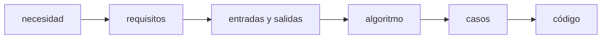
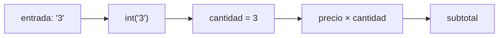
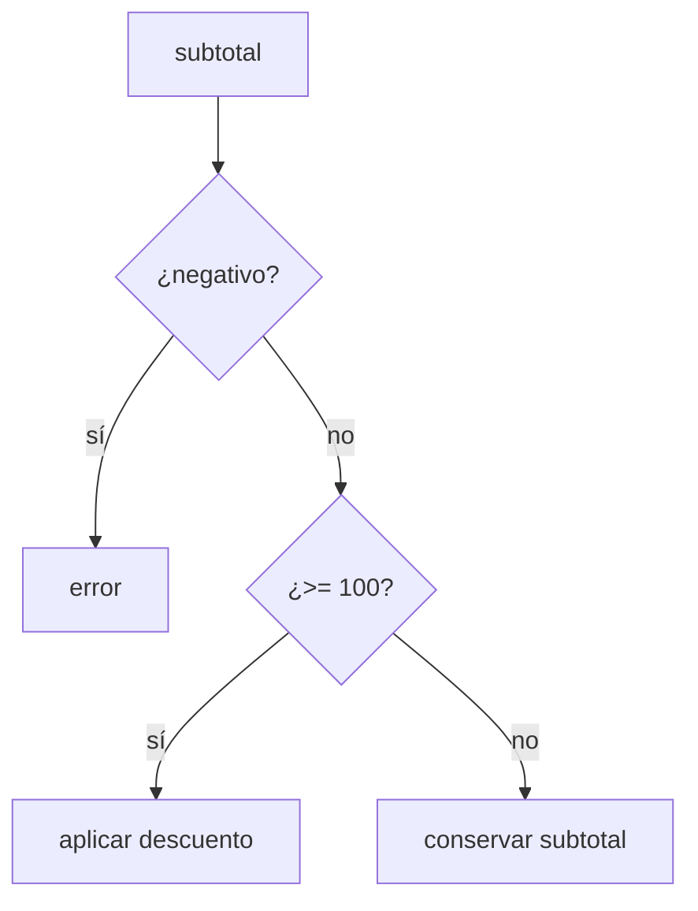
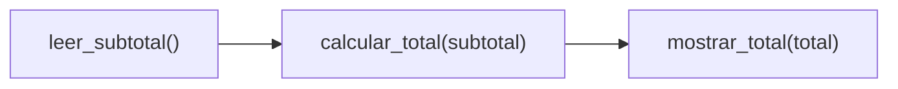
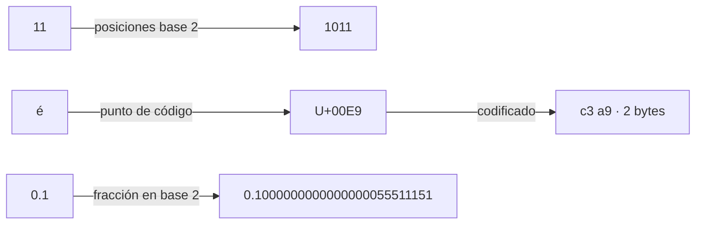
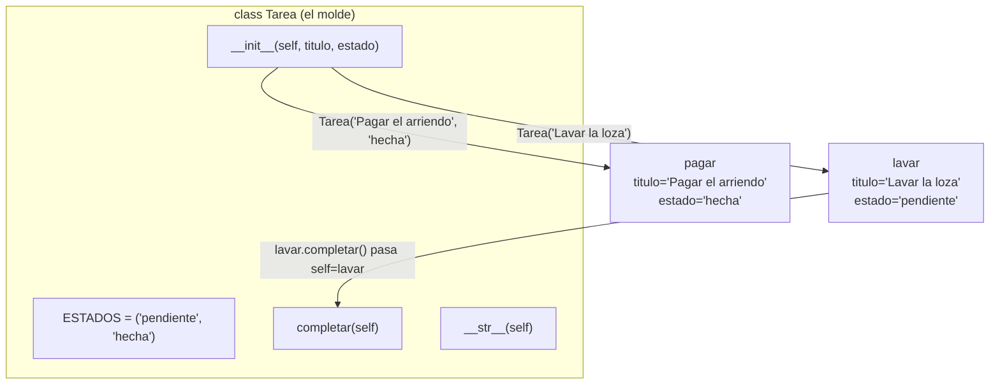
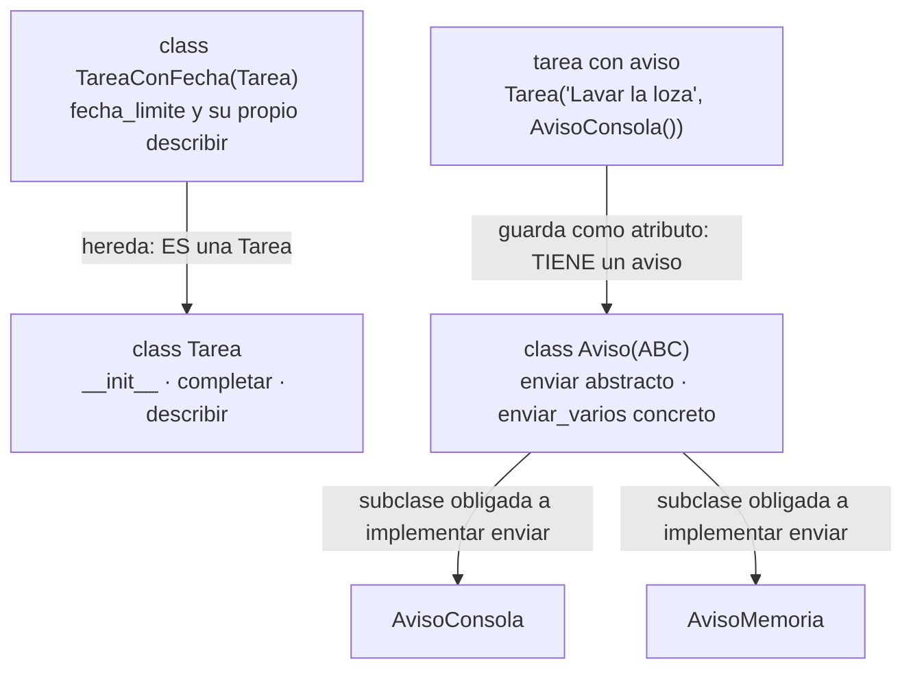

# Módulo 1: Pensamiento computacional y programación

**Entorno comprobado para esta edición (2026-11-21):** Python 3.14.10 en macOS 27.2 arm64, la línea de referencia del curso (`docs/VERSIONES.md`). Las cinco capturas de los temas 1 a 5 se generaron con `python3.14` ejecutado aquí y las transcripciones son literales de esa ejecución. Los ejemplos no requieren paquetes externos. El registro anterior (2026-11-18) decía 3.14.6 en Linux: se conserva como historial, pero los números de las transcripciones son las de hoy. Las instrucciones para Windows y PowerShell siguen contrastadas solo contra la documentación: **no se ejecutaron en esos sistemas**.


## Aprende construyendo

### Tema 1: Del problema al algoritmo y a los casos de prueba · Básico · 30 min

#### Paso 1 · Objetivo y preparación
Al finalizar vas a convertir un problema informal ("¿cuántas tareas están pendientes?") en un algoritmo explícito, implementarlo en Python y diseñar casos que incluyan una lista vacía y un estado no admitido. **Prerrequisitos:** Python instalado y el Tema 4 de Fundamentos módulo 0 (leer un comando antes de ejecutarlo); comprueba `python3.14 --version` (o `py -3.14 --version` en Windows).

#### Paso 2 · Contexto y caso real
El gestor de tareas CLI (proyecto integrador Fundamentos) que vas a construir módulo a módulo necesita, desde el día uno, contestar una pregunta simple: de todas las tareas guardadas, ¿cuántas están pendientes? Parece trivial, pero si no defines el algoritmo antes de escribir código —¿qué devuelve si no hay ninguna tarea todavía?— vas a terminar adivinando el comportamiento en vez de poder explicarlo.

#### Paso 3 · Teoría, modelo mental y analogía
Un problema informal ("contar pendientes") esconde preguntas sin responder. Un algoritmo es la versión explícita de la solución: una secuencia finita de pasos que, dada una entrada, produce una salida predecible, sin importar si después la escribes en Python o la ejecutas a mano con papel. Por eso el orden profesional es problema → algoritmo explícito → casos de prueba (incluyendo los bordes) → código, nunca directamente problema → código:
```text
CONTAR_PENDIENTES(tareas):
  contador = 0
  estados_admitidos = {"pendiente", "hecho"}
  PARA cada numero, tarea en tareas:
    SI tarea.estado no está en estados_admitidos:
      LANZAR ValueError con numero y estado
    SI tarea.estado es "pendiente": contador = contador + 1
  DEVOLVER contador
```
Este algoritmo no dice nada todavía sobre Python: devuelve cero para una lista vacía, cuenta las tareas pendientes y rechaza explícitamente estados fuera del contrato. Esos comportamientos deben comprobarse antes de confiar en la traducción a código. La analogía: diseñar un algoritmo sin pensar en sus bordes es como planear una ruta de reparto sin preguntar qué pasa si la lista de paradas viene vacía o si una parada tiene una dirección imposible.

**Cuándo NO usar:** No programes sin definir requisitos. No intentes casos límite sin pseudocódigo primero.

**Conceptos clave:** problema, requisito, entrada, proceso, salida, algoritmo, contrato, caso normal, caso límite y caso inválido.

Programar no comienza escribiendo sintaxis. Comienza definiendo con precisión qué problema se resolverá. “Haz una calculadora” es ambiguo: ¿qué operaciones admite?, ¿acepta decimales?, ¿qué ocurre si el usuario escribe texto?, ¿cómo se informa una división por cero? Un **requisito** elimina ambigüedad al describir comportamiento observable.

Considera: “calcular el total de una compra aplicando 10 % de descuento cuando el subtotal sea al menos 100”. La entrada es el subtotal; el proceso compara y quizá descuenta; la salida es el total. Una precondición razonable es que el subtotal no sea negativo.

```text
LEER subtotal
SI subtotal < 0
    MOSTRAR "valor inválido"
SI NO, SI subtotal >= 100
    total = subtotal * 0.90
SI NO
    total = subtotal
MOSTRAR total
```

Este pseudocódigo no pertenece a un lenguaje específico. Permite discutir la lógica antes de preocuparnos por paréntesis. Después diseñamos casos: `50 → 50` es normal sin descuento; `100 → 90` prueba exactamente el límite; `-1 → error` prueba entrada inválida. Un único ejemplo como `150 → 135` no demuestra que el límite ni la validación funcionen.

**Ejemplo desde cero:** escribe primero la tabla de pruebas, luego el programa. Esto invierte el hábito de “codificar y ver qué pasa” por “definir qué debe pasar y comprobarlo”.

**Analogía:** un algoritmo es una ruta de viaje y los casos de prueba son recorridos de inspección: uno por la carretera principal, otro por el límite del mapa y otro intentando entrar por una vía prohibida.

**¿Por qué es importante?** Los defectos caros suelen surgir de requisitos ambiguos y casos no considerados, no de desconocer una palabra reservada. Pensar en ejemplos antes de implementar conecta programación con ingeniería.

**Casos de uso reales:** reglas de descuento, validación de edad, cálculo de impuestos, límites de retiro y permisos de acceso se expresan como entradas, decisiones y resultados verificables.

**Diagrama:**



#### Profundización · Diseño: Casos límite con números flotantes (99.99)

**Escenario real:** El gestor de tareas aplica descuentos: "si subtotal >= 100, aplica 10%". Con la regla `subtotal >= 100`, el 99.99 se clasifica bien (no recibe descuento); el riesgo está en los cálculos con decimales que vienen después, porque un `float` no guarda exactamente todos los valores decimales.

**Tu tarea (sin mirar solución):**

1. **Predice:** `0.1 + 0.1 + 0.1` ¿da exactamente `0.3`? Si aplicas tres descuentos sucesivos de 0.10 cada uno, ¿el total acumulado es exacto?
2. **Diseña casos:**
   - Normal: 99.99
   - Límite: 100.00, 100.01
   - Trunca: Redondea a 2 decimales. ¿El resultado sigue siendo válido?
3. **Detecta:** Escribe una función que valide `precio * cantidad` sin perder centavos.
4. **Escenario:** ¿`99.99 * 0.90` imprime exactamente `89.991` en Python, o aparece un residuo binario visible?

**Escribe tu respuesta:**
```
0.1 + 0.1 + 0.1 en Python: _________
Casos diseñados: _________, _________, _________
Función validadora: redondea_a_centavos(resultado) _________
99.99 * 0.90 imprime: _________
```

<details>
<summary>SOLUCIÓN — Lee solo después de intentar</summary>

> **Respuesta esperada:**
>
> **`0.1 + 0.1 + 0.1` da `0.30000000000000004`, NO `0.3` exacto** — tres descuentos de 0.10 sumados en punto flotante binario acumulan un residuo visible, aunque cada número individual (`0.1`) "se vea" simple en decimal.
>
> **Casos:**
> - 99.99 → 99.99 (sin descuento)
> - 100.00 → 90.00 (límite exacto, descuento)
> - 100.01 → 90.009 (requiere redondeo)
>
> **Validador:**
> ```python
> from decimal import Decimal
> precio = Decimal('99.99') * Decimal('0.90')
> ```
>
> **`99.99 * 0.90` imprime exactamente `89.991`** en Python — este caso puntual NO muestra residuo visible (la imprecisión interna existe en binario, pero redondea limpio al convertir a texto). Esa es precisamente la trampa: no puedes predecir de antemano cuál cálculo con decimales se va a ver "limpio" y cuál no con solo mirarlo, por eso `Decimal` (o trabajar en centavos como enteros) es la única forma confiable de garantizar precisión exacta en dinero, en vez de confiar en que "este número en particular no tuvo problemas".

</details>

#### Paso 4 · Demostración guiada desde cero
Parte de una carpeta vacía y crea `src/pendientes.py`:
```bash
mkdir ejemplo-algoritmo
cd ejemplo-algoritmo
mkdir src
```
**Antes de leer el código:** usa cinco piezas que este curso explica a fondo más adelante. Por ahora basta con reconocerlas:

- `def contar_pendientes(tareas):` define una **función**: un bloque con nombre que recibe `tareas` y entrega un resultado con `return`. La llamas escribiendo `contar_pendientes(...)` (Tema 4).
- `{"descripcion": "comprar pan", "estado": "pendiente"}` es un **diccionario**: guarda valores bajo un nombre (clave). `tarea["estado"]` lee el valor de la clave `"estado"` (módulo 2).
- `for numero, tarea in enumerate(tareas, start=1):` recorre la lista y, en cada vuelta, te da el número de la tarea (1, 2, 3…) y la tarea misma (los `for` se ven en el Tema 3).
- `raise ValueError(...)` detiene el programa con un error y un mensaje: así se rechaza un estado no admitido en vez de contarlo mal.
- `f"Tarea {numero}: …"` es un **f-string**: escribe en el texto el valor de las variables que van entre llaves.

Guarda este contenido en `src/pendientes.py`:
```python
def contar_pendientes(tareas):
    contador = 0
    estados_admitidos = {"pendiente", "hecho"}
    for numero, tarea in enumerate(tareas, start=1):
        estado = tarea["estado"]
        if estado not in estados_admitidos:
            raise ValueError(f"Tarea {numero}: estado no admitido: {estado}")
        if estado == "pendiente":
            contador += 1
    return contador

tareas = [
    {"descripcion": "comprar pan", "estado": "pendiente"},
    {"descripcion": "pagar luz", "estado": "hecho"},
    {"descripcion": "llamar al dentista", "estado": "pendiente"},
]
print(contar_pendientes(tareas))
print(contar_pendientes([]))
```

**Explicación por bloques:** el primer bloque es la función. Recorre `tareas` con `enumerate(..., start=1)`
para que el mensaje de error diga «Tarea 2» y no «Tarea 1» (los índices de Python empiezan en cero, la
numeración para una persona empieza en uno). Dentro del bucle hay dos decisiones en un orden que importa:
primero se rechaza lo que el contrato no admite (`raise ValueError`), y solo después se cuenta lo pendiente.
El segundo bloque son los datos: tres diccionarios, dos de ellos con `"estado": "pendiente"`. La última
parte son las dos llamadas: la primera debe dar `2` y la segunda, con la lista vacía, `0`. `raise` no
imprime un texto y sigue de largo: detiene el proceso entero, y por eso el `codigo_de_salida` de esa
ejecución es `1` y no `0`.

```bash
python3.14 src/pendientes.py
```
En Windows sustituye `python3.14` por `py -3.14`.


**Resultado esperado:** `2` y luego `0`; la lista vacía nunca entra al `for`, así que el contador queda en
cero sin necesitar ningún caso especial. Salida literal de las cuatro ejecuciones de la captura, tomadas en
esta máquina (macOS 27.2, arm64) el 2026-11-21 con `scripts/render_terminal_capture.py` dentro de la carpeta
`ejemplo-algoritmo`:

```text
$ python3.14 src/pendientes.py
2
0
$ python3.14 src/pendientes-con-porcentaje.py
2
0
Traceback (most recent call last):
  File "/private/tmp/f1m1/t1/src/pendientes-con-porcentaje.py", line 23, in <module>
    print(porcentaje_pendientes([]))
          ~~~~~~~~~~~~~~~~~~~~~^^^^
  File "/private/tmp/f1m1/t1/src/pendientes-con-porcentaje.py", line 21, in porcentaje_pendiente
s
    return contar_pendientes(tareas) / len(tareas) * 100
           ~~~~~~~~~~~~~~~~~~~~~~~~~~^~~~~~~~~~~~~
ZeroDivisionError: division by zero
$ echo "codigo_de_salida=$?"
codigo_de_salida=1
$ python3.14 src/pendientes-con-porcentaje-corregido.py
2
0
0.0
$ python3.14 src/pendientes-estado-archivada.py
2
0
Traceback (most recent call last):
  File "/private/tmp/f1m1/t1/src/pendientes-estado-archivada.py", line 24, in <module>
    print(contar_pendientes(tareas))
          ~~~~~~~~~~~~~~~~~^^^^^^^^
  File "/private/tmp/f1m1/t1/src/pendientes-estado-archivada.py", line 7, in contar_pendientes
    raise ValueError(f"Tarea {numero}: estado no admitido: {estado}")
ValueError: Tarea 2: estado no admitido: archivada
$ echo "codigo_de_salida=$?"
codigo_de_salida=1
```

Los renglones `/private/tmp/f1m1/t1/...` son la carpeta absoluta de esta máquina: en la tuya el `File` del
traceback muestra la ruta de tu `ejemplo-algoritmo`, y el resto del mensaje es idéntico. Los renglones
partidos (`porcentaje_pendiente` / `s`) son el corte a 96 columnas de la ventana, no dos errores distintos.

**Fallo deliberado:** guardá una copia de `src/pendientes.py` como `src/pendientes-con-porcentaje.py` y
agregale al final esta segunda función, que calcula qué porcentaje de las tareas están pendientes sin pensar
en la lista vacía:
```python
def porcentaje_pendientes(tareas):
    return contar_pendientes(tareas) / len(tareas) * 100

print(porcentaje_pendientes([]))
```
Ejecutala con `python3.14 src/pendientes-con-porcentaje.py`. Python lanza
`ZeroDivisionError: division by zero`: el conteo sobrevivió a la lista vacía, pero el porcentaje no, porque
divide por `len(tareas)` sin comprobar que sea distinto de cero. Corrígelo guardando `src/pendientes-con-porcentaje-corregido.py`
con esta versión, que comprueba la lista vacía antes de dividir (`if not tareas:` es verdadero cuando la lista
no tiene elementos):
```python
def porcentaje_pendientes(tareas):
    if not tareas:
        return 0.0
    return contar_pendientes(tareas) / len(tareas) * 100

print(porcentaje_pendientes([]))
```
Ahora el resultado es `0.0`: la función define qué significa el porcentaje cuando no hay tareas antes de
dividir.

#### Paso 5 · Práctica guiada
Antes de escribir cualquier función sobre una lista de tareas, preguntate qué debería devolver con cero tareas; si no podés responder en una frase, todavía no terminaste de diseñar el algoritmo. Para comprobar el otro límite del contrato, guardá otra copia como `src/pendientes-estado-archivada.py`, cambiá `"hecho"` por `"archivada"` en una tarea y volvé a ejecutar con `python3.14 src/pendientes-estado-archivada.py`: el programa se detiene con `ValueError: Tarea 2: estado no admitido: archivada`, tal como sale en la captura del Paso 4, y el código de salida es `1`. Si tu proyecto necesita más estados, agrégalos explícitamente a `estados_admitidos`.

#### Paso 6 · Práctica independiente
Escribí la tabla de casos de prueba para `contar_pendientes` ANTES de tocar el código:

| Entrada de `tareas` | Resultado esperado |
|---|---|
| Pendiente, hecho, pendiente | `2` |
| `[]` | `0` |
| Pendiente, pendiente | `2` |
| Pendiente, archivada | `ValueError: Tarea 2: estado no admitido: archivada` |

Para cada fila anotá la entrada concreta y la salida o error esperado, y después confirma que el código cumple el contrato.

#### Paso 7 · Cierre
Entregá el algoritmo en pseudocódigo del Paso 3, la tabla de casos del Paso 6, el código de `contar_pendientes` y `porcentaje_pendientes`, y ambos fallos reproducidos: `ValueError` por estado inesperado y `ZeroDivisionError` por porcentaje de una lista vacía. Corrige el caso vacío antes de volver a ejecutar. Como siguiente paso, en el Tema 2 vas a ver qué pasa cuando esos mismos datos —por ejemplo, una prioridad escrita por el usuario— llegan con el tipo equivocado. Errores comunes: probar solo el caso feliz; dividir o indexar sin comprobar que la colección no esté vacía; contar silenciosamente un estado que el contrato no reconoce; escribir código antes de tener la tabla de casos. Fuentes oficiales consultadas el 2026-11-01: [control de flujo](https://docs.python.org/3/tutorial/controlflow.html) y [pruebas unitarias](https://docs.python.org/3/library/unittest.html).
**Implicación práctica:** El conteo de pendientes funcionó a la primera con datos de ejemplo, y ese falso éxito es exactamente lo que oculta el bug hasta que un usuario real se queda sin tareas.

### Tema 2: Variables, tipos, expresiones y cambios de estado · Básico · 30 min

#### Paso 1 · Objetivo y preparación
Al finalizar vas a ver cómo Python distingue tipos en tiempo de ejecución, y vas a reproducir un bug silencioso —sin ningún error ni traceback— que aparece al comparar dos textos como si fueran números. **Prerrequisitos:** el Tema 1 de este módulo y el Tema 2 de Fundamentos módulo 0 (del archivo fuente al programa en ejecución); comprueba `python3.14 --version` (o `py -3.14 --version` en Windows).

#### Paso 2 · Contexto y caso real
El gestor de tareas CLI va a leer la prioridad de una tarea desde la terminal con `input()`, por ejemplo para decidir cuál tarea atender primero. El problema: `input()` devuelve SIEMPRE texto, nunca un número, aunque el usuario haya tecleado solamente dígitos.

#### Paso 3 · Teoría, modelo mental y analogía
En Python cada valor tiene un tipo (`int`, `float`, `str`, `bool`, `list`...) y ese tipo decide qué operaciones son válidas: `3 + 2` suma, pero `"3" + "2"` concatena y da `"32"`, no `5`. Una variable es apenas una etiqueta que apunta a un valor; reasignarla (`prioridad = 5`) no modifica el valor anterior, solo hace que la etiqueta apunte a otro. Pero si DOS variables apuntan al mismo objeto mutable —una lista, por ejemplo— modificar esa lista a través de una de las dos etiquetas se ve reflejado en la otra, porque ambas señalan el mismo objeto en memoria, no dos copias independientes. La analogía: un valor es una casa y una variable es una dirección postal que apunta a ella; reasignar la variable es cambiar a qué casa apunta la dirección, pero si dos direcciones apuntan a la misma casa, pintarla desde una de ellas la deja pintada también para la otra.

**Cuándo NO usar:** No uses variables sin saber su tipo. No cambies tipos sin conversión explícita.

**Conceptos clave:** valor, variable, asignación, tipo, expresión, conversión y estado.

Un valor es información concreta, como `25`, `3.14`, `"Ana"` o `True`. Una variable asocia un nombre con un valor para poder usarlo posteriormente. El tipo determina qué representa el valor y qué operaciones tienen sentido: sumar números es distinto de concatenar textos.

Guardá el cálculo en `src/factura.py`:

```python
precio = 25.50
cantidad = 3
subtotal = precio * cantidad
print(subtotal)
```

Línea por línea: `precio` recibe un decimal; `cantidad`, un entero; la tercera línea evalúa la expresión de
multiplicación y guarda `76.5`; la cuarta envía ese valor a salida. Ejecutado con
`python3.14 src/factura.py`, el programa imprime `76.5`. El signo `=` significa asignación, no afirmación
matemática permanente. Si luego escribimos `cantidad = 4`, el estado cambia y la misma ejecución pasa a dar
`102.0`.

La entrada de `input()` siempre es texto. Para operar numéricamente hay que convertirla. Guardá la conversión
en `src/cantidad.py`:

```python
texto = input("Cantidad: ")
cantidad = int(texto)
print("cantidad leida:", cantidad)
```

Ejecutado con `python3.14 src/cantidad.py`, teclear `3` responde `Cantidad: cantidad leida: 3`. Si en vez de
`3` tecleás `abc`, el programa se detiene con
`ValueError: invalid literal for int() with base 10: 'abc'` y código de salida `1`. `int` puede fallar si el
texto no representa un entero. Esa posibilidad forma parte del requisito; no debe ocultarse. Usa nombres que
expresen significado (`precio_unitario`) y no posiciones accidentales (`x`).

Haz un trazado manual con columnas `línea`, `precio`, `cantidad`, `subtotal`. Actualiza la tabla después de cada instrucción. Este ejercicio parece lento, pero enseña a observar estado y prepara para usar un debugger.

**Analogía:** una variable es una etiqueta reutilizable sobre una caja; el tipo describe qué clase de contenido admite y las expresiones combinan contenidos para producir uno nuevo.

**¿Por qué es importante?** Comprender estado permite razonar sobre formularios, bases de datos, interfaces y procesos concurrentes. Muchos errores ocurren porque una variable tiene un valor distinto del que el programador supone.

**Casos de uso reales:** totales de una factura, estado de una sesión, cantidad disponible en inventario y progreso de una descarga son valores que cambian durante la ejecución.

**Diagrama:**



#### Profundización · Diseño: Conversión segura de entrada 1e10

**Escenario real:** El usuario ingresa `1e10` (científica: 10 mil millones) en "cantidad de tareas". El programa espera un entero pequeño (1-1000).

**Tu tarea (sin mirar solución):**

1. **Convierte:** `int(input())` recibe `"1e10"`. ¿Qué ocurre?, ¿es error?
2. **Valida:** Diseña un rango: cantidad entre 1 y 1000. ¿Cómo rechazarías 1e10?
3. **Recupera:** Si `float("1e10")` funciona pero `int("1e10")` falla, ¿cuál es la ruta segura?
4. **Escenario:** Usuarios en diferentes locales: ¿"3,14" (coma) es distinto de "3.14"?

**Escribe tu respuesta:**
```
int("1e10") → _________
Rango válido: 1 a 1000. Si entra 10000: _________
Ruta segura: float() o Decimal() antes de int()? _________
"3,14" vs "3.14": El mismo número? _________ (¿por qué?)
```

<details>
<summary>SOLUCIÓN — Lee solo después de intentar</summary>

> **Respuesta esperada:**
>
> **`int("1e10")`:** `ValueError: invalid literal for int() with base 10: '1e10'`. `int()` solo acepta dígitos (con signo opcional), sin notación científica ni separador decimal.
>
> **Si entra 10000:** se rechaza con una decisión (`if`, Tema 3) que compruebe el rango antes de usar el valor; la ruta segura de abajo lo hace.
>
> **Ruta segura:** convierte primero con `float()`, que sí entiende `1e10`, y acepta el valor solo si es entero y está en el rango. No uses `int(float(texto))` a secas: `int(float("3.7"))` da `3` y trunca sin avisar.
> ```python
> texto = "1e10"           # lo que escribió la persona
> numero = float(texto)    # "1e10" → 10000000000.0
> if numero.is_integer() and 1 <= numero <= 1000:
>     cantidad = int(numero)
>     print("cantidad válida:", cantidad)
> else:
>     print("cantidad rechazada:", texto)
> ```
> Salida: `cantidad rechazada: 1e10`. Con `"3.7"` también se rechaza y con `"25"` imprime `cantidad válida: 25`. Si el texto no es un número (`"abc"`), `float()` lanza `ValueError`; capturarlo requiere `try/except`, que llega más adelante en el curso.
>
> **"3,14" vs "3.14":** para Python no son lo mismo. `int()` rechaza los dos, porque no acepta separador decimal: `int("3.14")` también da `ValueError`. Quien acepta el punto es `float()`: `float("3.14")` da `3.14`, pero `float("3,14")` da `ValueError`, sin importar el idioma del sistema. Si tus usuarios escriben con coma, reemplázala antes de convertir: `float(texto.replace(",", "."))`.

</details>

**Transferencia al proyecto integrador «Fundamentos: gestor de tareas»:** Representa título, prioridad y estado de una tarea con tipos coherentes. Traza sus valores antes y después de completarla y prueba que un texto vacío no se interpreta como una tarea válida.

#### Paso 4 · Demostración guiada desde cero
Parte de una carpeta vacía:
```bash
mkdir ejemplo-variables
cd ejemplo-variables
mkdir src
```
Escribí en `src/prioridad.py`:
```python
def tarea_mas_urgente(prioridad_a, prioridad_b):
    return "a" if prioridad_a > prioridad_b else "b"

prioridad_a = int("9")
prioridad_b = int("10")
print(tarea_mas_urgente(prioridad_a, prioridad_b))
```
**Explicación por bloques:** el primer bloque define la función y contiene una sola decisión escrita como
`"a" if … else "b"`: compara los dos argumentos y devuelve una letra. Los `>` no saben de números ni de
textos; lo que compara es **el tipo del valor que recibe**, y por eso el segundo bloque (`int("9")` y
`int("10")`) es parte del ejemplo y no un adorno: convierte el texto en entero antes de llamar. La tercera
línea imprime el resultado de la comparación.

```bash
python3.14 src/prioridad.py
```
En Windows sustituye `python3.14` por `py -3.14`.


**Resultado esperado:** `b`; la tarea con prioridad 10 es la más urgente, como corresponde numéricamente.
Salida literal de las tres ejecuciones de la captura, tomadas en esta máquina (macOS 27.2, arm64) el
2026-11-21 con `scripts/render_terminal_capture.py` dentro de la carpeta `ejemplo-variables`:

```text
$ python3.14 src/prioridad.py
b
$ python3.14 src/prioridad-como-texto.py
a
$ python3.14 src/prioridad-100.py
False
True
```

**Fallo deliberado:** guardá una copia como `src/prioridad-como-texto.py`, quitá los dos `int(...)` y dejá
las prioridades como las entrega `input()`, es decir como texto:
```python
prioridad_a = "9"
prioridad_b = "10"
print(tarea_mas_urgente(prioridad_a, prioridad_b))
```
Ejecutala con `python3.14 src/prioridad-como-texto.py`. Esto imprime `a`. Python no lanza ningún error, porque
comparar dos strings con `>` es válido: compara carácter por carácter, y `"9" > "1"` es cierto, así que
`"9" > "10"` también lo es. El resultado es numéricamente incorrecto —10 es mayor que 9— pero no hay ningún
traceback que lo delate. Corregilo convirtiendo ambas prioridades con `int(...)` antes de compararlas.

#### Paso 5 · Práctica guiada
Pista: cuando algo se ejecuta sin ningún error pero el resultado está mal, sospechá primero de los tipos;
agregá esta línea a `src/prioridad-como-texto.py` justo antes del `print` y volvé a ejecutarlo:
```python
print(type(prioridad_a), type(prioridad_b))
```
Con las prioridades como texto la salida es `<class 'str'> <class 'str'>`, y con `int(...)` es
`<class 'int'> <class 'int'>`. En la misma prueba, `"9" > "10"` da `True` y `int("9") > int("10")` da
`False`: mismo programa, mismo `>`, dos respuestas opuestas según el tipo.

#### Paso 6 · Práctica independiente
Guardá `src/prioridad-100.py` con estas dos líneas y predecí, ANTES de ejecutar, qué va a imprimir cada una:
```python
print("100" > "9")
print(int("100") > int("9"))
```
Después comprobalo con `python3.14 src/prioridad-100.py` —la captura del Paso 4 ya trae esa ejecución:
`False` y `True`— y escribí en una línea por qué la comparación de textos contradice a la numérica incluso
cuando el primer operando tiene más dígitos que el segundo.

#### Paso 7 · Cierre
Entregá la versión correcta con `int(...)` del Paso 4, la comparación de strings que da `a` en vez de `b`, y la predicción escrita del Paso 6 sobre `"100" > "9"`; explicá por qué un programa sin errores ni advertencias puede estar devolviendo una respuesta incorrecta. Como siguiente paso, en el Tema 3 vas a recorrer todas las tareas con un bucle, donde este mismo descuido se puede repetir en cada vuelta sin que lo notes. Errores comunes: comparar o calcular con un valor que todavía es texto porque vino de `input()`; asumir que "no hay error" significa "el resultado es correcto". Fuentes oficiales consultadas el 2026-11-21: [tipos estándar de Python](https://docs.python.org/es/3/builtins/stdtypes.html) —la dirección anterior, `library/stdtypes.html`, responde ahora una redirección a `builtins/stdtypes.html`— y [expresiones](https://docs.python.org/es/3/reference/expressions.html).
**Implicación práctica:** `"9" > "10"` se ejecuta sin ninguna queja de Python: el intérprete no sabe que vos querías comparar números, y un programa que falla en silencio es más peligroso que uno que explota con un traceback.

### Tema 3: Decisiones, repeticiones y trazado de ejecución · Básico · 35 min

#### Paso 1 · Objetivo y preparación
Al finalizar vas a recorrer una lista de tareas con un bucle y una condición para detectar cuáles están vencidas, y vas a trazar a mano la ejecución para encontrar un error de "uno de más, uno de menos" que deja afuera la última tarea sin que se note a simple vista. **Prerrequisitos:** el Tema 2 de este módulo (tipos) y el Tema 3 de Fundamentos módulo 0 (moverse por carpetas sin perderse).

#### Paso 2 · Contexto y caso real
El gestor de tareas CLI necesita recorrer todas las tareas guardadas para marcar cuáles están vencidas (por ejemplo, con más de 3 días pendientes) y avisarle al usuario. Si el bucle que las recorre tiene un límite mal calculado, el programa no se cae ni avisa nada: simplemente deja una tarea sin revisar, y nadie lo nota hasta que esa tarea vencida se le escapó al usuario.

#### Paso 3 · Teoría, modelo mental y analogía
Una condición (`if`) elige un camino según si una expresión es `True` o `False`; un bucle (`for`, `while`) repite un bloque de instrucciones una cantidad de veces que puede depender de una lista, un contador o otra condición. El punto donde más errores se esconden es el límite del bucle: `range(len(tareas))` recorre exactamente los índices válidos, pero `range(len(tareas) - 1)` se queda un índice corto, y `range(len(tareas) + 1)` se pasa uno de más y revienta con `IndexError`. Trazar la ejecución a mano —anotar en una tabla el valor de cada variable después de cada vuelta— es la única forma confiable de detectar un límite mal puesto, porque el código "se ve bien" aunque esté iterando una vuelta de menos. La analogía: repasar un bucle sin trazarlo es como contar personas en una fila mirando de lejos: si te saltás a la última porque "ya viste suficientes", la fila sigue pareciendo completa aunque falte alguien.

**Conceptos clave:** booleano, comparación, condición, rama, bucle, iteración, acumulador e invariante.

Una condición produce `True` o `False`. `if` selecciona una rama; `for` o `while` repite trabajo. Estas herramientas son suficientes para expresar gran cantidad de algoritmos, pero también permiten bucles infinitos y ramas imposibles si no se razona con cuidado.

El acumulador vive en `src/suma.py`:
```python
total = 0
for numero in [12, 8, 5]:
    total = total + numero
print(total)
```

Antes del bucle, `total` vale cero. En cada iteración mantiene la suma de los elementos ya visitados: esa propiedad es un **invariante**. Después de 12 vale 12; después de 8 vale 20; después de 5 vale 25. Ejecutado con `python3.14 src/suma.py`, el programa imprime `25`, que es el valor que predice la tabla. Trazar una tabla permite predecir la salida sin ejecutar.

Las tres ramas del descuento viven en `src/descuento.py`, y `subtotal` se asigna arriba para que el archivo corra tal cual:
```python
subtotal = 100
if subtotal < 0:
    print("El subtotal no puede ser negativo")
elif subtotal >= 100:
    print(subtotal * 0.90)
else:
    print(subtotal)
```

El orden importa. Primero se rechaza lo inválido; luego se evalúa descuento; finalmente queda el caso
ordinario. Con `subtotal = 100`, `python3.14 src/descuento.py` imprime `90.0`: la segunda rama, porque `100`
sí cumple `>= 100`. Para probarlo, elegí valores a ambos lados de cada frontera: `-1`, `0`, `99.99`, `100` y
`100.01`.

**Error deliberado:** cambiá `>= 100` por `> 100` en `src/descuento.py` y volvé a ejecutarlo con
`subtotal = 100`. Ahora imprime `100` en vez de `90.0`: la frontera quedó fuera de la rama del descuento. El
caso `100` descubre la regresión. Esta práctica enseña que una prueba debe ser capaz de fallar cuando el
comportamiento se rompe.

**Analogía:** una condición es una bifurcación; un bucle es recorrer estaciones hasta cumplir un criterio. El trazado es el registro del viaje, no una suposición sobre dónde terminaste.

**¿Por qué es importante?** Control de flujo modela reglas de negocio y procesamiento de colecciones. Saber trazarlo es la base para diagnosticar resultados incorrectos sin llenar el código de impresiones aleatorias.

**Casos de uso reales:** recorrer pedidos, filtrar usuarios autorizados, reintentar una petición y procesar líneas de un archivo.

**Diagrama:**



#### Profundización · Diseño: Loop sobre lista vacía y comportamiento inesperado

**Escenario real:** El gestor de tareas itera sobre todas las tareas: `for tarea in tareas:`. Si la lista es vacía, el loop no entra, pero debe haber un mensaje. ¿Cuál es el comportamiento esperado?

**Tu tarea (sin mirar solución):**

1. **Traza:** Escribe loop `for` sobre lista vacía. ¿Se ejecuta el cuerpo alguna vez?
2. **Diseña:** Si no hay tareas, mostrar "sin tareas pendientes". ¿Dónde va el `if`?
3. **Compara:** ¿Es mejor `if len(tareas) == 0` o `if not tareas`?
4. **Edge case:** Loop `for i in range(0)` ¿entra en el cuerpo?

**Escribe tu respuesta:**
```
for tarea in []: cuerpo ejecuta _________ vez(ces)
Si lista vacía: if _________ (not tareas vs len(tareas)==0)
Mejor opción: _________ (¿por qué?)
for i in range(0): entra _________ vez(ces)
```

<details>
<summary>SOLUCIÓN — Lee solo después de intentar</summary>

> **Respuesta esperada:**
>
> **for tarea in []:** Nunca entra al cuerpo (0 veces).
>
> **Si lista vacía:** `if not tareas:` (más pythónico y legible).
>
> **Mejor opción:** `if not tareas` porque:
> - Funciona para listas, tuplas, strings, etc.
> - Más conciso: `not []` es True
> - No depende de `len()` (O(1) vs potencial O(n))
>
> **for i in range(0):** Nunca entra (0 veces). `range(0)` es una secuencia vacía.
>
> **Patrón robusto:**
> ```python
> if tareas:
>     for tarea in tareas:
>         print(tarea)
> else:
>     print("Sin tareas pendientes")
> ```

</details>

**Transferencia al proyecto integrador «Fundamentos: gestor de tareas»:** Recorre tareas y selecciona las pendientes de prioridad alta. Construye una tabla de casos con lista vacía, ninguna coincidencia y varias coincidencias, prediciendo el resultado antes de ejecutar.

#### Paso 4 · Demostración guiada desde cero
Parte de una carpeta vacía:
```bash
mkdir ejemplo-control-flujo
cd ejemplo-control-flujo
mkdir src
```
Escribí en `src/vencidas.py`:
```python
tareas = [
    {"descripcion": "comprar pan", "dias_pendiente": 1},
    {"descripcion": "pagar luz", "dias_pendiente": 5},
    {"descripcion": "llamar al dentista", "dias_pendiente": 4},
]

for i in range(len(tareas)):
    tarea = tareas[i]
    if tarea["dias_pendiente"] > 3:
        print(f"VENCIDA: {tarea['descripcion']}")
```
**Explicación por bloques:** el primer bloque son los datos: tres listas de diccionarios, cada tarea con sus
días pendiente. El segundo bloque es el bucle, y tiene tres piezas que hacen trabajos distintos.
`range(len(tareas))` produce los índices —con tres tareas, `0, 1, 2`—; `tareas[i]` es la única línea que
puede fallar con `IndexError`, porque pide una posición; el `if` decide si esa tarea se imprime. El límite
está en el `range`, no en el `if`: si el `range` entrega un índice menos, el cuerpo nunca ve la última tarea
y no hay forma de que el programa se queje.

```bash
python3.14 src/vencidas.py
```
En Windows sustituye `python3.14` por `py -3.14`.


**Resultado esperado:** imprime `VENCIDA: pagar luz` y `VENCIDA: llamar al dentista`: dos tareas vencidas
sobre tres. Salida literal de las tres ejecuciones de la captura, tomadas en esta máquina (macOS 27.2, arm64)
el 2026-11-21 con `scripts/render_terminal_capture.py` dentro de la carpeta `ejemplo-control-flujo`; el
prefijo `/private/tmp/f1m1/t3` es la carpeta absoluta de esta máquina y en la tuya aparece la ruta de tu
carpeta:

```text
$ python3.14 src/vencidas.py
VENCIDA: pagar luz
VENCIDA: llamar al dentista
$ python3.14 src/vencidas-uno-de-menos.py
VENCIDA: pagar luz
$ python3.14 src/vencidas-while.py
VENCIDA: pagar luz
VENCIDA: llamar al dentista
Traceback (most recent call last):
  File "/private/tmp/f1m1/t3/src/vencidas-while.py", line 9, in <module>
    tarea = tareas[i]
            ~~~~~~^^^
IndexError: list index out of range
$ echo "codigo_de_salida=$?"
codigo_de_salida=1
```

**Fallo deliberado:** guardá una copia como `src/vencidas-uno-de-menos.py` y cambiá `range(len(tareas))` por
`range(len(tareas) - 1)`. Al ejecutarla con `python3.14 src/vencidas-uno-de-menos.py` solo imprime
`VENCIDA: pagar luz`; "llamar al dentista", que es el último elemento (índice 2), nunca se revisa, porque con
3 tareas `range(len(tareas) - 1)` genera `0, 1` y se detiene antes de llegar a `2`. No hay ningún error: la
tarea vencida simplemente queda sin alertar. Corregilo devolviendo el límite a `range(len(tareas))`.

#### Paso 5 · Práctica guiada
Pista: antes de ejecutar, armá una tabla con columnas `i`, `tarea` y `¿se revisó?` y completala a mano siguiendo `range(len(tareas) - 1)` paso por paso; vas a ver en la tabla, antes de correr el código, que el índice 2 nunca aparece.

#### Paso 6 · Práctica independiente
Reescribí el bucle como un `while` con contador manual, en un archivo nuevo `src/vencidas-while.py`: `i = 0`
antes del bucle, `tarea = tareas[i]` adentro y `i += 1` al final del cuerpo. Con la condición de corte
`i < len(tareas)` tenés que obtener las mismas dos líneas que el `for` del Paso 4. Después rompelo cambiando
esa condición por `i <= len(tareas)` y ejecutalo con `python3.14 src/vencidas-while.py`: esta vez el programa
sí se detiene, con `IndexError: list index out of range` y código de salida `1` —es la tercera ejecución de la
captura del Paso 4—. Tracealo a mano y explicá en una línea por qué el mismo error de cálculo que antes pasó
desapercibido ahora explota: con `<` el índice fuera de rango nunca se pide, con `<=` sí.

#### Paso 7 · Cierre
Entregá el recorrido correcto del Paso 4, la versión con `range(len(tareas) - 1)` que se saltea la última tarea vencida, y la versión `while` con `i <= len(tareas)` del Paso 6 junto con el error que produce; explicá por qué un bucle con el límite mal puesto no avisa nada: simplemente procesa de menos o se pasa un paso más allá del final. Como siguiente paso, en el Tema 4 vas a dividir este mismo recorrido en funciones más chicas para que cada una se pueda probar por separado. Errores comunes: calcular el límite de un bucle sumando o restando uno sin verificarlo contra una tabla trazada a mano; confundir "no hay error" con "recorrió todo". Fuentes oficiales consultadas el 2026-11-21: [control de flujo](https://docs.python.org/es/3/tutorial/controlflow.html) y [tipos estándar de Python](https://docs.python.org/es/3/builtins/stdtypes.html).
**Implicación práctica:** `range(len(tareas) - 1)` no lanza ningún error ni advertencia: el programa corre, imprime algo razonable, y la única pista de que algo falta es contar a mano cuántas tareas vencidas había en realidad.

### Tema 4: Funciones y descomposición de problemas · Básico · 35 min

#### Paso 1 · Objetivo y preparación
Al finalizar vas a dividir el problema de "contar tareas pendientes" en varias funciones chicas, cada una con una sola responsabilidad, y vas a descubrir por qué una función que hace más de lo que su nombre promete puede sorprender a quien la usa. **Prerrequisitos:** el Tema 3 de este módulo (bucles y `if`) y el Tema 1 (la función `contar_pendientes` que aquí se desarma).

#### Paso 2 · Contexto y caso real
El gestor de tareas CLI va a crecer: cargar tareas desde un archivo, filtrarlas, contarlas, mostrarlas, guardarlas. Si todo ese trabajo vive en una sola función gigante, cualquier cambio chico —por ejemplo, cambiar cómo se guarda una tarea— obliga a releer y entender todo el bloque, incluso la parte que no tiene nada que ver con el cambio.

#### Paso 3 · Teoría, modelo mental y analogía
Una función con una sola responsabilidad hace una cosa, la hace bien, y su nombre describe exactamente esa cosa, ni más ni menos. El problema aparece cuando una función hace algo que su nombre NO anuncia: un **efecto secundario** oculto, como modificar una lista que recibió por parámetro, imprimir algo en pantalla, o escribir a un archivo, cuando quien la llama solo esperaba un valor de vuelta. Separar "calcular" de "mostrar" y de "guardar" en funciones distintas no es una regla estética: permite llamar a `contar(tareas)` cien veces en una prueba sin que eso imprima nada ni toque el disco. La analogía: una función con un efecto secundario oculto es como un cajero automático que, además de darte el saldo que pediste, le manda un mensaje a otra persona sin avisarte: técnicamente respondió tu pregunta, pero hizo algo más que vos no pediste ni esperabas.

**Conceptos clave:** función, parámetro, argumento, retorno, alcance, contrato, responsabilidad y composición.

Una función nombra una operación y permite utilizarla con datos distintos. Sus parámetros son entradas; `return` produce una salida. Una función pequeña puede comprobarse de manera aislada.

La regla de negocio vive en `src/total.py`:
```python
def calcular_total(subtotal):
    if subtotal < 0:
        raise ValueError("El subtotal no puede ser negativo")
    if subtotal >= 100:
        return subtotal * 0.90
    return subtotal
```

`def` declara la función. `subtotal` solo existe dentro de ella: tiene alcance local. La validación establece parte de su contrato. `raise` no imprime silenciosamente un valor inventado; informa que el contrato fue violado. Cada `return` termina la función y entrega un resultado. Para comprobar las tres salidas, agregá estas tres líneas al mismo `src/total.py` y ejecutalo con `python3.14 src/total.py`:
```python
print(calcular_total(50))
print(calcular_total(100))
print(calcular_total(100.01))
```
La salida literal es `50`, `90.0` y `90.009`: la primera llamada toma el `return` del final, las otras dos el
del descuento. Notá el tercer número: `100.01 * 0.90` no da un valor de dos decimales, y eso es lo que el
Tema 5 explica con punto flotante.

Ahora entrada, negocio y presentación separadas, en `src/presentacion.py`; la función `calcular_total` se
copia arriba para que el archivo corra solo:
```python
def calcular_total(subtotal):
    if subtotal < 0:
        raise ValueError("El subtotal no puede ser negativo")
    if subtotal >= 100:
        return subtotal * 0.90
    return subtotal

def leer_subtotal():
    return float(input("Subtotal: "))

def mostrar_total(total):
    print(f"Total: {total:.2f}")

subtotal = leer_subtotal()
total = calcular_total(subtotal)
mostrar_total(total)
```

Ejecutado con `python3.14 src/presentacion.py`, teclear `250` imprime `Total: 225.00` (el prompt `Subtotal:`
y el resultado salen en el mismo renglón de la terminal porque `input` no cambia de línea).
`calcular_total` no conoce la terminal y puede probarse directamente con `calcular_total(100)`. Evita funciones
que lean, calculen, guarden y muestren todo a la vez.

**Analogía:** una función es una máquina con conectores de entrada y salida. Si además obliga a introducir la mano, pintar el producto y enviarlo por correo, tiene demasiadas responsabilidades.

**Casos de uso reales:** validar credenciales, calcular envío, convertir monedas y transformar respuestas de una API son operaciones que conviene aislar.

**Diagrama:**



#### Profundización · Diseño: Nivel de descomposición y tamaño de funciones

**Escenario real:** El gestor de tareas crece: listar, crear, editar, borrar. Una función `main()` de 200 líneas es imposible de depurar. ¿Cómo dividirla?

**Tu tarea (sin mirar solución):**

1. **Diseña jerarquía:**
   - Nivel 1: `main()` — orquesta el flujo
   - Nivel 2: `cargar_tareas()`, `guardar_tareas()`, `mostrar_menu()`
   - Nivel 3: ¿Qué funciones agregarías?
2. **Tamaño:** Una función ¿debería caber en una pantalla (20 líneas) o puede tener 50?
3. **Responsabilidad:** ¿Una función `editar_tarea()` debe también guardar en disco o solo modificar en memoria?
4. **Testeo:** ¿Qué función es más fácil de probar?, ¿por qué?

**Escribe tu respuesta:**
```
Funciones nivel 3: _________, _________, _________
Tamaño ideal: _________ líneas máximo
Responsabilidad de editar_tarea(): _________ (¿guarda disco?)
Función más fácil de testear: _________ (¿por qué?)
```

<details>
<summary>SOLUCIÓN — Lee solo después de intentar</summary>

> **Respuesta esperada:**
>
> **Nivel 3 típico:**
> - `validar_titulo()`
> - `formatear_tareas_para_mostrar()`
> - `buscar_tarea_por_id()`
> - `eliminar_tarea_por_id()`
>
> **Tamaño ideal:** 10-30 líneas (cabe en pantalla, una responsabilidad).
>
> **editar_tarea():** Solo modifica en memoria. `guardar_tareas()` es responsable del disco (separación de concerns).
>
> **Más fácil de testear:** Funciones puras sin I/O:
> - `validar_titulo("abc")` → True/False
> - Vs. `guardar_tareas()` que toca disco

</details>

**Transferencia al proyecto integrador «Fundamentos: gestor de tareas»:** Separa validar, almacenar y presentar una tarea en funciones pequeñas. Prueba cada contrato y demuestra que cambiar la presentación no modifica el conteo de pendientes.

**Límites y decisión de uso:** Una función demasiado fragmentada puede ocultar el flujo tanto como una función enorme. Extrae responsabilidades con un contrato comprensible y evita dependencias globales; no crees envoltorios que solo cambian el nombre de una línea.

**¿Por qué es importante?** Porque `contar_pendientes` devolvió el número correcto: el bug no está en el resultado que mirás, sino en el efecto secundario que nadie pidió y que solo se nota revisando la lista después.

#### Paso 4 · Demostración guiada desde cero
Parte de una carpeta vacía:
```bash
mkdir ejemplo-funciones
cd ejemplo-funciones
mkdir src
```
Escribí en `src/descomposicion.py`:
```python
def filtrar_pendientes(tareas):
    return [tarea for tarea in tareas if tarea["estado"] == "pendiente"]

def contar(tareas):
    return len(tareas)

tareas = [
    {"descripcion": "comprar pan", "estado": "pendiente"},
    {"descripcion": "pagar luz", "estado": "hecho"},
]
pendientes = filtrar_pendientes(tareas)
print(contar(pendientes))
```
**Explicación por bloques:** `filtrar_pendientes` recorre y devuelve **una lista nueva** (`[... for ... if ...]`),
así que no toca la que recibió. `contar` es una sola línea: `len(tareas)`. Las cuatro líneas finales son el
programa: arman los datos, filtran, cuentan e imprimen. Fijate en lo que NO hacen las dos funciones: ninguna
tiene un `print` adentro, ninguna escribe a disco y ninguna modifica `tareas`. Por eso `contar` se puede
probar pasando una lista escrita a mano, sin necesidad de la función de al lado.

```bash
python3.14 src/descomposicion.py
```
En Windows sustituye `python3.14` por `py -3.14`.

![Captura de terminal: src/descomposicion.py responde 1; src/efecto-oculto.py imprime Hay 1 pendientes y después la lista vacia []](content/figures/foundations/efecto-secundario-oculto.svg)

**Resultado esperado:** `1`. Cada función hace una sola cosa —`filtrar_pendientes` filtra, `contar` cuenta— y
ninguna imprime ni modifica la lista original: `tareas` sigue teniendo sus 2 elementos después de llamarlas.
Salida literal de las dos ejecuciones de la captura, tomadas en esta máquina (macOS 27.2, arm64) el
2026-11-21 con `scripts/render_terminal_capture.py` dentro de la carpeta `ejemplo-funciones`:

```text
$ python3.14 src/descomposicion.py
1
$ python3.14 src/efecto-oculto.py
Hay 1 pendientes
[]
```

**Fallo deliberado:** guardá una copia como `src/efecto-oculto.py` y reemplazá `contar` por esta versión que
"de paso" también vacía la lista:
```python
def contar_pendientes(tareas):
    print(f"Hay {len(tareas)} pendientes")
    cantidad = len(tareas)
    tareas.clear()
    return cantidad

pendientes = filtrar_pendientes(tareas)
total = contar_pendientes(pendientes)
print(pendientes)
```
Al ejecutarla con `python3.14 src/efecto-oculto.py`, `total` da el valor correcto, pero la última línea
imprime `[]`: `contar_pendientes` vació la lista que recibió, aunque su nombre solo prometía contar. Quien la
llamó no tenía forma de adivinar, por el nombre, que `pendientes` iba a quedar vacía después. Corregilo
quitando el `print` y el `.clear()`, dejándola pura: recibe una lista y devuelve un número, sin tocar nada
más.

#### Paso 5 · Práctica guiada
Pista: para confirmar que una función es pura, llamala dos veces seguidas con el mismo argumento; si `contar_pendientes(pendientes)` cambia lo que devuelve la segunda vez —o la lista misma cambió—, algo además de "contar" está pasando ahí adentro.

#### Paso 6 · Práctica independiente
Escribí `cargar_tareas()` que devuelva una lista fija en memoria (simulando un archivo), sin filtrar ni contar nada adentro; después encadená `cargar_tareas() → filtrar_pendientes() → contar()` y confirmá que podés probar cada una por separado, pasándole datos armados a mano, sin necesitar las otras dos.

#### Paso 7 · Cierre
Entregá las tres funciones puras (`cargar_tareas`, `filtrar_pendientes`, `contar`) de los Pasos 4 y 6, la versión con el efecto secundario oculto que vacía la lista, y la explicación de por qué el nombre de una función es una promesa que el código debe cumplir sin sorpresas. Con esto cerrás el Módulo 1; como siguiente paso, en el Módulo 2 (Estructuras de datos, algoritmos y complejidad) vas a usar estas mismas funciones chicas sobre listas, diccionarios, pilas y colas más grandes. Errores comunes: una función que calcula y además imprime o guarda; nombrar una función con un verbo que no describe todo lo que hace. Fuentes oficiales consultadas el 2026-11-21: [control de flujo](https://docs.python.org/es/3/tutorial/controlflow.html) y [sentencias compuestas](https://docs.python.org/es/3/reference/compound_stmts.html).

### Tema 5: Cómo la computadora representa los datos — binario, texto y decimales · Básico · 40 min

#### Paso 1 · Objetivo y preparación
Al finalizar podrás explicar cómo un número, una letra y un decimal se guardan realmente como ceros y unos, convertir entre binario y decimal, y entender por qué `0.1 + 0.2` no da exactamente `0.3`. **Prerrequisitos:** los Temas 1 y 2 de este módulo (variables y tipos); comprueba `python3.14 --version` (o `py -3.14 --version` en Windows).

#### Paso 2 · Contexto y caso real
Un día el gestor de tareas muestra un total de `0.30000000000000004` en vez de `0.3`, o un nombre con acento aparece como `José`. No son bugs misteriosos: son consecuencias directas de cómo la máquina representa números y texto. Entender la representación te ahorra horas de confusión y es la base de todo lo demás.

#### Paso 3 · Teoría, modelo mental y analogía
La computadora almacena información como **bits** (0 o 1). El entero `11` puede escribirse en binario como `1011`, que representa `1×8 + 0×4 + 1×2 + 1×1`. El texto de Python contiene caracteres Unicode; para guardarlo o enviarlo hay que codificarlo como bytes. UTF-8 puede codificar el repertorio Unicode y usa entre uno y cuatro bytes por punto de código. Los valores `float` siguen IEEE 754 y representan fracciones en base 2: `0.1` no tiene una representación binaria finita, igual que `1/3` no tiene una representación decimal finita.

**Analogía:** el binario es como un ábaco donde cada cuenta vale el doble que la anterior (1, 2, 4, 8...); el punto flotante es como escribir `1/3` en decimal: por más dígitos que pongas (`0.3333...`), nunca es exacto, así que la máquina corta en algún punto.

**Conceptos clave:** bit, binario/decimal, code point, codificación UTF-8, punto flotante y error de redondeo.
**Cuándo no usarlo:** no necesitas convertir binario a mano en el día a día, pero sí entender por qué los decimales fallan: para dinero usa enteros (centavos) o `Decimal`, nunca `float`.

**Diagrama:**



Los cuatro rótulos son reproducibles en la terminal: `bin(11)` da `0b1011`, `hex(ord("é"))` da `0xe9`,
`"é".encode("utf-8").hex()` da `c3a9` y `f"{0.1:.25f}"` da `0.1000000000000000055511151`: el `0.1` que Python
muestra por defecto es una versión corta de ese número, no el valor guardado.

**Transferencia al proyecto integrador «Fundamentos: gestor de tareas»:** si el gestor maneja importes o presupuestos, guárdalos en centavos (enteros) y demuestra con una prueba que sumar `0.1 + 0.2` como `float` produce un total incorrecto frente a la versión en centavos.
Como **siguiente** paso, lleva lo aprendido al próximo tema y conéctalo con el proyecto integrador del track.
**Errores comunes:** comparar con `==` resultados de cálculos `float` que deberían ser iguales matemáticamente; usar tolerancia para dinero en lugar de una representación decimal definida; confundir cantidad de caracteres con bytes codificados. `len("ñandú")` cuenta puntos de código de la cadena, no bytes UTF-8.

#### Paso 4 · Demostración guiada desde cero
**Desde cero:** parte de una carpeta vacía, crea la carpeta de práctica y entra en ella con dos comandos separados, válidos en PowerShell, macOS y Linux:
```bash
mkdir ejemplo
cd ejemplo
```

Crea `representacion.py`:

```python
# Enteros en binario
print("11 en binario:", bin(11))          # 0b1011
print("0b1011 en decimal:", 0b1011)        # 11

# Texto: cada carácter es un número (code point), codificado en bytes UTF-8
print("Código de 'A':", ord("A"))          # 65
acento_bytes = "é".encode("utf-8")
print("'é' en bytes UTF-8:", acento_bytes, len(acento_bytes), "bytes")
emoji_bytes = "🚚".encode("utf-8")
print("'🚚' en bytes UTF-8:", emoji_bytes, len(emoji_bytes), "bytes")

# Punto flotante: la suma NO es exacta
resultado = 0.1 + 0.2
print("0.1 + 0.2 =", resultado)            # 0.30000000000000004
print("¿Es igual a 0.3?", resultado == 0.3)   # False
# Forma correcta de comparar decimales:
print("¿Casi igual?", abs(resultado - 0.3) < 1e-9)   # True
```

**Explicación por bloques:** el primer bloque usa dos notaciones del mismo entero: `bin(11)` devuelve el
texto `0b1011` y `0b1011` en el código es un literal que Python ya convierte a `11`. El segundo bloque separa
las dos caras de un carácter: `ord("A")` pregunta el punto de código (65) y `.encode("utf-8")` pregunta cómo
se escribe ese punto de código en bytes; la respuesta no ocupa lo mismo para `é` (2 bytes) que para 🚚 (4).
El tercer bloque calcula una vez (`resultado = 0.1 + 0.2`) y lo compara de dos maneras: con `==`, que exige
igualdad exacta y da `False`, y con una tolerancia (`abs(resultado - 0.3) < 1e-9`), que da `True`.

**Ejecuta el ejemplo:**

```bash
python3.14 representacion.py
```
En Windows sustituye `python3.14` por `py -3.14`.


**Resultado esperado:** `11 en binario: 0b1011`, el acento `é` ocupa 2 bytes y el emoji 🚚 ocupa 4, y
`0.1 + 0.2` da `0.30000000000000004` (distinto de `0.3`). Salida literal de la captura, tomada en esta máquina
(macOS 27.2, arm64) el 2026-11-21 con `scripts/render_terminal_capture.py` dentro de la carpeta `ejemplo`:

```text
$ python3.14 representacion.py
11 en binario: 0b1011
0b1011 en decimal: 11
Código de 'A': 65
'é' en bytes UTF-8: b'\xc3\xa9' 2 bytes
'🚚' en bytes UTF-8: b'\xf0\x9f\x9a\x9a' 4 bytes
0.1 + 0.2 = 0.30000000000000004
¿Es igual a 0.3? False
¿Casi igual? True
```

**Fallo deliberado:** creá `comparacion.py` con la comparación exacta puesta donde iría una regla de negocio,
y ejecutalo con `python3.14 comparacion.py`:
```python
resultado = 0.1 + 0.2

if resultado == 0.3:
    print("descuento aplicado")
```
La rama no se ejecuta y el archivo no imprime nada, con código de salida `0`, aunque matemáticamente 0,1 más
0,2 sea 0,3. No hay excepción: es un resultado incorrecto para una regla que esperaba igualdad exacta. Para
dinero usa centavos enteros o `Decimal`; compara floats con tolerancia solo cuando el problema admite
aproximación.

#### Paso 5 · Práctica guiada
Convierte a mano (y luego verifica con `bin()` y `int(..., 2)`) el número 42 a binario, y el binario `110100`
a decimal. Pista: suma las potencias de 2 donde hay un 1. Comprobado en esta máquina con
`python3.14 -c "print(bin(42), int('110100', 2))"`: `0b101010` y `52`.

#### Paso 6 · Práctica independiente
Escribe en `bytes.py` una función que reciba un texto y devuelva cuántos **bytes** ocupa en UTF-8 (no cuántos
caracteres), y pruébala con "hola", "ñandú" y "café ☕". La ejecución de referencia en esta máquina da
`4 caracteres / 4 bytes`, `5 / 7` y `6 / 9`: si tus números no coinciden, revisá si estás contando `len(texto)`
en vez de `len(texto.encode("utf-8"))`. Explicá por qué bytes y caracteres no coinciden.

#### Paso 7 · Cierre
Entrega las conversiones binario↔decimal, el conteo de bytes UTF-8 y el fallo de comparación de decimales. **¿Por qué es importante?** Casi todo principiante tropieza con el resultado visible de `0.1 + 0.2` y con el texto mal decodificado. Entender binario, UTF-8 y punto flotante ayuda a diagnosticar datos en archivos, bases de datos y redes. **Fuentes primarias consultadas el 2026-11-01:** [función `bin`](https://docs.python.org/3/library/functions.html#bin), [Unicode en Python](https://docs.python.org/3/howto/unicode.html), [aritmética de punto flotante](https://docs.python.org/3/tutorial/floatingpoint.html) y [aritmética decimal](https://docs.python.org/3/library/decimal.html).

### Tema 6: Clases y objetos: atributos, métodos e `__init__` · Básico · 35 min

#### Paso 1 · Objetivo y preparación
Al terminar vas a poder escribir una clase con `__init__`, crear objetos con esa clase, leer sus atributos desde
el objeto, y explicar por qué una regla («una tarea solo pasa de `pendiente` a `hecha`») vive dentro de un método
del objeto en lugar de copiarse en cada bucle del programa. **Prerrequisitos:** los Temas 2 a 4 de este módulo
(variables y tipos, decisiones y bucles, funciones). Del Tema 1 basta con recordar que
`raise ValueError("mensaje")` detiene el programa entero con un error explicado. Comprueba el intérprete con
`python3.14 --version` (en Windows, `py -3.14 --version`): debe responder `Python 3.14.10` o un 3.14 más reciente.
Todos los mensajes que se transcriben en este tema son salidas literales de Python 3.14.10 en macOS 27.2 arm64,
tomadas el 2026-11-21; las rutas de los *tracebacks* son las de esta máquina y en la tuya aparecerá la tuya.

#### Paso 2 · Contexto y caso real
En el Tema 1 guardaste cada tarea del gestor como un diccionario: `{"titulo": "Lavar la loza", "estado": "pendiente"}`.
El defecto aparece el primer día en que dos personas tocan el programa: alguien escribe
`tarea["estdo"] = "hecha"` y Python no protesta. La tarea termina con las dos claves a la vez —`'estado': 'pendiente'`
y `'estdo': 'hecha'`—, el reporte sigue contando esa tarea como pendiente y el error viaja hasta producción, porque
en ningún lugar del código estaba declarado qué claves son legales. Lo mismo pasa con la regla: «una tarea hecha no se
completa dos veces» se copia dentro del botón, dentro del reporte y dentro de la importación; la copia que alguien olvida
es la que falla. Una **clase** pone en un solo sitio los datos de una tarea y las operaciones que los cambian, de modo
que haya un único lugar que equivocarse —y un único lugar que arreglar—.

#### Paso 3 · Teoría, modelo mental y analogía
Una **clase** es un molde que declara dos cosas: qué datos lleva cada objeto y qué operaciones los cambian. Un
**objeto** (o instancia) es una tarea concreta creada con ese molde. Al escribir `Tarea("Lavar la loza")` Python hace
dos pasos: reserva un objeto vacío y llama a `__init__` con `"Lavar la loza"` como `titulo` y `"pendiente"` como
`estado`, que es el valor por defecto del parámetro. Dentro de `__init__`, `self` es **el objeto que se está creando**:
la línea `self.titulo = titulo` guarda el texto dentro de ese objeto, no dentro de la clase. Por eso `lavar` y `pagar`
pueden tener estados distintos.

Un **método** es una función definida dentro de la clase. Al llamar `lavar.completar()`, Python pasa el objeto como
primer argumento, así que la firma se escribe `def completar(self):` y `self` recibe a `lavar`. Los valores que se
escriben en el cuerpo de la clase, fuera de los métodos —como `ESTADOS = ("pendiente", "hecha")`— son **atributos de
clase**: los comparten todas las instancias. Los que se asignan con `self.` dentro de `__init__` son **atributos de
instancia**: cada objeto tiene los suyos. `__str__` es un método especial: `print(objeto)` lo llama para decidir qué
texto mostrar.

**Analogía:** la clase es la ficha de un modelo de lavadora en el catálogo: dice cuántos botones tiene y qué hace cada
botón. Cada objeto es una lavadora entregada en una casa: el botón «iniciar» es el mismo mecanismo en todas, pero el
programa que cada una está cumpliendo es suyo. **Su límite:** en una lavadora real nadie tiene que decirle al botón
«esta es la lavadora que me estás pulsando»; en Python cada método recibe el objeto explícitamente como primer
parámetro, y escribir el método sin `self` produce un error que aparece **al llamarlo**, no al definirlo —en el Paso 4
lo vas a reproducir—.

**Conceptos clave:** clase, objeto (instancia), `__init__`, `self`, atributo de instancia frente a atributo de clase,
método, `__str__`, identidad (`is`) frente a igualdad (`==`), `__eq__` y `__hash__`.

**Cuándo no usarlo:** una clase no es la respuesta por defecto. Si lo que tienes es un registro fijo de datos sin
reglas que proteger, un diccionario o una tupla siguen siendo más claros; `@dataclass`, que aparece en el Módulo 8,
ya escribe solo el `__init__` cuando los datos son lo único importante. Se justifica una clase cuando aparecen juntas
dos cosas: invariantes («el estado nunca puede ser un texto cualquiera») y operaciones que los respetan.

**Diagrama:**



Los rótulos del diagrama son los valores que se ven en la terminal: ejecutar `src/tarea.py` imprime
`Lavar la loza - pendiente`, `Pagar el arriendo - hecha`, `Tarea` y `False`; `type(lavar).__name__` devuelve el nombre
del molde y `lavar is pagar` devuelve `False` porque son dos objetos. Que los métodos vivan en la clase y no en cada
objeto se comprueba con `vars(lavar)`, que responde
`{'titulo': 'Lavar la loza', 'estado': 'pendiente'}`: solo datos, ningún método.

**Transferencia al proyecto integrador «Fundamentos: gestor de tareas»:** convierte los diccionarios del Tema 1 en
objetos `Tarea` con `completar()` y `esta_pendiente()`, y cuenta las pendientes llamando al método en vez de leer la
clave `"estado"`. Si el gestor guarda importes, la regla «el importe no puede ser negativo» tampoco debe repetirse en
cada pantalla: va dentro de `__init__`.

#### Paso 4 · Demostración guiada desde cero
**Desde cero:** parte de una carpeta vacía. Estos tres comandos funcionan igual en PowerShell, macOS y Linux:

```bash
mkdir ejemplo-clases
cd ejemplo-clases
mkdir src
```

**Parte A · de un diccionario suelto a una clase.** Guarda en `src/tarea.py`:

```python
class Tarea:
    def __init__(self, titulo, estado="pendiente"):
        self.titulo = titulo
        self.estado = estado


lavar = Tarea("Lavar la loza")
pagar = Tarea("Pagar el arriendo", "hecha")

print(lavar.titulo, "-", lavar.estado)
print(pagar.titulo, "-", pagar.estado)
print(type(lavar).__name__)
print(lavar is pagar)
```

**Explicación por bloques:** el primer bloque define la clase con un solo método, `__init__`, que no calcula nada:
copia los dos argumentos dentro del objeto naciente. El segundo bloque crea dos objetos: `pagar` pasa el segundo
argumento, así que su `estado` es `"hecha"`, y `lavar` usa el valor por defecto. El tercer bloque hace cuatro
preguntas distintas: dos leen atributos del objeto, `type(lavar).__name__` pregunta el nombre de la clase y
`lavar is pagar` pregunta si son el mismo objeto —no lo son, por eso la respuesta es `False` aunque compartan molde—.

Ejecuta con:

```bash
python3.14 src/tarea.py
```

**Resultado esperado:** `Lavar la loza - pendiente`, `Pagar el arriendo - hecha`, `Tarea` y `False`.

Salida literal de las cuatro ejecuciones de la captura (esta máquina, macOS 27.2 arm64, 2026-11-21, generada con
`scripts/render_terminal_capture.py` dentro de `ejemplo-clases`):


**Fallo deliberado 1:** guarda una copia como `src/tarea-sin-titulo.py` y quita el título al crear la primera tarea:

```python
class Tarea:
    def __init__(self, titulo, estado="pendiente"):
        self.titulo = titulo
        self.estado = estado


lavar = Tarea()
print(lavar.titulo)
```

Con `python3.14 src/tarea-sin-titulo.py` el programa muere así:

```text
Traceback (most recent call last):
  File "/private/tmp/f1m1/t6/src/tarea-sin-titulo.py", line 7, in <module>
    lavar = Tarea()
TypeError: Tarea.__init__() missing 1 required positional argument: 'titulo'
```

**Diagnóstico:** escribir `Tarea(...)` no solo crea el objeto: también llama a `__init__` con los argumentos que pasaste.
`titulo` no tiene valor por defecto, así que es obligatorio; `estado` sí lo tiene y por eso omitirlo no falla. El
mensaje dice exactamente qué falta, y el `Traceback` señala la línea 7, la llamada, no la definición.

**Fallo deliberado 2:** en una copia llamada `src/atributo-mal-escrito.py` lee el atributo con un dedo equivocado:

```python
class Tarea:
    def __init__(self, titulo, estado="pendiente"):
        self.titulo = titulo
        self.estado = estado


lavar = Tarea("Lavar la loza")
print(lavar.estdo)
```

Al ejecutar `python3.14 src/atributo-mal-escrito.py`:

```text
Traceback (most recent call last):
  File "/private/tmp/f1m1/t6/src/atributo-mal-escrito.py", line 8, in <module>
    print(lavar.estdo)
          ^^^^^^^^^^^
AttributeError: 'Tarea' object has no attribute 'estdo'. Did you mean: 'estado'?
```

**Diagnóstico:** Python 3.14 sugiere la corrección («Did you mean: `'estado`?»), pero fíjate en lo que **no** pasa: si
en vez de leer escribieras `lavar.estdo = "hecha"`, no habría ningún error. Ejecutado, `vars(lavar)` devuelve
`{'titulo': 'Lavar la loza', 'estado': 'pendiente', 'estdo': 'hecha'}`: la clase ordena el código, no reemplaza las
pruebas.

**Parte B · el objeto protege sus propias reglas.** La regla «solo existen dos estados» y «una tarea hecha no se
completa dos veces» ahora viven dentro del objeto. Guarda `src/tarea-reglas.py`:

```python
class Tarea:
    ESTADOS = ("pendiente", "hecha")

    def __init__(self, titulo, estado="pendiente"):
        if estado not in Tarea.ESTADOS:
            raise ValueError(f"estado no admitido: {estado}")
        self.titulo = titulo
        self.estado = estado

    def completar(self):
        if self.estado == "hecha":
            raise ValueError(f"'{self.titulo}' ya estaba hecha")
        self.estado = "hecha"

    def esta_pendiente(self):
        return self.estado == "pendiente"

    def __str__(self):
        marca = " " if self.esta_pendiente() else "x"
        return f"[{marca}] {self.titulo}"


tareas = [Tarea("Lavar la loza"), Tarea("Pagar el arriendo"), Tarea("Estudiar", "hecha")]
tareas[0].completar()

pendientes = 0
for tarea in tareas:
    print(tarea)
    if tarea.esta_pendiente():
        pendientes += 1
print("pendientes:", pendientes)
```

**Explicación por bloques:** el primer bloque es la clase. `ESTADOS` es un atributo de clase: la tupla se escribe una
vez y la consulta `estado not in Tarea.ESTADOS` la protege en cada creación. `completar` comprueba el estado de partida
**antes** de cambiarlo: ese es el patrón que se va a repetir en todos los cursos (State, en el módulo de patrones, es
esto mismo con nombre elegante). `esta_pendiente` devuelve un booleano en vez de cambiar nada. `__str__` arma el texto
`[x] título` o `[ ] título` llamando a otro método del mismo objeto con `self.esta_pendiente()`. El segundo bloque crea
tres tareas y completa la primera; el tercero recorre, imprime cada objeto —y ahí es Python quien invoca `__str__`, sin
que nadie lo escriba— y cuenta pendientes llamando al método.

Ejecuta `python3.14 src/tarea-reglas.py`. **Resultado esperado:**

```text
[x] Lavar la loza
[ ] Pagar el arriendo
[x] Estudiar
pendientes: 1
```

Sin `__str__`, la misma línea `print(tarea)` imprimiría algo como `<__main__.Tarea object at 0x10a0ec590>`: la
dirección de memoria cambia en cada ejecución, nunca es un texto para el usuario.

**Fallo deliberado 3:** copia el programa como `src/dos-veces-completar.py` y duplica la línea 24 (`tareas[0].completar()`):

```python
tareas = [Tarea("Lavar la loza"), Tarea("Pagar el arriendo"), Tarea("Estudiar", "hecha")]
tareas[0].completar()
tareas[0].completar()
```

Con `python3.14 src/dos-veces-completar.py` el `Traceback` muestra dos marcos, y eso es información:

```text
Traceback (most recent call last):
  File "/private/tmp/f1m1/t6/src/dos-veces-completar.py", line 25, in <module>
    tareas[0].completar()
    ~~~~~~~~~~~~~~~~~~~^^
  File "/private/tmp/f1m1/t6/src/dos-veces-completar.py", line 12, in completar
    raise ValueError(f"'{self.titulo}' ya estaba hecha")
ValueError: 'Lavar la loza' ya estaba hecha
```

**Diagnóstico:** el primer marco es la llamada (línea 25), el segundo es la regla que la rechazó (línea 12). Nadie
escribió un `if` suelto para atrapar esto: lo protege el objeto, y por tanto lo protege cualquier parte del programa
que intente completar la tarea.

**Fallo deliberado 4:** en otra copia, `src/estado-tipeado.py`, escribe mal el estado de la tercera tarea (`"hcha"`):

```python
tareas = [Tarea("Lavar la loza"), Tarea("Pagar el arriendo"), Tarea("Estudiar", "hcha")]
```

Ejecuta `python3.14 src/estado-tipeado.py`:

```text
Traceback (most recent call last):
  File "/private/tmp/f1m1/t6/src/estado-tipeado.py", line 23, in <module>
    tareas = [Tarea("Lavar la loza"), Tarea("Pagar el arriendo"), Tarea("Estudiar", "hcha")]
                                                                  ~~~~~^^^^^^^^^^^^^^^^^^^^
  File "/private/tmp/f1m1/t6/src/estado-tipeado.py", line 6, in __init__
    raise ValueError(f"estado no admitido: {estado}")
ValueError: estado no admitido: hcha
```

**Diagnóstico:** la línea de caretas (`~~~~~`) señala la llamada concreta dentro de la lista: Python 3.14 imprime esas
marcas para que veas qué elemento falló, y por eso el mensaje señala `Tarea("Estudiar", "hcha")` y no la línea de la
asignación. Falla **al crear** la tarea, no tres pantallas después.
**Límite, y hay que decirlo en voz alta:** Python no tiene atributos privados de verdad. Ejecutado:
`tarea.estado = "hcha"` desde fuera de la clase funciona sin quejarse, aunque `"hcha"` no esté en `ESTADOS`. La
convención es escribir con guion bajo (`self._estado`) lo que no debe tocarse desde fuera y cambiar el estado solo con
métodos; la garantía la dan las pruebas, no la sintaxis.

**Fallo deliberado 5:** en `src/sin-self.py` olvida `self` en un método. Cambia la firma de `esta_pendiente` por
`def esta_pendiente():` y deja el resto del programa igual:

```python
    def esta_pendiente():
        return self.estado == "pendiente"

    def __str__(self):
        marca = " " if self.esta_pendiente() else "x"
        return f"[{marca}] {self.titulo}"
```

Al ejecutar `python3.14 src/sin-self.py` el error **no** aparece donde está el método olvidado ni donde lo llamas
explícitamente en el bucle; aparece antes, en el `print(tarea)` de la línea 28, porque `__str__` lo usa por detrás:

```text
Traceback (most recent call last):
  File "/private/tmp/f1m1/t6/src/sin-self.py", line 28, in <module>
    print(tarea)
    ~~~~~^^^^^^^
  File "/private/tmp/f1m1/t6/src/sin-self.py", line 19, in __str__
    marca = " " if self.esta_pendiente() else "x"
                   ~~~~~~~~~~~~~~~~~~~^^
TypeError: Tarea.esta_pendiente() takes 0 positional arguments but 1 was given
```

**Diagnóstico:** `tarea.esta_pendiente()` equivale a `Tarea.esta_pendiente(tarea)`: Python siempre pasa el objeto como
primer argumento. Como la función definida sin `self` no recibe nada, el `TypeError` se arma al llamarla. Lee los dos
marcos del revés: el de abajo (`__str__`, línea 19) es el sitio real de la llamada que falló, y el de arriba (línea 28)
es el `print` que la disparó. Esa distancia entre el síntoma y la causa es la razón por la que este fallo está en el
tema: el error útil suele estar una llamada más adentro de donde lo ves.

**Parte C · identidad, igualdad y `hash`.** El gestor va a evitar tareas repetidas, así que necesitas distinguir «el
mismo objeto» de «otro objeto con los mismos datos». Guarda `src/identidad.py`:

```python
class Tarea:
    def __init__(self, titulo, estado="pendiente"):
        self.titulo = titulo
        self.estado = estado

    def completar(self):
        self.estado = "hecha"


a = Tarea("Estudiar")
b = Tarea("Estudiar")
alias = a

print("a == b:", a == b)
print("a is alias:", a is alias)
alias.completar()
print("a.estado:", a.estado)
print("b.estado:", b.estado)
```

**Explicación por bloques:** el primer bloque crea dos objetos distintos (`a`, `b`) con los mismos datos y un tercer
nombre, `alias`, que apunta al mismo objeto que `a`: `alias = a` no copia nada. El segundo bloque compara de dos maneras
y luego modifica a través del alias: `a == b` da `False` porque sin `__eq__` una clase compara por identidad, `a is alias`
da `True`, y el `completar()` pedido a través de `alias` cambia `a` (queda `hecha`) sin tocar `b` (queda `pendiente`).

Ejecuta `python3.14 src/identidad.py`. **Resultado esperado:**

```text
a == b: False
a is alias: True
a.estado: hecha
b.estado: pendiente
```

Ahora define la igualdad. Guarda `src/igualdad.py`:

```python
class Tarea:
    def __init__(self, titulo, estado="pendiente"):
        self.titulo = titulo
        self.estado = estado

    def completar(self):
        self.estado = "hecha"

    def __eq__(self, otra):
        if not isinstance(otra, Tarea):
            return NotImplemented
        return self.titulo == otra.titulo and self.estado == otra.estado


a = Tarea("Estudiar")
b = Tarea("Estudiar")
print("a == b:", a == b)
print("a is b:", a is b)
b.completar()
print("tras completar b:", a == b)
print("a == 'Estudiar':", a == "Estudiar")
```

**Explicación por bloques:** el método nuevo compara título y estado, y antes pregunta con `isinstance` si el de al lado
es una `Tarea`; si no lo es devuelve `NotImplemented`, que no es un error sino «no sé compararme con esto, inténtalo tú».
`NotImplemented` hace que `a == "Estudiar"` dé `False` en lugar de reventar. Las cuatro líneas finales cubren los cuatro
casos que importan: dos objetos con los mismos datos (`True`), identidad (`False`), el mismo par de objetos después de un
cambio (`False`, porque la igualdad depende del estado) y la comparación con un texto (`False`).

Ejecuta `python3.14 src/igualdad.py`. **Resultado esperado:** `a == b: True`, `a is b: False`,
`tras completar b: False`, `a == 'Estudiar': False`.

**Fallo deliberado 6:** guarda el programa anterior como `src/clave-en-conjunto.py` y añade al final
`vistas = {a}` (una línea 22):

```python
vistas = {a}
print(vistas)
```

Con `python3.14 src/clave-en-conjunto.py`:

```text
Traceback (most recent call last):
  File "/private/tmp/f1m1/t6/src/clave-en-conjunto.py", line 22, in <module>
    vistas = {a}
             ^^^
TypeError: cannot use 'Tarea' as a set element (unhashable type: 'Tarea')
```

**Diagnóstico:** al definir `__eq__`, Python desactiva el `__hash__` heredado de `object`. Es la decisión correcta para
este caso: un objeto cuyo estado cambia no puede ser clave de un conjunto o un diccionario, porque su hueco en la tabla
hash se calculó con otros datos. Lo mismo pasa con un diccionario: ejecutado, `{Tarea("Estudiar"): 1}` termina en
`TypeError: cannot use 'Tarea' as a dict key (unhashable type: 'Tarea')`. Dos arreglos legítimos, y hay que saber
cuándo toca cada uno. El primero, si basta con el título: usa el texto como clave y el conjunto funciona —
`vistas = {a.titulo}` imprime `{'Estudiar'}`—. El segundo, si quieres que las propias tareas sean claves, tienes que
hacerlas inmutables en la práctica y definir `__hash__` con el mismo campo que usa `__eq__`; ejecutado, un
`__eq__` que compara solo `titulo` más un `__hash__` que devuelve `hash(self.titulo)` hace que
`{Tarea("Estudiar"), Tarea("Estudiar"), Tarea("Lavar la loza")}` tenga `len` 2, que dos tareas del mismo título
comparen `True` y que `{Tarea("Estudiar"): 1}[Tarea("Estudiar")]` devuelva `1`.

#### Paso 5 · Práctica guiada
Predice antes de ejecutar: si `completar()` lanza `ValueError` cuando el estado ya es `"hecha"`, ¿qué tendría que hacer
`reabrir()`? Escribe la firma y la comprobación simétrica en una copia de la clase llamada `src/reabrir.py`, con la
misma estructura de la Parte B. Pista: la regla no dice «cambia el estado», dice «cambia el estado **desde** tal estado
de partida»; por eso la primera línea del método es un `if` sobre `self.estado`, y el mensaje debe llevar el título
(`f"'{self.titulo}' ya estaba pendiente"`) para que el error diga de qué tarea se trata. Ejecuta la copia: debe imprimir
`pendiente` y detenerse en la segunda llamada con `ValueError: 'Estudiar' ya estaba pendiente`.

#### Paso 6 · Práctica independiente
Escribe los tres ejercicios de abajo en tu carpeta `ejemplo-clases`. En cada uno, anota primero tu predicción (qué se
imprime o qué error sale y en qué línea), y solo después ejecuta y compara. Los tres niveles usan las piezas del Paso 4:
el primero copia una regla, el segundo exige entender cuántos objetos hay detrás de una lista, el tercero decide qué hace
«iguales» a dos tareas.

#### Paso 7 · Cierre
**Checklist de salida:** marca solo lo que ejecutaste en tu máquina.

- [ ] Creé dos objetos con `__init__` y leí sus atributos: `src/tarea.py` imprime `Tarea` y `False`.
- [ ] Reproduje el `TypeError` por olvidar el título (`src/tarea-sin-titulo.py`) y el `AttributeError` con sugerencia
      (`src/atributo-mal-escrito.py`).
- [ ] Hice que un método rechazara un cambio inválido y que `__init__` rechazara un estado desconocido.
- [ ] Vi el `TypeError` de `sin-self.py` aparecer dentro de `__str__`, no en la línea que yo esperaba.
- [ ] Expliqué con `src/identidad.py` por qué `alias = a` cambia a `a` y `==` sigue dando `False`.
- [ ] Expliqué por qué definir `__eq__` quita el hash (`src/clave-en-conjunto.py`).

**Errores comunes:** olvidar `self` en la firma del método; comparar objetos con `==` esperando igualdad de contenido sin
haber definido `__eq__`; usar un objeto mutable como clave de diccionario; creer que la clase «protege» el atributo
cuando cualquier línea puede asignarlo; escribir `tarea.estado = "hecha"` en vez de `tarea.completar()` y duplicar la
regla. **Siguiente paso:** el Tema 7 responde la pregunta de diseño que este tema deja abierta —cuándo una clase es un
caso especial de otra (herencia) y cuándo simplemente usa otra (composición)—, y `abc` convierte la regla de `__init__`
en un contrato que el intérprete comprueba. Como *siguiente* aplicación, en el Módulo 2 (estructuras de datos) el árbol
binario y la tabla hash se escriben con esta misma forma: una clase con el estado dentro y los métodos que lo protegen.

**Ejercicios.** Antes de abrir cada solución, escribe tu predicción o pega el error que obtuviste.

1. **(Guiado.)** Agrega a la `Tarea` de la Parte B un método `reabrir()` que pase de `hecha` a `pendiente` y lance
   `ValueError` si la tarea ya estaba pendiente. Pruébalo completando, reabriendo y volviendo a reabrir la misma tarea.

<details>
<summary>Solución del ejercicio 1: `src/reabrir.py`</summary>

```python
class Tarea:
    def __init__(self, titulo, estado="pendiente"):
        self.titulo = titulo
        self.estado = estado

    def completar(self):
        if self.estado == "hecha":
            raise ValueError(f"'{self.titulo}' ya estaba hecha")
        self.estado = "hecha"

    def reabrir(self):
        if self.estado == "pendiente":
            raise ValueError(f"'{self.titulo}' ya estaba pendiente")
        self.estado = "pendiente"


tarea = Tarea("Estudiar")
tarea.completar()
tarea.reabrir()
print(tarea.estado)
tarea.reabrir()
```

Ejecutado con `python3.14 src/reabrir.py`, imprime `pendiente` y después termina con
`ValueError: 'Estudiar' ya estaba pendiente`. La regla es simétrica a la de `completar`: cada método comprueba el estado
de partida antes de cambiarlo.

</details>

2. **(Intermedio.)** Predice las tres líneas que imprime este programa —guardado como `src/copia-superficial.py`— y
   después ejecútalo:

<details>
<summary>Solución del ejercicio 2: `src/copia-superficial.py`</summary>

```python
class Tarea:
    def __init__(self, titulo):
        self.titulo = titulo
        self.estado = "pendiente"

    def completar(self):
        self.estado = "hecha"


tareas = [Tarea("Lavar la loza"), Tarea("Estudiar")]
mismo = tareas
copia = list(tareas)

copia.append(Tarea("Pagar el arriendo"))
copia[0].completar()

print(len(tareas), len(mismo), len(copia))
print(tareas[0].estado)
print(mismo is tareas, copia is tareas, copia[0] is tareas[0])
```

Salida literal con `python3.14 src/copia-superficial.py`:

```text
2 2 3
hecha
True False True
```

`mismo` es otro nombre para la misma lista. `list(tareas)` crea una lista nueva —por eso agregar a `copia` deja
`tareas` en 2—, pero sus elementos son **los mismos objetos**: completar `copia[0]` cambia `tareas[0]`, que queda
`hecha`. Eso es una copia superficial. El módulo de patrones lo vuelve a usar (Memento) para explicar por qué deshacer
exige copias que no compartan objetos mutables.

</details>

3. **(Avanzado.)** El gestor debe poder meter tareas en un conjunto para no repetir avisos, pero una tarea cambia de
   estado. Escribe `src/hashable-por-titulo.py`: una `Tarea` cuyo `__eq__` compare solo el título y cuyo `__hash__`
   devuelva `hash(self.titulo)`. Crea el conjunto `{Tarea("Estudiar"), Tarea("Estudiar"), Tarea("Lavar la loza")}` y
   responde por escrito: ¿cuántos elementos tiene?, ¿`Tarea("Estudiar") == Tarea("Estudiar")` es `True`?, ¿qué valor da
   `{Tarea("Estudiar"): 1}[Tarea("Estudiar")]`?

<details>
<summary>Solución del ejercicio 3: `src/hashable-por-titulo.py`</summary>

```python
class Tarea:
    def __init__(self, titulo, estado="pendiente"):
        self.titulo = titulo
        self.estado = estado

    def __eq__(self, otra):
        if not isinstance(otra, Tarea):
            return NotImplemented
        return self.titulo == otra.titulo

    def __hash__(self):
        return hash(self.titulo)


vistas = {Tarea("Estudiar"), Tarea("Estudiar"), Tarea("Lavar la loza")}
print(len(vistas))
print(Tarea("Estudiar") == Tarea("Estudiar"))
print({Tarea("Estudiar"): 1}[Tarea("Estudiar")])
```

Salida literal con `python3.14 src/hashable-por-titulo.py`: `2`, `True`, `1`. La decisión de diseño está escrita en el
código: dos tareas son «la misma» si coinciden en título, así que el hash usa el título y nada más. Si mañana el título
dejara de ser único, esta clase volvería a mezclar tareas distintas —por eso el estado **no** entra ni en `__eq__` ni en
`__hash__`, y por eso `hash()` y `==` tienen que mirar siempre los mismos campos—.

</details>

**Fuentes oficiales consultadas el 2026-11-21:** [Clases, en el tutorial de Python](https://docs.python.org/es/3/tutorial/classes.html),
[modelo de datos: `__eq__` y `__hash__`](https://docs.python.org/3/reference/datamodel.html#object.__hash__),
[`__str__`](https://docs.python.org/3/reference/datamodel.html#object.__str__) y
[errores y excepciones, con sus *tracebacks*](https://docs.python.org/3/tutorial/errors.html).

### Tema 7: Herencia, composición y clases abstractas con `abc` · Intermedio · 40 min

#### Paso 1 · Objetivo y preparación
Al terminar vas a poder decidir si una clase nueva **es un** caso especial de otra (herencia con `super()`) o **tiene**
otra a la que le encarga trabajo (composición), y convertir esa decisión en un contrato que el intérprete comprueba con
`abc`. **Prerrequisitos:** el Tema 6 de este módulo (clases, métodos, `self` y `__init__`), y del Tema 5 la costumbre de
leer el *traceback* de abajo arriba. Comprueba `python3.14 --version` (en Windows, `py -3.14 --version`): debe responder
`Python 3.14.10` o un 3.14 más reciente. Las salidas de este tema son literales de Python 3.14.10 en macOS 27.2 arm64,
tomadas el 2026-11-21 dentro de `ejemplo-clases`; las rutas de los *tracebacks* son las de esta máquina.

#### Paso 2 · Contexto y caso real
El gestor de tareas ya tiene una clase `Tarea`. Llega el primer requisito: «algunas tareas tienen fecha límite». La
respuesta perezosa es copiar la clase entera y añadirle el campo; con tres requisitos más tendrías cuatro copias de
`completar()` y la regla buena se arreglaría en una sola de ellas. Segunda situación, dos semanas después: «al completar
una tarea hay que avisar», y el aviso a veces es la consola, a veces el correo, a veces el historial. Con copias
acabarías en `TareaConAvisoConsola`, `TareaConFechaYAvisoConsola`, `TareaConAvisoGuardado`… una clase por cada
combinación, que es exactamente la forma en que un programa deja de ser mantenible. Las dos situaciones tienen respuestas
distintas, y confundirlas es el error de diseño más caro de la programación orientada a objetos: la primera es
**herencia**, la segunda es **composición**. Y para que la segunda no se rompa en producción hace falta un contrato que
`abc` puede imponer al crear el objeto.

#### Paso 3 · Teoría, modelo mental y analogía
**Herencia.** `class TareaConFecha(Tarea):` declara que `TareaConFecha` hereda de `Tarea`: recibe sus métodos sin
escribirlos. Si define otro método con el mismo nombre, lo **sobrescribe**, y `super().describir()` llama a la versión de
la clase base para no repetirla. `super().__init__(titulo)` dentro del `__init__` propio hace lo mismo con la
construcción: sin esa línea, los atributos que creaba la clase base nunca existen. El bucle que llama a
`tarea.describir()` no pregunta el tipo de cada objeto: cada uno responde con su propia versión. Eso es **polimorfismo**.

**Composición.** Guardar otro objeto como atributo (`self.aviso = aviso`) y pedirle que haga parte del trabajo
(`self.aviso.enviar(...)`) es **delegación**. Las dos partes cambian por separado: un aviso nuevo no obliga a crear otra
subclase de tarea, y el aviso se elige al crear cada objeto.

**Contrato.** Una clase que hereda de `ABC` y marca un método con `@abstractmethod` no se puede instanciar, y sus
subclases tampoco hasta que implementen ese método: el error aparece en el `AvisoCorreo()` de turno y nombra lo que falta.
El `@` de la línea de arriba es un **decorador** (se desmonta en el módulo de patrones).

**Analogía:** la herencia es un familiar: te parece a tus padres, y para explicar quién eres puedes decir «soy como él,
pero con gafas». La composición es un compañero de trabajo: no compartes su ascendencia, le pides una tarea concreta y
puedes cambiar de compañero sin cambiar de empleo. **Su límite:** las dos relaciones se escriben con la misma facilidad,
el código no te avisa si elegiste mal; la prueba real es la frase que dices en voz alta —«una tarea con fecha **es una**
tarea» se sostiene; «una tarea **es un** aviso» es falsa, y aunque compilara, el diseño estaría torcido—.

**Conceptos clave:** herencia, subclase, sobrescritura, `super()`, polimorfismo, `isinstance`, composición, delegación,
*duck typing*, clase abstracta (`ABC`), `@abstractmethod`.

**Cuándo no usarlo:** hereda solo si la relación «es un» es cierta siempre y para siempre; si heredas para reutilizar
cuatro líneas estás comprando un acoplamiento: la subclase se rompe cuando cambia un detalle de la base. Si lo único que
varía es un comportamiento (el canal del aviso), compón: guarda el objeto y llámalo. Y si la jerarquía se te está haciendo de dos niveles solo
para compartir código, mira `@dataclass` (módulo 8) o una función que reciba el comportamiento como argumento antes de
abrir una subclase.

**Diagrama:**



Las cuatro puntas del diagrama son los objetos que se crean en el Paso 4: `src/herencia.py` construye una `Tarea` y una
`TareaConFecha` y responde `¿es una Tarea? True` para la segunda; `src/composicion.py` crea la tarea pasándole el aviso
por parámetro; `src/abstractas.py` responde `¿AvisoMemoria es un Aviso? True`. La diferencia entre la flecha «ES una» y
la flecha «TIENE un» es la decisión que este tema te pide tomar.

**Transferencia al proyecto integrador «Fundamentos: gestor de tareas»:** añade a la `Tarea` del Tema 6 un `Aviso`
compuesto que informe cada tarea completada, con una clase abstracta `Aviso` y dos implementaciones (consola y memoria).
Escribe en el README por qué elegiste composición y no una subclase por canal, y qué pasaría con `TareaConFecha` si
`Tarea` cambiara el nombre de un atributo.

#### Paso 4 · Demostración guiada desde cero
**Desde cero:** continúa dentro de la carpeta `ejemplo-clases` del Tema 6, donde los archivos ya están en `src/`.
Si vienes de una carpeta vacía, estos tres comandos son válidos en PowerShell, macOS y Linux:

```bash
mkdir ejemplo-clases
cd ejemplo-clases
mkdir src
```

Todo se ejecuta con `python3.14` y la ruta `src/`, igual que en el Tema 6.

**Parte A · herencia y `super()`.** Guarda `src/herencia.py`:

```python
class Tarea:
    def __init__(self, titulo):
        self.titulo = titulo
        self.estado = "pendiente"

    def completar(self):
        self.estado = "hecha"

    def describir(self):
        return f"{self.titulo} ({self.estado})"


class TareaConFecha(Tarea):
    def __init__(self, titulo, fecha_limite):
        super().__init__(titulo)
        self.fecha_limite = fecha_limite

    def describir(self):
        return f"{super().describir()} vence {self.fecha_limite}"


tareas = [Tarea("Lavar la loza"), TareaConFecha("Pagar el arriendo", "2026-12-05")]
tareas[1].completar()
for tarea in tareas:
    print(tarea.describir())
print("¿es una Tarea?", isinstance(tareas[1], Tarea))
print("¿es una TareaConFecha?", isinstance(tareas[0], TareaConFecha))
```

**Explicación por bloques:** el primer bloque es la clase base: tres métodos, ninguno sabe que existirán subclases. El
segundo define la subclase: su `__init__` recibe un argumento más, encarga el `titulo` a la base con
`super().__init__(titulo)` y se queda con `fecha_limite`; su `describir` reconstruye el texto **reutilizando** el de la
base con `super().describir()`, en vez de copiarlo. El tercer bloque es el polimorfismo: el `for` llama a `describir()`
sin preguntar el tipo y obtiene dos frases distintas; `completar()` ni siquiera está escrito en la subclase y funciona.
Las dos últimas líneas miden la relación: `isinstance(tareas[1], Tarea)` es `True` (la subclase **es** la base) y
`isinstance(tareas[0], TareaConFecha)` es `False` (la base no es la subclase: la relación apunta en un solo sentido).

Ejecuta `python3.14 src/herencia.py`.

**Resultado esperado:**

```text
Lavar la loza (pendiente)
Pagar el arriendo (hecha) vence 2026-12-05
¿es una Tarea? True
¿es una TareaConFecha? False
```

**Fallo deliberado 1:** borra la línea `super().__init__(titulo)` en una copia llamada `src/herencia-sin-super.py` y
ejecuta `python3.14 src/herencia-sin-super.py`:

```python
class TareaConFecha(Tarea):
    def __init__(self, titulo, fecha_limite):
        self.fecha_limite = fecha_limite
```

```text
Lavar la loza (pendiente)
Traceback (most recent call last):
  File "/private/tmp/f1m1/t7/src/herencia-sin-super.py", line 24, in <module>
    print(tarea.describir())
          ~~~~~~~~~~~~~~~^^
  File "/private/tmp/f1m1/t7/src/herencia-sin-super.py", line 18, in describir
    return f"{super().describir()} vence {self.fecha_limite}"
              ~~~~~~~~~~~~~~~~~^^
  File "/private/tmp/f1m1/t7/src/herencia-sin-super.py", line 10, in describir
    return f"{self.titulo} ({self.estado})"
              ^^^^^^^^^^^
AttributeError: 'TareaConFecha' object has no attribute 'titulo'
```

**Diagnóstico:** al definir su propio `__init__`, la subclase **reemplaza** el de `Tarea`: si no lo llama con `super()`,
`self.titulo` y `self.estado` nunca se crean. Fíjate en las tres llamadas del *traceback*: la 24 es el bucle, la 18 es el
`describir` de la subclase y la 10 es el de la base, que es donde el atributo brilla por su ausencia. La primera tarea se
imprime bien; el programa solo muere al llegar a la segunda. Salidas literales de las dos ejecuciones:


**Parte B · composición: la tarea *tiene* un aviso.** Guarda `src/composicion.py`:

```python
class AvisoConsola:
    def enviar(self, mensaje):
        print(f"[consola] {mensaje}")


class AvisoMemoria:
    def __init__(self):
        self.mensajes = []

    def enviar(self, mensaje):
        self.mensajes.append(mensaje)


class Tarea:
    def __init__(self, titulo, aviso):
        self.titulo = titulo
        self.estado = "pendiente"
        self.aviso = aviso              # la tarea TIENE un aviso

    def completar(self):
        self.estado = "hecha"
        self.aviso.enviar(f"{self.titulo}: hecha")


memoria = AvisoMemoria()
Tarea("Lavar la loza", AvisoConsola()).completar()
Tarea("Pagar el arriendo", memoria).completar()
Tarea("Estudiar", memoria).completar()
print("en memoria:", memoria.mensajes)
```

**Explicación por bloques:** los dos primeros bloques son avisos que no conocen a las tareas: comparten el nombre del
método (`enviar`) y nada más. El tercero es la tarea, que en `completar` **delega**: cambia su estado y le pasa el texto
al objeto que le dieron. El cuarto bloque muestra las dos ventajas: cada tarea decide su canal al crearse, y `memoria`
se reutiliza —acumula los dos mensajes porque el mismo objeto se pasó dos veces—. No hay ninguna subclase de tarea para
cada combinación: si mañana aparecen fecha límite y dos canales, se combinan solos.

Ejecuta `python3.14 src/composicion.py`.

**Resultado esperado:**

```text
[consola] Lavar la loza: hecha
en memoria: ['Pagar el arriendo: hecha', 'Estudiar: hecha']
```

**Fallo deliberado 2:** en una copia `src/aviso-texto.py` pasa un texto donde va el aviso: `Tarea("Estudiar", "correo")`.
Con `python3.14 src/aviso-texto.py`:

```text
[consola] Lavar la loza: hecha
Traceback (most recent call last):
  File "/private/tmp/f1m1/t7/src/aviso-texto.py", line 28, in <module>
    Tarea("Estudiar", "correo").completar()
    ~~~~~~~~~~~~~~~~~~~~~~~~~~~~~~~~~~~~~^^
  File "/private/tmp/f1m1/t7/src/aviso-texto.py", line 22, in completar
    self.aviso.enviar(f"{self.titulo}: hecha")
    ^^^^^^^^^^^^^^^^^
AttributeError: 'str' object has no attribute 'enviar'
```

**Diagnóstico:** la creación de la tarea no protestó: Python acepta cualquier objeto, y el error aparece hasta que alguien
completa la tarea —línea 22, dentro de `completar`, disparada desde la 28—. En un programa grande eso puede tardar días
en verse. La Parte C convierte esa promesa tácita en un contrato que falla al crear el aviso.

**Parte C · `abc`: el contrato se comprueba al crear el objeto.** Guarda `src/abstractas.py`:

```python
from abc import ABC, abstractmethod


class Aviso(ABC):
    @abstractmethod
    def enviar(self, mensaje):
        """Entrega un mensaje por un canal concreto."""

    def enviar_varios(self, mensajes):
        for mensaje in mensajes:
            self.enviar(mensaje)
        return len(mensajes)


class AvisoConsola(Aviso):
    def enviar(self, mensaje):
        print(f"[consola] {mensaje}")


class AvisoMemoria(Aviso):
    def __init__(self):
        self.mensajes = []

    def enviar(self, mensaje):
        self.mensajes.append(mensaje)


enviados = AvisoConsola().enviar_varios(["Lavar la loza: hecha", "Estudiar: hecha"])
print("enviados:", enviados)
memoria = AvisoMemoria()
memoria.enviar_varios(["Pagar el arriendo: hecha"])
print("en memoria:", memoria.mensajes)
print("¿AvisoMemoria es un Aviso?", isinstance(memoria, Aviso))
```

**Explicación por bloques:** el primer bloque declara el contrato. `Aviso(ABC)` la hace abstracta y `@abstractmethod`
marca `enviar` como obligatorio; el cuerpo es solo el *docstring*. `enviar_varios` es un método **concreto** de la clase
abstracta: recorre una lista y llama a `enviar` sin saber qué subclase lo implementa —esa es la idea que el patrón
Template Method lleva a nombre—. Los dos bloques siguientes implementan el contrato por caminos distintos. El último
bloque usa `enviar_varios` con ambos avisos: la consola imprime dos líneas y la memoria guarda una; `enviados` vale `2`
porque el método concreto cuenta lo enviado, y `isinstance(memoria, Aviso)` es `True` porque la subclase **es un** aviso
aunque no comparten una sola línea de código.

Ejecuta `python3.14 src/abstractas.py`.

**Resultado esperado:**

```text
[consola] Lavar la loza: hecha
[consola] Estudiar: hecha
enviados: 2
en memoria: ['Pagar el arriendo: hecha']
¿AvisoMemoria es un Aviso? True
```

**Fallo deliberado 3:** al final de una copia llamada `src/aviso-mandar.py` agrega un aviso que escribe el método mal
llamado e instáncialo:

```python
class AvisoCorreo(Aviso):
    def mandar(self, mensaje):
        print(mensaje)


AvisoCorreo()
```

`python3.14 src/aviso-mandar.py` repite la salida anterior y termina así (la captura corta la última línea a 96
columnas; el mensaje real es un solo renglón):

```text
Traceback (most recent call last):
  File "/private/tmp/f1m1/t7/src/aviso-mandar.py", line 41, in <module>
    AvisoCorreo()
    ~~~~~~~~~~~^^
TypeError: Can't instantiate abstract class AvisoCorreo without an implementation for abstract method 'enviar'
```

**Diagnóstico:** el error llega al **crear** el objeto, no al usarlo, y nombra el método que falta. Intenta instanciar la
clase base directamente (`src/aviso-base.py`, con `Aviso()` en la línea 10) y obtienes el mismo `TypeError` con el nombre
de `Aviso`: una clase abstracta no es un atajo para no escribir código, es una prohibición. Renombra `mandar` a `enviar`
en la copia y el programa vuelve a terminar en `exit 0`. Salida literal de las cuatro ejecuciones de la Parte B y la C:


**Fallo deliberado 4 — el límite del contrato:** `abc` comprueba el **nombre**, no la firma ni el contenido. Guarda
`src/firma-mal.py`:

```python
from abc import ABC, abstractmethod


class Aviso(ABC):
    @abstractmethod
    def enviar(self, mensaje):
        """Entrega un mensaje por un canal concreto."""


class AvisoSinParametro(Aviso):
    def enviar(self):                 # abc no mira la firma: esto se crea bien
        print("enviado")


aviso = AvisoSinParametro()
aviso.enviar("pagar el arriendo hoy")
```

Con `python3.14 src/firma-mal.py` la construcción pasa y muere la llamada:

```text
Traceback (most recent call last):
  File "/private/tmp/f1m1/t7/src/firma-mal.py", line 16, in <module>
    aviso.enviar("pagar el arriendo hoy")
    ~~~~~~~~~~~~^^^^^^^^^^^^^^^^^^^^^^^^^
TypeError: AvisoSinParametro.enviar() takes 1 positional argument but 2 were given
```

**Diagnóstico:** `AvisoSinParametro()` se creó sin queja porque `enviar` existe; el `TypeError` llega al llamarlo con el
mensaje. Lo que `abc` no garantiza lo garantizan las pruebas (módulo 5): un `assert` que envíe un mensaje por cada aviso
y compruebe el resultado habría cazado esto en un segundo. Y en el otro extremo, el contrato es opcional: ejecutado, un
objeto que no hereda de `Aviso` pero tiene `enviar` funciona igual con la tarea (`src/pato.py`); eso es *duck typing*, y
`typing.Protocol` (módulo 7) es la forma de documentarlo sin herencia.

#### Paso 5 · Práctica guiada
Antes de ejecutar, predice qué imprime `src/recurrente.py` y qué hace con el contrato de la clase base. Copia las clases
de la Parte A y escribe `TareaRecurrente(Tarea)` con un atributo `cada_dias` y un contador `veces`; en `completar`
aumenta el contador y **no** cambia el estado. Pista: si una suposición que la base hacía («después de `completar()` la
tarea queda hecha») deja de ser cierta en la subclase, tienes un problema de diseño, no de sintaxis —la sustitución de
Liskov del módulo de patrones es justamente esa regla, y aquí la vas a romper a propósito—.

#### Paso 6 · Práctica independiente
Resuelve los tres ejercicios del final del tema (`src/recurrente.py`, `src/mayusculas.py` y el contrato incompleto), en
ese orden: el primero reproduce una violación del contrato, el segundo mezcla herencia y composición en una sola clase, y
el tercero te hace decidir qué garantiza `abc` y qué te deja a ti. Escribe la predicción antes de ejecutar en cada uno.

#### Paso 7 · Cierre
**Checklist de salida:** marca solo lo que ejecutaste en tu máquina.

- [ ] Escribí una subclase que reutiliza `completar` y sobrescribe `describir` con `super()`.
- [ ] Reproduje el `AttributeError: 'TareaConFecha' object has no attribute 'titulo'` por borrar `super().__init__`.
- [ ] Cambié el canal de aviso de una tarea sin tocar la clase `Tarea` ni crear una subclase.
- [ ] Reproduje el `TypeError` de instanciar una clase abstracta incompleta, y el de `Aviso()` a secas.
- [ ] Comprobé que `abc` no mira la firma (`src/firma-mal.py`) y que el *duck typing* funciona sin contrato.

**Errores comunes:** heredar para reutilizar dos líneas; sobrescribir `__init__` sin `super().__init__`; cambiar el
significado de un método heredado y dejar que la base mienta; pasar un objeto sin `enviar` y enterarse al completar la
tarea; creer que `@abstractmethod` valida parámetros o resultados. **Siguiente paso:** aquí se cierra el capítulo 1, y en
el Módulo 2 (estructuras de datos) vas a escribir el árbol binario de búsqueda y la tabla hash con esta misma forma: una
clase con el estado dentro y los métodos que lo protegen. El módulo de patrones convierte la decisión «heredo o compone» en
nombres que ya están resueltos: Decorator (composición con la misma interfaz), State (herencia con contrato) y Template
Method (`enviar_varios` de este tema). **Fuentes oficiales consultadas el 2026-11-21:**
[herencia en el tutorial de Python](https://docs.python.org/es/3/tutorial/classes.html),
[`super()`](https://docs.python.org/3/library/functions.html#super), [módulo `abc`](https://docs.python.org/3/library/abc.html)
y [errores y *tracebacks*](https://docs.python.org/3/tutorial/errors.html).

**Ejercicios.** Antes de abrir cada solución, escribe tu predicción o pega el error que obtuviste.

1. **(Guiado.)** Crea `TareaRecurrente`, subclase de la `Tarea` de la Parte A, con `cada_dias`. Al completarla no se
   cierra: cuenta cuántas veces se hizo y sigue pendiente. `describir()` debe terminar en `cada N días, hecha K veces`.

<details>
<summary>Solución del ejercicio 1: `src/recurrente.py`</summary>

```python
class Tarea:
    def __init__(self, titulo):
        self.titulo = titulo
        self.estado = "pendiente"

    def completar(self):
        self.estado = "hecha"

    def describir(self):
        return f"{self.titulo} ({self.estado})"


class TareaRecurrente(Tarea):
    def __init__(self, titulo, cada_dias):
        super().__init__(titulo)
        self.cada_dias = cada_dias
        self.veces = 0

    def completar(self):
        self.veces += 1
        # Una tarea recurrente no se cierra: vuelve a quedar pendiente.

    def describir(self):
        return f"{super().describir()} cada {self.cada_dias} días, hecha {self.veces} veces"


regar = TareaRecurrente("Regar las plantas", 3)
regar.completar()
regar.completar()
print(regar.describir())
```

Salida literal con `python3.14 src/recurrente.py`: `Regar las plantas (pendiente) cada 3 días, hecha 2 veces`.
El riesgo está medido, no supuesto: `TareaRecurrente` es una `Tarea` para `isinstance`, pero viola la promesa de
`completar()`. Cualquier parte del programa que después de `completar()` dé la tarea por cerrada se equivoca con esta y
solo con esta. La alternativa honesta es que la tarea **tenga** una regla de repetición (composición) en vez de ser una
subclase que miente.

</details>

2. **(Intermedio.)** Escribe `AvisoMayusculas`, subclase de `Aviso` (Parte C), que reciba otro aviso al crearse y le
   reenvíe cada mensaje en mayúsculas. Pruébalo con un `AvisoMemoria` y predice qué guarda la memoria.

<details>
<summary>Solución del ejercicio 2: `src/mayusculas.py`</summary>

```python
from abc import ABC, abstractmethod


class Aviso(ABC):
    @abstractmethod
    def enviar(self, mensaje):
        """Entrega un mensaje por un canal concreto."""


class AvisoMemoria(Aviso):
    def __init__(self):
        self.mensajes = []

    def enviar(self, mensaje):
        self.mensajes.append(mensaje)


class AvisoMayusculas(Aviso):
    def __init__(self, interno):
        self.interno = interno          # compone otro Aviso

    def enviar(self, mensaje):
        self.interno.enviar(mensaje.upper())


memoria = AvisoMemoria()
urgente = AvisoMayusculas(memoria)
urgente.enviar("pagar el arriendo hoy")
memoria.enviar("estudiar")
print(memoria.mensajes)
```

Salida literal con `python3.14 src/mayusculas.py`: `['PAGAR EL ARRIENDO HOY', 'estudiar']`. `AvisoMayusculas` **es un**
`Aviso` (hereda de la abstracta, así que se puede pasar a cualquier código que pida un aviso) y **tiene un** `Aviso`
(compone el canal real). Esa combinación —mismo contrato, objeto envuelto— es el patrón Decorator del módulo de patrones.

</details>

3. **(Avanzado.)** Responde con código, no con opiniones: (a) escribe `src/pato.py` con una clase que **no** herede de
   `Aviso` pero tenga `enviar` y pásasela a una tarea —¿funciona?, (b) escribe una subclase de `Aviso` cuyo `enviar` no
   reciba `mensaje` —¿`abc` la deja crearse?, (c) decide qué harías tú para que el canal por correo no pueda olvidarse de
   `enviar` y a la vez no pueda tener la firma equivocada.

<details>
<summary>Solución del ejercicio 3: `src/pato.py`, `src/firma-mal.py` y una prueba</summary>

(a) `src/pato.py`, ejecutado:

```python
class Tarea:
    def __init__(self, titulo, aviso):
        self.titulo = titulo
        self.aviso = aviso

    def completar(self):
        self.aviso.enviar(f"{self.titulo}: hecha")


class SinHeredar:                      # no hereda de nada, solo tiene enviar
    def __init__(self):
        self.registro = []

    def enviar(self, mensaje):
        self.registro.append(mensaje.upper())


registro = SinHeredar()
Tarea("Estudiar", registro).completar()
print(registro.registro)
```

`python3.14 src/pato.py` imprime `['ESTUDIAR: HECHA']`: la tarea nunca preguntó el tipo, solo usó `enviar`. El contrato
de `abc` es una **intención documentada y verificable al instanciar**, no una condición para que el código funcione.

(b) Con `src/firma-mal.py` (Parte C, fallo deliberado 4): `abc` la deja crearse y el `TypeError` aparece al llamar
`enviar("...")` —`AvisoSinParametro.enviar() takes 1 positional argument but 2 were given`—.

(c) La respuesta es una prueba parametrizada, no más tipos: una lista `[AvisoConsola(), AvisoMemoria(), AvisoCorreo()]`
recorrida en una prueba que envíe un mensaje a cada aviso y compruebe el resultado. Esa prueba falla en el mismo segundo
en que alguien escriba `mandar`, `enviar()` sin parámetro o un `enviar` que no entregue nada —los tres casos que este tema
ya ejecutó—. El módulo 5 escribe esa prueba; `typing.Protocol` (módulo 7) añade el chequeo estático sin imponer herencia.

</details>

## Construcción guiada del capítulo

### Proyecto 1: calculadora de presupuesto desde carpeta vacía

Construye un programa que reciba descripción, precio y cantidad de varios productos; calcule subtotal; aplique descuento configurable; rechace valores negativos; y muestre un resumen. Empieza con `mkdir presupuesto`, crea `presupuesto.py`, `README.md` y `casos.md`.

Implementa por incrementos. Al cerrar cada etapa, ejecuta el programa, anota en `casos.md` qué cambió y qué casos ya pasan, y guarda una copia de la carpeta (`presupuesto-etapa-1`, `presupuesto-etapa-2`…) para poder volver atrás. Git, que hace esto mejor, llega en el módulo 5; por ahora no lo necesitas:

1. Un producto con valores escritos en código.
2. Entrada del usuario y conversión de tipos.
3. Validación y mensajes claros.
4. Funciones separadas para leer, calcular y mostrar.
5. Repetición para varios productos.
6. Tabla manual con al menos ocho casos.

**Verificación:** otra persona debe poder copiar la carpeta, ejecutar el comando documentado en `README.md` y reproducir todos los casos. Incluye un caso normal, valores cero, límite exacto del descuento, decimales, negativo y texto inválido. Los negativos y el cero se rechazan con `if` (Tema 3) después de convertir. Para el texto inválido (por ejemplo `abc` como precio), con lo visto hasta aquí el programa se detiene con `ValueError` al convertir: anota en `casos.md` el mensaje exacto que observas. Capturarlo con `try/except` y pedir el dato de nuevo es una mejora que harás cuando aprendas excepciones.

**Errores comunes y soluciones**

- Mezclar texto y número sin conversión: inspecciona tipos antes de operar.
- Usar `>` cuando el requisito dice “al menos”: prueba la frontera exacta.
- Calcular antes de validar: comprueba el rango (negativos, cero) justo después de convertir y antes de usar el valor.
- Crear una función enorme: separa entrada, regla y presentación.
