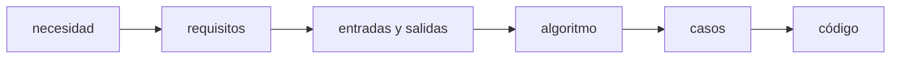
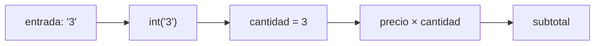
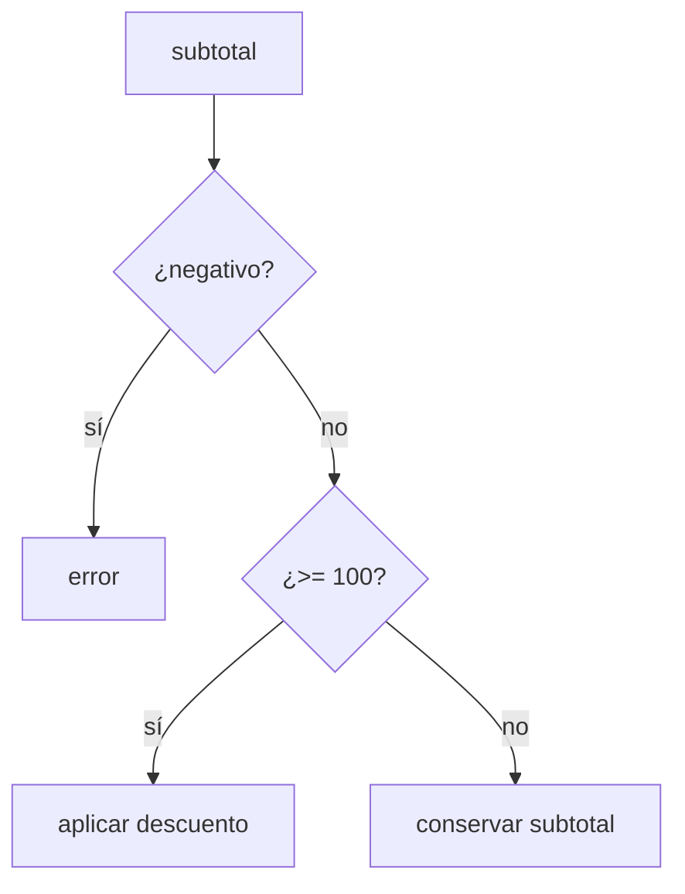
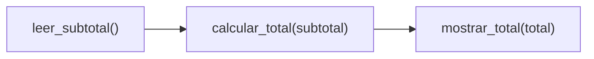

# Módulo 1: Pensamiento computacional y programación

**Entorno comprobado para esta revisión:** Python 3.14.6 en Linux (2026-11-18), la línea de referencia del curso. Los ejemplos no requieren paquetes externos. Las instrucciones para PowerShell y macOS no se ejecutaron en esos sistemas.


## Aprende construyendo

### Tema 1: Del problema al algoritmo y a los casos de prueba

#### Paso 1 · Objetivo y preparación
Al finalizar vas a convertir un problema informal ("¿cuántas tareas están pendientes?") en un algoritmo explícito, implementarlo en Python y diseñar casos que incluyan una lista vacía y un estado no admitido. **Prerrequisitos:** Python instalado; comprueba `python3 --version` (o `py --version` en Windows).

#### Paso 2 · Contexto y caso real
El gestor de tareas CLI (proyecto integrador Fundamentos) que vas a construir módulo a módulo necesita, desde el día uno, contestar una pregunta simple: de todas las tareas guardadas, ¿cuántas están pendientes? Parece trivial, pero si no defines el algoritmo antes de escribir código —¿qué devuelve si no hay ninguna tarea todavía?— vas a terminar adivinando el comportamiento en vez de poder explicarlo.

#### Paso 3 · Teoría, modelo mental y analogía
Un problema informal ("contar pendientes") esconde preguntas sin responder. Un algoritmo es la versión explícita de la solución: una secuencia finita de pasos que, dada una entrada, produce una salida predecible, sin importar si después la escribes en Python o la ejecutas a mano con papel. Por eso el orden profesional es problema → algoritmo explícito → casos de prueba (incluyendo los bordes) → código, nunca directamente problema → código:
```text
CONTAR_PENDIENTES(tareas):
  contador = 0
  estados_admitidos = {"pendiente", "hecho"}
  PARA cada numero, tarea en tareas:
    SI tarea.estado no está en estados_admitidos:
      LANZAR ValueError con numero y estado
    SI tarea.estado es "pendiente": contador = contador + 1
  DEVOLVER contador
```
Este algoritmo no dice nada todavía sobre Python: devuelve cero para una lista vacía, cuenta las tareas pendientes y rechaza explícitamente estados fuera del contrato. Esos comportamientos deben comprobarse antes de confiar en la traducción a código. La analogía: diseñar un algoritmo sin pensar en sus bordes es como planear una ruta de reparto sin preguntar qué pasa si la lista de paradas viene vacía o si una parada tiene una dirección imposible.

**Cuándo NO usar:** No programes sin definir requisitos. No intentes casos límite sin pseudocódigo primero.

**Conceptos clave:** problema, requisito, entrada, proceso, salida, algoritmo, contrato, caso normal, caso límite y caso inválido.

Programar no comienza escribiendo sintaxis. Comienza definiendo con precisión qué problema se resolverá. “Haz una calculadora” es ambiguo: ¿qué operaciones admite?, ¿acepta decimales?, ¿qué ocurre si el usuario escribe texto?, ¿cómo se informa una división por cero? Un **requisito** elimina ambigüedad al describir comportamiento observable.

Considera: “calcular el total de una compra aplicando 10 % de descuento cuando el subtotal sea al menos 100”. La entrada es el subtotal; el proceso compara y quizá descuenta; la salida es el total. Una precondición razonable es que el subtotal no sea negativo.

```text
LEER subtotal
SI subtotal < 0
    MOSTRAR "valor inválido"
SI NO, SI subtotal >= 100
    total = subtotal * 0.90
SI NO
    total = subtotal
MOSTRAR total
```

Este pseudocódigo no pertenece a un lenguaje específico. Permite discutir la lógica antes de preocuparnos por paréntesis. Después diseñamos casos: `50 → 50` es normal sin descuento; `100 → 90` prueba exactamente el límite; `-1 → error` prueba entrada inválida. Un único ejemplo como `150 → 135` no demuestra que el límite ni la validación funcionen.

**Ejemplo desde cero:** escribe primero la tabla de pruebas, luego el programa. Esto invierte el hábito de “codificar y ver qué pasa” por “definir qué debe pasar y comprobarlo”.

**Analogía:** un algoritmo es una ruta de viaje y los casos de prueba son recorridos de inspección: uno por la carretera principal, otro por el límite del mapa y otro intentando entrar por una vía prohibida.

**¿Por qué es importante?** Los defectos caros suelen surgir de requisitos ambiguos y casos no considerados, no de desconocer una palabra reservada. Pensar en ejemplos antes de implementar conecta programación con ingeniería.

**Casos de uso reales:** reglas de descuento, validación de edad, cálculo de impuestos, límites de retiro y permisos de acceso se expresan como entradas, decisiones y resultados verificables.

**Diagrama:**



#### Profundización · Diseño: Casos límite con números flotantes (99.99)

**Escenario real:** El gestor de tareas aplica descuentos: "si subtotal >= 100, aplica 10%". Con la regla `subtotal >= 100`, el 99.99 se clasifica bien (no recibe descuento); el riesgo está en los cálculos con decimales que vienen después, porque un `float` no guarda exactamente todos los valores decimales.

**Tu tarea (sin mirar solución):**

1. **Predice:** `0.1 + 0.1 + 0.1` ¿da exactamente `0.3`? Si aplicas tres descuentos sucesivos de 0.10 cada uno, ¿el total acumulado es exacto?
2. **Diseña casos:**
   - Normal: 99.99
   - Límite: 100.00, 100.01
   - Trunca: Redondea a 2 decimales. ¿El resultado sigue siendo válido?
3. **Detecta:** Escribe una función que valide `precio * cantidad` sin perder centavos.
4. **Escenario:** ¿`99.99 * 0.90` imprime exactamente `89.991` en Python, o aparece un residuo binario visible?

**Escribe tu respuesta:**
```
0.1 + 0.1 + 0.1 en Python: _________
Casos diseñados: _________, _________, _________
Función validadora: redondea_a_centavos(resultado) _________
99.99 * 0.90 imprime: _________
```

<details>
<summary>SOLUCIÓN — Lee solo después de intentar</summary>

> **Respuesta esperada:**
>
> **`0.1 + 0.1 + 0.1` da `0.30000000000000004`, NO `0.3` exacto** — tres descuentos de 0.10 sumados en punto flotante binario acumulan un residuo visible, aunque cada número individual (`0.1`) "se vea" simple en decimal.
>
> **Casos:**
> - 99.99 → 99.99 (sin descuento)
> - 100.00 → 90.00 (límite exacto, descuento)
> - 100.01 → 90.009 (requiere redondeo)
>
> **Validador:**
> ```python
> from decimal import Decimal
> precio = Decimal('99.99') * Decimal('0.90')
> ```
>
> **`99.99 * 0.90` imprime exactamente `89.991`** en Python — este caso puntual NO muestra residuo visible (la imprecisión interna existe en binario, pero redondea limpio al convertir a texto). Esa es precisamente la trampa: no puedes predecir de antemano cuál cálculo con decimales se va a ver "limpio" y cuál no con solo mirarlo, por eso `Decimal` (o trabajar en centavos como enteros) es la única forma confiable de garantizar precisión exacta en dinero, en vez de confiar en que "este número en particular no tuvo problemas".

</details>

#### Paso 4 · Demostración guiada desde cero
Parte de una carpeta vacía y crea `src/pendientes.py`:
```bash
mkdir ejemplo-algoritmo
cd ejemplo-algoritmo
mkdir src
```
**Antes de leer el código:** usa cinco piezas que este curso explica a fondo más adelante. Por ahora basta con reconocerlas:

- `def contar_pendientes(tareas):` define una **función**: un bloque con nombre que recibe `tareas` y entrega un resultado con `return`. La llamas escribiendo `contar_pendientes(...)` (Tema 4).
- `{"descripcion": "comprar pan", "estado": "pendiente"}` es un **diccionario**: guarda valores bajo un nombre (clave). `tarea["estado"]` lee el valor de la clave `"estado"` (módulo 2).
- `for numero, tarea in enumerate(tareas, start=1):` recorre la lista y, en cada vuelta, te da el número de la tarea (1, 2, 3…) y la tarea misma (los `for` se ven en el Tema 3).
- `raise ValueError(...)` detiene el programa con un error y un mensaje: así se rechaza un estado no admitido en vez de contarlo mal.
- `f"Tarea {numero}: …"` es un **f-string**: escribe en el texto el valor de las variables que van entre llaves.

Guarda este contenido en `src/pendientes.py`:
```python
def contar_pendientes(tareas):
    contador = 0
    estados_admitidos = {"pendiente", "hecho"}
    for numero, tarea in enumerate(tareas, start=1):
        estado = tarea["estado"]
        if estado not in estados_admitidos:
            raise ValueError(f"Tarea {numero}: estado no admitido: {estado}")
        if estado == "pendiente":
            contador += 1
    return contador

tareas = [
    {"descripcion": "comprar pan", "estado": "pendiente"},
    {"descripcion": "pagar luz", "estado": "hecho"},
    {"descripcion": "llamar al dentista", "estado": "pendiente"},
]
print(contar_pendientes(tareas))
print(contar_pendientes([]))
```
```bash
python3 src/pendientes.py
```
En Windows usa `py src/pendientes.py`.
**Resultado esperado:** `2` y luego `0`; la lista vacía nunca entra al `for`, así que el contador queda en cero sin necesitar ningún caso especial. **Fallo deliberado:** agrega al final del archivo esta segunda función, que calcula qué porcentaje de las tareas están pendientes sin pensar en la lista vacía:
```python
def porcentaje_pendientes(tareas):
    return contar_pendientes(tareas) / len(tareas) * 100

print(porcentaje_pendientes([]))
```
Python lanza `ZeroDivisionError: division by zero`: el conteo sobrevivió a la lista vacía, pero el porcentaje no, porque divide por `len(tareas)` sin comprobar que sea distinto de cero. Corrígelo reemplazando la función por esta versión, que comprueba la lista vacía antes de dividir (`if not tareas:` es verdadero cuando la lista no tiene elementos):
```python
def porcentaje_pendientes(tareas):
    if not tareas:
        return 0.0
    return contar_pendientes(tareas) / len(tareas) * 100

print(porcentaje_pendientes([]))
```
Ahora el resultado es `0.0`: la función define qué significa el porcentaje cuando no hay tareas antes de dividir.

#### Paso 5 · Práctica guiada
Antes de escribir cualquier función sobre una lista de tareas, preguntate qué debería devolver con cero tareas; si no podés responder en una frase, todavía no terminaste de diseñar el algoritmo. Para comprobar el otro límite del contrato, cambia `"hecho"` por `"archivada"` en una tarea y vuelve a ejecutar: debe detenerse con `ValueError` e identificar su posición y estado. Si tu proyecto necesita más estados, agrégalos explícitamente a `estados_admitidos`.

#### Paso 6 · Práctica independiente
Escribí la tabla de casos de prueba para `contar_pendientes` ANTES de tocar el código:

| Entrada de `tareas` | Resultado esperado |
|---|---|
| Pendiente, hecho, pendiente | `2` |
| `[]` | `0` |
| Pendiente, pendiente | `2` |
| Pendiente, archivada | `ValueError: Tarea 2: estado no admitido: archivada` |

Para cada fila anotá la entrada concreta y la salida o error esperado, y después confirma que el código cumple el contrato.

#### Paso 7 · Cierre
Entregá el algoritmo en pseudocódigo del Paso 3, la tabla de casos del Paso 6, el código de `contar_pendientes` y `porcentaje_pendientes`, y ambos fallos reproducidos: `ValueError` por estado inesperado y `ZeroDivisionError` por porcentaje de una lista vacía. Corrige el caso vacío antes de volver a ejecutar. Como siguiente paso, en el Tema 2 vas a ver qué pasa cuando esos mismos datos —por ejemplo, una prioridad escrita por el usuario— llegan con el tipo equivocado. Errores comunes: probar solo el caso feliz; dividir o indexar sin comprobar que la colección no esté vacía; contar silenciosamente un estado que el contrato no reconoce; escribir código antes de tener la tabla de casos. Fuentes oficiales consultadas el 2026-11-01: [control de flujo](https://docs.python.org/3/tutorial/controlflow.html) y [pruebas unitarias](https://docs.python.org/3/library/unittest.html).
**Implicación práctica:** El conteo de pendientes funcionó a la primera con datos de ejemplo, y ese falso éxito es exactamente lo que oculta el bug hasta que un usuario real se queda sin tareas.

### Tema 2: Variables, tipos, expresiones y cambios de estado

#### Paso 1 · Objetivo y preparación
Al finalizar vas a ver cómo Python distingue tipos en tiempo de ejecución, y vas a reproducir un bug silencioso —sin ningún error ni traceback— que aparece al comparar dos textos como si fueran números. **Prerrequisitos:** Tema 1 de este módulo.

#### Paso 2 · Contexto y caso real
El gestor de tareas CLI va a leer la prioridad de una tarea desde la terminal con `input()`, por ejemplo para decidir cuál tarea atender primero. El problema: `input()` devuelve SIEMPRE texto, nunca un número, aunque el usuario haya tecleado solamente dígitos.

#### Paso 3 · Teoría, modelo mental y analogía
En Python cada valor tiene un tipo (`int`, `float`, `str`, `bool`, `list`...) y ese tipo decide qué operaciones son válidas: `3 + 2` suma, pero `"3" + "2"` concatena y da `"32"`, no `5`. Una variable es apenas una etiqueta que apunta a un valor; reasignarla (`prioridad = 5`) no modifica el valor anterior, solo hace que la etiqueta apunte a otro. Pero si DOS variables apuntan al mismo objeto mutable —una lista, por ejemplo— modificar esa lista a través de una de las dos etiquetas se ve reflejado en la otra, porque ambas señalan el mismo objeto en memoria, no dos copias independientes. La analogía: un valor es una casa y una variable es una dirección postal que apunta a ella; reasignar la variable es cambiar a qué casa apunta la dirección, pero si dos direcciones apuntan a la misma casa, pintarla desde una de ellas la deja pintada también para la otra.

**Cuándo NO usar:** No uses variables sin saber su tipo. No cambies tipos sin conversión explícita.

**Conceptos clave:** valor, variable, asignación, tipo, expresión, conversión y estado.

Un valor es información concreta, como `25`, `3.14`, `"Ana"` o `True`. Una variable asocia un nombre con un valor para poder usarlo posteriormente. El tipo determina qué representa el valor y qué operaciones tienen sentido: sumar números es distinto de concatenar textos.

```python
precio = 25.50
cantidad = 3
subtotal = precio * cantidad
print(subtotal)
```

Línea por línea: `precio` recibe un decimal; `cantidad`, un entero; la tercera línea evalúa la expresión de multiplicación y guarda `76.5`; la cuarta envía ese valor a salida. El signo `=` significa asignación, no afirmación matemática permanente. Si luego escribimos `cantidad = 4`, el estado cambia.

La entrada de `input()` siempre es texto. Para operar numéricamente hay que convertirla:

```python
texto = input("Cantidad: ")
cantidad = int(texto)
```

`int` puede fallar si el texto no representa un entero. Esa posibilidad forma parte del requisito; no debe ocultarse. Usa nombres que expresen significado (`precio_unitario`) y no posiciones accidentales (`x`).

Haz un trazado manual con columnas `línea`, `precio`, `cantidad`, `subtotal`. Actualiza la tabla después de cada instrucción. Este ejercicio parece lento, pero enseña a observar estado y prepara para usar un debugger.

**Analogía:** una variable es una etiqueta reutilizable sobre una caja; el tipo describe qué clase de contenido admite y las expresiones combinan contenidos para producir uno nuevo.

**¿Por qué es importante?** Comprender estado permite razonar sobre formularios, bases de datos, interfaces y procesos concurrentes. Muchos errores ocurren porque una variable tiene un valor distinto del que el programador supone.

**Casos de uso reales:** totales de una factura, estado de una sesión, cantidad disponible en inventario y progreso de una descarga son valores que cambian durante la ejecución.

**Diagrama:**



#### Profundización · Diseño: Conversión segura de entrada 1e10

**Escenario real:** El usuario ingresa `1e10` (científica: 10 mil millones) en "cantidad de tareas". El programa espera un entero pequeño (1-1000).

**Tu tarea (sin mirar solución):**

1. **Convierte:** `int(input())` recibe `"1e10"`. ¿Qué ocurre?, ¿es error?
2. **Valida:** Diseña un rango: cantidad entre 1 y 1000. ¿Cómo rechazarías 1e10?
3. **Recupera:** Si `float("1e10")` funciona pero `int("1e10")` falla, ¿cuál es la ruta segura?
4. **Escenario:** Usuarios en diferentes locales: ¿"3,14" (coma) es distinto de "3.14"?

**Escribe tu respuesta:**
```
int("1e10") → _________
Rango válido: 1 a 1000. Si entra 10000: _________
Ruta segura: float() o Decimal() antes de int()? _________
"3,14" vs "3.14": El mismo número? _________ (¿por qué?)
```

<details>
<summary>SOLUCIÓN — Lee solo después de intentar</summary>

> **Respuesta esperada:**
>
> **`int("1e10")`:** `ValueError: invalid literal for int() with base 10: '1e10'`. `int()` solo acepta dígitos (con signo opcional), sin notación científica ni separador decimal.
>
> **Si entra 10000:** se rechaza con una decisión (`if`, Tema 3) que compruebe el rango antes de usar el valor; la ruta segura de abajo lo hace.
>
> **Ruta segura:** convierte primero con `float()`, que sí entiende `1e10`, y acepta el valor solo si es entero y está en el rango. No uses `int(float(texto))` a secas: `int(float("3.7"))` da `3` y trunca sin avisar.
> ```python
> texto = "1e10"           # lo que escribió la persona
> numero = float(texto)    # "1e10" → 10000000000.0
> if numero.is_integer() and 1 <= numero <= 1000:
>     cantidad = int(numero)
>     print("cantidad válida:", cantidad)
> else:
>     print("cantidad rechazada:", texto)
> ```
> Salida: `cantidad rechazada: 1e10`. Con `"3.7"` también se rechaza y con `"25"` imprime `cantidad válida: 25`. Si el texto no es un número (`"abc"`), `float()` lanza `ValueError`; capturarlo requiere `try/except`, que llega más adelante en el curso.
>
> **"3,14" vs "3.14":** para Python no son lo mismo. `int()` rechaza los dos, porque no acepta separador decimal: `int("3.14")` también da `ValueError`. Quien acepta el punto es `float()`: `float("3.14")` da `3.14`, pero `float("3,14")` da `ValueError`, sin importar el idioma del sistema. Si tus usuarios escriben con coma, reemplázala antes de convertir: `float(texto.replace(",", "."))`.

</details>

**Transferencia al proyecto integrador «Fundamentos: gestor de tareas»:** Representa título, prioridad y estado de una tarea con tipos coherentes. Traza sus valores antes y después de completarla y prueba que un texto vacío no se interpreta como una tarea válida.

#### Paso 4 · Demostración guiada desde cero
Parte de una carpeta vacía y crea `src/prioridad.py`:
```bash
mkdir ejemplo-variables
cd ejemplo-variables
mkdir src
```
```python
def tarea_mas_urgente(prioridad_a, prioridad_b):
    return "a" if prioridad_a > prioridad_b else "b"

prioridad_a = int("9")
prioridad_b = int("10")
print(tarea_mas_urgente(prioridad_a, prioridad_b))
```
```bash
python3 src/prioridad.py
```
En Windows usa `py src/prioridad.py`.
**Resultado esperado:** `b`; la tarea con prioridad 10 es la más urgente, como corresponde numéricamente. **Fallo deliberado:** quitá los dos `int(...)` y dejá las prioridades como las entrega `input()`, es decir como texto:
```python
prioridad_a = "9"
prioridad_b = "10"
print(tarea_mas_urgente(prioridad_a, prioridad_b))
```
Esto imprime `a`. Python no lanza ningún error, porque comparar dos strings con `>` es válido: compara carácter por carácter, y `"9" > "1"` es cierto, así que `"9" > "10"` también lo es. El resultado es numéricamente incorrecto —10 es mayor que 9— pero no hay ningún traceback que lo delate. Corregilo convirtiendo ambas prioridades con `int(...)` antes de compararlas.

#### Paso 5 · Práctica guiada
Pista: cuando algo se ejecuta sin ningún error pero el resultado está mal, sospechá primero de los tipos; imprimí `type(prioridad_a)` y `type(prioridad_b)` antes de comparar, no asumas que porque "se ven como números" Python los está tratando como números.

#### Paso 6 · Práctica independiente
Agregá una tercera prioridad `"100"` y predecí, ANTES de ejecutar, si `"100" > "9"` da `True` o `False` tratándolas como texto; después comprobalo y escribí en una línea por qué la comparación de textos puede contradecir la comparación numérica incluso con más de un dígito de diferencia.

#### Paso 7 · Cierre
Entregá la versión correcta con `int(...)` del Paso 4, la comparación de strings que da `a` en vez de `b`, y la predicción escrita del Paso 6 sobre `"100" > "9"`; explicá por qué un programa sin errores ni advertencias puede estar devolviendo una respuesta incorrecta. Como siguiente paso, en el Tema 3 vas a recorrer todas las tareas con un bucle, donde este mismo descuido se puede repetir en cada vuelta sin que lo notes. Errores comunes: comparar o calcular con un valor que todavía es texto porque vino de `input()`; asumir que "no hay error" significa "el resultado es correcto". Fuentes oficiales: https://docs.python.org/es/3/library/stdtypes.html y https://docs.python.org/es/3/reference/expressions.html.
**Implicación práctica:** `"9" > "10"` se ejecuta sin ninguna queja de Python: el intérprete no sabe que vos querías comparar números, y un programa que falla en silencio es más peligroso que uno que explota con un traceback.

### Tema 3: Decisiones, repeticiones y trazado de ejecución

#### Paso 1 · Objetivo y preparación
Al finalizar vas a recorrer una lista de tareas con un bucle y una condición para detectar cuáles están vencidas, y vas a trazar a mano la ejecución para encontrar un error de "uno de más, uno de menos" que deja afuera la última tarea sin que se note a simple vista. **Prerrequisitos:** Tema 2 de este módulo.

#### Paso 2 · Contexto y caso real
El gestor de tareas CLI necesita recorrer todas las tareas guardadas para marcar cuáles están vencidas (por ejemplo, con más de 3 días pendientes) y avisarle al usuario. Si el bucle que las recorre tiene un límite mal calculado, el programa no se cae ni avisa nada: simplemente deja una tarea sin revisar, y nadie lo nota hasta que esa tarea vencida se le escapó al usuario.

#### Paso 3 · Teoría, modelo mental y analogía
Una condición (`if`) elige un camino según si una expresión es `True` o `False`; un bucle (`for`, `while`) repite un bloque de instrucciones una cantidad de veces que puede depender de una lista, un contador o otra condición. El punto donde más errores se esconden es el límite del bucle: `range(len(tareas))` recorre exactamente los índices válidos, pero `range(len(tareas) - 1)` se queda un índice corto, y `range(len(tareas) + 1)` se pasa uno de más y revienta con `IndexError`. Trazar la ejecución a mano —anotar en una tabla el valor de cada variable después de cada vuelta— es la única forma confiable de detectar un límite mal puesto, porque el código "se ve bien" aunque esté iterando una vuelta de menos. La analogía: repasar un bucle sin trazarlo es como contar personas en una fila mirando de lejos: si te saltás a la última porque "ya viste suficientes", la fila sigue pareciendo completa aunque falte alguien.

**Conceptos clave:** booleano, comparación, condición, rama, bucle, iteración, acumulador e invariante.

Una condición produce `True` o `False`. `if` selecciona una rama; `for` o `while` repite trabajo. Estas herramientas son suficientes para expresar gran cantidad de algoritmos, pero también permiten bucles infinitos y ramas imposibles si no se razona con cuidado.

```python
total = 0
for numero in [12, 8, 5]:
    total = total + numero
print(total)
```

Antes del bucle, `total` vale cero. En cada iteración mantiene la suma de los elementos ya visitados: esa propiedad es un **invariante**. Después de 12 vale 12; después de 8 vale 20; después de 5 vale 25. Trazar una tabla permite predecir la salida sin ejecutar.

```python
if subtotal < 0:
    print("El subtotal no puede ser negativo")
elif subtotal >= 100:
    print(subtotal * 0.90)
else:
    print(subtotal)
```

El orden importa. Primero se rechaza lo inválido; luego se evalúa descuento; finalmente queda el caso ordinario. Para probarlo, elige valores a ambos lados de cada frontera: `-1`, `0`, `99.99`, `100` y `100.01`.

**Error deliberado:** cambia `>= 100` por `> 100`. El caso `100` descubrirá la regresión. Esta práctica enseña que una prueba debe ser capaz de fallar cuando el comportamiento se rompe.

**Analogía:** una condición es una bifurcación; un bucle es recorrer estaciones hasta cumplir un criterio. El trazado es el registro del viaje, no una suposición sobre dónde terminaste.

**¿Por qué es importante?** Control de flujo modela reglas de negocio y procesamiento de colecciones. Saber trazarlo es la base para diagnosticar resultados incorrectos sin llenar el código de impresiones aleatorias.

**Casos de uso reales:** recorrer pedidos, filtrar usuarios autorizados, reintentar una petición y procesar líneas de un archivo.

**Diagrama:**



#### Profundización · Diseño: Loop sobre lista vacía y comportamiento inesperado

**Escenario real:** El gestor de tareas itera sobre todas las tareas: `for tarea in tareas:`. Si la lista es vacía, el loop no entra, pero debe haber un mensaje. ¿Cuál es el comportamiento esperado?

**Tu tarea (sin mirar solución):**

1. **Traza:** Escribe loop `for` sobre lista vacía. ¿Se ejecuta el cuerpo alguna vez?
2. **Diseña:** Si no hay tareas, mostrar "sin tareas pendientes". ¿Dónde va el `if`?
3. **Compara:** ¿Es mejor `if len(tareas) == 0` o `if not tareas`?
4. **Edge case:** Loop `for i in range(0)` ¿entra en el cuerpo?

**Escribe tu respuesta:**
```
for tarea in []: cuerpo ejecuta _________ vez(ces)
Si lista vacía: if _________ (not tareas vs len(tareas)==0)
Mejor opción: _________ (¿por qué?)
for i in range(0): entra _________ vez(ces)
```

<details>
<summary>SOLUCIÓN — Lee solo después de intentar</summary>

> **Respuesta esperada:**
>
> **for tarea in []:** Nunca entra al cuerpo (0 veces).
>
> **Si lista vacía:** `if not tareas:` (más pythónico y legible).
>
> **Mejor opción:** `if not tareas` porque:
> - Funciona para listas, tuplas, strings, etc.
> - Más conciso: `not []` es True
> - No depende de `len()` (O(1) vs potencial O(n))
>
> **for i in range(0):** Nunca entra (0 veces). `range(0)` es una secuencia vacía.
>
> **Patrón robusto:**
> ```python
> if tareas:
>     for tarea in tareas:
>         print(tarea)
> else:
>     print("Sin tareas pendientes")
> ```

</details>

**Transferencia al proyecto integrador «Fundamentos: gestor de tareas»:** Recorre tareas y selecciona las pendientes de prioridad alta. Construye una tabla de casos con lista vacía, ninguna coincidencia y varias coincidencias, prediciendo el resultado antes de ejecutar.

#### Paso 4 · Demostración guiada desde cero
Parte de una carpeta vacía y crea `src/vencidas.py`:
```bash
mkdir ejemplo-control-flujo
cd ejemplo-control-flujo
mkdir src
```
```python
tareas = [
    {"descripcion": "comprar pan", "dias_pendiente": 1},
    {"descripcion": "pagar luz", "dias_pendiente": 5},
    {"descripcion": "llamar al dentista", "dias_pendiente": 4},
]

for i in range(len(tareas)):
    tarea = tareas[i]
    if tarea["dias_pendiente"] > 3:
        print(f"VENCIDA: {tarea['descripcion']}")
```
```bash
python3 src/vencidas.py
```
En Windows usa `py src/vencidas.py`.
**Resultado esperado:** imprime `VENCIDA: pagar luz` y `VENCIDA: llamar al dentista`: dos tareas vencidas sobre tres. **Fallo deliberado:** cambiá `range(len(tareas))` por `range(len(tareas) - 1)`. Ahora solo imprime `VENCIDA: pagar luz`; "llamar al dentista", que es el último elemento (índice 2), nunca se revisa, porque con 3 tareas `range(len(tareas) - 1)` genera `0, 1` y se detiene antes de llegar a `2`. No hay ningún error: la tarea vencida simplemente queda sin alertar. Corregilo devolviendo el límite a `range(len(tareas))`.

#### Paso 5 · Práctica guiada
Pista: antes de ejecutar, armá una tabla con columnas `i`, `tarea` y `¿se revisó?` y completala a mano siguiendo `range(len(tareas) - 1)` paso por paso; vas a ver en la tabla, antes de correr el código, que el índice 2 nunca aparece.

#### Paso 6 · Práctica independiente
Reescribí el bucle como un `while` con contador manual (`i = 0`, `i += 1` dentro del bucle) que logre el mismo resultado correcto que el `for` del Paso 4, y después rompelo cambiando la condición de corte de `i < len(tareas)` a `i <= len(tareas)`; tracealo a mano y explicá en una línea qué error concreto produce esta vez.

#### Paso 7 · Cierre
Entregá el recorrido correcto del Paso 4, la versión con `range(len(tareas) - 1)` que se saltea la última tarea vencida, y la versión `while` con `i <= len(tareas)` del Paso 6 junto con el error que produce; explicá por qué un bucle con el límite mal puesto no avisa nada: simplemente procesa de menos o se pasa un paso más allá del final. Como siguiente paso, en el Tema 4 vas a dividir este mismo recorrido en funciones más chicas para que cada una se pueda probar por separado. Errores comunes: calcular el límite de un bucle sumando o restando uno sin verificarlo contra una tabla trazada a mano; confundir "no hay error" con "recorrió todo". Fuentes oficiales: https://docs.python.org/es/3/tutorial/controlflow.html y https://docs.python.org/es/3/library/stdtypes.html.
**Implicación práctica:** `range(len(tareas) - 1)` no lanza ningún error ni advertencia: el programa corre, imprime algo razonable, y la única pista de que algo falta es contar a mano cuántas tareas vencidas había en realidad.

### Tema 4: Funciones y descomposición de problemas

#### Paso 1 · Objetivo y preparación
Al finalizar vas a dividir el problema de "contar tareas pendientes" en varias funciones chicas, cada una con una sola responsabilidad, y vas a descubrir por qué una función que hace más de lo que su nombre promete puede sorprender a quien la usa. **Prerrequisitos:** Tema 3 de este módulo.

#### Paso 2 · Contexto y caso real
El gestor de tareas CLI va a crecer: cargar tareas desde un archivo, filtrarlas, contarlas, mostrarlas, guardarlas. Si todo ese trabajo vive en una sola función gigante, cualquier cambio chico —por ejemplo, cambiar cómo se guarda una tarea— obliga a releer y entender todo el bloque, incluso la parte que no tiene nada que ver con el cambio.

#### Paso 3 · Teoría, modelo mental y analogía
Una función con una sola responsabilidad hace una cosa, la hace bien, y su nombre describe exactamente esa cosa, ni más ni menos. El problema aparece cuando una función hace algo que su nombre NO anuncia: un **efecto secundario** oculto, como modificar una lista que recibió por parámetro, imprimir algo en pantalla, o escribir a un archivo, cuando quien la llama solo esperaba un valor de vuelta. Separar "calcular" de "mostrar" y de "guardar" en funciones distintas no es una regla estética: permite llamar a `contar(tareas)` cien veces en una prueba sin que eso imprima nada ni toque el disco. La analogía: una función con un efecto secundario oculto es como un cajero automático que, además de darte el saldo que pediste, le manda un mensaje a otra persona sin avisarte: técnicamente respondió tu pregunta, pero hizo algo más que vos no pediste ni esperabas.

**Conceptos clave:** función, parámetro, argumento, retorno, alcance, contrato, responsabilidad y composición.

Una función nombra una operación y permite utilizarla con datos distintos. Sus parámetros son entradas; `return` produce una salida. Una función pequeña puede comprobarse de manera aislada.

```python
def calcular_total(subtotal):
    if subtotal < 0:
        raise ValueError("El subtotal no puede ser negativo")
    if subtotal >= 100:
        return subtotal * 0.90
    return subtotal
```

`def` declara la función. `subtotal` solo existe dentro de ella: tiene alcance local. La validación establece parte de su contrato. `raise` no imprime silenciosamente un valor inventado; informa que el contrato fue violado. Cada `return` termina la función y entrega un resultado.

```python
def leer_subtotal():
    return float(input("Subtotal: "))

def mostrar_total(total):
    print(f"Total: {total:.2f}")

subtotal = leer_subtotal()
total = calcular_total(subtotal)
mostrar_total(total)
```

Ahora entrada, negocio y presentación están separadas. `calcular_total` no conoce la terminal y puede probarse directamente con `calcular_total(100)`. Evita funciones que lean, calculen, guarden y muestren todo a la vez.

**Analogía:** una función es una máquina con conectores de entrada y salida. Si además obliga a introducir la mano, pintar el producto y enviarlo por correo, tiene demasiadas responsabilidades.

**Casos de uso reales:** validar credenciales, calcular envío, convertir monedas y transformar respuestas de una API son operaciones que conviene aislar.

**Diagrama:**



#### Profundización · Diseño: Nivel de descomposición y tamaño de funciones

**Escenario real:** El gestor de tareas crece: listar, crear, editar, borrar. Una función `main()` de 200 líneas es imposible de depurar. ¿Cómo dividirla?

**Tu tarea (sin mirar solución):**

1. **Diseña jerarquía:**
   - Nivel 1: `main()` — orquesta el flujo
   - Nivel 2: `cargar_tareas()`, `guardar_tareas()`, `mostrar_menu()`
   - Nivel 3: ¿Qué funciones agregarías?
2. **Tamaño:** Una función ¿debería caber en una pantalla (20 líneas) o puede tener 50?
3. **Responsabilidad:** ¿Una función `editar_tarea()` debe también guardar en disco o solo modificar en memoria?
4. **Testeo:** ¿Qué función es más fácil de probar?, ¿por qué?

**Escribe tu respuesta:**
```
Funciones nivel 3: _________, _________, _________
Tamaño ideal: _________ líneas máximo
Responsabilidad de editar_tarea(): _________ (¿guarda disco?)
Función más fácil de testear: _________ (¿por qué?)
```

<details>
<summary>SOLUCIÓN — Lee solo después de intentar</summary>

> **Respuesta esperada:**
>
> **Nivel 3 típico:**
> - `validar_titulo()`
> - `formatear_tareas_para_mostrar()`
> - `buscar_tarea_por_id()`
> - `eliminar_tarea_por_id()`
>
> **Tamaño ideal:** 10-30 líneas (cabe en pantalla, una responsabilidad).
>
> **editar_tarea():** Solo modifica en memoria. `guardar_tareas()` es responsable del disco (separación de concerns).
>
> **Más fácil de testear:** Funciones puras sin I/O:
> - `validar_titulo("abc")` → True/False
> - Vs. `guardar_tareas()` que toca disco

</details>

**Transferencia al proyecto integrador «Fundamentos: gestor de tareas»:** Separa validar, almacenar y presentar una tarea en funciones pequeñas. Prueba cada contrato y demuestra que cambiar la presentación no modifica el conteo de pendientes.

**Límites y decisión de uso:** Una función demasiado fragmentada puede ocultar el flujo tanto como una función enorme. Extrae responsabilidades con un contrato comprensible y evita dependencias globales; no crees envoltorios que solo cambian el nombre de una línea.

**¿Por qué es importante?** Porque `contar_pendientes` devolvió el número correcto: el bug no está en el resultado que mirás, sino en el efecto secundario que nadie pidió y que solo se nota revisando la lista después.

#### Paso 4 · Demostración guiada desde cero
Parte de una carpeta vacía y crea `src/descomposicion.py`:
```bash
mkdir ejemplo-funciones
cd ejemplo-funciones
mkdir src
```
```python
def filtrar_pendientes(tareas):
    return [tarea for tarea in tareas if tarea["estado"] == "pendiente"]

def contar(tareas):
    return len(tareas)

tareas = [
    {"descripcion": "comprar pan", "estado": "pendiente"},
    {"descripcion": "pagar luz", "estado": "hecho"},
]
pendientes = filtrar_pendientes(tareas)
print(contar(pendientes))
```
```bash
python3 src/descomposicion.py
```
En Windows usa `py src/descomposicion.py`.
**Resultado esperado:** `1`. Cada función hace una sola cosa —`filtrar_pendientes` filtra, `contar` cuenta— y ninguna imprime ni modifica la lista original: `tareas` sigue teniendo sus 2 elementos después de llamarlas. **Fallo deliberado:** reemplazá `contar` por esta versión que "de paso" también vacía la lista:
```python
def contar_pendientes(tareas):
    print(f"Hay {len(tareas)} pendientes")
    cantidad = len(tareas)
    tareas.clear()
    return cantidad

pendientes = filtrar_pendientes(tareas)
total = contar_pendientes(pendientes)
print(pendientes)
```
`total` da el valor correcto, pero la última línea imprime `[]`: `contar_pendientes` vació la lista que recibió, aunque su nombre solo prometía contar. Quien la llamó no tenía forma de adivinar, por el nombre, que `pendientes` iba a quedar vacía después. Corregilo quitando el `print` y el `.clear()`, dejándola pura: recibe una lista y devuelve un número, sin tocar nada más.

#### Paso 5 · Práctica guiada
Pista: para confirmar que una función es pura, llamala dos veces seguidas con el mismo argumento; si `contar_pendientes(pendientes)` cambia lo que devuelve la segunda vez —o la lista misma cambió—, algo además de "contar" está pasando ahí adentro.

#### Paso 6 · Práctica independiente
Escribí `cargar_tareas()` que devuelva una lista fija en memoria (simulando un archivo), sin filtrar ni contar nada adentro; después encadená `cargar_tareas() → filtrar_pendientes() → contar()` y confirmá que podés probar cada una por separado, pasándole datos armados a mano, sin necesitar las otras dos.

#### Paso 7 · Cierre
Entregá las tres funciones puras (`cargar_tareas`, `filtrar_pendientes`, `contar`) de los Pasos 4 y 6, la versión con el efecto secundario oculto que vacía la lista, y la explicación de por qué el nombre de una función es una promesa que el código debe cumplir sin sorpresas. Con esto cerrás el Módulo 1; como siguiente paso, en el Módulo 2 (Estructuras de datos, algoritmos y complejidad) vas a usar estas mismas funciones chicas sobre listas, diccionarios, pilas y colas más grandes. Errores comunes: una función que calcula y además imprime o guarda; nombrar una función con un verbo que no describe todo lo que hace. Fuentes oficiales: https://docs.python.org/es/3/tutorial/controlflow.html y https://docs.python.org/es/3/reference/compound_stmts.html.

### Tema 5: Cómo la computadora representa los datos — binario, texto y decimales

#### Paso 1 · Objetivo y preparación
Al finalizar podrás explicar cómo un número, una letra y un decimal se guardan realmente como ceros y unos, convertir entre binario y decimal, y entender por qué `0.1 + 0.2` no da exactamente `0.3`. Prerrequisitos: Temas 1-2 de este módulo (variables y tipos).

#### Paso 2 · Contexto y caso real
Un día el gestor de tareas muestra un total de `0.30000000000000004` en vez de `0.3`, o un nombre con acento aparece como `José`. No son bugs misteriosos: son consecuencias directas de cómo la máquina representa números y texto. Entender la representación te ahorra horas de confusión y es la base de todo lo demás.

#### Paso 3 · Teoría, modelo mental y analogía
La computadora almacena información como **bits** (0 o 1). El entero `11` puede escribirse en binario como `1011`, que representa `1×8 + 0×4 + 1×2 + 1×1`. El texto de Python contiene caracteres Unicode; para guardarlo o enviarlo hay que codificarlo como bytes. UTF-8 puede codificar el repertorio Unicode y usa entre uno y cuatro bytes por punto de código. Los valores `float` siguen IEEE 754 y representan fracciones en base 2: `0.1` no tiene una representación binaria finita, igual que `1/3` no tiene una representación decimal finita.

**Analogía:** el binario es como un ábaco donde cada cuenta vale el doble que la anterior (1, 2, 4, 8...); el punto flotante es como escribir `1/3` en decimal: por más dígitos que pongas (`0.3333...`), nunca es exacto, así que la máquina corta en algún punto.

**Conceptos clave:** bit, binario/decimal, code point, codificación UTF-8, punto flotante y error de redondeo.
**Cuándo no usarlo:** no necesitas convertir binario a mano en el día a día, pero sí entender por qué los decimales fallan: para dinero usa enteros (centavos) o `Decimal`, nunca `float`.

**Transferencia al proyecto integrador «Fundamentos: gestor de tareas»:** si el gestor maneja importes o presupuestos, guárdalos en centavos (enteros) y demuestra con una prueba que sumar `0.1 + 0.2` como `float` produce un total incorrecto frente a la versión en centavos.
Como **siguiente** paso, lleva lo aprendido al próximo tema y conéctalo con el proyecto integrador del track.
**Errores comunes:** comparar con `==` resultados de cálculos `float` que deberían ser iguales matemáticamente; usar tolerancia para dinero en lugar de una representación decimal definida; confundir cantidad de caracteres con bytes codificados. `len("ñandú")` cuenta puntos de código de la cadena, no bytes UTF-8.

#### Paso 4 · Demostración guiada desde cero
**Desde cero:** parte de una carpeta vacía, crea la carpeta de práctica y entra en ella con dos comandos separados, válidos en PowerShell, macOS y Linux:
```bash
mkdir ejemplo
cd ejemplo
```

Crea `representacion.py`:

```python
# Enteros en binario
print("11 en binario:", bin(11))          # 0b1011
print("0b1011 en decimal:", 0b1011)        # 11

# Texto: cada carácter es un número (code point), codificado en bytes UTF-8
print("Código de 'A':", ord("A"))          # 65
acento_bytes = "é".encode("utf-8")
print("'é' en bytes UTF-8:", acento_bytes, len(acento_bytes), "bytes")
emoji_bytes = "🚚".encode("utf-8")
print("'🚚' en bytes UTF-8:", emoji_bytes, len(emoji_bytes), "bytes")

# Punto flotante: la suma NO es exacta
resultado = 0.1 + 0.2
print("0.1 + 0.2 =", resultado)            # 0.30000000000000004
print("¿Es igual a 0.3?", resultado == 0.3)   # False
# Forma correcta de comparar decimales:
print("¿Casi igual?", abs(resultado - 0.3) < 1e-9)   # True
```

**Ejecuta el ejemplo:**

```bash
python3 representacion.py
```
En Windows usa `py representacion.py`.

Salida esperada:
```text
11 en binario: 0b1011
0b1011 en decimal: 11
Código de 'A': 65
'é' en bytes UTF-8: b'\xc3\xa9' 2 bytes
'🚚' en bytes UTF-8: b'\xf0\x9f\x9a\x9a' 4 bytes
0.1 + 0.2 = 0.30000000000000004
¿Es igual a 0.3? False
¿Casi igual? True
```

**Resultado esperado:** `11 en binario: 0b1011`, el acento `é` ocupa 2 bytes y el emoji 🚚 ocupa 4, y `0.1 + 0.2` da `0.30000000000000004` (distinto de `0.3`). **Fallo deliberado:** el ejemplo ya calcula `resultado = 0.1 + 0.2`; comprueba que `resultado == 0.3` es `False` y que una rama `if resultado == 0.3:` no se ejecutaría. No hay excepción: es un resultado incorrecto para una regla que esperaba igualdad exacta. Para dinero usa centavos enteros o `Decimal`; compara floats con tolerancia solo cuando el problema admite aproximación.

#### Paso 5 · Práctica guiada
Convierte a mano (y luego verifica con `bin()`) el número 42 a binario, y el binario `110100` a decimal. Pista: suma las potencias de 2 donde hay un 1.

#### Paso 6 · Práctica independiente
Escribe una función que reciba un texto y devuelva cuántos **bytes** ocupa en UTF-8 (no cuántos caracteres), y pruébala con "hola", "ñandú" y "café ☕". Explica por qué bytes y caracteres no coinciden.

#### Paso 7 · Cierre
Entrega las conversiones binario↔decimal, el conteo de bytes UTF-8 y el fallo de comparación de decimales. **¿Por qué es importante?** Casi todo principiante tropieza con el resultado visible de `0.1 + 0.2` y con el texto mal decodificado. Entender binario, UTF-8 y punto flotante ayuda a diagnosticar datos en archivos, bases de datos y redes. **Fuentes primarias consultadas el 2026-11-01:** [función `bin`](https://docs.python.org/3/library/functions.html#bin), [Unicode en Python](https://docs.python.org/3/howto/unicode.html), [aritmética de punto flotante](https://docs.python.org/3/tutorial/floatingpoint.html) y [aritmética decimal](https://docs.python.org/3/library/decimal.html).

### Tema 6: Clases y objetos: atributos, métodos e `__init__` · Básico · 35 min

**Duración estimada:** 35 min (tres subtemas de 12, 13 y 10 min).
**¿Por qué es importante?** Este tema abre la **programación orientada a objetos**: agrupar en un solo lugar los datos de una cosa y las reglas que los cambian. Desde el Módulo 2 el curso usa clases (el árbol binario de búsqueda, la tabla hash, los patrones del Módulo 14), así que aquí aprendes a leerlas y escribirlas.
**Prerrequisitos:** Temas 2 a 4 de este módulo (variables, decisiones y funciones). Del Tema 1 basta recordar que `raise ValueError("mensaje")` detiene el programa con un error explicado. Línea de versiones: Python 3.14; los mensajes de error que se citan se obtuvieron con Python 3.14.6.

**Mapa de subtemas críticos:** clase, objeto y `__init__` (núcleo, 6.1); métodos, `self` y reglas que protege el objeto (núcleo y diagnóstico, 6.2); identidad frente a igualdad y `__eq__` (límite y diagnóstico, 6.3). La herencia, la composición y las clases abstractas llegan en el Tema 7; `@dataclass`, que escribe `__init__` por ti, se usa desde el Módulo 8.

#### Subtema 6.1: De un diccionario suelto a una clase · 12 min

**1. Contexto**
En el Tema 1 guardaste cada tarea del gestor como un diccionario (`{"titulo": ..., "estado": ...}`). Nada impide que otra parte del programa escriba `"estdo"` por error: aparece una clave nueva y la tarea queda a medias. Una **clase** declara en un solo lugar qué datos tiene toda tarea.

**2. Hazlo tú**
Crea la carpeta `ejemplo-clases` y entra en ella (`mkdir ejemplo-clases` y después `cd ejemplo-clases`). Crea `tarea.py`:

```python
class Tarea:
    def __init__(self, titulo, estado="pendiente"):
        self.titulo = titulo
        self.estado = estado


lavar = Tarea("Lavar la loza")
pagar = Tarea("Pagar el arriendo", "hecha")

print(lavar.titulo, "-", lavar.estado)
print(pagar.titulo, "-", pagar.estado)
print(type(lavar).__name__)
print(lavar is pagar)
```

```bash
python3 tarea.py
```

En Windows usa `py tarea.py`.

**Resultado esperado:**

```text
Lavar la loza - pendiente
Pagar el arriendo - hecha
Tarea
False
```

**Fallo deliberado:** cambia `Tarea("Lavar la loza")` por `Tarea()`. **Error esperado:** `TypeError: Tarea.__init__() missing 1 required positional argument: 'titulo'`. **Diagnóstico:** al escribir `Tarea(...)`, Python crea el objeto y llama a `__init__` con los argumentos que pasaste; `titulo` no tiene valor por defecto, así que es obligatorio. Restaura la línea y prueba ahora `print(lavar.estdo)`: Python 3.14 responde `AttributeError: 'Tarea' object has no attribute 'estdo'. Did you mean: 'estado'?`.

**3. Entiende**
Una **clase** es el molde; cada **objeto** (o instancia) es una tarea concreta creada con ese molde. `__init__` es el método que se ejecuta solo al crear el objeto, y `self` es el objeto que se está creando. Los **atributos** (`self.titulo`, `self.estado`) son variables que viven dentro de cada objeto: `lavar` y `pagar` tienen los suyos, por eso `lavar is pagar` es `False`. **Límite:** Python no prohíbe crear atributos nuevos después: `lavar.estdo = "hecha"` no da error, crea un tercer atributo y deja `estado` igual. La clase ordena el código, pero no reemplaza las pruebas.

**4. Cierra**
Agrega a `__init__` un parámetro `prioridad` con valor por defecto `2`, crea tres tareas y anota en tu cuaderno qué imprime `vars(lavar)` (la función `vars` muestra los atributos de un objeto como diccionario).

#### Subtema 6.2: Métodos: el objeto protege sus propias reglas · 13 min

**1. Contexto**
Una tarea solo puede pasar de `pendiente` a `hecha`. Si cada parte del programa cambia `tarea.estado` a mano, la regla se repite (y se olvida) en muchos lugares. Un **método** pone la regla junto a los datos que protege.

**2. Hazlo tú**
Reemplaza `tarea.py`:

```python
class Tarea:
    ESTADOS = ("pendiente", "hecha")

    def __init__(self, titulo, estado="pendiente"):
        if estado not in Tarea.ESTADOS:
            raise ValueError(f"estado no admitido: {estado}")
        self.titulo = titulo
        self.estado = estado

    def completar(self):
        if self.estado == "hecha":
            raise ValueError(f"'{self.titulo}' ya estaba hecha")
        self.estado = "hecha"

    def esta_pendiente(self):
        return self.estado == "pendiente"

    def __str__(self):
        marca = " " if self.esta_pendiente() else "x"
        return f"[{marca}] {self.titulo}"


tareas = [Tarea("Lavar la loza"), Tarea("Pagar el arriendo"), Tarea("Estudiar", "hecha")]
tareas[0].completar()

pendientes = 0
for tarea in tareas:
    print(tarea)
    if tarea.esta_pendiente():
        pendientes += 1
print("pendientes:", pendientes)
```

Ejecuta `python3 tarea.py`.

**Resultado esperado:**

```text
[x] Lavar la loza
[ ] Pagar el arriendo
[x] Estudiar
pendientes: 1
```

**Fallo deliberado 1:** duplica la línea `tareas[0].completar()`. **Error esperado:** `ValueError: 'Lavar la loza' ya estaba hecha`. **Diagnóstico:** el error lo lanza la regla del objeto, no un `if` repartido por el programa. Cambia también `"hecha"` por `"hcha"` en la tercera tarea: obtienes `ValueError: estado no admitido: hcha` al crearla.

**Fallo deliberado 2:** borra `self` en `def esta_pendiente(self):`. **Error esperado:** `TypeError: Tarea.esta_pendiente() takes 0 positional arguments but 1 was given`. **Diagnóstico:** `tarea.esta_pendiente()` equivale a `Tarea.esta_pendiente(tarea)`; Python siempre pasa el objeto como primer argumento, y el método debe recibirlo.

**3. Entiende**
Un **método** es una función definida dentro de la clase; su primer parámetro, `self`, es el objeto sobre el que se llama. `ESTADOS` es un **atributo de clase**: lo comparten todas las tareas, mientras que `titulo` y `estado` son de cada objeto. `__str__` es un método especial: `print(tarea)` lo usa para mostrar el objeto; sin él verías algo como `<__main__.Tarea object at 0x...>`. **Límite:** Python no tiene atributos privados de verdad; `tareas[1].estado = "hcha"` sigue funcionando. La convención es nombrar con guion bajo (`_estado`) lo que no debe tocarse desde fuera, y cambiar el estado solo con métodos.

**4. Cierra**
Escribe qué línea del programa protege la regla «no se completa dos veces» y por qué ya no necesitas repetir esa comprobación en el bucle.

#### Subtema 6.3: Identidad, igualdad y `__eq__` · 10 min

**1. Contexto**
El gestor va a evitar tareas repetidas. Antes de compararlas necesitas saber qué significa que dos objetos sean «el mismo» y qué significa que sean «iguales».

**2. Hazlo tú**
Crea `identidad.py`:

```python
class Tarea:
    def __init__(self, titulo, estado="pendiente"):
        self.titulo = titulo
        self.estado = estado

    def completar(self):
        self.estado = "hecha"


a = Tarea("Estudiar")
b = Tarea("Estudiar")
alias = a

print("a == b:", a == b)
print("a is alias:", a is alias)
alias.completar()
print("a.estado:", a.estado)
print("b.estado:", b.estado)
```

Ejecuta `python3 identidad.py`.

**Resultado esperado:**

```text
a == b: False
a is alias: True
a.estado: hecha
b.estado: pendiente
```

Ahora agrega este método dentro de la clase, debajo de `completar`, y cambia el final del archivo:

```python
    def __eq__(self, otra):
        if not isinstance(otra, Tarea):
            return NotImplemented
        return self.titulo == otra.titulo and self.estado == otra.estado
```

```python
a = Tarea("Estudiar")
b = Tarea("Estudiar")
print("a == b:", a == b)
print("a is b:", a is b)
b.completar()
print("tras completar b:", a == b)
print("a == 'Estudiar':", a == "Estudiar")
```

**Resultado esperado:** `a == b: True`, `a is b: False`, `tras completar b: False` y `a == 'Estudiar': False`.

**Fallo deliberado:** al final agrega `vistas = {a}` para guardar la tarea en un conjunto. **Error esperado en Python 3.14:** `TypeError: cannot use 'Tarea' as a set element (unhashable type: 'Tarea')`. **Diagnóstico:** al definir `__eq__`, Python desactiva el hash por defecto de la clase. Es lo correcto aquí: una tarea cambia de estado, y un objeto que cambia no debe servir de clave en un conjunto o diccionario. Usa como clave algo que no cambie, como el título: `vistas = {a.titulo}`.

**3. Entiende**
`is` pregunta por **identidad**: ¿son el mismo objeto en memoria? `==` pregunta por **igualdad**, y sin `__eq__` una clase compara por identidad. Una asignación como `alias = a` no copia el objeto: crea otro nombre para él, por eso completar `alias` cambia `a`. Devolver `NotImplemented` le dice a Python «no sé compararme con eso», y la comparación con un texto da `False` en vez de un error. **Límite:** decidir qué hace iguales a dos objetos es una decisión del dominio; aquí cuentan título y estado, en otro programa podría bastar un identificador. Las tablas hash del Módulo 2 (Tema 6) explican por qué el hash y la igualdad deben ir de acuerdo.

**4. Cierra**
Anota con tus palabras la diferencia entre `a is b` y `a == b`, y un caso del gestor en el que cada una sea la pregunta correcta.

**Hito del tema:**

- [ ] Creé objetos con `__init__` y leí sus atributos.
- [ ] Provoqué y diagnostiqué un `TypeError` por olvidar `self`.
- [ ] Hice que un método rechazara un cambio de estado inválido.
- [ ] Expliqué con un ejemplo la diferencia entre identidad e igualdad.

**Ejercicios.** Antes de abrir cada solución, escribe tu predicción o el error que obtuviste.

1. Agrega a la `Tarea` del subtema 6.2 un método `reabrir()` que pase de `hecha` a `pendiente` y lance `ValueError` si la tarea ya estaba pendiente. Pruébalo completando, reabriendo y volviendo a reabrir la misma tarea.

<details>
<summary>Solución del ejercicio 1</summary>

```python
class Tarea:
    def __init__(self, titulo, estado="pendiente"):
        self.titulo = titulo
        self.estado = estado

    def completar(self):
        if self.estado == "hecha":
            raise ValueError(f"'{self.titulo}' ya estaba hecha")
        self.estado = "hecha"

    def reabrir(self):
        if self.estado == "pendiente":
            raise ValueError(f"'{self.titulo}' ya estaba pendiente")
        self.estado = "pendiente"


tarea = Tarea("Estudiar")
tarea.completar()
tarea.reabrir()
print(tarea.estado)
tarea.reabrir()
```

Imprime `pendiente` y después termina con `ValueError: 'Estudiar' ya estaba pendiente`. La regla es simétrica a la de `completar`: cada método comprueba el estado de partida antes de cambiarlo.

</details>

2. Predice las tres líneas que imprime este programa y después ejecútalo:

```python
class Tarea:
    def __init__(self, titulo):
        self.titulo = titulo
        self.estado = "pendiente"

    def completar(self):
        self.estado = "hecha"


tareas = [Tarea("Lavar la loza"), Tarea("Estudiar")]
mismo = tareas
copia = list(tareas)

copia.append(Tarea("Pagar el arriendo"))
copia[0].completar()

print(len(tareas), len(mismo), len(copia))
print(tareas[0].estado)
print(mismo is tareas, copia is tareas, copia[0] is tareas[0])
```

<details>
<summary>Solución del ejercicio 2</summary>

```text
2 2 3
hecha
True False True
```

`mismo` es otro nombre para la misma lista. `list(tareas)` crea una lista nueva (por eso agregar a `copia` no cambia `tareas`), pero sus elementos son **los mismos objetos**: completar `copia[0]` cambia `tareas[0]`. Esto se llama copia superficial; el Módulo 14 (Memento) la vuelve a usar para explicar por qué deshacer exige copias que no compartan objetos mutables.

</details>

**Fuentes oficiales consultadas el 2026-11-18:** [Clases, en el tutorial de Python](https://docs.python.org/es/3/tutorial/classes.html), [`object.__eq__` y `__hash__`](https://docs.python.org/3/reference/datamodel.html#object.__hash__) y [`__str__`](https://docs.python.org/3/reference/datamodel.html#object.__str__).

**Transferencia al proyecto integrador «Fundamentos: gestor de tareas»:** convierte los diccionarios de tareas del Tema 1 en objetos `Tarea` con `completar()` y `esta_pendiente()`, y cuenta las pendientes llamando al método en vez de leer la clave `"estado"`.

### Tema 7: Herencia, composición y clases abstractas con `abc` · Intermedio · 40 min

**Duración estimada:** 40 min (tres subtemas de 13, 14 y 13 min).
**¿Por qué es importante?** Con varias clases aparece la pregunta de diseño central de la programación orientada a objetos: ¿una clase **es un** caso especial de otra (herencia) o **tiene** otra a la que le encarga trabajo (composición)? Los patrones del Módulo 14 (Decorator, State, Template Method) se construyen con estas tres herramientas.
**Prerrequisitos:** Tema 6 de este módulo (clases, métodos y `self`). Línea de versiones: Python 3.14.

**Mapa de subtemas críticos:** herencia, sobrescritura y `super()` (núcleo y diagnóstico, 7.1); composición y delegación (núcleo y decisión, 7.2); clases abstractas con `abc` como contrato comprobado (núcleo y límite, 7.3). Los decoradores (la línea con `@`) se explican a fondo en el Módulo 14, Tema 1; `typing.Protocol`, la alternativa sin herencia, aparece en el Módulo 7.

#### Subtema 7.1: Herencia y `super()`: una tarea con fecha límite · 13 min

**1. Contexto**
Algunas tareas tienen fecha límite. Siguen siendo tareas (se completan igual), pero se describen distinto. Copiar la clase entera duplicaría `completar`; la **herencia** permite escribir solo lo que cambia.

**2. Hazlo tú**
En `ejemplo-clases`, crea `herencia.py`:

```python
class Tarea:
    def __init__(self, titulo):
        self.titulo = titulo
        self.estado = "pendiente"

    def completar(self):
        self.estado = "hecha"

    def describir(self):
        return f"{self.titulo} ({self.estado})"


class TareaConFecha(Tarea):
    def __init__(self, titulo, fecha_limite):
        super().__init__(titulo)
        self.fecha_limite = fecha_limite

    def describir(self):
        return f"{super().describir()} vence {self.fecha_limite}"


tareas = [Tarea("Lavar la loza"), TareaConFecha("Pagar el arriendo", "2026-12-05")]
tareas[1].completar()
for tarea in tareas:
    print(tarea.describir())
print("¿es una Tarea?", isinstance(tareas[1], Tarea))
print("¿es una TareaConFecha?", isinstance(tareas[0], TareaConFecha))
```

Ejecuta `python3 herencia.py`.

**Resultado esperado:**

```text
Lavar la loza (pendiente)
Pagar el arriendo (hecha) vence 2026-12-05
¿es una Tarea? True
¿es una TareaConFecha? False
```

**Fallo deliberado:** borra la línea `super().__init__(titulo)`. **Error esperado:** después de imprimir la primera tarea, `AttributeError: 'TareaConFecha' object has no attribute 'titulo'`. **Diagnóstico:** al definir su propio `__init__`, la subclase reemplaza el de `Tarea`; si no lo llama con `super()`, los atributos que creaba la clase base nunca existen.

**3. Entiende**
`class TareaConFecha(Tarea)` declara que `TareaConFecha` **hereda** de `Tarea`: recibe `completar` sin escribirlo. Al definir otra vez `describir`, la **sobrescribe**, y `super().describir()` llama a la versión de la clase base para no repetirla. El bucle llama a `describir()` sin preguntar el tipo de cada tarea: cada objeto responde con su propia versión (eso se llama **polimorfismo**). **Límite:** la herencia ata la subclase a los detalles de la base; si `Tarea` cambia un atributo, todas las subclases pueden romperse. Úsala cuando la frase «X **es una** Y» sea cierta siempre, no solo para reutilizar código.

**4. Cierra**
Escribe en tu cuaderno qué métodos tiene `TareaConFecha` (heredados y propios) y cuál de ellos llama a `super()`.

#### Subtema 7.2: Composición: la tarea *tiene* un aviso · 14 min

**1. Contexto**
Al completar una tarea quieres avisar: a veces por consola, a veces guardando el mensaje. Con herencia necesitarías `TareaConAvisoConsola`, `TareaConFechaYAvisoConsola`, `TareaConAvisoGuardado`… una clase por cada combinación. La **composición** separa las dos variaciones: la tarea guarda un objeto aviso y le encarga el envío.

**2. Hazlo tú**
Crea `composicion.py`:

```python
class AvisoConsola:
    def enviar(self, mensaje):
        print(f"[consola] {mensaje}")


class AvisoMemoria:
    def __init__(self):
        self.mensajes = []

    def enviar(self, mensaje):
        self.mensajes.append(mensaje)


class Tarea:
    def __init__(self, titulo, aviso):
        self.titulo = titulo
        self.estado = "pendiente"
        self.aviso = aviso              # la tarea TIENE un aviso

    def completar(self):
        self.estado = "hecha"
        self.aviso.enviar(f"{self.titulo}: hecha")


memoria = AvisoMemoria()
Tarea("Lavar la loza", AvisoConsola()).completar()
Tarea("Pagar el arriendo", memoria).completar()
Tarea("Estudiar", memoria).completar()
print("en memoria:", memoria.mensajes)
```

Ejecuta `python3 composicion.py`.

**Resultado esperado:**

```text
[consola] Lavar la loza: hecha
en memoria: ['Pagar el arriendo: hecha', 'Estudiar: hecha']
```

**Fallo deliberado:** cambia `Tarea("Estudiar", memoria)` por `Tarea("Estudiar", "correo")`. **Error esperado:** `AttributeError: 'str' object has no attribute 'enviar'`, y aparece al llamar a `completar()`, no al crear la tarea. **Diagnóstico:** la tarea confía en que su aviso tenga un método `enviar`, pero nada lo comprobó al construirla. El subtema 7.3 convierte esa promesa en un contrato que falla antes.

**3. Entiende**
**Composición** es guardar otro objeto como atributo; **delegación** es pedirle que haga parte del trabajo (`self.aviso.enviar(...)`). Ahora la tarea y el aviso cambian por separado: un aviso nuevo no obliga a crear otra subclase de `Tarea`, y puedes elegirlo al crear cada objeto. Python acepta cualquier objeto que tenga `enviar` (se le llama *duck typing*: «si hace cua como un pato…»). **Decisión:** prefiere composición cuando el comportamiento que varía es independiente de la identidad del objeto; reserva la herencia para relaciones «es un» estables. **Límite:** hay más objetos que conectar y el error de un aviso inválido aparece tarde.

**4. Cierra**
Dibuja dos cajas, `Tarea` y `AvisoMemoria`, con una flecha «tiene un», y escribe qué clase tendrías que tocar para agregar un aviso por correo.

#### Subtema 7.3: Clases abstractas con `abc`: un contrato que se comprueba al crear el objeto · 13 min

**1. Contexto**
Todos los avisos deben tener `enviar`. Quieres que olvidarlo falle en cuanto alguien cree el aviso, no cuando una tarea por fin se complete. El módulo `abc` (*abstract base classes*) de la biblioteca estándar resuelve exactamente eso.

**2. Hazlo tú**
Crea `abstractas.py`:

```python
from abc import ABC, abstractmethod


class Aviso(ABC):
    @abstractmethod
    def enviar(self, mensaje):
        """Entrega un mensaje por un canal concreto."""

    def enviar_varios(self, mensajes):
        for mensaje in mensajes:
            self.enviar(mensaje)
        return len(mensajes)


class AvisoConsola(Aviso):
    def enviar(self, mensaje):
        print(f"[consola] {mensaje}")


class AvisoMemoria(Aviso):
    def __init__(self):
        self.mensajes = []

    def enviar(self, mensaje):
        self.mensajes.append(mensaje)


enviados = AvisoConsola().enviar_varios(["Lavar la loza: hecha", "Estudiar: hecha"])
print("enviados:", enviados)
memoria = AvisoMemoria()
memoria.enviar_varios(["Pagar el arriendo: hecha"])
print("en memoria:", memoria.mensajes)
print("¿AvisoMemoria es un Aviso?", isinstance(memoria, Aviso))
```

Ejecuta `python3 abstractas.py`.

**Resultado esperado:**

```text
[consola] Lavar la loza: hecha
[consola] Estudiar: hecha
enviados: 2
en memoria: ['Pagar el arriendo: hecha']
¿AvisoMemoria es un Aviso? True
```

**Fallo deliberado:** al final del archivo agrega una subclase que se equivoca de nombre y trata de crearla:

```python
class AvisoCorreo(Aviso):
    def mandar(self, mensaje):
        print(mensaje)


AvisoCorreo()
```

**Error esperado en Python 3.14:** `TypeError: Can't instantiate abstract class AvisoCorreo without an implementation for abstract method 'enviar'`. Lo mismo ocurre con `Aviso()`. **Diagnóstico:** el error aparece al **crear** el objeto y nombra el método que falta; renombra `mandar` a `enviar` y el programa vuelve a funcionar.

**3. Entiende**
Una clase que hereda de `ABC` y marca métodos con `@abstractmethod` es una **clase abstracta**: no se puede instanciar, y sus subclases tampoco hasta que implementen todos los métodos abstractos. La línea `@abstractmethod` es un **decorador**: modifica la función que está debajo (verás cómo funcionan en el Módulo 14). La clase abstracta también puede traer métodos concretos que se heredan, como `enviar_varios`, que usa `enviar` sin saber qué subclase lo implementa: esa idea es el núcleo del patrón Template Method (Módulo 14, Tema 3). **Límite:** `abc` solo comprueba que el método exista; no revisa sus parámetros ni lo que hace. Eso sigue siendo trabajo de las pruebas (Módulo 5).

**4. Cierra**
En `composicion.py` (subtema 7.2), copia la clase `Aviso`, haz que `AvisoConsola` y `AvisoMemoria` hereden de ella y reemplaza `"correo"` por `AvisoCorreo()`. Anota en qué línea aparece ahora el error y compáralo con el `AttributeError` del subtema 7.2.

**Hito del tema:**

- [ ] Hice una subclase que reutiliza un método heredado y sobrescribe otro con `super()`.
- [ ] Provoqué el `AttributeError` de olvidar `super().__init__` y lo expliqué.
- [ ] Cambié el aviso de una tarea sin crear otra subclase.
- [ ] Provoqué el `TypeError` de una clase abstracta incompleta y expliqué qué comprueba `abc` y qué no.

**Ejercicios.** Antes de abrir cada solución, escribe tu predicción o el error que obtuviste.

1. Crea `TareaRecurrente`, subclase de la `Tarea` del subtema 7.1, con un atributo `cada_dias`. Al completarla no se cierra: cuenta cuántas veces se hizo y sigue pendiente. `describir()` debe terminar en `cada N días, hecha K veces`.

<details>
<summary>Solución del ejercicio 1</summary>

```python
class Tarea:
    def __init__(self, titulo):
        self.titulo = titulo
        self.estado = "pendiente"

    def completar(self):
        self.estado = "hecha"

    def describir(self):
        return f"{self.titulo} ({self.estado})"


class TareaRecurrente(Tarea):
    def __init__(self, titulo, cada_dias):
        super().__init__(titulo)
        self.cada_dias = cada_dias
        self.veces = 0

    def completar(self):
        self.veces += 1
        # Una tarea recurrente no se cierra: vuelve a quedar pendiente.

    def describir(self):
        return f"{super().describir()} cada {self.cada_dias} días, hecha {self.veces} veces"


regar = TareaRecurrente("Regar las plantas", 3)
regar.completar()
regar.completar()
print(regar.describir())
```

Imprime `Regar las plantas (pendiente) cada 3 días, hecha 2 veces`. Fíjate en el riesgo: `TareaRecurrente` cambia el significado de `completar`. Si otra parte del programa supone que, tras `completar()`, toda `Tarea` queda `hecha`, esta subclase rompe esa suposición; es la señal de que quizá «tarea recurrente» debería ser una tarea que *tiene* una regla de repetición (composición).

</details>

2. Escribe `AvisoMayusculas`, subclase de `Aviso` (subtema 7.3), que reciba otro aviso al crearse y le reenvíe cada mensaje en mayúsculas. Pruébalo con un `AvisoMemoria`.

<details>
<summary>Solución del ejercicio 2</summary>

```python
from abc import ABC, abstractmethod


class Aviso(ABC):
    @abstractmethod
    def enviar(self, mensaje):
        """Entrega un mensaje por un canal concreto."""


class AvisoMemoria(Aviso):
    def __init__(self):
        self.mensajes = []

    def enviar(self, mensaje):
        self.mensajes.append(mensaje)


class AvisoMayusculas(Aviso):
    def __init__(self, interno):
        self.interno = interno          # compone otro Aviso

    def enviar(self, mensaje):
        self.interno.enviar(mensaje.upper())


memoria = AvisoMemoria()
urgente = AvisoMayusculas(memoria)
urgente.enviar("pagar el arriendo hoy")
memoria.enviar("estudiar")
print(memoria.mensajes)
```

Imprime `['PAGAR EL ARRIENDO HOY', 'estudiar']`. `AvisoMayusculas` **es un** `Aviso` (herencia de la clase abstracta) y **tiene un** `Aviso` (composición): esa combinación es el patrón Decorator del Módulo 14, Tema 1.

</details>

**Fuentes oficiales consultadas el 2026-11-18:** [Herencia, en el tutorial de Python](https://docs.python.org/es/3/tutorial/classes.html#inheritance), [`super()`](https://docs.python.org/3/library/functions.html#super) y [módulo `abc`](https://docs.python.org/3/library/abc.html).

**Transferencia al proyecto integrador «Fundamentos: gestor de tareas»:** añade a la `Tarea` del Tema 6 un `Aviso` compuesto que informe cada tarea completada, y escribe en el README por qué elegiste composición y no una subclase por canal.

## Construcción guiada del capítulo

### Proyecto 1: calculadora de presupuesto desde carpeta vacía

Construye un programa que reciba descripción, precio y cantidad de varios productos; calcule subtotal; aplique descuento configurable; rechace valores negativos; y muestre un resumen. Empieza con `mkdir presupuesto`, crea `presupuesto.py`, `README.md` y `casos.md`.

Implementa por incrementos. Al cerrar cada etapa, ejecuta el programa, anota en `casos.md` qué cambió y qué casos ya pasan, y guarda una copia de la carpeta (`presupuesto-etapa-1`, `presupuesto-etapa-2`…) para poder volver atrás. Git, que hace esto mejor, llega en el módulo 5; por ahora no lo necesitas:

1. Un producto con valores escritos en código.
2. Entrada del usuario y conversión de tipos.
3. Validación y mensajes claros.
4. Funciones separadas para leer, calcular y mostrar.
5. Repetición para varios productos.
6. Tabla manual con al menos ocho casos.

**Verificación:** otra persona debe poder copiar la carpeta, ejecutar el comando documentado en `README.md` y reproducir todos los casos. Incluye un caso normal, valores cero, límite exacto del descuento, decimales, negativo y texto inválido. Los negativos y el cero se rechazan con `if` (Tema 3) después de convertir. Para el texto inválido (por ejemplo `abc` como precio), con lo visto hasta aquí el programa se detiene con `ValueError` al convertir: anota en `casos.md` el mensaje exacto que observas. Capturarlo con `try/except` y pedir el dato de nuevo es una mejora que harás cuando aprendas excepciones.

**Errores comunes y soluciones**

- Mezclar texto y número sin conversión: inspecciona tipos antes de operar.
- Usar `>` cuando el requisito dice “al menos”: prueba la frontera exacta.
- Calcular antes de validar: comprueba el rango (negativos, cero) justo después de convertir y antes de usar el valor.
- Crear una función enorme: separa entrada, regla y presentación.
