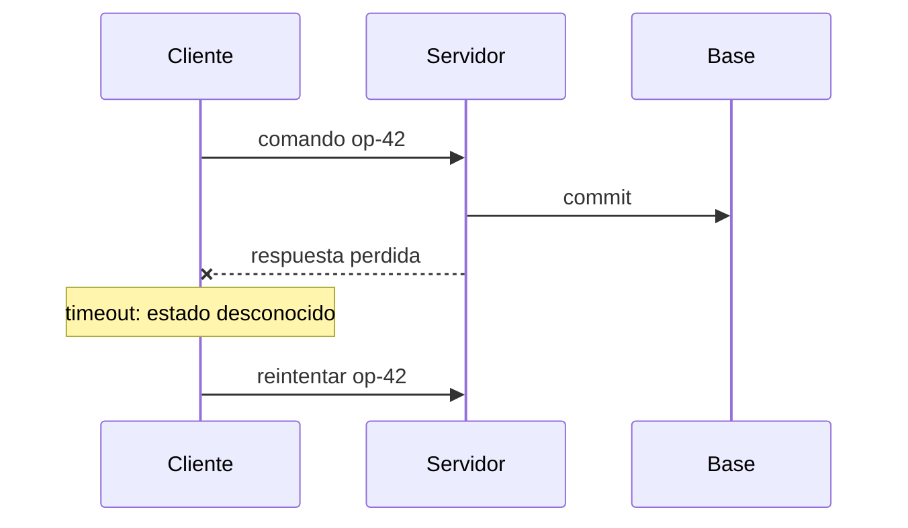
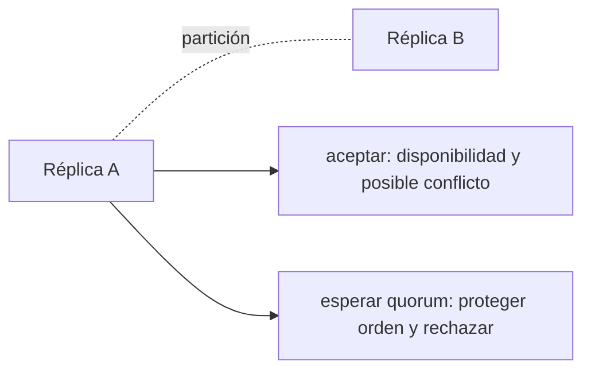
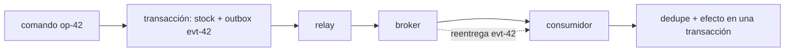
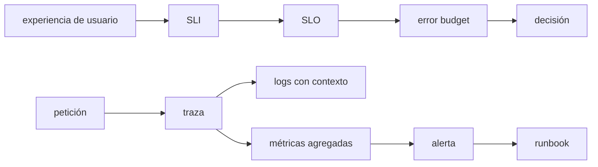
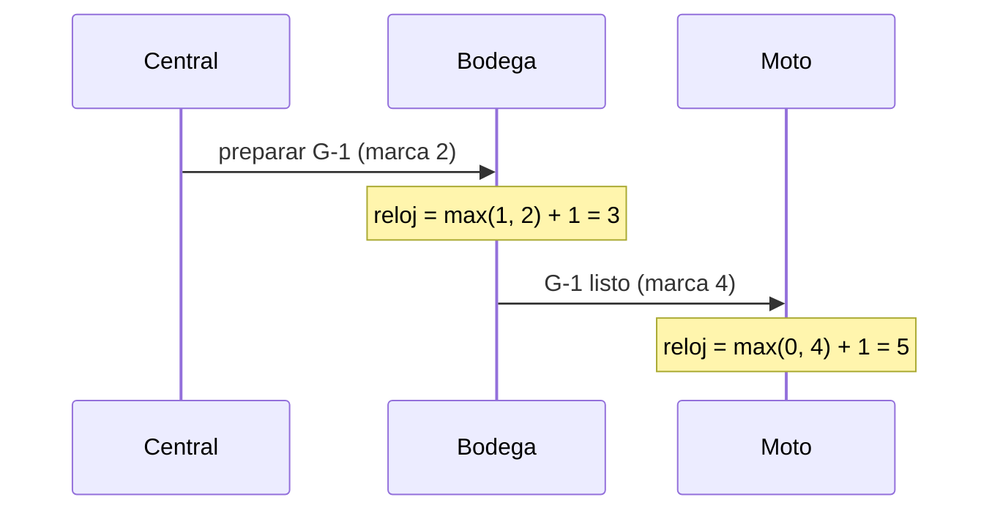
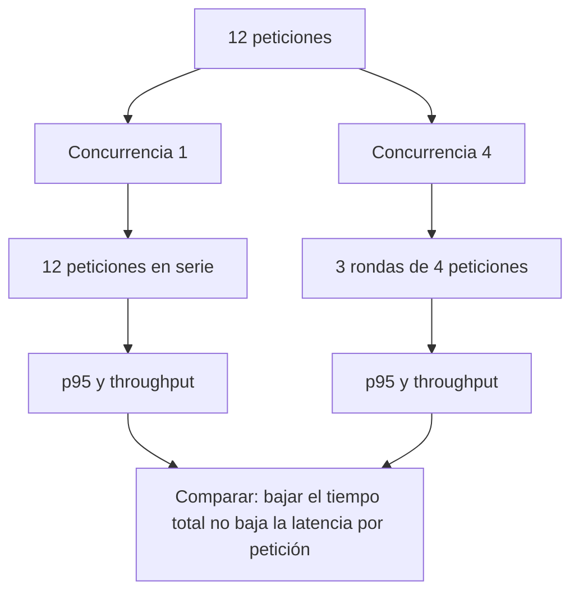

# Módulo 10: Sistemas distribuidos, resiliencia y observabilidad

Una aplicación local puede asumir que una llamada termina o falla de forma visible. Cuando dos procesos se comunican por red aparece una tercera posibilidad: el resultado es **desconocido**. La respuesta puede perderse después de que el servidor confirmó un pedido; un mensaje puede llegar dos veces; dos réplicas pueden observar órdenes diferentes. Este módulo enseña a razonar bajo esa incertidumbre sin prometer garantías que el sistema no puede cumplir.


## Aprende construyendo

### Tema 1: La red convierte el resultado en una incertidumbre

#### Paso 1 · Objetivo y preparación
Al finalizar vas a simular un timeout real al confirmar una entrega de RutaFlow, y a comprobar por qué el cliente no puede saber qué pasó del otro lado. Prerrequisitos: Python 3 instalado.

#### Paso 2 · Contexto y caso real
A lo largo de estos 12 módulos vas a construir el proyecto integrador Fundamentos; en este módulo le toca agregar configuración (qué archivo usar, qué formato). Cuando la app del conductor envía "confirmar entrega" y la conexión se corta antes de recibir respuesta, el conductor no sabe si el servidor nunca recibió el comando, lo procesó y se perdió la respuesta, o lo procesó dos veces por un reintento previo.

#### Paso 3 · Teoría, modelo mental y analogía
La red es una carretera con retrasos, pérdidas y duplicados — un timeout es un límite de espera local, nunca una prueba de lo que pasó del lado del servidor.

**Conceptos clave:** sistema distribuido, nodo, mensaje, latencia, ancho de banda, timeout, fallo parcial, pérdida, duplicación, reordenamiento, reloj físico, reloj lógico, causalidad y deadline.

#### Profundización · Diseño: Backoff y jitter en reintentos

**Escenario:** Tu cliente reintenta conectar a la API de RutaFlow. Sin espera, bombardea al servidor. Con espera fija (1s cada vez), sincronización de reintento causa "thundering herd".

**Tu tarea:**
1. Implementa backoff: 1s, 2s, 4s, 8s... (máx 60s).
2. Añade jitter (randomizar espera).
3. ¿Por qué jitter es crítico? (Pista: todos reintentando al mismo tiempo.)
4. ¿Cómo un cliente lo usa sin ser invasivo?

[SOLUCIÓN PLEGADA]
> Backoff: `delay = min(2^attempt * base, max)`, ej. `2^3 * 1 = 8s`. Jitter: `delay += random(0, delay)`, ej. 8s ± 4s. Sin jitter, 1000 clientes reintentando a los 8s exacto = pico masivo que mata servidor de nuevo. Con jitter, se esparcen uniformemente. Cliente: wrapper de `requests.get()` con reintento transparente (biblioteca `tenacity` en Python).

**Cuándo NO usar:** No reintentes indefinidamente sin límite. No confíes en timeout como prueba de fallo del servidor.

#### Profundización · Diseño: Consistencia eventual en sistemas distribuidos

**Escenario real:** CLI Fundamentos se replica en 3 servidores (primaria + 2 replicas). Escribes tarea en A, lees de B 1ms después.

**Tu tarea (sin mirar solución):**

1. ¿Ves tarea nueva o antigua?
2. ¿Cuánto tiempo tarda B en sincronizar?
3. ¿Cómo detectas inconsistencia?
4. ¿Apps que toleran inconsistencia temporal?

<details>
<summary>SOLUCIÓN — Lee solo después de intentar</summary>

> **Respuesta esperada:**
> Probablemente veas valor viejo momentáneamente. Replicación típicamente: 10ms-1s. Detección: compara timestamp primaria vs replica. Analítica, historial de posiciones toleran delay; pagos/saldos no.

</details>

Un sistema distribuido contiene componentes que cooperan mediante mensajes y no comparten una memoria ni un reloj perfecto. Un proceso puede continuar mientras otro está caído, lento o aislado. Esto produce **fallos parciales**: desde un nodo no siempre es posible distinguir si el receptor falló, la red está lenta o solo se perdió la respuesta.

Si el cliente envía “retirar 1 unidad” y vence su timeout, no sabe si el servidor nunca recibió, recibió pero falló o completó y perdió la respuesta. Repetir sin identidad puede retirar dos veces. Un timeout es un límite de espera local, no una prueba sobre el estado remoto.

La latencia tiene distribución y cola; no es una constante. Un deadline comunica cuánto tiempo total queda para una operación y debe propagarse a dependencias. Si cada capa usa un timeout independiente de cinco segundos, una solicitud puede consumir muchos múltiplos del presupuesto original.

Los relojes físicos derivan y se sincronizan con error. No uses una marca temporal como prueba absoluta de orden entre máquinas. Cuando importa la relación “A ocurrió antes que B”, registra causalidad mediante versión, secuencia o reloj lógico. Dos eventos sin relación causal pueden ser concurrentes aunque sus timestamps parezcan ordenados.

```python
from dataclasses import dataclass

@dataclass(frozen=True)
class Command:
    operation_id: str
    product_id: int
    quantity: int

def withdraw(client, command: Command, deadline_seconds: float):
    # operation_id conserva identidad a través de reintentos.
    return client.post("/withdrawals", json=command.__dict__, timeout=deadline_seconds)
```

**Analogía:** envías una carta certificada y no recibes el acuse. El silencio no permite saber si la carta no llegó o si llegó y el acuse se perdió. Reenviar una orden sin número único puede ejecutar dos compras.

**¿Por qué es importante?** porque muchos defectos distribuidos nacen al tratar una llamada remota como una función local. La red añade latencia, pérdida, independencia de fallos y estados desconocidos.

**Casos de uso reales:** pagos con respuesta perdida, API lenta, servicio DNS intermitente, petición móvil que cambia de red, procesamiento fuera de orden y jobs ejecutados tras un reinicio.

**Diagrama:**



El mismo problema de identidad de comando aparece en `examples/rutaflow/node/confirm-delivery.ts` (ya citado en el Módulo 7): el chequeo de `commandId` ya procesado existe precisamente para que un reintento tras un timeout de red nunca se confunda con un comando nuevo, igual que el `operation_id` de Python de este Tema.

#### Paso 4 · Demostración guiada
**Desde cero:** parte de una carpeta vacía, ejecuta el comando que aparece debajo y escribe `src/ejemplo.py` con el contenido de este tema.
```bash
mkdir ejemplo && cd ejemplo
```

```python
import socket

def confirmar_con_timeout(sock, command_id, segundos=2):
    sock.settimeout(segundos)
    try:
        sock.sendall(f"CONFIRMAR {command_id}".encode())
        return sock.recv(1024)
    except socket.timeout:
        return None  # estado desconocido: no sabemos si el servidor procesó el comando
```

**Ejecuta el ejemplo** (guarda el código en un archivo y córrelo desde la terminal):

```bash
python3 ejemplo.py
```
Observa la salida impresa y compárala con el resultado esperado.

Resultado esperado: si el servidor tarda más que `segundos`, la función devuelve `None` — eso significa literalmente "no sé qué pasó", no "falló".

#### Paso 5 · Práctica guiada
Pista: tratá ese `None` como "seguro que falló" y reenviá el mismo comando SIN usar el mismo `command_id` (generando uno nuevo) — ese es el fallo deliberado: si el primer intento sí había llegado y se procesó, ahora la entrega queda confirmada dos veces con dos IDs distintos, exactamente el duplicado que la identidad del comando (Tema 3) existe para evitar.

#### Paso 6 · Práctica independiente
Corregí el Paso 5 reenviando el comando con el MISMO `command_id` original, y documentá qué necesitaría el servidor para responder correctamente a ese reintento (pista: la respuesta del Tema 3, `findCommandResult(commandId)`).

#### Paso 7 · Cierre
Entregá el timeout real devolviendo estado desconocido del Paso 4, el duplicado provocado por generar un ID nuevo del Paso 5, y la corrección reusando el ID original del Paso 6; explicá por qué tratar un timeout como "falló con certeza" es tan equivocado como tratarlo como "funcionó con certeza". Siguiente paso: estudiar consistencia. Errores comunes: asumir orden y reintentar sin límite. Fuente oficial: https://sre.google/sre-book.

### Tema 2: Replicación, consistencia y decisiones explícitas

#### Paso 1 · Objetivo y preparación
Al finalizar vas a simular una lectura obsoleta real sobre una réplica de `ShipmentEvents` de RutaFlow, y a decidir si ese envío específico tolera esa inconsistencia. Prerrequisitos: ninguno adicional.

#### Paso 2 · Contexto y caso real
Si `ShipmentEvents` tuviera una tabla global multi-región (como la del Módulo 33 del track Cloud), el estado "entregado" podría escribirse en una región y tardar en replicarse a la otra — alguien consultando desde la región equivocada vería un estado viejo.

#### Paso 3 · Teoría, modelo mental y analogía
Las réplicas son copias con reglas de coordinación propias; leer una réplica puede devolver un estado anterior al real — el mismo quorum que evita decisiones aisladas también tiene un costo de latencia.

**Conceptos clave:** réplica, líder, seguidor, quorum, partición, disponibilidad, consistencia linealizable, consistencia eventual, lectura obsoleta, conflicto, consenso, CAP, PACELC y fencing token.

#### Profundización · Diseño: Read-your-writes sin coste global

**Escenario:** Usuario confirma una entrega. Quiere ver inmediatamente que su entrega ahora está "delivered". Pero tu BD replica a múltiples nodos (eventual consistency).

**Tu tarea:**
1. ¿Cuándo puedes garantizar read-your-write sin coste?
2. ¿Cuándo necesitas un truco? (Pista: timestamp de sesión.)
3. ¿Cuándo es aceptable eventual consistency?
4. ¿Qué alternativas hay aparte de transacciones globales?

[SOLUCIÓN PLEGADA]
> Sin coste: si la lectura va a la instancia que escribió (session affinity). Con truco: timestamp de escritura en cookie, cliente reenvía, servidor espera a replicación de esa versión o rechaza. Eventual consistency es aceptable para reporte (15s de delay OK). Alternativas: (1) escribir en BD primaria, leer de primaria temporalmente. (2) Usar async messaging con ack antes de retornar ("escriba y notifique" pattern). (3) Accept UI "está guardando..."

**Cuándo NO usar:** No prometas consistencia fuerte cuando el costo es prohibitivo. No ocultes lecturas obsoletas al usuario sin ser explícito.

#### Profundización · Diseño: Reintentabilidad y fallos transitorios

**Escenario real:** CLI Fundamentos conecta a BD. Timeout 500ms. ¿Reintentar 3 veces?

**Tu tarea (sin mirar solución):**

1. ¿Cómo diferencias fallo transitorio de permanente?
2. Estrategia: ¿reintentos inmediatos, espera exponencial, circuit breaker?
3. ¿Cuántos reintentos antes de fallar?
4. ¿Usuario ve errores o retry silencioso?

<details>
<summary>SOLUCIÓN — Lee solo después de intentar</summary>

> **Respuesta esperada:**
> Transitorio: timeout, conexión rechazada. Permanente: 403, 404. Estrategia: espera exponencial (1s, 2s, 4s). 3-5 reintentos máximo. Usuario: éxito rápido o error claro después de reintentos.

</details>

Replicar datos mejora tolerancia a fallos y capacidad de lectura, pero exige decidir qué valor observar cuando las copias difieren. En replicación con líder, las escrituras pasan por una autoridad y seguidores aplican cambios después. Leer un seguidor puede devolver estado anterior. En multi-líder o peer-to-peer aparecen conflictos que requieren reglas de resolución compatibles con el dominio.

**Consistencia** no significa una sola cosa. La linealizabilidad hace que operaciones parezcan ocurrir en un orden único compatible con tiempo real; es útil para reservar el último artículo, pero cuesta coordinación. La consistencia eventual promete convergencia si cesan actualizaciones; puede ser suficiente para un contador analítico, no necesariamente para autorizar un retiro.

CAP no dice “elige dos para siempre”. Durante una partición de red, una operación concreta debe rechazar o esperar para conservar consistencia, o aceptar y arriesgar divergencia para conservar disponibilidad. Sin partición, PACELC recuerda que aún existe un compromiso entre latencia y consistencia. La elección se hace por invariante y operación, no por etiqueta del producto.

El consenso permite acordar una secuencia o líder pese a ciertos fallos; protocolos como Raft requieren mayorías y no crean disponibilidad cuando no existe quorum. Un lock distribuido con lease puede expirar mientras el antiguo propietario sigue trabajando. Un **fencing token** creciente permite que el recurso rechace escrituras de propietarios obsoletos.

```text
Invariante fuerte: ninguna ubicación vende más unidades de las asignadas.
Opción A: coordinar cada venta con autoridad central.
Opción B: reservar cupos por ubicación y reconciliar transferencias.
```

La opción B conserva autonomía usando partición explícita del inventario; no elimina el invariante, lo reformula con derechos de venta limitados.

**Analogía:** dos taquillas desconectadas no pueden vender libremente el mismo último asiento y garantizar que nunca se duplique. Pueden esperar conexión o recibir previamente cupos diferentes.

**¿Por qué es importante?** porque seleccionar una base “AP” o “CP” no sustituye analizar qué inconsistencia soporta el negocio y cómo se repara.

**Casos de uso reales:** catálogos con lecturas obsoletas tolerables, stock y saldos fuertes, elección de líder, cachés, réplicas geográficas y bloqueos de jobs.

**Diagrama:**



El proyecto integrador Fundamentos enfrentaría esta misma decisión si su CLI sincronizara `almacenamiento.py` contra un servidor remoto: leer el estado de una tarea desde una réplica recién creada podría devolver una versión vieja, y decidir si eso es tolerable (listar tareas) o no (confirmar que una tarea crítica ya se guardó) es exactamente el mismo criterio operación-por-operación que este Tema aplica a `ShipmentEvents`.

#### Paso 4 · Demostración guiada
**Desde cero:** parte de una carpeta vacía, ejecuta el comando que aparece debajo y escribe `src/ejemplo.py` con el contenido de este tema.
```bash
mkdir ejemplo && cd ejemplo
```

```python
primaria = {"env-4471": "entregado"}
replica = {"env-4471": "en_ruta"}  # todavía no recibió la replicación

def leer_estado(fuente, shipment_id):
    return fuente.get(shipment_id)

print("primaria:", leer_estado(primaria, "env-4471"))
print("réplica (obsoleta):", leer_estado(replica, "env-4471"))
```

**Ejecuta el ejemplo** (guarda el código en un archivo y córrelo desde la terminal):

```bash
python3 ejemplo.py
```
Observa la salida impresa y compárala con el resultado esperado.

Resultado esperado: `primaria` devuelve `"entregado"`, `réplica` todavía devuelve `"en_ruta"` — ambos valores son reales en su propia copia, la inconsistencia es temporal, no un bug.

#### Paso 5 · Práctica guiada
Pista: usá el valor de la réplica para decidir si facturar el envío como completado — ese es el fallo deliberado: facturar basándose en una lectura obsoleta podría cobrar antes de que la entrega esté realmente confirmada en todo el sistema, exactamente el tipo de operación que necesita consistencia fuerte (leer siempre de la primaria), no eventual.

#### Paso 6 · Práctica independiente
Identificá, para RutaFlow, una operación que SÍ toleraría leer de la réplica (pista: mostrar el historial de ubicaciones en un panel de analítica, Módulo 19 del track Cloud) frente a una que no (pista: decidir si cobrar o reembolsar) — documentando el criterio que usaste para distinguirlas.

#### Paso 7 · Cierre
Entregá la lectura obsoleta real del Paso 4, el uso incorrecto para facturación del Paso 5, y la clasificación de operaciones del Paso 6; explicá por qué "elegir una base AP o CP" no sustituye decidir, operación por operación, qué inconsistencia tolera el negocio. Siguiente paso: estudiar mensajes. Errores comunes: prometer consistencia sin coste y ocultar lecturas obsoletas. Fuente oficial: https://martinfowler.com/articles/patterns-of-distributed-systems.

### Tema 3: Mensajes que se procesan con efectos exactamente una vez

#### Paso 1 · Objetivo y preparación
Al finalizar vas a confirmar, ejecutando el código real de RutaFlow, que `confirmDelivery` ya logra el efecto "exactamente una vez" aunque el comando llegue duplicado. Prerrequisitos: Node.js instalado.

#### Paso 2 · Contexto y caso real
Si la app del conductor reintenta "confirmar entrega" por una mala conexión (Tema 1), el mismo `commandId` puede llegarle al backend dos o tres veces — `examples/rutaflow/node/confirm-delivery.ts` ya resuelve esto, pero nunca lo comprobamos ejecutándolo de verdad.

#### Paso 3 · Teoría, modelo mental y analogía
Un broker es una bandeja numerada; la deduplicación por `commandId` hace que repetir el mismo número nunca produzca un segundo efecto, solo devuelve el recibo que ya existía.

**Conceptos clave:** productor, broker, consumidor, ack, entrega al menos una vez, como máximo una vez, exactamente una vez efectiva, idempotencia, deduplicación, retry, backoff, jitter, dead-letter queue, outbox y saga.

#### Profundización · Diseño: Tabla outbox para notificaciones garantizadas

**Escenario:** Confirmaste una entrega (BD) pero el email notificando al cliente nunca se envía (servicio de email cae). BD consistente, notificación perdida.

**Tu tarea:**
1. Diseña tabla `outbox` junto con `shipments`.
2. ¿Cómo garantizar atomicidad?
3. ¿Cómo el consumidor procesa con garantía de una entrega?
4. ¿Cuándo eliminar de outbox?

[SOLUCIÓN PLEGADA]
> Transacción: INSERT shipment + INSERT outbox en same TX. Atomicidad: BD ACID. Consumidor: polling en outbox buscando `processed=false`, procesa (envía email), marca `processed=true` en same TX. Si email falla (excepción), rollback y reintenta. Una entrega: idempotencia de operación + deduplicación por ID (email es idempotente si usa shipment_id). Eliminar: mantener >30 días (auditoría), después limpiar en batch.

**Cuándo NO usar:** No reintentes operaciones no idempotentes; diseña idempotencia primero. No garantices "exactamente una vez" sin mecanismo de deduplicación explícito.

#### Profundización · Diseño: Mensajes garantizados exactamente una vez

**Escenario real:** Evento 'tarea completada' se procesa en 2 servicios: guardar en BD, enviar email. Evento duplicado → 2 emails.

**Tu tarea (sin mirar solución):**

1. ¿Qué significa 'exactamente una vez'?
2. ¿Cómo se implementa sin duplicados?
3. ¿Clave de deduplicación? (command_id)
4. ¿Trade-offs vs 'al menos una vez'?

<details>
<summary>SOLUCIÓN — Lee solo después de intentar</summary>

> **Respuesta esperada:**
> Garantiza procesamiento único incluso con fallos. Usa `idempotency_key` global (único por evento). Servicio marca evento como 'procesado' antes de completar. Si reintentos: recupera marcador, no repite. Trade-off: costo de almacenar marcadores.

</details>

Los brokers desacoplan tiempo y capacidad: el productor publica y el consumidor procesa después. Pero el acknowledgement puede perderse y el broker reenviar. “Al menos una vez” implica posibles duplicados; “como máximo una vez” puede perder trabajo. Muchos sistemas que anuncian exactly-once limitan la garantía a una frontera. El efecto de negocio requiere diseño idempotente de extremo a extremo.

Una operación idempotente produce el mismo efecto observable al repetirse con la misma identidad. Guarda `operation_id` bajo restricción única en la misma transacción del cambio. Si llega otra vez, devuelve el resultado registrado sin repetir el retiro.

El problema de doble escritura ocurre al actualizar la base y publicar un evento como pasos separados. Si la aplicación cae entre ambos, uno queda sin el otro. El patrón **transactional outbox** escribe cambio y evento pendiente en una transacción local; un relay publica después y marca progreso. Puede publicar dos veces, por lo que el consumidor también deduplica.

```sql
BEGIN;
UPDATE products SET stock = stock - 1
 WHERE id = 7 AND stock >= 1;
INSERT INTO outbox(event_id, kind, payload, published)
 VALUES ('evt-42', 'StockWithdrawn', '{"product_id":7}', 0);
COMMIT;
```

Los reintentos se reservan para errores transitorios y usan backoff exponencial con jitter para evitar una estampida sincronizada. Deben respetar deadline y presupuesto máximo. Errores permanentes van a revisión o dead-letter con contexto y procedimiento; una DLQ sin propietario es un cementerio silencioso.

Una saga coordina una transacción de negocio entre servicios mediante pasos y compensaciones. Compensar no viaja atrás en el tiempo: crea una acción nueva y puede fallar. Diseña estados intermedios visibles, operaciones idempotentes y recuperación manual.

**Analogía:** el outbox es el libro de correspondencia de una oficina. La decisión y la nota “enviar aviso” se registran juntas; un mensajero puede intentar varias veces y el destinatario reconoce el número de expediente.

**¿Por qué es importante?** porque una entrega duplicada es normal bajo recuperación. Sin identidad e invariantes, los reintentos que mejoran disponibilidad corrompen datos.

**Casos de uso reales:** cobros, emails, webhooks, integración de inventario, workers, importaciones masivas y publicación de eventos de dominio.

**Diagrama:**



**Transferencia al proyecto integrador «Fundamentos: gestor de tareas»:** Asigna un identificador a cada comando de completar tarea y registra los ya procesados. Envía el mismo comando dos veces y comprueba un solo cambio durable, incluso al reiniciar el consumidor.

#### Paso 4 · Demostración guiada
**Desde cero:** parte de una carpeta vacía, ejecuta el comando que aparece debajo y escribe `src/ejemplo.py` con el contenido de este tema.
```bash
mkdir ejemplo && cd ejemplo
```

```typescript
import { confirmDelivery, type DeliveryRepository, type DeliveryResult } from "./confirm-delivery";

const resultados = new Map<string, DeliveryResult>();
const repo: DeliveryRepository = {
  async findCommandResult(commandId) { return resultados.get(commandId) ?? null; },
  async confirm(command) {
    const result = { shipmentId: command.shipmentId, status: "delivered" as const };
    resultados.set(command.commandId, result);
    return result;
  },
};

const comando = { commandId: "cmd-1", shipmentId: "env-4471", occurredAt: "2026-10-05", recipientPin: "837201" };
console.log(await confirmDelivery(comando, repo));
console.log(await confirmDelivery(comando, repo)); // mismo commandId, reenviado
```

**Ejecuta el ejemplo** (guarda el código en un archivo y córrelo desde la terminal):

```bash
python3 ejemplo.py
```
Observa la salida impresa y compárala con el resultado esperado.

Resultado esperado: ambas líneas imprimen el mismo resultado, pero `repo.confirm()` solo se ejecuta una vez — la segunda llamada a `confirmDelivery` lo detecta con `findCommandResult` y devuelve el resultado ya guardado, sin volver a "confirmar" nada.

#### Paso 5 · Práctica guiada
Pista: cambiá el segundo comando para que use `commandId: "cmd-2"` (distinto) pero el mismo `shipmentId` — ese es el fallo deliberado: como el `commandId` es nuevo, `confirmDelivery` lo trata como un comando genuino y vuelve a llamar `repo.confirm()`, confirmando el mismo envío una segunda vez; la deduplicación protege por `commandId`, no por `shipmentId`.

#### Paso 6 · Práctica independiente
Agregá un `console.log` dentro de `repo.confirm` para contar cuántas veces se ejecuta de verdad, y repetí el comando original (`cmd-1`) cinco veces seguidas — confirmá que el contador queda en 1, sin importar cuántos reintentos reciba.

#### Paso 7 · Cierre
Entregá la deduplicación real confirmada del Paso 4, el duplicado por ID distinto del Paso 5, y el contador en 1 tras cinco reintentos del Paso 6; explicá por qué la garantía es "exactamente una vez por `commandId`", no "exactamente una vez por envío" en términos absolutos. Siguiente paso: estudiar resiliencia. Errores comunes: confundir entrega con efecto y reintentar operaciones no idempotentes. Fuente oficial: https://microservices.io/patterns/data/transactional-outbox.html.

### Tema 4: Resiliencia y observabilidad orientadas a objetivos

#### Paso 1 · Objetivo y preparación
Al finalizar vas a definir un SLI/SLO real para `confirmar-entrega` de RutaFlow, y a medir cuánto presupuesto de error consume una dependencia lenta. Prerrequisitos: Python 3 instalado.

#### Paso 2 · Contexto y caso real
Si el proveedor de SMS que notifica al cliente (Módulo 10 del track Cloud) empieza a responder lento, RutaFlow necesita un número concreto para decidir si eso ya es un problema real o todavía tolerable, no una sensación de "se siente lento".

#### Paso 3 · Teoría, modelo mental y analogía
Un SLI mide lo que importa (proporción de confirmaciones completadas bajo 300ms); el error budget es la fracción de incumplimiento que el negocio decidió tolerar — una alerta solo tiene sentido si consume una parte real de ese presupuesto.

**Conceptos clave:** resiliencia, bulkhead, circuit breaker, load shedding, degradación, observabilidad, log, métrica, traza, correlation ID, SLI, SLO, error budget, alerta, runbook, incidente y postmortem.

#### Profundización · Diseño: Runbook de diagnóstico a las 3 AM

**Escenario:** Dashboard muestra que confirmación de entregas cae a 92% de disponibilidad. Es 3 AM. Necesitas un runbook de diagnóstico.

**Tu tarea:**
1. Escribe pasos: "Si SLI < 95, entonces..."
2. ¿Cuál es el árbol de decisión de causa raíz?
3. ¿Cuándo escalar? ¿Cuándo revert?
4. ¿Cómo no caer en pánico?

[SOLUCIÓN PLEGADA]
> Runbook: (1) Verificar métrica (¿falsa alarma?), (2) Histograma de latencia: ¿p99 disparado (contención BD) o errors subieron (código)?, (3) Si contención, escalar DB o revisar queries lentas; si errors, revisar logs de aplicación y últimos deploys (revert si es reciente), (4) Alertar on-call si >10 min sin resolución. Automatizar: si surge que es por carga, auto-scale (Kubernetes horizontal pod autoscaler).

**Cuándo NO usar:** No alerten sin acción clara. No midas solo promedios; ocultan outliers.

#### Profundización · Diseño: Resiliencia con timeout y fallback

**Escenario real:** CLI Fundamentos consulta servicio externo de geolocalización. Demora 30s.

**Tu tarea (sin mirar solución):**

1. ¿Qué timeout usarías?
2. ¿Fallback si timeout (caché, default, null)?
3. ¿Cuántos reintentos antes de fallback?
4. ¿Cómo informar al usuario?

<details>
<summary>SOLUCIÓN — Lee solo después de intentar</summary>

> **Respuesta esperada:**
> Timeout: 5-10s máximo. Fallback: caché antiguo si disponible, sino null. 1-2 reintentos antes de fallback. Usuario: ubicación precisa (éxito), aproximada (caché), o 'sin ubicación' (fallback).

</details>

Resiliencia es mantener una función aceptable y recuperarse; no fingir que nada falla. Timeouts limitan espera; bulkheads aíslan recursos; circuit breakers evitan insistir sobre una dependencia que falla; load shedding rechaza temprano cuando aceptar empeoraría todo. Cada patrón tiene coste y estado propio. Un circuit breaker mal configurado puede ocultar recuperación o amplificar oscilaciones.

La observabilidad permite inferir estado interno desde señales. Los logs describen eventos con campos estructurados; métricas agregan series numéricas; trazas conectan el camino de una solicitud entre componentes. Incluye `trace_id`, `operation_id` y versión, pero evita contraseñas, tokens y datos personales. Alta cardinalidad como `user_id` puede volver inviable una métrica; pertenece normalmente a logs protegidos o atributos muestreados.

Un SLI mide comportamiento que importa: proporción de retiros válidos completados bajo 300 ms, por ejemplo. El SLO fija un objetivo y ventana: 99.9 % durante 28 días. El error budget es la fracción permitida de incumplimiento y facilita decidir entre velocidad de cambio y trabajo de confiabilidad. Una alerta debe representar consumo significativo del presupuesto y tener acción humana clara.

```python
def availability_sli(events):
    eligible = [e for e in events if e["valid_request"]]
    good = [e for e in eligible if e["status"] == "ok" and e["ms"] <= 300]
    return len(good) / len(eligible) if eligible else 1.0
```

Durante un incidente: declara coordinación, limita impacto, conserva línea temporal, comunica y recupera. Después, un postmortem sin culpables analiza condiciones y defensas, no busca una persona “causante”. Las acciones deben tener propietario, prioridad y criterio verificable.

**Analogía:** el tablero de un avión no evita turbulencia; ofrece señales relacionadas para reconocerla y procedimientos practicados para mantener vuelo seguro.

**¿Por qué es importante?** porque un sistema distribuido no puede operarse con `print` desconectados ni alertas sobre cada error. Se necesitan objetivos de usuario, correlación y decisiones ensayadas.

**Casos de uso reales:** latencia de checkout, saturación de pool, dependencia caída, cola acumulada, despliegue defectuoso, guardia operativa y game days.

**Diagrama:**



Un SLI equivalente para el proyecto integrador Fundamentos viviría en `tareas.py`: si el CLI alguna vez dependiera de un servicio externo (por ejemplo, para sincronizar tareas), medirías la proporción de comandos completados bajo un umbral de tiempo, exactamente con la misma función `sli_confirmaciones` de este Tema, solo cambiando qué evento se considera "bueno".

#### Paso 4 · Demostración guiada
**Desde cero:** parte de una carpeta vacía, ejecuta el comando que aparece debajo y escribe `src/ejemplo.py` con el contenido de este tema.
```bash
mkdir ejemplo && cd ejemplo
```

```python
def sli_confirmaciones(eventos):
    elegibles = [e for e in eventos if e["valido"]]
    buenos = [e for e in elegibles if e["estado"] == "ok" and e["ms"] <= 300]
    return len(buenos) / len(elegibles) if elegibles else 1.0

eventos = [
    {"valido": True, "estado": "ok", "ms": 120},
    {"valido": True, "estado": "ok", "ms": 280},
    {"valido": True, "estado": "ok", "ms": 900},  # el proveedor de SMS respondió lento
]
print(sli_confirmaciones(eventos))
```

**Ejecuta el ejemplo** (guarda el código en un archivo y córrelo desde la terminal):

```bash
python3 ejemplo.py
```
Observa la salida impresa y compárala con el resultado esperado.

Resultado esperado: `0.6666...` — dos de tres confirmaciones cumplieron el SLI de 300ms; si el SLO es 99.9% en 28 días, este único evento lento ya consume una fracción real y medible del presupuesto de error, no una sensación vaga.

#### Paso 5 · Práctica guiada
Pista: cambiá el cálculo para usar `mean([e["ms"] for e in eventos])` como única métrica, en vez del SLI de proporción bajo el umbral — ese es el fallo deliberado: el promedio (433ms) puede esconder que 2 de 3 confirmaciones estuvieron perfectamente bien y solo una se disparó; el SLI correcto mide el resultado que le importa al usuario, no un promedio que cualquier valor extremo puede distorsionar.

#### Paso 6 · Práctica independiente
Agregá una alerta que dispare solo cuando el SLI caiga por debajo de un umbral sostenido (por ejemplo, menos de 99% durante más de 5 minutos, no por un solo evento lento aislado), y documentá qué acción humana concreta debería seguir esa alerta — una alerta sin acción clara es ruido, no observabilidad.

#### Paso 7 · Cierre
Entregá el SLI real calculado del Paso 4, el promedio engañoso del Paso 5, y la alerta con acción concreta del Paso 6; explicá por qué medir "lo que le importa al usuario" (confirmaciones a tiempo) es distinto de medir "lo que es fácil de medir" (CPU, promedio). Siguiente paso: estudiar sistemas operativos. Errores comunes: alertar sin acción y medir solo promedios. Fuente oficial: https://sre.google/sre-book/monitoring-distributed-systems/.

### Tema 5: Tiempo, coordinación y acuerdo: Lamport, elección de líder y commit en dos fases

#### Paso 1 · Objetivo y preparación
Al finalizar podrás ordenar eventos sin reloj global con relojes lógicos de Lamport, elegir un coordinador cuando el anterior falla con el algoritmo del matón (bully) y explicar cómo el commit en dos fases (2PC) logra que todos confirmen o nadie lo haga. Prerrequisitos: Temas 1 a 3 de este módulo.

#### Paso 2 · Contexto y caso real
En RutaFlow, la central, la bodega y la moto registran eventos de la misma entrega en máquinas distintas cuyos relojes no coinciden: ordenar por hora local mostró entregas "antes" de ser despachadas. Además, cuando cae el servidor coordinador alguien debe reemplazarlo, y un pedido que toca inventario, pagos y despacho debe aplicarse en los tres o en ninguno. Son los problemas clásicos que trata Tanenbaum en *Sistemas operativos distribuidos* y un caso real de todo sistema con varios servicios.

#### Paso 3 · Teoría, modelo mental y analogía
Un **reloj lógico de Lamport** es un contador por nodo: se incrementa en cada evento y, al recibir un mensaje, toma `max(propio, marca del mensaje) + 1`. Así, si A causó B, la marca de A es menor que la de B (aunque marcas iguales no implican nada). El **algoritmo del matón** elige como coordinador al nodo vivo con mayor identificador: quien detecta la caída convoca a los mayores, y el mayor que responde toma el control. El **commit en dos fases** tiene una fase de *preparación* (cada participante vota si puede confirmar) y una de *decisión* (COMMIT solo si todos votaron sí). Su debilidad: si el coordinador cae entre fases, los participantes quedan bloqueados; por eso los microservicios suelen preferir sagas (Spring Boot, Módulo 15).

**Analogía:** Lamport es numerar los pasos de una receta compartida por varios cocineros sin mirar el reloj; 2PC es la boda: el oficiante pregunta a ambos y solo declara el matrimonio si los dos dicen sí.

**Diagrama:**



#### Paso 4 · Demostración guiada desde cero
**Ejemplo independiente (desde cero):** este tema se reproduce en una **carpeta vacía**, como **proyecto nuevo**, sin estado de otros temas.

```bash
mkdir distribuidos && cd distribuidos
```

Crea `distribuidos.py`:

```python
import random

# --- 1. Relojes lógicos de Lamport: ordenar eventos sin un reloj global
class Nodo:
    def __init__(self, nombre):
        self.nombre, self.reloj, self.log = nombre, 0, []
    def evento(self, texto):
        self.reloj += 1
        self.log.append((self.reloj, self.nombre, texto))
    def enviar(self, texto):
        self.evento(f"envía {texto}")
        return (self.reloj, texto)
    def recibir(self, mensaje):
        marca, texto = mensaje
        self.reloj = max(self.reloj, marca) + 1          # regla de Lamport
        self.log.append((self.reloj, self.nombre, f"recibe {texto}"))

central, bodega, moto = Nodo("central"), Nodo("bodega"), Nodo("moto")
central.evento("crea pedido G-1")
m1 = central.enviar("preparar G-1")
bodega.evento("revisa inventario")
bodega.recibir(m1)
m2 = bodega.enviar("G-1 listo")
moto.recibir(m2)
moto.evento("entrega G-1")
print("Orden por reloj de Lamport:")
for marca, nodo, texto in sorted(central.log + bodega.log + moto.log):
    print(f"  {marca:>2} {nodo:<8} {texto}")

# --- 2. Elección de líder con el algoritmo del matón (bully)
def bully(vivos, iniciador):
    mayores = [n for n in vivos if n > iniciador]
    if not mayores:
        return iniciador                                 # nadie mayor respondió: gana
    return bully(vivos, min(mayores))                    # el siguiente mayor toma la elección
servidores = [1, 2, 3, 4, 5]
caido = 5
vivos = [s for s in servidores if s != caido]
print(f"\nCayó el coordinador {caido}; el nodo 2 inicia la elección -> nuevo líder: {bully(vivos, 2)}")

# --- 3. Commit en dos fases (2PC): todos confirman o nadie confirma
def dos_fases(participantes):
    votos = {nombre: voto() for nombre, voto in participantes.items()}   # fase 1: preparar
    decision = "COMMIT" if all(votos.values()) else "ABORT"             # fase 2: decidir
    return votos, decision
random.seed(3)
for intento in range(1, 3):
    votos, decision = dos_fases({
        "inventario": lambda: True,
        "pagos": lambda: random.random() > 0.4,
        "despacho": lambda: True,
    })
    print(f"Transacción {intento}: votos={votos} -> {decision}")
```

**Ejecuta el ejemplo:**

```bash
python3 distribuidos.py
```

**Resultado esperado:**

```text
Orden por reloj de Lamport:
   1 bodega   revisa inventario
   1 central  crea pedido G-1
   2 central  envía preparar G-1
   3 bodega   recibe preparar G-1
   4 bodega   envía G-1 listo
   5 moto     recibe G-1 listo
   6 moto     entrega G-1

Cayó el coordinador 5; el nodo 2 inicia la elección -> nuevo líder: 4
Transacción 1: votos={'inventario': True, 'pagos': False, 'despacho': True} -> ABORT
Transacción 2: votos={'inventario': True, 'pagos': True, 'despacho': True} -> COMMIT
```

Los eventos con la misma marca (1) son concurrentes: Lamport no decide cuál fue primero. La transacción 1 se abortó porque `pagos` votó no; la semilla fija hace el resultado repetible.

**Fallo deliberado:** En `recibir` reemplaza `self.reloj = max(self.reloj, marca) + 1` por `self.reloj += 1`. Ahora `bodega recibe preparar G-1` y `central envía preparar G-1` quedan con la misma marca (2), y `moto recibe G-1 listo` aparece con marca 1, antes de que la bodega lo enviara. Sin tomar el máximo se rompe la causalidad.

#### Paso 5 · Práctica guiada
Agrega un cuarto nodo, `cliente`, que reciba el aviso de entrega de la moto, y verifica que su marca es mayor que todas las anteriores de la cadena. **Pista:** la moto debe usar `enviar` después de `entregar` y el cliente `recibir` con ese mensaje.

#### Paso 6 · Práctica independiente
Simula en `dos_fases` que el coordinador cae después de recibir los votos y antes de decidir. Escribe qué estado queda en cada participante y por qué 2PC se considera un protocolo bloqueante.

#### Paso 7 · Cierre
**¿Por qué es importante?** porque ordenar eventos, elegir líderes y acordar resultados son la base de bases de datos replicadas, Kafka, Kubernetes y cualquier sistema con varios nodos.
**Fuente oficial:** [Lamport: Time, Clocks, and the Ordering of Events (1978)](https://lamport.azurewebsites.net/pubs/time-clocks.pdf), [Two-phase commit protocol (Wikipedia)](https://en.wikipedia.org/wiki/Two-phase_commit_protocol); Tanenbaum, *Sistemas operativos distribuidos*, caps. 2-3.
**Conceptos clave:** reloj lógico, relación "ocurrió antes", eventos concurrentes, elección de líder, algoritmo del matón, commit en dos fases, protocolo bloqueante.
**Cuándo no usarlo:** no implementes estos algoritmos en producción: usa herramientas probadas (etcd, ZooKeeper, transacciones de la base de datos, sagas). Implementarlos sirve para entender sus garantías y límites.

**Transferencia al proyecto integrador «Fundamentos: gestor de tareas»:** registra cada cambio de estado de una tarea con una marca de Lamport y ordena el historial con ella.
Como **siguiente** paso, aplica lo aprendido en el proyecto integrador del track y compara el resultado con lo que esperabas.
**Errores comunes:** aplicar `max(self.reloj, marca) + 1` solo al enviar y olvidarlo al recibir (el fallo deliberado del Paso 4), lo que rompe la causalidad entre nodos; y asumir que dos eventos con la misma marca de Lamport ocurrieron "al mismo tiempo" en sentido real, cuando una marca igual solo significa que no hay relación causal establecida entre ellos.

## Construcción guiada del capítulo

### Proyecto 10: inventario distribuido mínimo y observable

No dividas el sistema en muchos microservicios. Conserva el núcleo modular y añade únicamente un proceso API, un relay de outbox y un consumidor de reportes. La meta es observar garantías y fallos, no acumular infraestructura.

1. Define los invariantes de retiro y reporte, modelo de consistencia y garantía de entrega.
2. Agrega `operation_id` a comandos y una restricción única. Prueba repetición secuencial y concurrente.
3. Escribe el cambio de stock y evento outbox en una sola transacción SQLite.
4. Implementa un relay reiniciable que pueda publicar duplicados deliberadamente.
5. Implementa consumidor con tabla de eventos procesados y efecto idempotente.
6. Conecta los tres procesos con Docker Compose y una cola simple apropiada para aprendizaje.
7. Crea un proxy o adaptador de fallos configurable: latencia, pérdida de respuesta, duplicación y pausa del consumidor.
8. Instrumenta logs JSON, métricas y trazas con identificadores correlacionados.
9. Define un SLI, SLO y alerta. Genera carga normal y un fallo que consuma presupuesto.
10. Ejecuta un game day: reinicia relay después del commit, duplica mensajes, llena cola y recupera siguiendo el runbook.
11. Entrega línea temporal y postmortem con impacto, factores contribuyentes, detección, recuperación y acciones verificables.

**Verificación:** demuestra mediante consultas que cada `operation_id` afecta stock una vez, cada evento converge a un único efecto y ningún evento comprometido se pierde tras reinicios. Muestra una traza completa, métricas antes/durante/después y logs correlacionados. Ejecuta todo desde un clon limpio con un solo comando documentado.

**Errores comunes y soluciones**

- Reintentar todo: clasifica errores permanentes, transitorios y ambiguos; limita por deadline.
- Confundir ACK con efecto único: deduplica junto al efecto del consumidor.
- Marcar outbox antes de publicar: publica y luego marca; acepta duplicación segura.
- Usar timestamp como orden global: utiliza secuencia o relación causal.
- Crear una métrica por usuario: controla cardinalidad y privacidad.
- SLO basado en CPU: vincúlalo con resultado y latencia percibidos por usuario.
- Postmortem “el operador falló”: investiga por qué una acción humana podía causar impacto sin barreras.


## Aplicación del material de referencia

### Tema 6: Latencia y throughput: medir concurrencia sin confundirla con capacidad ilimitada

#### Paso 1 · Objetivo y preparación
Al finalizar medirás latencia p95 y peticiones por segundo en dos niveles de concurrencia, conservando el número total de peticiones. **Prerrequisitos:** Node 24, HTTP, promesas y noción de percentil. Es un ejemplo independiente desde carpeta vacía, con servidor local y sin paquetes.

#### Paso 2 · Contexto y caso real
El panel de RutaFlow consulta entregas y alguien propone «hacer todo en paralelo» para acelerar. **¿Por qué es importante?** Reducir tiempo total de un lote no implica que cada petición sea más rápida ni que el sistema soporte cualquier carga. Capacidad necesita una carga, un objetivo y límites observados.

#### Paso 3 · Teoría, modelo mental y analogía
Latencia es tiempo por petición; throughput es cantidad completada por unidad de tiempo. Concurrencia es trabajo en vuelo. La cola puede aumentar latencia aunque el throughput deje de crecer. p95 no es promedio: aquí ordenamos las muestras y tomamos la posición del percentil empírico.

**Analogía:** abrir más cajas puede despachar más personas por minuto, pero no elimina el tiempo de cada cobro ni la capacidad del almacén. El límite es que nuestra espera asíncrona representa I/O simulado: no es un benchmark de CPU, disco, base de datos ni red real de Internet.

**Diagrama:**



#### Paso 4 · Demostración guiada desde cero
```bash
cp -R examples/rutaflow-material/capacity ejemplo-capacidad
cd ejemplo-capacidad
node medir.mjs
```
Si creas los archivos manualmente, guarda `medir.mjs` en una carpeta vacía:

Crea `capacity/medir.mjs` con este contenido completo:
```javascript
import { createServer } from 'node:http';
import { performance } from 'node:perf_hooks';
import assert from 'node:assert/strict';

const server = createServer((_req, res) => setTimeout(() => res.end('ok'), 20));
await new Promise(resolve => server.listen(0, '127.0.0.1', resolve));
const url = `http://127.0.0.1:${server.address().port}`;
try {
  for (const concurrency of [1, 4]) {
    let next = 0;
    const latencies = [];
    const started = performance.now();
    await Promise.all(Array.from({ length: concurrency }, async () => {
      while (next++ < 12) {
        const start = performance.now();
        const response = await fetch(url);
        assert.equal(await response.text(), 'ok');
        latencies.push(performance.now() - start);
      }
    }));
    const elapsed = performance.now() - started;
    latencies.sort((a, b) => a - b);
    assert.equal(latencies.length, 12);
    console.log(JSON.stringify({ concurrency, requests: latencies.length,
      p95Ms: Math.round(latencies[Math.ceil(.95 * latencies.length) - 1]),
      requestsPerSecond: Math.round(12 / (elapsed / 1000)) }));
  }
} finally {
  await new Promise(resolve => server.close(resolve));
}
```

**Resultado esperado:** dos líneas JSON con concurrencia 1 y 4; cada una registra 12 peticiones, p95 y throughput. Los valores exactos varían. Explica cada bloque: el servidor introduce una espera, los workers comparten un contador, se mide hasta consumir el cuerpo y finally cierra el recurso. Verificar 12 respuestas correctas evita presentar errores rápidos como rendimiento.

#### Paso 5 · Práctica guiada
**Fallo deliberado:** calcula peticiones por segundo dividiendo 12 por milisegundos sin convertir a segundos. El número queda mil veces menor. **Pista:** escribe las unidades de numerador y denominador antes de interpretar resultados.

#### Paso 6 · Práctica independiente
Compara concurrencias 1, 2 y 4 con varias repeticiones. Añade un estado HTTP de fallo y cuéntalo por separado. Explica por qué 12 muestras locales no bastan para fijar un SLO de producción y qué medirías al saturar una dependencia.

#### Paso 7 · Cierre
El siguiente paso es un ensayo con carga representativa y un presupuesto de recursos. En el proyecto integrador, guarda las dos líneas JSON en `docs/capacidad.md` y explica qué cambió entre concurrencia 1 y 4. **Errores comunes:** comparar máquinas distintas sin contexto, confundir percentil con máximo y asumir escala lineal para tareas CPU-bound. **Límites y decisión de uso:** no extrapoles esta simulación a una flota real ni prometas una capacidad a partir de una sola ejecución.

**Fuente oficial:** [Node performance hooks](https://nodejs.org/api/perf_hooks.html).
