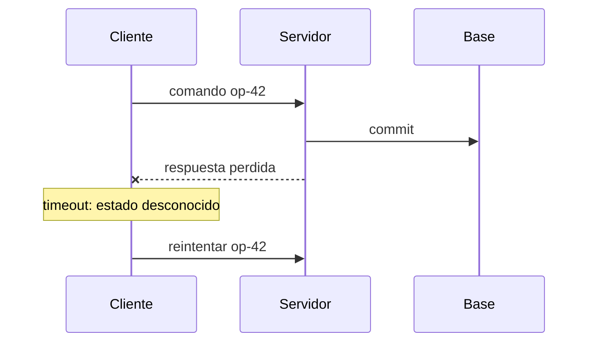
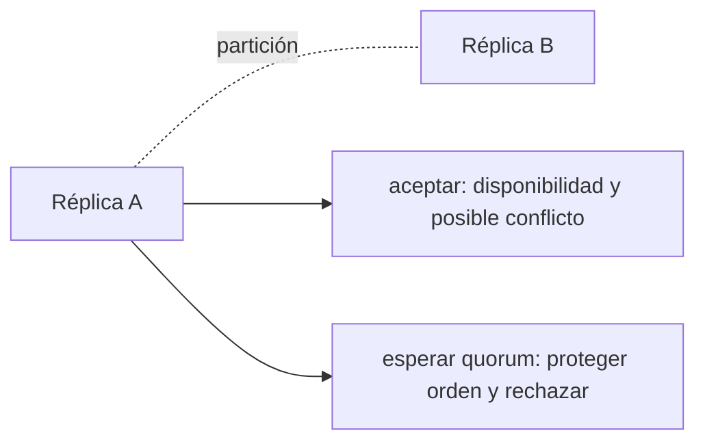
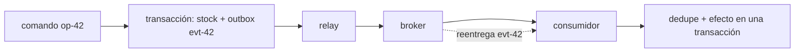
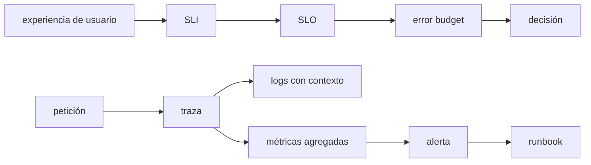
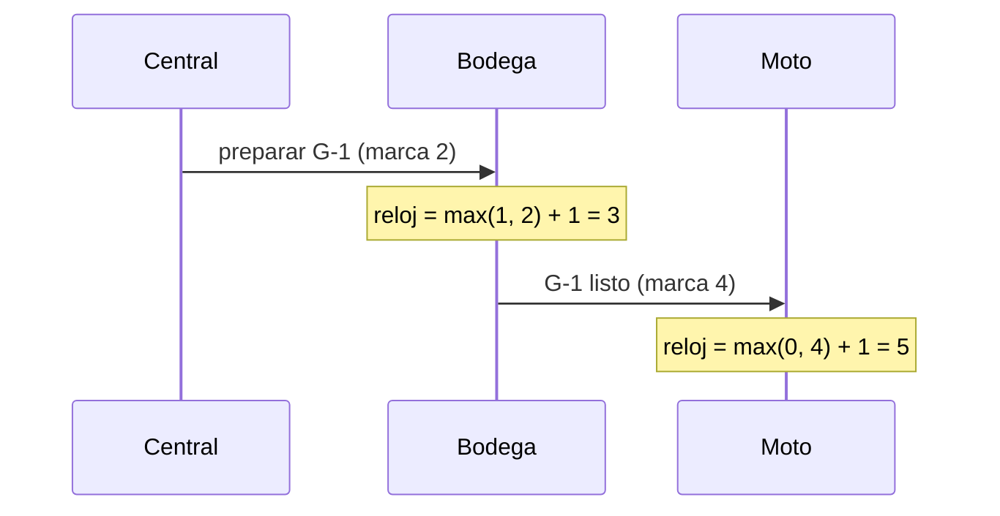
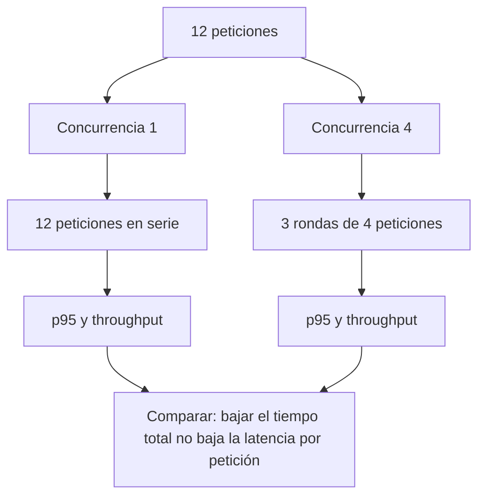
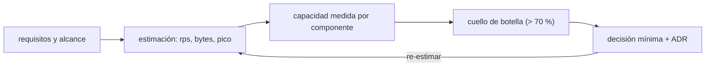

# Módulo 10: Sistemas distribuidos, resiliencia y observabilidad

Una aplicación local puede asumir que una llamada termina o falla de forma visible. Cuando dos procesos se comunican por red aparece una tercera posibilidad: el resultado es **desconocido**. La respuesta puede perderse después de que el servidor confirmó un pedido; un mensaje puede llegar dos veces; dos réplicas pueden observar órdenes diferentes. Este módulo enseña a razonar bajo esa incertidumbre sin prometer garantías que el sistema no puede cumplir.


## Aprende construyendo


### Tema 1: La red convierte el resultado en una incertidumbre · Avanzado · 45 min

<details open>
<summary><strong>Capa 1 — Lectura</strong></summary>

#### ► DE QUÉ TRATA
Al finalizar vas a simular un timeout real al confirmar una entrega de RutaFlow, y a comprobar por qué el cliente no puede saber qué pasó del otro lado. Prerrequisitos: Python 3 instalado.

#### ► LA IDEA EN UNA FRASE
**Al finalizar vas a simular un timeout real al confirmar una entrega de RutaFlow, y a comprobar por qué el cliente no puede saber qué pasó del otro lado.**

#### ► POR QUÉ EXISTE ESTO
Resuelve un problema real de diseño o implementación y evita decisiones a ciegas.

#### ► LA ANALOGÍA
Piensa en la red convierte el resultado en una incertidumbre como una herramienta de taller: útil cuando conoces su propósito y sus límites.
**Dónde se rompe la analogía:** en software, los efectos dependen del contexto, la escala y los trade-offs.

#### ► CÓMO FUNCIONA


#### ► LO QUE PUEDE SALIR MAL
| Síntoma | Causa probable | Arreglo |
|---|---|---|
| La red convierte el resultado en una incertidumbre se aplica pero el resultado no mejora | Se usó sin medir el problema real | Mide antes y compara contra la alternativa simple |
| Aparece complejidad inesperada | Se adoptó la técnica sin comprender sus trade-offs | Vuelve a la sección de trade-offs y reduce el alcance |
| Falla en un caso límite | Se asumió un contexto que no se cumple | Prueba el caso límite y documenta cuándo NO usarlo |

#### ► TRADE-OFFS
| Opción | Cuándo usarla | Cuándo NO usarla |
|---|---|---|
| Usar La red convierte el resultado en una incertidumbre | Cuando el problema coincide con su propósito y el beneficio es observable | Cuando agrega complejidad sin resolver un problema real |
| Alternativa más simple | Cuando el contexto es pequeño, estable o fácil de razonar | Cuando ya demostró no escalar o no cumplir el requisito |
| Postergar la decisión | Cuando falta evidencia del problema | Cuando el costo de esperar es mayor que el costo de probar |

#### ► CUÁNDO NO USAR ESTO
No uses la red convierte el resultado en una incertidumbre por defecto. Aplícalo cuando el problema lo justifique y puedas verificar el beneficio; si una alternativa más simple resuelve igual, prefiérela.

#### ► DE VUELTA A LA ANALOGÍA
Volviendo a la analogía: la red convierte el resultado en una incertidumbre funciona como el modelo inicial, pero recuerda dónde se rompe: en producción importan la evidencia, la escala y el costo de equivocarte.

#### ► LO QUE DEBES RECORDAR
- La red convierte el resultado en una incertidumbre existe para resolver un problema específico.
- Mide antes de adoptar complejidad.
- Conoce el caso donde NO usarlo.
- Verifica con evidencia observable.

#### ► PREGUNTAS PARA PENSAR
1. ¿Qué problema concreto resuelve la red convierte el resultado en una incertidumbre en tu contexto?
2. ¿Cómo sabrías que la red convierte el resultado en una incertidumbre no está funcionando bien?
3. ¿Qué alternativa más simple considerarías antes de usar la red convierte el resultado en una incertidumbre?

</details>

<details>
<summary><strong>Capa 2 — Construcción</strong></summary>

#### Código y verificación
```python
from dataclasses import dataclass

@dataclass(frozen=True)
class Command:
    operation_id: str
    product_id: int
    quantity: int

def withdraw(client, command: Command, deadline_seconds: float):
    # operation_id conserva identidad a través de reintentos.
    return client.post("/withdrawals", json=command.__dict__, timeout=deadline_seconds)
```


```bash
mkdir ejemplo && cd ejemplo
```

```python
import socket

def confirmar_con_timeout(sock, command_id, segundos=2):
    sock.settimeout(segundos)
    try:
        sock.sendall(f"CONFIRMAR {command_id}".encode())
        return sock.recv(1024)
    except socket.timeout:
        return None  # estado desconocido: no sabemos si el servidor procesó el comando
```

```bash
python3 ejemplo.py
```

</details>

### Tema 2: Replicación, consistencia y decisiones explícitas · Avanzado · 45 min

<details open>
<summary><strong>Capa 1 — Lectura</strong></summary>

#### ► DE QUÉ TRATA
Al finalizar vas a simular una lectura obsoleta real sobre una réplica de ShipmentEvents de RutaFlow, y a decidir si ese envío específico tolera esa inconsistencia. Prerrequisitos: ninguno adicional.

#### ► LA IDEA EN UNA FRASE
**Al finalizar vas a simular una lectura obsoleta real sobre una réplica de ShipmentEvents de RutaFlow, y a decidir si ese envío específico tolera esa inconsistencia.**

#### ► POR QUÉ EXISTE ESTO
Resuelve un problema real de diseño o implementación y evita decisiones a ciegas.

#### ► LA ANALOGÍA
Piensa en replicación, consistencia y decisiones explícitas como una herramienta de taller: útil cuando conoces su propósito y sus límites.
**Dónde se rompe la analogía:** en software, los efectos dependen del contexto, la escala y los trade-offs.

#### ► CÓMO FUNCIONA


#### ► LO QUE PUEDE SALIR MAL
| Síntoma | Causa probable | Arreglo |
|---|---|---|
| Replicación, consistencia y decisiones explícitas se aplica pero el resultado no mejora | Se usó sin medir el problema real | Mide antes y compara contra la alternativa simple |
| Aparece complejidad inesperada | Se adoptó la técnica sin comprender sus trade-offs | Vuelve a la sección de trade-offs y reduce el alcance |
| Falla en un caso límite | Se asumió un contexto que no se cumple | Prueba el caso límite y documenta cuándo NO usarlo |

#### ► TRADE-OFFS
| Opción | Cuándo usarla | Cuándo NO usarla |
|---|---|---|
| Usar Replicación, consistencia y decisiones explícitas | Cuando el problema coincide con su propósito y el beneficio es observable | Cuando agrega complejidad sin resolver un problema real |
| Alternativa más simple | Cuando el contexto es pequeño, estable o fácil de razonar | Cuando ya demostró no escalar o no cumplir el requisito |
| Postergar la decisión | Cuando falta evidencia del problema | Cuando el costo de esperar es mayor que el costo de probar |

#### ► CUÁNDO NO USAR ESTO
No uses replicación, consistencia y decisiones explícitas por defecto. Aplícalo cuando el problema lo justifique y puedas verificar el beneficio; si una alternativa más simple resuelve igual, prefiérela.

#### ► DE VUELTA A LA ANALOGÍA
Volviendo a la analogía: replicación, consistencia y decisiones explícitas funciona como el modelo inicial, pero recuerda dónde se rompe: en producción importan la evidencia, la escala y el costo de equivocarte.

#### ► LO QUE DEBES RECORDAR
- Replicación, consistencia y decisiones explícitas existe para resolver un problema específico.
- Mide antes de adoptar complejidad.
- Conoce el caso donde NO usarlo.
- Verifica con evidencia observable.

#### ► PREGUNTAS PARA PENSAR
1. ¿Qué problema concreto resuelve replicación, consistencia y decisiones explícitas en tu contexto?
2. ¿Cómo sabrías que replicación, consistencia y decisiones explícitas no está funcionando bien?
3. ¿Qué alternativa más simple considerarías antes de usar replicación, consistencia y decisiones explícitas?

</details>

<details>
<summary><strong>Capa 2 — Construcción</strong></summary>

#### Código y verificación
```text
Invariante fuerte: ninguna ubicación vende más unidades de las asignadas.
Opción A: coordinar cada venta con autoridad central.
Opción B: reservar cupos por ubicación y reconciliar transferencias.
```


```bash
mkdir ejemplo && cd ejemplo
```

```python
primaria = {"env-4471": "entregado"}
replica = {"env-4471": "en_ruta"}  # todavía no recibió la replicación

def leer_estado(fuente, shipment_id):
    return fuente.get(shipment_id)

print("primaria:", leer_estado(primaria, "env-4471"))
print("réplica (obsoleta):", leer_estado(replica, "env-4471"))
```

```bash
python3 ejemplo.py
```

</details>

### Tema 3: Mensajes que se procesan con efectos exactamente una vez · Avanzado · 45 min

<details open>
<summary><strong>Capa 1 — Lectura</strong></summary>

#### ► DE QUÉ TRATA
Al finalizar vas a implementar y ejecutar confirmDelivery para comprobar que logra el efecto "exactamente una vez" aunque el comando llegue duplicado. Prerrequisitos: Node.js 24 o posterior para ejecutar TypeScript con borrado de tipos.

#### ► LA IDEA EN UNA FRASE
**Al finalizar vas a implementar y ejecutar confirmDelivery para comprobar que logra el efecto "exactamente una vez" aunque el comando llegue duplicado.**

#### ► POR QUÉ EXISTE ESTO
Resuelve un problema real de diseño o implementación y evita decisiones a ciegas.

#### ► LA ANALOGÍA
Piensa en mensajes que se procesan con efectos exactamente una vez como una herramienta de taller: útil cuando conoces su propósito y sus límites.
**Dónde se rompe la analogía:** en software, los efectos dependen del contexto, la escala y los trade-offs.

#### ► CÓMO FUNCIONA


#### ► LO QUE PUEDE SALIR MAL
| Síntoma | Causa probable | Arreglo |
|---|---|---|
| Mensajes que se procesan con efectos exactamente una vez se aplica pero el resultado no mejora | Se usó sin medir el problema real | Mide antes y compara contra la alternativa simple |
| Aparece complejidad inesperada | Se adoptó la técnica sin comprender sus trade-offs | Vuelve a la sección de trade-offs y reduce el alcance |
| Falla en un caso límite | Se asumió un contexto que no se cumple | Prueba el caso límite y documenta cuándo NO usarlo |

#### ► TRADE-OFFS
| Opción | Cuándo usarla | Cuándo NO usarla |
|---|---|---|
| Usar Mensajes que se procesan con efectos exactamente una vez | Cuando el problema coincide con su propósito y el beneficio es observable | Cuando agrega complejidad sin resolver un problema real |
| Alternativa más simple | Cuando el contexto es pequeño, estable o fácil de razonar | Cuando ya demostró no escalar o no cumplir el requisito |
| Postergar la decisión | Cuando falta evidencia del problema | Cuando el costo de esperar es mayor que el costo de probar |

#### ► CUÁNDO NO USAR ESTO
No uses mensajes que se procesan con efectos exactamente una vez por defecto. Aplícalo cuando el problema lo justifique y puedas verificar el beneficio; si una alternativa más simple resuelve igual, prefiérela.

#### ► DE VUELTA A LA ANALOGÍA
Volviendo a la analogía: mensajes que se procesan con efectos exactamente una vez funciona como el modelo inicial, pero recuerda dónde se rompe: en producción importan la evidencia, la escala y el costo de equivocarte.

#### ► LO QUE DEBES RECORDAR
- Mensajes que se procesan con efectos exactamente una vez existe para resolver un problema específico.
- Mide antes de adoptar complejidad.
- Conoce el caso donde NO usarlo.
- Verifica con evidencia observable.

#### ► PREGUNTAS PARA PENSAR
1. ¿Qué problema concreto resuelve mensajes que se procesan con efectos exactamente una vez en tu contexto?
2. ¿Cómo sabrías que mensajes que se procesan con efectos exactamente una vez no está funcionando bien?
3. ¿Qué alternativa más simple considerarías antes de usar mensajes que se procesan con efectos exactamente una vez?

</details>

<details>
<summary><strong>Capa 2 — Construcción</strong></summary>

#### Código y verificación
```sql
BEGIN;
UPDATE products SET stock = stock - 1
 WHERE id = 7 AND stock >= 1;
INSERT INTO outbox(event_id, kind, payload, published)
 VALUES ('evt-42', 'StockWithdrawn', '{"product_id":7}', 0);
COMMIT;
```


```bash
mkdir ejemplo-mensajes && cd ejemplo-mensajes
```

```typescript
export type DeliveryCommand = Readonly<{
  commandId: string;
  shipmentId: string;
  occurredAt: string;
  recipientPin: string;
}>;

export interface DeliveryRepository {
  findCommandResult(commandId: string): Promise<DeliveryResult | null>;
  confirm(command: DeliveryCommand): Promise<DeliveryResult>;
}

export type DeliveryResult = Readonly<{ shipmentId: string; status: 'delivered' }>;

export async function confirmDelivery(
  command: DeliveryCommand,
  repository: DeliveryRepository,
): Promise<DeliveryResult> {
  if (!command.commandId || !command.shipmentId) throw new TypeError('command identifiers are required');
  if (!/^\d{6}$/.test(command.recipientPin)) throw new TypeError('recipientPin must contain six digits');
  const previousResult = await repository.findCommandResult(command.commandId);
  if (previousResult) return previousResult;
  return repository.confirm(command);
}
```

```typescript
import { confirmDelivery, type DeliveryRepository, type DeliveryResult } from './confirm-delivery.ts';

const resultados = new Map<string, DeliveryResult>();
let confirmaciones = 0;
const repo: DeliveryRepository = {
  async findCommandResult(commandId) { return resultados.get(commandId) ?? null; },
  async confirm(command) {
    confirmaciones += 1;
    const result = { shipmentId: command.shipmentId, status: 'delivered' as const };
    resultados.set(command.commandId, result);
    return result;
  },
};

const comando = {
  commandId: 'cmd-1', shipmentId: 'env-4471',
  occurredAt: '2026-10-05', recipientPin: '837201',
};
console.log(await confirmDelivery(comando, repo));
console.log(await confirmDelivery(comando, repo)); // mismo commandId, reenviado
console.log('confirmaciones reales:', confirmaciones);
```

```bash
node reintentos.ts
```

</details>

### Tema 4: Resiliencia y observabilidad orientadas a objetivos · Avanzado · 45 min

<details open>
<summary><strong>Capa 1 — Lectura</strong></summary>

#### ► DE QUÉ TRATA
Al finalizar vas a definir un SLI/SLO real para confirmar-entrega de RutaFlow, y a medir cuánto presupuesto de error consume una dependencia lenta. Prerrequisitos: Python 3 instalado.

#### ► LA IDEA EN UNA FRASE
**Al finalizar vas a definir un SLI/SLO real para confirmar-entrega de RutaFlow, y a medir cuánto presupuesto de error consume una dependencia lenta.**

#### ► POR QUÉ EXISTE ESTO
Resuelve un problema real de diseño o implementación y evita decisiones a ciegas.

#### ► LA ANALOGÍA
Piensa en resiliencia y observabilidad orientadas a objetivos como una herramienta de taller: útil cuando conoces su propósito y sus límites.
**Dónde se rompe la analogía:** en software, los efectos dependen del contexto, la escala y los trade-offs.

#### ► CÓMO FUNCIONA


#### ► LO QUE PUEDE SALIR MAL
| Síntoma | Causa probable | Arreglo |
|---|---|---|
| Resiliencia y observabilidad orientadas a objetivos se aplica pero el resultado no mejora | Se usó sin medir el problema real | Mide antes y compara contra la alternativa simple |
| Aparece complejidad inesperada | Se adoptó la técnica sin comprender sus trade-offs | Vuelve a la sección de trade-offs y reduce el alcance |
| Falla en un caso límite | Se asumió un contexto que no se cumple | Prueba el caso límite y documenta cuándo NO usarlo |

#### ► TRADE-OFFS
| Opción | Cuándo usarla | Cuándo NO usarla |
|---|---|---|
| Usar Resiliencia y observabilidad orientadas a objetivos | Cuando el problema coincide con su propósito y el beneficio es observable | Cuando agrega complejidad sin resolver un problema real |
| Alternativa más simple | Cuando el contexto es pequeño, estable o fácil de razonar | Cuando ya demostró no escalar o no cumplir el requisito |
| Postergar la decisión | Cuando falta evidencia del problema | Cuando el costo de esperar es mayor que el costo de probar |

#### ► CUÁNDO NO USAR ESTO
No uses resiliencia y observabilidad orientadas a objetivos por defecto. Aplícalo cuando el problema lo justifique y puedas verificar el beneficio; si una alternativa más simple resuelve igual, prefiérela.

#### ► DE VUELTA A LA ANALOGÍA
Volviendo a la analogía: resiliencia y observabilidad orientadas a objetivos funciona como el modelo inicial, pero recuerda dónde se rompe: en producción importan la evidencia, la escala y el costo de equivocarte.

#### ► LO QUE DEBES RECORDAR
- Resiliencia y observabilidad orientadas a objetivos existe para resolver un problema específico.
- Mide antes de adoptar complejidad.
- Conoce el caso donde NO usarlo.
- Verifica con evidencia observable.

#### ► PREGUNTAS PARA PENSAR
1. ¿Qué problema concreto resuelve resiliencia y observabilidad orientadas a objetivos en tu contexto?
2. ¿Cómo sabrías que resiliencia y observabilidad orientadas a objetivos no está funcionando bien?
3. ¿Qué alternativa más simple considerarías antes de usar resiliencia y observabilidad orientadas a objetivos?

</details>

<details>
<summary><strong>Capa 2 — Construcción</strong></summary>

#### Código y verificación
```python
def availability_sli(events):
    eligible = [e for e in events if e["valid_request"]]
    good = [e for e in eligible if e["status"] == "ok" and e["ms"] <= 300]
    return len(good) / len(eligible) if eligible else 1.0
```


```bash
mkdir ejemplo && cd ejemplo
```

```python
def sli_confirmaciones(eventos):
    elegibles = [e for e in eventos if e["valido"]]
    buenos = [e for e in elegibles if e["estado"] == "ok" and e["ms"] <= 300]
    return len(buenos) / len(elegibles) if elegibles else 1.0

eventos = [
    {"valido": True, "estado": "ok", "ms": 120},
    {"valido": True, "estado": "ok", "ms": 280},
    {"valido": True, "estado": "ok", "ms": 900},  # el proveedor de SMS respondió lento
]
print(sli_confirmaciones(eventos))
```

```bash
python3 ejemplo.py
```

</details>

### Tema 5: Tiempo, coordinación y acuerdo: Lamport, elección de líder y commit en dos fases · Avanzado · 45 min

<details open>
<summary><strong>Capa 1 — Lectura</strong></summary>

#### ► DE QUÉ TRATA
Al finalizar podrás ordenar eventos sin reloj global con relojes lógicos de Lamport, elegir un coordinador cuando el anterior falla con el algoritmo del matón (bully) y explicar cómo el commit en dos fases (2PC) logra que todos confirmen o nadie lo haga. Prerrequisitos: Temas 1 a…

#### ► LA IDEA EN UNA FRASE
**Al finalizar podrás ordenar eventos sin reloj global con relojes lógicos de Lamport, elegir un coordinador cuando el anterior falla con el algoritmo del matón (bully) y explicar cómo el commit en dos fases (2PC) logra que todos confirmen o nadie lo haga.**

#### ► POR QUÉ EXISTE ESTO
Resuelve un problema real de diseño o implementación y evita decisiones a ciegas.

#### ► LA ANALOGÍA
Piensa en tiempo, coordinación y acuerdo: lamport, elección de líder y commit en dos fases como una herramienta de taller: útil cuando conoces su propósito y sus límites.
**Dónde se rompe la analogía:** en software, los efectos dependen del contexto, la escala y los trade-offs.

#### ► CÓMO FUNCIONA


#### ► LO QUE PUEDE SALIR MAL
| Síntoma | Causa probable | Arreglo |
|---|---|---|
| Tiempo, coordinación y acuerdo: Lamport, elección de líder y commit en dos fases se aplica pero el resultado no mejora | Se usó sin medir el problema real | Mide antes y compara contra la alternativa simple |
| Aparece complejidad inesperada | Se adoptó la técnica sin comprender sus trade-offs | Vuelve a la sección de trade-offs y reduce el alcance |
| Falla en un caso límite | Se asumió un contexto que no se cumple | Prueba el caso límite y documenta cuándo NO usarlo |

#### ► TRADE-OFFS
| Opción | Cuándo usarla | Cuándo NO usarla |
|---|---|---|
| Usar Tiempo, coordinación y acuerdo: Lamport, elección de líder y commit en dos fases | Cuando el problema coincide con su propósito y el beneficio es observable | Cuando agrega complejidad sin resolver un problema real |
| Alternativa más simple | Cuando el contexto es pequeño, estable o fácil de razonar | Cuando ya demostró no escalar o no cumplir el requisito |
| Postergar la decisión | Cuando falta evidencia del problema | Cuando el costo de esperar es mayor que el costo de probar |

#### ► CUÁNDO NO USAR ESTO
No uses tiempo, coordinación y acuerdo: lamport, elección de líder y commit en dos fases por defecto. Aplícalo cuando el problema lo justifique y puedas verificar el beneficio; si una alternativa más simple resuelve igual, prefiérela.

#### ► DE VUELTA A LA ANALOGÍA
Volviendo a la analogía: tiempo, coordinación y acuerdo: lamport, elección de líder y commit en dos fases funciona como el modelo inicial, pero recuerda dónde se rompe: en producción importan la evidencia, la escala y el costo de equivocarte.

#### ► LO QUE DEBES RECORDAR
- Tiempo, coordinación y acuerdo: Lamport, elección de líder y commit en dos fases existe para resolver un problema específico.
- Mide antes de adoptar complejidad.
- Conoce el caso donde NO usarlo.
- Verifica con evidencia observable.

#### ► PREGUNTAS PARA PENSAR
1. ¿Qué problema concreto resuelve tiempo, coordinación y acuerdo: lamport, elección de líder y commit en dos fases en tu contexto?
2. ¿Cómo sabrías que tiempo, coordinación y acuerdo: lamport, elección de líder y commit en dos fases no está funcionando bien?
3. ¿Qué alternativa más simple considerarías antes de usar tiempo, coordinación y acuerdo: lamport, elección de líder y commit en dos fases?

</details>

<details>
<summary><strong>Capa 2 — Construcción</strong></summary>

#### Código y verificación


```bash
mkdir distribuidos && cd distribuidos
```

```python
import random

# --- 1. Relojes lógicos de Lamport: ordenar eventos sin un reloj global
class Nodo:
    def __init__(self, nombre):
        self.nombre, self.reloj, self.log = nombre, 0, []
    def evento(self, texto):
        self.reloj += 1
        self.log.append((self.reloj, self.nombre, texto))
    def enviar(self, texto):
        self.evento(f"envía {texto}")
        return (self.reloj, texto)
    def recibir(self, mensaje):
        marca, texto = mensaje
        self.reloj = max(self.reloj, marca) + 1          # regla de Lamport
        self.log.append((self.reloj, self.nombre, f"recibe {texto}"))

central, bodega, moto = Nodo("central"), Nodo("bodega"), Nodo("moto")
central.evento("crea pedido G-1")
m1 = central.enviar("preparar G-1")
bodega.evento("revisa inventario")
bodega.recibir(m1)
m2 = bodega.enviar("G-1 listo")
moto.recibir(m2)
moto.evento("entrega G-1")
print("Orden por reloj de Lamport:")
for marca, nodo, texto in sorted(central.log + bodega.log + moto.log):
    print(f"  {marca:>2} {nodo:<8} {texto}")

# --- 2. Elección de líder con el algoritmo del matón (bully)
def bully(vivos, iniciador):
    mayores = [n for n in vivos if n > iniciador]
    if not mayores:
        return iniciador                                 # nadie mayor respondió: gana
    return bully(vivos, min(mayores))                    # el siguiente mayor toma la elección
servidores = [1, 2, 3, 4, 5]
caido = 5
vivos = [s for s in servidores if s != caido]
print(f"\nCayó el coordinador {caido}; el nodo 2 inicia la elección -> nuevo líder: {bully(vivos, 2)}")

# --- 3. Commit en dos fases (2PC): todos confirman o nadie confirma
def dos_fases(participantes):
    votos = {nombre: voto() for nombre, voto in participantes.items()}   # fase 1: preparar
    decision = "COMMIT" if all(votos.values()) else "ABORT"             # fase 2: decidir
    return votos, decision
random.seed(3)
for intento in range(1, 3):
    votos, decision = dos_fases({
        "inventario": lambda: True,
        "pagos": lambda: random.random() > 0.4,
        "despacho": lambda: True,
    })
    print(f"Transacción {intento}: votos={votos} -> {decision}")
```

```bash
python3 distribuidos.py
```

```text
Orden por reloj de Lamport:
   1 bodega   revisa inventario
   1 central  crea pedido G-1
   2 central  envía preparar G-1
   3 bodega   recibe preparar G-1
   4 bodega   envía G-1 listo
   5 moto     recibe G-1 listo
   6 moto     entrega G-1

Cayó el coordinador 5; el nodo 2 inicia la elección -> nuevo líder: 4
Transacción 1: votos={'inventario': True, 'pagos': False, 'despacho': True} -> ABORT
Transacción 2: votos={'inventario': True, 'pagos': True, 'despacho': True} -> COMMIT
```

</details>

### Proyecto 10: inventario distribuido mínimo y observable

<details open>
<summary><strong>Capa 1 — Lectura</strong></summary>

#### ► DE QUÉ TRATA
Este tema te guía por proyecto 10: inventario distribuido mínimo y observable con foco en comprensión antes de implementación.

#### ► LA IDEA EN UNA FRASE
**Entender proyecto 10: inventario distribuido mínimo y observable te permite tomar mejores decisiones técnicas.**

#### ► POR QUÉ EXISTE ESTO
Resuelve un problema real de diseño o implementación y evita decisiones a ciegas.

#### ► LA ANALOGÍA
Piensa en proyecto 10: inventario distribuido mínimo y observable como una herramienta de taller: útil cuando conoces su propósito y sus límites.
**Dónde se rompe la analogía:** en software, los efectos dependen del contexto, la escala y los trade-offs.

#### ► CÓMO FUNCIONA
1. Identifica el problema que proyecto 10: inventario distribuido mínimo y observable resuelve.
2. Observa sus componentes y relaciones.
3. Aplica la opción más simple que funcione.
4. Verifica el resultado y los límites.

#### ► LO QUE PUEDE SALIR MAL
| Síntoma | Causa probable | Arreglo |
|---|---|---|
| Proyecto 10: inventario distribuido mínimo y observable se aplica pero el resultado no mejora | Se usó sin medir el problema real | Mide antes y compara contra la alternativa simple |
| Aparece complejidad inesperada | Se adoptó la técnica sin comprender sus trade-offs | Vuelve a la sección de trade-offs y reduce el alcance |
| Falla en un caso límite | Se asumió un contexto que no se cumple | Prueba el caso límite y documenta cuándo NO usarlo |

#### ► TRADE-OFFS
| Opción | Cuándo usarla | Cuándo NO usarla |
|---|---|---|
| Usar Proyecto 10: inventario distribuido mínimo y observable | Cuando el problema coincide con su propósito y el beneficio es observable | Cuando agrega complejidad sin resolver un problema real |
| Alternativa más simple | Cuando el contexto es pequeño, estable o fácil de razonar | Cuando ya demostró no escalar o no cumplir el requisito |
| Postergar la decisión | Cuando falta evidencia del problema | Cuando el costo de esperar es mayor que el costo de probar |

#### ► CUÁNDO NO USAR ESTO
No uses proyecto 10: inventario distribuido mínimo y observable por defecto. Aplícalo cuando el problema lo justifique y puedas verificar el beneficio; si una alternativa más simple resuelve igual, prefiérela.

#### ► DE VUELTA A LA ANALOGÍA
Volviendo a la analogía: proyecto 10: inventario distribuido mínimo y observable funciona como el modelo inicial, pero recuerda dónde se rompe: en producción importan la evidencia, la escala y el costo de equivocarte.

#### ► LO QUE DEBES RECORDAR
- Proyecto 10: inventario distribuido mínimo y observable existe para resolver un problema específico.
- Mide antes de adoptar complejidad.
- Conoce el caso donde NO usarlo.
- Verifica con evidencia observable.

#### ► PREGUNTAS PARA PENSAR
1. ¿Qué problema concreto resuelve proyecto 10: inventario distribuido mínimo y observable en tu contexto?
2. ¿Cómo sabrías que proyecto 10: inventario distribuido mínimo y observable no está funcionando bien?
3. ¿Qué alternativa más simple considerarías antes de usar proyecto 10: inventario distribuido mínimo y observable?

</details>

<details>
<summary><strong>Capa 2 — Construcción</strong></summary>

#### Nota de construcción
Este tema es principalmente conceptual en esta versión. La verificación se realiza con las preguntas de comprensión y el criterio de cuándo NO usar proyecto 10: inventario distribuido mínimo y observable.

</details>

### Tema 6: Latencia y throughput: medir concurrencia sin confundirla con capacidad ilimitada · Avanzado · 45 min

<details open>
<summary><strong>Capa 1 — Lectura</strong></summary>

#### ► DE QUÉ TRATA
Al finalizar medirás latencia p95 y peticiones por segundo en dos niveles de concurrencia, conservando el número total de peticiones. Prerrequisitos: Node 24, HTTP, promesas y noción de percentil. Es un ejemplo independiente desde carpeta vacía, con servidor local y sin paquetes.

#### ► LA IDEA EN UNA FRASE
**Al finalizar medirás latencia p95 y peticiones por segundo en dos niveles de concurrencia, conservando el número total de peticiones.**

#### ► POR QUÉ EXISTE ESTO
Resuelve un problema real de diseño o implementación y evita decisiones a ciegas.

#### ► LA ANALOGÍA
Piensa en latencia y throughput: medir concurrencia sin confundirla con capacidad ilimitada como una herramienta de taller: útil cuando conoces su propósito y sus límites.
**Dónde se rompe la analogía:** en software, los efectos dependen del contexto, la escala y los trade-offs.

#### ► CÓMO FUNCIONA


#### ► LO QUE PUEDE SALIR MAL
| Síntoma | Causa probable | Arreglo |
|---|---|---|
| Latencia y throughput: medir concurrencia sin confundirla con capacidad ilimitada se aplica pero el resultado no mejora | Se usó sin medir el problema real | Mide antes y compara contra la alternativa simple |
| Aparece complejidad inesperada | Se adoptó la técnica sin comprender sus trade-offs | Vuelve a la sección de trade-offs y reduce el alcance |
| Falla en un caso límite | Se asumió un contexto que no se cumple | Prueba el caso límite y documenta cuándo NO usarlo |

#### ► TRADE-OFFS
| Opción | Cuándo usarla | Cuándo NO usarla |
|---|---|---|
| Usar Latencia y throughput: medir concurrencia sin confundirla con capacidad ilimitada | Cuando el problema coincide con su propósito y el beneficio es observable | Cuando agrega complejidad sin resolver un problema real |
| Alternativa más simple | Cuando el contexto es pequeño, estable o fácil de razonar | Cuando ya demostró no escalar o no cumplir el requisito |
| Postergar la decisión | Cuando falta evidencia del problema | Cuando el costo de esperar es mayor que el costo de probar |

#### ► CUÁNDO NO USAR ESTO
No uses latencia y throughput: medir concurrencia sin confundirla con capacidad ilimitada por defecto. Aplícalo cuando el problema lo justifique y puedas verificar el beneficio; si una alternativa más simple resuelve igual, prefiérela.

#### ► DE VUELTA A LA ANALOGÍA
Volviendo a la analogía: latencia y throughput: medir concurrencia sin confundirla con capacidad ilimitada funciona como el modelo inicial, pero recuerda dónde se rompe: en producción importan la evidencia, la escala y el costo de equivocarte.

#### ► LO QUE DEBES RECORDAR
- Latencia y throughput: medir concurrencia sin confundirla con capacidad ilimitada existe para resolver un problema específico.
- Mide antes de adoptar complejidad.
- Conoce el caso donde NO usarlo.
- Verifica con evidencia observable.

#### ► PREGUNTAS PARA PENSAR
1. ¿Qué problema concreto resuelve latencia y throughput: medir concurrencia sin confundirla con capacidad ilimitada en tu contexto?
2. ¿Cómo sabrías que latencia y throughput: medir concurrencia sin confundirla con capacidad ilimitada no está funcionando bien?
3. ¿Qué alternativa más simple considerarías antes de usar latencia y throughput: medir concurrencia sin confundirla con capacidad ilimitada?

</details>

<details>
<summary><strong>Capa 2 — Construcción</strong></summary>

#### Código y verificación


```bash
mkdir ejemplo-capacidad && cd ejemplo-capacidad
```

```javascript
import { createServer } from 'node:http';
import { performance } from 'node:perf_hooks';
import assert from 'node:assert/strict';

const server = createServer((_req, res) => setTimeout(() => res.end('ok'), 20));
await new Promise(resolve => server.listen(0, '127.0.0.1', resolve));
const url = `http://127.0.0.1:${server.address().port}`;
try {
  for (const concurrency of [1, 4]) {
    let next = 0;
    const latencies = [];
    const started = performance.now();
    await Promise.all(Array.from({ length: concurrency }, async () => {
      while (next++ < 12) {
        const start = performance.now();
        const response = await fetch(url);
        assert.equal(await response.text(), 'ok');
        latencies.push(performance.now() - start);
      }
    }));
    const elapsed = performance.now() - started;
    latencies.sort((a, b) => a - b);
    assert.equal(latencies.length, 12);
    console.log(JSON.stringify({ concurrency, requests: latencies.length,
      p95Ms: Math.round(latencies[Math.ceil(.95 * latencies.length) - 1]),
      requestsPerSecond: Math.round(12 / (elapsed / 1000)) }));
  }
} finally {
  await new Promise(resolve => server.close(resolve));
}
```

```bash
node medir.mjs
```

</details>

### Tema 7: Diseño de sistemas: de requisitos a estimación de capacidad y cuello de botella · Avanzado · 45 min

<details open>
<summary><strong>Capa 1 — Lectura</strong></summary>

#### ► DE QUÉ TRATA
Al finalizar vas a convertir los requisitos de una función del inventario en números (peticiones por segundo, almacenamiento, ancho de banda), identificar qué componente se satura primero y justificar una decisión de diseño con esa estimación. Prerrequisitos: el Tema 6 de este mó…

#### ► LA IDEA EN UNA FRASE
**Al finalizar vas a convertir los requisitos de una función del inventario en números (peticiones por segundo, almacenamiento, ancho de banda), identificar qué componente se satura primero y justificar una decisión de diseño con esa estimación.**

#### ► POR QUÉ EXISTE ESTO
Resuelve un problema real de diseño o implementación y evita decisiones a ciegas.

#### ► LA ANALOGÍA
Piensa en diseño de sistemas: de requisitos a estimación de capacidad y cuello de botella como una herramienta de taller: útil cuando conoces su propósito y sus límites.
**Dónde se rompe la analogía:** en software, los efectos dependen del contexto, la escala y los trade-offs.

#### ► CÓMO FUNCIONA


#### ► LO QUE PUEDE SALIR MAL
| Síntoma | Causa probable | Arreglo |
|---|---|---|
| Diseño de sistemas: de requisitos a estimación de capacidad y cuello de botella se aplica pero el resultado no mejora | Se usó sin medir el problema real | Mide antes y compara contra la alternativa simple |
| Aparece complejidad inesperada | Se adoptó la técnica sin comprender sus trade-offs | Vuelve a la sección de trade-offs y reduce el alcance |
| Falla en un caso límite | Se asumió un contexto que no se cumple | Prueba el caso límite y documenta cuándo NO usarlo |

#### ► TRADE-OFFS
| Opción | Cuándo usarla | Cuándo NO usarla |
|---|---|---|
| Usar Diseño de sistemas: de requisitos a estimación de capacidad y cuello de botella | Cuando el problema coincide con su propósito y el beneficio es observable | Cuando agrega complejidad sin resolver un problema real |
| Alternativa más simple | Cuando el contexto es pequeño, estable o fácil de razonar | Cuando ya demostró no escalar o no cumplir el requisito |
| Postergar la decisión | Cuando falta evidencia del problema | Cuando el costo de esperar es mayor que el costo de probar |

#### ► CUÁNDO NO USAR ESTO
No uses diseño de sistemas: de requisitos a estimación de capacidad y cuello de botella por defecto. Aplícalo cuando el problema lo justifique y puedas verificar el beneficio; si una alternativa más simple resuelve igual, prefiérela.

#### ► DE VUELTA A LA ANALOGÍA
Volviendo a la analogía: diseño de sistemas: de requisitos a estimación de capacidad y cuello de botella funciona como el modelo inicial, pero recuerda dónde se rompe: en producción importan la evidencia, la escala y el costo de equivocarte.

#### ► LO QUE DEBES RECORDAR
- Diseño de sistemas: de requisitos a estimación de capacidad y cuello de botella existe para resolver un problema específico.
- Mide antes de adoptar complejidad.
- Conoce el caso donde NO usarlo.
- Verifica con evidencia observable.

#### ► PREGUNTAS PARA PENSAR
1. ¿Qué problema concreto resuelve diseño de sistemas: de requisitos a estimación de capacidad y cuello de botella en tu contexto?
2. ¿Cómo sabrías que diseño de sistemas: de requisitos a estimación de capacidad y cuello de botella no está funcionando bien?
3. ¿Qué alternativa más simple considerarías antes de usar diseño de sistemas: de requisitos a estimación de capacidad y cuello de botella?

</details>

<details>
<summary><strong>Capa 2 — Construcción</strong></summary>

#### Código y verificación


```bash
mkdir -p ejemplo-diseno && cd ejemplo-diseno
```

```json
{
  "usuarios_activos_dia": 2000,
  "consultas_por_usuario": 40,
  "movimientos_por_usuario": 5,
  "factor_pico": 4,
  "bytes_por_movimiento": 300,
  "capacidad_lecturas_rps": 150,
  "capacidad_escrituras_rps": 40
}
```

```python
import json
import sys
from pathlib import Path

SEGUNDOS_DIA = 86_400
UMBRAL = 0.70  # por encima de este uso, el componente se considera cuello de botella

s = json.loads(Path(sys.argv[1] if len(sys.argv) > 1 else "supuestos.json").read_text(encoding="utf-8"))

lecturas_pico = s["usuarios_activos_dia"] * s["consultas_por_usuario"] / SEGUNDOS_DIA * s["factor_pico"]
escrituras_pico = s["usuarios_activos_dia"] * s["movimientos_por_usuario"] / SEGUNDOS_DIA * s["factor_pico"]
gb_anuales = s["usuarios_activos_dia"] * s["movimientos_por_usuario"] * s["bytes_por_movimiento"] * 365 / 1e9

uso = {
    "lecturas": lecturas_pico / s["capacidad_lecturas_rps"],
    "escrituras": escrituras_pico / s["capacidad_escrituras_rps"],
}
print(f"lecturas pico: {lecturas_pico:.1f} rps  escrituras pico: {escrituras_pico:.2f} rps")
print(f"almacenamiento anual: {gb_anuales:.2f} GB")
for nombre, valor in uso.items():
    print(f"uso {nombre}: {valor:.0%}")
cuellos = [n for n, v in uso.items() if v > UMBRAL]
print("cuello de botella:", ", ".join(cuellos) if cuellos else "ninguno; no agregues componentes")
sys.exit(1 if cuellos else 0)
```

```bash
python3 estimar.py; echo "salida: $?"
```

```text
lecturas pico: 3.7 rps  escrituras pico: 0.46 rps
almacenamiento anual: 1.09 GB
uso lecturas: 2%
uso escrituras: 1%
cuello de botella: ninguno; no agregues componentes
salida: 0
```

</details>
