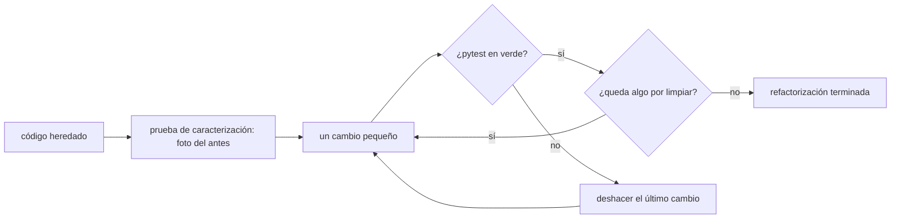
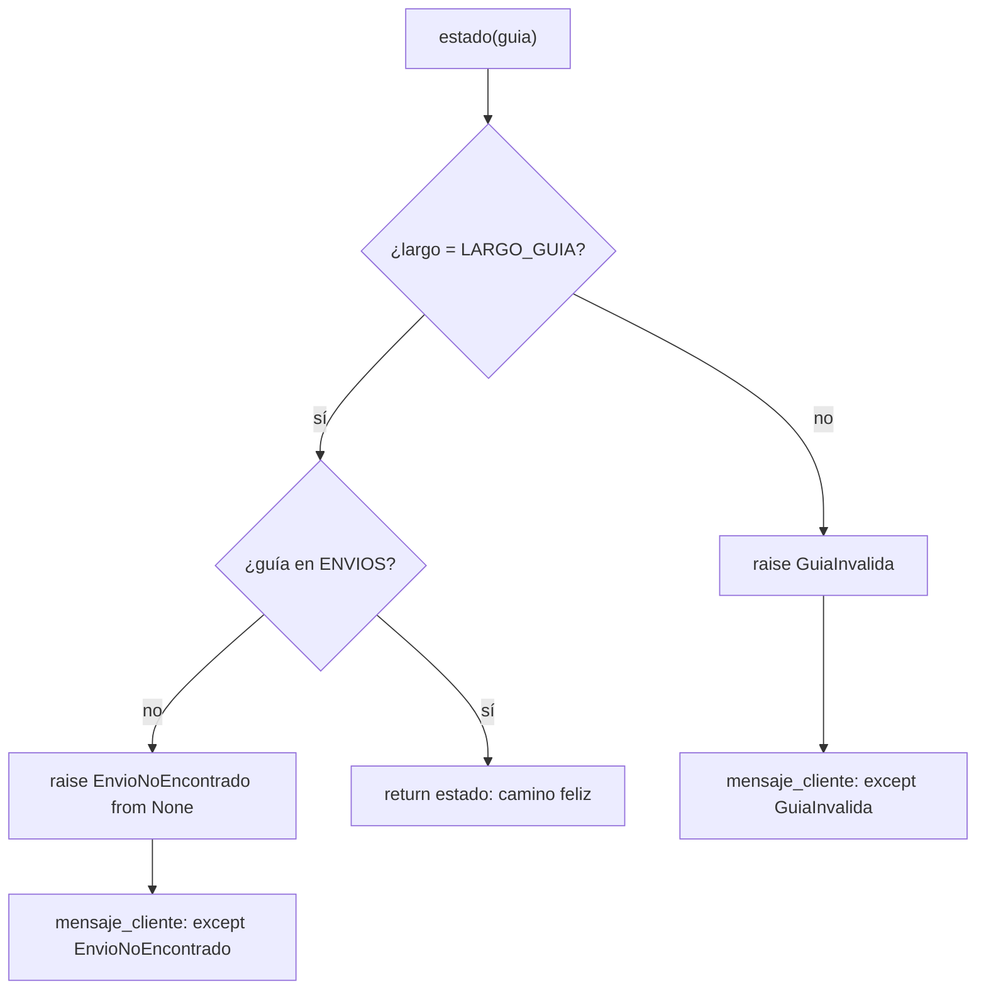
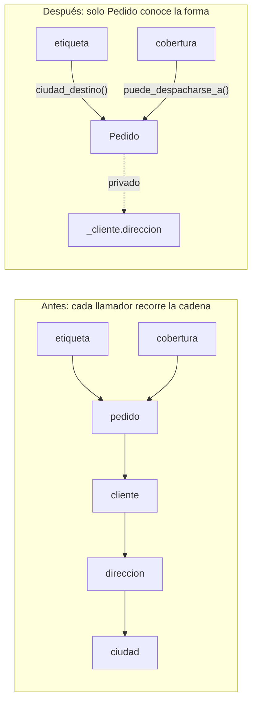
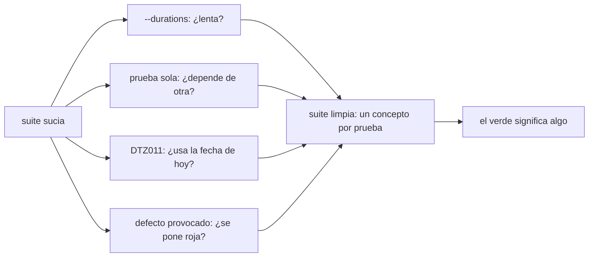

# Módulo 10: Código limpio

**Entorno comprobado para esta edición (2026-11-24):** Python 3.13.18 en Linux x86_64, pytest 9.2.0 y Ruff 0.17.6. La línea de referencia del curso es Python 3.14 (`docs/VERSIONES.md`); estos ejemplos no usan nada exclusivo de esa versión. Todas las transcripciones son literales de esa ejecución, en la carpeta de práctica `/home/estudiante/labs/codigo-limpio` (tu `~/labs/codigo-limpio`). Los tiempos que informa `pytest` (`0.01s`, `1.00s`) cambian en cada máquina. Las ideas de este módulo vienen de la tradición de «código limpio» de la ingeniería de software; los ejemplos y el texto son propios del curso.

Al terminar este módulo podrás:
- proteger un código heredado con pruebas de caracterización antes de cambiarlo;
- renombrar, extraer funciones y reemplazar números mágicos y argumentos bandera sin cambiar el comportamiento;
- reemplazar códigos de error por excepciones con nombre y distinguir un comentario útil de uno que sobra;
- separar objetos de estructuras de datos y aplicar la ley de Demeter;
- escribir pruebas rápidas, independientes, repetibles y autoevaluadas, con un concepto por prueba;
- usar Ruff para que una máquina señale parte de estos problemas.

**Qué necesitas saber antes:** funciones y descomposición (Módulo 1, Tema 4); clases, objetos, métodos y composición
(Módulo 1, Temas 6 y 7); excepciones y `assert` (Módulo 1, Tema 1); listas, tuplas y diccionarios (Módulo 2, Tema 1);
prueba de regresión, prueba unitaria, `pytest`, linter y formateador (Módulo 5, Temas 1, 2 y 4).


## Aprende construyendo


### Tema 1: Nombres que revelan intención y funciones pequeñas · Avanzado · 60 min

<details open>
<summary><strong>Capa 1 — Lectura</strong></summary>

#### Objetivos
Al terminar este tema podrás:
- escribir una prueba de caracterización que fije lo que hace hoy un código heredado;
- renombrar variables y funciones para que digan qué guardan y qué hacen;
- reemplazar números mágicos por constantes y un argumento bandera por dos funciones;
- dividir una función larga en funciones pequeñas de un solo nivel de abstracción, con la misma salida.

**Conceptos clave:** refactorización, prueba de caracterización, nombre con intención, número mágico, constante, función pequeña, nivel de abstracción, argumento bandera

#### El problema
La persona que escribió la facturación de RutaFlow ya no está en la empresa. Te deja `calc(l, f)`: nueve líneas
con `t`, `x[2]`, `1200` y `0.9`. Contabilidad pide agregar una ciudad y nadie se atreve a tocarla. ¿Cómo la vuelves
legible **sin cambiar** un solo peso de lo que factura, y cómo lo demuestras?

Este tema usa **función** y **descomposición** (Módulo 1, Tema 4), **prueba de regresión**, **prueba unitaria** y
**pytest** (Módulo 5, Temas 1 y 2) y **linter** (Módulo 5, Tema 4). Aquí no se redefinen.

#### Glosario del tema

**refactorización**
- **Definición técnica:** cambio en la estructura interna del código que no altera su comportamiento observable; se hace en pasos pequeños, cada uno verificado con pruebas.
- **En palabras sencillas:** ordenar la bodega sin perder ni agregar una sola caja.
- **Dónde se rompe la comparación:** en la bodega ves si falta una caja; en el código solo lo sabes si una prueba lo comprueba.
- **Ejemplo:** cambiar `calc(l, f)` por `total_facturable(envios)` y comprobar que ambas devuelven `20000` para la misma ruta.
- **Error típico:** «refactorizar» y de paso corregir una regla de negocio; si el resultado cambia, ya no es refactorización.

**prueba de caracterización**
- **Definición técnica:** prueba que registra lo que el código hace hoy, sin juzgar si es correcto, para detectar cualquier cambio de comportamiento durante una refactorización.
- **En palabras sencillas:** una foto del antes; después comparas el «después» contra la foto.
- **Dónde se rompe la comparación:** la foto también guarda los defectos actuales; si el viejo calcula mal, la prueba exige seguir calculando mal.
- **Ejemplo:** `assert total_facturable(ruta) == calc(ruta, False)` compara la versión nueva con la heredada en cinco rutas.
- **Error típico:** escribirla con una sola ruta «feliz»; entonces no detecta cambios en rutas vacías o sin entregados.

**nombre con intención**
- **Definición técnica:** identificador que comunica qué representa un valor o qué hace una función, incluida la unidad cuando aplica, sin obligar a leer el cuerpo.
- **En palabras sencillas:** un nombre que responde «¿qué es esto?» sin que tengas que adivinar.
- **Dónde se rompe la comparación:** un nombre largo no es mejor por ser largo; `peso_kg` dice más que `valor_numerico_del_peso`.
- **Ejemplo:** `for ciudad, peso_kg, estado in envios` en lugar de `for x in l` con `x[0]`, `x[1]` y `x[2]`.
- **Error típico:** usar `l`, `O` o `I` como nombres; se confunden con `1` y `0`, y Ruff lo marca con `E741`.

**número mágico**
- **Definición técnica:** literal numérico o de texto escrito directamente en la lógica, sin nombre que explique su origen ni su significado.
- **En palabras sencillas:** un número que aparece «porque sí» y que solo entiende quien lo escribió.
- **Dónde se rompe la comparación:** no todo literal es mágico: `0` como inicio de un acumulador se entiende solo.
- **Ejemplo:** el `1200` de `x[1] * 1200`: ¿pesos por kilo, por caja o por kilómetro?
- **Error típico:** cambiar la tarifa en un lugar y olvidar otro `1200` copiado en otro archivo.

**constante**
- **Definición técnica:** nombre asignado una sola vez a un valor fijo; en Python se escribe en MAYÚSCULAS por convención (PEP 8), aunque el lenguaje permite reasignarlo.
- **En palabras sencillas:** el número mágico con su etiqueta puesta, en un único lugar.
- **Dónde se rompe la comparación:** Python no la protege; si alguien reasigna `TARIFA_POR_KG`, el programa obedece.
- **Ejemplo:** `TARIFA_POR_KG = 1200` en la línea 2 de `facturacion.py`.
- **Error típico:** confundir renombrar con cambiar el dato: `ESTADO_ENTREGADO = "entregado"` es más legible, pero los datos dicen `"E"`.

**función pequeña**
- **Definición técnica:** función con una sola responsabilidad, que cabe en la vista sin desplazarse y cuyo nombre describe todo lo que hace.
- **En palabras sencillas:** una herramienta que hace una sola cosa y la hace bien, como un destornillador.
- **Dónde se rompe la comparación:** el tamaño es un síntoma, no la regla; diez líneas con dos responsabilidades siguen siendo demasiadas.
- **Ejemplo:** `formatear_pesos(valor)` solo formatea; no calcula ni valida.
- **Error típico:** partir por cantidad de líneas y crear `parte1()` y `parte2()`, nombres que no dicen nada.

**nivel de abstracción**
- **Definición técnica:** grado de detalle de una instrucción; una función bien escrita mezcla pasos del mismo nivel y delega los detalles a funciones de nivel inferior.
- **En palabras sencillas:** un índice dice «capítulo 3: tarifas», no copia la fórmula; la fórmula va dentro del capítulo.
- **Dónde se rompe la comparación:** en el código los niveles no tienen número; los reconoces cuando una línea dice «qué» y la siguiente dice «cómo».
- **Ejemplo:** `reporte` solo dice «una línea por envío»; `formatear_pesos` sabe de comas y puntos.
- **Error típico:** una función que valida guías y, en la línea siguiente, reemplaza comas por puntos.

**argumento bandera**
- **Definición técnica:** parámetro booleano que hace que una función ejecute dos comportamientos distintos según su valor.
- **En palabras sencillas:** un interruptor escondido: la misma función hace una cosa u otra según un `True` o `False`.
- **Dónde se rompe la comparación:** el interruptor se ve en la pared; en la llamada `calc(ruta, True)` no se ve qué enciende el `True`.
- **Ejemplo:** `calc(ruta, True)` se reemplaza por `total_cliente_frecuente(ruta)`.
- **Error típico:** agregar una segunda bandera (`calc(ruta, True, False)`); ya son cuatro comportamientos en una función.

#### ► CÓMO FUNCIONA
Refactorizar código heredado sigue siempre el mismo ciclo. Primero pones la red: una **prueba de caracterización** que
compara lo nuevo con lo viejo. Luego haces **un** cambio pequeño, ejecutas la prueba y, si sigue en verde, haces el
siguiente. Si se pone en rojo, deshaces el último cambio: sabes exactamente cuál fue.

| Síntoma en el código | Qué haces | Qué lo verifica |
|---|---|---|
| `l`, `t`, `x[2]` | Renombrar con intención y desempaquetar | Prueba de caracterización |
| `1200`, `0.9`, `"E"` | Extraer constante con nombre | Prueba de caracterización |
| `calc(ruta, True)` | Dos funciones con nombre propio | Prueba de caracterización |
| Función que valida, calcula y formatea | Extraer funciones pequeñas | Misma salida, línea por línea |
| `l`, `O`, `I` como nombres | Renombrar | Ruff, regla `E741` |



#### Problema resuelto 1.1
Vuelve legible `calc(l, f)` sin cambiar lo que factura. Demuestra con pruebas que la versión nueva responde igual en
rutas vacías, rutas sin entregados, pesos con decimales y varias ciudades.

**Razonamiento:**
1. Antes de tocar nada, la red: una prueba que compare la versión nueva con `calc` en varias rutas.
2. Leer el código viejo y nombrar cada pieza: `x[0]` es la ciudad, `x[1]` el peso en kg y `x[2]` el estado.
3. Los literales `1200`, `5000`, `9000`, `"E"` y `0.9` pasan a constantes con nombre.
4. La bandera `f` se convierte en dos funciones: `total_facturable` y `total_cliente_frecuente`.

Este es el código heredado, tal como llegó:

```python
# facturacion_antes.py — total facturable de una ruta (código heredado)
def calc(l, f):
    t = 0
    for x in l:
        if x[2] == "E":
            t += x[1] * 1200 + (5000 if x[0] == "BOG" else 9000)
    if f:
        t = t * 0.9
    return round(t)
```

Esta es la versión refactorizada:

```python
# facturacion.py — total facturable de una ruta (después de refactorizar)
TARIFA_POR_KG = 1200
TARIFA_BASE_POR_CIUDAD = {"BOG": 5000}
TARIFA_BASE_OTRAS_CIUDADES = 9000
ESTADO_ENTREGADO = "E"
DESCUENTO_CLIENTE_FRECUENTE = 0.10


def tarifa_envio(ciudad, peso_kg):
    base = TARIFA_BASE_POR_CIUDAD.get(ciudad, TARIFA_BASE_OTRAS_CIUDADES)
    return base + peso_kg * TARIFA_POR_KG


def total_facturable(envios):
    total = 0
    for ciudad, peso_kg, estado in envios:
        if estado == ESTADO_ENTREGADO:
            total += tarifa_envio(ciudad, peso_kg)
    return round(total)


def total_cliente_frecuente(envios):
    total = total_facturable(envios) * (1 - DESCUENTO_CLIENTE_FRECUENTE)
    return round(total)
```

La red de seguridad compara ambas versiones en cinco rutas distintas:

```python
# test_facturacion.py — la versión nueva debe responder igual que la heredada
from facturacion import total_cliente_frecuente, total_facturable
from facturacion_antes import calc

RUTAS = [
    [],
    [("BOG", 2, "E"), ("CAL", 1, "P"), ("MED", 3, "E")],
    [("BOG", 2.5, "E"), ("BOG", 0.4, "E")],
    [("CAL", 1, "P"), ("PAS", 7, "P")],
    [("BOG", 1, "E"), ("BUC", 1, "E"), ("BOG", 3, "E")],
]


def test_total_sin_descuento_igual_al_heredado():
    for ruta in RUTAS:
        assert total_facturable(ruta) == calc(ruta, False), ruta


def test_total_con_descuento_igual_al_heredado():
    for ruta in RUTAS:
        assert total_cliente_frecuente(ruta) == calc(ruta, True), ruta
```

Y un programa corto para verlas lado a lado:

```python
# comparar.py — muestra las dos versiones lado a lado
from facturacion import total_cliente_frecuente, total_facturable
from facturacion_antes import calc

ruta = [("BOG", 2, "E"), ("CAL", 1, "P"), ("MED", 3, "E")]
print("Antes:  ", calc(ruta, False), calc(ruta, True))
print("Después:", total_facturable(ruta), total_cliente_frecuente(ruta))
```

```text
$ python3 comparar.py
Antes:   20000 18000
Después: 20000 18000
```

```text
$ python -m pytest -q test_facturacion.py
..                                                                       [100%]
2 passed in 0.01s
```

**Explicación por partes.**
- `facturacion_antes.py`, línea 6: en una sola línea mezcla la tarifa por kilo, la base por ciudad y la regla «Bogotá es local».
- `facturacion.py`, líneas 2–6: cada literal recibe un nombre. `DESCUENTO_CLIENTE_FRECUENTE = 0.10` explica qué era el `0.9`.
- Línea 3: la base por ciudad es un diccionario (Módulo 2); agregar Medellín será agregar una clave, no otro `if`.
- Línea 16: desempaquetar la tupla en `ciudad, peso_kg, estado` elimina los índices `x[0]`, `x[1]` y `x[2]`.
- Líneas 22–24: la bandera desapareció. Quien lee `total_cliente_frecuente(ruta)` sabe qué recibe sin abrir la función.
- `test_facturacion.py`, líneas 5–11: rutas elegidas para cubrir cada regla, incluida la lista vacía y los decimales.
- Líneas 16 y 21: el mensaje del `assert` es la ruta; si falla, `pytest` dice con qué datos.
- La interfaz no cambió: ambas versiones reciben la misma lista de tuplas. Por eso se pueden comparar directamente.

> **Error común.** Renombrar el **dato** creyendo que renombras el **nombre**. Si al limpiar escribes
> `ESTADO_ENTREGADO = "entregado"`, el código se lee mejor, pero los datos siguen diciendo `"E"`. La red lo atrapa:

```text
$ python -m pytest -q test_facturacion.py
FF                                                                       [100%]
=================================== FAILURES ===================================
__________________ test_total_sin_descuento_igual_al_heredado __________________

    def test_total_sin_descuento_igual_al_heredado():
        for ruta in RUTAS:
>           assert total_facturable(ruta) == calc(ruta, False), ruta
E           AssertionError: [('BOG', 2, 'E'), ('CAL', 1, 'P'), ('MED', 3, 'E')]
E           assert 0 == 20000
E            +  where 0 = total_facturable([('BOG', 2, 'E'), ('CAL', 1, 'P'), ('MED', 3, 'E')])
E            +  and   20000 = calc([('BOG', 2, 'E'), ('CAL', 1, 'P'), ('MED', 3, 'E')], False)

test_facturacion.py:16: AssertionError
__________________ test_total_con_descuento_igual_al_heredado __________________

    def test_total_con_descuento_igual_al_heredado():
        for ruta in RUTAS:
>           assert total_cliente_frecuente(ruta) == calc(ruta, True), ruta
E           AssertionError: [('BOG', 2, 'E'), ('CAL', 1, 'P'), ('MED', 3, 'E')]
E           assert 0 == 18000
E            +  where 0 = total_cliente_frecuente([('BOG', 2, 'E'), ('CAL', 1, 'P'), ('MED', 3, 'E')])
E            +  and   18000 = calc([('BOG', 2, 'E'), ('CAL', 1, 'P'), ('MED', 3, 'E')], True)

test_facturacion.py:21: AssertionError
=========================== short test summary info ============================
FAILED test_facturacion.py::test_total_sin_descuento_igual_al_heredado - Asse...
FAILED test_facturacion.py::test_total_con_descuento_igual_al_heredado - Asse...
2 failed in 0.02s
```

> Lee el bloque `E`: `assert 0 == 20000` dice que la versión nueva ya no factura nada. La línea
> `where 0 = total_facturable([...])` muestra con qué ruta. Deshaces el cambio y la suite vuelve a verde.

> **Buena práctica.** Haz un commit (Módulo 5, Tema 3) por cada paso de refactorización en verde. Si un paso rompe
> algo que las pruebas no ven, `git revert` deshace solo ese paso.

#### Problema resuelto 1.2
`liquidacion_antes.py` arma el reporte diario: valida la guía, calcula el valor, suma el recargo urgente y formatea
en pesos, todo en una función. Divídela en funciones pequeñas de un solo nivel y comprueba que el reporte es idéntico.

**Razonamiento:**
1. Listar lo que hace la función: validar, calcular, formatear y armar la lista. Son cuatro responsabilidades.
2. Cada una pasa a su función, con un nombre que diga qué hace. `reporte` queda en el nivel más alto: «una línea por envío».
3. Los datos de prueba deben pasar por cada regla: válido, urgente, prefijo malo, peso cero y un valor con miles.
4. La comprobación es la salida completa, comparada línea por línea con la versión vieja.

```python
# liquidacion_antes.py — líneas del reporte de liquidación (código heredado)
def reporte(envios):
    lineas = []
    for envio in envios:
        if not envio["guia"].startswith("RF-") or envio["peso_kg"] <= 0:
            lineas.append(f"{envio['guia']}: rechazado")
            continue
        valor = 5000 + envio["peso_kg"] * 1200
        if envio["urgente"]:
            valor = valor + 3000
        lineas.append(f"{envio['guia']}: ${valor:,.0f}".replace(",", "."))
    return lineas
```

```python
# liquidacion.py — líneas del reporte de liquidación (después de refactorizar)
PREFIJO_GUIA = "RF-"
TARIFA_BASE = 5000
TARIFA_POR_KG = 1200
RECARGO_URGENTE = 3000


def es_valido(envio):
    return envio["guia"].startswith(PREFIJO_GUIA) and envio["peso_kg"] > 0


def valor_envio(envio):
    recargo = RECARGO_URGENTE if envio["urgente"] else 0
    return TARIFA_BASE + envio["peso_kg"] * TARIFA_POR_KG + recargo


def formatear_pesos(valor):
    return f"${valor:,.0f}".replace(",", ".")


def linea_reporte(envio):
    if not es_valido(envio):
        return f"{envio['guia']}: rechazado"
    return f"{envio['guia']}: {formatear_pesos(valor_envio(envio))}"


def reporte(envios):
    return [linea_reporte(envio) for envio in envios]
```

```python
# ruta_ejemplo.py — envíos de prueba que cubren cada regla del reporte
ENVIOS = [
    {"guia": "RF-101", "peso_kg": 2, "urgente": False},
    {"guia": "RF-102", "peso_kg": 1.5, "urgente": True},
    {"guia": "XX-103", "peso_kg": 1, "urgente": False},
    {"guia": "RF-104", "peso_kg": 0, "urgente": True},
    {"guia": "RF-105", "peso_kg": 12, "urgente": True},
]
```

```python
# test_liquidacion.py — el reporte nuevo debe ser idéntico, línea por línea
import liquidacion
import liquidacion_antes
from ruta_ejemplo import ENVIOS


def test_reporte_identico_al_heredado():
    assert liquidacion.reporte(ENVIOS) == liquidacion_antes.reporte(ENVIOS)


def test_valor_envio_suma_recargo_urgente():
    envio = {"guia": "RF-102", "peso_kg": 1.5, "urgente": True}
    assert liquidacion.valor_envio(envio) == 9800
```

```python
# ver_reporte.py — imprime el reporte con la versión nueva
from liquidacion import reporte
from ruta_ejemplo import ENVIOS

for linea in reporte(ENVIOS):
    print(linea)
```

```text
$ python3 ver_reporte.py
RF-101: $7.400
RF-102: $9.800
XX-103: rechazado
RF-104: rechazado
RF-105: $22.400
```

```text
$ python -m pytest -q test_liquidacion.py
..                                                                       [100%]
2 passed in 0.01s
```

Un linter puede medir parte del problema. La regla `C901` cuenta los caminos posibles dentro de una función
(complejidad ciclomática); aquí se fija el máximo en 3 para ver la diferencia:

```text
$ ruff check --select C901 --config "lint.mccabe.max-complexity=3" liquidacion_antes.py liquidacion.py
C901 `reporte` is too complex (4 > 3)
 --> liquidacion_antes.py:2:5
  |
1 | # liquidacion_antes.py — líneas del reporte de liquidación (código heredado)
2 | def reporte(envios):
  |     ^^^^^^^
3 |     lineas = []
4 |     for envio in envios:
  |

Found 1 error.
```

**Explicación por partes.**
- `liquidacion_antes.py`, línea 5: la validación vive en el mismo bucle que el cálculo; para probarla sola hay que armar un reporte.
- Línea 11: el formato (`:,.0f` y el cambio de coma por punto) está mezclado con el armado de la lista.
- `liquidacion.py`, líneas 8–18: tres funciones de un solo propósito; cada una se puede probar por separado.
- Líneas 21–24: `linea_reporte` decide «rechazado o valor» y delega los detalles.
- Línea 28: `reporte` queda en una línea y en el nivel más alto. Se lee como la descripción del requisito.
- `test_liquidacion.py`, línea 8: la prueba de caracterización compara listas completas; un espacio de diferencia la pone en rojo.
- Línea 13: una prueba unitaria nueva, posible solo ahora que `valor_envio` existe por separado.
- `C901 ... (4 > 3)`: la función vieja tiene 4 caminos; ninguna función nueva supera el límite, por eso Ruff no las menciona.

> **Error común.** Confiar en que `ruff check .` revisa los nombres. Sobre el archivo heredado responde que todo está
> bien, porque `E741` no está entre las reglas que Ruff activa por defecto:

```text
$ ruff check facturacion_antes.py
All checks passed!
$ ruff check --select E741 facturacion_antes.py
E741 Ambiguous variable name: `l`
 --> facturacion_antes.py:2:10
  |
1 | # facturacion_antes.py — total facturable de una ruta (código heredado)
2 | def calc(l, f):
  |          ^
3 |     t = 0
4 |     for x in l:
  |

Found 1 error.
```

> La regla solo detecta letras ambiguas como `l`. Ninguna herramienta sabe que `t` debía llamarse `total`: eso lo decides tú.

> **Prevenir errores.** Antes de extraer una función, escribe su nombre en una línea. Si necesitas «y» para
> describirla (`validar_y_formatear`), son dos funciones.

#### Checkpoint 1.1
En `facturacion.py`, ¿por qué `total_cliente_frecuente` llama a `total_facturable` en vez de repetir el bucle?

Respuesta: porque el descuento es una regla sobre el total, no sobre cada envío. Reusar `total_facturable` deja la
regla de facturación en un solo lugar: si cambia una tarifa, ambas funciones la ven.

</details>

<details>
<summary><strong>Capa 2 — Construcción</strong></summary>

#### Paso 1 · Prepara la carpeta
Crea `~/labs/codigo-limpio`, entra con `cd ~/labs/codigo-limpio` y activa un entorno virtual con `pytest` y `ruff`,
como en el Módulo 5, Tema 2. Escribe `facturacion_antes.py` exactamente como aparece arriba.

#### Paso 2 · Pon la red antes de tocar nada
Escribe `test_facturacion.py` importando, por ahora, `calc` en ambos lados de la comparación. Ejecuta
`python -m pytest -q test_facturacion.py`: debe decir `2 passed`. Esa es la foto del antes.

#### Paso 3 · Refactoriza en pasos pequeños
Crea `facturacion.py`. Primero renombra y desempaqueta; ejecuta las pruebas. Luego extrae las constantes; ejecuta.
Por último reemplaza la bandera por dos funciones; ejecuta. Cambia los imports de la prueba y confirma `2 passed`.

#### Paso 4 · Provoca el error común y extrae funciones
Cambia `ESTADO_ENTREGADO` a `"entregado"`, mira el `assert 0 == 20000` y deshazlo. Luego escribe `liquidacion_antes.py`,
`liquidacion.py`, `ruta_ejemplo.py` y `test_liquidacion.py`, y ejecuta la regla `C901` con el límite 3.

#### Resumen
- **Refactorizar** es cambiar la estructura sin cambiar el comportamiento; se hace en pasos pequeños y verificados.
- La **prueba de caracterización** fija lo que hace hoy el código heredado y compara cada paso contra esa foto.
- Un **nombre con intención** dice qué es o qué hace; desempaquetar tuplas elimina índices como `x[2]`.
- Un **número mágico** se convierte en **constante** con nombre en MAYÚSCULAS, en un único lugar.
- Una **función pequeña** tiene una responsabilidad y trabaja en un solo **nivel de abstracción**.
- Un **argumento bandera** se reemplaza por dos funciones con nombre propio.
- Ruff ayuda (`E741`, `C901`), pero la intención de un nombre solo la puedes juzgar tú.

#### Ejercicio verificable 1
Básico. Sin ejecutar, calcula `total_facturable` y `total_cliente_frecuente` para la ruta
`[("BOG", 1, "E"), ("CAL", 2, "E")]`. Luego compruébalo en Python.

Respuesta esperada: `17600` y `15840`. Bogotá: `5000 + 1 * 1200 = 6200`. Cali: `9000 + 2 * 1200 = 11400`. El total es
`17600` y con el 10 % de descuento queda `15840`.

#### Ejercicio verificable 2
Intermedio. Contabilidad pide que Medellín (`"MED"`) tenga base 7000. Agrega la clave al diccionario de la línea 3 y
ejecuta `test_facturacion.py`. ¿Qué pasa y qué debes hacer con la prueba?

Respuesta esperada: fallan las dos pruebas, con `assert 18000 == 20000` y `assert 16200 == 18000` para la ruta que
incluye Medellín. Es correcto que fallen: ya no es una refactorización, es una regla nueva. La prueba de
caracterización cumplió su papel; ahora escribes una prueba unitaria con el valor nuevo y retiras la comparación con `calc`.

#### Ejercicio verificable 3
Reto. Refactoriza `def etiqueta(g, u):`, que devuelve `"[URGENTE] " + g.upper()` si `u` es verdadero y
`g.upper()` si no. Elimina la bandera y demuestra que nada cambió.

Respuesta esperada: dos funciones, `etiqueta_normal(guia)`, que devuelve `guia.upper()`, y `etiqueta_urgente(guia)`,
que devuelve `"[URGENTE] " + etiqueta_normal(guia)`. La prueba compara, para varias guías,
`etiqueta_normal(g) == etiqueta(g, False)` y `etiqueta_urgente(g) == etiqueta(g, True)`. Con `"rf-101"`,
`etiqueta_urgente` devuelve `[URGENTE] RF-101`.

#### En el trabajo
En casi todas las empresas trabajarás sobre código que no escribiste. La regla del equipo suele ser «deja el código un
poco mejor de como lo encontraste», pero siempre con una prueba antes. Los pull requests de refactorización van
**separados** de los que cambian reglas de negocio: así la revisión de código sabe qué buscar. Si un mismo PR renombra
y cambia una tarifa, nadie puede asegurar qué causó una diferencia en la factura.

</details>

### Tema 2: Comentarios honestos y excepciones en lugar de códigos de error · Avanzado · 50 min

<details open>
<summary><strong>Capa 1 — Lectura</strong></summary>

#### Objetivos
Al terminar este tema podrás:
- reemplazar códigos de error como `-1` y `-2` por excepciones personalizadas con nombre;
- separar el camino feliz del manejo de errores y encadenar excepciones con `from`;
- clasificar comentarios en útiles, redundantes y código comentado, y decidir qué hacer con cada uno;
- demostrar con pruebas que el cliente recibe los mismos mensajes antes y después del cambio.

**Conceptos clave:** código de error, excepción personalizada, camino feliz, encadenamiento de excepciones, comentario que explica el porqué, comentario redundante, código comentado, docstring

#### El problema
El portal de RutaFlow consulta el estado de una guía con `estado_con_codigo`, que devuelve el estado o los números
`-2` y `-1`. Un desarrollador nuevo escribió `estado_con_codigo(guia).upper()` y el portal se cayó con una guía mal
escrita. Los comentarios que explicaban los códigos estaban ahí, pero nadie los leyó. ¿Cómo haces que el error no se
pueda ignorar y que el código se explique sin depender de comentarios?

Este tema usa **excepción** (Módulo 1, Tema 1), **herencia** y **subclase** (Módulo 1, Tema 7), **diccionario**
(Módulo 2, Tema 1) y **refactorización** y **prueba de caracterización** (Tema 1 de este módulo).

#### Glosario del tema

**código de error**
- **Definición técnica:** valor de retorno especial (como `-1`, `None` o `""`) que una función usa para indicar un fallo, mezclado con los valores de éxito.
- **En palabras sencillas:** un papelito con un número que alguien debe recordar revisar y saber traducir.
- **Dónde se rompe la comparación:** el papelito se nota; el `-2` es un dato más, y el programa sigue como si fuera un estado.
- **Ejemplo:** `estado_con_codigo("BO-9")` devuelve `-2`, que el llamador debe comparar a mano.
- **Error típico:** olvidar revisarlo: `estado_con_codigo("BO-9").upper()` produce `AttributeError: 'int' object has no attribute 'upper'`.

**excepción personalizada**
- **Definición técnica:** clase propia que hereda de una excepción de Python (`ValueError`, `LookupError`…) y nombra un fallo del dominio. Se lanza con `raise` y se captura por su nombre.
- **En palabras sencillas:** una alarma con su nombre escrito: «guía inválida» suena distinto de «envío no encontrado».
- **Dónde se rompe la comparación:** heredar de `ValueError` hace que un `except ValueError` genérico también la atrape; elige el padre con cuidado.
- **Ejemplo:** `class GuiaInvalida(ValueError):` en la línea 7 de `errores.py`.
- **Error típico:** heredar de `BaseException`; entonces ni `except Exception` la detiene y el programa se cae.

**camino feliz**
- **Definición técnica:** secuencia de instrucciones que se ejecuta cuando todos los datos son válidos; el código limpio la deja legible de arriba abajo y aparta los errores.
- **En palabras sencillas:** la ruta del día en que todo sale bien, sin desvíos.
- **Dónde se rompe la comparación:** no es el caso más común, solo el más simple; los errores también son parte del requisito.
- **Ejemplo:** en `mensaje_cliente` nuevo, la línea 26 es el camino feliz; los `except` de abajo son los desvíos.
- **Error típico:** probar solo el camino feliz y descubrir en producción qué hace el programa con una guía vacía.

**encadenamiento de excepciones**
- **Definición técnica:** relación entre una excepción nueva y la que la causó; `raise B from A` la declara, `raise B from None` la oculta y un `raise` sin `from` dentro de `except` la muestra como accidente.
- **En palabras sencillas:** decir en el reporte si el segundo choque fue consecuencia del primero o una coincidencia.
- **Dónde se rompe la comparación:** Python no adivina tu intención; sin `from`, imprime «otra excepción ocurrió mientras se manejaba la primera».
- **Ejemplo:** `raise EnvioNoEncontrado(guia) from None` en la línea 21 de `errores.py`.
- **Error típico:** relanzar sin `from` y obtener un traceback doble con `During handling of the above exception, another exception occurred:`.

**comentario que explica el porqué**
- **Definición técnica:** comentario que registra una razón, una restricción externa o una decisión que el código no puede expresar por sí mismo.
- **En palabras sencillas:** la nota que responde «¿por qué está así?», no «¿qué hace?».
- **Dónde se rompe la comparación:** también envejece; si cambia la regla del operador postal, el comentario debe cambiar con ella.
- **Ejemplo:** `# El operador postal asigna guías de 9 caracteres: "BO-" más seis dígitos.`
- **Error típico:** explicar con un comentario lo que un buen nombre ya diría, en vez de cambiar el nombre.

**comentario redundante**
- **Definición técnica:** comentario que repite lo que la instrucción siguiente ya dice; no agrega información y puede quedar desactualizado.
- **En palabras sencillas:** un letrero de «puerta» pegado en una puerta.
- **Dónde se rompe la comparación:** el letrero no miente nunca; el comentario sí, cuando alguien cambia el código y no el comentario.
- **Ejemplo:** `# busca la guía` encima de `if guia not in ENVIOS:`.
- **Error típico:** usar comentarios para explicar códigos mágicos (`# -2 = guía inválida`) en vez de eliminar el código mágico.

**código comentado**
- **Definición técnica:** instrucciones desactivadas con `#` que se dejan en el archivo; el historial de Git ya las conserva.
- **En palabras sencillas:** muebles viejos tapados con una sábana en medio de la sala.
- **Dónde se rompe la comparación:** nadie se atreve a quitar la sábana porque no sabe si alguien la necesita.
- **Ejemplo:** `# print("consultando", guia)` en la línea 12 de `errores_antes.py`; Ruff lo señala con `ERA001`.
- **Error típico:** comentar en vez de borrar «por si acaso»; para eso existe `git log` (Módulo 5, Tema 3).

**docstring**
- **Definición técnica:** cadena de texto escrita como primera instrucción de un módulo, clase o función; Python la guarda en el atributo `__doc__` y la muestra `help()`.
- **En palabras sencillas:** la etiqueta de instrucciones pegada a la herramienta, que viaja con ella.
- **Dónde se rompe la comparación:** a diferencia de un comentario con `#`, el programa sí la conserva y la puedes leer en ejecución.
- **Ejemplo:** `"""La guía no tiene el formato del operador postal."""` en la línea 8 de `errores.py`.
- **Error típico:** escribir un docstring que repite el nombre (`"""Guía inválida."""`); debe decir cuándo ocurre.

#### ► CÓMO FUNCIONA
Con códigos de error, cada llamador debe recordar comparar el resultado con `-1` y `-2` antes de usarlo. Si lo olvida,
el programa sigue con un número donde esperaba un texto y falla más adelante, lejos de la causa. Con excepciones,
olvidar el manejo **detiene** el programa en el punto exacto, con un nombre que explica qué pasó.

| Situación | Código de error | Excepción personalizada |
|---|---|---|
| Guía con largo incorrecto | `return -2` | `raise GuiaInvalida(...)` |
| Guía que no existe | `return -1` | `raise EnvioNoEncontrado(...)` |
| El llamador olvida revisar | Sigue con un dato falso | Se detiene en el punto exacto |
| Qué documenta el fallo | Un comentario `# -2 = ...` | El nombre de la clase y su docstring |

Los comentarios se revisan con tres preguntas: ¿explica un porqué? Se queda. ¿Repite el código? Se borra. ¿Es
código desactivado? Se borra; Git lo recuerda.



#### Problema resuelto 2.1
Reemplaza los códigos `-2` y `-1` de `estado_con_codigo` por excepciones personalizadas. Limpia los comentarios y
demuestra que `mensaje_cliente` responde igual para guías válidas, cortas, largas, vacías e inexistentes.

**Razonamiento:**
1. Cada código de error se convierte en una excepción con nombre: `-2` en `GuiaInvalida` y `-1` en `EnvioNoEncontrado`.
2. El `9` es un número mágico; pasa a `LARGO_GUIA` con un comentario que explica **por qué** vale 9.
3. Los comentarios redundantes y el `print` comentado se borran; los que traducían códigos desaparecen con los códigos.
4. La prueba de caracterización compara `mensaje_cliente` viejo y nuevo; otras dos fijan la equivalencia código ↔ excepción.

```python
# errores_antes.py — consulta de estado con códigos de error (código heredado)
ENVIOS = {"BO-000001": "en ruta", "BO-000002": "entregado"}


def estado_con_codigo(guia):
    # revisa el largo
    if len(guia) != 9:
        return -2  # -2 = guía inválida
    # busca la guía
    if guia not in ENVIOS:
        return -1  # -1 = no existe
    # print("consultando", guia)
    return ENVIOS[guia]


def mensaje_cliente(guia):
    resultado = estado_con_codigo(guia)
    if resultado == -2:
        return "Revisa el número de guía"
    if resultado == -1:
        return "No encontramos tu envío"
    return f"Tu envío está {resultado}"
```

```python
# errores.py — consulta de estado con excepciones (después de refactorizar)
ENVIOS = {"BO-000001": "en ruta", "BO-000002": "entregado"}
# El operador postal asigna guías de 9 caracteres: "BO-" más seis dígitos.
LARGO_GUIA = 9


class GuiaInvalida(ValueError):
    """La guía no tiene el formato del operador postal."""


class EnvioNoEncontrado(LookupError):
    """La guía tiene buen formato, pero no está registrada."""


def estado(guia):
    if len(guia) != LARGO_GUIA:
        raise GuiaInvalida(f"La guía {guia!r} debe tener {LARGO_GUIA} caracteres")
    try:
        return ENVIOS[guia]
    except KeyError:
        raise EnvioNoEncontrado(guia) from None


def mensaje_cliente(guia):
    try:
        return f"Tu envío está {estado(guia)}"
    except GuiaInvalida:
        return "Revisa el número de guía"
    except EnvioNoEncontrado:
        return "No encontramos tu envío"
```

```python
# test_errores.py — las excepciones cuentan lo mismo que los códigos
import pytest

import errores
import errores_antes

GUIAS = ["BO-000001", "BO-000002", "BO-9", "BO-0000001", "BO-000777", ""]


def test_mensaje_cliente_igual_al_heredado():
    for guia in GUIAS:
        assert errores.mensaje_cliente(guia) == errores_antes.mensaje_cliente(guia)


def test_guia_registrada_devuelve_el_mismo_estado():
    assert errores.estado("BO-000002") == errores_antes.estado_con_codigo("BO-000002")


def test_codigo_menos_dos_ahora_es_guia_invalida():
    assert errores_antes.estado_con_codigo("BO-9") == -2
    with pytest.raises(errores.GuiaInvalida, match="9 caracteres"):
        errores.estado("BO-9")


def test_codigo_menos_uno_ahora_es_envio_no_encontrado():
    assert errores_antes.estado_con_codigo("BO-000777") == -1
    with pytest.raises(errores.EnvioNoEncontrado):
        errores.estado("BO-000777")
```

Y la comparación directa, que conserva el programa original del curso:

```python
# comparar_errores.py — misma consulta con códigos y con excepciones
from errores import EnvioNoEncontrado, GuiaInvalida, estado
from errores_antes import estado_con_codigo

for guia in ["BO-000001", "BO-9", "BO-000777"]:
    codigo = estado_con_codigo(guia)
    print(f"{guia:<10} código={codigo!r:<10}", end=" ")
    try:
        print("excepción: ninguna, estado =", estado(guia))
    except (GuiaInvalida, EnvioNoEncontrado) as error:
        print(f"excepción: {type(error).__name__}: {error}")
```

```text
$ python3 comparar_errores.py
BO-000001  código='en ruta'  excepción: ninguna, estado = en ruta
BO-9       código=-2         excepción: GuiaInvalida: La guía 'BO-9' debe tener 9 caracteres
BO-000777  código=-1         excepción: EnvioNoEncontrado: BO-000777
```

```text
$ python -m pytest -q test_errores.py
....                                                                     [100%]
4 passed in 0.02s
```

**Explicación por partes.**
- `errores_antes.py`, líneas 6 y 9: comentarios redundantes; repiten la instrucción de abajo.
- Líneas 8 y 11: comentarios que traducen códigos mágicos. Existen solo porque `-2` y `-1` no dicen nada.
- Línea 12: código comentado. Nadie sabe si sigue siendo necesario.
- `errores.py`, línea 3: comentario que explica el porqué; el código no puede decir que la regla viene del operador postal.
- Líneas 7–12: dos excepciones personalizadas con docstring. `GuiaInvalida` hereda de `ValueError` porque el dato está mal formado.
- Línea 21: `from None` oculta el `KeyError` interno; para el llamador, el diccionario es un detalle.
- Líneas 24–30: el camino feliz ocupa una línea (26); los fallos quedan abajo, cada uno con su mensaje.
- `test_errores.py`, línea 7: guías para cada caso, incluidas la vacía y la de 10 caracteres.
- Líneas 19–28: cada prueba fija la equivalencia: donde el viejo devolvía `-2`, el nuevo lanza `GuiaInvalida`.

> **Error común.** Usar el resultado de una función con códigos de error sin revisarlo. Este llamador olvidó el `if`:

```python
# olvido_codigo.py — un llamador que olvidó revisar el código de error
from errores_antes import estado_con_codigo

print(estado_con_codigo("BO-9").upper())
```

```text
$ python3 olvido_codigo.py
Traceback (most recent call last):
  File "/home/estudiante/labs/codigo-limpio/olvido_codigo.py", line 4, in <module>
    print(estado_con_codigo("BO-9").upper())
          ^^^^^^^^^^^^^^^^^^^^^^^^^^^^^^^
AttributeError: 'int' object has no attribute 'upper'
```

> El mensaje no habla de guías: dice que un `int` no tiene `upper`. El `-2` viajó como si fuera un estado. Con
> `estado("BO-9")`, el error habría sido `GuiaInvalida: La guía 'BO-9' debe tener 9 caracteres`.

> **Buena práctica.** Pide a Ruff que busque código comentado con la regla `ERA001` antes de entregar:

```text
$ ruff check --select ERA001 errores_antes.py errores.py
ERA001 Found commented-out code
  --> errores_antes.py:12:5
   |
10 |     if guia not in ENVIOS:
11 |         return -1  # -1 = no existe
12 |     # print("consultando", guia)
   |     ^^^^^^^^^^^^^^^^^^^^^^^^^^^^
13 |     return ENVIOS[guia]
   |
help: Remove commented-out code
   |
11 |         return -1  # -1 = no existe
   -     # print("consultando", guia)
12 |     return ENVIOS[guia]
   |
note: This suggestion may be incorrect or produce invalid syntax. It requires manual review and cannot be applied automatically

Found 1 error.
```

#### Problema resuelto 2.2
En un paso intermedio de la refactorización, alguien relanzó la excepción sin `from`. Observa qué traceback produce,
deja que Ruff lo detecte y compáralo con la versión final.

**Razonamiento:**
1. Dentro de un `except`, un `raise` sin `from` hace que Python suponga un accidente durante el manejo.
2. El traceback mostrará dos excepciones: el `KeyError` interno y la nuestra.
3. La regla `B904` de Ruff exige decidir: `from error` si la causa importa, `from None` si es un detalle.

```python
# errores_intermedio.py — versión intermedia: relanza sin decir de dónde viene
ENVIOS = {"BO-000001": "en ruta"}


class EnvioNoEncontrado(LookupError):
    """La guía tiene buen formato, pero no está registrada."""


def estado(guia):
    try:
        return ENVIOS[guia]
    except KeyError:
        raise EnvioNoEncontrado(guia)


estado("BO-000777")
```

```text
$ python3 errores_intermedio.py
Traceback (most recent call last):
  File "/home/estudiante/labs/codigo-limpio/errores_intermedio.py", line 11, in estado
    return ENVIOS[guia]
           ~~~~~~^^^^^^
KeyError: 'BO-000777'

During handling of the above exception, another exception occurred:

Traceback (most recent call last):
  File "/home/estudiante/labs/codigo-limpio/errores_intermedio.py", line 16, in <module>
    estado("BO-000777")
    ~~~~~~^^^^^^^^^^^^^
  File "/home/estudiante/labs/codigo-limpio/errores_intermedio.py", line 13, in estado
    raise EnvioNoEncontrado(guia)
EnvioNoEncontrado: BO-000777
$ ruff check --select B904 errores_intermedio.py errores.py
B904 Within an `except` clause, raise exceptions with `raise ... from err` or `raise ... from None` to distinguish them from errors in exception handling
  --> errores_intermedio.py:13:9
   |
11 |         return ENVIOS[guia]
12 |     except KeyError:
13 |         raise EnvioNoEncontrado(guia)
   |         ^^^^^^^^^^^^^^^^^^^^^^^^^^^^^

Found 1 error.
```

**Explicación por partes.**
- El primer bloque muestra el `KeyError` de la línea 11: un detalle interno que el llamador no necesita.
- `During handling of the above exception, another exception occurred:` dice «hubo un segundo fallo mientras manejabas el primero». Es falso: fue intencional.
- `B904` señala la línea 13 de `errores_intermedio.py`. En `errores.py` no aparece porque la línea 21 ya dice `from None`.
- Con `from None`, el traceback muestra solo `EnvioNoEncontrado`: un mensaje, una causa.

> **Error común.** Capturar con `except Exception:` para «no romper nada». Atrapa también `GuiaInvalida`,
> `EnvioNoEncontrado` y errores de programación como `NameError`, y el portal responde como si todo estuviera bien.
> Captura solo las excepciones que sabes manejar, por su nombre.

> **Prevenir errores.** Antes de escribir un comentario, intenta expresar lo mismo con un nombre o una constante. Si
> no se puede, porque es una razón externa, escribe el comentario.

#### Checkpoint 2.1
¿Por qué `GuiaInvalida` hereda de `ValueError` y `EnvioNoEncontrado` de `LookupError`?

Respuesta: una guía de 4 caracteres es un **valor** mal formado; ese es el sentido de `ValueError`. Una guía bien
formada que no está registrada es una **búsqueda** fallida, como `KeyError`, que también hereda de `LookupError`.
Así, quien ya captura `ValueError` o `LookupError` sigue funcionando.

</details>

<details>
<summary><strong>Capa 2 — Construcción</strong></summary>

#### Paso 1 · Escribe el código heredado y su red
En `~/labs/codigo-limpio`, escribe `errores_antes.py` y ejecuta `python3 olvido_codigo.py` para ver el
`AttributeError`. Escribe `test_errores.py` con solo la primera prueba, comparando la versión vieja consigo misma.

#### Paso 2 · Crea las excepciones
Escribe `errores.py` con `GuiaInvalida` y `EnvioNoEncontrado`, cada una con su docstring. Reemplaza los `return -2`
y `return -1` por `raise`. Agrega las otras tres pruebas y ejecuta `python -m pytest -q test_errores.py`: `4 passed`.

#### Paso 3 · Mira el traceback doble
Escribe `errores_intermedio.py`, ejecútalo y señala las dos excepciones del traceback. Ejecuta Ruff con
`--select B904` y corrige con `from None`.

#### Paso 4 · Limpia los comentarios
Ejecuta `ruff check --select ERA001 errores_antes.py errores.py`. Clasifica cada comentario de `errores_antes.py` en
porqué, redundante o código comentado, y anota qué harías con cada uno.

#### Resumen
- Un **código de error** se mezcla con los datos y depende de que alguien recuerde revisarlo.
- Una **excepción personalizada** nombra el fallo, detiene el programa en el punto exacto y se captura por su nombre.
- El **camino feliz** queda legible arriba; el manejo de errores va en los `except`.
- El **encadenamiento de excepciones** con `from` declara la causa; `from None` oculta un detalle interno.
- Un **comentario que explica el porqué** se queda; un **comentario redundante** y el **código comentado** se borran.
- Un **docstring** documenta una clase o función y viaja con ella en `__doc__`.
- Ruff ayuda con `ERA001` (código comentado) y `B904` (relanzar sin `from`).

#### Ejercicio verificable 1
Básico. Predice qué devuelve `mensaje_cliente` de `errores.py` para `"BO-000002"`, `""` y `"BO-0000001"`. Luego compruébalo.

Respuesta esperada: `Tu envío está entregado`, `Revisa el número de guía` y `Revisa el número de guía`. La guía vacía
y la de 10 caracteres no tienen 9 caracteres, así que `estado` lanza `GuiaInvalida`.

#### Ejercicio verificable 2
Intermedio. Clasifica los cinco comentarios de `errores_antes.py` (líneas 6, 8, 9, 11 y 12) y el de la línea 3 de
`errores.py`. Para cada uno di si se queda, se borra o desaparece con la refactorización.

Respuesta esperada: líneas 6 y 9, redundantes: se borran. Líneas 8 y 11 traducen códigos mágicos: desaparecen al
cambiar los códigos por excepciones. Línea 12, código comentado: se borra (`ERA001`). La línea 3 de `errores.py`
explica el porqué del 9: se queda.

#### Ejercicio verificable 3
Reto. En un archivo nuevo, importa `estado` y crea `EnvioYaEntregado(ValueError)` con docstring. Escribe
`exigir_en_ruta(guia)`, que devuelva el estado o lance `EnvioYaEntregado(guia)` si es `"entregado"`. Llámala con
`"BO-000001"` y con `"BO-000002"`, sin capturar.

Respuesta esperada: la primera llamada imprime `en ruta`. La segunda termina el programa con un traceback cuya última
línea es `EnvioYaEntregado: BO-000002`. Una prueba con `pytest.raises(EnvioYaEntregado)` debe cubrir ese caso.

#### En el trabajo
En una API real, cada excepción personalizada se traduce a una respuesta HTTP (Módulo 3, Tema 2): `GuiaInvalida` a
`400`, `EnvioNoEncontrado` a `404`. Esa traducción se escribe una sola vez, en un manejador central, y no en cada
función. En las revisiones de código se pide borrar el código comentado. Si un comentario explica **qué** hace una línea,
se pide un mejor nombre.

</details>

### Tema 3: Objetos frente a estructuras de datos y la ley de Demeter · Avanzado · 50 min

<details open>
<summary><strong>Capa 1 — Lectura</strong></summary>

#### Objetivos
Al terminar este tema podrás:
- distinguir una estructura de datos, que expone sus datos, de un objeto, que los esconde y ofrece comportamiento;
- declarar estructuras de datos con `@dataclass` y proteger los datos de un objeto con atributos privados y `@property`;
- reconocer una cadena de navegación y reemplazarla por un método del objeto vecino (ley de Demeter);
- comprobar con pruebas que el despacho decide igual antes y después del cambio.

**Conceptos clave:** objeto frente a estructura de datos, dataclass, encapsulamiento, atributo privado, propiedad, ley de Demeter, cadena de navegación, pedir en lugar de preguntar

#### El problema
En RutaFlow, tres archivos distintos escriben `pedido.cliente.direccion.ciudad` para imprimir etiquetas, calcular
cobertura y armar rutas. Cuando un cliente se registra sin dirección, uno de ellos olvida revisar `None` y la
impresora de etiquetas se detiene. Y si mañana la dirección pasa a tener «ciudad de entrega» y «ciudad de facturación»,
hay que cambiar los tres. ¿Cómo haces que solo un lugar conozca esa cadena?

Este tema usa **clase**, **objeto**, **atributo**, **método** y **`__init__`** (Módulo 1, Tema 6), **composición**
(Módulo 1, Tema 7) y **conjunto** y **None** (Módulo 2, Tema 1). Aquí no se redefinen.

#### Glosario del tema

**objeto frente a estructura de datos**
- **Definición técnica:** en diseño, una estructura de datos expone sus datos y no tiene comportamiento propio; un objeto esconde sus datos y expone operaciones sobre ellos.
- **En palabras sencillas:** un formulario lleno que cualquiera lee, frente a una ventanilla que responde preguntas sin dejarte ver el archivo.
- **Dónde se rompe la comparación:** Python permite mezclar ambos en una clase; la separación es una decisión de diseño, no una regla del lenguaje.
- **Ejemplo:** `Direccion` (ciudad y barrio, sin métodos) es estructura de datos; `Pedido` con `ciudad_destino()` es objeto.
- **Error típico:** el híbrido: una clase con todos sus datos públicos **y** con lógica; tiene las desventajas de ambos.

**dataclass**
- **Definición técnica:** decorador `@dataclass` del módulo estándar `dataclasses` que genera `__init__`, `__repr__` y `__eq__` a partir de los atributos declarados con anotaciones de tipo (`ciudad: str`).
- **En palabras sencillas:** un molde que arma solo la clase de datos: tú dices qué campos tiene y Python escribe el resto.
- **Dónde se rompe la comparación:** la anotación `ciudad: str` documenta, pero Python no la verifica: acepta un número igual.
- **Ejemplo:** `Direccion("Bogotá", "Chapinero")` se imprime como `Direccion(ciudad='Bogotá', barrio='Chapinero')`.
- **Error típico:** omitir un campo: `Direccion("Bogotá")` produce `TypeError: Direccion.__init__() missing 1 required positional argument: 'barrio'`.

**encapsulamiento**
- **Definición técnica:** principio de diseño que oculta el estado interno de un objeto y solo permite usarlo mediante sus métodos públicos.
- **En palabras sencillas:** el cajero automático no te deja tocar los billetes; le pides una operación y él decide.
- **Dónde se rompe la comparación:** en Python el ocultamiento es una convención; nada impide técnicamente leer un atributo privado.
- **Ejemplo:** `Pedido` guarda `self._cliente` y ofrece `ciudad_destino()`; quien lo usa no sabe que existe `Cliente`.
- **Error típico:** agregar un método `get_` y `set_` por cada atributo; eso expone todo con más pasos.

**atributo privado**
- **Definición técnica:** atributo cuyo nombre empieza con guion bajo (`_guia`); por convención (PEP 8) solo lo usa el código de su propia clase.
- **En palabras sencillas:** un cajón con el letrero «solo personal autorizado», sin candado.
- **Dónde se rompe la comparación:** no hay candado: `pedido._guia` funciona; Ruff lo señala con la regla `SLF001`.
- **Ejemplo:** `self._guia = guia` en la línea 19 de `demeter.py`.
- **Error típico:** leerlo desde fuera «porque funciona»; cuando la clase cambie su interior, tu código se rompe.

**propiedad**
- **Definición técnica:** método decorado con `@property` que se lee como un atributo (`pedido.guia`, sin paréntesis); sin un *setter*, el valor es de solo lectura.
- **En palabras sencillas:** una ventanilla de consulta: muestra el dato, pero no deja cambiarlo.
- **Dónde se rompe la comparación:** parece un atributo, pero ejecuta código en cada lectura.
- **Ejemplo:** `pedido.guia` devuelve `"G-1"`, leído desde `self._guia`.
- **Error típico:** intentar asignarla: `pedido.guia = "G-9"` produce `AttributeError: property 'guia' of 'Pedido' object has no setter`.

**ley de Demeter**
- **Definición técnica:** guía de diseño: un método solo llama métodos de su propio objeto, de sus parámetros, de los objetos que crea y de sus atributos directos.
- **En palabras sencillas:** habla con tus vecinos, no con los vecinos de tus vecinos.
- **Dónde se rompe la comparación:** no es una ley física; con estructuras de datos, recorrer sus campos es normal y no la viola.
- **Ejemplo:** `pedido.ciudad_destino()` en lugar de `pedido.cliente.direccion.ciudad`.
- **Error típico:** «cumplirla» guardando cada paso en una variable (`c = pedido.cliente`, `d = c.direccion`); la dependencia sigue ahí.

**cadena de navegación**
- **Definición técnica:** expresión que recorre varios objetos encadenando accesos (`a.b.c.d`), lo que acopla al llamador con la estructura interna de cada eslabón.
- **En palabras sencillas:** dar indicaciones del tipo «entra, gira dos veces, abre el tercer cajón»; si alguien mueve un mueble, te pierdes.
- **Dónde se rompe la comparación:** las cadenas sobre valores simples (`texto.strip().lower()`) no acoplan a nadie: cada paso devuelve un `str`.
- **Ejemplo:** `pedido.cliente.direccion.ciudad`, repetida en `ciudad_para_etiqueta` y `puede_despacharse`.
- **Error típico:** olvidar que un eslabón puede ser `None`: `AttributeError: 'NoneType' object has no attribute 'ciudad'`.

**pedir en lugar de preguntar**
- **Definición técnica:** estilo de diseño en el que el llamador pide al objeto que haga o decida algo, en vez de pedirle sus datos y decidir afuera.
- **En palabras sencillas:** en lugar de pedir la llave y abrir tú la puerta, le pides al portero que la abra.
- **Dónde se rompe la comparación:** a veces el llamador sí necesita el dato, por ejemplo para imprimirlo; ahí basta un método que lo entregue.
- **Ejemplo:** `pedido.puede_despacharse_a(COBERTURA)` en lugar de revisar desde afuera la dirección del cliente.
- **Error típico:** repetir la misma decisión en cada llamador; cuando la regla cambia, uno queda viejo.

#### ► CÓMO FUNCIONA
Antes, cada llamador conocía la forma completa: `Pedido` tiene `cliente`, que tiene `direccion`, que puede ser
`None`. Después, solo `Pedido` conoce esa forma. Los llamadores le piden lo que necesitan: la ciudad de destino o si
se puede despachar. `Cliente` y `Direccion` siguen siendo estructuras de datos: no tienen lógica y está bien leerlas.

| Pieza | Tipo de diseño | Quién puede leer sus datos |
|---|---|---|
| `Direccion` | Estructura de datos (`@dataclass`) | Cualquiera |
| `Cliente` | Estructura de datos (`@dataclass`) | Cualquiera |
| `Pedido` | Objeto con atributos privados | Solo sus métodos; afuera, `guia`, `ciudad_destino()` y `puede_despacharse_a()` |
| `despacho.py` | Llamador | Habla solo con `Pedido` |



#### Problema resuelto 3.1
Convierte `Pedido` en un objeto que responda por sí mismo. Los llamadores no deben recorrer
`pedido.cliente.direccion`. Demuestra que la etiqueta y la decisión de despacho no cambian.

**Razonamiento:**
1. Identificar la cadena repetida: `pedido.cliente.direccion` aparece cuatro veces en `demeter_antes.py`.
2. `Direccion` y `Cliente` solo guardan datos: siguen como `@dataclass`. `Pedido` toma decisiones: pasa a ser objeto.
3. Los datos de `Pedido` se vuelven privados (`_guia`, `_cliente`); la guía se expone de solo lectura con `@property`.
4. La prueba construye el mismo caso con ambas versiones y compara las respuestas, incluido el cliente sin dirección.

```python
# demeter_antes.py — cada llamador recorre la cadena interna (código heredado)
from dataclasses import dataclass


@dataclass
class Direccion:
    ciudad: str
    barrio: str


@dataclass
class Cliente:
    nombre: str
    direccion: Direccion | None


@dataclass
class Pedido:
    guia: str
    cliente: Cliente


def ciudad_para_etiqueta(pedido):
    if pedido.cliente.direccion is None:
        return "sin dirección"
    return pedido.cliente.direccion.ciudad


def puede_despacharse(pedido, cobertura):
    if pedido.cliente.direccion is None:
        return False
    return pedido.cliente.direccion.ciudad in cobertura
```

```python
# demeter.py — el pedido responde por sí mismo (después de refactorizar)
from dataclasses import dataclass


@dataclass
class Direccion:
    ciudad: str
    barrio: str


@dataclass
class Cliente:
    nombre: str
    direccion: Direccion | None


class Pedido:
    def __init__(self, guia, cliente):
        self._guia = guia
        self._cliente = cliente

    @property
    def guia(self):
        return self._guia

    def tiene_direccion(self):
        return self._cliente.direccion is not None

    def ciudad_destino(self):
        if not self.tiene_direccion():
            return "sin dirección"
        return self._cliente.direccion.ciudad

    def puede_despacharse_a(self, cobertura):
        return self.tiene_direccion() and self.ciudad_destino() in cobertura
```

```python
# test_demeter.py — los métodos de Pedido responden igual que las funciones viejas
import demeter
import demeter_antes

COBERTURA = {"Bogotá", "Medellín"}
CASOS = [
    ("G-1", "Ana", ("Bogotá", "Chapinero")),
    ("G-2", "Beto", None),
    ("G-3", "Caro", ("Pasto", "Centro")),
    ("G-4", "Dani", ("Medellín", "Laureles")),
]


def construir(modulo, guia, nombre, datos_direccion):
    direccion = modulo.Direccion(*datos_direccion) if datos_direccion else None
    return modulo.Pedido(guia, modulo.Cliente(nombre, direccion))


def test_ciudad_destino_igual_a_la_etiqueta_heredada():
    for caso in CASOS:
        viejo = construir(demeter_antes, *caso)
        nuevo = construir(demeter, *caso)
        assert nuevo.ciudad_destino() == demeter_antes.ciudad_para_etiqueta(viejo)


def test_despacho_igual_al_heredado():
    for caso in CASOS:
        viejo = construir(demeter_antes, *caso)
        nuevo = construir(demeter, *caso)
        esperado = demeter_antes.puede_despacharse(viejo, COBERTURA)
        assert nuevo.puede_despacharse_a(COBERTURA) == esperado
```

El programa de despacho, que conserva el ejemplo original del curso, ahora habla solo con `Pedido`:

```python
# despacho.py — el llamador solo habla con Pedido
from demeter import Cliente, Direccion, Pedido

COBERTURA = {"Bogotá", "Medellín"}
pedidos = [
    Pedido("G-1", Cliente("Ana", Direccion("Bogotá", "Chapinero"))),
    Pedido("G-2", Cliente("Beto", None)),
    Pedido("G-3", Cliente("Caro", Direccion("Pasto", "Centro"))),
]
for pedido in pedidos:
    despachable = pedido.puede_despacharse_a(COBERTURA)
    print(pedido.guia, pedido.ciudad_destino(), "despachable:", despachable)
```

```text
$ python3 despacho.py
G-1 Bogotá despachable: True
G-2 sin dirección despachable: False
G-3 Pasto despachable: False
```

```text
$ python -m pytest -q test_demeter.py
..                                                                       [100%]
2 passed in 0.01s
```

**Explicación por partes.**
- `demeter_antes.py`, líneas 17–20: `Pedido` es un `@dataclass`; todo es público y cada llamador decide por su cuenta.
- Líneas 24–32: `pedido.cliente.direccion` aparece cuatro veces, en dos funciones que repiten la revisión de `None`.
- `demeter.py`, líneas 5–14: `Direccion` y `Cliente` no cambian; son estructuras de datos y está bien que lo sean.
- Líneas 18–20: `Pedido` guarda sus colaboradores como privados. Nadie afuera sabe que existe `_cliente`.
- Líneas 22–24: `guia` es una propiedad: se lee como atributo y no se puede reasignar.
- Línea 32: la única cadena que queda está **dentro** de `Pedido`, sobre estructuras de datos. Si la forma cambia, se edita aquí.
- `test_demeter.py`, líneas 14–16: `construir` arma el mismo pedido con cualquiera de los dos módulos.
- `despacho.py`, líneas 11–12: el llamador pide decisiones y datos a `Pedido`; no conoce `Cliente` ni `Direccion` por dentro.

> **Error común.** Recorrer la cadena sin revisar cada eslabón. Con el cliente sin dirección:

```python
# cadena.py — un llamador que recorre la cadena sin revisar None
from demeter_antes import Cliente, Pedido

pedido = Pedido("G-2", Cliente("Beto", None))
print(pedido.cliente.direccion.ciudad)
```

```text
$ python3 cadena.py
Traceback (most recent call last):
  File "/home/estudiante/labs/codigo-limpio/cadena.py", line 5, in <module>
    print(pedido.cliente.direccion.ciudad)
          ^^^^^^^^^^^^^^^^^^^^^^^^^^^^^^^
AttributeError: 'NoneType' object has no attribute 'ciudad'
```

> Lee el mensaje de izquierda a derecha: el objeto era `None` y se le pidió `ciudad`. El defecto no está en la línea
> 5: está en que cada llamador debe recordar una regla que pertenece a `Pedido`.

> **Buena práctica.** Usa `@dataclass` para lo que solo guarda datos y clases con atributos privados para lo que
> decide. Mezclar ambas cosas en una clase deja a todos leyendo y decidiendo por su cuenta.

#### Problema resuelto 3.2
Un compañero imprime la guía leyendo `pedido._guia` y luego intenta llegar al cliente con `pedido.cliente`. Observa
qué responde Python y qué detecta Ruff.

**Razonamiento:**
1. El guion bajo es una convención: Python no impide leer `_guia`.
2. `cliente` ya no existe como atributo público, así que Python sí falla en ese acceso.
3. La regla `SLF001` de Ruff señala los accesos a miembros privados desde fuera de la clase.

```python
# fuga_privada.py — lee desde fuera un atributo privado (no lo hagas)
from demeter import Cliente, Pedido

pedido = Pedido("G-2", Cliente("Beto", None))
print(pedido._guia)
print(pedido.cliente)
```

```text
$ python3 fuga_privada.py
G-2
Traceback (most recent call last):
  File "/home/estudiante/labs/codigo-limpio/fuga_privada.py", line 6, in <module>
    print(pedido.cliente)
          ^^^^^^^^^^^^^^
AttributeError: 'Pedido' object has no attribute 'cliente'
$ ruff check --select SLF001 fuga_privada.py
SLF001 Private member accessed: `_guia`
 --> fuga_privada.py:5:7
  |
4 | pedido = Pedido("G-2", Cliente("Beto", None))
5 | print(pedido._guia)
  |       ^^^^^^^^^^^^
6 | print(pedido.cliente)
  |

Found 1 error.
```

**Explicación por partes.**
- `G-2`: la línea 5 funcionó. La convención no tiene candado, y por eso es fácil romperla sin darse cuenta.
- `AttributeError: 'Pedido' object has no attribute 'cliente'`: el encapsulamiento cerró la cadena. La única puerta es un método.
- ``SLF001 Private member accessed: `_guia` ``: Ruff encuentra la fuga sin ejecutar. La corrección es usar `pedido.guia`.

> **Error común.** «Arreglar» el `AttributeError` agregando `@property def cliente(self): return self._cliente`.
> Desaparece el error y vuelve la cadena: los llamadores otra vez recorren `pedido.cliente.direccion`. Si el llamador
> necesita algo del cliente, agrega a `Pedido` un método que lo entregue.

> **Ingeniería de software.** Cuando cambie la estructura de `Cliente`, por ejemplo con dos direcciones, solo cambia
> el cuerpo de `ciudad_destino`. `despacho.py` y las etiquetas no se enteran. Eso es lo que compra la ley de Demeter.

#### Checkpoint 3.1
La línea 32 de `demeter.py` dice `self._cliente.direccion.ciudad`. ¿Viola la ley de Demeter?

Respuesta: no en la práctica. `Cliente` y `Direccion` son estructuras de datos sin comportamiento; leer sus campos es
su uso normal. Lo importante es que la cadena vive en un solo lugar, dentro de `Pedido`, y no en cada llamador.

</details>

<details>
<summary><strong>Capa 2 — Construcción</strong></summary>

#### Paso 1 · El código heredado
En `~/labs/codigo-limpio`, escribe `demeter_antes.py` y `cadena.py`. Ejecuta `python3 cadena.py` y confirma el
`AttributeError: 'NoneType' object has no attribute 'ciudad'`.

#### Paso 2 · La red de seguridad
Escribe `test_demeter.py` usando `demeter_antes` en ambos lados y confirma `2 passed`. Incluye el caso del cliente sin dirección.

#### Paso 3 · Convierte `Pedido` en objeto
Escribe `demeter.py`: deja `Direccion` y `Cliente` como `@dataclass` y reescribe `Pedido` con `_guia`, `_cliente`,
la propiedad `guia` y los tres métodos. Cambia la prueba para comparar ambos módulos y ejecuta `despacho.py`.

#### Paso 4 · Busca fugas
Escribe `fuga_privada.py`, ejecútalo y luego `ruff check --select SLF001 fuga_privada.py`. Corrige la línea 5 para
usar `pedido.guia` y vuelve a ejecutar Ruff hasta ver `All checks passed!`.

#### Resumen
- En **objeto frente a estructura de datos**, la estructura expone datos y el objeto expone comportamiento.
- Un **dataclass** declara una estructura de datos con anotaciones y genera `__init__`, `__repr__` y `__eq__`.
- El **encapsulamiento** oculta el estado; en Python, un **atributo privado** empieza con `_` por convención.
- Una **propiedad** (`@property`) expone un dato de solo lectura sin paréntesis.
- La **ley de Demeter** pide hablar solo con vecinos directos; una **cadena de navegación** la rompe y acopla al llamador.
- **Pedir en lugar de preguntar** deja cada decisión en el objeto que tiene los datos.
- Ruff señala con `SLF001` los accesos a miembros privados desde fuera de la clase.

#### Ejercicio verificable 1
Básico. Agrega a `despacho.py` el pedido `Pedido("G-4", Cliente("Dani", Direccion("Medellín", "Laureles")))`. Predice
la línea nueva que imprime.

Respuesta esperada: `G-4 Medellín despachable: True`, porque Medellín está en `COBERTURA` y el cliente tiene dirección.

#### Ejercicio verificable 2
Intermedio. Un reporte necesita el nombre del destinatario y alguien escribe `pedido.cliente.nombre`. ¿Qué pasa con
`demeter.py` y cómo lo resuelves sin romper el encapsulamiento?

Respuesta esperada: falla con `AttributeError: 'Pedido' object has no attribute 'cliente'`. Se agrega a `Pedido` un
método `nombre_destinatario(self)` que devuelva `self._cliente.nombre`, con una prueba. No se expone `_cliente`.

#### Ejercicio verificable 3
Reto. Agrega a `Pedido` el método `etiqueta()`, que devuelva `"G-1 → Bogotá (Chapinero)"` o `"G-2 → sin dirección"`.
Escribe una prueba para cada caso.

Respuesta esperada: el método usa `tiene_direccion()`; sin dirección devuelve `f"{self._guia} → sin dirección"`. Con
dirección, guarda `direccion = self._cliente.direccion` y devuelve `f"{self._guia} → {direccion.ciudad} ({direccion.barrio})"`.
Las pruebas comparan con `G-1 → Bogotá (Chapinero)` y `G-2 → sin dirección`.

#### En el trabajo
En un backend, las estructuras de datos son los objetos que viajan por la red o salen de la base de datos (Módulo 4):
JSON, filas, DTO. Los objetos de dominio, como un pedido, encierran las reglas. Las revisiones de código suelen marcar
cadenas como `orden.cliente.cuenta.plan.limite` repetidas en varios servicios. La corrección habitual es un método en
el objeto vecino, que deja una sola cadena para mantener.

</details>

### Tema 4: Pruebas limpias: F.I.R.S.T. y un concepto por prueba · Avanzado · 50 min

<details open>
<summary><strong>Capa 1 — Lectura</strong></summary>

#### Objetivos
Al terminar este tema podrás:
- reconocer en una suite las pruebas lentas, dependientes del orden, no repetibles y sin comprobación;
- reescribirlas con un concepto por prueba, nombres que describen la regla y la forma preparar-actuar-comprobar;
- demostrar con un defecto provocado que una suite limpia lo detecta y una sucia no;
- leer la misma suite escrita con `unittest`, la biblioteca de pruebas incluida en Python.

**Conceptos clave:** F.I.R.S.T., prueba rápida, prueba independiente, prueba repetible, prueba autoevaluada, prueba oportuna, un concepto por prueba, preparar-actuar-comprobar, unittest

#### El problema
La suite de tarifas de RutaFlow pasa siempre en verde. Un día alguien borra sin querer la validación de kilos y
se facturan envíos de 0 kg. La suite sigue en verde. Además tarda un segundo de más, una prueba falla si se ejecuta
sola y otra imprime un número que nadie mira. ¿Cómo debe ser una prueba para que el verde signifique algo?

Este tema usa **prueba unitaria**, **pytest** y **fixture** (Módulo 5, Tema 2), **excepción** (Módulo 1, Tema 1) y
**refactorización** y **prueba de caracterización** (Tema 1 de este módulo).

#### Glosario del tema

**F.I.R.S.T.**
- **Definición técnica:** sigla en inglés de cinco propiedades de una buena prueba unitaria: *Fast* (rápida), *Independent* (independiente), *Repeatable* (repetible), *Self-validating* (autoevaluada) y *Timely* (oportuna).
- **En palabras sencillas:** una lista de chequeo de cinco puntos para saber si una prueba merece confianza.
- **Dónde se rompe la comparación:** no es una métrica; una prueba puede cumplir los cinco puntos y probar la regla equivocada.
- **Ejemplo:** `test_sucio.py` falla en cuatro de los cinco puntos; `test_tarifas.py` los cumple.
- **Error típico:** memorizar la sigla sin revisar la suite; cada punto se comprueba con un comando concreto.

**prueba rápida**
- **Definición técnica:** prueba que se ejecuta en milisegundos porque no espera, no usa red ni disco y no depende de servicios externos.
- **En palabras sencillas:** una prueba que no te da tiempo de ir por un café.
- **Dónde se rompe la comparación:** un segundo parece poco; con mil pruebas son 16 minutos, y nadie ejecuta una suite así antes de cada commit.
- **Ejemplo:** `--durations=2` muestra `1.00s call test_sucio.py::test_1` por un `time.sleep(1)`.
- **Error típico:** poner esperas «para que cargue»; si algo debe esperarse, la prueba usa un doble de prueba (Módulo 5, Tema 2).

**prueba independiente**
- **Definición técnica:** prueba que prepara todo lo que necesita y no depende de que otra se haya ejecutado antes ni deja estado compartido.
- **En palabras sencillas:** cada examen se califica solo, sin mirar la hoja del compañero.
- **Dónde se rompe la comparación:** `pytest` ejecuta en orden de archivo; la dependencia queda oculta hasta que alguien ejecuta una sola prueba.
- **Ejemplo:** `test_sucio.py::test_2` pasa en grupo y falla sola con `assert 0 == 1`.
- **Error típico:** guardar datos en una lista global (`registrados`) que otra prueba lee.

**prueba repetible**
- **Definición técnica:** prueba que da el mismo resultado en cualquier máquina, día u hora, porque controla las entradas que cambian: fecha, azar, red.
- **En palabras sencillas:** el mismo experimento con los mismos ingredientes da el mismo resultado.
- **Dónde se rompe la comparación:** la fecha no parece un ingrediente; con `date.today()`, la prueba de hoy y la de mañana usan datos distintos.
- **Ejemplo:** `dias_de_retraso(date(2026, 11, 20), date(2026, 11, 24))` siempre devuelve `4`.
- **Error típico:** llamar a `date.today()` dentro de la prueba; Ruff lo señala con `DTZ011`.

**prueba autoevaluada**
- **Definición técnica:** prueba que decide por sí misma si pasó o falló mediante una comprobación (`assert`), sin que una persona lea la salida.
- **En palabras sencillas:** un semáforo, no un informe para leer.
- **Dónde se rompe la comparación:** un `print` dentro de una prueba parece verificar algo, pero `pytest` la marca en verde imprima lo que imprima.
- **Ejemplo:** `assert retraso == 4` en lugar de `print(dias_de_retraso(...))`.
- **Error típico:** `try: ... except ValueError: pass`; pasa si se lanza la excepción **y** si no se lanza.

**prueba oportuna**
- **Definición técnica:** prueba escrita junto con el código que verifica, o antes de cambiarlo, y no semanas después.
- **En palabras sencillas:** el cinturón se abrocha antes de arrancar, no después del choque.
- **Dónde se rompe la comparación:** en código heredado llegas tarde por definición; ahí lo oportuno es escribirla antes de refactorizar.
- **Ejemplo:** las pruebas de caracterización del Tema 1 se escribieron antes del primer cambio.
- **Error típico:** «primero termino y después pruebo»; al final, el código quedó difícil de probar.

**un concepto por prueba**
- **Definición técnica:** cada función de prueba verifica una sola regla de comportamiento, y su nombre describe esa regla.
- **En palabras sencillas:** una pregunta por casilla; si falla, sabes cuál fue sin leer el código.
- **Dónde se rompe la comparación:** no exige un solo `assert`; varios están bien si comprueban la misma regla.
- **Ejemplo:** `test_rechaza_kilos_no_positivos` solo prueba la validación de kilos.
- **Error típico:** `test_1` con tres reglas; si falla la primera, las otras dos no llegan a ejecutarse.

**preparar-actuar-comprobar**
- **Definición técnica:** forma de escribir una prueba en tres bloques separados por una línea en blanco: preparar los datos, ejecutar la acción y comprobar el resultado.
- **En palabras sencillas:** pon los ingredientes, cocina, prueba el plato.
- **Dónde se rompe la comparación:** en pruebas de una línea los tres bloques caben juntos; la forma importa cuando la preparación crece.
- **Ejemplo:** líneas 23–28 de `test_tarifas.py`: dos fechas, una llamada y un `assert`.
- **Error típico:** mezclar varias acciones y comprobaciones intercaladas; ya no se sabe qué acción causó qué resultado.

**unittest**
- **Definición técnica:** módulo de pruebas de la biblioteca estándar de Python. Las pruebas son métodos `test_*` de una subclase de `unittest.TestCase` y comprueban con `assertEqual` y similares.
- **En palabras sencillas:** el juego de herramientas de pruebas que trae Python de fábrica, sin instalar nada.
- **Dónde se rompe la comparación:** `pytest` también ejecuta pruebas de `unittest`; no son mundos separados.
- **Ejemplo:** `self.assertRaisesRegex(ValueError, "positivo")` equivale a `pytest.raises(ValueError, match="positivo")`.
- **Error típico:** llamar `assertEquals` con «s»: se eliminó en Python 3.12 y produce `AttributeError`.

#### ► CÓMO FUNCIONA
El código de producción **no cambia** en este tema: `tarifas.py` es el mismo antes y después. Lo que se refactoriza es la
suite. Cada propiedad de F.I.R.S.T. se comprueba con algo observable, no con opinión.

| Propiedad | Cómo la compruebas | Síntoma en `test_sucio.py` |
|---|---|---|
| Rápida | `python -m pytest --durations=2` | `1.00s` por un `time.sleep(1)` |
| Independiente | Ejecutar una prueba sola con `archivo::prueba` | `test_2` falla sola |
| Repetible | Buscar `date.today()`, azar o red; Ruff `DTZ011` | `test_3` usa la fecha de hoy |
| Autoevaluada | Provocar un defecto y ver si la suite se pone roja | Sigue en verde sin validación |
| Oportuna | Mirar si la prueba existe antes del cambio | Se escribió después |



#### Problema resuelto 4.1
Diagnostica `test_sucio.py` con comandos, reescríbela como `test_tarifas.py` y demuestra que el código de producción
es el mismo: ambas suites pasan sobre el mismo `tarifas.py`.

**Razonamiento:**
1. Primero la evidencia: `--durations`, una prueba ejecutada sola y la regla `DTZ011`.
2. `test_1` tiene tres reglas: tarifa de Bogotá, tarifa nacional y validación. Serán tres pruebas con nombre propio.
3. `test_2` solo existe por el estado compartido: desaparece. `test_3` se vuelve repetible pasando la fecha como dato.
4. Para la validación se usa `pytest.raises`, que falla si la excepción **no** se lanza.

Este es el código de producción, igual para ambas suites:

```python
# tarifas.py — reglas de tarifa y retraso que vamos a probar
TARIFA_BASE_BOGOTA = 5000
TARIFA_BASE_NACIONAL = 9000
TARIFA_POR_KG = 1200


def tarifa(ciudad, kilos):
    if kilos <= 0:
        raise ValueError("kilos debe ser positivo")
    base = TARIFA_BASE_BOGOTA if ciudad == "Bogotá" else TARIFA_BASE_NACIONAL
    return base + kilos * TARIFA_POR_KG


def dias_de_retraso(fecha_limite, hoy):
    return max(0, (hoy - fecha_limite).days)
```

La suite heredada:

```python
# test_sucio.py — pruebas que pasan hoy y no protegen nada (no lo copies)
import time
from datetime import date

from tarifas import dias_de_retraso, tarifa

registrados = []


def test_1():
    time.sleep(1)
    registrados.append(tarifa("Bogotá", 2))
    assert registrados[0] == 7400
    assert tarifa("Cali", 1) == 10200
    try:
        tarifa("Bogotá", 0)
    except ValueError:
        pass


def test_2():
    assert len(registrados) == 1


def test_3():
    print(dias_de_retraso(date(2026, 11, 20), date.today()))
```

```text
$ python -m pytest -q test_sucio.py --durations=2
...                                                                      [100%]
============================= slowest 2 durations ==============================
1.01s call     test_sucio.py::test_1

(1 durations < 0.005s hidden.  Use -vv to show these durations.)
3 passed in 1.02s
$ python -m pytest -q test_sucio.py::test_2
F                                                                        [100%]
=================================== FAILURES ===================================
____________________________________ test_2 ____________________________________

    def test_2():
>       assert len(registrados) == 1
E       assert 0 == 1
E        +  where 0 = len([])

test_sucio.py:22: AssertionError
=========================== short test summary info ============================
FAILED test_sucio.py::test_2 - assert 0 == 1
1 failed in 0.01s
$ ruff check --select DTZ011 test_sucio.py
DTZ011 `datetime.date.today()` used
  --> test_sucio.py:26:47
   |
25 | def test_3():
26 |     print(dias_de_retraso(date(2026, 11, 20), date.today()))
   |                                               ^^^^^^^^^^^^
help: Use `datetime.datetime.now(tz=...).date()` instead

Found 1 error.
```

La suite limpia:

```python
# test_tarifas.py — un concepto por prueba y nombres que cuentan la regla
from datetime import date

import pytest

from tarifas import dias_de_retraso, tarifa


def test_bogota_cobra_base_local_mas_precio_por_kilo():
    assert tarifa("Bogotá", 2) == 7400


def test_otras_ciudades_cobran_base_nacional():
    assert tarifa("Cali", 1) == 10200


def test_rechaza_kilos_no_positivos():
    with pytest.raises(ValueError, match="positivo"):
        tarifa("Bogotá", 0)


def test_entrega_antes_del_limite_no_tiene_retraso():
    fecha_limite = date(2026, 11, 20)
    hoy = date(2026, 11, 19)

    retraso = dias_de_retraso(fecha_limite, hoy)

    assert retraso == 0


def test_entrega_tardia_cuenta_los_dias_de_retraso():
    fecha_limite = date(2026, 11, 20)
    hoy = date(2026, 11, 24)

    retraso = dias_de_retraso(fecha_limite, hoy)

    assert retraso == 4
```

```text
$ python -m pytest -q test_tarifas.py --durations=2
.....                                                                    [100%]
============================= slowest 2 durations ==============================

(2 durations < 0.005s hidden.  Use -vv to show these durations.)
5 passed in 0.01s
$ python -m pytest -q test_tarifas.py::test_entrega_tardia_cuenta_los_dias_de_retraso
.                                                                        [100%]
1 passed in 0.01s
```

**Explicación por partes.**
- `test_sucio.py`, línea 11: el `sleep` hace que una sola prueba tarde `1.00s`; `--durations` la delata.
- Líneas 7, 12 y 22: `registrados` es estado compartido. `test_2` solo pasa si `test_1` corrió antes; sola da `assert 0 == 1`.
- Líneas 15–18: el `try` con `pass` no comprueba nada; pasa con o sin excepción.
- Línea 26: `print` en lugar de `assert`, y además con `date.today()`; Ruff lo marca con `DTZ011`.
- `test_tarifas.py`, líneas 9–19: tres reglas, tres pruebas; el nombre de cada una se lee como el requisito.
- Líneas 22–28: preparar (23–24), actuar (26) y comprobar (28), separados por líneas en blanco.
- Ejecutada sola, `test_entrega_tardia_cuenta_los_dias_de_retraso` pasa: no depende de nadie.
- Ninguna prueba limpia llega a 5 ms; por eso `--durations=2` no muestra ninguna y avisa que ocultó dos.

> **Error común.** Creer que el verde de `test_sucio.py` protege algo. Borra las líneas 8 y 9 de `tarifas.py` (la
> validación de kilos) y ejecuta las dos suites:

```text
$ python -m pytest -q test_sucio.py
...                                                                      [100%]
3 passed in 1.01s
$ python -m pytest -q test_tarifas.py
..F..                                                                    [100%]
=================================== FAILURES ===================================
_______________________ test_rechaza_kilos_no_positivos ________________________

    def test_rechaza_kilos_no_positivos():
>       with pytest.raises(ValueError, match="positivo"):
             ^^^^^^^^^^^^^^^^^^^^^^^^^^^^^^^^^^^^^^^^^^^
E       Failed: DID NOT RAISE ValueError

test_tarifas.py:18: Failed
=========================== short test summary info ============================
FAILED test_tarifas.py::test_rechaza_kilos_no_positivos - Failed: DID NOT RAI...
1 failed, 4 passed in 0.02s
```

> La suite sucia sigue con `3 passed`: su `try` con `pass` acepta que no se lance nada. La limpia responde
> `Failed: DID NOT RAISE ValueError` y nombra la regla rota. Restaura las dos líneas antes de seguir.

> **Prevenir errores.** Después de escribir una prueba, rompe a propósito la regla que protege y mírala fallar.
> Si sigue en verde, la prueba no prueba esa regla.

#### Problema resuelto 4.2
El curso tenía las mismas reglas escritas con `unittest`. Ejecútalas sin instalar nada y compáralas con la versión de
`pytest`.

**Razonamiento:**
1. `unittest` viene con Python; basta `python3 archivo.py` gracias a `unittest.main()`.
2. Cada prueba es un método de una clase que hereda de `unittest.TestCase`.
3. La equivalencia con `pytest` es directa: `assertEqual` por `assert ==` y `assertRaisesRegex` por `pytest.raises`.

```python
# test_pruebas_limpias.py — las mismas reglas con unittest, de la biblioteca estándar
import unittest

from tarifas import tarifa


class TarifaTest(unittest.TestCase):
    def test_bogota_cobra_base_local_mas_precio_por_kilo(self):
        self.assertEqual(tarifa("Bogotá", 2), 7400)

    def test_otras_ciudades_cobran_base_nacional(self):
        self.assertEqual(tarifa("Cali", 1), 10200)

    def test_rechaza_kilos_no_positivos(self):
        with self.assertRaisesRegex(ValueError, "positivo"):
            tarifa("Bogotá", 0)


if __name__ == "__main__":
    unittest.main(verbosity=2)
```

```text
$ python3 test_pruebas_limpias.py
test_bogota_cobra_base_local_mas_precio_por_kilo (__main__.TarifaTest.test_bogota_cobra_base_local_mas_precio_por_kilo) ... ok
test_otras_ciudades_cobran_base_nacional (__main__.TarifaTest.test_otras_ciudades_cobran_base_nacional) ... ok
test_rechaza_kilos_no_positivos (__main__.TarifaTest.test_rechaza_kilos_no_positivos) ... ok

----------------------------------------------------------------------
Ran 3 tests in 0.000s

OK
```

**Explicación por partes.**
- Línea 7: `TarifaTest` hereda de `unittest.TestCase`; de ahí salen `assertEqual` y `assertRaisesRegex`.
- Líneas 8–16: los mismos tres conceptos y los mismos nombres que en `test_tarifas.py`.
- Líneas 19–20: `unittest.main(verbosity=2)` ejecuta las pruebas e imprime una línea por cada una, con `ok`.
- La salida muestra el nombre completo `__main__.TarifaTest.test_...`: módulo, clase y método.
- `python -m pytest -q` también recoge este archivo; en el resultado final del módulo cuenta junto a las demás.

> **Buena práctica.** Elige una sola herramienta por proyecto. Este curso usa `pytest` desde el Módulo 5; conoce
> `unittest` para leer proyectos que ya lo usan, sin mezclar estilos en archivos nuevos.

#### Checkpoint 4.1
`test_2` de `test_sucio.py` pasa cuando ejecutas todo el archivo. ¿Por qué eso no la hace confiable?

Respuesta: porque depende de que `test_1` haya agregado un valor a `registrados`. Ejecutada sola, la lista está vacía
y da `assert 0 == 1`. No es independiente: su resultado depende del orden, no del código que dice probar.

</details>

<details>
<summary><strong>Capa 2 — Construcción</strong></summary>

#### Paso 1 · El código y la suite heredada
En `~/labs/codigo-limpio`, escribe `tarifas.py` y `test_sucio.py`. Ejecuta
`python -m pytest -q test_sucio.py --durations=2` y anota cuánto tarda `test_1`.

#### Paso 2 · Reúne la evidencia
Ejecuta `test_sucio.py::test_2` sola y `ruff check --select DTZ011 test_sucio.py`. Anota en una lista qué propiedad
de F.I.R.S.T. falla en cada prueba.

#### Paso 3 · Escribe la suite limpia
Escribe `test_tarifas.py` con una prueba por regla y la forma preparar-actuar-comprobar. Ejecuta cada prueba sola con
`archivo::nombre` y confirma que todas pasan.

#### Paso 4 · Rompe a propósito
Borra las líneas 8 y 9 de `tarifas.py`, ejecuta ambas suites y compara. Restaura las líneas y ejecuta
`python3 test_pruebas_limpias.py` para ver las mismas reglas con `unittest`.

#### Resumen
- **F.I.R.S.T.** resume cinco propiedades de una prueba confiable; cada una se comprueba con un comando.
- Una **prueba rápida** no espera; `--durations` encuentra las lentas.
- Una **prueba independiente** pasa sola y en grupo; el estado global compartido la rompe.
- Una **prueba repetible** controla la fecha y el azar; `DTZ011` encuentra `date.today()`.
- Una **prueba autoevaluada** decide con `assert`; un `print` o un `except: pass` no comprueban nada.
- Una **prueba oportuna** se escribe junto al código, o antes de refactorizarlo.
- **Un concepto por prueba**, con la forma **preparar-actuar-comprobar**, dice qué regla falló sin leer el código.
- **unittest** es la herramienta incluida en Python; `pytest` también ejecuta sus pruebas.

#### Ejercicio verificable 1
Básico. Ejecuta `python -m pytest -q -s test_sucio.py::test_3`. La opción `-s` deja ver lo que imprime la prueba.
¿Qué número aparece y por qué la prueba no es repetible?

Respuesta esperada: el 2026-11-24 imprime `4` y `1 passed`. Mañana imprimirá `5`, otro día otro número, y la prueba
pasará siempre porque no tiene `assert`. Depende de la fecha del computador y no comprueba nada.

#### Ejercicio verificable 2
Intermedio. Escribe una prueba para la regla «una entrega el mismo día del límite no tiene retraso», con la forma
preparar-actuar-comprobar y un nombre que describa la regla.

Respuesta esperada: `def test_entrega_el_dia_limite_no_tiene_retraso():` con `fecha_limite = date(2026, 11, 20)`,
`hoy = date(2026, 11, 20)`, una línea en blanco, `retraso = dias_de_retraso(fecha_limite, hoy)`, otra línea en
blanco y `assert retraso == 0`. Pasa ejecutada sola y en grupo.

#### Ejercicio verificable 3
Reto. En `tarifas.py`, reemplaza `max(0, (hoy - fecha_limite).days)` por `(hoy - fecha_limite).days`. Antes de
ejecutar, predice qué prueba de `test_tarifas.py` falla y con qué mensaje.

Respuesta esperada: falla solo `test_entrega_antes_del_limite_no_tiene_retraso`, con `assert -1 == 0`: entregar un día
antes da `-1` días de retraso. El resumen dice `1 failed, 4 passed`. Restaura `max(0, ...)` al terminar.

#### En el trabajo
En los equipos profesionales, una suite que tarda varios minutos deja de ejecutarse antes de cada commit. Las
pruebas que fallan «a veces» (*flaky*) se ignoran hasta que esconden un defecto real. Por eso se vigilan los tiempos en
CI (Módulo 5, Tema 4) y se exige que cada prueba pase sola. En las revisiones de código, una prueba sin `assert` o con
`except: pass` se rechaza igual que un defecto.

</details>

### Proyecto 14: rescate de código heredado

<details open>
<summary><strong>Capa 1 — Lectura</strong></summary>

El proyecto aplica los cuatro temas a un módulo heredado de RutaFlow: el que tú elijas de módulos anteriores, o uno
que te entreguen. La regla es la misma de todo el módulo: primero la red, luego los cambios pequeños. No hay técnicas
nuevas; cada entregable remite al tema donde se explicó. Al cerrar, toda la carpeta del módulo debe pasar las
tres órdenes del pipeline del Módulo 5:

```text
$ python -m pytest -q
.....................                                                    [100%]
21 passed in 1.04s
$ ruff check .
All checks passed!
$ ruff format --check .
25 files already formatted
```

</details>

<details>
<summary><strong>Capa 2 — Construcción</strong></summary>

#### Entregables
1. **Red de seguridad.** Pruebas de caracterización que comparan la versión heredada con la nueva en al menos cinco casos. Incluye un caso vacío y uno inválido (Tema 1).
2. **Nombres y funciones.** Sin nombres de una letra, números mágicos ni argumentos bandera. La regla `C901` con límite 5 no reporta nada (Tema 1).
3. **Errores.** Los códigos de error reemplazados por excepciones personalizadas con docstring, encadenadas con `from` cuando se relanzan; `ruff check --select ERA001,B904 .` sin avisos (Tema 2).
4. **Diseño.** Estructuras de datos con `@dataclass`, objetos con atributos privados y ninguna cadena de navegación fuera de la clase dueña; `ruff check --select SLF001 .` sin avisos (Tema 3).
5. **Pruebas.** Una suite con un concepto por prueba, sin `sleep`, sin `date.today()` y sin estado compartido; cada prueba pasa ejecutada sola (Tema 4).
6. **Historial.** Un commit por paso de refactorización, cada uno con la suite en verde. El pull request explica qué comportamiento no cambió (Módulo 5, Temas 3 y 4).

#### Criterio de terminado
Un clon limpio del repositorio pasa `python -m pytest -q`, `ruff check .` y `ruff format --check .`. Además, al borrar
a propósito cualquier validación del código nuevo, al menos una prueba se pone en rojo.

</details>
