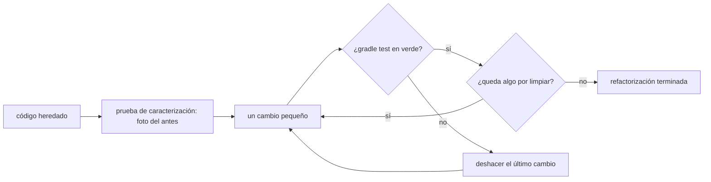
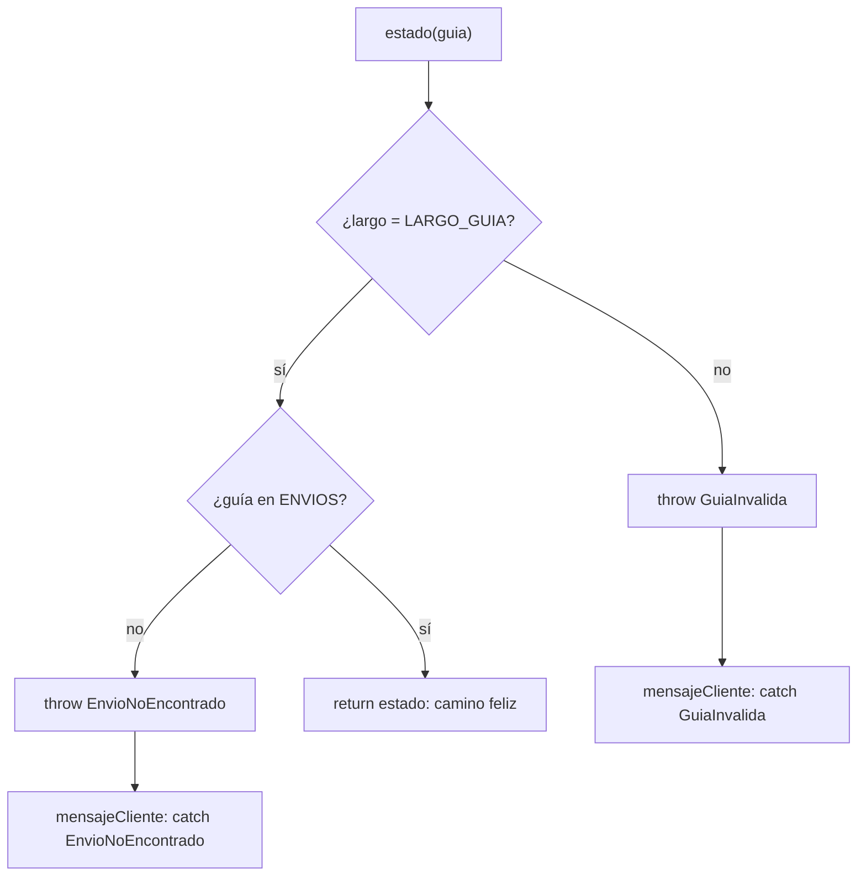
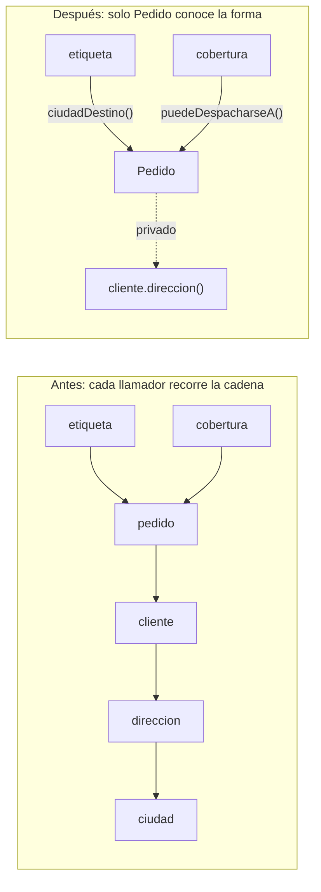
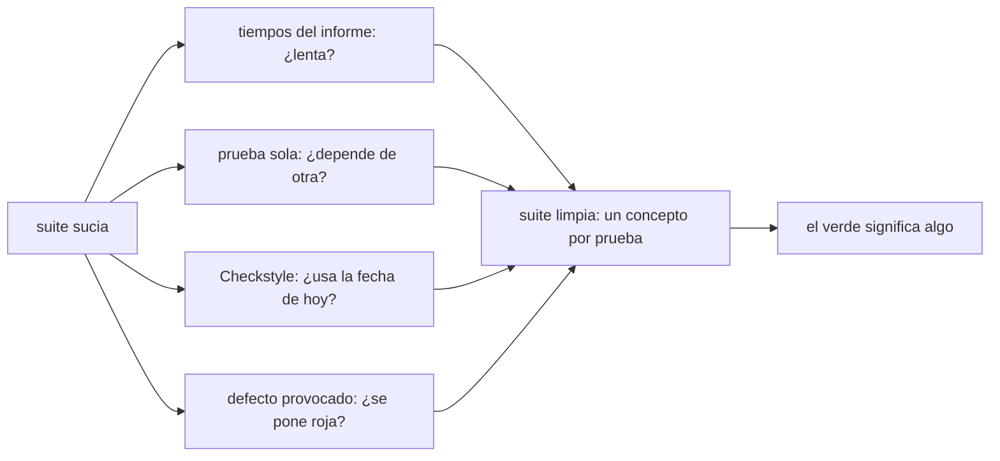

# Módulo 10: Código limpio

**Entorno comprobado para esta edición (2026-11-24):** OpenJDK 25.0.5.1 en Linux x86_64, Gradle 8.14.3 con JUnit 5.13.4 (como en el Módulo 4) y Checkstyle 9.3. Todas las transcripciones son literales de esa ejecución, en la carpeta de práctica `/home/estudiante/labs/codigo-limpio` (tu `~/labs/codigo-limpio`). Los tiempos que informa Gradle (`BUILD SUCCESSFUL in 3s`) cambian en cada máquina. Checkstyle se ejecutó con el comando `checkstyle`, que el Paso 1 del Tema 1 te enseña a crear; si usas una versión más reciente de Checkstyle, las reglas de este módulo y sus mensajes son los mismos. Las ideas de este módulo vienen de la tradición de «código limpio» de la ingeniería de software; los ejemplos y el texto son propios del curso.

Al terminar este módulo podrás:
- proteger un código heredado con pruebas de caracterización antes de cambiarlo;
- renombrar, extraer métodos y reemplazar números mágicos y argumentos bandera sin cambiar el comportamiento;
- reemplazar códigos de error por excepciones con nombre y distinguir un comentario útil de uno que sobra;
- separar objetos de estructuras de datos y aplicar la ley de Demeter;
- escribir pruebas rápidas, independientes, repetibles y autoevaluadas, con un concepto por prueba;
- usar Checkstyle para que una máquina señale parte de estos problemas.

**Qué necesitas saber antes:** métodos y descomposición (Módulo 1, Tema 4); clases, objetos, métodos y composición
(Módulo 1, Temas 6 y 7); excepciones y records (Módulo 1, Tema 1); `List`, `Map` y arreglos (Módulo 2, Tema 1);
prueba de regresión, prueba unitaria, JUnit, Gradle, linter y formateador (Módulo 4 y Módulo 5, Temas 1, 2 y 4).


## Aprende construyendo


### Tema 1: Nombres que revelan intención y funciones pequeñas · Avanzado · 60 min

<details open>
<summary><strong>Capa 1 — Lectura</strong></summary>

#### Objetivos
Al terminar este tema podrás:
- escribir una prueba de caracterización que fije lo que hace hoy un código heredado;
- renombrar variables y métodos para que digan qué guardan y qué hacen;
- reemplazar números mágicos por constantes y un argumento bandera por dos métodos;
- dividir un método largo en métodos pequeños de un solo nivel de abstracción, con la misma salida.

**Conceptos clave:** refactorización, prueba de caracterización, nombre con intención, número mágico, constante, método pequeño, nivel de abstracción, argumento bandera

#### El problema
La persona que escribió la facturación de RutaFlow ya no está en la empresa. Te deja `calc(l, f)`: doce líneas
con `t`, `x[2]`, `1200` y `0.9`. Contabilidad pide agregar una ciudad y nadie se atreve a tocarla. ¿Cómo la vuelves
legible **sin cambiar** un solo peso de lo que factura, y cómo lo demuestras?

Este tema usa **método** y **descomposición** (Módulo 1, Tema 4), **prueba de regresión**, **prueba unitaria**,
**JUnit** y **Gradle** (Módulo 4; Módulo 5, Temas 1 y 2) y **linter** (Módulo 5, Tema 4). Aquí no se redefinen.

#### Glosario del tema

**refactorización**
- **Definición técnica:** cambio en la estructura interna del código que no altera su comportamiento observable; se hace en pasos pequeños, cada uno verificado con pruebas.
- **En palabras sencillas:** ordenar la bodega sin perder ni agregar una sola caja.
- **Dónde se rompe la comparación:** en la bodega ves si falta una caja; en el código solo lo sabes si una prueba lo comprueba.
- **Ejemplo:** cambiar `calc(l, f)` por `totalFacturable(envios)` y comprobar que ambos devuelven `20000` para la misma ruta.
- **Error típico:** «refactorizar» y de paso corregir una regla de negocio; si el resultado cambia, ya no es refactorización.

**prueba de caracterización**
- **Definición técnica:** prueba que registra lo que el código hace hoy, sin juzgar si es correcto, para detectar cualquier cambio de comportamiento durante una refactorización.
- **En palabras sencillas:** una foto del antes; después comparas el «después» contra la foto.
- **Dónde se rompe la comparación:** la foto también guarda los defectos actuales; si el viejo calcula mal, la prueba exige seguir calculando mal.
- **Ejemplo:** `assertEquals(calc(ruta, false), totalFacturable(...))` compara la versión nueva con la heredada en cinco rutas.
- **Error típico:** escribirla con una sola ruta «feliz»; entonces no detecta cambios en rutas vacías o sin entregados.

**nombre con intención**
- **Definición técnica:** identificador que comunica qué representa un valor o qué hace un método, incluida la unidad cuando aplica, sin obligar a leer el cuerpo.
- **En palabras sencillas:** un nombre que responde «¿qué es esto?» sin que tengas que adivinar.
- **Dónde se rompe la comparación:** un nombre largo no es mejor por ser largo; `pesoKg` dice más que `valorNumericoDelPeso`.
- **Ejemplo:** un record `Envio(ciudad, pesoKg, estado)` en lugar de un `Object[] x` con `x[0]`, `x[1]` y `x[2]`.
- **Error típico:** usar `l`, `O` o `I` como nombres; se confunden con `1` y `0`. Checkstyle los marca si le pides nombres de al menos dos letras.

**número mágico**
- **Definición técnica:** literal numérico o de texto escrito directamente en la lógica, sin nombre que explique su origen ni su significado.
- **En palabras sencillas:** un número que aparece «porque sí» y que solo entiende quien lo escribió.
- **Dónde se rompe la comparación:** no todo literal es mágico: `0` como inicio de un acumulador se entiende solo.
- **Ejemplo:** el `1200` de `x[1] * 1200`: ¿pesos por kilo, por caja o por kilómetro?
- **Error típico:** cambiar la tarifa en un lugar y olvidar otro `1200` copiado en otro archivo.

**constante**
- **Definición técnica:** campo `static final` asignado una sola vez a un valor fijo; en Java se escribe en MAYÚSCULAS_CON_GUIONES por convención y el compilador impide reasignarlo.
- **En palabras sencillas:** el número mágico con su etiqueta puesta, en un único lugar.
- **Dónde se rompe la comparación:** `final` protege la referencia, no el contenido: un `static final Map` mutable se puede modificar por dentro. Por eso aquí se usan `Map.of`, que es inmutable.
- **Ejemplo:** `static final double TARIFA_POR_KG = 1200;` en la línea 6 de `Facturacion.java`.
- **Error típico:** confundir renombrar con cambiar el dato: `ESTADO_ENTREGADO = "entregado"` es más legible, pero los datos dicen `"E"`.

**método pequeño**
- **Definición técnica:** método con una sola responsabilidad, que cabe en la vista sin desplazarse y cuyo nombre describe todo lo que hace.
- **En palabras sencillas:** una herramienta que hace una sola cosa y la hace bien, como un destornillador.
- **Dónde se rompe la comparación:** el tamaño es un síntoma, no la regla; diez líneas con dos responsabilidades siguen siendo demasiadas.
- **Ejemplo:** `formatearPesos(valor)` solo formatea; no calcula ni valida.
- **Error típico:** partir por cantidad de líneas y crear `parte1()` y `parte2()`, nombres que no dicen nada.

**nivel de abstracción**
- **Definición técnica:** grado de detalle de una instrucción; un método bien escrito mezcla pasos del mismo nivel y delega los detalles a métodos de nivel inferior.
- **En palabras sencillas:** un índice dice «capítulo 3: tarifas», no copia la fórmula; la fórmula va dentro del capítulo.
- **Dónde se rompe la comparación:** en el código los niveles no tienen número; los reconoces cuando una línea dice «qué» y la siguiente dice «cómo».
- **Ejemplo:** `reporte` solo dice «una línea por envío»; `formatearPesos` sabe de comas y puntos.
- **Error típico:** un método que valida guías y, en la línea siguiente, reemplaza comas por puntos.

**argumento bandera**
- **Definición técnica:** parámetro `boolean` que hace que un método ejecute dos comportamientos distintos según su valor.
- **En palabras sencillas:** un interruptor escondido: el mismo método hace una cosa u otra según un `true` o `false`.
- **Dónde se rompe la comparación:** el interruptor se ve en la pared; en la llamada `calc(ruta, true)` no se ve qué enciende el `true`.
- **Ejemplo:** `calc(ruta, true)` se reemplaza por `totalClienteFrecuente(envios)`.
- **Error típico:** agregar una segunda bandera (`calc(ruta, true, false)`); ya son cuatro comportamientos en un método.

#### ► CÓMO FUNCIONA
Refactorizar código heredado sigue siempre el mismo ciclo. Primero pones la red: una **prueba de caracterización** que
compara lo nuevo con lo viejo. Luego haces **un** cambio pequeño, ejecutas la prueba y, si sigue en verde, haces el
siguiente. Si se pone en rojo, deshaces el último cambio: sabes exactamente cuál fue.

| Síntoma en el código | Qué haces | Qué lo verifica |
|---|---|---|
| `l`, `t`, `x[2]` | Renombrar con intención y usar un record | Prueba de caracterización |
| `1200`, `0.9`, `"E"` | Extraer constante con nombre | Prueba de caracterización |
| `calc(ruta, true)` | Dos métodos con nombre propio | Prueba de caracterización |
| Método que valida, calcula y formatea | Extraer métodos pequeños | Misma salida, línea por línea |
| `l`, `O`, `I` como nombres | Renombrar | Checkstyle, `ParameterName` y `LocalVariableName` |



#### Problema resuelto 1.1
Vuelve legible `calc(l, f)` sin cambiar lo que factura. Demuestra con pruebas que la versión nueva responde igual en
rutas vacías, rutas sin entregados, pesos con decimales y varias ciudades.

**Razonamiento:**
1. Antes de tocar nada, la red: una prueba JUnit que compare la versión nueva con `calc` en varias rutas.
2. Leer el código viejo y nombrar cada pieza: `x[0]` es la ciudad, `x[1]` el peso en kg y `x[2]` el estado. Esos
   nombres pasan a un record `Envio`.
3. Los literales `1200`, `5000`, `9000`, `"E"` y `0.9` pasan a constantes con nombre.
4. La bandera `f` se convierte en dos métodos: `totalFacturable` y `totalClienteFrecuente`.
5. El proyecto es de Gradle, como en el Módulo 4: el código va en `src/main/java` y las pruebas en `src/test/java`.

Este es el código heredado, tal como llegó:

```java
// FacturacionAntes.java — total facturable de una ruta (código heredado)
import java.util.List;

class FacturacionAntes {
    static long calc(List<Object[]> l, boolean f) {
        double t = 0;
        for (Object[] x : l) {
            if (x[2].equals("E")) {
                t += (double) x[1] * 1200 + (x[0].equals("BOG") ? 5000 : 9000);
            }
        }
        if (f) {
            t = t * 0.9;
        }
        return Math.round(t);
    }
}
```

Esta es la versión refactorizada:

```java
// Envio.java — un envío de la ruta, con nombre para cada dato
import java.util.List;

record Envio(String ciudad, double pesoKg, String estado) {
    /** Convierte la fila del formato heredado (ciudad, peso, estado) en un Envio. */
    static Envio desdeFila(Object[] fila) {
        return new Envio((String) fila[0], (double) fila[1], (String) fila[2]);
    }

    static List<Envio> desdeFilas(List<Object[]> filas) {
        return filas.stream().map(Envio::desdeFila).toList();
    }
}
```

```java
// Facturacion.java — total facturable de una ruta (después de refactorizar)
import java.util.List;
import java.util.Map;

class Facturacion {
    static final double TARIFA_POR_KG = 1200;
    static final Map<String, Double> TARIFA_BASE_POR_CIUDAD = Map.of("BOG", 5000.0);
    static final double TARIFA_BASE_OTRAS_CIUDADES = 9000;
    static final String ESTADO_ENTREGADO = "E";
    static final double DESCUENTO_CLIENTE_FRECUENTE = 0.10;

    static double tarifaEnvio(String ciudad, double pesoKg) {
        double base = TARIFA_BASE_POR_CIUDAD.getOrDefault(ciudad, TARIFA_BASE_OTRAS_CIUDADES);
        return base + pesoKg * TARIFA_POR_KG;
    }

    static long totalFacturable(List<Envio> envios) {
        double total = 0;
        for (Envio envio : envios) {
            if (envio.estado().equals(ESTADO_ENTREGADO)) {
                total += tarifaEnvio(envio.ciudad(), envio.pesoKg());
            }
        }
        return Math.round(total);
    }

    static long totalClienteFrecuente(List<Envio> envios) {
        return Math.round(totalFacturable(envios) * (1 - DESCUENTO_CLIENTE_FRECUENTE));
    }
}
```

La red de seguridad compara ambas versiones en cinco rutas distintas:

```java
// FacturacionTest.java — la versión nueva debe responder igual que la heredada
import static org.junit.jupiter.api.Assertions.assertEquals;

import java.util.Arrays;
import java.util.List;
import org.junit.jupiter.api.Test;

class FacturacionTest {
    static final List<List<Object[]>> RUTAS = List.of(
            List.of(),
            List.of(new Object[] {"BOG", 2.0, "E"}, new Object[] {"CAL", 1.0, "P"}, new Object[] {"MED", 3.0, "E"}),
            List.of(new Object[] {"BOG", 2.5, "E"}, new Object[] {"BOG", 0.4, "E"}),
            List.of(new Object[] {"CAL", 1.0, "P"}, new Object[] {"PAS", 7.0, "P"}),
            List.of(new Object[] {"BOG", 1.0, "E"}, new Object[] {"BUC", 1.0, "E"}, new Object[] {"BOG", 3.0, "E"}));

    static String texto(List<Object[]> ruta) {
        return ruta.stream().map(Arrays::toString).toList().toString();
    }

    @Test
    void totalSinDescuentoIgualAlHeredado() {
        for (List<Object[]> ruta : RUTAS) {
            assertEquals(FacturacionAntes.calc(ruta, false), Facturacion.totalFacturable(Envio.desdeFilas(ruta)), texto(ruta));
        }
    }

    @Test
    void totalConDescuentoIgualAlHeredado() {
        for (List<Object[]> ruta : RUTAS) {
            assertEquals(FacturacionAntes.calc(ruta, true), Facturacion.totalClienteFrecuente(Envio.desdeFilas(ruta)), texto(ruta));
        }
    }
}
```

Y un programa corto para verlas lado a lado, en `src/main/java` junto a las demás clases:

```java
// Comparar.java — muestra las dos versiones lado a lado
void main() {
    List<Object[]> ruta = List.of(
            new Object[] {"BOG", 2.0, "E"}, new Object[] {"CAL", 1.0, "P"}, new Object[] {"MED", 3.0, "E"});
    List<Envio> envios = Envio.desdeFilas(ruta);
    IO.println("Antes:   " + FacturacionAntes.calc(ruta, false) + " " + FacturacionAntes.calc(ruta, true));
    IO.println("Después: " + Facturacion.totalFacturable(envios) + " " + Facturacion.totalClienteFrecuente(envios));
}
```

```text
$ java src/main/java/Comparar.java
Antes:   20000 18000
Después: 20000 18000
```

```text
$ gradle test --tests FacturacionTest
> Task :compileJava
> Task :processResources NO-SOURCE
> Task :classes
> Task :compileTestJava
> Task :processTestResources NO-SOURCE
> Task :testClasses

> Task :test

FacturacionTest > totalConDescuentoIgualAlHeredado() PASSED

FacturacionTest > totalSinDescuentoIgualAlHeredado() PASSED

BUILD SUCCESSFUL in 2s
3 actionable tasks: 3 executed
```

**Explicación por partes.**
- `FacturacionAntes.java`, línea 5: cada envío es un `Object[]`; nada dice qué hay en cada posición, y la línea 9
  necesita convertir `x[1]` a `double` a mano.
- Línea 9: en una sola línea mezcla la tarifa por kilo, la base por ciudad y la regla «Bogotá es local».
- `Envio.java`: el record pone nombre a cada dato. `desdeFila` traduce el formato heredado; así la prueba puede darle
  los mismos datos a las dos versiones.
- `Facturacion.java`, líneas 6–10: cada literal recibe un nombre. `DESCUENTO_CLIENTE_FRECUENTE = 0.10` explica qué era el `0.9`.
- Línea 7: la base por ciudad es un `Map` (Módulo 2); agregar Medellín será agregar una clave, no otro `if`.
- Línea 19: el `for` recorre records `Envio`; `envio.pesoKg()` reemplaza a `(double) x[1]`.
- Líneas 27–29: la bandera desapareció. Quien lee `totalClienteFrecuente(envios)` sabe qué recibe sin abrir el método.
- `FacturacionTest.java`, líneas 9–14: rutas elegidas para cubrir cada regla, incluida la lista vacía y los decimales.
- Líneas 23 y 30: el tercer argumento de `assertEquals` es el mensaje: la ruta. Si falla, JUnit dice con qué datos.

> **Error común.** Renombrar el **dato** creyendo que renombras el **nombre**. Si al limpiar escribes
> `ESTADO_ENTREGADO = "entregado"`, el código se lee mejor, pero los datos siguen diciendo `"E"`. La red lo atrapa:

```text
$ gradle test --tests FacturacionTest
> Task :compileJava
> Task :processResources NO-SOURCE
> Task :classes
> Task :compileTestJava
> Task :processTestResources NO-SOURCE
> Task :testClasses

> Task :test FAILED

FacturacionTest > totalConDescuentoIgualAlHeredado() FAILED
    org.opentest4j.AssertionFailedError: [[BOG, 2.0, E], [CAL, 1.0, P], [MED, 3.0, E]] ==> expected: <18000> but was: <0>

FacturacionTest > totalSinDescuentoIgualAlHeredado() FAILED
    org.opentest4j.AssertionFailedError: [[BOG, 2.0, E], [CAL, 1.0, P], [MED, 3.0, E]] ==> expected: <20000> but was: <0>

2 tests completed, 2 failed

FAILURE: Build failed with an exception.

* What went wrong:
Execution failed for task ':test'.
> There were failing tests. See the report at: file:///home/estudiante/labs/codigo-limpio/build/reports/tests/test/index.html

* Try:
> Run with --scan to get full insights.

BUILD FAILED in 3s
3 actionable tasks: 3 executed
```

> Lee la línea `AssertionFailedError`: primero la ruta (el mensaje), luego `expected: <20000> but was: <0>`: la
> versión nueva ya no factura nada. Deshaces el cambio y la suite vuelve a verde.

> **Buena práctica.** Haz un commit (Módulo 5, Tema 3) por cada paso de refactorización en verde. Si un paso rompe
> algo que las pruebas no ven, `git revert` deshace solo ese paso.

#### Problema resuelto 1.2
`LiquidacionAntes.java` arma el reporte diario: valida la guía, calcula el valor, suma el recargo urgente y formatea
en pesos, todo en un método. Divídelo en métodos pequeños de un solo nivel y comprueba que el reporte es idéntico.

**Razonamiento:**
1. Listar lo que hace el método: validar, calcular, formatear y armar la lista. Son cuatro responsabilidades.
2. Cada una pasa a su método, con un nombre que diga qué hace. `reporte` queda en el nivel más alto: «una línea por envío».
3. Los datos de prueba deben pasar por cada regla: válido, urgente, prefijo malo, peso cero y un valor con miles.
4. La comprobación es la salida completa, comparada línea por línea con la versión vieja.

```java
// EnvioDiario.java — un envío del reporte de liquidación
record EnvioDiario(String guia, double pesoKg, boolean urgente) {}
```

```java
// LiquidacionAntes.java — líneas del reporte de liquidación (código heredado)
import java.util.ArrayList;
import java.util.List;
import java.util.Locale;

class LiquidacionAntes {
    static List<String> reporte(List<EnvioDiario> envios) {
        List<String> lineas = new ArrayList<>();
        for (EnvioDiario envio : envios) {
            if (!envio.guia().startsWith("RF-") || envio.pesoKg() <= 0) {
                lineas.add(envio.guia() + ": rechazado");
                continue;
            }
            double valor = 5000 + envio.pesoKg() * 1200;
            if (envio.urgente()) {
                valor = valor + 3000;
            }
            lineas.add(envio.guia() + ": " + String.format(Locale.ROOT, "$%,.0f", valor).replace(',', '.'));
        }
        return lineas;
    }
}
```

```java
// Liquidacion.java — líneas del reporte de liquidación (después de refactorizar)
import java.util.List;
import java.util.Locale;

class Liquidacion {
    static final String PREFIJO_GUIA = "RF-";
    static final double TARIFA_BASE = 5000;
    static final double TARIFA_POR_KG = 1200;
    static final double RECARGO_URGENTE = 3000;

    static boolean esValido(EnvioDiario envio) {
        return envio.guia().startsWith(PREFIJO_GUIA) && envio.pesoKg() > 0;
    }

    static double valorEnvio(EnvioDiario envio) {
        double recargo = envio.urgente() ? RECARGO_URGENTE : 0;
        return TARIFA_BASE + envio.pesoKg() * TARIFA_POR_KG + recargo;
    }

    static String formatearPesos(double valor) {
        return String.format(Locale.ROOT, "$%,.0f", valor).replace(',', '.');
    }

    static String lineaReporte(EnvioDiario envio) {
        if (!esValido(envio)) {
            return envio.guia() + ": rechazado";
        }
        return envio.guia() + ": " + formatearPesos(valorEnvio(envio));
    }

    static List<String> reporte(List<EnvioDiario> envios) {
        return envios.stream().map(Liquidacion::lineaReporte).toList();
    }
}
```

```java
// RutaEjemplo.java — envíos de prueba que cubren cada regla del reporte
import java.util.List;

final class RutaEjemplo {
    static final List<EnvioDiario> ENVIOS = List.of(
            new EnvioDiario("RF-101", 2, false),
            new EnvioDiario("RF-102", 1.5, true),
            new EnvioDiario("XX-103", 1, false),
            new EnvioDiario("RF-104", 0, true),
            new EnvioDiario("RF-105", 12, true));

    private RutaEjemplo() {}
}
```

```java
// LiquidacionTest.java — el reporte nuevo debe ser idéntico, línea por línea
import static org.junit.jupiter.api.Assertions.assertEquals;

import org.junit.jupiter.api.Test;

class LiquidacionTest {
    @Test
    void reporteIdenticoAlHeredado() {
        assertEquals(LiquidacionAntes.reporte(RutaEjemplo.ENVIOS), Liquidacion.reporte(RutaEjemplo.ENVIOS));
    }

    @Test
    void valorEnvioSumaRecargoUrgente() {
        assertEquals(9800, Liquidacion.valorEnvio(new EnvioDiario("RF-102", 1.5, true)));
    }
}
```

```java
// VerReporte.java — imprime el reporte con la versión nueva
void main() {
    for (String linea : Liquidacion.reporte(RutaEjemplo.ENVIOS)) {
        IO.println(linea);
    }
}
```

```text
$ java src/main/java/VerReporte.java
RF-101: $7.400
RF-102: $9.800
XX-103: rechazado
RF-104: rechazado
RF-105: $22.400
```

```text
$ gradle test --tests LiquidacionTest
> Task :compileJava
> Task :processResources NO-SOURCE
> Task :classes
> Task :compileTestJava
> Task :processTestResources NO-SOURCE
> Task :testClasses

> Task :test

LiquidacionTest > reporteIdenticoAlHeredado() PASSED

LiquidacionTest > valorEnvioSumaRecargoUrgente() PASSED

BUILD SUCCESSFUL in 1s
3 actionable tasks: 3 executed
```

Un linter puede medir parte del problema. Checkstyle no revisa nada que no le pidas: sus reglas se escriben en un
archivo XML. La regla `CyclomaticComplexity` cuenta los caminos posibles dentro de un método (complejidad
ciclomática); este archivo fija el máximo en 3 para ver la diferencia:

```xml
<?xml version="1.0"?>
<!DOCTYPE module PUBLIC "-//Checkstyle//DTD Checkstyle Configuration 1.3//EN"
        "https://checkstyle.org/dtds/configuration_1_3.dtd">
<!-- complejidad.xml — avisa si un método tiene más de 3 caminos posibles -->
<module name="Checker">
    <module name="TreeWalker">
        <module name="CyclomaticComplexity">
            <property name="max" value="3"/>
        </module>
    </module>
</module>
```

```text
$ checkstyle -c config/complejidad.xml src/main/java/LiquidacionAntes.java src/main/java/Liquidacion.java
Starting audit...
[ERROR] /home/estudiante/labs/codigo-limpio/src/main/java/LiquidacionAntes.java:7:5: Cyclomatic Complexity is 5 (max allowed is 3). [CyclomaticComplexity]
Audit done.
Checkstyle ends with 1 errors.
```

**Explicación por partes.**
- `LiquidacionAntes.java`, línea 10: la validación vive en el mismo bucle que el cálculo; para probarla sola hay que armar un reporte.
- Línea 18: el formato (`%,.0f` y el cambio de coma por punto) está mezclado con el armado de la lista.
- `Liquidacion.java`, líneas 11–22: tres métodos de un solo propósito; cada uno se puede probar por separado.
- Líneas 24–29: `lineaReporte` decide «rechazado o valor» y delega los detalles.
- Líneas 31–33: `reporte` queda en una línea y en el nivel más alto. Se lee como la descripción del requisito.
- `LiquidacionTest.java`, línea 9: la prueba de caracterización compara listas completas; un espacio de diferencia la pone en rojo.
- Línea 14: una prueba unitaria nueva, posible solo ahora que `valorEnvio` existe por separado.
- `Cyclomatic Complexity is 5 (max allowed is 3)`: el método viejo tiene 5 caminos (el método, el `for`, el `if`, el
  `||` y el `if` urgente); ningún método nuevo supera el límite, por eso Checkstyle no los menciona.

> **Error común.** Creer que Checkstyle revisa los nombres porque «pasó Checkstyle». Con `complejidad.xml`, sobre el
> archivo heredado solo habla de complejidad: los nombres `l`, `f`, `t` y `x` pasan sin comentario. Hay que pedir
> esa regla en otro archivo:

```xml
<?xml version="1.0"?>
<!DOCTYPE module PUBLIC "-//Checkstyle//DTD Checkstyle Configuration 1.3//EN"
        "https://checkstyle.org/dtds/configuration_1_3.dtd">
<!-- nombres.xml — parámetros y variables locales de al menos dos letras -->
<module name="Checker">
    <module name="TreeWalker">
        <module name="ParameterName">
            <property name="format" value="^[a-z][a-zA-Z0-9]+$"/>
        </module>
        <module name="LocalVariableName">
            <property name="format" value="^[a-z][a-zA-Z0-9]+$"/>
        </module>
    </module>
</module>
```

```text
$ checkstyle -c config/complejidad.xml src/main/java/FacturacionAntes.java
Starting audit...
[ERROR] /home/estudiante/labs/codigo-limpio/src/main/java/FacturacionAntes.java:5:5: Cyclomatic Complexity is 5 (max allowed is 3). [CyclomaticComplexity]
Audit done.
Checkstyle ends with 1 errors.
$ checkstyle -c config/nombres.xml src/main/java/FacturacionAntes.java src/main/java/Facturacion.java
Starting audit...
[ERROR] /home/estudiante/labs/codigo-limpio/src/main/java/FacturacionAntes.java:5:37: Name 'l' must match pattern '^[a-z][a-zA-Z0-9]+$'. [ParameterName]
[ERROR] /home/estudiante/labs/codigo-limpio/src/main/java/FacturacionAntes.java:5:48: Name 'f' must match pattern '^[a-z][a-zA-Z0-9]+$'. [ParameterName]
[ERROR] /home/estudiante/labs/codigo-limpio/src/main/java/FacturacionAntes.java:6:16: Name 't' must match pattern '^[a-z][a-zA-Z0-9]+$'. [LocalVariableName]
[ERROR] /home/estudiante/labs/codigo-limpio/src/main/java/FacturacionAntes.java:7:23: Name 'x' must match pattern '^[a-z][a-zA-Z0-9]+$'. [LocalVariableName]
Audit done.
Checkstyle ends with 4 errors.
```

> La regla solo detecta nombres de una letra. Ninguna herramienta sabe que `t` debía llamarse `total`: un `tt` también
> pasaría. Eso lo decides tú.

> **Prevenir errores.** Antes de extraer un método, escribe su nombre en una línea. Si necesitas «y» para
> describirlo (`validarYFormatear`), son dos métodos.

#### Checkpoint 1.1
En `Facturacion.java`, ¿por qué `totalClienteFrecuente` llama a `totalFacturable` en vez de repetir el bucle?

Respuesta: porque el descuento es una regla sobre el total, no sobre cada envío. Reusar `totalFacturable` deja la
regla de facturación en un solo lugar: si cambia una tarifa, ambos métodos la ven.

</details>

<details>
<summary><strong>Capa 2 — Construcción</strong></summary>

#### Paso 1 · Prepara la carpeta
Crea `~/labs/codigo-limpio` con `src/main/java`, `src/test/java` y `config`, y copia ahí `settings.gradle.kts` y
`build.gradle.kts` del proyecto del Módulo 4 (con JUnit; el nombre del proyecto pasa a `codigo-limpio`). Descarga una
sola vez el jar «all» de Checkstyle desde su página de versiones (`checkstyle-<versión>-all.jar`), guárdalo en
`~/herramientas` y crea el comando con `alias checkstyle='java -jar ~/herramientas/checkstyle-<versión>-all.jar'`
en tu `~/.bashrc`. Escribe `FacturacionAntes.java` exactamente como aparece arriba.

#### Paso 2 · Pon la red antes de tocar nada
Escribe `FacturacionTest.java` llamando, por ahora, a `calc` en ambos lados de la comparación. Ejecuta
`gradle test --tests FacturacionTest`: las dos pruebas deben decir `PASSED`. Esa es la foto del antes.

#### Paso 3 · Refactoriza en pasos pequeños
Crea `Envio.java` y `Facturacion.java`. Primero renombra y pasa a records; ejecuta las pruebas. Luego extrae las
constantes; ejecuta. Por último reemplaza la bandera por dos métodos; ejecuta. Cambia la prueba para que llame a los
métodos nuevos y confirma que las dos dicen `PASSED`.

#### Paso 4 · Provoca el error común y extrae métodos
Cambia `ESTADO_ENTREGADO` a `"entregado"`, mira el `expected: <20000> but was: <0>` y deshazlo. Luego escribe
`EnvioDiario.java`, `LiquidacionAntes.java`, `Liquidacion.java`, `RutaEjemplo.java` y `LiquidacionTest.java`, y
ejecuta Checkstyle con `config/complejidad.xml`.

#### Resumen
- **Refactorizar** es cambiar la estructura sin cambiar el comportamiento; se hace en pasos pequeños y verificados.
- La **prueba de caracterización** fija lo que hace hoy el código heredado y compara cada paso contra esa foto.
- Un **nombre con intención** dice qué es o qué hace; un record elimina índices como `x[2]`.
- Un **número mágico** se convierte en **constante** `static final` con nombre en MAYÚSCULAS, en un único lugar.
- Un **método pequeño** tiene una responsabilidad y trabaja en un solo **nivel de abstracción**.
- Un **argumento bandera** se reemplaza por dos métodos con nombre propio.
- Checkstyle ayuda (`CyclomaticComplexity`, `ParameterName`), pero solo con las reglas que le pidas, y la intención
  de un nombre solo la puedes juzgar tú.

#### Ejercicio verificable 1
Básico. Sin ejecutar, calcula `totalFacturable` y `totalClienteFrecuente` para los envíos
`new Envio("BOG", 1, "E")` y `new Envio("CAL", 2, "E")`. Luego compruébalo en Java.

Respuesta esperada: `17600` y `15840`. Bogotá: `5000 + 1 * 1200 = 6200`. Cali: `9000 + 2 * 1200 = 11400`. El total es
`17600` y con el 10 % de descuento queda `15840`.

#### Ejercicio verificable 2
Intermedio. Contabilidad pide que Medellín (`"MED"`) tenga base 7000. Agrega la clave al `Map.of` de la línea 7 y
ejecuta `gradle test --tests FacturacionTest`. ¿Qué pasa y qué debes hacer con la prueba?

Respuesta esperada: fallan las dos pruebas, con `expected: <20000> but was: <18000>` y
`expected: <18000> but was: <16200>` para la ruta que incluye Medellín. Es correcto que fallen: ya no es una refactorización, es una regla nueva. La prueba de
caracterización cumplió su papel; ahora escribes una prueba unitaria con el valor nuevo y retiras la comparación con `calc`.

#### Ejercicio verificable 3
Reto. Refactoriza `static String etiqueta(String g, boolean u)`, que devuelve `"[URGENTE] " + g.toUpperCase()` si `u`
es verdadero y `g.toUpperCase()` si no. Elimina la bandera y demuestra que nada cambió.

Respuesta esperada: dos métodos, `etiquetaNormal(String guia)`, que devuelve `guia.toUpperCase()`, y
`etiquetaUrgente(String guia)`, que devuelve `"[URGENTE] " + etiquetaNormal(guia)`. La prueba compara, para varias
guías, `assertEquals(etiqueta(g, false), etiquetaNormal(g))` y `assertEquals(etiqueta(g, true), etiquetaUrgente(g))`.
Con `"rf-101"`, `etiquetaUrgente` devuelve `[URGENTE] RF-101`.

#### En el trabajo
En casi todas las empresas trabajarás sobre código que no escribiste. La regla del equipo suele ser «deja el código un
poco mejor de como lo encontraste», pero siempre con una prueba antes. Los pull requests de refactorización van
**separados** de los que cambian reglas de negocio: así la revisión de código sabe qué buscar. Si un mismo PR renombra
y cambia una tarifa, nadie puede asegurar qué causó una diferencia en la factura.

</details>

### Tema 2: Comentarios honestos y excepciones en lugar de códigos de error · Avanzado · 50 min

<details open>
<summary><strong>Capa 1 — Lectura</strong></summary>

#### Objetivos
Al terminar este tema podrás:
- reemplazar códigos de error como `"-1"` y `"-2"` por excepciones personalizadas con nombre;
- separar el camino feliz del manejo de errores y encadenar una excepción con su causa;
- clasificar comentarios en útiles, redundantes y código comentado, y decidir qué hacer con cada uno;
- demostrar con pruebas que el cliente recibe los mismos mensajes antes y después del cambio.

**Conceptos clave:** código de error, excepción personalizada, camino feliz, encadenamiento de excepciones, comentario que explica el porqué, comentario redundante, código comentado, Javadoc

#### El problema
El portal de RutaFlow consulta el estado de una guía con `estadoConCodigo`, que devuelve el estado o los textos
`"-2"` y `"-1"`. Un desarrollador nuevo escribió `estadoConCodigo(guia).toUpperCase()` y el portal le mostró a un
cliente «Estado: -2». Los comentarios que explicaban los códigos estaban ahí, pero nadie los leyó. ¿Cómo haces que el error no se
pueda ignorar y que el código se explique sin depender de comentarios?

Este tema usa **excepción** (Módulo 1, Tema 1), **herencia** y **subclase** (Módulo 1, Tema 7), **`Map`**
(Módulo 2, Tema 1) y **refactorización** y **prueba de caracterización** (Tema 1 de este módulo).

#### Glosario del tema

**código de error**
- **Definición técnica:** valor de retorno especial (como `-1`, `null` o `""`) que un método usa para indicar un fallo, mezclado con los valores de éxito.
- **En palabras sencillas:** un papelito con un número que alguien debe recordar revisar y saber traducir.
- **Dónde se rompe la comparación:** el papelito se nota; el `"-2"` es un dato más, y el programa sigue como si fuera un estado.
- **Ejemplo:** `estadoConCodigo("BO-9")` devuelve `"-2"`, que el llamador debe comparar a mano.
- **Error típico:** olvidar revisarlo: `estadoConCodigo("BO-9").toUpperCase()` no falla; devuelve `"-2"` y el cliente ve un número sin sentido.

**excepción personalizada**
- **Definición técnica:** clase propia que hereda de una excepción de Java (`IllegalArgumentException`, `NoSuchElementException`…) y nombra un fallo del dominio. Se lanza con `throw` y se captura por su nombre con `catch`.
- **En palabras sencillas:** una alarma con su nombre escrito: «guía inválida» suena distinto de «envío no encontrado».
- **Dónde se rompe la comparación:** heredar de `IllegalArgumentException` hace que un `catch (IllegalArgumentException e)` genérico también la atrape; elige el padre con cuidado.
- **Ejemplo:** `class GuiaInvalida extends IllegalArgumentException` en `GuiaInvalida.java`.
- **Error típico:** heredar de `Exception` sin pensarlo: es una excepción **comprobada** y obliga a todos los métodos de la cadena a declararla con `throws`. Para errores de datos, hereda de `RuntimeException` o de una de sus hijas.

**camino feliz**
- **Definición técnica:** secuencia de instrucciones que se ejecuta cuando todos los datos son válidos; el código limpio la deja legible de arriba abajo y aparta los errores.
- **En palabras sencillas:** la ruta del día en que todo sale bien, sin desvíos.
- **Dónde se rompe la comparación:** no es el caso más común, solo el más simple; los errores también son parte del requisito.
- **Ejemplo:** en `mensajeCliente` nuevo, la línea 22 es el camino feliz; los `catch` de abajo son los desvíos.
- **Error típico:** probar solo el camino feliz y descubrir en producción qué hace el programa con una guía vacía.

**encadenamiento de excepciones**
- **Definición técnica:** relación entre una excepción nueva y la que la causó; se declara pasando la original como **causa** al constructor (`new GuiaInvalida(mensaje, error)`), y Java la muestra en la traza con `Caused by:`.
- **En palabras sencillas:** decir en el reporte que el segundo choque fue consecuencia del primero, y conservar la foto del primero.
- **Dónde se rompe la comparación:** Java no adivina tu intención; si no pasas la causa, la excepción original desaparece sin dejar rastro.
- **Ejemplo:** `throw new GuiaInvalida("...", error);` en la línea 6 de `NumeroGuia.java`.
- **Error típico:** envolver una excepción sin pasar la causa: la traza dice qué pasó en tu código, pero ya no dice por qué.

**comentario que explica el porqué**
- **Definición técnica:** comentario que registra una razón, una restricción externa o una decisión que el código no puede expresar por sí mismo.
- **En palabras sencillas:** la nota que responde «¿por qué está así?», no «¿qué hace?».
- **Dónde se rompe la comparación:** también envejece; si cambia la regla del operador postal, el comentario debe cambiar con ella.
- **Ejemplo:** `# El operador postal asigna guías de 9 caracteres: "BO-" más seis dígitos.`
- **Error típico:** explicar con un comentario lo que un buen nombre ya diría, en vez de cambiar el nombre.

**comentario redundante**
- **Definición técnica:** comentario que repite lo que la instrucción siguiente ya dice; no agrega información y puede quedar desactualizado.
- **En palabras sencillas:** un letrero de «puerta» pegado en una puerta.
- **Dónde se rompe la comparación:** el letrero no miente nunca; el comentario sí, cuando alguien cambia el código y no el comentario.
- **Ejemplo:** `// busca la guía` encima de `if (!ENVIOS.containsKey(guia))`.
- **Error típico:** usar comentarios para explicar códigos mágicos (`// -2 = guía inválida`) en vez de eliminar el código mágico.

**código comentado**
- **Definición técnica:** instrucciones desactivadas con `//` que se dejan en el archivo; el historial de Git ya las conserva.
- **En palabras sencillas:** muebles viejos tapados con una sábana en medio de la sala.
- **Dónde se rompe la comparación:** nadie se atreve a quitar la sábana porque no sabe si alguien la necesita.
- **Ejemplo:** `// System.out.println("consultando " + guia);` en la línea 16 de `ErroresAntes.java`.
- **Error típico:** comentar en vez de borrar «por si acaso»; para eso existe `git log` (Módulo 5, Tema 3).

**Javadoc**
- **Definición técnica:** comentario que empieza con `/**`, escrito justo antes de una clase, un método o un campo; la herramienta `javadoc` lo convierte en documentación y los editores lo muestran al pasar el cursor.
- **En palabras sencillas:** la etiqueta de instrucciones pegada a la herramienta, que viaja con ella.
- **Dónde se rompe la comparación:** a diferencia de un comentario con `//`, tiene un formato que las herramientas leen y publican.
- **Ejemplo:** `/** La guía no tiene el formato del operador postal. */` en la línea 2 de `GuiaInvalida.java`.
- **Error típico:** escribir un Javadoc que repite el nombre (`/** Guía inválida. */`); debe decir cuándo ocurre.

#### ► CÓMO FUNCIONA
Con códigos de error, cada llamador debe recordar comparar el resultado con `"-1"` y `"-2"` antes de usarlo. Si lo
olvida, el programa sigue con un código donde esperaba un estado y el problema aparece más adelante, lejos de la causa. Con excepciones,
olvidar el manejo **detiene** el programa en el punto exacto, con un nombre que explica qué pasó.

| Situación | Código de error | Excepción personalizada |
|---|---|---|
| Guía con largo incorrecto | `return "-2"` | `throw new GuiaInvalida(...)` |
| Guía que no existe | `return "-1"` | `throw new EnvioNoEncontrado(...)` |
| El llamador olvida revisar | Sigue con un dato falso | Se detiene en el punto exacto |
| Qué documenta el fallo | Un comentario `// -2 = ...` | El nombre de la clase y su Javadoc |

Los comentarios se revisan con tres preguntas: ¿explica un porqué? Se queda. ¿Repite el código? Se borra. ¿Es
código desactivado? Se borra; Git lo recuerda.



#### Problema resuelto 2.1
Reemplaza los códigos `"-2"` y `"-1"` de `estadoConCodigo` por excepciones personalizadas. Limpia los comentarios y
demuestra que `mensajeCliente` responde igual para guías válidas, cortas, largas, vacías e inexistentes.

**Razonamiento:**
1. Cada código de error se convierte en una excepción con nombre: `"-2"` en `GuiaInvalida` y `"-1"` en `EnvioNoEncontrado`.
2. El `9` es un número mágico; pasa a `LARGO_GUIA` con un comentario que explica **por qué** vale 9.
3. Los comentarios redundantes y el `println` comentado se borran; los que traducían códigos desaparecen con los códigos.
4. La prueba de caracterización compara `mensajeCliente` viejo y nuevo; otras dos fijan la equivalencia código ↔ excepción.

```java
// ErroresAntes.java — consulta de estado con códigos de error (código heredado)
import java.util.Map;

class ErroresAntes {
    static final Map<String, String> ENVIOS = Map.of("BO-000001", "en ruta", "BO-000002", "entregado");

    static String estadoConCodigo(String guia) {
        // revisa el largo
        if (guia.length() != 9) {
            return "-2"; // -2 = guía inválida
        }
        // busca la guía
        if (!ENVIOS.containsKey(guia)) {
            return "-1"; // -1 = no existe
        }
        // System.out.println("consultando " + guia);
        return ENVIOS.get(guia);
    }

    static String mensajeCliente(String guia) {
        String resultado = estadoConCodigo(guia);
        if (resultado.equals("-2")) {
            return "Revisa el número de guía";
        }
        if (resultado.equals("-1")) {
            return "No encontramos tu envío";
        }
        return "Tu envío está " + resultado;
    }
}
```

```java
// GuiaInvalida.java
/** La guía no tiene el formato del operador postal. */
class GuiaInvalida extends IllegalArgumentException {
    GuiaInvalida(String mensaje) {
        super(mensaje);
    }

    GuiaInvalida(String mensaje, Throwable causa) {
        super(mensaje, causa);
    }
}
```

```java
// EnvioNoEncontrado.java
import java.util.NoSuchElementException;

/** La guía tiene buen formato, pero no está registrada. */
class EnvioNoEncontrado extends NoSuchElementException {
    EnvioNoEncontrado(String guia) {
        super(guia);
    }
}
```

```java
// Errores.java — consulta de estado con excepciones (después de refactorizar)
import java.util.Map;

class Errores {
    static final Map<String, String> ENVIOS = Map.of("BO-000001", "en ruta", "BO-000002", "entregado");
    // El operador postal asigna guías de 9 caracteres: "BO-" más seis dígitos.
    static final int LARGO_GUIA = 9;

    static String estado(String guia) {
        if (guia.length() != LARGO_GUIA) {
            throw new GuiaInvalida("La guía '" + guia + "' debe tener " + LARGO_GUIA + " caracteres");
        }
        String estado = ENVIOS.get(guia);
        if (estado == null) {
            throw new EnvioNoEncontrado(guia);
        }
        return estado;
    }

    static String mensajeCliente(String guia) {
        try {
            return "Tu envío está " + estado(guia);
        } catch (GuiaInvalida error) {
            return "Revisa el número de guía";
        } catch (EnvioNoEncontrado error) {
            return "No encontramos tu envío";
        }
    }
}
```

```java
// ErroresTest.java — las excepciones cuentan lo mismo que los códigos
import static org.junit.jupiter.api.Assertions.assertEquals;
import static org.junit.jupiter.api.Assertions.assertThrows;
import static org.junit.jupiter.api.Assertions.assertTrue;

import java.util.List;
import org.junit.jupiter.api.Test;

class ErroresTest {
    static final List<String> GUIAS = List.of("BO-000001", "BO-000002", "BO-9", "BO-0000001", "BO-000777", "");

    @Test
    void mensajeClienteIgualAlHeredado() {
        for (String guia : GUIAS) {
            assertEquals(ErroresAntes.mensajeCliente(guia), Errores.mensajeCliente(guia), guia);
        }
    }

    @Test
    void guiaRegistradaDevuelveElMismoEstado() {
        assertEquals(ErroresAntes.estadoConCodigo("BO-000002"), Errores.estado("BO-000002"));
    }

    @Test
    void codigoMenosDosAhoraEsGuiaInvalida() {
        assertEquals("-2", ErroresAntes.estadoConCodigo("BO-9"));
        GuiaInvalida error = assertThrows(GuiaInvalida.class, () -> Errores.estado("BO-9"));
        assertTrue(error.getMessage().contains("9 caracteres"));
    }

    @Test
    void codigoMenosUnoAhoraEsEnvioNoEncontrado() {
        assertEquals("-1", ErroresAntes.estadoConCodigo("BO-000777"));
        assertThrows(EnvioNoEncontrado.class, () -> Errores.estado("BO-000777"));
    }
}
```

Y la comparación directa:

```java
// CompararErrores.java — misma consulta con códigos y con excepciones
void main() {
    for (String guia : List.of("BO-000001", "BO-9", "BO-000777")) {
        String codigo = ErroresAntes.estadoConCodigo(guia);
        IO.print("%-10s código=%-10s ".formatted(guia, "'" + codigo + "'"));
        try {
            IO.println("excepción: ninguna, estado = " + Errores.estado(guia));
        } catch (GuiaInvalida | EnvioNoEncontrado error) {
            IO.println("excepción: " + error);
        }
    }
}
```

```text
$ java src/main/java/CompararErrores.java
BO-000001  código='en ruta'  excepción: ninguna, estado = en ruta
BO-9       código='-2'       excepción: GuiaInvalida: La guía 'BO-9' debe tener 9 caracteres
BO-000777  código='-1'       excepción: EnvioNoEncontrado: BO-000777
```

```text
$ gradle test --tests ErroresTest
> Task :compileJava
> Task :processResources NO-SOURCE
> Task :classes
> Task :compileTestJava
> Task :processTestResources NO-SOURCE
> Task :testClasses

> Task :test

ErroresTest > codigoMenosUnoAhoraEsEnvioNoEncontrado() PASSED

ErroresTest > codigoMenosDosAhoraEsGuiaInvalida() PASSED

ErroresTest > mensajeClienteIgualAlHeredado() PASSED

ErroresTest > guiaRegistradaDevuelveElMismoEstado() PASSED

BUILD SUCCESSFUL in 1s
3 actionable tasks: 3 executed
```

**Explicación por partes.**
- `ErroresAntes.java`, líneas 8 y 12: comentarios redundantes; repiten la instrucción de abajo.
- Líneas 10 y 14: comentarios que traducen códigos mágicos. Existen solo porque `"-2"` y `"-1"` no dicen nada.
- Línea 16: código comentado. Nadie sabe si sigue siendo necesario.
- `GuiaInvalida.java` y `EnvioNoEncontrado.java`: dos excepciones personalizadas con Javadoc. `GuiaInvalida` hereda
  de `IllegalArgumentException` porque el dato está mal formado. El segundo constructor recibe la causa (Problema
  resuelto 2.2).
- `Errores.java`, línea 6: comentario que explica el porqué; el código no puede decir que la regla viene del operador postal.
- Líneas 13–16: `Map.get` devuelve `null` si la guía no está; ese `null` no sale del método, se convierte en una excepción con nombre.
- Líneas 20–28: el camino feliz ocupa una línea (22); los fallos quedan abajo, cada uno con su mensaje.
- `ErroresTest.java`, línea 10: guías para cada caso, incluidas la vacía y la de 10 caracteres.
- Líneas 24–35: las dos últimas pruebas fijan la equivalencia: donde el viejo devolvía `"-2"`, el nuevo lanza `GuiaInvalida`.
  `assertThrows` devuelve la excepción para revisar su mensaje.

> **Error común.** Usar el resultado de un método con códigos de error sin revisarlo. Este llamador olvidó el `if`:

```java
// OlvidoCodigo.java — un llamador que olvidó revisar el código de error
void main() {
    IO.println("Estado: " + ErroresAntes.estadoConCodigo("BO-9").toUpperCase());
}
```

```text
$ java src/main/java/OlvidoCodigo.java
Estado: -2
```

> No hay ningún error: el `"-2"` viajó como si fuera un estado y llegó a la pantalla del cliente. Con
> `Errores.estado("BO-9")`, el programa se habría detenido con `GuiaInvalida: La guía 'BO-9' debe tener 9 caracteres`.

> **Buena práctica.** Pide a Checkstyle que busque código comentado antes de entregar. No trae una regla con ese
> nombre, pero `RegexpSinglelineJava` busca un patrón: un comentario `//` que termina en punto y coma casi siempre es
> una instrucción desactivada.

```xml
<?xml version="1.0"?>
<!DOCTYPE module PUBLIC "-//Checkstyle//DTD Checkstyle Configuration 1.3//EN"
        "https://checkstyle.org/dtds/configuration_1_3.dtd">
<!-- comentarios.xml — busca código comentado: un comentario // que termina en punto y coma -->
<module name="Checker">
    <module name="TreeWalker">
        <module name="RegexpSinglelineJava">
            <property name="format" value="^\s*//.*;\s*$"/>
            <property name="message" value="Código comentado: bórralo, Git lo recuerda"/>
        </module>
    </module>
</module>
```

```text
$ checkstyle -c config/comentarios.xml src/main/java/ErroresAntes.java src/main/java/Errores.java
Starting audit...
[ERROR] /home/estudiante/labs/codigo-limpio/src/main/java/ErroresAntes.java:16: Código comentado: bórralo, Git lo recuerda [RegexpSinglelineJava]
Audit done.
Checkstyle ends with 1 errors.
```

#### Problema resuelto 2.2
El número de guía son los seis dígitos después de `BO-`. Convertirlo con `Integer.parseInt` puede fallar con
`NumberFormatException`, que el portal no entiende; hay que traducirla a `GuiaInvalida`. En un paso intermedio,
alguien la tradujo sin pasar la causa. Compara la traza de esa versión con la de la versión final.

**Razonamiento:**
1. Dentro de un `catch`, lanzar una excepción nueva **reemplaza** a la original.
2. Si no se pasa la original como causa, la traza solo muestra la nueva: se pierde qué carácter falló.
3. Con la causa, Java imprime la nueva excepción y, debajo, `Caused by:` con la original.

```java
// NumeroGuiaSinCausa.java — versión intermedia: envuelve la excepción y pierde la causa
int numeroDeGuia(String guia) {
    try {
        return Integer.parseInt(guia.substring(3));
    } catch (NumberFormatException error) {
        throw new GuiaInvalida("La guía '" + guia + "' no termina en seis dígitos");
    }
}

void main() {
    IO.println(numeroDeGuia("BO-00A001"));
}
```

```text
$ java src/main/java/NumeroGuiaSinCausa.java
Exception in thread "main" GuiaInvalida: La guía 'BO-00A001' no termina en seis dígitos
	at NumeroGuiaSinCausa.numeroDeGuia(NumeroGuiaSinCausa.java:6)
	at NumeroGuiaSinCausa.main(NumeroGuiaSinCausa.java:11)
```

```java
// NumeroGuia.java — versión final: la excepción nueva lleva su causa
int numeroDeGuia(String guia) {
    try {
        return Integer.parseInt(guia.substring(3));
    } catch (NumberFormatException error) {
        throw new GuiaInvalida("La guía '" + guia + "' no termina en seis dígitos", error);
    }
}

void main() {
    IO.println(numeroDeGuia("BO-00A001"));
}
```

```text
$ java src/main/java/NumeroGuia.java
Exception in thread "main" GuiaInvalida: La guía 'BO-00A001' no termina en seis dígitos
	at NumeroGuia.numeroDeGuia(NumeroGuia.java:6)
	at NumeroGuia.main(NumeroGuia.java:11)
Caused by: java.lang.NumberFormatException: For input string: "00A001"
	at java.base/java.lang.NumberFormatException.forInputString(NumberFormatException.java:67)
	at java.base/java.lang.Integer.parseInt(Integer.java:565)
	at java.base/java.lang.Integer.parseInt(Integer.java:662)
	at NumeroGuia.numeroDeGuia(NumeroGuia.java:4)
	at NumeroGuia.main(NumeroGuia.java:11)
	at java.base/jdk.internal.reflect.DirectMethodHandleAccessor.invoke(DirectMethodHandleAccessor.java:104)
	at java.base/java.lang.reflect.Method.invoke(Method.java:565)
	at jdk.compiler/com.sun.tools.javac.launcher.SourceLauncher.execute(SourceLauncher.java:256)
	at jdk.compiler/com.sun.tools.javac.launcher.SourceLauncher.run(SourceLauncher.java:138)
	at jdk.compiler/com.sun.tools.javac.launcher.SourceLauncher.main(SourceLauncher.java:76)
```

**Explicación por partes.**
- `NumeroGuiaSinCausa.java`, línea 6: la `GuiaInvalida` se crea sin la causa. La traza termina ahí: nadie sabe que
  el problema era la `A` de `00A001`.
- `NumeroGuia.java`, línea 6: la única diferencia es el segundo argumento, `error`. Ahora la traza tiene dos partes:
  la excepción del dominio arriba y, en `Caused by:`, la original con su texto `For input string: "00A001"`.
- Las líneas que empiezan con `at java.base/...` y `at jdk.compiler/...` son del propio Java y del lanzador de
  archivos fuente: léelas de arriba abajo hasta llegar a tus archivos.
- Ninguna herramienta de este curso detecta la causa olvidada: la red es la revisión de código. Busca cada `throw new`
  dentro de un `catch` y pregunta si lleva la causa.

> **Error común.** Capturar con `catch (Exception e)` para «no romper nada». Atrapa también `GuiaInvalida`,
> `EnvioNoEncontrado` y errores de programación como `NullPointerException`, y el portal responde como si todo estuviera bien.
> Captura solo las excepciones que sabes manejar, por su nombre.

> **Prevenir errores.** Antes de escribir un comentario, intenta expresar lo mismo con un nombre o una constante. Si
> no se puede, porque es una razón externa, escribe el comentario.

#### Checkpoint 2.1
¿Por qué `GuiaInvalida` hereda de `IllegalArgumentException` y `EnvioNoEncontrado` de `NoSuchElementException`?

Respuesta: una guía de 4 caracteres es un **argumento** mal formado; ese es el sentido de `IllegalArgumentException`.
Una guía bien formada que no está registrada es una **búsqueda** sin resultado, el sentido de `NoSuchElementException`.
Así, quien ya captura esas excepciones de Java sigue funcionando. Las dos son no comprobadas: nadie tiene que
declararlas con `throws`.

</details>

<details>
<summary><strong>Capa 2 — Construcción</strong></summary>

#### Paso 1 · Escribe el código heredado y su red
En `~/labs/codigo-limpio`, escribe `ErroresAntes.java` y `OlvidoCodigo.java`, y ejecuta el segundo para ver el
`Estado: -2`. Escribe `ErroresTest.java` con solo la primera prueba, comparando la versión vieja consigo misma.

#### Paso 2 · Crea las excepciones
Escribe `GuiaInvalida.java` y `EnvioNoEncontrado.java`, cada una con su Javadoc, y `Errores.java`. Reemplaza los
`return "-2"` y `return "-1"` por `throw`. Agrega las otras tres pruebas y ejecuta `gradle test --tests ErroresTest`:
las cuatro deben decir `PASSED`.

#### Paso 3 · Mira la causa perdida
Escribe `NumeroGuiaSinCausa.java` y `NumeroGuia.java` y ejecútalos. Señala en la segunda traza dónde empieza la
causa y qué dice de `00A001`.

#### Paso 4 · Limpia los comentarios
Ejecuta Checkstyle con `config/comentarios.xml` sobre `ErroresAntes.java` y `Errores.java`. Clasifica cada comentario
de `ErroresAntes.java` en porqué, redundante o código comentado, y anota qué harías con cada uno.

#### Resumen
- Un **código de error** se mezcla con los datos y depende de que alguien recuerde revisarlo.
- Una **excepción personalizada** nombra el fallo, detiene el programa en el punto exacto y se captura por su nombre.
- El **camino feliz** queda legible arriba; el manejo de errores va en los `catch`.
- El **encadenamiento de excepciones** pasa la original como causa; sin ella, la traza pierde el porqué.
- Un **comentario que explica el porqué** se queda; un **comentario redundante** y el **código comentado** se borran.
- Un **Javadoc** (`/** ... */`) documenta una clase o un método y las herramientas lo publican.
- Checkstyle puede buscar código comentado con una regla de patrón; la causa olvidada la encuentra la revisión de código.

#### Ejercicio verificable 1
Básico. Predice qué devuelve `Errores.mensajeCliente` para `"BO-000002"`, `""` y `"BO-0000001"`. Luego compruébalo.

Respuesta esperada: `Tu envío está entregado`, `Revisa el número de guía` y `Revisa el número de guía`. La guía vacía
y la de 10 caracteres no tienen 9 caracteres, así que `estado` lanza `GuiaInvalida`.

#### Ejercicio verificable 2
Intermedio. Clasifica los cinco comentarios de `ErroresAntes.java` (líneas 8, 10, 12, 14 y 16) y el de la línea 6 de
`Errores.java`. Para cada uno di si se queda, se borra o desaparece con la refactorización.

Respuesta esperada: líneas 8 y 12, redundantes: se borran. Líneas 10 y 14 traducen códigos mágicos: desaparecen al
cambiar los códigos por excepciones. Línea 16, código comentado: se borra (la regla de `comentarios.xml` la señala).
La línea 6 de `Errores.java` explica el porqué del 9: se queda.

#### Ejercicio verificable 3
Reto. Crea `EnvioYaEntregado`, que herede de `IllegalStateException`, con Javadoc. En un programa nuevo, escribe
`exigirEnRuta(String guia)`, que use `Errores.estado` y devuelva el estado o lance `new EnvioYaEntregado(guia)` si es
`"entregado"`. Llámalo con `"BO-000001"` y con `"BO-000002"`, sin capturar.

Respuesta esperada: la primera llamada imprime `en ruta`. La segunda termina el programa con una traza cuya primera
línea es `Exception in thread "main" EnvioYaEntregado: BO-000002`. Una prueba con
`assertThrows(EnvioYaEntregado.class, ...)` debe cubrir ese caso.

#### En el trabajo
En una API real, cada excepción personalizada se traduce a una respuesta HTTP (Módulo 3, Tema 2): `GuiaInvalida` a
`400`, `EnvioNoEncontrado` a `404`. Esa traducción se escribe una sola vez, en un manejador central (en Spring, un `@ControllerAdvice`), y no en
cada método. En las revisiones de código se pide borrar el código comentado. Si un comentario explica **qué** hace una línea,
se pide un mejor nombre.

</details>

### Tema 3: Objetos frente a estructuras de datos y la ley de Demeter · Avanzado · 50 min

<details open>
<summary><strong>Capa 1 — Lectura</strong></summary>

#### Objetivos
Al terminar este tema podrás:
- distinguir una estructura de datos, que expone sus datos, de un objeto, que los esconde y ofrece comportamiento;
- declarar estructuras de datos con records y proteger los datos de un objeto con campos privados y métodos de acceso;
- reconocer una cadena de navegación y reemplazarla por un método del objeto vecino (ley de Demeter);
- comprobar con pruebas que el despacho decide igual antes y después del cambio.

**Conceptos clave:** objeto frente a estructura de datos, record como estructura de datos, encapsulamiento, campo privado, método de acceso, ley de Demeter, cadena de navegación, pedir en lugar de preguntar

#### El problema
En RutaFlow, tres archivos distintos escriben `pedido.cliente().direccion().ciudad()` para imprimir etiquetas,
calcular cobertura y armar rutas. Cuando un cliente se registra sin dirección, uno de ellos olvida revisar `null` y la
impresora de etiquetas se detiene. Y si mañana la dirección pasa a tener «ciudad de entrega» y «ciudad de facturación»,
hay que cambiar los tres. ¿Cómo haces que solo un lugar conozca esa cadena?

Este tema usa **clase**, **objeto**, **atributo**, **método** y **constructor** (Módulo 1, Tema 6), **composición**
(Módulo 1, Tema 7), **record** (Módulo 1, Tema 1) y **`Set`** y **`null`** (Módulo 2, Tema 1). Aquí no se redefinen.

#### Glosario del tema

**objeto frente a estructura de datos**
- **Definición técnica:** en diseño, una estructura de datos expone sus datos y no tiene comportamiento propio; un objeto esconde sus datos y expone operaciones sobre ellos.
- **En palabras sencillas:** un formulario lleno que cualquiera lee, frente a una ventanilla que responde preguntas sin dejarte ver el archivo.
- **Dónde se rompe la comparación:** Java permite mezclar ambos en una clase; la separación es una decisión de diseño, no una regla del lenguaje.
- **Ejemplo:** `Direccion` (ciudad y barrio, sin lógica) es estructura de datos; `Pedido` con `ciudadDestino()` es objeto.
- **Error típico:** el híbrido: una clase con todos sus datos públicos **y** con lógica; tiene las desventajas de ambos.

**record como estructura de datos**
- **Definición técnica:** un record (Módulo 1, Tema 1) declara sus componentes y Java genera el constructor, un método de acceso por componente (`ciudad()`), `equals`, `hashCode` y `toString`; es la forma natural de escribir una estructura de datos.
- **En palabras sencillas:** un molde que arma solo la clase de datos: tú dices qué campos tiene y Java escribe el resto.
- **Dónde se rompe la comparación:** el tipo sí se revisa (no acepta un número donde va un `String`), pero `null` entra en cualquier componente de tipo objeto.
- **Ejemplo:** `new Direccion("Bogotá", "Chapinero")` se imprime como `Direccion[ciudad=Bogotá, barrio=Chapinero]`.
- **Error típico:** omitir un componente: `new Direccion("Bogotá")` no compila: `constructor Direccion in record Direccion cannot be applied to given types`.

**encapsulamiento**
- **Definición técnica:** principio de diseño que oculta el estado interno de un objeto y solo permite usarlo mediante sus métodos públicos.
- **En palabras sencillas:** el cajero automático no te deja tocar los billetes; le pides una operación y él decide.
- **Dónde se rompe la comparación:** en Java el ocultamiento lo impone el compilador para `private`; aun así, un método que devuelve un objeto interno mutable vuelve a abrir la puerta.
- **Ejemplo:** `Pedido` guarda `private final Cliente cliente` y ofrece `ciudadDestino()`; quien lo usa no sabe que existe `Cliente`.
- **Error típico:** agregar un `get` y un `set` por cada campo; eso expone todo con más pasos.

**campo privado**
- **Definición técnica:** campo declarado `private`: solo el código de su propia clase puede leerlo o cambiarlo; el compilador rechaza cualquier acceso desde fuera.
- **En palabras sencillas:** un cajón con candado: la llave la tiene solo la clase.
- **Dónde se rompe la comparación:** el candado protege el campo, no el objeto al que apunta: si un método público devuelve ese objeto, quien lo recibe puede usarlo.
- **Ejemplo:** `private final String guia;` en la línea 5 de `Pedido.java`.
- **Error típico:** escribir `pedido.guia` desde otra clase: `error: guia has private access in Pedido`.

**método de acceso**
- **Definición técnica:** método público sin parámetros que devuelve un dato del objeto (`guia()`); si no hay método que lo cambie y el campo es `final`, el dato es de solo lectura.
- **En palabras sencillas:** una ventanilla de consulta: muestra el dato, pero no deja cambiarlo.
- **Dónde se rompe la comparación:** parece un campo, pero es un método: puede calcular el valor en vez de guardarlo.
- **Ejemplo:** `pedido.guia()` devuelve `"G-1"`, leído del campo privado `guia`.
- **Error típico:** agregar un método de acceso para cada colaborador interno («`cliente()`, por si acaso»): vuelve la cadena de navegación.

**ley de Demeter**
- **Definición técnica:** guía de diseño: un método solo llama métodos de su propio objeto, de sus parámetros, de los objetos que crea y de sus atributos directos.
- **En palabras sencillas:** habla con tus vecinos, no con los vecinos de tus vecinos.
- **Dónde se rompe la comparación:** no es una ley física; con estructuras de datos, recorrer sus campos es normal y no la viola.
- **Ejemplo:** `pedido.ciudadDestino()` en lugar de `pedido.cliente().direccion().ciudad()`.
- **Error típico:** «cumplirla» guardando cada paso en una variable (`Cliente c = pedido.cliente();`, `Direccion d = c.direccion();`); la dependencia sigue ahí.

**cadena de navegación**
- **Definición técnica:** expresión que recorre varios objetos encadenando accesos (`a.b().c().d()`), lo que acopla al llamador con la estructura interna de cada eslabón.
- **En palabras sencillas:** dar indicaciones del tipo «entra, gira dos veces, abre el tercer cajón»; si alguien mueve un mueble, te pierdes.
- **Dónde se rompe la comparación:** las cadenas sobre valores simples (`texto.strip().toLowerCase()`) no acoplan a nadie: cada paso devuelve un `String`.
- **Ejemplo:** `pedido.cliente().direccion().ciudad()`, repetida en `ciudadParaEtiqueta` y `puedeDespacharse`.
- **Error típico:** olvidar que un eslabón puede ser `null`: `NullPointerException: Cannot invoke "Direccion.ciudad()" because the return value of "Cliente.direccion()" is null`.

**pedir en lugar de preguntar**
- **Definición técnica:** estilo de diseño en el que el llamador pide al objeto que haga o decida algo, en vez de pedirle sus datos y decidir afuera.
- **En palabras sencillas:** en lugar de pedir la llave y abrir tú la puerta, le pides al portero que la abra.
- **Dónde se rompe la comparación:** a veces el llamador sí necesita el dato, por ejemplo para imprimirlo; ahí basta un método que lo entregue.
- **Ejemplo:** `pedido.puedeDespacharseA(cobertura)` en lugar de revisar desde afuera la dirección del cliente.
- **Error típico:** repetir la misma decisión en cada llamador; cuando la regla cambia, uno queda viejo.

#### ► CÓMO FUNCIONA
Antes, cada llamador conocía la forma completa: `Pedido` tiene `cliente`, que tiene `direccion`, que puede ser
`null`. Después, solo `Pedido` conoce esa forma. Los llamadores le piden lo que necesitan: la ciudad de destino o si
se puede despachar. `Cliente` y `Direccion` siguen siendo estructuras de datos: no tienen lógica y está bien leerlas.

| Pieza | Tipo de diseño | Quién puede leer sus datos |
|---|---|---|
| `Direccion` | Estructura de datos (record) | Cualquiera |
| `Cliente` | Estructura de datos (record) | Cualquiera |
| `Pedido` | Objeto con campos privados | Solo sus métodos; afuera, `guia()`, `ciudadDestino()` y `puedeDespacharseA()` |
| `Despacho.java` | Llamador | Habla solo con `Pedido` |



#### Problema resuelto 3.1
Convierte `Pedido` en un objeto que responda por sí mismo. Los llamadores no deben recorrer
`pedido.cliente().direccion()`. Demuestra que la etiqueta y la decisión de despacho no cambian.

**Razonamiento:**
1. Identificar la cadena repetida: `pedido.cliente().direccion()` aparece cuatro veces en `DemeterAntes.java`.
2. `Direccion` y `Cliente` solo guardan datos: siguen como records, y las dos versiones los comparten. `Pedido` toma
   decisiones: pasa de record a clase con comportamiento.
3. Los datos de `Pedido` se vuelven `private`; la guía se expone de solo lectura con el método `guia()`.
4. La prueba construye el mismo caso con ambas versiones y compara las respuestas, incluido el cliente sin dirección.

```java
// Direccion.java — estructura de datos: solo guarda datos
record Direccion(String ciudad, String barrio) {}
```

```java
// Cliente.java — estructura de datos; direccion puede ser null si el cliente no la registró
record Cliente(String nombre, Direccion direccion) {}
```

```java
// DemeterAntes.java — cada llamador recorre la cadena interna (código heredado)
import java.util.Set;

class DemeterAntes {
    record Pedido(String guia, Cliente cliente) {}

    static String ciudadParaEtiqueta(Pedido pedido) {
        if (pedido.cliente().direccion() == null) {
            return "sin dirección";
        }
        return pedido.cliente().direccion().ciudad();
    }

    static boolean puedeDespacharse(Pedido pedido, Set<String> cobertura) {
        if (pedido.cliente().direccion() == null) {
            return false;
        }
        return cobertura.contains(pedido.cliente().direccion().ciudad());
    }
}
```

```java
// Pedido.java — el pedido responde por sí mismo (después de refactorizar)
import java.util.Set;

class Pedido {
    private final String guia;
    private final Cliente cliente;

    Pedido(String guia, Cliente cliente) {
        this.guia = guia;
        this.cliente = cliente;
    }

    String guia() {
        return guia;
    }

    boolean tieneDireccion() {
        return cliente.direccion() != null;
    }

    String ciudadDestino() {
        if (!tieneDireccion()) {
            return "sin dirección";
        }
        return cliente.direccion().ciudad();
    }

    boolean puedeDespacharseA(Set<String> cobertura) {
        return tieneDireccion() && cobertura.contains(ciudadDestino());
    }
}
```

```java
// DemeterTest.java — los métodos de Pedido responden igual que los métodos viejos
import static org.junit.jupiter.api.Assertions.assertEquals;

import java.util.List;
import java.util.Set;
import org.junit.jupiter.api.Test;

class DemeterTest {
    static final Set<String> COBERTURA = Set.of("Bogotá", "Medellín");
    static final List<Cliente> CLIENTES = List.of(
            new Cliente("Ana", new Direccion("Bogotá", "Chapinero")),
            new Cliente("Beto", null),
            new Cliente("Caro", new Direccion("Pasto", "Centro")),
            new Cliente("Dani", new Direccion("Medellín", "Laureles")));

    @Test
    void ciudadDestinoIgualALaEtiquetaHeredada() {
        for (Cliente cliente : CLIENTES) {
            DemeterAntes.Pedido viejo = new DemeterAntes.Pedido("G-1", cliente);
            Pedido nuevo = new Pedido("G-1", cliente);
            assertEquals(DemeterAntes.ciudadParaEtiqueta(viejo), nuevo.ciudadDestino(), cliente.nombre());
        }
    }

    @Test
    void despachoIgualAlHeredado() {
        for (Cliente cliente : CLIENTES) {
            DemeterAntes.Pedido viejo = new DemeterAntes.Pedido("G-1", cliente);
            Pedido nuevo = new Pedido("G-1", cliente);
            assertEquals(DemeterAntes.puedeDespacharse(viejo, COBERTURA), nuevo.puedeDespacharseA(COBERTURA), cliente.nombre());
        }
    }
}
```

El programa de despacho ahora habla solo con `Pedido`:

```java
// Despacho.java — el llamador solo habla con Pedido
void main() {
    Set<String> cobertura = Set.of("Bogotá", "Medellín");
    List<Pedido> pedidos = List.of(
            new Pedido("G-1", new Cliente("Ana", new Direccion("Bogotá", "Chapinero"))),
            new Pedido("G-2", new Cliente("Beto", null)),
            new Pedido("G-3", new Cliente("Caro", new Direccion("Pasto", "Centro"))));
    for (Pedido pedido : pedidos) {
        boolean despachable = pedido.puedeDespacharseA(cobertura);
        IO.println(pedido.guia() + " " + pedido.ciudadDestino() + " despachable: " + despachable);
    }
}
```

```text
$ java src/main/java/Despacho.java
G-1 Bogotá despachable: true
G-2 sin dirección despachable: false
G-3 Pasto despachable: false
```

```text
$ gradle test --tests DemeterTest
> Task :compileJava
> Task :processResources NO-SOURCE
> Task :classes
> Task :compileTestJava
> Task :processTestResources NO-SOURCE
> Task :testClasses

> Task :test

DemeterTest > despachoIgualAlHeredado() PASSED

DemeterTest > ciudadDestinoIgualALaEtiquetaHeredada() PASSED

BUILD SUCCESSFUL in 1s
3 actionable tasks: 3 executed
```

**Explicación por partes.**
- `DemeterAntes.java`, línea 5: el `Pedido` viejo es un record; todo se puede leer y cada llamador decide por su cuenta.
- Líneas 7–19: `pedido.cliente().direccion()` aparece cuatro veces, en dos métodos que repiten la revisión de `null`.
- `Direccion.java` y `Cliente.java` no cambian; son estructuras de datos y está bien que lo sean.
- `Pedido.java`, líneas 5–6: `Pedido` guarda sus colaboradores como `private final`. Nadie afuera sabe que existe `cliente`.
- Líneas 13–15: `guia()` entrega la guía y nada permite cambiarla.
- Línea 25: la única cadena que queda está **dentro** de `Pedido`, sobre estructuras de datos. Si la forma cambia, se edita aquí.
- `DemeterTest.java`, líneas 19–21 y 28–30: cada prueba arma el mismo pedido con las dos versiones y compara.
- `Despacho.java`, líneas 8–11: el llamador pide decisiones y datos a `Pedido`; no conoce `Cliente` ni `Direccion` por dentro.

> **Error común.** Recorrer la cadena sin revisar cada eslabón. Con el cliente sin dirección:

```java
// Cadena.java — un llamador que recorre la cadena sin revisar null
void main() {
    DemeterAntes.Pedido pedido = new DemeterAntes.Pedido("G-2", new Cliente("Beto", null));
    IO.println(pedido.cliente().direccion().ciudad());
}
```

```text
$ java src/main/java/Cadena.java
Exception in thread "main" java.lang.NullPointerException: Cannot invoke "Direccion.ciudad()" because the return value of "Cliente.direccion()" is null
	at Cadena.main(Cadena.java:4)
```

> Lee el mensaje: Java dice qué se intentó (`Direccion.ciudad()`) y qué era `null` (lo que devolvió
> `Cliente.direccion()`). El defecto no está en la línea 4: está en que cada llamador debe recordar una regla que
> pertenece a `Pedido`.

> **Buena práctica.** Usa records para lo que solo guarda datos y clases con campos privados para lo que decide.
> Mezclar ambas cosas en una clase deja a todos leyendo y decidiendo por su cuenta.

#### Problema resuelto 3.2
Un compañero imprime la guía leyendo el campo `pedido.guia` y luego intenta llegar al cliente con `pedido.cliente()`.
Observa qué responde Java.

**Razonamiento:**
1. `guia` es un campo `private`: el compilador no deja leerlo desde otra clase.
2. `Pedido` ya no tiene un método `cliente()`: la cadena quedó cerrada.
3. Los dos errores aparecen al compilar, antes de ejecutar una sola línea.

```java
// FugaPrivada.java — intenta leer desde fuera los datos privados de Pedido
void main() {
    Pedido pedido = new Pedido("G-2", new Cliente("Beto", null));
    IO.println(pedido.guia);
    IO.println(pedido.cliente());
}
```

```text
$ java src/main/java/FugaPrivada.java
src/main/java/FugaPrivada.java:4: error: guia has private access in Pedido
    IO.println(pedido.guia);
                     ^
src/main/java/FugaPrivada.java:5: error: cannot find symbol
    IO.println(pedido.cliente());
                     ^
  symbol:   method cliente()
  location: variable pedido of type Pedido
2 errors
error: compilation failed
```

**Explicación por partes.**
- `guia has private access in Pedido`: el candado es real. La corrección es usar el método `pedido.guia()`.
- `cannot find symbol ... method cliente()`: el encapsulamiento cerró la cadena. La única puerta es un método de `Pedido`.
- Mientras `FugaPrivada.java` no compile, `gradle test` tampoco: está en `src/main/java` y Gradle compila todos los
  archivos de esa carpeta. Corrígelo antes de seguir.

> **Error común.** «Arreglar» el error agregando a `Pedido` un método `Cliente cliente() { return cliente; }`.
> Desaparece el error y vuelve la cadena: los llamadores otra vez recorren `pedido.cliente().direccion()`. Si el llamador
> necesita algo del cliente, agrega a `Pedido` un método que lo entregue.

> **Ingeniería de software.** Cuando cambie la estructura de `Cliente`, por ejemplo con dos direcciones, solo cambia
> el cuerpo de `ciudadDestino`. `Despacho.java` y las etiquetas no se enteran. Eso es lo que compra la ley de Demeter.

#### Checkpoint 3.1
La línea 25 de `Pedido.java` dice `cliente.direccion().ciudad()`. ¿Viola la ley de Demeter?

Respuesta: no en la práctica. `Cliente` y `Direccion` son estructuras de datos sin comportamiento; leer sus campos es
su uso normal. Lo importante es que la cadena vive en un solo lugar, dentro de `Pedido`, y no en cada llamador.

</details>

<details>
<summary><strong>Capa 2 — Construcción</strong></summary>

#### Paso 1 · El código heredado
En `~/labs/codigo-limpio`, escribe `Direccion.java`, `Cliente.java`, `DemeterAntes.java` y `Cadena.java`. Ejecuta
`java src/main/java/Cadena.java` y confirma la `NullPointerException`.

#### Paso 2 · La red de seguridad
Escribe `DemeterTest.java` usando `DemeterAntes` en ambos lados y confirma que las dos pruebas dicen `PASSED`. Incluye el caso del cliente sin dirección.

#### Paso 3 · Convierte `Pedido` en objeto
Escribe `Pedido.java` con los campos privados `guia` y `cliente`, el método `guia()` y los tres métodos de decisión.
Cambia la prueba para comparar ambas versiones y ejecuta `Despacho.java`.

#### Paso 4 · Busca fugas
Escribe `FugaPrivada.java` como en el Problema resuelto 3.2 y ejecútalo. Corrige la línea 4 para usar `pedido.guia()`,
borra la línea 5 y vuelve a ejecutar hasta ver `G-2`.

#### Resumen
- En **objeto frente a estructura de datos**, la estructura expone datos y el objeto expone comportamiento.
- Un **record** es la forma natural de una estructura de datos: genera constructor, métodos de acceso, `equals` y `toString`.
- El **encapsulamiento** oculta el estado; un **campo privado** (`private`) lo protege el compilador.
- Un **método de acceso** expone un dato de solo lectura; no lo agregues para cada colaborador interno.
- La **ley de Demeter** pide hablar solo con vecinos directos; una **cadena de navegación** la rompe y acopla al llamador.
- **Pedir en lugar de preguntar** deja cada decisión en el objeto que tiene los datos.
- El compilador rechaza cualquier acceso a un campo `private` desde fuera de la clase.

#### Ejercicio verificable 1
Básico. Agrega a `Despacho.java` el pedido `new Pedido("G-4", new Cliente("Dani", new Direccion("Medellín", "Laureles")))`.
Predice la línea nueva que imprime.

Respuesta esperada: `G-4 Medellín despachable: true`, porque Medellín está en `cobertura` y el cliente tiene dirección.

#### Ejercicio verificable 2
Intermedio. Un reporte necesita el nombre del destinatario y alguien escribe `pedido.cliente().nombre()`. ¿Qué pasa
con `Pedido.java` y cómo lo resuelves sin romper el encapsulamiento?

Respuesta esperada: no compila: `cannot find symbol`, `method cliente()`. Se agrega a `Pedido` un método
`String nombreDestinatario()` que devuelva `cliente.nombre()`, con una prueba. No se expone `cliente`.

#### Ejercicio verificable 3
Reto. Agrega a `Pedido` el método `etiqueta()`, que devuelva `"G-1 → Bogotá (Chapinero)"` o `"G-2 → sin dirección"`.
Escribe una prueba para cada caso.

Respuesta esperada: el método usa `tieneDireccion()`; sin dirección devuelve `guia + " → sin dirección"`. Con
dirección, guarda `Direccion direccion = cliente.direccion();` y devuelve
`guia + " → " + direccion.ciudad() + " (" + direccion.barrio() + ")"`.
Las pruebas comparan con `G-1 → Bogotá (Chapinero)` y `G-2 → sin dirección`.

#### En el trabajo
En un backend, las estructuras de datos son los objetos que viajan por la red o salen de la base de datos (Módulo 4):
JSON, filas, DTO; en Java, casi siempre records. Los objetos de dominio, como un pedido, encierran las reglas. Las revisiones de código suelen marcar
cadenas como `orden.cliente.cuenta.plan.limite` repetidas en varios servicios. La corrección habitual es un método en
el objeto vecino, que deja una sola cadena para mantener.

</details>

### Tema 4: Pruebas limpias: F.I.R.S.T. y un concepto por prueba · Avanzado · 50 min

<details open>
<summary><strong>Capa 1 — Lectura</strong></summary>

#### Objetivos
Al terminar este tema podrás:
- reconocer en una suite las pruebas lentas, dependientes del orden, no repetibles y sin comprobación;
- reescribirlas con un concepto por prueba, nombres que describen la regla y la forma preparar-actuar-comprobar;
- demostrar con un defecto provocado que una suite limpia lo detecta y una sucia no;
- comprobar varios casos de una misma regla con una prueba parametrizada de JUnit.

**Conceptos clave:** F.I.R.S.T., prueba rápida, prueba independiente, prueba repetible, prueba autoevaluada, prueba oportuna, un concepto por prueba, preparar-actuar-comprobar, prueba parametrizada

#### El problema
La suite de tarifas de RutaFlow pasa siempre en verde. Un día alguien borra sin querer la validación de kilos y
se facturan envíos de 0 kg. La suite sigue en verde. Además tarda un segundo de más, una prueba falla si se ejecuta
sola y otra imprime un número que nadie mira. ¿Cómo debe ser una prueba para que el verde signifique algo?

Este tema usa **prueba unitaria**, **JUnit** y **Gradle** (Módulo 4; Módulo 5, Tema 2), **excepción** (Módulo 1, Tema 1) y
**refactorización** y **prueba de caracterización** (Tema 1 de este módulo).

#### Glosario del tema

**F.I.R.S.T.**
- **Definición técnica:** sigla en inglés de cinco propiedades de una buena prueba unitaria: *Fast* (rápida), *Independent* (independiente), *Repeatable* (repetible), *Self-validating* (autoevaluada) y *Timely* (oportuna).
- **En palabras sencillas:** una lista de chequeo de cinco puntos para saber si una prueba merece confianza.
- **Dónde se rompe la comparación:** no es una métrica; una prueba puede cumplir los cinco puntos y probar la regla equivocada.
- **Ejemplo:** `SucioTest` falla en cuatro de los cinco puntos; `TarifasTest` los cumple.
- **Error típico:** memorizar la sigla sin revisar la suite; cada punto se comprueba con un comando concreto.

**prueba rápida**
- **Definición técnica:** prueba que se ejecuta en milisegundos porque no espera, no usa red ni disco y no depende de servicios externos.
- **En palabras sencillas:** una prueba que no te da tiempo de ir por un café.
- **Dónde se rompe la comparación:** un segundo parece poco; con mil pruebas son 16 minutos, y nadie ejecuta una suite así antes de cada commit.
- **Ejemplo:** el informe de Gradle muestra `time="1.019"` para `test1()` por un `Thread.sleep(1000)`.
- **Error típico:** poner esperas «para que cargue»; si algo debe esperarse, la prueba usa un doble de prueba (Módulo 5, Tema 2).

**prueba independiente**
- **Definición técnica:** prueba que prepara todo lo que necesita y no depende de que otra se haya ejecutado antes ni deja estado compartido.
- **En palabras sencillas:** cada examen se califica solo, sin mirar la hoja del compañero.
- **Dónde se rompe la comparación:** si el autor fijó el orden con `@Order`, la dependencia queda oculta hasta que alguien ejecuta una sola prueba.
- **Ejemplo:** `SucioTest.test2` pasa en grupo y falla sola con `expected: <1> but was: <0>`.
- **Error típico:** guardar datos en un campo `static` (`registrados`) que otra prueba lee.

**prueba repetible**
- **Definición técnica:** prueba que da el mismo resultado en cualquier máquina, día u hora, porque controla las entradas que cambian: fecha, azar, red.
- **En palabras sencillas:** el mismo experimento con los mismos ingredientes da el mismo resultado.
- **Dónde se rompe la comparación:** la fecha no parece un ingrediente; con `LocalDate.now()`, la prueba de hoy y la de mañana usan datos distintos.
- **Ejemplo:** `diasDeRetraso(LocalDate.of(2026, 11, 20), LocalDate.of(2026, 11, 24))` siempre devuelve `4`.
- **Error típico:** llamar a `LocalDate.now()` dentro de la prueba; una regla de Checkstyle lo puede señalar.

**prueba autoevaluada**
- **Definición técnica:** prueba que decide por sí misma si pasó o falló mediante una comprobación (`assertEquals`, `assertThrows`…), sin que una persona lea la salida.
- **En palabras sencillas:** un semáforo, no un informe para leer.
- **Dónde se rompe la comparación:** un `System.out.println` dentro de una prueba parece verificar algo, pero JUnit la marca en verde imprima lo que imprima; Gradle ni siquiera muestra esa salida.
- **Ejemplo:** `assertEquals(4, retraso)` en lugar de `System.out.println(diasDeRetraso(...))`.
- **Error típico:** un `try` con un `catch` vacío; pasa si se lanza la excepción **y** si no se lanza.

**prueba oportuna**
- **Definición técnica:** prueba escrita junto con el código que verifica, o antes de cambiarlo, y no semanas después.
- **En palabras sencillas:** el cinturón se abrocha antes de arrancar, no después del choque.
- **Dónde se rompe la comparación:** en código heredado llegas tarde por definición; ahí lo oportuno es escribirla antes de refactorizar.
- **Ejemplo:** las pruebas de caracterización del Tema 1 se escribieron antes del primer cambio.
- **Error típico:** «primero termino y después pruebo»; al final, el código quedó difícil de probar.

**un concepto por prueba**
- **Definición técnica:** cada método de prueba verifica una sola regla de comportamiento, y su nombre describe esa regla.
- **En palabras sencillas:** una pregunta por casilla; si falla, sabes cuál fue sin leer el código.
- **Dónde se rompe la comparación:** no exige una sola comprobación; varias están bien si comprueban la misma regla.
- **Ejemplo:** `rechazaKilosNoPositivos` solo prueba la validación de kilos.
- **Error típico:** `test1` con tres reglas; si falla la primera, las otras dos no llegan a ejecutarse.

**preparar-actuar-comprobar**
- **Definición técnica:** forma de escribir una prueba en tres bloques separados por una línea en blanco: preparar los datos, ejecutar la acción y comprobar el resultado.
- **En palabras sencillas:** pon los ingredientes, cocina, prueba el plato.
- **Dónde se rompe la comparación:** en pruebas de una línea los tres bloques caben juntos; la forma importa cuando la preparación crece.
- **Ejemplo:** líneas 28–33 de `TarifasTest.java`: dos fechas, una llamada y un `assertEquals`.
- **Error típico:** mezclar varias acciones y comprobaciones intercaladas; ya no se sabe qué acción causó qué resultado.

**prueba parametrizada**
- **Definición técnica:** prueba de JUnit marcada con `@ParameterizedTest` que se ejecuta una vez por cada fila de datos; `@CsvSource` da las filas como texto y JUnit convierte cada valor al tipo del parámetro.
- **En palabras sencillas:** la misma pregunta de examen con varios números distintos.
- **Dónde se rompe la comparación:** todas las filas prueban **la misma** regla; si una fila necesita otra comprobación, es otra prueba.
- **Ejemplo:** `cuentaLosDiasDeRetraso` corre cuatro veces, una por fila, y cada ejecución aparece con su nombre.
- **Error típico:** mezclar en una parametrizada casos de reglas distintas (tarifa y retraso); cuando falla, el nombre ya no dice qué regla se rompió.

#### ► CÓMO FUNCIONA
El código de producción **no cambia** en este tema: `Tarifas.java` es el mismo antes y después. Lo que se refactoriza es la
suite. Cada propiedad de F.I.R.S.T. se comprueba con algo observable, no con opinión.

| Propiedad | Cómo la compruebas | Síntoma en `SucioTest` |
|---|---|---|
| Rápida | Leer los tiempos del informe en `build/test-results` | `1.019` s por un `Thread.sleep(1000)` |
| Independiente | Ejecutar una prueba sola con `--tests Clase.metodo` | `test2` falla sola |
| Repetible | Buscar `LocalDate.now()`, azar o red; `config/pruebas.xml` | `test3` usa la fecha de hoy |
| Autoevaluada | Provocar un defecto y ver si la suite se pone roja | Sigue en verde sin validación |
| Oportuna | Mirar si la prueba existe antes del cambio | Se escribió después |



#### Problema resuelto 4.1
Diagnostica `SucioTest` con comandos, reescríbela como `TarifasTest` y demuestra que el código de producción es el
mismo: ambas suites pasan sobre el mismo `Tarifas.java`.

**Razonamiento:**
1. Primero la evidencia: los tiempos del informe, una prueba ejecutada sola y una regla de Checkstyle para la fecha.
2. `test1` tiene tres reglas: tarifa de Bogotá, tarifa nacional y validación. Serán tres pruebas con nombre propio.
3. `test2` solo existe por el estado compartido: desaparece. `test3` se vuelve repetible pasando la fecha como dato.
4. Para la validación se usa `assertThrows`, que falla si la excepción **no** se lanza.

Este es el código de producción, igual para ambas suites:

```java
// Tarifas.java — reglas de tarifa y retraso que vamos a probar
import java.time.LocalDate;
import java.time.temporal.ChronoUnit;

class Tarifas {
    static final double TARIFA_BASE_BOGOTA = 5000;
    static final double TARIFA_BASE_NACIONAL = 9000;
    static final double TARIFA_POR_KG = 1200;

    static double tarifa(String ciudad, double kilos) {
        if (kilos <= 0) {
            throw new IllegalArgumentException("kilos debe ser positivo");
        }
        double base = ciudad.equals("Bogotá") ? TARIFA_BASE_BOGOTA : TARIFA_BASE_NACIONAL;
        return base + kilos * TARIFA_POR_KG;
    }

    static long diasDeRetraso(LocalDate fechaLimite, LocalDate hoy) {
        return Math.max(0, ChronoUnit.DAYS.between(fechaLimite, hoy));
    }
}
```

La suite heredada:

```java
// SucioTest.java — pruebas que pasan hoy y no protegen nada (no lo copies)
import static org.junit.jupiter.api.Assertions.assertEquals;

import java.time.LocalDate;
import java.util.ArrayList;
import java.util.List;
import org.junit.jupiter.api.MethodOrderer;
import org.junit.jupiter.api.Order;
import org.junit.jupiter.api.Test;
import org.junit.jupiter.api.TestMethodOrder;

@TestMethodOrder(MethodOrderer.OrderAnnotation.class)
class SucioTest {
    static List<Double> registrados = new ArrayList<>();

    @Test
    @Order(1)
    void test1() throws InterruptedException {
        Thread.sleep(1000);
        registrados.add(Tarifas.tarifa("Bogotá", 2));
        assertEquals(7400, registrados.get(0));
        assertEquals(10200, Tarifas.tarifa("Cali", 1));
        try {
            Tarifas.tarifa("Bogotá", 0);
        } catch (IllegalArgumentException e) {
            // no hace nada
        }
    }

    @Test
    @Order(2)
    void test2() {
        assertEquals(1, registrados.size());
    }

    @Test
    @Order(3)
    void test3() {
        System.out.println(Tarifas.diasDeRetraso(LocalDate.of(2026, 11, 20), LocalDate.now()));
    }
}
```

```text
$ gradle test --tests SucioTest
> Task :compileJava
> Task :processResources NO-SOURCE
> Task :classes
> Task :compileTestJava
> Task :processTestResources NO-SOURCE
> Task :testClasses

> Task :test

SucioTest > test1() PASSED

SucioTest > test2() PASSED

SucioTest > test3() PASSED

BUILD SUCCESSFUL in 2s
3 actionable tasks: 3 executed
$ grep -o 'testcase name="[^"]*" classname="[^"]*" time="[^"]*"' build/test-results/test/TEST-SucioTest.xml
testcase name="test1()" classname="SucioTest" time="1.027"
testcase name="test2()" classname="SucioTest" time="0.002"
testcase name="test3()" classname="SucioTest" time="0.012"
$ gradle test --tests SucioTest.test2
> Task :compileJava UP-TO-DATE
> Task :processResources NO-SOURCE
> Task :classes UP-TO-DATE
> Task :compileTestJava UP-TO-DATE
> Task :processTestResources NO-SOURCE
> Task :testClasses UP-TO-DATE

> Task :test FAILED

SucioTest > test2() FAILED
    org.opentest4j.AssertionFailedError: expected: <1> but was: <0>

1 test completed, 1 failed

FAILURE: Build failed with an exception.

* What went wrong:
Execution failed for task ':test'.
> There were failing tests. See the report at: file:///home/estudiante/labs/codigo-limpio/build/reports/tests/test/index.html

* Try:
> Run with --scan to get full insights.

BUILD FAILED in 1s
3 actionable tasks: 1 executed, 2 up-to-date
```

La regla de fecha, con el mismo truco de patrón del Tema 2:

```xml
<?xml version="1.0"?>
<!DOCTYPE module PUBLIC "-//Checkstyle//DTD Checkstyle Configuration 1.3//EN"
        "https://checkstyle.org/dtds/configuration_1_3.dtd">
<!-- pruebas.xml — una prueba que lee la fecha de hoy no es repetible -->
<module name="Checker">
    <module name="TreeWalker">
        <module name="RegexpSinglelineJava">
            <property name="format" value="LocalDate\.now\(\)"/>
            <property name="ignoreComments" value="true"/>
            <property name="message" value="Prueba no repetible: pasa la fecha como dato en vez de LocalDate.now()"/>
        </module>
    </module>
</module>
```

```text
$ checkstyle -c config/pruebas.xml src/test/java/SucioTest.java src/test/java/TarifasTest.java
Starting audit...
[ERROR] /home/estudiante/labs/codigo-limpio/src/test/java/SucioTest.java:39: Prueba no repetible: pasa la fecha como dato en vez de LocalDate.now() [RegexpSinglelineJava]
Audit done.
Checkstyle ends with 1 errors.
```

La suite limpia:

```java
// TarifasTest.java — un concepto por prueba y nombres que cuentan la regla
import static org.junit.jupiter.api.Assertions.assertEquals;
import static org.junit.jupiter.api.Assertions.assertThrows;

import java.time.LocalDate;
import org.junit.jupiter.api.Test;

class TarifasTest {
    @Test
    void bogotaCobraBaseLocalMasPrecioPorKilo() {
        assertEquals(7400, Tarifas.tarifa("Bogotá", 2));
    }

    @Test
    void otrasCiudadesCobranBaseNacional() {
        assertEquals(10200, Tarifas.tarifa("Cali", 1));
    }

    @Test
    void rechazaKilosNoPositivos() {
        IllegalArgumentException error =
                assertThrows(IllegalArgumentException.class, () -> Tarifas.tarifa("Bogotá", 0));
        assertEquals("kilos debe ser positivo", error.getMessage());
    }

    @Test
    void entregaAntesDelLimiteNoTieneRetraso() {
        LocalDate fechaLimite = LocalDate.of(2026, 11, 20);
        LocalDate hoy = LocalDate.of(2026, 11, 19);

        long retraso = Tarifas.diasDeRetraso(fechaLimite, hoy);

        assertEquals(0, retraso);
    }

    @Test
    void entregaTardiaCuentaLosDiasDeRetraso() {
        LocalDate fechaLimite = LocalDate.of(2026, 11, 20);
        LocalDate hoy = LocalDate.of(2026, 11, 24);

        long retraso = Tarifas.diasDeRetraso(fechaLimite, hoy);

        assertEquals(4, retraso);
    }
}
```

```text
$ gradle test --tests TarifasTest
> Task :compileJava
> Task :processResources NO-SOURCE
> Task :classes
> Task :compileTestJava
> Task :processTestResources NO-SOURCE
> Task :testClasses

> Task :test

TarifasTest > rechazaKilosNoPositivos() PASSED

TarifasTest > entregaTardiaCuentaLosDiasDeRetraso() PASSED

TarifasTest > entregaAntesDelLimiteNoTieneRetraso() PASSED

TarifasTest > otrasCiudadesCobranBaseNacional() PASSED

TarifasTest > bogotaCobraBaseLocalMasPrecioPorKilo() PASSED

BUILD SUCCESSFUL in 1s
3 actionable tasks: 3 executed
$ gradle test --tests TarifasTest.entregaTardiaCuentaLosDiasDeRetraso
> Task :compileJava UP-TO-DATE
> Task :processResources NO-SOURCE
> Task :classes UP-TO-DATE
> Task :compileTestJava UP-TO-DATE
> Task :processTestResources NO-SOURCE
> Task :testClasses UP-TO-DATE

> Task :test

TarifasTest > entregaTardiaCuentaLosDiasDeRetraso() PASSED

BUILD SUCCESSFUL in 1s
3 actionable tasks: 1 executed, 2 up-to-date
```

**Explicación por partes.**
- `SucioTest.java`, línea 19: el `sleep` hace que una sola prueba tarde más de un segundo; el informe XML que Gradle
  guarda en `build/test-results` lo delata con `time="1.019"`.
- Líneas 12, 14, 20 y 33: `registrados` es estado compartido, y el autor tuvo que fijar el orden con `@Order` para que
  `test2` pasara. Sola da `expected: <1> but was: <0>`.
- Líneas 23–27: el `try` con el `catch` vacío no comprueba nada; pasa con o sin excepción.
- Línea 39: `println` en lugar de una comprobación, y además con `LocalDate.now()`; la regla de `pruebas.xml` lo marca.
- `TarifasTest.java`, líneas 9–24: tres reglas, tres pruebas; el nombre de cada una se lee como el requisito.
- Líneas 27–34: preparar (28–29), actuar (31) y comprobar (33), separados por líneas en blanco.
- Ejecutada sola, `entregaTardiaCuentaLosDiasDeRetraso` pasa: no depende de nadie.
- La línea `3 actionable tasks: 1 executed, 2 up-to-date` dice que Gradle no recompiló nada: solo volvió a ejecutar pruebas.

> **Error común.** Creer que el verde de `SucioTest` protege algo. Borra las líneas 11 a 13 de `Tarifas.java` (la
> validación de kilos) y ejecuta las dos suites:

```text
$ gradle test --tests SucioTest --tests TarifasTest
> Task :compileJava
> Task :processResources NO-SOURCE
> Task :classes
> Task :compileTestJava
> Task :processTestResources NO-SOURCE
> Task :testClasses

> Task :test FAILED

SucioTest > test1() PASSED

SucioTest > test2() PASSED

SucioTest > test3() PASSED

TarifasTest > rechazaKilosNoPositivos() FAILED
    org.opentest4j.AssertionFailedError: Expected java.lang.IllegalArgumentException to be thrown, but nothing was thrown.

TarifasTest > entregaTardiaCuentaLosDiasDeRetraso() PASSED

TarifasTest > entregaAntesDelLimiteNoTieneRetraso() PASSED

TarifasTest > otrasCiudadesCobranBaseNacional() PASSED

TarifasTest > bogotaCobraBaseLocalMasPrecioPorKilo() PASSED

8 tests completed, 1 failed

FAILURE: Build failed with an exception.

* What went wrong:
Execution failed for task ':test'.
> There were failing tests. See the report at: file:///home/estudiante/labs/codigo-limpio/build/reports/tests/test/index.html

* Try:
> Run with --scan to get full insights.

BUILD FAILED in 2s
3 actionable tasks: 3 executed
```

> La suite sucia sigue en verde: su `catch` vacío acepta que no se lance nada. La limpia responde
> `Expected java.lang.IllegalArgumentException to be thrown, but nothing was thrown.` y nombra la regla rota.
> Restaura las tres líneas antes de seguir.

> **Prevenir errores.** Después de escribir una prueba, rompe a propósito la regla que protege y mírala fallar.
> Si sigue en verde, la prueba no prueba esa regla.

#### Problema resuelto 4.2
La regla del retraso tiene más casos interesantes: entregar el mismo día del límite o cruzar de un mes a otro. En vez
de copiar la prueba cuatro veces, escríbela una vez y dale una tabla de casos.

**Razonamiento:**
1. Todos los casos prueban **una** regla: «los días de retraso son los días después del límite, nunca negativos».
2. `@ParameterizedTest` ejecuta el método una vez por fila; `@CsvSource` da las filas como texto.
3. JUnit convierte `2026-11-20` en `LocalDate` y `4` en `long` según los tipos de los parámetros.
4. El atributo `name` arma el nombre de cada ejecución con los datos de la fila (`{0}`, `{1}`, `{2}`).

```java
// TarifasParametrizadaTest.java — una regla, varios casos, con una prueba parametrizada
import static org.junit.jupiter.api.Assertions.assertEquals;

import java.time.LocalDate;
import org.junit.jupiter.params.ParameterizedTest;
import org.junit.jupiter.params.provider.CsvSource;

class TarifasParametrizadaTest {
    @ParameterizedTest(name = "límite {0}, entrega {1}: {2} días")
    @CsvSource({
        "2026-11-20, 2026-11-19, 0",
        "2026-11-20, 2026-11-20, 0",
        "2026-11-20, 2026-11-24, 4",
        "2026-11-28, 2026-12-02, 4"
    })
    void cuentaLosDiasDeRetraso(LocalDate fechaLimite, LocalDate hoy, long esperado) {
        assertEquals(esperado, Tarifas.diasDeRetraso(fechaLimite, hoy));
    }
}
```

```text
$ gradle test --tests TarifasParametrizadaTest
> Task :compileJava
> Task :processResources NO-SOURCE
> Task :classes
> Task :compileTestJava
> Task :processTestResources NO-SOURCE
> Task :testClasses

> Task :test

TarifasParametrizadaTest > cuentaLosDiasDeRetraso(LocalDate, LocalDate, long) > límite 2026-11-20, entrega 2026-11-19: 0 días PASSED

TarifasParametrizadaTest > cuentaLosDiasDeRetraso(LocalDate, LocalDate, long) > límite 2026-11-20, entrega 2026-11-20: 0 días PASSED

TarifasParametrizadaTest > cuentaLosDiasDeRetraso(LocalDate, LocalDate, long) > límite 2026-11-20, entrega 2026-11-24: 4 días PASSED

TarifasParametrizadaTest > cuentaLosDiasDeRetraso(LocalDate, LocalDate, long) > límite 2026-11-28, entrega 2026-12-02: 4 días PASSED

BUILD SUCCESSFUL in 1s
3 actionable tasks: 3 executed
```

**Explicación por partes.**
- Líneas 10–15: cuatro filas, cuatro ejecuciones. La última cruza de noviembre a diciembre.
- Línea 16: los tres parámetros reciben los valores de cada fila, ya convertidos.
- Salida: cada ejecución tiene su propio nombre con los datos. Si una fila falla, sabes cuál sin leer el código.
- `@ParameterizedTest` viene en `junit-jupiter`, la misma dependencia que ya tiene el proyecto.

> **Buena práctica.** Usa una prueba parametrizada cuando cambian los datos y no la regla. Si dos filas necesitan
> comprobaciones distintas, son dos pruebas.

#### Checkpoint 4.1
`test2` de `SucioTest` pasa cuando ejecutas toda la clase. ¿Por qué eso no la hace confiable?

Respuesta: porque depende de que `test1` haya agregado un valor a `registrados`. Ejecutada sola, la lista está vacía
y da `expected: <1> but was: <0>`. No es independiente: su resultado depende del orden, no del código que dice probar.

</details>

<details>
<summary><strong>Capa 2 — Construcción</strong></summary>

#### Paso 1 · El código y la suite heredada
En `~/labs/codigo-limpio`, escribe `Tarifas.java` y `SucioTest.java`. Ejecuta `gradle test --tests SucioTest` y
lee en `build/test-results/test/TEST-SucioTest.xml` cuánto tarda `test1`.

#### Paso 2 · Reúne la evidencia
Ejecuta `gradle test --tests SucioTest.test2` y Checkstyle con `config/pruebas.xml`. Anota en una lista qué propiedad
de F.I.R.S.T. falla en cada prueba.

#### Paso 3 · Escribe la suite limpia
Escribe `TarifasTest.java` con una prueba por regla y la forma preparar-actuar-comprobar. Ejecuta cada prueba sola con
`--tests TarifasTest.nombre` y confirma que todas pasan.

#### Paso 4 · Rompe a propósito
Borra las líneas 11 a 13 de `Tarifas.java`, ejecuta ambas suites y compara. Restaura las líneas, escribe
`TarifasParametrizadaTest.java` y ejecútala.

#### Resumen
- **F.I.R.S.T.** resume cinco propiedades de una prueba confiable; cada una se comprueba con un comando.
- Una **prueba rápida** no espera; los tiempos del informe de Gradle encuentran las lentas.
- Una **prueba independiente** pasa sola y en grupo; el estado `static` compartido la rompe.
- Una **prueba repetible** controla la fecha y el azar; una regla de Checkstyle encuentra `LocalDate.now()`.
- Una **prueba autoevaluada** decide con `assertEquals` o `assertThrows`; un `println` o un `catch` vacío no comprueban nada.
- Una **prueba oportuna** se escribe junto al código, o antes de refactorizarlo.
- **Un concepto por prueba**, con la forma **preparar-actuar-comprobar**, dice qué regla falló sin leer el código.
- Una **prueba parametrizada** repite una regla con varias filas de datos y nombra cada ejecución.

#### Ejercicio verificable 1
Básico. Ejecuta `gradle test --tests SucioTest.test3`. Gradle no muestra lo que imprimen las pruebas; búscalo en el
informe con `grep -A1 "<system-out>" build/test-results/test/TEST-SucioTest.xml`. ¿Qué número aparece y por qué la
prueba no es repetible?

Respuesta esperada: el 2026-11-24 aparece `4` dentro de `<system-out>`, y la prueba dice `PASSED`. Mañana imprimirá
`5`, otro día otro número, y la prueba pasará siempre porque no comprueba nada. Además, nadie ve ese número: estaba
escondido en un archivo.

#### Ejercicio verificable 2
Intermedio. Escribe una prueba para la regla «una entrega el mismo día del límite no tiene retraso», con la forma
preparar-actuar-comprobar y un nombre que describa la regla.

Respuesta esperada: `@Test void entregaElDiaLimiteNoTieneRetraso()` con `fechaLimite = LocalDate.of(2026, 11, 20)` y
`hoy = LocalDate.of(2026, 11, 20)`, una línea en blanco, `long retraso = Tarifas.diasDeRetraso(fechaLimite, hoy);`,
otra línea en blanco y `assertEquals(0, retraso);`. Pasa ejecutada sola y en grupo. (La segunda fila de
`TarifasParametrizadaTest` cubre el mismo caso.)

#### Ejercicio verificable 3
Reto. En `Tarifas.java`, reemplaza `Math.max(0, ChronoUnit.DAYS.between(fechaLimite, hoy))` por
`ChronoUnit.DAYS.between(fechaLimite, hoy)`. Antes de ejecutar, predice qué prueba de `TarifasTest` falla y con qué
mensaje.

Respuesta esperada: falla solo `entregaAntesDelLimiteNoTieneRetraso`, con `expected: <0> but was: <-1>`: entregar un
día antes da `-1` días de retraso. El resumen dice `5 tests completed, 1 failed`. En `TarifasParametrizadaTest` falla
también la primera fila. Restaura `Math.max(0, ...)` al terminar.

#### En el trabajo
En los equipos profesionales, una suite que tarda varios minutos deja de ejecutarse antes de cada commit. Las
pruebas que fallan «a veces» (*flaky*) se ignoran hasta que esconden un defecto real. Por eso se vigilan los tiempos en
CI (Módulo 5, Tema 4) y se exige que cada prueba pase sola. En las revisiones de código, una prueba sin comprobación o con
un `catch` vacío se rechaza igual que un defecto.

</details>

### Proyecto 14: rescate de código heredado

<details open>
<summary><strong>Capa 1 — Lectura</strong></summary>

El proyecto aplica los cuatro temas a un módulo heredado de RutaFlow: el que tú elijas de módulos anteriores, o uno
que te entreguen. La regla es la misma de todo el módulo: primero la red, luego los cambios pequeños. No hay técnicas
nuevas; cada entregable remite al tema donde se explicó. Al cerrar, la carpeta del módulo debe pasar dos órdenes:
todas las pruebas y Checkstyle con las reglas del módulo juntas sobre el código nuevo (los archivos `...Antes.java`
se conservan solo como referencia de la red de seguridad):

```xml
<?xml version="1.0"?>
<!DOCTYPE module PUBLIC "-//Checkstyle//DTD Checkstyle Configuration 1.3//EN"
        "https://checkstyle.org/dtds/configuration_1_3.dtd">
<!-- checkstyle.xml — las reglas del módulo juntas, para el código nuevo -->
<module name="Checker">
    <module name="TreeWalker">
        <module name="CyclomaticComplexity">
            <property name="max" value="5"/>
        </module>
        <module name="ParameterName">
            <property name="format" value="^[a-z][a-zA-Z0-9]+$"/>
        </module>
        <module name="LocalVariableName">
            <property name="format" value="^[a-z][a-zA-Z0-9]+$"/>
        </module>
        <module name="RegexpSinglelineJava">
            <property name="format" value="^\s*//.*;\s*$"/>
            <property name="message" value="Código comentado: bórralo, Git lo recuerda"/>
        </module>
    </module>
</module>
```

```text
$ gradle test
… (las 22 pruebas del módulo dicen PASSED)
BUILD SUCCESSFUL in 2s
3 actionable tasks: 3 executed
$ checkstyle -c config/checkstyle.xml src/main/java/Facturacion.java src/main/java/Liquidacion.java src/main/java/Errores.java src/main/java/Pedido.java src/main/java/Tarifas.java
Starting audit...
Audit done.
```

</details>

<details>
<summary><strong>Capa 2 — Construcción</strong></summary>

#### Entregables
1. **Red de seguridad.** Pruebas de caracterización que comparan la versión heredada con la nueva en al menos cinco casos. Incluye un caso vacío y uno inválido (Tema 1).
2. **Nombres y métodos.** Sin nombres de una letra, números mágicos ni argumentos bandera. `CyclomaticComplexity` con límite 5 no reporta nada (Tema 1).
3. **Errores.** Los códigos de error reemplazados por excepciones personalizadas con Javadoc, que pasan la causa cuando envuelven otra excepción; sin código comentado según `config/comentarios.xml` (Tema 2).
4. **Diseño.** Estructuras de datos con records, objetos con campos privados y ninguna cadena de navegación fuera de la clase dueña (Tema 3).
5. **Pruebas.** Una suite con un concepto por prueba, sin `Thread.sleep`, sin `LocalDate.now()` y sin estado compartido; cada prueba pasa ejecutada sola (Tema 4).
6. **Historial.** Un commit por paso de refactorización, cada uno con la suite en verde. El pull request explica qué comportamiento no cambió (Módulo 5, Temas 3 y 4).

#### Criterio de terminado
Un clon limpio del repositorio pasa `gradle test` y Checkstyle con `config/checkstyle.xml` sobre el código nuevo.
Además, al borrar a propósito cualquier validación del código nuevo, al menos una prueba se pone en rojo.

</details>
