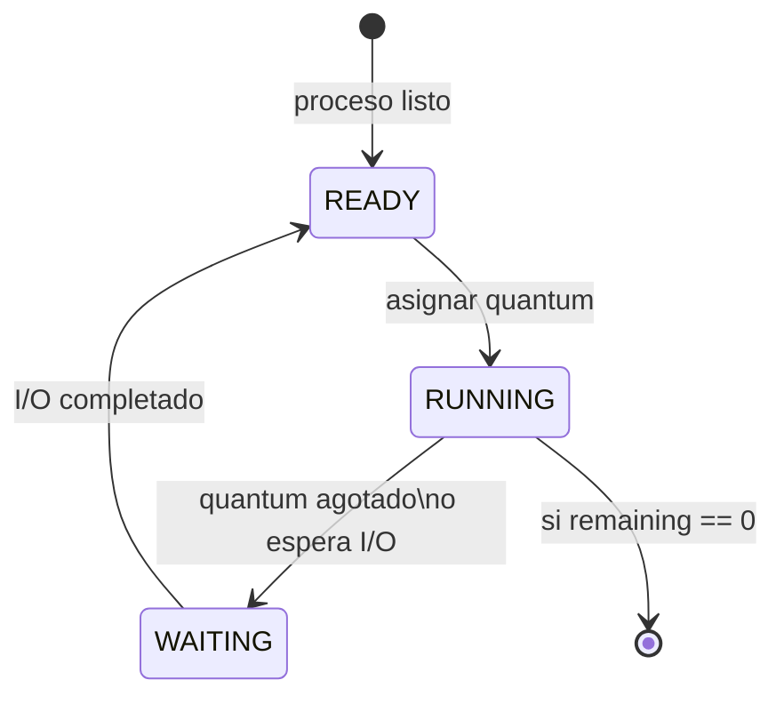
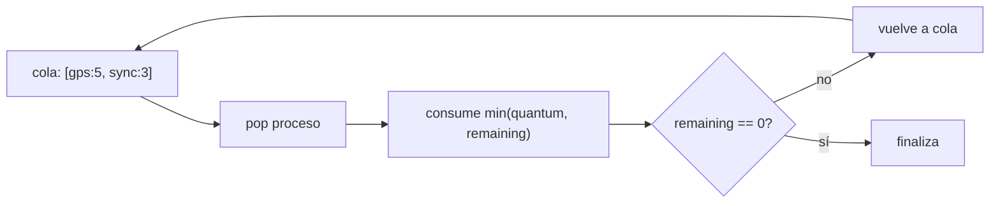
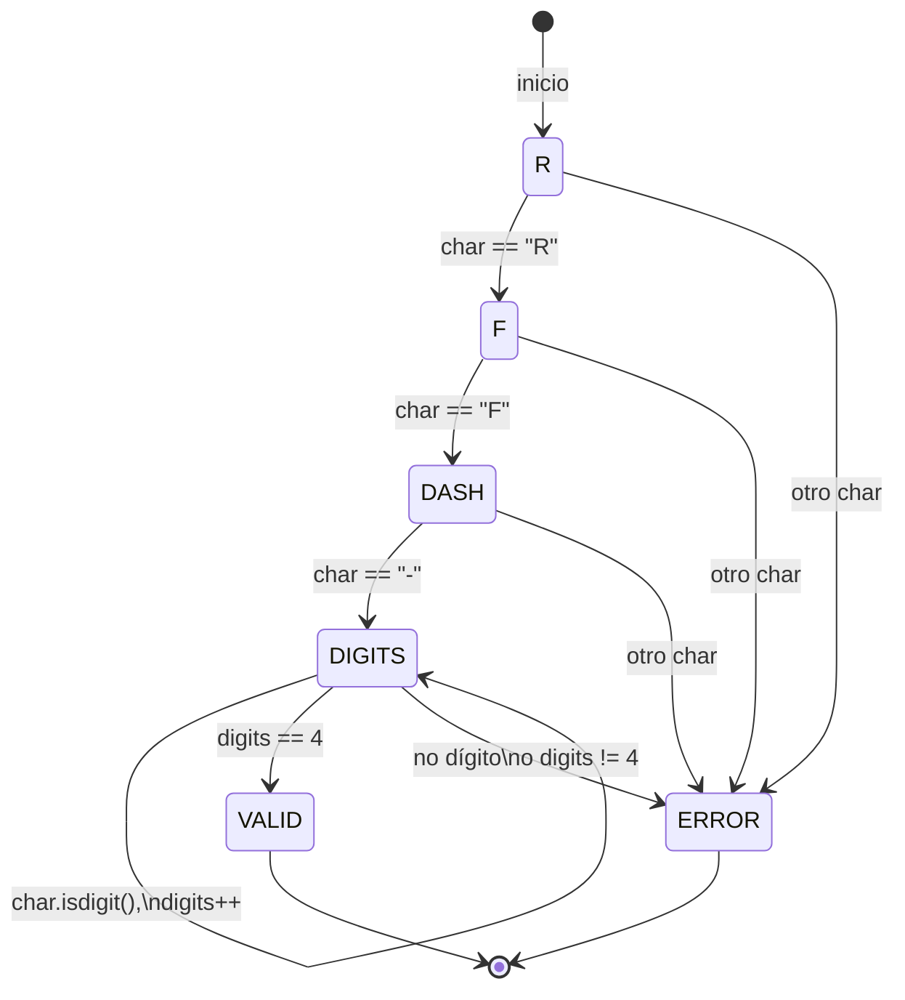
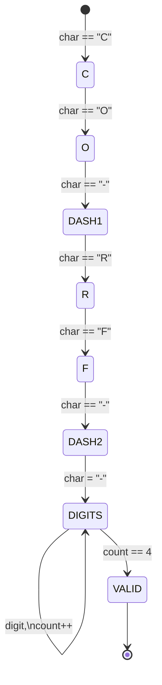
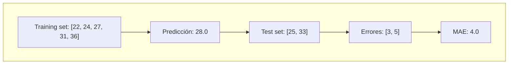
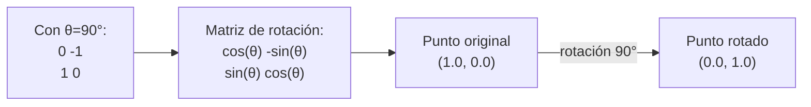

# Módulo 11: Ciencias de la Computación: mapa de especializaciones

## Antes de comenzar: entorno de experimentos

Necesitas Python 3 y una terminal. Crea `academia-labs/foundations/specializations/{src,evidence}`; en Windows PowerShell crea las dos carpetas por separado si tu terminal no expande llaves. Comprueba `python3 --version` o `py --version`. No instales dependencias: todos los ejemplos usan la biblioteca estándar.

## Aprende construyendo

Este capítulo no intenta resumir toda la disciplina. Construirás seis experimentos pequeños para distinguir sus áreas, reconocer los fundamentos que comparten y elegir qué estudiar después con evidencia. Trabaja dentro de `academia-labs/foundations/specializations/` y guarda cada resultado en `evidence/`.


### Tema 1: Sistemas, arquitectura y sistemas operativos · Avanzado · 45 min

<details open>
<summary><strong>Capa 1 — Lectura</strong></summary>

#### ► DE QUÉ TRATA
Al finalizar vas a simular con Round Robin cómo un dispositivo de RutaFlow repartiría CPU entre GPS, sincronización y procesamiento de fotos. Prerrequisitos: Python 3 instalado.

#### ► LA IDEA EN UNA FRASE
**Al finalizar vas a simular con Round Robin cómo un dispositivo de RutaFlow repartiría CPU entre GPS, sincronización y procesamiento de fotos.**

#### ► POR QUÉ EXISTE ESTO
Resuelve un problema real de diseño o implementación y evita decisiones a ciegas.

#### ► LA ANALOGÍA
Piensa en sistemas, arquitectura y sistemas operativos como una herramienta de taller: útil cuando conoces su propósito y sus límites.
**Dónde se rompe la analogía:** en software, los efectos dependen del contexto, la escala y los trade-offs.

#### ► CÓMO FUNCIONA


#### ► LO QUE PUEDE SALIR MAL
| Síntoma | Causa probable | Arreglo |
|---|---|---|
| Sistemas, arquitectura y sistemas operativos se aplica pero el resultado no mejora | Se usó sin medir el problema real | Mide antes y compara contra la alternativa simple |
| Aparece complejidad inesperada | Se adoptó la técnica sin comprender sus trade-offs | Vuelve a la sección de trade-offs y reduce el alcance |
| Falla en un caso límite | Se asumió un contexto que no se cumple | Prueba el caso límite y documenta cuándo NO usarlo |

#### ► TRADE-OFFS
| Opción | Cuándo usarla | Cuándo NO usarla |
|---|---|---|
| Usar Sistemas, arquitectura y sistemas operativos | Cuando el problema coincide con su propósito y el beneficio es observable | Cuando agrega complejidad sin resolver un problema real |
| Alternativa más simple | Cuando el contexto es pequeño, estable o fácil de razonar | Cuando ya demostró no escalar o no cumplir el requisito |
| Postergar la decisión | Cuando falta evidencia del problema | Cuando el costo de esperar es mayor que el costo de probar |

#### ► CUÁNDO NO USAR ESTO
No uses sistemas, arquitectura y sistemas operativos por defecto. Aplícalo cuando el problema lo justifique y puedas verificar el beneficio; si una alternativa más simple resuelve igual, prefiérela.

#### ► DE VUELTA A LA ANALOGÍA
Volviendo a la analogía: sistemas, arquitectura y sistemas operativos funciona como el modelo inicial, pero recuerda dónde se rompe: en producción importan la evidencia, la escala y el costo de equivocarte.

#### ► LO QUE DEBES RECORDAR
- Sistemas, arquitectura y sistemas operativos existe para resolver un problema específico.
- Mide antes de adoptar complejidad.
- Conoce el caso donde NO usarlo.
- Verifica con evidencia observable.

#### ► PREGUNTAS PARA PENSAR
1. ¿Qué problema concreto resuelve sistemas, arquitectura y sistemas operativos en tu contexto?
2. ¿Cómo sabrías que sistemas, arquitectura y sistemas operativos no está funcionando bien?
3. ¿Qué alternativa más simple considerarías antes de usar sistemas, arquitectura y sistemas operativos?

</details>

<details>
<summary><strong>Capa 2 — Construcción</strong></summary>

#### Código y verificación
```python
from collections import deque

processes = deque([{"id": "gps", "remaining": 5}, {"id": "sync", "remaining": 3}])
quantum = 2

while processes:
    process = processes.popleft()
    consumed = min(quantum, process["remaining"])
    process["remaining"] -= consumed
    print(f"{process['id']}: usa {consumed}, resta {process['remaining']}")
    if process["remaining"] > 0:  # Solo vuelve a la cola si falta trabajo.
        processes.append(process)
```

```bash
python3 ejemplo.py
```




```bash
mkdir ejemplo && cd ejemplo
```

</details>

### Tema 2: Algoritmos, autómatas, lenguajes y compiladores · Avanzado · 45 min

<details open>
<summary><strong>Capa 1 — Lectura</strong></summary>

#### ► DE QUÉ TRATA
Al finalizar vas a construir un autómata que reconoce guías de RutaFlow con el formato RF-####. Prerrequisitos: Python 3 instalado.

#### ► LA IDEA EN UNA FRASE
**Al finalizar vas a construir un autómata que reconoce guías de RutaFlow con el formato RF-####.**

#### ► POR QUÉ EXISTE ESTO
Resuelve un problema real de diseño o implementación y evita decisiones a ciegas.

#### ► LA ANALOGÍA
Piensa en algoritmos, autómatas, lenguajes y compiladores como una herramienta de taller: útil cuando conoces su propósito y sus límites.
**Dónde se rompe la analogía:** en software, los efectos dependen del contexto, la escala y los trade-offs.

#### ► CÓMO FUNCIONA


#### ► LO QUE PUEDE SALIR MAL
| Síntoma | Causa probable | Arreglo |
|---|---|---|
| Algoritmos, autómatas, lenguajes y compiladores se aplica pero el resultado no mejora | Se usó sin medir el problema real | Mide antes y compara contra la alternativa simple |
| Aparece complejidad inesperada | Se adoptó la técnica sin comprender sus trade-offs | Vuelve a la sección de trade-offs y reduce el alcance |
| Falla en un caso límite | Se asumió un contexto que no se cumple | Prueba el caso límite y documenta cuándo NO usarlo |

#### ► TRADE-OFFS
| Opción | Cuándo usarla | Cuándo NO usarla |
|---|---|---|
| Usar Algoritmos, autómatas, lenguajes y compiladores | Cuando el problema coincide con su propósito y el beneficio es observable | Cuando agrega complejidad sin resolver un problema real |
| Alternativa más simple | Cuando el contexto es pequeño, estable o fácil de razonar | Cuando ya demostró no escalar o no cumplir el requisito |
| Postergar la decisión | Cuando falta evidencia del problema | Cuando el costo de esperar es mayor que el costo de probar |

#### ► CUÁNDO NO USAR ESTO
No uses algoritmos, autómatas, lenguajes y compiladores por defecto. Aplícalo cuando el problema lo justifique y puedas verificar el beneficio; si una alternativa más simple resuelve igual, prefiérela.

#### ► DE VUELTA A LA ANALOGÍA
Volviendo a la analogía: algoritmos, autómatas, lenguajes y compiladores funciona como el modelo inicial, pero recuerda dónde se rompe: en producción importan la evidencia, la escala y el costo de equivocarte.

#### ► LO QUE DEBES RECORDAR
- Algoritmos, autómatas, lenguajes y compiladores existe para resolver un problema específico.
- Mide antes de adoptar complejidad.
- Conoce el caso donde NO usarlo.
- Verifica con evidencia observable.

#### ► PREGUNTAS PARA PENSAR
1. ¿Qué problema concreto resuelve algoritmos, autómatas, lenguajes y compiladores en tu contexto?
2. ¿Cómo sabrías que algoritmos, autómatas, lenguajes y compiladores no está funcionando bien?
3. ¿Qué alternativa más simple considerarías antes de usar algoritmos, autómatas, lenguajes y compiladores?

</details>

<details>
<summary><strong>Capa 2 — Construcción</strong></summary>

#### Código y verificación
```python
def is_tracking_code(text: str) -> bool:
    state = "R"
    digits = 0
    for char in text:
        if state == "R" and char == "R": state = "F"
        elif state == "F" and char == "F": state = "DASH"
        elif state == "DASH" and char == "-": state = "DIGITS"
        elif state == "DIGITS" and char.isdigit(): digits += 1
        else: return False  # Símbolo inválido para el estado actual.
    return state == "DIGITS" and digits == 4

for value in ["RF-2048", "RF-20A8", "RF-12345"]:
    print(value, is_tracking_code(value))
```

```bash
python3 ejemplo.py
```




```bash
mkdir ejemplo && cd ejemplo
```

</details>

### Tema 3: Bases de datos, almacenes analíticos y minería de datos · Avanzado · 45 min

<details open>
<summary><strong>Capa 1 — Lectura</strong></summary>

#### ► DE QUÉ TRATA
Al finalizar vas a agregar tiempos de entrega de RutaFlow por zona, y a confirmar que una restricción CHECK protege la calidad del dato. Prerrequisitos: Python 3 instalado.

#### ► LA IDEA EN UNA FRASE
**Al finalizar vas a agregar tiempos de entrega de RutaFlow por zona, y a confirmar que una restricción CHECK protege la calidad del dato.**

#### ► POR QUÉ EXISTE ESTO
Resuelve un problema real de diseño o implementación y evita decisiones a ciegas.

#### ► LA ANALOGÍA
Piensa en bases de datos, almacenes analíticos y minería de datos como una herramienta de taller: útil cuando conoces su propósito y sus límites.
**Dónde se rompe la analogía:** en software, los efectos dependen del contexto, la escala y los trade-offs.

#### ► CÓMO FUNCIONA
1. Identifica el problema que bases de datos, almacenes analíticos y minería de datos resuelve.
2. Observa sus componentes y relaciones.
3. Aplica la opción más simple que funcione.
4. Verifica el resultado y los límites.

#### ► LO QUE PUEDE SALIR MAL
| Síntoma | Causa probable | Arreglo |
|---|---|---|
| Bases de datos, almacenes analíticos y minería de datos se aplica pero el resultado no mejora | Se usó sin medir el problema real | Mide antes y compara contra la alternativa simple |
| Aparece complejidad inesperada | Se adoptó la técnica sin comprender sus trade-offs | Vuelve a la sección de trade-offs y reduce el alcance |
| Falla en un caso límite | Se asumió un contexto que no se cumple | Prueba el caso límite y documenta cuándo NO usarlo |

#### ► TRADE-OFFS
| Opción | Cuándo usarla | Cuándo NO usarla |
|---|---|---|
| Usar Bases de datos, almacenes analíticos y minería de datos | Cuando el problema coincide con su propósito y el beneficio es observable | Cuando agrega complejidad sin resolver un problema real |
| Alternativa más simple | Cuando el contexto es pequeño, estable o fácil de razonar | Cuando ya demostró no escalar o no cumplir el requisito |
| Postergar la decisión | Cuando falta evidencia del problema | Cuando el costo de esperar es mayor que el costo de probar |

#### ► CUÁNDO NO USAR ESTO
No uses bases de datos, almacenes analíticos y minería de datos por defecto. Aplícalo cuando el problema lo justifique y puedas verificar el beneficio; si una alternativa más simple resuelve igual, prefiérela.

#### ► DE VUELTA A LA ANALOGÍA
Volviendo a la analogía: bases de datos, almacenes analíticos y minería de datos funciona como el modelo inicial, pero recuerda dónde se rompe: en producción importan la evidencia, la escala y el costo de equivocarte.

#### ► LO QUE DEBES RECORDAR
- Bases de datos, almacenes analíticos y minería de datos existe para resolver un problema específico.
- Mide antes de adoptar complejidad.
- Conoce el caso donde NO usarlo.
- Verifica con evidencia observable.

#### ► PREGUNTAS PARA PENSAR
1. ¿Qué problema concreto resuelve bases de datos, almacenes analíticos y minería de datos en tu contexto?
2. ¿Cómo sabrías que bases de datos, almacenes analíticos y minería de datos no está funcionando bien?
3. ¿Qué alternativa más simple considerarías antes de usar bases de datos, almacenes analíticos y minería de datos?

</details>

<details>
<summary><strong>Capa 2 — Construcción</strong></summary>

#### Código y verificación
```python
import sqlite3

db = sqlite3.connect(":memory:")
db.execute("CREATE TABLE delivery (zone TEXT NOT NULL, minutes INTEGER NOT NULL CHECK(minutes > 0))")
db.executemany("INSERT INTO delivery VALUES (?, ?)", [("norte", 31), ("norte", 25), ("sur", 48)])

query = "SELECT zone, COUNT(*), ROUND(AVG(minutes), 1) FROM delivery GROUP BY zone"
for zone, total, average in db.execute(query):
    print(zone, total, average)
```

```bash
python3 ejemplo.py
```

```bash
mkdir ejemplo && cd ejemplo
```

</details>

### Tema 4: Inteligencia artificial, aprendizaje automático y visión · Avanzado · 45 min

<details open>
<summary><strong>Capa 1 — Lectura</strong></summary>

#### ► DE QUÉ TRATA
Al finalizar vas a construir la línea base mínima que cualquier modelo de predicción de retraso de RutaFlow tendría que superar para justificar su complejidad. Prerrequisitos: Python 3 instalado.

#### ► LA IDEA EN UNA FRASE
**Al finalizar vas a construir la línea base mínima que cualquier modelo de predicción de retraso de RutaFlow tendría que superar para justificar su complejidad.**

#### ► POR QUÉ EXISTE ESTO
Resuelve un problema real de diseño o implementación y evita decisiones a ciegas.

#### ► LA ANALOGÍA
Piensa en inteligencia artificial, aprendizaje automático y visión como una herramienta de taller: útil cuando conoces su propósito y sus límites.
**Dónde se rompe la analogía:** en software, los efectos dependen del contexto, la escala y los trade-offs.

#### ► CÓMO FUNCIONA


#### ► LO QUE PUEDE SALIR MAL
| Síntoma | Causa probable | Arreglo |
|---|---|---|
| Inteligencia artificial, aprendizaje automático y visión se aplica pero el resultado no mejora | Se usó sin medir el problema real | Mide antes y compara contra la alternativa simple |
| Aparece complejidad inesperada | Se adoptó la técnica sin comprender sus trade-offs | Vuelve a la sección de trade-offs y reduce el alcance |
| Falla en un caso límite | Se asumió un contexto que no se cumple | Prueba el caso límite y documenta cuándo NO usarlo |

#### ► TRADE-OFFS
| Opción | Cuándo usarla | Cuándo NO usarla |
|---|---|---|
| Usar Inteligencia artificial, aprendizaje automático y visión | Cuando el problema coincide con su propósito y el beneficio es observable | Cuando agrega complejidad sin resolver un problema real |
| Alternativa más simple | Cuando el contexto es pequeño, estable o fácil de razonar | Cuando ya demostró no escalar o no cumplir el requisito |
| Postergar la decisión | Cuando falta evidencia del problema | Cuando el costo de esperar es mayor que el costo de probar |

#### ► CUÁNDO NO USAR ESTO
No uses inteligencia artificial, aprendizaje automático y visión por defecto. Aplícalo cuando el problema lo justifique y puedas verificar el beneficio; si una alternativa más simple resuelve igual, prefiérela.

#### ► DE VUELTA A LA ANALOGÍA
Volviendo a la analogía: inteligencia artificial, aprendizaje automático y visión funciona como el modelo inicial, pero recuerda dónde se rompe: en producción importan la evidencia, la escala y el costo de equivocarte.

#### ► LO QUE DEBES RECORDAR
- Inteligencia artificial, aprendizaje automático y visión existe para resolver un problema específico.
- Mide antes de adoptar complejidad.
- Conoce el caso donde NO usarlo.
- Verifica con evidencia observable.

#### ► PREGUNTAS PARA PENSAR
1. ¿Qué problema concreto resuelve inteligencia artificial, aprendizaje automático y visión en tu contexto?
2. ¿Cómo sabrías que inteligencia artificial, aprendizaje automático y visión no está funcionando bien?
3. ¿Qué alternativa más simple considerarías antes de usar inteligencia artificial, aprendizaje automático y visión?

</details>

<details>
<summary><strong>Capa 2 — Construcción</strong></summary>

#### Código y verificación
```python
training_minutes = [22, 24, 27, 31, 36]
test_minutes = [25, 33]
prediction = sum(training_minutes) / len(training_minutes)

errors = [abs(real - prediction) for real in test_minutes]
mae = sum(errors) / len(errors)  # Error absoluto medio: menor es mejor.
print(f"predicción={prediction:.1f}, mae={mae:.1f}")
```

```bash
python3 ejemplo.py
```


```
test_error (eje Y)
    ^
    | (25, 3) o
    | 
    | (33, 5) o
    |___________> train_error (eje X)
    0   10   20   28.0   40
    
    Línea base: predicción = 28.0 (roja)
    Puntos: (train_dato, |test_dato - predicción|)
```

```bash
mkdir ejemplo && cd ejemplo
```

</details>

### Tema 5: Gráficos y cómputo científico · Avanzado · 45 min

<details open>
<summary><strong>Capa 1 — Lectura</strong></summary>

#### ► DE QUÉ TRATA
Al finalizar vas a rotar las coordenadas de una parada de RutaFlow y a confirmar que la distancia entre paradas se conserva. Prerrequisitos: Python 3 instalado.

#### ► LA IDEA EN UNA FRASE
**Al finalizar vas a rotar las coordenadas de una parada de RutaFlow y a confirmar que la distancia entre paradas se conserva.**

#### ► POR QUÉ EXISTE ESTO
Resuelve un problema real de diseño o implementación y evita decisiones a ciegas.

#### ► LA ANALOGÍA
Piensa en gráficos y cómputo científico como una herramienta de taller: útil cuando conoces su propósito y sus límites.
**Dónde se rompe la analogía:** en software, los efectos dependen del contexto, la escala y los trade-offs.

#### ► CÓMO FUNCIONA


#### ► LO QUE PUEDE SALIR MAL
| Síntoma | Causa probable | Arreglo |
|---|---|---|
| Gráficos y cómputo científico se aplica pero el resultado no mejora | Se usó sin medir el problema real | Mide antes y compara contra la alternativa simple |
| Aparece complejidad inesperada | Se adoptó la técnica sin comprender sus trade-offs | Vuelve a la sección de trade-offs y reduce el alcance |
| Falla en un caso límite | Se asumió un contexto que no se cumple | Prueba el caso límite y documenta cuándo NO usarlo |

#### ► TRADE-OFFS
| Opción | Cuándo usarla | Cuándo NO usarla |
|---|---|---|
| Usar Gráficos y cómputo científico | Cuando el problema coincide con su propósito y el beneficio es observable | Cuando agrega complejidad sin resolver un problema real |
| Alternativa más simple | Cuando el contexto es pequeño, estable o fácil de razonar | Cuando ya demostró no escalar o no cumplir el requisito |
| Postergar la decisión | Cuando falta evidencia del problema | Cuando el costo de esperar es mayor que el costo de probar |

#### ► CUÁNDO NO USAR ESTO
No uses gráficos y cómputo científico por defecto. Aplícalo cuando el problema lo justifique y puedas verificar el beneficio; si una alternativa más simple resuelve igual, prefiérela.

#### ► DE VUELTA A LA ANALOGÍA
Volviendo a la analogía: gráficos y cómputo científico funciona como el modelo inicial, pero recuerda dónde se rompe: en producción importan la evidencia, la escala y el costo de equivocarte.

#### ► LO QUE DEBES RECORDAR
- Gráficos y cómputo científico existe para resolver un problema específico.
- Mide antes de adoptar complejidad.
- Conoce el caso donde NO usarlo.
- Verifica con evidencia observable.

#### ► PREGUNTAS PARA PENSAR
1. ¿Qué problema concreto resuelve gráficos y cómputo científico en tu contexto?
2. ¿Cómo sabrías que gráficos y cómputo científico no está funcionando bien?
3. ¿Qué alternativa más simple considerarías antes de usar gráficos y cómputo científico?

</details>

<details>
<summary><strong>Capa 2 — Construcción</strong></summary>

#### Código y verificación
```python
from math import cos, sin, pi

def rotate(point: tuple[float, float], degrees: float) -> tuple[float, float]:
    radians = degrees * pi / 180
    x, y = point
    return (x * cos(radians) - y * sin(radians), x * sin(radians) + y * cos(radians))

x, y = rotate((1.0, 0.0), 90)
print(round(x, 6), round(y, 6))
```

```bash
python3 ejemplo.py
```


```
Antes (coordenadas originales):        Después (rotadas 90°):
  (0, 0) Salida                         (-0, 0) Salida
    ↓                                     ↓
  (1, 0) Parada 1     →rotación→       (0, 1) Parada 1
    ↓                                     ↓
  (1, 1) Entrega                        (-1, 1) Entrega

Distancia Salida→Parada 1: 1.0 (antes) = 1.0 (después) ✓
Distancia Parada 1→Entrega: 1.0 (antes) = 1.0 (después) ✓
```

```bash
mkdir ejemplo && cd ejemplo
```

</details>

### Tema 6: Redes, seguridad, web e ingeniería profesional · Avanzado · 45 min

<details open>
<summary><strong>Capa 1 — Lectura</strong></summary>

#### ► DE QUÉ TRATA
Al finalizar vas a registrar un hallazgo real de latencia de RutaFlow separando evidencia, inferencia y decisión, sin que nada se pueda editar después en silencio. Prerrequisitos: Python 3 instalado.

#### ► LA IDEA EN UNA FRASE
**Al finalizar vas a registrar un hallazgo real de latencia de RutaFlow separando evidencia, inferencia y decisión, sin que nada se pueda editar después en silencio.**

#### ► POR QUÉ EXISTE ESTO
Resuelve un problema real de diseño o implementación y evita decisiones a ciegas.

#### ► LA ANALOGÍA
Piensa en redes, seguridad, web e ingeniería profesional como una herramienta de taller: útil cuando conoces su propósito y sus límites.
**Dónde se rompe la analogía:** en software, los efectos dependen del contexto, la escala y los trade-offs.

#### ► CÓMO FUNCIONA
1. Identifica el problema que redes, seguridad, web e ingeniería profesional resuelve.
2. Observa sus componentes y relaciones.
3. Aplica la opción más simple que funcione.
4. Verifica el resultado y los límites.

#### ► LO QUE PUEDE SALIR MAL
| Síntoma | Causa probable | Arreglo |
|---|---|---|
| Redes, seguridad, web e ingeniería profesional se aplica pero el resultado no mejora | Se usó sin medir el problema real | Mide antes y compara contra la alternativa simple |
| Aparece complejidad inesperada | Se adoptó la técnica sin comprender sus trade-offs | Vuelve a la sección de trade-offs y reduce el alcance |
| Falla en un caso límite | Se asumió un contexto que no se cumple | Prueba el caso límite y documenta cuándo NO usarlo |

#### ► TRADE-OFFS
| Opción | Cuándo usarla | Cuándo NO usarla |
|---|---|---|
| Usar Redes, seguridad, web e ingeniería profesional | Cuando el problema coincide con su propósito y el beneficio es observable | Cuando agrega complejidad sin resolver un problema real |
| Alternativa más simple | Cuando el contexto es pequeño, estable o fácil de razonar | Cuando ya demostró no escalar o no cumplir el requisito |
| Postergar la decisión | Cuando falta evidencia del problema | Cuando el costo de esperar es mayor que el costo de probar |

#### ► CUÁNDO NO USAR ESTO
No uses redes, seguridad, web e ingeniería profesional por defecto. Aplícalo cuando el problema lo justifique y puedas verificar el beneficio; si una alternativa más simple resuelve igual, prefiérela.

#### ► DE VUELTA A LA ANALOGÍA
Volviendo a la analogía: redes, seguridad, web e ingeniería profesional funciona como el modelo inicial, pero recuerda dónde se rompe: en producción importan la evidencia, la escala y el costo de equivocarte.

#### ► LO QUE DEBES RECORDAR
- Redes, seguridad, web e ingeniería profesional existe para resolver un problema específico.
- Mide antes de adoptar complejidad.
- Conoce el caso donde NO usarlo.
- Verifica con evidencia observable.

#### ► PREGUNTAS PARA PENSAR
1. ¿Qué problema concreto resuelve redes, seguridad, web e ingeniería profesional en tu contexto?
2. ¿Cómo sabrías que redes, seguridad, web e ingeniería profesional no está funcionando bien?
3. ¿Qué alternativa más simple considerarías antes de usar redes, seguridad, web e ingeniería profesional?

</details>

<details>
<summary><strong>Capa 2 — Construcción</strong></summary>

#### Código y verificación
```python
from dataclasses import dataclass

@dataclass(frozen=True)
class Finding:
    evidence: str
    inference: str
    decision: str

finding = Finding(
    evidence="2 de 20 solicitudes superaron 500 ms",
    inference="la latencia podría concentrarse en una dependencia",
    decision="añadir trazas antes de escalar infraestructura",
)
print(finding)
```

```bash
python3 ejemplo.py
```

```bash
mkdir ejemplo && cd ejemplo
```

</details>
