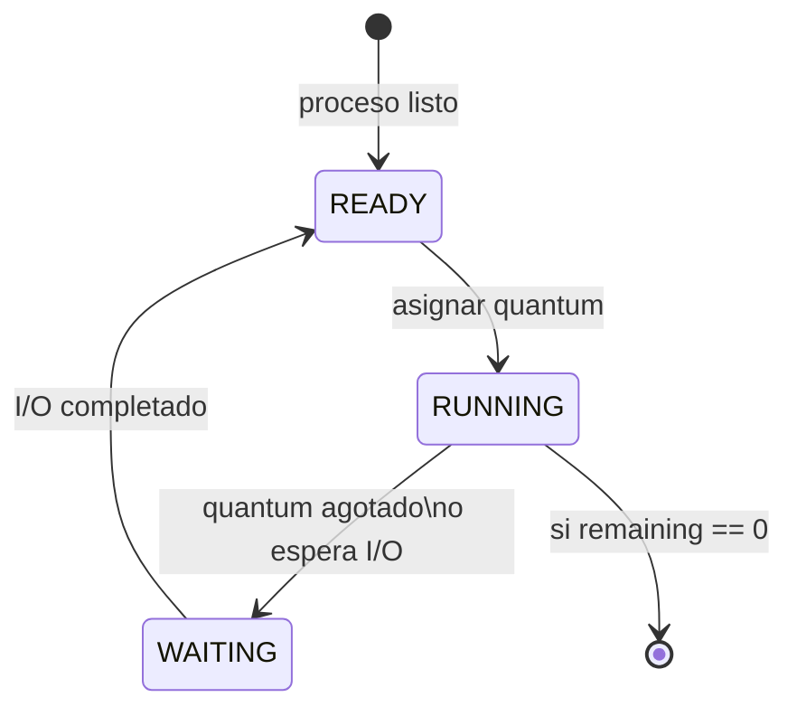
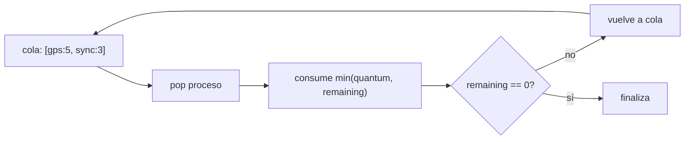
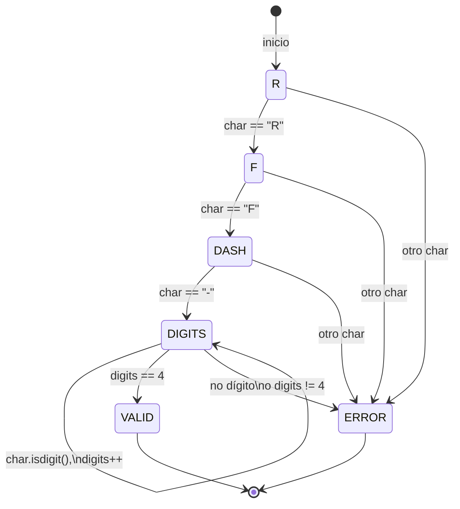
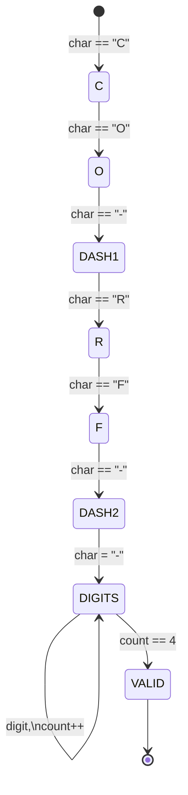
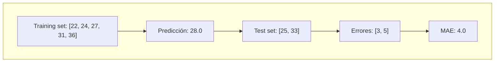
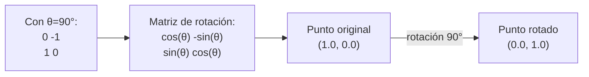

# Módulo 11: Ciencias de la Computación: mapa de especializaciones

## Antes de comenzar: entorno de experimentos

Necesitas Python 3 y una terminal. Crea `academia-labs/foundations/specializations/{src,evidence}`; en Windows PowerShell crea las dos carpetas por separado si tu terminal no expande llaves. Comprueba `python3 --version` o `py --version`. No instales dependencias: todos los ejemplos usan la biblioteca estándar.

## Aprende construyendo

Este capítulo no intenta resumir toda la disciplina. Construirás seis experimentos pequeños para distinguir sus áreas, reconocer los fundamentos que comparten y elegir qué estudiar después con evidencia. Trabaja dentro de `academia-labs/foundations/specializations/` y guarda cada resultado en `evidence/`.


### Tema 1: Sistemas, arquitectura y sistemas operativos · Avanzado · 45 min

<details open>
<summary><strong>Capa 1 — Lectura</strong></summary>

#### ► DE QUÉ TRATA
Al finalizar vas a simular con Round Robin cómo un dispositivo de RutaFlow repartiría CPU entre GPS, sincronización y procesamiento de fotos. Prerrequisitos: Python 3 instalado.

#### ► CÓMO FUNCIONA


</details>

<details>
<summary><strong>Capa 2 — Construcción</strong></summary>

#### Código y verificación
```python
from collections import deque

processes = deque([{"id": "gps", "remaining": 5}, {"id": "sync", "remaining": 3}])
quantum = 2

while processes:
    process = processes.popleft()
    consumed = min(quantum, process["remaining"])
    process["remaining"] -= consumed
    print(f"{process['id']}: usa {consumed}, resta {process['remaining']}")
    if process["remaining"] > 0:  # Solo vuelve a la cola si falta trabajo.
        processes.append(process)
```

```bash
python3 ejemplo.py
```




```bash
mkdir ejemplo && cd ejemplo
```

</details>

### Tema 2: Algoritmos, autómatas, lenguajes y compiladores · Avanzado · 45 min

<details open>
<summary><strong>Capa 1 — Lectura</strong></summary>

#### ► DE QUÉ TRATA
Al finalizar vas a construir un autómata que reconoce guías de RutaFlow con el formato RF-####. Prerrequisitos: Python 3 instalado.

#### ► CÓMO FUNCIONA


</details>

<details>
<summary><strong>Capa 2 — Construcción</strong></summary>

#### Código y verificación
```python
def is_tracking_code(text: str) -> bool:
    state = "R"
    digits = 0
    for char in text:
        if state == "R" and char == "R": state = "F"
        elif state == "F" and char == "F": state = "DASH"
        elif state == "DASH" and char == "-": state = "DIGITS"
        elif state == "DIGITS" and char.isdigit(): digits += 1
        else: return False  # Símbolo inválido para el estado actual.
    return state == "DIGITS" and digits == 4

for value in ["RF-2048", "RF-20A8", "RF-12345"]:
    print(value, is_tracking_code(value))
```

```bash
python3 ejemplo.py
```




```bash
mkdir ejemplo && cd ejemplo
```

</details>

### Tema 3: Bases de datos, almacenes analíticos y minería de datos · Avanzado · 45 min

<details open>
<summary><strong>Capa 1 — Lectura</strong></summary>

#### ► DE QUÉ TRATA
Al finalizar vas a agregar tiempos de entrega de RutaFlow por zona, y a confirmar que una restricción CHECK protege la calidad del dato. Prerrequisitos: Python 3 instalado.

</details>

<details>
<summary><strong>Capa 2 — Construcción</strong></summary>

#### Código y verificación
```python
import sqlite3

db = sqlite3.connect(":memory:")
db.execute("CREATE TABLE delivery (zone TEXT NOT NULL, minutes INTEGER NOT NULL CHECK(minutes > 0))")
db.executemany("INSERT INTO delivery VALUES (?, ?)", [("norte", 31), ("norte", 25), ("sur", 48)])

query = "SELECT zone, COUNT(*), ROUND(AVG(minutes), 1) FROM delivery GROUP BY zone"
for zone, total, average in db.execute(query):
    print(zone, total, average)
```

```bash
python3 ejemplo.py
```

```bash
mkdir ejemplo && cd ejemplo
```

</details>

### Tema 4: Inteligencia artificial, aprendizaje automático y visión · Avanzado · 45 min

<details open>
<summary><strong>Capa 1 — Lectura</strong></summary>

#### ► DE QUÉ TRATA
Al finalizar vas a construir la línea base mínima que cualquier modelo de predicción de retraso de RutaFlow tendría que superar para justificar su complejidad. Prerrequisitos: Python 3 instalado.

#### ► CÓMO FUNCIONA


</details>

<details>
<summary><strong>Capa 2 — Construcción</strong></summary>

#### Código y verificación
```python
training_minutes = [22, 24, 27, 31, 36]
test_minutes = [25, 33]
prediction = sum(training_minutes) / len(training_minutes)

errors = [abs(real - prediction) for real in test_minutes]
mae = sum(errors) / len(errors)  # Error absoluto medio: menor es mejor.
print(f"predicción={prediction:.1f}, mae={mae:.1f}")
```

```bash
python3 ejemplo.py
```


```
test_error (eje Y)
    ^
    | (25, 3) o
    | 
    | (33, 5) o
    |___________> train_error (eje X)
    0   10   20   28.0   40
    
    Línea base: predicción = 28.0 (roja)
    Puntos: (train_dato, |test_dato - predicción|)
```

```bash
mkdir ejemplo && cd ejemplo
```

</details>

### Tema 5: Gráficos y cómputo científico · Avanzado · 45 min

<details open>
<summary><strong>Capa 1 — Lectura</strong></summary>

#### ► DE QUÉ TRATA
Al finalizar vas a rotar las coordenadas de una parada de RutaFlow y a confirmar que la distancia entre paradas se conserva. Prerrequisitos: Python 3 instalado.

#### ► CÓMO FUNCIONA


</details>

<details>
<summary><strong>Capa 2 — Construcción</strong></summary>

#### Código y verificación
```python
from math import cos, sin, pi

def rotate(point: tuple[float, float], degrees: float) -> tuple[float, float]:
    radians = degrees * pi / 180
    x, y = point
    return (x * cos(radians) - y * sin(radians), x * sin(radians) + y * cos(radians))

x, y = rotate((1.0, 0.0), 90)
print(round(x, 6), round(y, 6))
```

```bash
python3 ejemplo.py
```


```
Antes (coordenadas originales):        Después (rotadas 90°):
  (0, 0) Salida                         (-0, 0) Salida
    ↓                                     ↓
  (1, 0) Parada 1     →rotación→       (0, 1) Parada 1
    ↓                                     ↓
  (1, 1) Entrega                        (-1, 1) Entrega

Distancia Salida→Parada 1: 1.0 (antes) = 1.0 (después) ✓
Distancia Parada 1→Entrega: 1.0 (antes) = 1.0 (después) ✓
```

```bash
mkdir ejemplo && cd ejemplo
```

</details>

### Tema 6: Redes, seguridad, web e ingeniería profesional · Avanzado · 45 min

<details open>
<summary><strong>Capa 1 — Lectura</strong></summary>

#### ► DE QUÉ TRATA
Al finalizar vas a registrar un hallazgo real de latencia de RutaFlow separando evidencia, inferencia y decisión, sin que nada se pueda editar después en silencio. Prerrequisitos: Python 3 instalado.

</details>

<details>
<summary><strong>Capa 2 — Construcción</strong></summary>

#### Código y verificación
```python
from dataclasses import dataclass

@dataclass(frozen=True)
class Finding:
    evidence: str
    inference: str
    decision: str

finding = Finding(
    evidence="2 de 20 solicitudes superaron 500 ms",
    inference="la latencia podría concentrarse en una dependencia",
    decision="añadir trazas antes de escalar infraestructura",
)
print(finding)
```

```bash
python3 ejemplo.py
```

```bash
mkdir ejemplo && cd ejemplo
```

</details>
