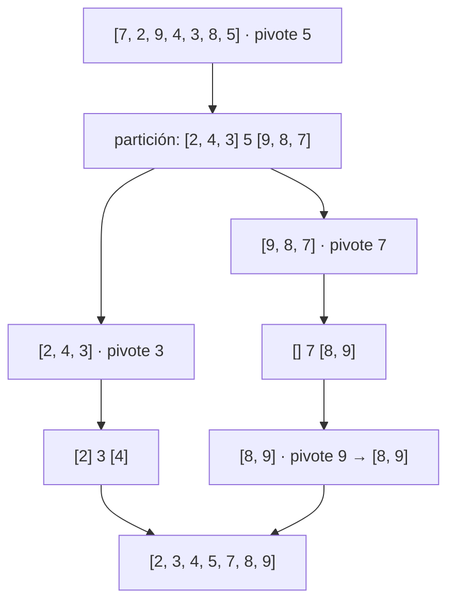
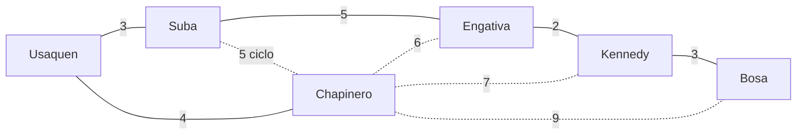
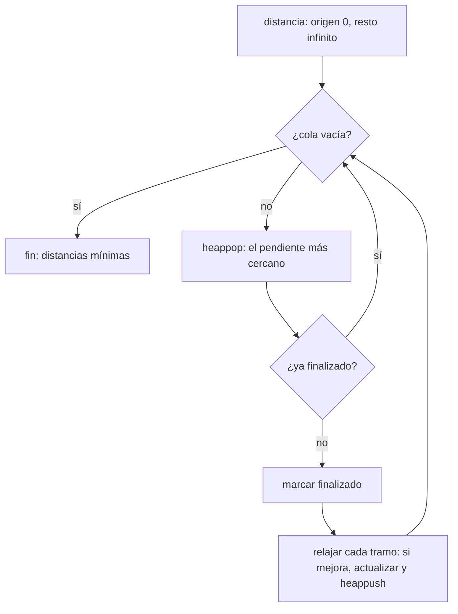
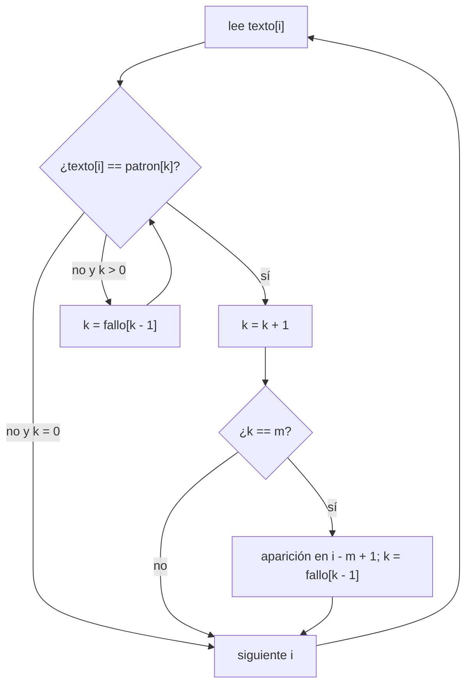
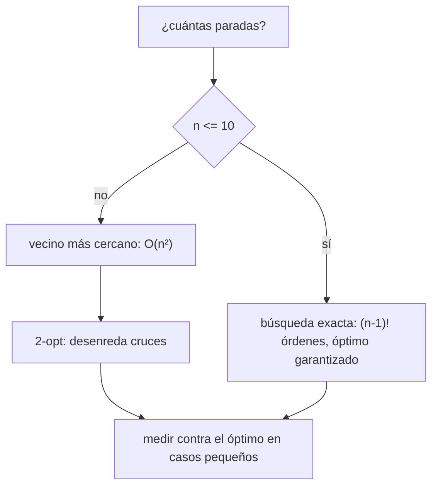

# Módulo 12: Algoritmos clásicos

**Entorno comprobado para esta edición (2026-11-24):** Python 3.13.18 en Linux x86_64, solo con la biblioteca
estándar (`heapq`, `itertools`, `math`, `random`, `time`). La línea de referencia del curso es Python 3.14
(`docs/VERSIONES.md`); estos ejemplos no usan nada exclusivo de esa versión. Todas las salidas se obtuvieron
ejecutando el código mostrado. Los **conteos** de comparaciones, distancias y rutas son exactos y deben coincidir
con los tuyos. Los **tiempos** en milisegundos cambian de una máquina a otra; lo que se mantiene es la proporción.

## Apertura del módulo

#### Objetivos del módulo
Al terminar este módulo podrás:
- trazar a mano quick sort, Kruskal, Prim, Dijkstra, Bellman-Ford y KMP sobre datos pequeños;
- contar comparaciones de tres ordenamientos y explicar por qué quick sort puede caer en `O(n²)`;
- refutar una elección codiciosa con un contraejemplo y justificar cuándo sí es correcta;
- calcular y reconstruir rutas de tiempo mínimo, y detectar un ciclo negativo;
- explicar qué significa NP-completo y medir la calidad de una heurística contra la solución exacta.

#### Esquema del módulo
1. Ordenamientos: insertion, merge y quick sort.
2. Algoritmos codiciosos y árbol de expansión mínima.
3. Caminos más cortos con Dijkstra.
4. Búsqueda en cadenas: de la fuerza bruta a KMP.
5. Problemas intratables: P, NP y heurísticas.
6. Proyecto 12: planificador de entregas de RutaFlow.

#### Qué necesitas saber antes
Este módulo construye sobre el Módulo 2 y **no redefine** sus términos; los enlaza:
- **estructura de datos**, lista, diccionario, conjunto y tupla (Módulo 2, Tema 1);
- **pila**, **cola** y `deque` (Módulo 2, Tema 2);
- **búsqueda lineal** y **búsqueda binaria** (Módulo 2, Tema 3);
- **complejidad temporal y espacial**, **peor caso**, **notación O grande**, **logaritmo**, **ordenamiento**,
  **recursión** y **caso base**; además, el ordenamiento por inserción y el de mezcla (Módulo 2, Tema 4,
  Problema resuelto 4.4);
- **árbol**, **nodo** y **raíz** (Módulo 2, Tema 5);
- **grafo**, **vértice**, **arista**, **lista de adyacencia**, **BFS**, **DFS** y **camino más corto** (Módulo 2, Tema 7);
- **memoización**, **programación dinámica** y **algoritmo voraz** (Módulo 2, Tema 8);
- funciones, `lambda` y comprensiones de lista (Módulos 1 y 2).

Todos los programas se guardan en una carpeta `~/labs/algoritmos` y se ejecutan con `python3 archivo.py`.

## Aprende construyendo

### Tema 1: Ordenamientos: insertion, merge y quick sort · Intermedio · 60 min

<details open>
<summary><strong>Capa 1 — Lectura</strong></summary>

#### Objetivos
Al terminar este tema podrás:
- trazar en una tabla la partición de quick sort y predecir dónde queda el pivote;
- contar las comparaciones de inserción, mezcla y quick sort con 100, 1000 y 3000 datos;
- explicar por qué quick sort cae en `O(n²)` con un pivote fijo y cómo lo evita un pivote al azar;
- elegir un ordenamiento estable cuando el orden de los empates importa.

**Conceptos clave:** divide y vencerás, quick sort, pivote, partición, ordenamiento in situ, ordenamiento estable

#### El problema
Cada mañana RutaFlow recibe hasta 3000 paradas y debe ordenarlas por distancia al depósito. En el Módulo 2
implementaste inserción y mezcla. Un compañero propone quick sort «porque es el más rápido». Lo prueba con la
lista del día anterior, que ya venía ordenada, y el programa se cae. Además, dos paradas a la misma distancia
cambian de lugar entre ejecuciones. ¿Qué hace quick sort por dentro y cuándo conviene usarlo?

El **ordenamiento por inserción** y el **ordenamiento por mezcla** ya están explicados e implementados en el
Módulo 2, Tema 4 (Problema resuelto 4.4), junto con la **recursión** y la **notación O grande**. Aquí se reúsan.

#### Glosario del tema

**divide y vencerás**
- **Definición técnica:** estrategia que parte un problema en subproblemas independientes del mismo tipo, los resuelve con recursión y combina sus resultados.
- **En palabras sencillas:** repartir una pila grande de guías en montones pequeños, resolver cada montón y juntar.
- **Dónde se rompe la comparación:** en la vida real repartes entre personas en paralelo; aquí una sola función resuelve un montón después de otro.
- **Ejemplo:** la mezcla parte la lista por la mitad; quick sort la parte alrededor de un pivote.
- **Error típico:** partir en pedazos que no se achican, como una mitad vacía y otra de `n - 1`: la recursión se alarga.

**quick sort**
- **Definición técnica:** ordenamiento de divide y vencerás que elige un pivote, deja a su izquierda los menores y a su derecha los demás, y ordena cada lado recursivamente.
- **En palabras sencillas:** escoger una parada de referencia y separar las más cercanas de las más lejanas; repetir en cada grupo.
- **Dónde se rompe la comparación:** el trabajo duro está **antes** de la recursión (partir); en la mezcla está **después** (combinar).
- **Ejemplo:** con `[7, 2, 9, 4, 3, 8, 5]` y pivote `5`, la primera partición deja `[2, 4, 3, 5, 9, 8, 7]`.
- **Error típico:** usar siempre el último elemento como pivote con datos ya ordenados: cae en `O(n²)` y en `RecursionError`.

**pivote**
- **Definición técnica:** elemento elegido en cada llamada de quick sort; al terminar la partición queda en su posición final definitiva.
- **En palabras sencillas:** la parada que sirve de línea divisoria: «más cerca que esta» o «más lejos que esta».
- **Dónde se rompe la comparación:** una línea divisoria mala no se nota en el resultado, solo en el tiempo.
- **Ejemplo:** el pivote `5` termina en la posición 3, que es justo su lugar en la lista ordenada.
- **Error típico:** creer que el pivote debe ser la mediana exacta; basta con que no sea casi siempre el mínimo o el máximo.

**partición**
- **Definición técnica:** recorrido que reordena un tramo de la lista para que los menores que el pivote queden antes de él y los demás después; cuesta `O(n)`.
- **En palabras sencillas:** pasar una vez por las paradas y mandar cada una a «antes» o «después» del pivote.
- **Dónde se rompe la comparación:** cada lado queda separado, pero **no** ordenado por dentro.
- **Ejemplo:** el esquema de Lomuto usa un índice `frontera`: todo lo que está antes de él ya es menor que el pivote.
- **Error típico:** recorrer hasta `fin` incluido y comparar el pivote consigo mismo; el bucle va hasta `fin - 1`.

**ordenamiento in situ**
- **Definición técnica:** ordenamiento que reorganiza los elementos dentro de la misma lista, con memoria extra `O(1)` o `O(log n)` (*in-place*).
- **En palabras sencillas:** ordenar las cajas en el mismo estante, sin bajar todo a un estante auxiliar.
- **Dónde se rompe la comparación:** la recursión sí usa memoria en la pila de llamadas, aunque no copie la lista.
- **Ejemplo:** `particionar` intercambia elementos con `datos[a], datos[b] = datos[b], datos[a]`; la mezcla, en cambio, crea listas nuevas.
- **Error típico:** esperar que la lista original quede intacta después de un ordenamiento in situ.

**ordenamiento estable**
- **Definición técnica:** ordenamiento que conserva el orden relativo original de los elementos con la misma clave.
- **En palabras sencillas:** si dos paradas están a la misma distancia, siguen en el orden en que se registraron.
- **Dónde se rompe la comparación:** la estabilidad solo se ve cuando ordenas por una parte del dato y el resto es distinto.
- **Ejemplo:** `sorted(paradas, key=...)` es estable; la mezcla con `<=` también; quick sort con Lomuto no.
- **Error típico:** ordenar por distancia con un método inestable y luego culpar a los datos porque las guías «se desordenan».

#### ► CÓMO FUNCIONA
**Paso 1: partir alrededor de un pivote.** Toma las distancias `[7, 2, 9, 4, 3, 8, 5]` y el último valor, `5`,
como pivote. Recorre con `j` de izquierda a derecha. Cuando `datos[j]` es menor que `5`, lo intercambias con la
posición `frontera` y avanzas la frontera. Al final pones el pivote en `frontera`.

| `j` | `datos[j]` | ¿menor que 5? | Lista después del paso | `frontera` |
|---|---|---|---|---|
| 0 | 7 | no | `[7, 2, 9, 4, 3, 8, 5]` | 0 |
| 1 | 2 | sí: cambia posiciones 0 y 1 | `[2, 7, 9, 4, 3, 8, 5]` | 1 |
| 2 | 9 | no | `[2, 7, 9, 4, 3, 8, 5]` | 1 |
| 3 | 4 | sí: cambia posiciones 1 y 3 | `[2, 4, 9, 7, 3, 8, 5]` | 2 |
| 4 | 3 | sí: cambia posiciones 2 y 4 | `[2, 4, 3, 7, 9, 8, 5]` | 3 |
| 5 | 8 | no | `[2, 4, 3, 7, 9, 8, 5]` | 3 |
| fin | 5 | pivote a la posición 3 | `[2, 4, 3, 5, 9, 8, 7]` | 3 |

**Paso 2: recursión.** El `5` ya está en su sitio. Quedan dos tramos independientes: `[2, 4, 3]` y
`[9, 8, 7]`. Cada uno se parte igual hasta que tiene 0 o 1 elementos, el **caso base**.

**Paso 3: contar.** Partir un tramo de `m` elementos cuesta `m - 1` comparaciones. En cada nivel de la
recursión los tramos juntos suman como mucho `n` elementos.
- **Caso bueno:** si el pivote parte cerca de la mitad, hay unos `log2(n)` niveles. Total: `O(n log n)`.
- **Peor caso:** si el pivote es siempre el máximo, un lado queda vacío. Las comparaciones son
  `(n-1) + (n-2) + … + 1 = n(n-1)/2`, es decir `O(n²)`. Con `n = 900` son exactamente 404 550.
- **Pivote al azar:** ninguna entrada concreta provoca el peor caso de forma sistemática. El costo
  **esperado** vuelve a ser `O(n log n)`.

**Paso 4: memoria.** Quick sort es in situ, pero cada llamada pendiente ocupa la pila de llamadas: `O(log n)`
en el caso bueno y `O(n)` en el peor. La mezcla crea listas nuevas: `O(n)` de memoria extra.

| Algoritmo | Mejor caso | Peor caso | Memoria extra | Estable |
|---|---|---|---|---|
| inserción (Módulo 2) | `O(n)` | `O(n²)` | `O(1)` | sí |
| mezcla (Módulo 2) | `O(n log n)` | `O(n log n)` | `O(n)` | sí, con `<=` |
| quick sort, Lomuto | `O(n log n)` | `O(n²)` | `O(log n)` a `O(n)` | no |



#### Problema resuelto 1.1
Implementa quick sort in situ con la partición de Lomuto y muestra la traza de la tabla anterior.

**Razonamiento:**
1. `particionar` recibe la lista y un tramo `[inicio..fin]`; devuelve la posición final del pivote.
2. `quick_sort` llama a `particionar` y luego se llama a sí misma con cada lado.
3. El caso base es un tramo con 0 o 1 elementos: `inicio >= fin`.
4. Un parámetro `nivel` agrega sangría para ver qué llamada está trabajando.

Pseudocódigo:

```text
QUICK_SORT(lista, inicio, fin):
  SI inicio >= fin: TERMINAR                      ← caso base
  p = PARTICIONAR(lista, inicio, fin)              ← el pivote queda en p
  QUICK_SORT(lista, inicio, p - 1)
  QUICK_SORT(lista, p + 1, fin)
```

```python
# quick_traza.py — quick sort in situ con partición de Lomuto, paso a paso
def particionar(datos, inicio, fin, traza=False):
    pivote = datos[fin]                      # el último elemento es el pivote
    frontera = inicio                        # datos[inicio:frontera] ya son < pivote
    for j in range(inicio, fin):
        menor = datos[j] < pivote
        if menor:
            datos[frontera], datos[j] = datos[j], datos[frontera]
            frontera += 1
        if traza:
            print(f"j={j}  {'menor' if menor else 'mayor'}  {datos}  frontera={frontera}")
    datos[frontera], datos[fin] = datos[fin], datos[frontera]   # pivote a su lugar
    return frontera


def quick_sort(datos, inicio=0, fin=None, nivel=0):
    if fin is None:
        fin = len(datos) - 1
    if inicio >= fin:                        # caso base: 0 o 1 elementos
        return
    p = particionar(datos, inicio, fin)
    print(f"{'  ' * nivel}[{inicio}..{fin}] pivote={datos[p]} -> {datos[inicio:fin + 1]}")
    quick_sort(datos, inicio, p - 1, nivel + 1)
    quick_sort(datos, p + 1, fin, nivel + 1)


km = [7, 2, 9, 4, 3, 8, 5]                   # distancias del depósito a 7 paradas
print("Partición de", km, "con pivote", km[-1])
copia = list(km)
posicion = particionar(copia, 0, len(copia) - 1, traza=True)
print("pivote en la posición", posicion, "->", copia)
print()
print("Llamadas recursivas:")
quick_sort(km)
print("ordenada:", km)
```

```text
$ python3 quick_traza.py
Partición de [7, 2, 9, 4, 3, 8, 5] con pivote 5
j=0  mayor  [7, 2, 9, 4, 3, 8, 5]  frontera=0
j=1  menor  [2, 7, 9, 4, 3, 8, 5]  frontera=1
j=2  mayor  [2, 7, 9, 4, 3, 8, 5]  frontera=1
j=3  menor  [2, 4, 9, 7, 3, 8, 5]  frontera=2
j=4  menor  [2, 4, 3, 7, 9, 8, 5]  frontera=3
j=5  mayor  [2, 4, 3, 7, 9, 8, 5]  frontera=3
pivote en la posición 3 -> [2, 4, 3, 5, 9, 8, 7]

Llamadas recursivas:
[0..6] pivote=5 -> [2, 4, 3, 5, 9, 8, 7]
  [0..2] pivote=3 -> [2, 3, 4]
  [4..6] pivote=7 -> [7, 8, 9]
    [5..6] pivote=9 -> [8, 9]
ordenada: [2, 3, 4, 5, 7, 8, 9]
```

**Explicación por partes.**
- Línea 3: el pivote es el último elemento del tramo.
- Línea 4: `frontera` marca dónde termina la zona de menores; empieza vacía.
- Líneas 7–9: si el elemento es menor, lo intercambias con la frontera y la avanzas. Es la tabla del Paso 1.
- Línea 12: el pivote pasa a la frontera, su posición definitiva.
- Líneas 19–20: caso base; un tramo de 0 o 1 elementos ya está ordenado.
- Líneas 23–24: las dos llamadas recursivas; el pivote ya no se toca.
- Salida: el tramo `[0..2]` y el `[4..6]` se ordenan por separado. El `[4..4]` no aparece: es un caso base.

> **Error común.** Usar el último elemento como pivote con una lista ya ordenada. Cada partición deja un lado
> vacío y la recursión baja un nivel por elemento. Con 3000 paradas el programa termina con
> `RecursionError: maximum recursion depth exceeded`. Python limita la pila a unas 1000 llamadas.
> El programa siguiente lo reproduce; de la salida se muestran solo las cuatro últimas líneas del traceback.

```python
# pivote_fijo.py — quick sort con el último elemento como pivote y una lista ya ordenada
def ordenar(lista, inicio, fin):
    if inicio >= fin:
        return
    pivote, frontera = lista[fin], inicio
    for j in range(inicio, fin):
        if lista[j] < pivote:
            lista[frontera], lista[j] = lista[j], lista[frontera]
            frontera += 1
    lista[frontera], lista[fin] = lista[fin], lista[frontera]
    ordenar(lista, inicio, frontera - 1)
    ordenar(lista, frontera + 1, fin)


paradas = list(range(3000))          # ya vienen ordenadas por distancia
ordenar(paradas, 0, len(paradas) - 1)
print("listo")
```

```text
$ python3 pivote_fijo.py
…
    ordenar(lista, inicio, frontera - 1)
    ~~~~~~~^^^^^^^^^^^^^^^^^^^^^^^^^^^^^
  [Previous line repeated 996 more times]
RecursionError: maximum recursion depth exceeded
```

> **Prevenir errores.** Prueba todo ordenamiento con cuatro entradas: vacía, de un elemento, ya ordenada y en
> orden inverso. Las dos últimas son justamente las que derriban a un quick sort con pivote fijo.

#### Problema resuelto 1.2
Cuenta las comparaciones de inserción, mezcla y quick sort con 100, 1000 y 3000 distancias al azar. Después,
compara el pivote fijo con el pivote al azar sobre una lista ya ordenada.

**Razonamiento:**
1. Las tres funciones devuelven la lista ordenada y el número de comparaciones entre elementos.
2. Un `assert` compara cada resultado con `sorted`: si un algoritmo falla, el programa se detiene.
3. La predicción: inserción crece cerca de 9 veces al triplicar `n` (`O(n²)`); mezcla y quick sort, poco más de 3.
4. Con 900 datos ya ordenados y pivote fijo deben salir `900 · 899 / 2 = 404 550` comparaciones.

```python
# ordenamientos.py — tres ordenamientos con contador de comparaciones
import random
import time


def insercion(valores):
    lista, comp = list(valores), 0
    for i in range(1, len(lista)):
        actual, j = lista[i], i - 1
        while j >= 0:
            comp += 1
            if lista[j] <= actual:
                break
            lista[j + 1] = lista[j]
            j -= 1
        lista[j + 1] = actual
    return lista, comp


def mezcla(valores):
    if len(valores) <= 1:
        return list(valores), 0
    medio = len(valores) // 2
    izq, c1 = mezcla(valores[:medio])
    der, c2 = mezcla(valores[medio:])
    res, comp, i, j = [], c1 + c2, 0, 0
    while i < len(izq) and j < len(der):
        comp += 1
        if izq[i] <= der[j]:                 # <= conserva el orden de los iguales
            res.append(izq[i])
            i += 1
        else:
            res.append(der[j])
            j += 1
    return res + izq[i:] + der[j:], comp


def rapido(valores, pivote_azar=True):
    lista, comp = list(valores), 0

    def ordenar(inicio, fin):
        nonlocal comp                        # comp es la variable de rapido()
        if inicio >= fin:
            return
        if pivote_azar:                      # mueve un elemento al azar al final
            k = random.randint(inicio, fin)
            lista[k], lista[fin] = lista[fin], lista[k]
        pivote, frontera = lista[fin], inicio
        for j in range(inicio, fin):
            comp += 1
            if lista[j] < pivote:
                lista[frontera], lista[j] = lista[j], lista[frontera]
                frontera += 1
        lista[frontera], lista[fin] = lista[fin], lista[frontera]
        ordenar(inicio, frontera - 1)
        ordenar(frontera + 1, fin)

    ordenar(0, len(lista) - 1)
    return lista, comp


random.seed(12)
print(f"{'n':>5} {'inserción':>10} {'mezcla':>7} {'rápido':>7}   tiempos en ms (ins/mez/ráp)")
for n in (100, 1000, 3000):
    km = [random.randint(1, 30_000) for _ in range(n)]   # metros hasta cada parada
    fila, tiempos = [], []
    for funcion in (insercion, mezcla, rapido):
        inicio = time.perf_counter()
        resultado, comp = funcion(km)
        tiempos.append((time.perf_counter() - inicio) * 1000)
        assert resultado == sorted(km)
        fila.append(comp)
    print(f"{n:>5} {fila[0]:>10,} {fila[1]:>7,} {fila[2]:>7,}   "
          + " / ".join(f"{t:.1f}" for t in tiempos))

ya_ordenada = list(range(900))
print("rápido, pivote fijo, lista ordenada n=900:", f"{rapido(ya_ordenada, False)[1]:,}")
print("rápido, pivote al azar, misma lista:      ", f"{rapido(ya_ordenada)[1]:,}")
```

```text
$ python3 ordenamientos.py
    n  inserción  mezcla  rápido   tiempos en ms (ins/mez/ráp)
  100      2,565     546     596   0.2 / 0.1 / 0.1
 1000    251,642   8,696  12,150   17.8 / 1.4 / 1.3
 3000  2,231,614  30,908  38,693   181.6 / 5.2 / 4.2
rápido, pivote fijo, lista ordenada n=900: 404,550
rápido, pivote al azar, misma lista:       9,190
```

**Explicación por partes.**
- Líneas 6–17 y 20–35: inserción y mezcla del Módulo 2 con un contador `comp`.
- Línea 41: `ordenar` es una función definida dentro de `rapido`; ve la lista y el contador de la función externa.
- Línea 42: `nonlocal comp` permite **modificar** ese contador desde la función interna. Sin esa línea, `comp += 1`
  produce `UnboundLocalError`.
- Líneas 45–47: con `pivote_azar`, un elemento elegido al azar se cambia al final y hace de pivote.
- Línea 71: el `assert` garantiza que los tres algoritmos ordenan bien antes de comparar su costo.
- Salida, tabla: de 1000 a 3000 datos, inserción multiplica sus comparaciones por 8,9; mezcla, por 3,6; quick sort, por 3,2.
- Salida, dos últimas líneas: el pivote fijo hace exactamente `n(n-1)/2`; el pivote al azar, 44 veces menos.

> **Rendimiento.** Con 3000 datos, `n · log2(n)` vale cerca de 34 650. Mezcla hizo 30 908 comparaciones y quick
> sort 38 693: el mismo orden de magnitud. Inserción hizo 2,2 millones, que es del orden de `n²/4`.

> **Buena práctica.** En producción usa `sorted()` o `lista.sort()`. Usan Timsort: `O(n log n)` en el peor caso,
> estable y rápido con datos casi ordenados. Escribe quick sort para entender y para entrevistas.

#### Problema resuelto 1.3
Ordena seis paradas por distancia y comprueba qué métodos conservan el orden de registro de los empates.

**Razonamiento:**
1. Cada parada es una tupla `(km, guía)`; se ordena **solo** por los kilómetros.
2. Las guías `RF-01`, `RF-03` y `RF-06` están a 4 km. Un método estable las deja en ese orden.
3. Se comparan `sorted` con `key`, la mezcla con `<=` y quick sort con Lomuto.

```python
# estable.py — ¿conserva cada algoritmo el orden de registro de las paradas empatadas?
paradas = [(4, "RF-01"), (2, "RF-02"), (4, "RF-03"), (1, "RF-04"), (2, "RF-05"), (4, "RF-06")]


def mezcla_por_km(lista):
    if len(lista) <= 1:
        return list(lista)
    medio = len(lista) // 2
    izq, der = mezcla_por_km(lista[:medio]), mezcla_por_km(lista[medio:])
    res, i, j = [], 0, 0
    while i < len(izq) and j < len(der):
        if izq[i][0] <= der[j][0]:               # empate: gana la izquierda
            res.append(izq[i])
            i += 1
        else:
            res.append(der[j])
            j += 1
    return res + izq[i:] + der[j:]


def rapido_por_km(lista):
    lista = list(lista)

    def ordenar(inicio, fin):
        if inicio >= fin:
            return
        pivote, frontera = lista[fin][0], inicio
        for j in range(inicio, fin):
            if lista[j][0] < pivote:             # compara solo los kilómetros
                lista[frontera], lista[j] = lista[j], lista[frontera]
                frontera += 1
        lista[frontera], lista[fin] = lista[fin], lista[frontera]
        ordenar(inicio, frontera - 1)
        ordenar(frontera + 1, fin)

    ordenar(0, len(lista) - 1)
    return lista


def mostrar(nombre, lista):
    print(f"{nombre:<9}", " ".join(f"{km}:{guia}" for km, guia in lista))


mostrar("registro", paradas)
mostrar("sorted", sorted(paradas, key=lambda p: p[0]))
mostrar("mezcla", mezcla_por_km(paradas))
mostrar("rápido", rapido_por_km(paradas))
```

```text
$ python3 estable.py
registro  4:RF-01 2:RF-02 4:RF-03 1:RF-04 2:RF-05 4:RF-06
sorted    1:RF-04 2:RF-02 2:RF-05 4:RF-01 4:RF-03 4:RF-06
mezcla    1:RF-04 2:RF-02 2:RF-05 4:RF-01 4:RF-03 4:RF-06
rápido    1:RF-04 2:RF-05 2:RF-02 4:RF-06 4:RF-01 4:RF-03
```

**Explicación por partes.**
- Línea 12: con `<=`, en un empate gana el elemento de la mitad izquierda, que se registró antes. Por eso la mezcla es estable.
- Línea 29: Lomuto compara solo `lista[j][0]`, los kilómetros, igual que los otros dos métodos.
- Línea 45: `key=lambda p: p[0]` le dice a `sorted` que compare solo el primer valor de cada tupla.
- Salida: `sorted` y `mezcla` dejan `RF-01 RF-03 RF-06`; quick sort deja `RF-06 RF-01 RF-03`. Los intercambios
  largos de la partición saltan por encima de elementos iguales.

#### Checkpoint 1.1
¿Qué devuelve `particionar([3, 1, 2], 0, 2)` y cómo queda la lista?

Respuesta: devuelve `1` y la lista queda `[1, 2, 3]`. El pivote es `2`; solo el `1` es menor, así que la frontera
termina en 1 y el `2` se cambia a esa posición.

#### Checkpoint 1.2
¿Por qué quick sort puede degradarse a `O(n²)` y cómo se evita?

Respuesta: si el pivote es siempre el mínimo o el máximo, cada partición quita un solo elemento y las
comparaciones suman `n(n-1)/2`. Se evita eligiendo el pivote al azar o con la mediana de tres valores.

</details>

<details>
<summary><strong>Capa 2 — Construcción</strong></summary>

#### Paso 1 · Prepara la carpeta
Crea `~/labs/algoritmos` y entra con `cd ~/labs/algoritmos`. Todos los archivos del módulo van ahí.

#### Paso 2 · Traza a mano antes de ejecutar
Copia en papel la tabla del Paso 1 con la lista `[6, 1, 8, 3, 5]`. Después escribe `quick_traza.py`, cambia `km`
por esa lista y compara tu tabla con la traza.

#### Paso 3 · Mide los tres ordenamientos
Escribe `ordenamientos.py` y ejecútalo. Tus conteos deben ser idénticos a los del Problema resuelto 1.2; tus
tiempos, no.

#### Paso 4 · Derriba el pivote fijo
Escribe `pivote_fijo.py`, ejecútalo y lee la última línea del error. Luego cambia `range(3000)` por `range(500)` y
comprueba que termina: la profundidad, no la lista, era el problema.

#### Paso 5 · Comprueba la estabilidad
Escribe `estable.py` y agrega una séptima parada `(2, "RF-07")`. Predice dónde la deja cada método antes de ejecutar.

#### Resumen
- **Divide y vencerás** parte el problema, resuelve cada parte con recursión y combina.
- **Quick sort** hace el trabajo al **partir**; la mezcla lo hace al **combinar**.
- La **partición** de Lomuto deja el **pivote** en su posición final con `n - 1` comparaciones.
- Quick sort cuesta `O(n log n)` con pivotes equilibrados y `O(n²)` si el pivote es siempre un extremo.
- Un pivote al azar hace que el peor caso sea improbable para cualquier entrada.
- Un **ordenamiento in situ** no copia la lista; uno **estable** respeta el orden de los empates.
- `sorted()` es estable y `O(n log n)`: es la opción por defecto en código real.

#### Ejercicio verificable 1
Básico. Ejecuta `particionar([6, 1, 8, 3, 5], 0, 4)` y escribe la lista resultante y el valor devuelto.

Respuesta esperada: devuelve `2` y la lista queda `[1, 3, 5, 6, 8]`. El `1` y el `3` son menores que `5`; la
frontera llega a 2 y allí queda el pivote.

#### Ejercicio verificable 2
Intermedio. Sin ejecutar, predice cuántas comparaciones hace `rapido(list(range(100)), False)`. Después compruébalo.

Respuesta esperada: `4950`, que es `100 · 99 / 2`. Con pivote fijo y lista ordenada, cada partición compara todo el
tramo y deja un lado vacío.

#### Ejercicio verificable 3
Reto. Escribe un quick sort de **tres listas**: `menores`, `iguales` y `mayores` que el pivote `lista[len(lista) // 2][0]`,
construidas con comprensiones. Ordénalo por kilómetros con las paradas de `estable.py`. ¿Es estable? ¿Es in situ?

Respuesta esperada: `[(1, 'RF-04'), (2, 'RF-02'), (2, 'RF-05'), (4, 'RF-01'), (4, 'RF-03'), (4, 'RF-06')]`. Es
estable, porque cada comprensión recorre la lista en orden. No es in situ: crea listas nuevas, memoria `O(n)`.

#### En el trabajo
Los lenguajes ya traen ordenamientos afinados: Python y Java usan Timsort para objetos; C++ usa introsort, un
quick sort que cambia a otro método si la recursión se hace muy profunda. Tu trabajo es elegir la **clave** y
saber si necesitas **estabilidad**. Por ejemplo, para ordenar por barrio y, dentro del barrio, por hora: ordenas
primero por hora y luego, con un método estable, por barrio.

</details>

### Tema 2: Algoritmos codiciosos y árbol de expansión mínima · Intermedio · 60 min

<details open>
<summary><strong>Capa 1 — Lectura</strong></summary>

#### Objetivos
Al terminar este tema podrás:
- refutar una elección codiciosa con un contraejemplo verificado por programación dinámica;
- explicar la propiedad que hace correcta una elección codiciosa;
- construir un árbol de expansión mínima con Kruskal y con Prim, y trazar cada decisión en una tabla;
- justificar la complejidad de ambos algoritmos.

**Conceptos clave:** grafo ponderado, contraejemplo, propiedad de elección codiciosa, árbol de expansión mínima, algoritmo de Kruskal, conjuntos disjuntos, algoritmo de Prim

#### El problema
RutaFlow tiene seis bodegas en Bogotá y quiere unirlas con enlaces de radio para compartir el inventario. Cada
enlace posible tiene un costo de instalación distinto. Basta con que cada bodega se comunique con las demás,
directo o pasando por otras. ¿Qué enlaces instalar para conectar todo con el menor costo total?

Un **algoritmo voraz** (o codicioso) toma en cada paso la opción que parece mejor y no la reconsidera. Su ficha
está en el Módulo 2, Tema 8. **Grafo**, **vértice** y **arista** están en el Módulo 2, Tema 7.

#### Glosario del tema

**grafo ponderado**
- **Definición técnica:** grafo en el que cada arista tiene un número asociado, su peso, que representa un costo, una distancia o un tiempo.
- **En palabras sencillas:** un mapa de carreteras donde cada carretera tiene escrito su precio o sus minutos.
- **Dónde se rompe la comparación:** un peso no tiene que ser una distancia física; puede ser dinero, riesgo o incluso negativo.
- **Ejemplo:** `(4, "Usaquen", "Chapinero")`: el enlace entre esas bodegas cuesta 4 millones.
- **Error típico:** usar BFS del Módulo 2 en un grafo ponderado: BFS minimiza tramos, no la suma de pesos.

**contraejemplo**
- **Definición técnica:** entrada concreta para la que un algoritmo produce un resultado incorrecto; basta uno para refutar que el algoritmo es correcto en general.
- **En palabras sencillas:** un solo caso en que la regla falla demuestra que la regla no sirve siempre.
- **Dónde se rompe la comparación:** mil casos que funcionan no demuestran que la regla sea correcta; uno que falla sí demuestra que no lo es.
- **Ejemplo:** pagar 6 con fichas de 4, 3 y 1: la regla codiciosa usa `[4, 1, 1]`; lo óptimo es `[3, 3]`.
- **Error típico:** probar solo con monedas colombianas, donde la regla codiciosa sí acierta, y concluir que siempre acierta.

**propiedad de elección codiciosa**
- **Definición técnica:** propiedad de un problema según la cual existe una solución óptima que contiene la elección localmente mejor; el resto se resuelve igual sobre lo que queda.
- **En palabras sencillas:** tomar lo mejor ahora nunca te cierra el camino a la mejor solución final.
- **Dónde se rompe la comparación:** «parece obvio que conviene» no es una demostración; la propiedad se prueba para cada problema.
- **Ejemplo:** en un árbol de expansión mínima, la arista más barata que cruza entre dos grupos siempre puede formar parte de la solución.
- **Error típico:** suponer la propiedad sin buscar un contraejemplo, como en el cambio con fichas de 4, 3 y 1.

**árbol de expansión mínima**
- **Definición técnica:** subconjunto de aristas de un grafo conexo, no dirigido y ponderado que une todos los vértices, no forma ciclos y tiene la menor suma de pesos posible (*minimum spanning tree*, MST).
- **En palabras sencillas:** la red más barata de cables que deja a todas las bodegas comunicadas.
- **Dónde se rompe la comparación:** no da la ruta más corta entre dos bodegas; minimiza el costo **total** de la red.
- **Ejemplo:** con 6 bodegas el árbol tiene 5 enlaces; en este tema cuesta 17 millones.
- **Error típico:** confundirlo con los caminos de Dijkstra (Tema 3), que minimizan la distancia desde un origen.

**algoritmo de Kruskal**
- **Definición técnica:** algoritmo codicioso que ordena las aristas de menor a mayor peso y acepta cada una si no forma un ciclo con las ya aceptadas.
- **En palabras sencillas:** recorrer la lista de enlaces del más barato al más caro e instalar cada uno solo si une dos grupos aún separados.
- **Dónde se rompe la comparación:** «formar un ciclo» no se ve mirando un enlace aislado; hay que saber a qué grupo pertenece cada bodega.
- **Ejemplo:** `Suba-Chapinero (5)` se descarta porque Suba y Chapinero ya estaban unidas a través de Usaquén.
- **Error típico:** aceptar la arista más barata sin comprobar ciclos: el resultado deja de ser un árbol y cuesta más.

**conjuntos disjuntos**
- **Definición técnica:** estructura de datos que mantiene grupos sin elementos en común y ofrece dos operaciones: encontrar el representante (raíz) de un elemento y unir dos grupos (*union-find*).
- **En palabras sencillas:** cada bodega apunta a un «jefe de grupo»; dos bodegas están conectadas si tienen el mismo jefe.
- **Dónde se rompe la comparación:** el jefe no es especial: es solo la bodega en la que termina la cadena de apuntadores.
- **Ejemplo:** `padre = {n: n for n in nodos}`: al inicio cada bodega es su propio jefe.
- **Error típico:** unir `padre[a] = b` en vez de unir las raíces: grupos que ya estaban unidos se separan.

**algoritmo de Prim**
- **Definición técnica:** algoritmo codicioso que hace crecer un solo árbol desde un vértice inicial; en cada paso agrega la arista más barata que conecta un vértice del árbol con uno de fuera.
- **En palabras sencillas:** empezar en una bodega y, en cada paso, instalar el enlace más barato que suma una bodega nueva a la red.
- **Dónde se rompe la comparación:** el orden de los enlaces cambia según la bodega inicial, pero el costo total mínimo es el mismo.
- **Ejemplo:** desde Chapinero agrega Usaquén (4), Suba (3), Engativá (5), Kennedy (2) y Bosa (3): total 17.
- **Error típico:** aplicarlo a un grafo no conexo: no hay arista que cruce y `min` falla con una lista vacía.

#### ► CÓMO FUNCIONA
**Paso 1: refutar con un contraejemplo.** La regla «usa siempre la moneda más grande» paga 1700 pesos con
`[1000, 500, 200]`, que es óptimo. Con fichas de 4, 3 y 1, para pagar 6 usa `[4, 1, 1]`, tres fichas, cuando
`[3, 3]` usa dos. Un solo caso basta para refutar la regla. La programación dinámica del Módulo 2 da el óptimo verdadero.

**Paso 2: por qué en el MST la regla sí funciona.** Parte las bodegas en dos grupos cualesquiera. Entre todos
los enlaces que **cruzan** de un grupo al otro, el más barato siempre cabe en algún árbol mínimo. Si un árbol no
lo usara, podrías cambiar el enlace que cruza en ese árbol por el más barato sin desconectar nada, y el costo
no subiría. Esta es la **propiedad del corte**, la forma que toma aquí la propiedad de elección codiciosa.

**Paso 3: Kruskal.** Ordena los nueve enlaces por costo y decide uno por uno. Los grupos los lleva la estructura
de conjuntos disjuntos. Se detiene al aceptar `V - 1 = 5` enlaces.

| Orden | Enlace (costo) | ¿Mismo grupo? | Decisión | Grupos después | Total |
|---|---|---|---|---|---|
| 1 | Engativá–Kennedy (2) | no | acepta | {Eng, Ken} | 2 |
| 2 | Kennedy–Bosa (3) | no | acepta | {Eng, Ken, Bos} | 5 |
| 3 | Usaquén–Suba (3) | no | acepta | {Eng, Ken, Bos} {Usa, Sub} | 8 |
| 4 | Usaquén–Chapinero (4) | no | acepta | {Eng, Ken, Bos} {Usa, Sub, Cha} | 12 |
| 5 | Suba–Chapinero (5) | **sí** | descarta: ciclo | sin cambio | 12 |
| 6 | Suba–Engativá (5) | no | acepta: 5 enlaces, termina | un solo grupo | 17 |

**Paso 4: Prim.** Empieza en Chapinero. En cada paso mira solo los enlaces que cruzan entre «ya conectadas» y
«por conectar», y toma el más barato.

| Paso | Conectadas antes | Enlace más barato que cruza | Bodega nueva | Total |
|---|---|---|---|---|
| 1 | Cha | Usaquén–Chapinero (4) | Usaquén | 4 |
| 2 | Cha, Usa | Usaquén–Suba (3) | Suba | 7 |
| 3 | Cha, Usa, Sub | Suba–Engativá (5) | Engativá | 12 |
| 4 | + Eng | Engativá–Kennedy (2) | Kennedy | 14 |
| 5 | + Ken | Kennedy–Bosa (3) | Bosa | 17 |

**Paso 5: complejidad.** Sea `V` el número de vértices y `A` el de aristas.
- **Kruskal:** ordenar cuesta `O(A log A)`. Cada consulta de raíz, con el acortamiento de caminos, cuesta casi
  `O(1)` en promedio. Total: `O(A log A)`.
- **Prim de este tema:** `V - 1` pasos y en cada uno revisa las `A` aristas. Total: `O(V · A)`. Con la cola de
  prioridad del Tema 3 baja a `O(A log V)`.



Las líneas continuas son el árbol de 17 millones; las punteadas, los enlaces que no se instalan.

#### Problema resuelto 2.1
Refuta la regla «usa siempre la moneda más grande» con un contraejemplo y compárala con el óptimo.

**Razonamiento:**
1. `cambio_codicioso` ordena las monedas de mayor a menor y resta mientras pueda.
2. `cambio_optimo` usa la tabulación del Módulo 2, Tema 8: `mejor[v]` es el mínimo de monedas para pagar `v`.
3. Si ambas cuentas difieren para algún monto, ese monto es el contraejemplo.

```python
# codiciosos.py — una elección codiciosa que funciona y otra que falla
def cambio_codicioso(monto, monedas):
    usadas = []
    for moneda in sorted(monedas, reverse=True):   # la moneda más grande primero
        while monto >= moneda:
            monto -= moneda
            usadas.append(moneda)
    return usadas


def cambio_optimo(monto, monedas):
    # programación dinámica: mejor[v] = mínimo de monedas para pagar v
    mejor = [0] + [None] * monto
    for valor in range(1, monto + 1):
        opciones = [mejor[valor - m] for m in monedas
                    if m <= valor and mejor[valor - m] is not None]
        mejor[valor] = min(opciones) + 1 if opciones else None
    return mejor[monto]


colombianas = [1000, 500, 200, 100, 50]
print("1700 con monedas colombianas:", cambio_codicioso(1700, colombianas),
      "| óptimo:", cambio_optimo(1700, colombianas), "monedas")
fichas = [4, 3, 1]                                   # fichas de peaje de un sistema inventado
print("6 con fichas [4, 3, 1]:", cambio_codicioso(6, fichas),
      "| óptimo:", cambio_optimo(6, fichas), "fichas")
```

```text
$ python3 codiciosos.py
1700 con monedas colombianas: [1000, 500, 200] | óptimo: 3 monedas
6 con fichas [4, 3, 1]: [4, 1, 1] | óptimo: 2 fichas
```

**Explicación por partes.**
- Línea 4: `sorted(monedas, reverse=True)` recorre de la moneda más grande a la más pequeña.
- Líneas 5–7: mientras el monto alcance, usa esa moneda. Nunca reconsidera.
- Línea 13: `mejor[0] = 0` es el caso base; `None` marca montos que todavía no se saben pagar.
- Líneas 15–17: para cada valor prueba todas las monedas y se queda con la opción de menos monedas.
- Salida: con monedas colombianas ambos dan 3; con fichas de 4, 3 y 1, la regla codiciosa usa 3 y el óptimo, 2.

#### Problema resuelto 2.2
Conecta las seis bodegas con Kruskal y con Prim, y comprueba que ambos llegan al mismo costo mínimo.

**Razonamiento:**
1. Los enlaces se guardan como tuplas `(costo, a, b)`: así `sorted` los ordena por costo sin `key`.
2. Kruskal necesita saber si dos bodegas ya están en el mismo grupo: conjuntos disjuntos con un diccionario `padre`.
3. Prim necesita saber qué bodegas ya están conectadas: un conjunto `conectadas`.
4. Un árbol con 6 vértices tiene 5 aristas: Kruskal puede detenerse al llegar a 5.

```python
# red_minima.py — conectar las seis bodegas de RutaFlow al menor costo (Kruskal y Prim)
bodegas = ["Usaquen", "Suba", "Chapinero", "Engativa", "Kennedy", "Bosa"]
enlaces = [  # (costo en millones de pesos, bodega, bodega)
    (4, "Usaquen", "Chapinero"), (3, "Usaquen", "Suba"), (5, "Suba", "Chapinero"),
    (5, "Suba", "Engativa"), (6, "Chapinero", "Engativa"), (7, "Chapinero", "Kennedy"),
    (2, "Engativa", "Kennedy"), (3, "Kennedy", "Bosa"), (9, "Chapinero", "Bosa"),
]


def kruskal(nodos, aristas):
    padre = {n: n for n in nodos}            # cada bodega empieza sola en su grupo

    def raiz(n):
        while padre[n] != n:
            padre[n] = padre[padre[n]]       # acorta el camino hacia la raíz
            n = padre[n]
        return n

    arbol, total = [], 0
    for costo, a, b in sorted(aristas):      # elección codiciosa: la más barata primero
        ra, rb = raiz(a), raiz(b)
        if ra == rb:
            print(f"  {a}-{b} ({costo}): descartada, cerraría un ciclo")
            continue
        padre[ra] = rb                       # une los dos grupos
        arbol.append((a, b, costo))
        total += costo
        print(f"  {a}-{b} ({costo}): aceptada, total={total}")
        if len(arbol) == len(nodos) - 1:     # un árbol con V vértices tiene V-1 aristas
            break
    return arbol, total


def prim(nodos, aristas, inicio):
    conectadas, arbol, total = {inicio}, [], 0
    while len(conectadas) < len(nodos):
        cruzan = [(c, a, b) for c, a, b in aristas if (a in conectadas) != (b in conectadas)]
        costo, a, b = min(cruzan)            # elección codiciosa: el cruce más barato
        nueva = b if a in conectadas else a
        conectadas.add(nueva)
        arbol.append((a, b, costo))
        total += costo
        print(f"  {a}-{b} ({costo}): agrega {nueva}, total={total}")
    return arbol, total


print("Kruskal:")
_, total_k = kruskal(bodegas, enlaces)
print("Prim desde Chapinero:")
_, total_p = prim(bodegas, enlaces, "Chapinero")
print("costo total Kruskal:", total_k, "| Prim:", total_p)
```

```text
$ python3 red_minima.py
Kruskal:
  Engativa-Kennedy (2): aceptada, total=2
  Kennedy-Bosa (3): aceptada, total=5
  Usaquen-Suba (3): aceptada, total=8
  Usaquen-Chapinero (4): aceptada, total=12
  Suba-Chapinero (5): descartada, cerraría un ciclo
  Suba-Engativa (5): aceptada, total=17
Prim desde Chapinero:
  Usaquen-Chapinero (4): agrega Usaquen, total=4
  Usaquen-Suba (3): agrega Suba, total=7
  Suba-Engativa (5): agrega Engativa, total=12
  Engativa-Kennedy (2): agrega Kennedy, total=14
  Kennedy-Bosa (3): agrega Bosa, total=17
costo total Kruskal: 17 | Prim: 17
```

**Explicación por partes.**
- Línea 11: cada bodega empieza como su propia raíz: seis grupos de uno.
- Líneas 13–17: `raiz` sube por los apuntadores hasta una bodega que se apunta a sí misma. La línea 15 hace que
  cada bodega apunte a su abuelo; así las cadenas se acortan para las consultas siguientes.
- Líneas 22–24: si las dos raíces coinciden, el enlace cerraría un ciclo y se descarta.
- Línea 25: une las **raíces**, no las bodegas, para fusionar los grupos completos.
- Líneas 29–30: con `V - 1` enlaces el árbol está completo y el bucle termina.
- Línea 37: `(a in conectadas) != (b in conectadas)` es verdadero cuando el enlace cruza: un extremo dentro y otro fuera.
- Línea 38: `min` sobre tuplas compara primero el costo: elige el cruce más barato.
- Salida: Kruskal y Prim instalan los mismos cinco enlaces en distinto orden; ambos cuestan 17.

> **Error común.** Aplicar Prim a un grafo que no es conexo. Si agregas `"Soacha"` a `bodegas` sin ningún
> enlace, después de conectar las otras seis no queda arista que cruce y el programa termina con
> `ValueError: min() iterable argument is empty`. Kruskal no falla, pero devuelve solo 5 enlaces para 7 bodegas.

> **Prevenir errores.** Después de Kruskal, comprueba `len(arbol) == len(nodos) - 1`. Si no se cumple, el grafo
> no es conexo y alguna bodega quedó aislada.

> **Ingeniería de software.** Tanto Kruskal como Prim dan **un** árbol mínimo. Si hay empates de costo pueden dar
> árboles distintos con el mismo total. No escribas pruebas que exijan un árbol concreto; prueba el costo y la cantidad de enlaces.

#### Checkpoint 2.1
Si el enlace Suba–Chapinero bajara de 5 a 2 millones, ¿cuánto costaría la nueva red mínima?

Respuesta: 15. Kruskal acepta Engativá–Kennedy (2), Suba–Chapinero (2), Kennedy–Bosa (3), Usaquén–Suba (3) y
Suba–Engativá (5). Usaquén–Chapinero (4) se descarta porque ya forma ciclo.

#### Checkpoint 2.2
¿Cuándo es correcta una elección codiciosa?

Respuesta: cuando el problema tiene la propiedad de elección codiciosa (siempre existe una solución óptima que
incluye la mejor elección local) y subestructura óptima. Se demuestra para cada problema; un contraejemplo la refuta.

</details>

<details>
<summary><strong>Capa 2 — Construcción</strong></summary>

#### Paso 1 · Refuta la regla
En `~/labs/algoritmos` escribe `codiciosos.py`, ejecútalo y busca a mano otro monto que falle con fichas de 4, 3 y 1.

#### Paso 2 · Dibuja la red
Dibuja las seis bodegas y los nueve enlaces. Llena la tabla de Kruskal en papel antes de programar.

#### Paso 3 · Implementa Kruskal y Prim
Escribe `red_minima.py` y compara la salida con tus tablas.

#### Paso 4 · Rompe la conexión
Agrega `"Soacha"` a `bodegas` sin enlaces y lee el error de Prim. Luego agrega `(8, "Bosa", "Soacha")` y comprueba
que ambos algoritmos dan 25.

#### Resumen
- Un **grafo ponderado** asigna un peso a cada arista.
- Un **contraejemplo** basta para refutar una regla codiciosa; mil aciertos no la demuestran.
- La **propiedad de elección codiciosa** se demuestra para cada problema; en el MST la da la propiedad del corte.
- El **árbol de expansión mínima** une todos los vértices sin ciclos con el menor costo total.
- **Kruskal** ordena aristas y usa **conjuntos disjuntos** para evitar ciclos: `O(A log A)`.
- **Prim** hace crecer un árbol desde un vértice: `O(V · A)` en su versión simple.

#### Ejercicio verificable 1
Básico. ¿Qué devuelven `cambio_codicioso(900, colombianas)` y `cambio_optimo(900, colombianas)`?

Respuesta esperada: `[500, 200, 200]` y `3`. Con monedas colombianas la regla codiciosa coincide con el óptimo.

#### Ejercicio verificable 2
Intermedio. Ejecuta `prim(bodegas, enlaces, "Bosa")`. Escribe el orden en que se agregan las bodegas y el total.

Respuesta esperada: Kennedy, Engativá, Suba, Usaquén y Chapinero, con total 17. Cambia el orden respecto a
empezar en Chapinero, pero no el costo.

#### Ejercicio verificable 3
Reto. Escribe un bucle que encuentre todos los montos entre 1 y 29 en los que la regla codiciosa con fichas
`[4, 3, 1]` usa más fichas que el óptimo.

Respuesta esperada: `[6, 10, 14, 18, 22, 26]`. Todos dejan resto 2 al dividir entre 4: la regla toma un 4 de
más y paga el resto con unos, cuando dos fichas de 3 lo cubren mejor.

#### En el trabajo
Los árboles de expansión mínima diseñan redes de fibra, tuberías y cableado eléctrico. Los protocolos de
red como *Spanning Tree Protocol* evitan ciclos entre switches con la misma idea. Kruskal también agrupa datos:
si te detienes antes de unir todo, los grupos que quedan son clústeres de puntos cercanos.

</details>

### Tema 3: Caminos más cortos con Dijkstra · Intermedio · 60 min

<details open>
<summary><strong>Capa 1 — Lectura</strong></summary>

#### Objetivos
Al terminar este tema podrás:
- usar `heapq` como cola de prioridad y explicar por qué sacar el mínimo cuesta `O(log n)`;
- calcular con Dijkstra los minutos mínimos desde el depósito y reconstruir cada ruta;
- trazar en una tabla cada extracción y cada relajación de Dijkstra;
- explicar por qué Dijkstra falla con pesos negativos y detectar un ciclo negativo con Bellman-Ford.

**Conceptos clave:** cola de prioridad, montículo binario, relajación, algoritmo de Dijkstra, ciclo negativo, algoritmo de Bellman-Ford

#### El problema
En el Módulo 2, BFS encontró la ruta con **menos tramos**. Pero un tramo por la Autopista puede tardar 40
minutos y dos tramos por calles internas, 25. El despachador de RutaFlow necesita los **minutos** mínimos desde el
depósito a cada barrio y la ruta exacta para el conductor. ¿Cómo se calcula eso en un **grafo ponderado** (Tema 2)?

La **cola** FIFO es del Módulo 2, Tema 2; el **árbol** y la **raíz**, del Módulo 2, Tema 5; **BFS** y **camino más
corto** en tramos, del Módulo 2, Tema 7.

#### Glosario del tema

**cola de prioridad**
- **Definición técnica:** tipo abstracto de datos que guarda elementos con una prioridad y siempre entrega primero el de prioridad mínima (o máxima), sin importar el orden de llegada.
- **En palabras sencillas:** la fila de urgencias: pasa primero el más grave, no el que llegó primero.
- **Dónde se rompe la comparación:** en urgencias alguien decide la gravedad; aquí la prioridad es un número que tú pones al insertar.
- **Ejemplo:** la parada con plazo de 5 minutos sale antes que la de 40, aunque haya llegado después.
- **Error típico:** usar una lista y `min()` cada vez: sacar el mínimo cuesta `O(n)` en lugar de `O(log n)`.

**montículo binario**
- **Definición técnica:** árbol binario completo guardado en una lista, en el que cada padre es menor o igual que sus hijos; el hijo de la posición `i` está en `2i + 1` y `2i + 2` (*binary heap*).
- **En palabras sencillas:** una pirámide de números donde cada uno es menor que los dos que tiene debajo; el menor de todos queda arriba.
- **Dónde se rompe la comparación:** la pirámide no está ordenada por pisos: dos hermanos pueden estar en cualquier orden.
- **Ejemplo:** `[5, 15, 30, 40, 20]` es un montículo válido aunque la lista no esté ordenada.
- **Error típico:** leer `monticulo[1]` como el segundo menor; solo `monticulo[0]` tiene garantía.

**relajación**
- **Definición técnica:** operación que, para una arista `u → v` con peso `p`, actualiza `distancia[v] = distancia[u] + p` si ese valor es menor que el actual.
- **En palabras sencillas:** «si llegar a Kennedy pasando por Chapinero es más rápido que lo que ya sabía, me quedo con eso».
- **Dónde se rompe la comparación:** «relajar» no significa aflojar; es un nombre histórico para «mejorar una cota».
- **Ejemplo:** Kennedy tenía 25; por Chapinero da `15 + 5 = 20`, así que pasa a 20.
- **Error típico:** actualizar la distancia y olvidar actualizar `anterior`: el tiempo sale bien y la ruta sale mal.

**algoritmo de Dijkstra**
- **Definición técnica:** algoritmo que calcula los caminos de peso mínimo desde un origen en un grafo con pesos no negativos; extrae de una cola de prioridad el vértice pendiente más cercano, lo da por definitivo y relaja sus aristas.
- **En palabras sencillas:** un BFS que, en vez de avanzar por niveles, avanza siempre hacia el barrio que está a menos minutos.
- **Dónde se rompe la comparación:** BFS usa una cola FIFO; Dijkstra necesita una cola de prioridad porque los tramos pesan distinto.
- **Ejemplo:** desde el depósito, Bosa queda a 30 minutos por `Deposito -> Chapinero -> Kennedy -> Bosa`.
- **Error típico:** usarlo con pesos negativos: da una respuesta incorrecta sin ningún error.

**ciclo negativo**
- **Definición técnica:** ciclo de un grafo dirigido cuya suma de pesos es menor que cero; si es alcanzable, no existe camino mínimo, porque cada vuelta baja el costo.
- **En palabras sencillas:** una vuelta que te paga por darla; podrías dar vueltas para siempre y «ganar».
- **Dónde se rompe la comparación:** en minutos de viaje no existe; aparece en costos con reembolsos o en tasas de cambio.
- **Ejemplo:** `Kennedy -> Chapinero` con `-4` y `Chapinero -> Kennedy` con `1` suman `-3` por vuelta.
- **Error típico:** buscar un camino mínimo sin comprobar antes que no haya ciclos negativos.

**algoritmo de Bellman-Ford**
- **Definición técnica:** algoritmo de caminos mínimos que relaja todas las aristas `V - 1` veces; admite pesos negativos y detecta ciclos negativos con una ronda extra.
- **En palabras sencillas:** repasar todos los tramos una y otra vez hasta que nada mejore; si después de tantas rondas algo sigue mejorando, hay un ciclo que paga.
- **Dónde se rompe la comparación:** no elige el más cercano como Dijkstra; repasa todo, por eso es más lento.
- **Ejemplo:** con el reembolso de 4, encuentra que Chapinero cuesta 1 por `Deposito -> Kennedy -> Chapinero`.
- **Error típico:** hacer solo `V - 2` rondas: un camino de `V - 1` tramos queda sin terminar de mejorar.

#### ► CÓMO FUNCIONA
**Paso 1: la cola de prioridad.** `heapq` guarda el montículo en una lista común. `heappush` agrega al final y
hace **subir** el valor mientras sea menor que su padre. `heappop` saca la raíz, pone el último en su lugar y lo
hace **bajar**. Un montículo de `n` elementos tiene altura `log2(n)`: cada operación cuesta `O(log n)`.

| Operación | Lista interna | Qué pasó |
|---|---|---|
| push 40 | `[40]` | primer elemento: es la raíz |
| push 15 | `[15, 40]` | 15 < 40: sube y queda de raíz |
| push 30 | `[15, 40, 30]` | 30 > 15: se queda como hijo derecho |
| push 5 | `[5, 15, 30, 40]` | sube dos niveles: pasa a 40 y a 15 |
| push 20 | `[5, 15, 30, 40, 20]` | 20 > 15: se queda |
| pop | `[15, 20, 30, 40]` | sale 5; 20 va arriba y baja hasta su lugar |

**Paso 2: Dijkstra.** Todas las distancias empiezan en infinito, salvo el origen en 0. Mientras la cola tenga
algo: saca el pendiente más cercano, márcalo como **finalizado** y relaja cada tramo que sale de él. Si un
barrio ya finalizado vuelve a salir de la cola, es una entrada vieja y se descarta.

| Saca | Minutos | Relajaciones | Cola después (ordenada) |
|---|---|---|---|
| Deposito | 0 | Chapinero=15, Kennedy=25 | (15, Cha), (25, Ken) |
| Chapinero | 15 | Usaquén=35, Kennedy=20 | (20, Ken), (25, Ken), (35, Usa) |
| Kennedy | 20 | Bosa=30 | (25, Ken), (30, Bos), (35, Usa) |
| Kennedy | 25 | ninguna: entrada vieja, se descarta | (30, Bos), (35, Usa) |
| Bosa | 30 | ninguna | (35, Usa) |
| Usaquén | 35 | ninguna | vacía |

**Paso 3: por qué es correcto.** Cuando Dijkstra saca un barrio con `d` minutos, todos los demás pendientes
están a `d` o más. Con pesos **no negativos**, ningún desvío por ellos puede llegar antes. Por eso `d` ya es
definitivo. Con un peso negativo este argumento se cae: un desvío largo puede terminar en un tramo que resta.

**Paso 4: complejidad.** Cada tramo puede provocar a lo sumo un `heappush`; hay como mucho `A` entradas en la
cola. Cada `push` y cada `pop` cuestan `O(log A)`, y `log A <= 2 log V`. Total: `O((V + A) log V)`.
Bellman-Ford hace `V - 1` rondas sobre las `A` aristas: `O(V · A)`.



#### Problema resuelto 3.1
Atiende cinco paradas por plazo, la más urgente primero, con `heapq`, y observa la lista interna del montículo.

**Razonamiento:**
1. La prioridad son los minutos que faltan para el plazo; la tupla `(minutos, guía)` se compara por su primer valor.
2. Imprimir solo los minutos de la lista interna permite comparar con la tabla del Paso 1.
3. `heappop` debe entregar los plazos en orden creciente aunque la lista interna no esté ordenada.

```python
# cola_prioridad.py — paradas urgentes primero, con un montículo de heapq
import heapq

llegadas = [("RF-11", 40), ("RF-12", 15), ("RF-13", 30), ("RF-14", 5), ("RF-15", 20)]
monticulo = []                                   # una lista vacía es un montículo válido
for guia, minutos in llegadas:                   # minutos que faltan para el plazo
    heapq.heappush(monticulo, (minutos, guia))   # la tupla se compara por su primer valor
    print(f"push ({minutos:>2}, {guia})  lista={[m for m, _ in monticulo]}")

print("raíz (el mínimo):", monticulo[0])
while monticulo:
    minutos, guia = heapq.heappop(monticulo)     # saca siempre el plazo más cercano
    print(f"pop  ({minutos:>2}, {guia})  quedan={[m for m, _ in monticulo]}")
```

```text
$ python3 cola_prioridad.py
push (40, RF-11)  lista=[40]
push (15, RF-12)  lista=[15, 40]
push (30, RF-13)  lista=[15, 40, 30]
push ( 5, RF-14)  lista=[5, 15, 30, 40]
push (20, RF-15)  lista=[5, 15, 30, 40, 20]
raíz (el mínimo): (5, 'RF-14')
pop  ( 5, RF-14)  quedan=[15, 20, 30, 40]
pop  (15, RF-12)  quedan=[20, 40, 30]
pop  (20, RF-15)  quedan=[30, 40]
pop  (30, RF-13)  quedan=[40]
pop  (40, RF-11)  quedan=[]
```

**Explicación por partes.**
- Línea 5: el montículo es una lista común; `heapq` no es una clase, son funciones que la mantienen como montículo.
- Línea 7: `heappush` inserta la tupla y la hace subir; cuesta `O(log n)`.
- Línea 10: `monticulo[0]` es siempre el mínimo; leerlo cuesta `O(1)`.
- Línea 12: `heappop` saca el mínimo y reacomoda; cuesta `O(log n)`.
- Salida: la lista interna nunca está ordenada, pero los `pop` salen en orden 5, 15, 20, 30, 40.

> **Error común.** Guardar en el montículo tuplas cuyo segundo valor no se puede comparar. Con dos entradas de
> igual prioridad, `heapq.heappush(h, (15, {"guia": "RF-2"}))` termina con
> `TypeError: '<' not supported between instances of 'dict' and 'dict'`. Ante un empate, Python compara el
> segundo valor. Usa `(prioridad, contador, dato)` con un contador que nunca se repite.

#### Problema resuelto 3.2
Calcula los minutos mínimos desde el depósito a cada barrio y reconstruye la ruta de cada uno.

**Razonamiento:**
1. El mapa es un diccionario de diccionarios: `mapa["Chapinero"]["Kennedy"]` son los minutos de ese tramo.
2. `distancia` guarda el mejor tiempo conocido; `anterior` guarda desde dónde se llegó, para reconstruir la ruta.
3. La traza imprime una fila por extracción para compararla con la tabla del Paso 2.
4. Para reconstruir, se sigue `anterior` desde el destino hasta el origen y se invierte la lista.

```python
# rutas.py — tiempos mínimos desde el depósito con Dijkstra
import heapq

mapa = {  # minutos de viaje por cada tramo (grafo dirigido y ponderado)
    "Deposito": {"Chapinero": 15, "Kennedy": 25},
    "Chapinero": {"Usaquen": 20, "Kennedy": 5},
    "Kennedy": {"Bosa": 10, "Usaquen": 40},
    "Usaquen": {"Bosa": 30},
    "Bosa": {},
}


def dijkstra(grafo, origen, traza=False):
    distancia = {nodo: float("inf") for nodo in grafo}
    anterior = {}
    distancia[origen] = 0
    pendientes = [(0, origen)]                   # cola de prioridad: (minutos, nodo)
    finalizados = set()
    while pendientes:
        d, nodo = heapq.heappop(pendientes)
        if nodo in finalizados:                  # entrada vieja: ya tiene su mínimo
            if traza:
                print(f"descarta ({d}, {nodo}): entrada vieja")
            continue
        finalizados.add(nodo)
        cambios = []
        for vecino, peso in grafo[nodo].items():
            nueva = d + peso
            if vecino not in finalizados and nueva < distancia[vecino]:
                distancia[vecino] = nueva        # relajación: encontramos algo mejor
                anterior[vecino] = nodo
                heapq.heappush(pendientes, (nueva, vecino))
                cambios.append(f"{vecino}={nueva}")
        if traza:
            print(f"saca {nodo:<9} d={d:<3} mejora: {', '.join(cambios) or '-':<23}"
                  f" cola={sorted(pendientes)}")
    return distancia, anterior


def camino(anterior, destino):
    ruta = [destino]
    while ruta[-1] in anterior:                  # retrocede hasta el origen
        ruta.append(anterior[ruta[-1]])
    return list(reversed(ruta))


distancia, anterior = dijkstra(mapa, "Deposito", traza=True)
print()
for destino in ["Chapinero", "Kennedy", "Usaquen", "Bosa"]:
    print(f"{destino:<9} {distancia[destino]:>3} min  ruta: {' -> '.join(camino(anterior, destino))}")
```

```text
$ python3 rutas.py
saca Deposito  d=0   mejora: Chapinero=15, Kennedy=25 cola=[(15, 'Chapinero'), (25, 'Kennedy')]
saca Chapinero d=15  mejora: Usaquen=35, Kennedy=20  cola=[(20, 'Kennedy'), (25, 'Kennedy'), (35, 'Usaquen')]
saca Kennedy   d=20  mejora: Bosa=30                 cola=[(25, 'Kennedy'), (30, 'Bosa'), (35, 'Usaquen')]
descarta (25, Kennedy): entrada vieja
saca Bosa      d=30  mejora: -                       cola=[(35, 'Usaquen')]
saca Usaquen   d=35  mejora: -                       cola=[]

Chapinero  15 min  ruta: Deposito -> Chapinero
Kennedy    20 min  ruta: Deposito -> Chapinero -> Kennedy
Usaquen    35 min  ruta: Deposito -> Chapinero -> Usaquen
Bosa       30 min  ruta: Deposito -> Chapinero -> Kennedy -> Bosa
```

**Explicación por partes.**
- Línea 14: `float("inf")` es infinito: cualquier tiempo real es menor que él.
- Líneas 21–24: si el barrio ya está finalizado, la entrada es vieja y se descarta. Es la fila «descarta (25, Kennedy)».
- Línea 25: al sacarlo por primera vez, su distancia es definitiva (Paso 3).
- Líneas 29–32: la relajación. Si el tiempo por este barrio mejora, se actualizan `distancia` y `anterior`, y se mete a la cola.
- Línea 36: `sorted(pendientes)` solo ordena una copia para imprimir; la cola interna sigue siendo un montículo.
- Líneas 40–44: `camino` sigue `anterior` hacia atrás; el origen no tiene anterior y detiene el bucle.
- Salida: Kennedy queda en 20, no en 25: el tramo directo pierde contra `15 + 5`.

> **Error común.** Olvidar un barrio sin salidas como clave del mapa. Si borras la línea `"Bosa": {},`, la
> relajación desde Kennedy hace `distancia["Bosa"]` y el programa termina con `KeyError: 'Bosa'`. Todo vértice
> debe ser clave, aunque su diccionario de vecinos esté vacío.

#### Problema resuelto 3.3
Un tramo con reembolso tiene peso negativo. Muestra que Dijkstra da una respuesta incorrecta, que Bellman-Ford
da la correcta y que Bellman-Ford detecta un ciclo negativo.

**Razonamiento:**
1. Pesos en miles de pesos: `Kennedy -> Chapinero` paga un reembolso de 4, peso `-4`.
2. Dijkstra finaliza Chapinero con 2 antes de mirar Kennedy. Luego el camino `5 + (-4) = 1` ya no puede corregirlo.
3. Bellman-Ford no finaliza nada: repasa todas las aristas `V - 1` veces.
4. Si se agrega `Chapinero -> Kennedy` con peso 1, la vuelta suma `-3`; la ronda extra lo detecta.

Traza de Dijkstra con el reembolso:

| Saca | Costo | Relajaciones | Qué falla |
|---|---|---|---|
| Deposito | 0 | Chapinero=2, Kennedy=5 | — |
| Chapinero | 2 | Bosa=3 | Chapinero queda finalizado con 2 |
| Bosa | 3 | ninguna | — |
| Kennedy | 5 | `Kennedy -> Chapinero` daría 1, pero Chapinero ya está finalizado | Chapinero y Bosa quedan mal |

Traza de Bellman-Ford, primera ronda, en el orden de las aristas del diccionario:

| Arista | Cálculo | Resultado |
|---|---|---|
| Deposito → Chapinero (2) | 0 + 2 < inf | Chapinero = 2 |
| Deposito → Kennedy (5) | 0 + 5 < inf | Kennedy = 5 |
| Kennedy → Chapinero (-4) | 5 - 4 = 1 < 2 | Chapinero = 1 |
| Chapinero → Bosa (1) | 1 + 1 < inf | Bosa = 2 |

Las rondas 2 y 3 no cambian nada: las distancias ya son mínimas.

```python
# negativos.py — un reembolso (peso negativo) engaña a Dijkstra; Bellman-Ford no se deja
import heapq

costos = {  # miles de pesos por tramo; Kennedy -> Chapinero paga un reembolso de 4
    "Deposito": {"Chapinero": 2, "Kennedy": 5},
    "Kennedy": {"Chapinero": -4},
    "Chapinero": {"Bosa": 1},
    "Bosa": {},
}


def dijkstra(grafo, origen):
    distancia = {n: float("inf") for n in grafo}
    distancia[origen] = 0
    pendientes, finalizados = [(0, origen)], set()
    while pendientes:
        d, nodo = heapq.heappop(pendientes)
        if nodo in finalizados:
            continue
        finalizados.add(nodo)                    # supone que d ya no puede bajar
        for vecino, peso in grafo[nodo].items():
            if vecino not in finalizados and d + peso < distancia[vecino]:
                distancia[vecino] = d + peso
                heapq.heappush(pendientes, (d + peso, vecino))
    return distancia


def bellman_ford(grafo, origen):
    distancia = {n: float("inf") for n in grafo}
    distancia[origen] = 0
    aristas = [(a, b, p) for a in grafo for b, p in grafo[a].items()]
    for _ in range(len(grafo) - 1):              # V - 1 rondas bastan sin ciclos negativos
        for a, b, p in aristas:
            if distancia[a] + p < distancia[b]:
                distancia[b] = distancia[a] + p
    for a, b, p in aristas:                      # ronda extra: si aún mejora, hay ciclo negativo
        if distancia[a] + p < distancia[b]:
            raise ValueError(f"ciclo negativo alcanzable: el tramo {a} -> {b} sigue bajando")
    return distancia


print("Dijkstra:    ", dijkstra(costos, "Deposito"))
print("Bellman-Ford:", bellman_ford(costos, "Deposito"))

costos["Chapinero"]["Kennedy"] = 1               # Kennedy -> Chapinero -> Kennedy suma -3
try:
    bellman_ford(costos, "Deposito")
except ValueError as error:
    print("Bellman-Ford:", error)
```

```text
$ python3 negativos.py
Dijkstra:     {'Deposito': 0, 'Kennedy': 5, 'Chapinero': 2, 'Bosa': 3}
Bellman-Ford: {'Deposito': 0, 'Kennedy': 5, 'Chapinero': 1, 'Bosa': 2}
Bellman-Ford: ciclo negativo alcanzable: el tramo Kennedy -> Chapinero sigue bajando
```

**Explicación por partes.**
- Línea 20: el comentario resume la suposición de Dijkstra; con pesos negativos es falsa.
- Línea 22: `vecino not in finalizados` impide corregir a Chapinero desde Kennedy.
- Línea 31: la lista de aristas como tuplas `(origen, destino, peso)`, sacada del diccionario.
- Líneas 32–35: `V - 1` rondas de relajación. Un camino mínimo sin ciclos tiene como mucho `V - 1` tramos.
- Líneas 36–38: si en la ronda extra algo todavía mejora, hay un ciclo negativo alcanzable.
- Línea 45: se agrega el tramo de vuelta y aparece el ciclo `Kennedy -> Chapinero -> Kennedy`.
- Salida: Dijkstra dice 2 y 3; los valores correctos son 1 y 2. Sin el `try`, el `ValueError` detendría el programa.

> **Buena práctica.** Antes de elegir algoritmo, valida los datos: si algún peso es negativo, usa Bellman-Ford o
> lanza un error explícito. Dijkstra con pesos negativos no avisa: entrega números equivocados.

#### Checkpoint 3.1
Si el tramo `Chapinero -> Kennedy` pasara de 5 a 12 minutos, ¿cuánto tardaría llegar a Bosa y por qué ruta?

Respuesta: 35 minutos por `Deposito -> Kennedy -> Bosa`. Por Chapinero, Kennedy costaría `15 + 12 = 27`, peor que el directo de 25.

#### Checkpoint 3.2
¿Por qué Dijkstra falla con pesos negativos?

Respuesta: porque da por definitiva la distancia del vértice que saca de la cola. Esa decisión supone que
ningún desvío posterior puede bajarla, y un peso negativo sí la baja.

</details>

<details>
<summary><strong>Capa 2 — Construcción</strong></summary>

#### Paso 1 · Observa el montículo
En `~/labs/algoritmos` escribe `cola_prioridad.py`. Antes de ejecutar, dibuja la pirámide después de cada `push`.

#### Paso 2 · Traza Dijkstra en papel
Copia la tabla del Paso 2 con las columnas vacías y llénala tú. Luego escribe `rutas.py` y compara.

#### Paso 3 · Provoca los dos errores
Borra la línea `"Bosa": {},` y lee el `KeyError`. Restaura la línea. Después reproduce el `TypeError` del montículo
con dos diccionarios de igual prioridad.

#### Paso 4 · Rompe Dijkstra con un reembolso
Escribe `negativos.py`, ejecútalo y explica la diferencia con las dos trazas del Problema resuelto 3.3.

#### Resumen
- Una **cola de prioridad** entrega siempre el mínimo; en Python se implementa con `heapq`.
- Un **montículo binario** guarda un árbol completo en una lista; insertar y sacar cuestan `O(log n)`.
- La **relajación** mejora la distancia de un vértice si un tramo ofrece un camino más corto.
- **Dijkstra** finaliza el pendiente más cercano y relaja sus tramos: `O((V + A) log V)`.
- La ruta se reconstruye siguiendo `anterior` desde el destino.
- Con pesos negativos, Dijkstra falla en silencio; **Bellman-Ford** acierta en `O(V · A)`.
- Un **ciclo negativo** alcanzable hace que no exista camino mínimo; Bellman-Ford lo detecta con una ronda extra.

#### Ejercicio verificable 1
Básico. ¿Qué lista queda después de `h = [30, 10, 20, 5]` y `heapq.heapify(h)`? ¿En qué orden salen con `heappop`?

Respuesta esperada: `[5, 10, 20, 30]` y salen `5, 10, 20, 30`. `heapify` reordena la lista en `O(n)` para que cumpla la propiedad del montículo.

#### Ejercicio verificable 2
Intermedio. Agrega a `mapa` un tramo directo `"Deposito" -> "Usaquen"` de 30 minutos. ¿Qué cambia?

Respuesta esperada: Usaquén pasa de 35 a 30 minutos con ruta `Deposito -> Usaquen`. Los demás barrios no cambian.

#### Ejercicio verificable 3
Reto. Agrega a `bellman_ford` un diccionario `anterior` y una función `camino`, como en `rutas.py`. Con los
costos originales de `negativos.py`, ¿cuál es la ruta más barata a Bosa?

Respuesta esperada: `Deposito -> Kennedy -> Chapinero -> Bosa`, con costo 2. Actualiza `anterior[b] = a` en la misma
línea donde mejoras `distancia[b]`.

#### En el trabajo
Los servicios de mapas y las plataformas de domicilios calculan rutas con variantes de Dijkstra, como A*, que
agrega una estimación de la distancia restante. Los enrutadores de internet usan Dijkstra en el protocolo OSPF.
Bellman-Ford aparece en el protocolo RIP y en la detección de arbitraje entre tasas de cambio, que es un ciclo negativo.

</details>

### Tema 4: Búsqueda en cadenas: de la fuerza bruta a KMP · Intermedio · 50 min

<details open>
<summary><strong>Capa 1 — Lectura</strong></summary>

#### Objetivos
Al terminar este tema podrás:
- implementar la búsqueda ingenua de un patrón y contar sus comparaciones en el peor caso;
- construir a mano la tabla de fallos de un patrón y comprobarla con código;
- trazar el recorrido de KMP sobre un texto y explicar por qué nunca retrocede;
- comparar `O(n · m)` con `O(n + m)` en un caso adversario.

**Conceptos clave:** patrón, búsqueda ingenua, caso adversario, borde, tabla de fallos, algoritmo KMP

#### El problema
Los escáneres de RutaFlow escriben un registro de texto con millones de caracteres al día. Auditoría necesita
encontrar todas las apariciones de un código dentro de ese registro. La primera versión compara letra por letra
desde cada posición y, con ciertos registros, tarda muchísimo. ¿Se puede buscar sin volver a mirar caracteres
que ya revisaste?

Las cadenas (`str`), los índices y las rebanadas son del Módulo 1. La **búsqueda lineal** y la **notación O
grande** están en el Módulo 2, Temas 3 y 4.

#### Glosario del tema

**patrón**
- **Definición técnica:** cadena de longitud `m` cuyas apariciones se buscan dentro de un texto de longitud `n`.
- **En palabras sencillas:** la palabra que buscas con Ctrl+F.
- **Dónde se rompe la comparación:** Ctrl+F suele ignorar mayúsculas; el algoritmo compara caracteres exactos.
- **Ejemplo:** buscar `"RF-1"` en `"RF-10RF-10RF-1"` da las posiciones 0, 5 y 10.
- **Error típico:** buscar un patrón vacío: no tiene sentido y algunas implementaciones fallan con `IndexError`.

**búsqueda ingenua**
- **Definición técnica:** algoritmo que prueba cada posición inicial `i` del texto y compara el patrón carácter por carácter hasta la primera diferencia; cuesta `O(n · m)` en el peor caso (fuerza bruta).
- **En palabras sencillas:** poner la palabra debajo del texto, comparar, correrla un espacio y volver a empezar.
- **Dónde se rompe la comparación:** con textos normales suele cortar en el primer carácter y parece rápida; el peor caso se esconde.
- **Ejemplo:** con 20 001 caracteres y un patrón de 51, hace 1 017 501 comparaciones.
- **Error típico:** recorrer `range(len(texto))` en vez de `range(len(texto) - len(patron) + 1)`: `texto[i + j]` se sale del texto y puede producir `IndexError`.

**caso adversario**
- **Definición técnica:** entrada construida a propósito para provocar el peor caso de un algoritmo.
- **En palabras sencillas:** el examen diseñado para que el método falle o se demore lo máximo.
- **Dónde se rompe la comparación:** no hace falta un atacante; registros con muchos caracteres repetidos aparecen solos.
- **Ejemplo:** texto `"AAA…AB"` y patrón `"AA…AB"`: en cada posición casi todo coincide hasta el último carácter.
- **Error típico:** medir solo con texto al azar y concluir que la búsqueda ingenua siempre basta.

**borde**
- **Definición técnica:** cadena que es a la vez prefijo propio y sufijo propio de otra; «propio» significa que no es la cadena completa.
- **En palabras sencillas:** un pedazo con el que la palabra empieza y también termina.
- **Dónde se rompe la comparación:** el prefijo y el sufijo pueden solaparse: en `"AAA"` el borde más largo es `"AA"`.
- **Ejemplo:** en `"ABAB"` el borde más largo es `"AB"`, de largo 2.
- **Error típico:** contar la cadena completa como borde de sí misma; entonces la tabla nunca avanza.

**tabla de fallos**
- **Definición técnica:** lista `fallo` del mismo largo que el patrón, donde `fallo[i]` es el largo del borde más largo de `patron[:i+1]`; se construye en `O(m)`.
- **En palabras sencillas:** una chuleta que dice «si fallas aquí, ya tienes estas letras ganadas; sigue desde ahí».
- **Dónde se rompe la comparación:** depende solo del patrón, nunca del texto; se calcula una vez y sirve para cualquier texto.
- **Ejemplo:** para `"ABABC"` es `[0, 0, 1, 2, 0]`.
- **Error típico:** usar `fallo[k]` en lugar de `fallo[k - 1]` al fallar: se desplaza una posición y salta coincidencias.

**algoritmo KMP**
- **Definición técnica:** algoritmo de Knuth, Morris y Pratt que recorre el texto una sola vez; ante una diferencia, usa la tabla de fallos para decidir cuánto del patrón ya coincide, sin retroceder en el texto. Cuesta `O(n + m)`.
- **En palabras sencillas:** buscar sin volver atrás en el texto, recordando cuántas letras del patrón ya llevas.
- **Dónde se rompe la comparación:** en textos comunes no gana mucho; su ventaja aparece con repeticiones.
- **Ejemplo:** en el caso adversario hace 39 951 comparaciones contra 1 017 501 de la ingenua.
- **Error típico:** reiniciar `k = 0` tras encontrar una aparición: se pierden apariciones solapadas.

#### ► CÓMO FUNCIONA
**Paso 1: el costo de la fuerza bruta.** Hay `n - m + 1` posiciones de inicio. En el caso adversario cada una
compara los `m` caracteres. Total: `(n - m + 1) · m`. Con `n = 20 001` y `m = 51` da `19 951 · 51 = 1 017 501`.

**Paso 2: la tabla de fallos de `"ABABC"`.** `k` es el largo del borde actual. Si el carácter sigue el borde,
`k` crece; si no, `k` baja al borde del borde, `fallo[k - 1]`.

| `i` | `patron[i]` | Compara con `patron[k]` | `k` después | `fallo[i]` |
|---|---|---|---|---|
| 0 | A | — (siempre 0) | 0 | 0 |
| 1 | B | `patron[0]` = A: distinto | 0 | 0 |
| 2 | A | `patron[0]` = A: igual | 1 | 1 |
| 3 | B | `patron[1]` = B: igual | 2 | 2 |
| 4 | C | `patron[2]` = A: distinto → `k = fallo[1] = 0`; `patron[0]` = A: distinto | 0 | 0 |

**Paso 3: KMP sobre el texto `"ABABABC"`.** `k` cuenta cuántos caracteres del patrón coinciden ya. El índice
`i` del texto avanza siempre de uno en uno.

| `i` | carácter | `k` antes | Qué pasa | `k` después |
|---|---|---|---|---|
| 0 | A | 0 | coincide con `patron[0]` | 1 |
| 1 | B | 1 | coincide con `patron[1]` | 2 |
| 2 | A | 2 | coincide con `patron[2]` | 3 |
| 3 | B | 3 | coincide con `patron[3]` | 4 |
| 4 | A | 4 | `patron[4]` = C: falla → `k = fallo[3] = 2`; `patron[2]` = A: coincide | 3 |
| 5 | B | 3 | coincide con `patron[3]` | 4 |
| 6 | C | 4 | coincide con `patron[4]`: aparición en `6 - 5 + 1 = 2` | 5 |

En `i = 4` la búsqueda ingenua volvería al carácter 1 del texto. KMP sabe que `"AB"` ya coincide y sigue.

**Paso 4: por qué es `O(n + m)`.** En la búsqueda, `k` sube como mucho 1 por cada carácter del texto: `n` subidas
en total. Cada vuelta del `while` baja `k` al menos en 1, y nunca puede bajar más de lo que subió. Entonces el
`while` da como mucho `n` vueltas en todo el recorrido: hay a lo sumo `2n` comparaciones. Con la tabla, `O(m)`
más, el total es `O(n + m)`.



#### Problema resuelto 4.1
Busca un código en un registro adversario con la búsqueda ingenua y con KMP, cuenta sus comparaciones y
muestra la traza del Paso 3.

**Razonamiento:**
1. Las dos funciones devuelven la lista de posiciones y el número de comparaciones de caracteres.
2. `tabla_fallos` se prueba con `"ABABC"`: debe dar `[0, 0, 1, 2, 0]`, como en la tabla del Paso 2.
3. El registro adversario tiene 20 000 letras `A` y una `B`; el patrón, 50 `A` y una `B`.
4. `str.find` de Python sirve para comprobar que la posición es correcta.

```python
# cadenas.py — búsqueda ingenua frente a KMP, contando comparaciones
def busqueda_ingenua(texto, patron):
    posiciones, comparaciones = [], 0
    for i in range(len(texto) - len(patron) + 1):   # cada posible punto de inicio
        j = 0
        while j < len(patron):
            comparaciones += 1
            if texto[i + j] != patron[j]:
                break
            j += 1
        if j == len(patron):
            posiciones.append(i)
    return posiciones, comparaciones


def tabla_fallos(patron):
    # fallo[i] = largo del prefijo propio más largo que también es sufijo de patron[:i+1]
    fallo, k = [0] * len(patron), 0
    for i in range(1, len(patron)):
        while k > 0 and patron[i] != patron[k]:
            k = fallo[k - 1]                        # prueba un borde más corto
        if patron[i] == patron[k]:
            k += 1
        fallo[i] = k
    return fallo


def kmp(texto, patron, traza=False):
    fallo, posiciones, k, comparaciones = tabla_fallos(patron), [], 0, 0
    for i, c in enumerate(texto):                   # i nunca retrocede
        antes = k
        while k > 0 and c != patron[k]:
            comparaciones += 1
            k = fallo[k - 1]                        # salta usando la tabla
        comparaciones += 1
        if c == patron[k]:
            k += 1
        if traza:
            print(f"i={i} c={c} k: {antes} -> {k}")
        if k == len(patron):
            posiciones.append(i - k + 1)
            k = fallo[k - 1]
    return posiciones, comparaciones


print("tabla de fallos de 'ABABC':", tabla_fallos("ABABC"))
print(kmp("ABABABC", "ABABC", traza=True))

registro = "A" * 20000 + "B"            # caso adversario: casi coincide en cada posición
patron = "A" * 50 + "B"
print("ingenua:", busqueda_ingenua(registro, patron))
print("kmp:    ", kmp(registro, patron))
print("find:   ", registro.find(patron))
```

```text
$ python3 cadenas.py
tabla de fallos de 'ABABC': [0, 0, 1, 2, 0]
i=0 c=A k: 0 -> 1
i=1 c=B k: 1 -> 2
i=2 c=A k: 2 -> 3
i=3 c=B k: 3 -> 4
i=4 c=A k: 4 -> 3
i=5 c=B k: 3 -> 4
i=6 c=C k: 4 -> 5
([2], 8)
ingenua: ([19950], 1017501)
kmp:     ([19950], 39951)
find:    19950
```

**Explicación por partes.**
- Línea 4: las posiciones válidas de inicio van de 0 a `n - m`; por eso el `+ 1`.
- Líneas 6–10: compara hasta la primera diferencia; `break` corta el `while`.
- Líneas 20–21: si el carácter no extiende el borde, prueba el borde del borde, más corto.
- Líneas 22–24: si coincide, el borde crece en 1 y se anota en la tabla.
- Línea 30: `enumerate` da el índice `i` y el carácter `c`; el `for` nunca retrocede.
- Líneas 32–34: ante una diferencia, `k` baja con la tabla en vez de mover `i` hacia atrás.
- Líneas 40–42: al completar el patrón, registra la posición y sigue con `fallo[k - 1]`, lo que permite apariciones solapadas.
- Salida: la traza coincide con la tabla del Paso 3. En el caso adversario, KMP hace 25 veces menos comparaciones.

> **Error común.** Buscar un patrón vacío con KMP. `kmp("RF-100", "")` termina con
> `IndexError: string index out of range`, porque `patron[k]` con `k = 0` no existe. Valida al inicio:
> `if not patron: raise ValueError("el patrón no puede estar vacío")`.

> **Buena práctica.** En código real usa `texto.find(patron)`, el operador `in` o el módulo `re`. Están escritos
> en C y optimizados para casos comunes. Implementa KMP para entender la idea de no repetir trabajo.

> **Rendimiento.** La búsqueda ingenua es `O(n · m)` solo en casos como este. Con texto al azar suele cortar en el
> primer carácter y se comporta casi como `O(n)`. Mide con tus datos reales antes de cambiar de algoritmo.

#### Checkpoint 4.1
¿Cuál es la tabla de fallos de `"AAAA"`?

Respuesta: `[0, 1, 2, 3]`. Cada prefijo de largo `i + 1` tiene como borde más largo el mismo prefijo sin su último carácter.

</details>

<details>
<summary><strong>Capa 2 — Construcción</strong></summary>

#### Paso 1 · Construye la tabla a mano
En papel, llena la tabla del Paso 2 para `"ABAAB"`. Después compárala con `tabla_fallos("ABAAB")`.

#### Paso 2 · Implementa las dos búsquedas
En `~/labs/algoritmos` escribe `cadenas.py`, ejecútalo y compara la traza con la tabla del Paso 3.

#### Paso 3 · Mide el caso adversario
Cambia el largo del patrón a 100 `A` y una `B`. Predice con la fórmula `(n - m + 1) · m` las comparaciones de la
búsqueda ingenua antes de ejecutar.

#### Paso 4 · Provoca el error
Llama `kmp("RF-100", "")`, lee el `IndexError` y agrega la validación del recuadro.

#### Resumen
- Un **patrón** de largo `m` se busca en un texto de largo `n`.
- La **búsqueda ingenua** cuesta `O(n · m)` en un **caso adversario**.
- Un **borde** es un prefijo propio que también es sufijo.
- La **tabla de fallos** guarda el borde más largo de cada prefijo del patrón y se construye en `O(m)`.
- **KMP** no retrocede en el texto: cuesta `O(n + m)`.
- En producción se usan `find`, `in` o `re`; KMP explica por qué se puede buscar sin repetir trabajo.

#### Ejercicio verificable 1
Básico. ¿Qué devuelve `tabla_fallos("ABAAB")`?

Respuesta esperada: `[0, 0, 1, 1, 2]`. En la posición 3, el `A` no extiende el borde `"A"` hacia `"AB"`; baja a 0 y
vuelve a coincidir con la primera `A`.

#### Ejercicio verificable 2
Intermedio. Ejecuta `kmp("RF-10RF-10RF-1", "RF-1")` y `busqueda_ingenua` con los mismos datos. Compara
posiciones y comparaciones.

Respuesta esperada: ambas dan `[0, 5, 10]`; KMP hace 14 comparaciones y la ingenua 20. La tabla de `"RF-1"` es
`[0, 0, 0, 0]`: sin bordes, KMP ahorra poco.

#### Ejercicio verificable 3
Reto. Demuestra que el conteo de la ingenua en el caso adversario es exactamente `(n - m + 1) · m` y comprueba la
cifra de la salida.

Respuesta esperada: en cada una de las `n - m + 1` posiciones, las 50 `A` coinciden y la diferencia o el éxito
llega en el carácter 51: `m` comparaciones. `(20 001 - 51 + 1) · 51 = 19 951 · 51 = 1 017 501`.

#### En el trabajo
Los editores de texto, `grep` y los motores de bases de datos buscan cadenas todo el tiempo. Las herramientas de
bioinformática buscan secuencias de ADN, que son textos largos con un alfabeto de solo cuatro letras y muchas
repeticiones, un caso parecido al adversario. Los sistemas de detección de intrusos buscan miles de patrones a la
vez con Aho-Corasick, una generalización de la tabla de fallos.

</details>

### Tema 5: Problemas intratables: P, NP y heurísticas · Intermedio · 60 min

<details open>
<summary><strong>Capa 1 — Lectura</strong></summary>

#### Objetivos
Al terminar este tema podrás:
- distinguir entre resolver un problema y verificar una solución, y ubicar un problema en P o en NP;
- explicar qué significa que un problema sea NP-completo, con el problema del viajante como ejemplo;
- medir el crecimiento factorial de la búsqueda exhaustiva y estimar cuándo deja de ser viable;
- aplicar vecino más cercano y 2-opt, y medir su calidad contra la ruta exacta.

**Conceptos clave:** problema de decisión, clase P, certificado, clase NP, NP-completo, problema del viajante, heurística, 2-opt

#### El problema
Un conductor de RutaFlow sale del depósito, visita nueve paradas y vuelve. El equipo prueba todos los órdenes
posibles y obtiene la ruta perfecta en menos de un segundo. El lunes llegan 19 paradas y el programa no
termina. Nadie encuentra un error en el código. ¿Qué pasó y qué se hace cuando la respuesta exacta es imposible
de calcular a tiempo?

El **algoritmo voraz** y la **programación dinámica** son del Módulo 2, Tema 8; la **notación O grande**, del
Módulo 2, Tema 4. La **matriz de distancias** es una lista de listas: `d[a][b]` son los km de `a` a `b`.

#### Glosario del tema

**problema de decisión**
- **Definición técnica:** problema cuya respuesta es solo sí o no; las clases P y NP se definen sobre este tipo de problemas.
- **En palabras sencillas:** una pregunta de sí o no, como «¿hay una ruta de 22 km o menos?».
- **Dónde se rompe la comparación:** a RutaFlow le interesa la mejor ruta, no un sí o un no; pero si sabes responder la pregunta para cada límite, encuentras el óptimo.
- **Ejemplo:** «¿existe una ruta que visite las 4 paradas y vuelva con 22 km o menos?» → sí.
- **Error típico:** comparar la dificultad de un problema de optimización con uno de decisión sin convertirlos al mismo formato.

**clase P**
- **Definición técnica:** conjunto de problemas de decisión que un algoritmo resuelve en tiempo polinomial, `O(n^k)` para alguna constante `k`.
- **En palabras sencillas:** problemas que se resuelven rápido incluso con muchos datos.
- **Dónde se rompe la comparación:** un `O(n^10)` está en P y en la práctica es lentísimo; «polinomial» es una frontera teórica.
- **Ejemplo:** «¿hay ruta de Deposito a Bosa en 30 minutos o menos?» se responde con Dijkstra en `O((V + A) log V)`.
- **Error típico:** creer que P significa «problemas pequeños»; significa que el tiempo crece como un polinomio.

**certificado**
- **Definición técnica:** dato que acompaña a una respuesta «sí» y permite comprobarla en tiempo polinomial.
- **En palabras sencillas:** la prueba que te muestran: no tienes que encontrarla, solo revisarla.
- **Dónde se rompe la comparación:** un certificado prueba el «sí», pero no existe uno corto que pruebe en general el «no».
- **Ejemplo:** la ruta `Deposito -> Kennedy -> Bosa -> Usaquen -> Chapinero -> Deposito` prueba que existe una de 22 km.
- **Error típico:** confundir verificar con encontrar: revisar la ruta es `O(n)`, encontrarla puede ser exponencial.

**clase NP**
- **Definición técnica:** conjunto de problemas de decisión cuyas respuestas «sí» tienen un certificado verificable en tiempo polinomial (*nondeterministic polynomial*).
- **En palabras sencillas:** problemas donde comprobar una solución que te dan es fácil, aunque encontrarla pueda ser difícil.
- **Dónde se rompe la comparación:** NP **no** significa «no polinomial»; todo problema de P también está en NP.
- **Ejemplo:** la pregunta del viajante con un límite está en NP: `verificar` revisa la ruta en `O(n)`.
- **Error típico:** decir «este problema es NP» como sinónimo de «es imposible»; muchos problemas de NP son fáciles.

**NP-completo**
- **Definición técnica:** problema que está en NP y al que se puede reducir en tiempo polinomial cualquier otro problema de NP; si uno se resolviera en tiempo polinomial, todos los de NP también.
- **En palabras sencillas:** los más difíciles de NP: resolver rápido uno de ellos sería resolver rápido todos.
- **Dónde se rompe la comparación:** nadie ha demostrado que sean imposibles de resolver rápido; es la pregunta abierta «¿P = NP?».
- **Ejemplo:** el viajante en versión de decisión, SAT y la mochila en versión de decisión son NP-completos.
- **Error típico:** concluir «no hay nada que hacer»: se resuelven casos pequeños exactos y casos grandes con heurísticas.

**problema del viajante**
- **Definición técnica:** dado un conjunto de ciudades y sus distancias, encontrar el recorrido de menor longitud que visita cada ciudad una vez y vuelve al inicio (*traveling salesman problem*, TSP).
- **En palabras sencillas:** el orden de entregas que hace recorrer menos kilómetros al conductor.
- **Dónde se rompe la comparación:** en la calle hay ventanas horarias, capacidad del vehículo y tráfico; el TSP básico no las incluye.
- **Ejemplo:** con 10 paradas y el depósito fijo hay `9! = 362 880` órdenes posibles.
- **Error típico:** confundirlo con Dijkstra: Dijkstra va de un punto a otro; el viajante debe pasar por **todos**.

**heurística**
- **Definición técnica:** método que encuentra una solución buena en tiempo razonable, sin garantizar que sea óptima.
- **En palabras sencillas:** una regla práctica que casi siempre funciona bien, como «ve siempre a la parada más cercana».
- **Dónde se rompe la comparación:** «buena» se mide: sin comparar contra el óptimo o contra una cota, no sabes cuánto pierdes.
- **Ejemplo:** el vecino más cercano da 24 km donde el óptimo es 22 km: 9 % más.
- **Error típico:** presentar el resultado de una heurística como «la ruta óptima».

**2-opt**
- **Definición técnica:** heurística de búsqueda local para el viajante que elige dos tramos de la ruta, invierte el segmento entre ellos y acepta el cambio si la longitud baja; repite hasta que ninguna inversión mejore.
- **En palabras sencillas:** buscar en la ruta dos tramos que se cruzan y «desenredarlos».
- **Dónde se rompe la comparación:** al terminar, ninguna inversión mejora, pero puede existir una ruta mejor que requiera cambios más grandes: es un óptimo local.
- **Ejemplo:** invertir las posiciones 3 y 4 cambia `… Chapinero -> Usaquen …` por `… Usaquen -> Chapinero …` y baja de 24 a 22 km.
- **Error típico:** invertir un segmento que incluye el depósito: la ruta deja de empezar y terminar en él.

#### ► CÓMO FUNCIONA
**Paso 1: contar los órdenes.** Con el depósito fijo y `n - 1` paradas, hay `(n - 1)!` órdenes. Cada uno se suma
en `O(n)`. La búsqueda exhaustiva cuesta `O(n!)`.

| Puntos `n` | Órdenes `(n - 1)!` |
|---|---|
| 6 | 120 |
| 10 | 362 880 |
| 12 | 39 916 800 |
| 15 | 87 178 291 200 |
| 20 | 121 645 100 408 832 000 |

**Paso 2: verificar es fácil.** Dada una ruta y un límite, basta revisar que empieza y termina en el depósito,
que visita cada parada una vez y que su suma no pasa el límite. Es `O(n)`. Por eso el viajante de decisión está en
NP. Además es NP-completo: no se conoce ningún algoritmo polinomial para él.

**Paso 3: vecino más cercano.** Desde el punto actual, ve a la parada pendiente más cercana. Son `n` pasos y cada
uno revisa hasta `n` candidatos: `O(n²)`.

| Paso | Desde | Parada pendiente más cercana | Km | Ruta acumulada |
|---|---|---|---|---|
| 1 | Deposito | Kennedy | 2 | Dep → Ken |
| 2 | Kennedy | Bosa | 3 | Dep → Ken → Bos |
| 3 | Bosa | Chapinero | 7 | … → Cha |
| 4 | Chapinero | Usaquén | 3 | … → Usa |
| 5 | Usaquén | vuelve al depósito | 9 | total 24 km |

**Paso 4: 2-opt.** Prueba cada par de posiciones `i < j` sin tocar el depósito. Invierte `ruta[i..j]` y mide.
Si baja, acepta y sigue buscando. Cada pasada revisa `O(n²)` pares y mide cada ruta en `O(n)`: `O(n³)` por pasada.

| Ruta antes | Inversión | Ruta después | Km |
|---|---|---|---|
| Dep, Ken, Bos, **Cha, Usa**, Dep | posiciones 3..4 | Dep, Ken, Bos, **Usa, Cha**, Dep | 24 → 22 |

Bosa → Chapinero (7) más Usaquén → Depósito (9) suman 16. Bosa → Usaquén (9) más Chapinero → Depósito (5) suman 14.
Por eso baja 2 km.



#### Problema resuelto 5.1
Construye la ruta de cinco puntos con vecino más cercano, mejórala con 2-opt y verifica el certificado.

**Razonamiento:**
1. Las distancias salen de coordenadas en km: la línea recta redondeada al km.
2. `vecino_mas_cercano` imprime cada decisión para compararla con la tabla del Paso 3.
3. `dos_opt` imprime cada inversión aceptada, como en la tabla del Paso 4.
4. `verificar` es el algoritmo polinomial que comprueba un certificado contra un límite.

```python
# heuristica.py — vecino más cercano y mejora 2-opt sobre cinco puntos de RutaFlow
nombres = ["Deposito", "Bosa", "Kennedy", "Chapinero", "Usaquen"]
coordenadas = [(2, 9), (1, 4), (1, 7), (7, 7), (10, 6)]      # posición en km sobre un plano
d = [[round(((a[0] - b[0]) ** 2 + (a[1] - b[1]) ** 2) ** 0.5) for b in coordenadas]
     for a in coordenadas]                                  # distancia en línea recta, redondeada


def costo(ruta):
    return sum(d[a][b] for a, b in zip(ruta, ruta[1:]))


def vecino_mas_cercano():
    ruta, pendientes = [0], set(range(1, len(d)))
    while pendientes:
        siguiente = min(pendientes, key=lambda c: (d[ruta[-1]][c], c))   # empate: menor índice
        print(f"  desde {nombres[ruta[-1]]:<9} va a {nombres[siguiente]:<9} ({d[ruta[-1]][siguiente]} km)")
        ruta.append(siguiente)
        pendientes.remove(siguiente)
    return ruta + [0]                                       # vuelve al depósito


def dos_opt(ruta):
    mejoro = True
    while mejoro:
        mejoro = False
        for i in range(1, len(ruta) - 2):
            for j in range(i + 1, len(ruta) - 1):
                nueva = ruta[:i] + ruta[i:j + 1][::-1] + ruta[j + 1:]   # invierte un tramo
                if costo(nueva) < costo(ruta):
                    print(f"  invierte posiciones {i}..{j}: {costo(ruta)} -> {costo(nueva)} km")
                    ruta, mejoro = nueva, True
    return ruta


def verificar(ruta, limite):
    # comprobar un certificado es rápido: O(n)
    visita_todo = sorted(ruta[1:-1]) == list(range(1, len(d)))
    return ruta[0] == ruta[-1] == 0 and visita_todo and costo(ruta) <= limite


def mostrar(ruta):
    return " -> ".join(nombres[i] for i in ruta) + f" = {costo(ruta)} km"


print("Vecino más cercano:")
inicial = vecino_mas_cercano()
print(" ", mostrar(inicial))
print("2-opt:")
mejorada = dos_opt(inicial)
print(" ", mostrar(mejorada))
print("¿ruta de 22 km o menos?", verificar(mejorada, 22), "| ¿de 21 o menos?", verificar(mejorada, 21))
```

```text
$ python3 heuristica.py
Vecino más cercano:
  desde Deposito  va a Kennedy   (2 km)
  desde Kennedy   va a Bosa      (3 km)
  desde Bosa      va a Chapinero (7 km)
  desde Chapinero va a Usaquen   (3 km)
  Deposito -> Kennedy -> Bosa -> Chapinero -> Usaquen -> Deposito = 24 km
2-opt:
  invierte posiciones 3..4: 24 -> 22 km
  Deposito -> Kennedy -> Bosa -> Usaquen -> Chapinero -> Deposito = 22 km
¿ruta de 22 km o menos? True | ¿de 21 o menos? False
```

**Explicación por partes.**
- Líneas 4–5: una comprensión doble construye la matriz `d`; `** 0.5` es la raíz cuadrada.
- Línea 9: `zip(ruta, ruta[1:])` empareja cada punto con el siguiente: los tramos de la ruta.
- Línea 15: `min` con `key` elige la parada más cercana; en un empate de km gana el menor índice.
- Línea 28: `ruta[i:j + 1][::-1]` invierte el segmento; las rebanadas a cada lado quedan igual.
- Líneas 26–27: `i` empieza en 1 y `j` termina antes del último: el depósito nunca se mueve.
- Líneas 35–38: verificar es `O(n)`: un `sorted` pequeño y una suma.
- Salida: el certificado prueba que hay una ruta de 22 km; responder «no» para 21 km exige otro argumento.

#### Problema resuelto 5.2
Mide la búsqueda exacta con 6, 8 y 10 puntos al azar, compara la heurística y estima el tiempo para 15 y 20.

**Razonamiento:**
1. `permutations` genera los `(n - 1)!` órdenes de las paradas; el depósito es el punto 0.
2. Se mide el tiempo de la exacta y se divide entre `9!` para obtener el costo de un orden.
3. Multiplicar ese costo por `(n - 1)!` da una estimación para tamaños que no se pueden ejecutar.

```python
# np_rutas.py — la ruta exacta crece en factorial; la heurística no
import math
import random
import time
from itertools import permutations


def puntos_de_entrega(n, semilla):
    random.seed(semilla)
    p = [(random.randint(0, 100), random.randint(0, 100)) for _ in range(n)]
    return [[round(((a[0] - b[0]) ** 2 + (a[1] - b[1]) ** 2) ** 0.5) for b in p] for a in p]


def costo(ruta, d):
    return sum(d[a][b] for a, b in zip(ruta, ruta[1:]))


def exacta(d):
    mejor, mejor_costo = None, math.inf
    for orden in permutations(range(1, len(d))):     # (n-1)! órdenes posibles
        ruta = (0,) + orden + (0,)
        c = costo(ruta, d)
        if c < mejor_costo:
            mejor, mejor_costo = ruta, c
    return list(mejor)


def vecino_mas_cercano(d):
    ruta, pendientes = [0], set(range(1, len(d)))
    while pendientes:
        siguiente = min(pendientes, key=lambda c: (d[ruta[-1]][c], c))
        ruta.append(siguiente)
        pendientes.remove(siguiente)
    return ruta + [0]


def dos_opt(ruta, d):
    mejoro = True
    while mejoro:
        mejoro = False
        for i in range(1, len(ruta) - 2):
            for j in range(i + 1, len(ruta) - 1):
                nueva = ruta[:i] + ruta[i:j + 1][::-1] + ruta[j + 1:]
                if costo(nueva, d) < costo(ruta, d):
                    ruta, mejoro = nueva, True
    return ruta


print(" n  órdenes    exacta   tiempo     vecino  +2-opt")
for n in (6, 8, 10):
    d = puntos_de_entrega(n, semilla=1)
    inicio = time.perf_counter()
    optima = costo(exacta(d), d)
    ms = (time.perf_counter() - inicio) * 1000
    vecino = vecino_mas_cercano(d)
    mejorada = dos_opt(vecino, d)
    print(f"{n:>2} {math.factorial(n - 1):>8,} {optima:>8} {ms:>8.1f} ms"
          f" {costo(vecino, d):>6} {costo(mejorada, d):>7}")

por_orden = ms / math.factorial(9)                    # costo medido de un orden con n=10
for n in (15, 20):
    dias = por_orden * math.factorial(n - 1) / 1000 / 3600 / 24
    print(f"estimado exacta n={n}: {dias:,.1f} días")
```

```text
$ python3 np_rutas.py
 n  órdenes    exacta   tiempo     vecino  +2-opt
 6      120      284      0.1 ms    318     284
 8    5,040      291      4.6 ms    336     291
10  362,880      303    357.7 ms    363     303
estimado exacta n=15: 1.0 días
estimado exacta n=20: 1,387,954.5 días
```

**Explicación por partes.**
- Línea 5: `permutations(iterable)` devuelve cada orden posible, uno a la vez, sin guardarlos todos en memoria.
- Línea 19: `math.inf` es infinito; la primera ruta siempre lo mejora.
- Líneas 20–24: recorre los `(n - 1)!` órdenes y guarda el más corto.
- Línea 31: igual que en `heuristica.py`, pero recibe la matriz `d` como parámetro.
- Líneas 60–63: estima con el tiempo medido para `n = 10`; `/ 1000 / 3600 / 24` pasa de milisegundos a días.
- Salida: de 8 a 10 puntos los órdenes se multiplican por 72 y el tiempo crece en una proporción parecida.
- Salida: con esta semilla, 2-opt alcanzó el óptimo; el vecino más cercano solo quedó entre 12 % y 20 % por encima.

> **Error común.** Generar las paradas con `range(1, len(d) + 1)`. La última no existe en la matriz y el programa
> termina con `IndexError: list index out of range`. Si `d` tiene `n` filas, los puntos van de `0` a `n - 1`.

> **Rendimiento.** Ninguna máquina más rápida salva la búsqueda exacta. Una 1000 veces más veloz divide la
> estimación de `n = 20` entre 1000 y sigue tardando años. El crecimiento factorial le gana a cualquier mejora constante.

> **Ingeniería de software.** Cuando uses una heurística, documenta qué garantiza y qué no. Incluye una prueba que la
> compare con la solución exacta en casos pequeños y reporte el porcentaje de diferencia.

#### Checkpoint 5.1
¿Cuántos órdenes revisa la búsqueda exacta con 12 puntos y cuántas veces más que con 10?

Respuesta: `11! = 39 916 800`, que son `11 · 10 = 110` veces los 362 880 de `n = 10`.

#### Checkpoint 5.2
¿Qué significa que un problema sea NP-completo?

Respuesta: que está en NP (un «sí» se verifica en tiempo polinomial) y que todo problema de NP se reduce a él.
Si alguien lo resolviera en tiempo polinomial, resolvería así todos los de NP.

</details>

<details>
<summary><strong>Capa 2 — Construcción</strong></summary>

#### Paso 1 · Traza la heurística a mano
Con la matriz de `heuristica.py`, llena en papel la tabla del Paso 3. Luego escribe el archivo y compara.

#### Paso 2 · Verifica certificados
Llama `verificar` con la ruta inicial y límites de 24 y 23. Explica por qué una da `True` y la otra `False`.

#### Paso 3 · Mide el crecimiento
Escribe `np_rutas.py` y ejecútalo. Agrega `11` a la tupla `(6, 8, 10)` y cambia `math.factorial(9)` por `math.factorial(10)`. Comprueba que el
tiempo se multiplica por cerca de 10.

#### Paso 4 · Busca dónde falla 2-opt
Cambia la semilla de `puntos_de_entrega` y anota en qué casos `+2-opt` no alcanza el valor de `exacta`.

#### Resumen
- Un **problema de decisión** responde sí o no; P y NP se definen sobre ellos.
- La **clase P** reúne los problemas que se resuelven en tiempo polinomial.
- La **clase NP** reúne los que tienen un **certificado** verificable en tiempo polinomial.
- Un problema **NP-completo** es de los más difíciles de NP; el **problema del viajante** es el ejemplo de RutaFlow.
- La búsqueda exacta del viajante cuesta `O(n!)`: con 20 puntos ya no termina en una vida.
- Una **heurística** como vecino más cercano, `O(n²)`, da rutas buenas sin garantía.
- **2-opt** desenreda cruces hasta un óptimo local; su calidad se mide contra el óptimo en casos pequeños.

#### Ejercicio verificable 1
Básico. Con `heuristica.py`, ¿cuánto mide la ruta `[0, 1, 2, 3, 4, 0]` y qué devuelve `verificar([0, 1, 2, 3, 4, 0], 30)`?

Respuesta esperada: 26 km y `True`: empieza y termina en el depósito, visita todo y no pasa de 30.

#### Ejercicio verificable 2
Intermedio. Recorre las 24 permutaciones de `[1, 2, 3, 4]` en `heuristica.py` y encuentra la ruta exacta. ¿Llegó 2-opt al óptimo?

Respuesta esperada: la ruta `(0, 2, 1, 4, 3, 0)` con 22 km. Sí: es la misma que dejó 2-opt.

#### Ejercicio verificable 3
Reto. En `np_rutas.py` usa `semilla=2` con `n = 10`. Compara exacta, vecino más cercano y 2-opt.

Respuesta esperada: exacta 300, vecino 305 y 2-opt 305. Aquí 2-opt no mejora nada: la ruta del vecino ya es un
óptimo local que queda 1,7 % por encima del óptimo.

#### En el trabajo
Las empresas de logística resuelven variantes del viajante con ventanas horarias y capacidad de vehículos. Usan
bibliotecas de optimización como OR-Tools, que combinan heurísticas iniciales, búsqueda local tipo 2-opt y
límites de tiempo. En una entrevista, decir «es NP-completo» no cierra la conversación: se espera que
propongas una heurística y una forma de medir su calidad.

</details>

### Proyecto 12: planificador de entregas de RutaFlow

<details open>
<summary><strong>Capa 1 — Lectura</strong></summary>

#### Qué vas a construir
Un planificador que recibe las paradas del día y produce tres cosas: los minutos mínimos entre barrios, la ruta
del conductor y el orden en que se cargan los paquetes en el camión. No hay técnicas nuevas: cada decisión remite
al tema donde se explicó.

#### Decisiones de diseño
| Necesidad | Algoritmo | Justificación |
|---|---|---|
| Minutos mínimos entre cada par de barrios | Dijkstra desde cada barrio | pesos no negativos; `O(V · (V + A) log V)` (Tema 3) |
| Ruta exacta con pocas paradas | búsqueda exhaustiva | 5 barrios dan `5! = 120` órdenes (Tema 5) |
| Ruta cuando crezcan las paradas | vecino más cercano + 2-opt | rápida y medida contra la exacta (Tema 5) |
| Orden de carga | `sorted` con `key` y `reverse=True` | estable: los empates conservan el orden de registro (Tema 1) |

El camión se carga por atrás: lo que se entrega de último entra primero. Dos guías del mismo barrio deben quedar
en el orden en que se registraron, para que el conductor las encuentre como dice la planilla.

</details>

<details>
<summary><strong>Capa 2 — Construcción</strong></summary>

#### Paso 1 · Prepara la carpeta
Crea `~/labs/planificador` y entra con `cd ~/labs/planificador`.

#### Paso 2 · Escribe el programa

```python
# planificador.py — tiempos mínimos, ruta del día y orden de carga de RutaFlow
import heapq
from itertools import permutations

tramos = [  # (barrio, barrio, minutos); cada tramo sirve en ambos sentidos
    ("Deposito", "Chapinero", 15), ("Deposito", "Kennedy", 25), ("Chapinero", "Kennedy", 5),
    ("Chapinero", "Usaquen", 20), ("Kennedy", "Bosa", 10), ("Usaquen", "Suba", 12),
    ("Suba", "Engativa", 14), ("Engativa", "Kennedy", 18), ("Engativa", "Chapinero", 22),
]
paradas = [  # (guía, barrio) en orden de registro
    ("RF-501", "Suba"), ("RF-502", "Bosa"), ("RF-503", "Usaquen"),
    ("RF-504", "Bosa"), ("RF-505", "Engativa"), ("RF-506", "Kennedy"),
]


def construir_mapa(lista):
    mapa = {}
    for a, b, minutos in lista:
        mapa.setdefault(a, {})[b] = minutos
        mapa.setdefault(b, {})[a] = minutos
    return mapa


def dijkstra(grafo, origen):
    distancia = {n: float("inf") for n in grafo}
    distancia[origen] = 0
    pendientes, finalizados = [(0, origen)], set()
    while pendientes:
        d, nodo = heapq.heappop(pendientes)
        if nodo in finalizados:
            continue
        finalizados.add(nodo)
        for vecino, peso in grafo[nodo].items():
            if d + peso < distancia[vecino]:
                distancia[vecino] = d + peso
                heapq.heappush(pendientes, (d + peso, vecino))
    return distancia


def costo(ruta, t):
    return sum(t[a][b] for a, b in zip(ruta, ruta[1:]))


def ruta_exacta(barrios, t):
    candidatas = (["Deposito", *orden, "Deposito"] for orden in permutations(barrios))
    return min(candidatas, key=lambda r: costo(r, t))


def ruta_heuristica(barrios, t):
    ruta, pendientes = ["Deposito"], set(barrios)
    while pendientes:                                    # vecino más cercano
        siguiente = min(pendientes, key=lambda b: (t[ruta[-1]][b], b))
        ruta.append(siguiente)
        pendientes.remove(siguiente)
    ruta.append("Deposito")
    mejoro = True
    while mejoro:                                        # mejora 2-opt
        mejoro = False
        for i in range(1, len(ruta) - 2):
            for j in range(i + 1, len(ruta) - 1):
                nueva = ruta[:i] + ruta[i:j + 1][::-1] + ruta[j + 1:]
                if costo(nueva, t) < costo(ruta, t):
                    ruta, mejoro = nueva, True
    return ruta


mapa = construir_mapa(tramos)
t = {barrio: dijkstra(mapa, barrio) for barrio in mapa}  # minutos mínimos entre todo par
barrios = sorted({barrio for _, barrio in paradas})
print("minutos desde el depósito:", {b: t["Deposito"][b] for b in barrios})

exacta = ruta_exacta(barrios, t)
heuristica = ruta_heuristica(barrios, t)
print("ruta exacta:    ", " -> ".join(exacta), f"({costo(exacta, t)} min)")
print("ruta heurística:", " -> ".join(heuristica), f"({costo(heuristica, t)} min)")

turno = {barrio: i for i, barrio in enumerate(exacta[1:-1])}
carga = sorted(paradas, key=lambda p: turno[p[1]], reverse=True)   # estable: respeta el registro
print("orden de carga (entra primero lo que se entrega de último):")
for guia, barrio in carga:
    print(f"  {guia} {barrio}")
```

#### Paso 3 · Ejecuta y lee el resultado

```text
$ python3 planificador.py
minutos desde el depósito: {'Bosa': 30, 'Engativa': 37, 'Kennedy': 20, 'Suba': 47, 'Usaquen': 35}
ruta exacta:     Deposito -> Bosa -> Kennedy -> Engativa -> Suba -> Usaquen -> Deposito (119 min)
ruta heurística: Deposito -> Kennedy -> Bosa -> Engativa -> Suba -> Usaquen -> Deposito (119 min)
orden de carga (entra primero lo que se entrega de último):
  RF-503 Usaquen
  RF-501 Suba
  RF-505 Engativa
  RF-506 Kennedy
  RF-502 Bosa
  RF-504 Bosa
```

**Explicación por partes.**
- Líneas 16–21: `setdefault(a, {})` devuelve el diccionario de vecinos de `a` y lo crea vacío si no existe. Cada
  tramo se anota en los dos sentidos.
- Línea 68: Dijkstra desde cada barrio arma la tabla `t[a][b]` con los minutos mínimos entre todo par, aunque no
  haya tramo directo.
- Línea 45: `*orden` desempaca la tupla de barrios entre los dos depósitos.
- Líneas 44–46 y 49–64: la ruta exacta y la heurística usan la misma tabla `t` y la misma función `costo`.
- Línea 78: `reverse=True` invierte el orden, pero `sorted` sigue siendo estable: `RF-502` queda antes que `RF-504`.
- Salida: las dos rutas son distintas y miden lo mismo, 119 minutos; con empates hay más de una ruta óptima.

> **Prevenir errores.** Si agregas la parada `("RF-507", "Soacha")` y Soacha no aparece en `tramos`, la línea 70
> termina con `KeyError: 'Soacha'`. Valida al inicio que cada barrio de `paradas` sea clave de `mapa` y reporta
> las guías inválidas.

#### Entregables
1. **Programa.** `planificador.py` con las tres salidas, ejecutable con `python3 planificador.py`.
2. **Prueba de la heurística.** Un archivo de pruebas que compare la ruta heurística con la exacta en al menos
   cinco juegos de paradas y reporte el porcentaje de diferencia (Tema 5).
3. **Prueba de estabilidad.** Una prueba con tres guías del mismo barrio que confirme que conservan su orden de registro (Tema 1).
4. **Validación de pesos.** Un error explícito si algún tramo tiene minutos negativos, con su prueba (Tema 3).
5. **README.** La complejidad de cada parte, el número máximo de paradas para la ruta exacta en tu máquina y lo que la
   heurística **no** garantiza.

#### Criterio de terminado
Con las paradas del ejemplo, el programa imprime exactamente la salida del Paso 3. Las pruebas pasan, y el
README explica con números por qué la ruta exacta deja de usarse a partir de cierto tamaño.

</details>
