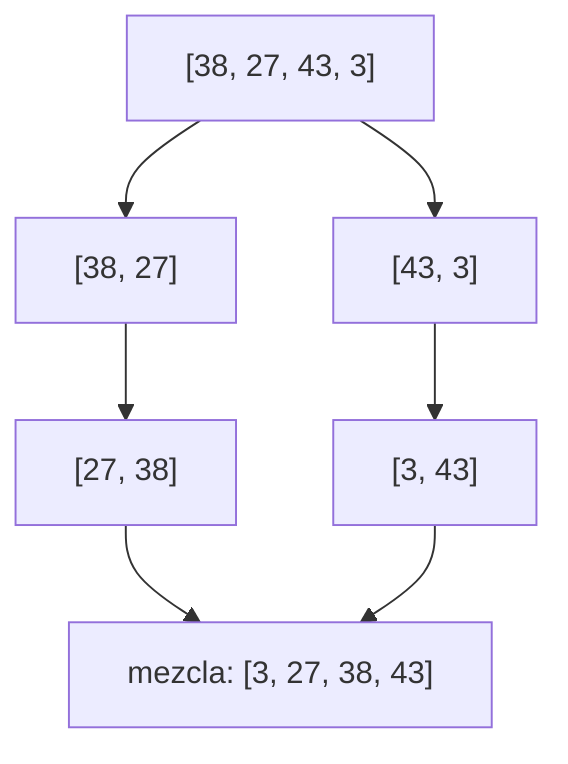
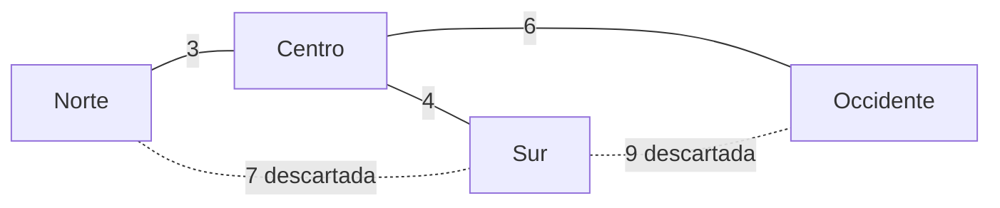
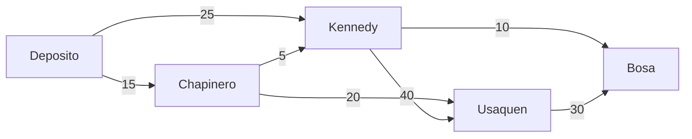
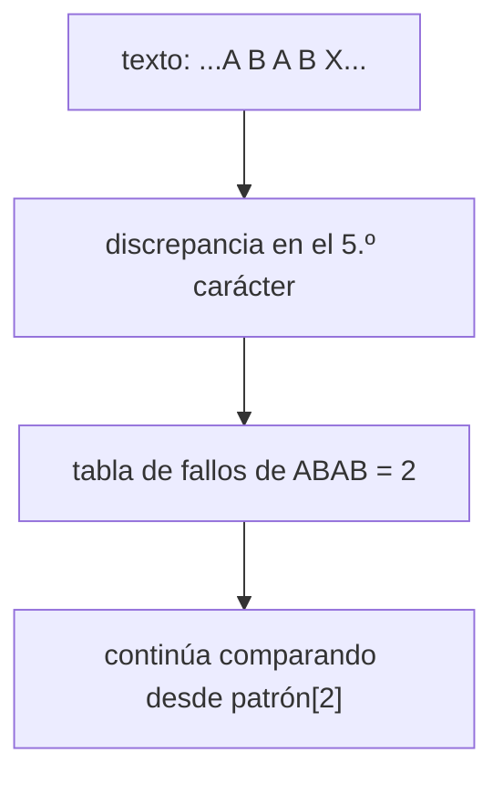
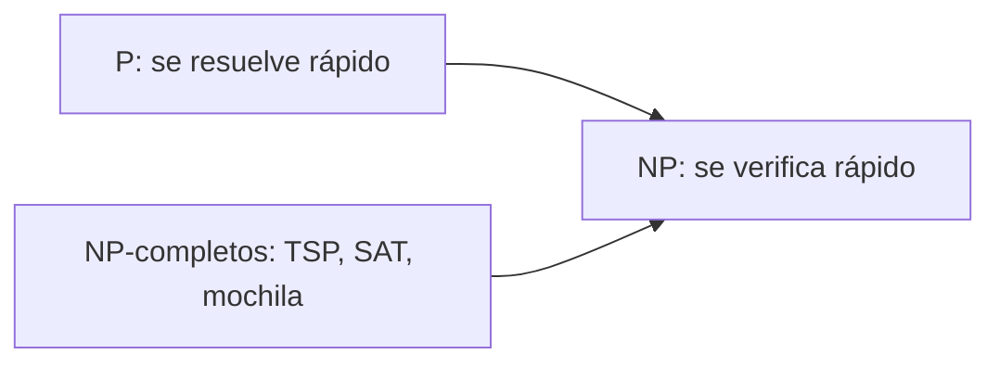

# Módulo 12: Algoritmos clásicos


## Aprende construyendo


### Tema 1: Ordenamientos: insertion, merge y quick sort · Intermedio · 45 min

<details open>
<summary><strong>Capa 1 — Lectura</strong></summary>

#### ► DE QUÉ TRATA
Al finalizar podrás implementar tres algoritmos de ordenamiento, explicar su complejidad (O(n²) frente a O(n log n)) y decidir cuándo uno es mejor que otro. Prerrequisito: Módulo 2, Tema 4 (complejidad y recursión). Necesitas Python 3.14, la línea del curso.

#### ► CÓMO FUNCIONA


</details>

<details>
<summary><strong>Capa 2 — Construcción</strong></summary>

#### Código y verificación

```bash
mkdir algoritmos && cd algoritmos
```

```python
import random
import time

def merge_sort(datos):
    if len(datos) <= 1:
        return datos
    medio = len(datos) // 2
    izquierda = merge_sort(datos[:medio])
    derecha = merge_sort(datos[medio:])
    resultado, i, j = [], 0, 0
    while i < len(izquierda) and j < len(derecha):
        if izquierda[i] <= derecha[j]:          # <= mantiene el orden de los iguales (estable)
            resultado.append(izquierda[i]); i += 1
        else:
            resultado.append(derecha[j]); j += 1
    resultado.extend(izquierda[i:])
    resultado.extend(derecha[j:])
    return resultado

def quick_sort(datos):
    if len(datos) <= 1:
        return datos
    pivote = datos[len(datos) // 2]
    menores = [x for x in datos if x < pivote]
    iguales = [x for x in datos if x == pivote]
    mayores = [x for x in datos if x > pivote]
    return quick_sort(menores) + iguales + quick_sort(mayores)

def insertion_sort(datos):
    datos = list(datos)
    for i in range(1, len(datos)):
        actual, j = datos[i], i - 1
        while j >= 0 and datos[j] > actual:
            datos[j + 1] = datos[j]; j -= 1
        datos[j + 1] = actual
    return datos

random.seed(42)
pesos = [random.randint(1, 5000) for _ in range(3000)]   # pesos de paquetes en gramos
esperado = sorted(pesos)
for nombre, f in [("insertion", insertion_sort), ("merge", merge_sort), ("quick", quick_sort)]:
    inicio = time.perf_counter()
    ok = f(pesos) == esperado
    ms = (time.perf_counter() - inicio) * 1000
    print(f"{nombre:<9} correcto={ok} tiempo={ms:.1f} ms")
```

```bash
python3 ordenamientos.py
```

```text
insertion correcto=True tiempo=88.7 ms
merge     correcto=True tiempo=2.8 ms
quick     correcto=True tiempo=2.0 ms
```

</details>

### Tema 2: Algoritmos codiciosos y árbol de expansión mínima · Intermedio · 45 min

<details open>
<summary><strong>Capa 1 — Lectura</strong></summary>

#### ► DE QUÉ TRATA
Al finalizar podrás reconocer un algoritmo codicioso, demostrar con un contraejemplo cuándo falla y construir un árbol de expansión mínima con Kruskal. Prerrequisitos: Módulo 2, Temas 7 (grafos) y 8 (programación dinámica).

#### ► CÓMO FUNCIONA


</details>

<details>
<summary><strong>Capa 2 — Construcción</strong></summary>

#### Código y verificación


```bash
mkdir algoritmos && cd algoritmos
```

```python
def cambio_codicioso(monto, monedas):
    usadas = []
    for moneda in sorted(monedas, reverse=True):
        while monto >= moneda:
            monto -= moneda
            usadas.append(moneda)
    return usadas

def cambio_optimo(monto, monedas):
    # programación dinámica: mínimo de monedas para cada valor de 0 a monto
    mejor = [0] + [None] * monto
    for valor in range(1, monto + 1):
        opciones = [mejor[valor - m] for m in monedas if m <= valor and mejor[valor - m] is not None]
        mejor[valor] = min(opciones) + 1 if opciones else None
    return mejor[monto]

def kruskal(nodos, aristas):
    padre = {n: n for n in nodos}
    def raiz(n):
        while padre[n] != n:
            padre[n] = padre[padre[n]]
            n = padre[n]
        return n
    arbol, total = [], 0
    for costo, a, b in sorted(aristas):        # decisión codiciosa: la más barata primero
        ra, rb = raiz(a), raiz(b)
        if ra != rb:                            # no forma ciclo
            padre[ra] = rb
            arbol.append((a, b, costo)); total += costo
    return arbol, total

print("Pesos colombianos 1700:", cambio_codicioso(1700, [1000, 500, 200, 100, 50]))
print("Sistema raro 6 con [4,3,1]: codicioso usa", len(cambio_codicioso(6, [4, 3, 1])),
      "monedas; óptimo usa", cambio_optimo(6, [4, 3, 1]))

bodegas = ["Norte", "Sur", "Centro", "Occidente"]
cables = [(7, "Norte", "Sur"), (3, "Norte", "Centro"), (4, "Centro", "Sur"),
          (6, "Centro", "Occidente"), (9, "Sur", "Occidente")]
arbol, total = kruskal(bodegas, cables)
print("Red mínima:", arbol, "costo total:", total)
```

```bash
python3 codiciosos.py
```

```text
Pesos colombianos 1700: [1000, 500, 200]
Sistema raro 6 con [4,3,1]: codicioso usa 3 monedas; óptimo usa 2
Red mínima: [('Norte', 'Centro', 3), ('Centro', 'Sur', 4), ('Centro', 'Occidente', 6)] costo total: 13
```

</details>

### Tema 3: Caminos más cortos con Dijkstra · Intermedio · 45 min

<details open>
<summary><strong>Capa 1 — Lectura</strong></summary>

#### ► DE QUÉ TRATA
Al finalizar podrás calcular la ruta de menor costo en un grafo con pesos usando Dijkstra y una cola de prioridad, reconstruir el camino y explicar por qué falla con pesos negativos. Prerrequisitos: Tema 2 de este módulo y Módulo 2, Tema 7 (BFS).

#### ► CÓMO FUNCIONA


</details>

<details>
<summary><strong>Capa 2 — Construcción</strong></summary>

#### Código y verificación


```bash
mkdir algoritmos && cd algoritmos
```

```python
import heapq

# minutos de viaje entre puntos de reparto (grafo dirigido con pesos)
mapa = {
    "Deposito": {"Chapinero": 15, "Kennedy": 25},
    "Chapinero": {"Usaquen": 20, "Kennedy": 5},
    "Kennedy": {"Bosa": 10, "Usaquen": 40},
    "Usaquen": {"Bosa": 30},
    "Bosa": {},
}

def dijkstra(grafo, origen):
    distancia = {nodo: float("inf") for nodo in grafo}
    anterior = {}
    distancia[origen] = 0
    pendientes = [(0, origen)]                 # cola de prioridad: (minutos, nodo)
    while pendientes:
        d, nodo = heapq.heappop(pendientes)
        if d > distancia[nodo]:
            continue                           # entrada vieja: ya encontramos algo mejor
        for vecino, peso in grafo[nodo].items():
            nueva = d + peso
            if nueva < distancia[vecino]:
                distancia[vecino] = nueva
                anterior[vecino] = nodo
                heapq.heappush(pendientes, (nueva, vecino))
    return distancia, anterior

def camino(anterior, destino):
    ruta = [destino]
    while ruta[-1] in anterior:
        ruta.append(anterior[ruta[-1]])
    return list(reversed(ruta))

distancia, anterior = dijkstra(mapa, "Deposito")
for destino in ["Chapinero", "Kennedy", "Usaquen", "Bosa"]:
    print(f"{destino:<9} {distancia[destino]:>3} min  ruta: {' -> '.join(camino(anterior, destino))}")
```

```bash
python3 rutas.py
```

```text
Chapinero  15 min  ruta: Deposito -> Chapinero
Kennedy    20 min  ruta: Deposito -> Chapinero -> Kennedy
Usaquen    35 min  ruta: Deposito -> Chapinero -> Usaquen
Bosa       30 min  ruta: Deposito -> Chapinero -> Kennedy -> Bosa
```

</details>

### Tema 4: Búsqueda en cadenas: de la fuerza bruta a KMP · Intermedio · 45 min

<details open>
<summary><strong>Capa 1 — Lectura</strong></summary>

#### ► DE QUÉ TRATA
Al finalizar podrás implementar la búsqueda ingenua y el algoritmo Knuth-Morris-Pratt (KMP), construir su tabla de fallos y medir la diferencia en comparaciones. Prerrequisito: Módulo 2, Tema 4.

#### ► CÓMO FUNCIONA


</details>

<details>
<summary><strong>Capa 2 — Construcción</strong></summary>

#### Código y verificación


```bash
mkdir algoritmos && cd algoritmos
```

```python
def busqueda_ingenua(texto, patron):
    posiciones, comparaciones = [], 0
    for i in range(len(texto) - len(patron) + 1):
        j = 0
        while j < len(patron):
            comparaciones += 1
            if texto[i + j] != patron[j]:
                break
            j += 1
        if j == len(patron):
            posiciones.append(i)
    return posiciones, comparaciones

def tabla_fallos(patron):
    # fallo[i] = longitud del prefijo más largo que también es sufijo de patron[:i+1]
    fallo, k = [0] * len(patron), 0
    for i in range(1, len(patron)):
        while k > 0 and patron[i] != patron[k]:
            k = fallo[k - 1]
        if patron[i] == patron[k]:
            k += 1
        fallo[i] = k
    return fallo

def kmp(texto, patron):
    fallo, posiciones, k, comparaciones = tabla_fallos(patron), [], 0, 0
    for i, c in enumerate(texto):
        while k > 0 and c != patron[k]:
            comparaciones += 1
            k = fallo[k - 1]
        comparaciones += 1
        if c == patron[k]:
            k += 1
        if k == len(patron):
            posiciones.append(i - k + 1)
            k = fallo[k - 1]
    return posiciones, comparaciones

guia = "A" * 20000 + "B"            # caso adversario: casi coincide en cada posición
patron = "A" * 50 + "B"
print("tabla de fallos de 'ABABC':", tabla_fallos("ABABC"))
print("ingenua:", busqueda_ingenua(guia, patron))
print("kmp:    ", kmp(guia, patron))
```

```bash
python3 cadenas.py
```

```text
tabla de fallos de 'ABABC': [0, 0, 1, 2, 0]
ingenua: ([19950], 1017501)
kmp:     ([19950], 39951)
```

</details>

### Tema 5: Problemas intratables: P, NP y heurísticas · Intermedio · 45 min

<details open>
<summary><strong>Capa 1 — Lectura</strong></summary>

#### ► DE QUÉ TRATA
Al finalizar podrás explicar qué significa que un problema sea NP-completo, observar el crecimiento factorial de una búsqueda exhaustiva y justificar el uso de una heurística con su costo en calidad. Prerrequisitos: los temas anteriores de este módulo.

#### ► CÓMO FUNCIONA


</details>

<details>
<summary><strong>Capa 2 — Construcción</strong></summary>

#### Código y verificación


```bash
mkdir algoritmos && cd algoritmos
```

```python
from itertools import permutations
import random
import time

def distancia_total(ruta, d):
    return sum(d[a][b] for a, b in zip(ruta, ruta[1:]))

def tsp_fuerza_bruta(n, d):
    mejor = None
    for orden in permutations(range(1, n)):
        ruta = (0,) + orden + (0,)
        costo = distancia_total(ruta, d)
        if mejor is None or costo < mejor[0]:
            mejor = (costo, ruta)
    return mejor

def vecino_mas_cercano(n, d):
    ruta, pendientes = [0], set(range(1, n))
    while pendientes:
        siguiente = min(pendientes, key=lambda c: d[ruta[-1]][c])
        ruta.append(siguiente); pendientes.remove(siguiente)
    ruta.append(0)
    return distancia_total(ruta, d), tuple(ruta)

def puntos_de_entrega(n, semilla=1):
    random.seed(semilla)
    p = [(random.randint(0, 100), random.randint(0, 100)) for _ in range(n)]
    return [[round(((a[0] - b[0]) ** 2 + (a[1] - b[1]) ** 2) ** 0.5) for b in p] for a in p]

for n in [6, 8, 10]:
    d = puntos_de_entrega(n)
    t = time.perf_counter(); exacto = tsp_fuerza_bruta(n, d); te = time.perf_counter() - t
    aprox = vecino_mas_cercano(n, d)
    print(f"n={n:>2}  rutas posibles={len(list(permutations(range(1, n)))):>7}  exacto={exacto[0]:>4} ({te*1000:7.1f} ms)  heurística={aprox[0]:>4}")
```

```bash
python3 np.py
```

```text
n= 6  rutas posibles=    120  exacto= 284 (    0.1 ms)  heurística= 318
n= 8  rutas posibles=   5040  exacto= 291 (    2.4 ms)  heurística= 336
n=10  rutas posibles= 362880  exacto= 303 (  197.1 ms)  heurística= 363
```

</details>

### Proyecto 12: planificador de entregas de RutaFlow

<details open>
<summary><strong>Capa 1 — Lectura</strong></summary>

</details>

<details>
<summary><strong>Capa 2 — Construcción</strong></summary>

#### Nota de construcción
Este tema es principalmente conceptual en esta versión. La verificación se realiza con las preguntas de comprensión y el criterio de cuándo NO usar proyecto 12: planificador de entregas de rutaflow.

</details>
