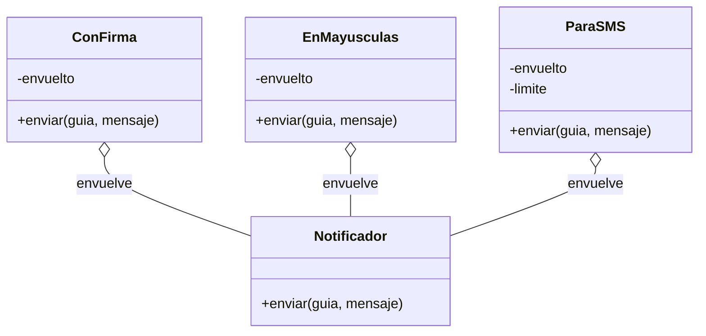
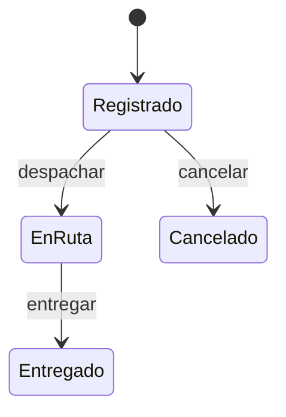
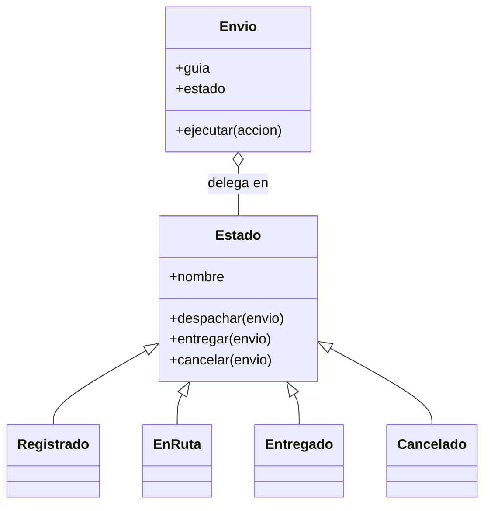
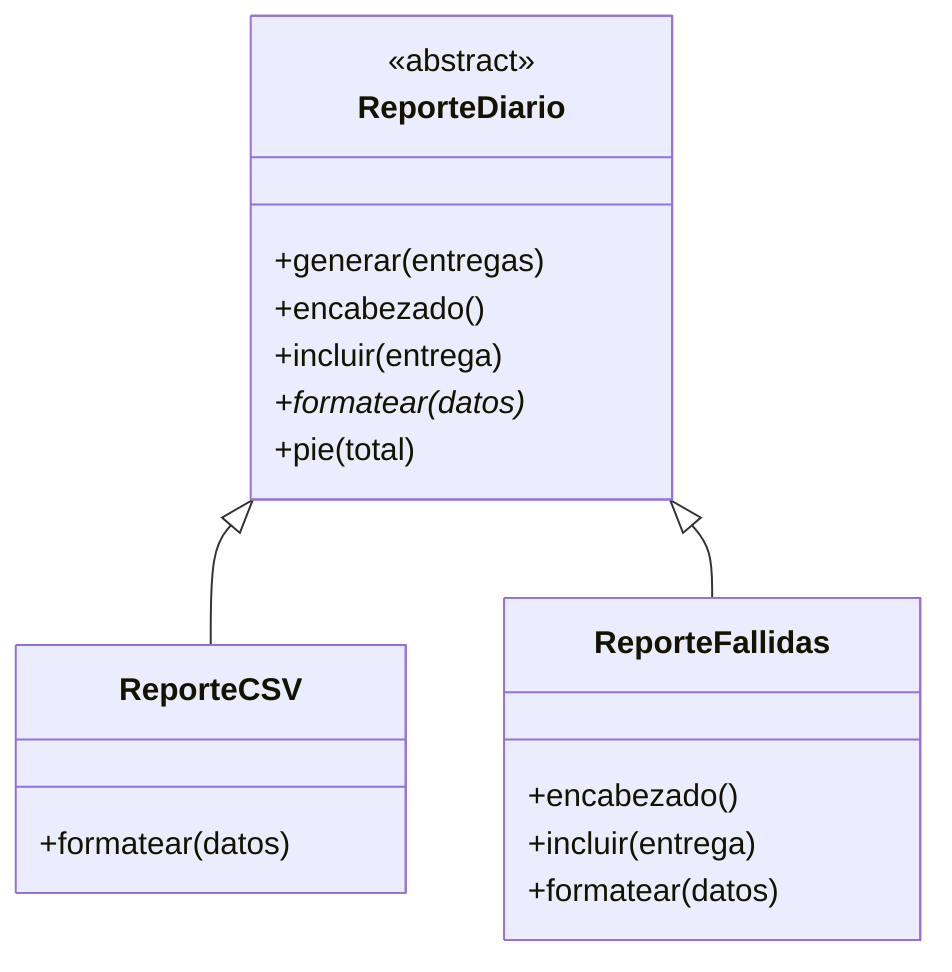
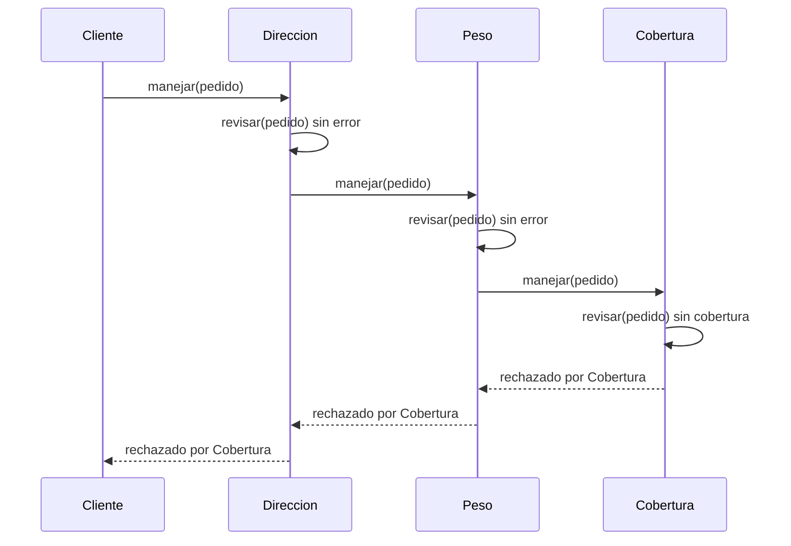
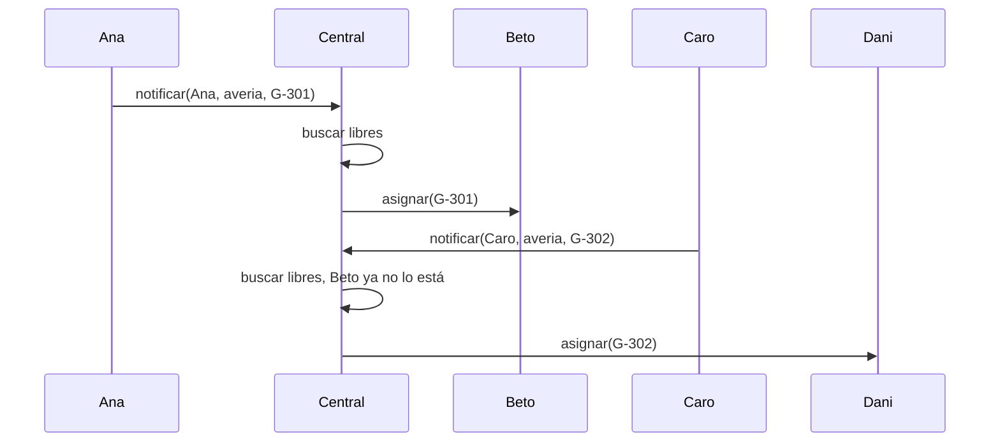
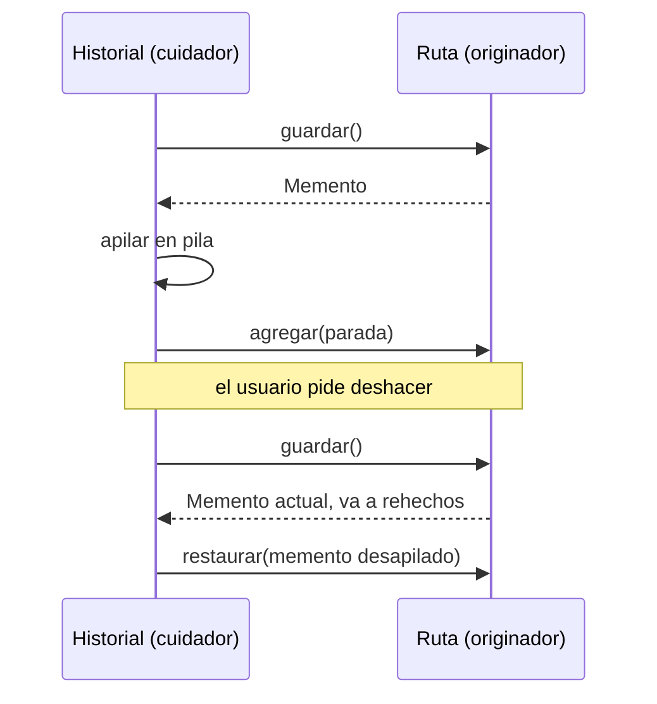
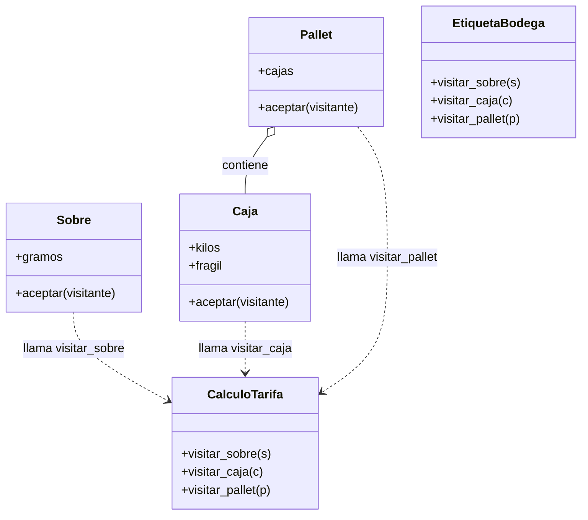
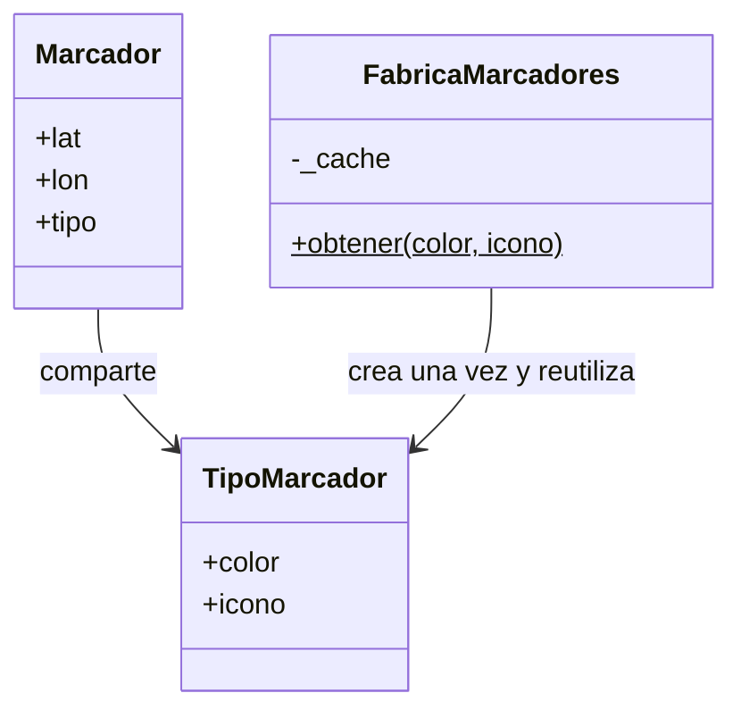

# Módulo 13: Catálogo de patrones de diseño

**Entorno comprobado para esta edición (2026-11-24):** Python 3.13.18 en Linux x86_64, solo con la biblioteca estándar (`abc`, `dataclasses`, `functools`, `time`, `sys` y `tracemalloc`). La línea de referencia del curso es Python 3.14 (`docs/VERSIONES.md`); estos ejemplos no usan nada exclusivo de esa versión. Todas las transcripciones son literales de esa ejecución, en la carpeta de práctica `/home/estudiante/labs/patrones` (tu `~/labs/patrones`). Los tiempos en milisegundos y los megabytes medidos pueden variar un poco en tu equipo; los textos y los conteos no.

## Apertura del módulo

Al terminar este módulo podrás:
- reconocer en código de RutaFlow el problema que resuelve cada uno de ocho patrones de diseño;
- transformar una versión «antes» con `if`, copias o referencias cruzadas en una versión con el patrón, sin cambiar el resultado correcto;
- dibujar el diagrama de clases o de secuencia de cada patrón y explicar quién llama a quién;
- demostrar con una ejecución real el fallo que el patrón evita;
- justificar cuándo **no** usar un patrón y qué alternativa más simple elegir.

**Esquema del módulo:** Decorator (Tema 1), State (Tema 2), Template Method (Tema 3), Chain of Responsibility (Tema 4), Mediator (Tema 5), Memento (Tema 6), Visitor (Tema 7) y Flyweight (Tema 8). Cierra con el Proyecto 13, que los une en un núcleo de envíos.

**Qué necesitas saber antes:** clase, objeto, atributo, método, `__init__` y `self` (Módulo 1, Tema 6); herencia, `super()`, sobrescritura, composición, clase abstracta, método abstracto y polimorfismo (Módulo 1, Tema 7); excepción y `assert` (Módulo 1, Tema 1); función, parámetro y `__name__` (Módulo 1, Tema 4); lista, diccionario, tupla, conjunto y mutable (Módulo 2, Tema 1); pila (Módulo 2, Tema 2). Esas fichas no se repiten aquí: cada tema las enlaza.

## Antes de empezar: cómo usar este catálogo

Este módulo es la referencia de patrones del curso; el Módulo 7 (Tema 3) solo practica Repository y Adapter y remite aquí. Cada tema sigue el mismo recorrido: un **antes** con el problema real en código de RutaFlow, ejecutado; un **después** con el patrón, ejecutado con la misma entrada; un diagrama; y un apartado **Cuándo no usarlo**.

No empieces eligiendo patrón. Identifica primero el problema, las fuerzas que tiran en direcciones distintas y la alternativa más simple. Un patrón innecesario agrega archivos, saltos y conceptos que alguien tendrá que leer.

La alternativa simple que más vas a ver se llama **Strategy**: pasar un objeto o una función intercambiable. Ya la usaste con los avisos del Módulo 1, Tema 7, cuando `Envio` recibía un `AvisoConsola` o un `AvisoMemoria`.

Prepara la carpeta una sola vez; todos los programas del módulo viven ahí y algunos importan a otros:

```bash
mkdir -p ~/labs/patrones && cd ~/labs/patrones
```

## Aprende construyendo

### Tema 1: Decorator: agregar comportamiento sin heredar · Avanzado · 60 min

<details open>
<summary><strong>Capa 1 — Lectura</strong></summary>

#### Objetivos
Al terminar este tema podrás:
- explicar qué es un patrón de diseño y qué problema resuelve el patrón Decorator;
- envolver un objeto con decoradores apilables y predecir cómo cambia el resultado al cambiar el orden;
- distinguir el patrón Decorator del decorador de función `@` de Python;
- conservar el nombre y la documentación de una función decorada con `functools.wraps`.

**Conceptos clave:** patrón de diseño, Decorator, decorador de función, argumentos variables, `functools.wraps`

Ya los conoces y no se repiten: *clase*, *objeto*, *método* y `__init__` (Módulo 1, Tema 6); *herencia*,
*sobrescritura*, `super()` y *composición* (Módulo 1, Tema 7); *función* y `__name__` (Módulo 1, Tema 4).

#### El problema
RutaFlow avisa a sus clientes cuándo sale cada paquete. Unos clientes quieren el aviso firmado, otros en mayúsculas,
otros recortado para SMS, y algunos todo a la vez. Si cada combinación es una subclase, cada extra nuevo duplica el
número de clases. ¿Cómo agregas comportamiento a un objeto, en cualquier combinación, sin crear una clase por mezcla?

#### Glosario del tema

**patrón de diseño**
- **Definición técnica:** solución con nombre a un problema de diseño que se repite, descrita por su estructura de clases, sus colaboraciones y sus consecuencias.
- **En palabras sencillas:** una receta probada para organizar clases cuando aparece un problema conocido; el nombre permite hablar de ella en una frase.
- **Dónde se rompe la comparación:** una receta se sigue al pie de la letra; un patrón se adapta al lenguaje y al problema, y a veces la mejor decisión es no usarlo.
- **Ejemplo:** «usa un Decorator para la firma» le dice a otra persona qué clases esperar sin dibujarlas.
- **Error típico:** buscar dónde meter un patrón antes de tener el problema que resuelve.

**Decorator**
- **Definición técnica:** patrón estructural en el que un objeto envoltorio implementa la misma interfaz que el objeto que envuelve, le delega la llamada y agrega trabajo antes o después.
- **En palabras sencillas:** como meter un regalo en varias bolsas: cada bolsa agrega algo, pero por fuera sigue siendo «algo que se entrega».
- **Dónde se rompe la comparación:** las bolsas no cambian el regalo; un decorador sí puede cambiar los datos que pasan, como el mensaje en mayúsculas.
- **Ejemplo:** `ConFirma(EnMayusculas(Notificador()))` responde a `enviar` igual que un `Notificador`.
- **Error típico:** olvidar delegar: si `ConFirma.enviar` no llama a `self.envuelto.enviar`, el aviso original se pierde.

**decorador de función**
- **Definición técnica:** función que recibe una función y devuelve otra que la reemplaza; la sintaxis `@nombre` sobre un `def` equivale a `f = nombre(f)`.
- **En palabras sencillas:** un envoltorio para funciones: la llamas igual que antes y por dentro hace algo extra, como medir el tiempo.
- **Dónde se rompe la comparación:** se parece al patrón Decorator en la idea, pero se aplica una sola vez al definir la función, no a cada objeto mientras el programa corre.
- **Ejemplo:** `@cronometrado` sobre `def calcular_tarifa` hace que cada llamada imprima cuánto tardó.
- **Error típico:** olvidar `return envoltura` al final del decorador: la función queda en `None` y llamarla produce `TypeError: 'NoneType' object is not callable`.

**argumentos variables**
- **Definición técnica:** un parámetro escrito `*args` recibe en una tupla todos los argumentos posicionales que lleguen; al llamar, `funcion(*args)` los vuelve a repartir.
- **En palabras sencillas:** una bolsa que recibe cuantos datos le pasen, para entregarlos intactos a la función envuelta.
- **Dónde se rompe la comparación:** la bolsa guarda el orden: `args` es una tupla y `args[0]` es el primer argumento.
- **Ejemplo:** en `calcular_tarifa(3)`, la envoltura recibe `args == (3,)`.
- **Error típico:** escribir `funcion(args)` sin asterisco: la función recibe una tupla como un solo argumento.

**`functools.wraps`**
- **Definición técnica:** decorador de la biblioteca estándar que copia a la envoltura los metadatos de la función original: `__name__`, `__doc__` y otros.
- **En palabras sencillas:** le pone a la envoltura la etiqueta de la función que envuelve, para que no se pierda quién es.
- **Dónde se rompe la comparación:** copia la etiqueta, no el comportamiento: la envoltura sigue ejecutando su propio código.
- **Ejemplo:** con `@wraps(funcion)`, `calcular_tarifa.__name__` sigue siendo `'calcular_tarifa'`.
- **Error típico:** omitirlo: los registros, los errores y las herramientas de prueba muestran `envoltura` en lugar del nombre real.

#### ► CÓMO FUNCIONA
Cada decorador **tiene** un objeto con el mismo método `enviar` y lo guarda en `self.envuelto`: es composición. Al
llamar `enviar`, el decorador de afuera hace su parte y le pasa la llamada al de adentro. El cliente no sabe cuántas
capas hay: solo ve algo que responde a `enviar`.



El diagrama dibuja el envoltorio hacia `Notificador`, pero cualquier objeto con `enviar` sirve: un `ConFirma` puede
envolver un `EnMayusculas`. Por eso las capas se apilan en cualquier orden.

#### Problema resuelto 1.1
Antes del patrón. Implementa los avisos con herencia: una subclase para cada combinación de firma y mayúsculas.

**Razonamiento:**
1. La firma y las mayúsculas son extras; cada combinación necesita su clase.
2. `NotificadorMayusculasConFirma` hereda de `NotificadorMayusculas` y copia la firma.
3. Cuenta cuántas clases harían falta si cada extra se puede combinar con todos.

```python
# notificador_herencia.py — cada combinación de extras pide una subclase
class Notificador:
    def enviar(self, guia, mensaje):
        return f"[{guia}] {mensaje}"

class NotificadorConFirma(Notificador):
    def enviar(self, guia, mensaje):
        return super().enviar(guia, mensaje) + " -- RutaFlow"

class NotificadorMayusculas(Notificador):
    def enviar(self, guia, mensaje):
        return super().enviar(guia, mensaje.upper())

class NotificadorMayusculasConFirma(NotificadorMayusculas):
    def enviar(self, guia, mensaje):
        return super().enviar(guia, mensaje) + " -- RutaFlow"   # firma copiada otra vez

clases = [Notificador, NotificadorConFirma, NotificadorMayusculas, NotificadorMayusculasConFirma]
for clase in clases:
    print(f"{clase.__name__:<30} {clase().enviar('G-101', 'Tu paquete salió')}")

for extras in (2, 3, 4):
    print(f"Con {extras} extras combinables necesitas {2 ** extras} clases")
```

```text
$ python3 notificador_herencia.py
Notificador                    [G-101] Tu paquete salió
NotificadorConFirma            [G-101] Tu paquete salió -- RutaFlow
NotificadorMayusculas          [G-101] TU PAQUETE SALIÓ
NotificadorMayusculasConFirma  [G-101] TU PAQUETE SALIÓ -- RutaFlow
Con 2 extras combinables necesitas 4 clases
Con 3 extras combinables necesitas 8 clases
Con 4 extras combinables necesitas 16 clases
```

**Explicación por partes.**
- Líneas 6–8 y 14–16: la firma ` -- RutaFlow` aparece escrita dos veces. Si cambia, hay que acordarse de las dos.
- Línea 14: para combinar dos extras hace falta una clase nueva que herede de una y copie la otra.
- Líneas 22–23: cada extra puede estar o no, así que con *n* extras hay 2ⁿ combinaciones. Con cuatro, 16 clases.

#### Problema resuelto 1.2
Después del patrón. Escribe cada extra como un envoltorio independiente y apílalos en el orden que pida cada cliente.

**Razonamiento:**
1. Cada extra es una clase con `envuelto` y un método `enviar` con la misma firma que `Notificador.enviar`.
2. `enviar` delega en `self.envuelto` y agrega su parte antes o después.
3. Un extra nuevo, como el recorte para SMS, es una clase nueva; ninguna clase anterior cambia.

```python
# decorator.py — envoltorios con la misma interfaz que se apilan
class Notificador:                         # componente base
    def enviar(self, guia, mensaje):
        return f"[{guia}] {mensaje}"

class ConFirma:                            # decorador: misma interfaz, envuelve otro notificador
    def __init__(self, envuelto):
        self.envuelto = envuelto
    def enviar(self, guia, mensaje):
        return self.envuelto.enviar(guia, mensaje) + " -- RutaFlow"

class EnMayusculas:
    def __init__(self, envuelto):
        self.envuelto = envuelto
    def enviar(self, guia, mensaje):
        return self.envuelto.enviar(guia, mensaje.upper())

class ParaSMS:                             # extra nuevo: no toca ninguna clase anterior
    def __init__(self, envuelto, limite=32):
        self.envuelto, self.limite = envuelto, limite
    def enviar(self, guia, mensaje):
        return self.envuelto.enviar(guia, mensaje)[: self.limite]

simple = Notificador()
completo = ConFirma(EnMayusculas(Notificador()))
print(simple.enviar("G-101", "Tu paquete salió"))
print(completo.enviar("G-101", "Tu paquete salió"))

largo = "Tu paquete salió de la bodega de Fontibón"
print(ParaSMS(ConFirma(Notificador())).enviar("G-101", largo))   # recorta y pierde la firma
print(ConFirma(ParaSMS(Notificador())).enviar("G-101", largo))   # recorta y luego firma
```

```text
$ python3 decorator.py
[G-101] Tu paquete salió
[G-101] TU PAQUETE SALIÓ -- RutaFlow
[G-101] Tu paquete salió de la b
[G-101] Tu paquete salió de la b -- RutaFlow
```

**Explicación por partes.**
- Líneas 6–10: `ConFirma` guarda el objeto envuelto (línea 8) y agrega la firma **después** de su respuesta.
- Líneas 15–16: `EnMayusculas` cambia el mensaje **antes** de delegar.
- Líneas 18–22: `ParaSMS` es el extra nuevo. Recorta con `[: self.limite]` lo que devuelve la capa de adentro.
- Líneas 30–31: las mismas tres clases en distinto orden dan resultados distintos. En la línea 30 la firma se recorta;
  en la 31 la firma se agrega después del recorte y el texto pasa de 32 caracteres.

Con *n* extras ahora tienes *n* clases, no 2ⁿ. La combinación se decide al crear el objeto, no al escribir clases.

#### Problema resuelto 1.3
Python trae su propia versión de la idea para funciones: el decorador `@`. Apila dos decoradores sobre
`calcular_tarifa`: uno mide el tiempo con `functools.wraps` y otro registra la llamada sin `wraps`.

**Razonamiento:**
1. Un decorador de función recibe `funcion`, define `envoltura(*args)` y devuelve `envoltura`.
2. Los decoradores se aplican de abajo arriba: primero `@cronometrado`, luego `@registrado`.
3. Para ver el efecto de `wraps`, imprime `__name__` y `__doc__` de la función final.

```python
# cronometro.py — decoradores de función apilados, con y sin functools.wraps
import time
from functools import wraps

def cronometrado(funcion):                 # decorador de función de Python (@)
    @wraps(funcion)                        # copia nombre y documentación de la original
    def envoltura(*args):
        inicio = time.perf_counter()
        resultado = funcion(*args)
        print(f"  {funcion.__name__} tardó {(time.perf_counter() - inicio) * 1000:.0f} ms")
        return resultado
    return envoltura

def registrado(funcion):                   # mismo esquema, pero SIN wraps
    def envoltura(*args):
        print(f"  llamada a {funcion.__name__}{args}")
        return funcion(*args)
    return envoltura

@registrado
@cronometrado
def calcular_tarifa(kilos):
    """Tarifa base de 4000 más 1200 por kilo."""
    time.sleep(0.05)
    return 4000 + kilos * 1200

print("Tarifa:", calcular_tarifa(3))
print("Nombre visible:", calcular_tarifa.__name__)
print("Documentación:", calcular_tarifa.__doc__)
```

```text
$ python3 cronometro.py
  llamada a calcular_tarifa(3,)
  calcular_tarifa tardó 50 ms
Tarifa: 7600
Nombre visible: envoltura
Documentación: None
```

**Explicación por partes.**
- Líneas 5–12: `cronometrado` define una función dentro de otra. La envoltura recuerda `funcion` aunque
  `cronometrado` ya terminó.
- Línea 6: `@wraps(funcion)` copia el nombre y la documentación de `calcular_tarifa` a la envoltura.
- Líneas 20–22: equivalen a `calcular_tarifa = registrado(cronometrado(calcular_tarifa))`.
- Salida, línea 1: `registrado` imprime `calcular_tarifa` porque la función que recibió ya traía el nombre copiado.
- Salida, líneas 4–5: la función final es la envoltura de `registrado`, que no usó `wraps`: se llama `envoltura` y
  perdió su documentación. El tiempo (`50 ms`) puede variar unos milisegundos en tu equipo.

> **Error común.** Olvidar `return envoltura` al final del decorador de función. El `def` decorado queda asociado a
> `None`, y la primera llamada termina con `TypeError: 'NoneType' object is not callable`. Si ves ese error justo
> en la línea que llama una función decorada, revisa el `return` del decorador.

```python
# sin_return.py — un decorador que olvida devolver la envoltura
def registrado(funcion):
    def envoltura(*args):
        print("llamada a", funcion.__name__)
        return funcion(*args)

@registrado
def calcular_tarifa(kilos):
    return 4000 + kilos * 1200

print(calcular_tarifa(3))
```

```text
$ python3 sin_return.py
Traceback (most recent call last):
  File "/home/estudiante/labs/patrones/sin_return.py", line 11, in <module>
    print(calcular_tarifa(3))
          ~~~~~~~~~~~~~~~^^^
TypeError: 'NoneType' object is not callable
```

> **Buena práctica.** Pon `@wraps(funcion)` en cada decorador de función que escribas. Los registros, los mensajes
> de error y las herramientas como `pytest` usan `__name__` para decirte qué falló.

> **Ingeniería de software.** El orden de los envoltorios es una decisión de negocio. Escribe en un solo lugar cómo
> se arma cada notificador (por ejemplo, una función `notificador_para(cliente)`), para que nadie apile capas al revés.

#### Cuándo no usarlo
- Si solo existe una combinación, un método con un parámetro (`enviar(..., firmado=True)`) es más corto y más claro.
- Si los extras no se combinan sino que se reemplazan uno por otro, pasa un objeto intercambiable: es Strategy.
- Si necesitas preguntar «¿este aviso tiene firma?», las capas lo esconden; ahí conviene un objeto con atributos explícitos.
- Más de tres o cuatro capas hacen difícil depurar: cada llamada atraviesa todos los `enviar`.

#### Checkpoint 1.1
¿Qué imprime `EnMayusculas(ConFirma(Notificador())).enviar("G-9", "ok")`? ¿La firma sale en mayúsculas?

Respuesta: `[G-9] OK -- RutaFlow`. `EnMayusculas` convierte el mensaje **antes** de delegar, y la firma se agrega
dentro, en `ConFirma`, después de recibir el mensaje ya convertido. La firma no pasa por `upper()`.

</details>

<details>
<summary><strong>Capa 2 — Construcción</strong></summary>

#### Paso 1 · Mide el problema
En `~/labs/patrones`, escribe `notificador_herencia.py` y ejecútalo con `python3 notificador_herencia.py`. Comprueba
las cuatro clases y la línea `Con 4 extras combinables necesitas 16 clases`.

#### Paso 2 · Envuelve en lugar de heredar
Escribe `decorator.py` y ejecútalo. Comprueba que las dos últimas líneas difieren solo por el orden de `ParaSMS` y
`ConFirma`. Cambia `limite=32` por `limite=20` y predice la salida antes de ejecutar.

#### Paso 3 · Decora funciones y conserva los metadatos
Escribe `cronometro.py` y ejecútalo: verás `Nombre visible: envoltura`. Agrega `@wraps(funcion)` encima de la
`envoltura` de `registrado` y ejecuta otra vez.

#### Resumen
- Un **patrón de diseño** es una solución con nombre a un problema que se repite, con sus consecuencias.
- **Decorator** envuelve un objeto con otro de la misma interfaz que delega y agrega trabajo.
- Los envoltorios se apilan: *n* extras son *n* clases, y el **orden** de las capas cambia el resultado.
- Un **decorador de función** (`@`) reemplaza una función por una envoltura al definirla.
- Los **argumentos variables** `*args` permiten que la envoltura pase cualquier argumento a la función original.
- **`functools.wraps`** conserva `__name__` y `__doc__`; sin él, la función decorada se llama `envoltura`.

#### Ejercicio verificable 1
Básico. Escribe un decorador `ConPrefijo` que anteponga `RutaFlow: ` al mensaje antes de delegar. ¿Qué imprime
`ConPrefijo(Notificador()).enviar("G-7", "Llegó")`?

Respuesta esperada: `[G-7] RutaFlow: Llegó`. La clase guarda `envuelto` y su `enviar` devuelve
`self.envuelto.enviar(guia, "RutaFlow: " + mensaje)`.

#### Ejercicio verificable 2
Intermedio. Agrega `@wraps(funcion)` a `registrado` en `cronometro.py`. ¿Qué cambia en la salida?

Respuesta esperada: las dos últimas líneas pasan a ser `Nombre visible: calcular_tarifa` y
`Documentación: Tarifa base de 4000 más 1200 por kilo.`. La tarifa sigue siendo `7600`.

#### Ejercicio verificable 3
Reto. Un SMS admite 32 caracteres y debe conservar la firma completa. Arma el notificador solo con `ConFirma`,
`ParaSMS` y `Notificador`, sin escribir clases nuevas, y comprueba la longitud con `len`.

Respuesta esperada: `ConFirma(ParaSMS(Notificador(), limite=32 - len(" -- RutaFlow")))`. Con el mensaje largo de
`decorator.py` imprime `[G-101] Tu paquete s -- RutaFlow`, y `len` de ese texto da `32`.

#### En el trabajo
El patrón Decorator aparece en los *middlewares* de los frameworks web: cada capa envuelve la petición para medir
tiempos, revisar permisos o comprimir la respuesta. Los decoradores `@` de Python están en todas partes: rutas de
Flask y FastAPI, `@pytest.fixture`, `@lru_cache`. En una revisión de código, un decorador sin `wraps` suele
señalarse porque rompe los registros y la documentación automática.

</details>

### Tema 2: State: un objeto que cambia de comportamiento según su estado · Avanzado · 60 min

<details open>
<summary><strong>Capa 1 — Lectura</strong></summary>

#### Objetivos
Al terminar este tema podrás:
- dibujar la máquina de estados de un envío con sus transiciones permitidas;
- reemplazar una cadena de `if estado == ...` por un objeto por estado;
- rechazar transiciones inválidas con una excepción y comprobar las 12 combinaciones de estado y acción;
- leer el `AttributeError` de una acción mal escrita.

**Conceptos clave:** máquina de estados, transición, State, `getattr`

Ya los conoces y no se repiten: *clase*, *objeto*, *atributo de clase* y *método* (Módulo 1, Tema 6); *herencia*,
*sobrescritura* y *polimorfismo* (Módulo 1, Tema 7); *excepción* (Módulo 1, Tema 1); *patrón de diseño* (Tema 1 de este módulo).

#### El problema
Un envío de RutaFlow pasa por estados: registrado, en ruta, entregado o cancelado. No todas las acciones valen en
todos los estados: un envío entregado no se cancela. Hoy esas reglas viven en un `if/elif` largo, y una condición
olvidada deja pasar una acción prohibida sin ningún error. ¿Cómo haces que cada estado decida qué acciones admite?

#### Glosario del tema

**máquina de estados**
- **Definición técnica:** modelo con un conjunto finito de estados, un estado inicial y reglas que dicen a qué estado se pasa con cada acción.
- **En palabras sencillas:** el mapa de los caminos posibles de un envío: desde dónde se puede ir a dónde, y nada más.
- **Dónde se rompe la comparación:** en un mapa real puedes salir del camino; en una máquina de estados bien hecha, lo que no está dibujado no se puede hacer.
- **Ejemplo:** registrado → en ruta → entregado; registrado → cancelado.
- **Error típico:** dibujar solo el camino feliz y olvidar decidir qué pasa con las acciones inválidas.

**transición**
- **Definición técnica:** cambio de un estado a otro provocado por una acción; cada transición tiene un estado de origen, una acción y un estado de destino.
- **En palabras sencillas:** una flecha del mapa: «si estás aquí y haces esto, llegas allá».
- **Dónde se rompe la comparación:** una flecha no dice qué pasa si intentas una acción sin flecha; el programa sí debe decirlo, normalmente con un error.
- **Ejemplo:** en ruta + entregar = entregado.
- **Error típico:** permitir una transición por omisión, como cancelar sin preguntar el estado actual.

**State**
- **Definición técnica:** patrón de comportamiento en el que un objeto delega sus acciones en un objeto estado; cada clase de estado implementa solo las acciones que admite y la transición se hace cambiando ese objeto.
- **En palabras sencillas:** el envío no se pregunta «¿en qué estado estoy?»; le pasa la acción a su estado y el estado sabe qué hacer.
- **Dónde se rompe la comparación:** parece que el envío cambia de clase; en realidad sigue siendo el mismo objeto `Envio` y solo cambia lo que guarda en `self.estado`.
- **Ejemplo:** `Registrado().despachar(envio)` cambia `envio.estado` a un objeto `EnRuta`.
- **Error típico:** crear las clases de estado pero dejar el `if` en `Envio`: el patrón queda a medias y las reglas, duplicadas.

**`getattr`**
- **Definición técnica:** función integrada que devuelve el atributo de un objeto a partir de su nombre como texto: `getattr(objeto, "nombre")` equivale a `objeto.nombre`.
- **En palabras sencillas:** buscar un método por su nombre escrito, cuando el nombre llega en una variable.
- **Dónde se rompe la comparación:** el nombre se comprueba al ejecutar, no al escribir; un error de tipeo aparece solo cuando esa línea corre.
- **Ejemplo:** `getattr(self.estado, "despachar")` devuelve el método `despachar` del estado actual.
- **Error típico:** pasar un nombre que no existe: `AttributeError: 'Registrado' object has no attribute 'despacar'. Did you mean: 'despachar'?`.

#### ► CÓMO FUNCIONA
Primero el mapa. Las flechas son las únicas transiciones permitidas:



Después las clases. La clase base `Estado` rechaza las tres acciones con `ValueError`. Cada subclase sobrescribe
solo las acciones que tienen flecha. `Envio` guarda un objeto estado y le delega cada acción:



Una flecha nueva en el mapa es un método nuevo en una sola clase de estado. Un estado nuevo es una clase nueva.

#### Problema resuelto 2.1
Antes del patrón. Implementa las transiciones con `if/elif` y prueba la secuencia despachar, entregar, cancelar.

**Razonamiento:**
1. Cada rama del `if` combina una acción con el estado de origen que la permite.
2. Si ninguna rama coincide, se lanza `ValueError`.
3. Cancelar después de entregar debería caer en el `else`.

```python
# estado_con_if.py — las reglas de transición repartidas en if/elif
class Envio:
    def __init__(self, guia):
        self.guia, self.estado = guia, "registrado"

    def ejecutar(self, accion):
        if accion == "despachar" and self.estado == "registrado":
            self.estado = "en ruta"
        elif accion == "entregar" and self.estado == "en ruta":
            self.estado = "entregado"
        elif accion == "cancelar":             # olvidó preguntar por el estado
            self.estado = "cancelado"
        else:
            raise ValueError(f"No se puede {accion} en estado {self.estado}")
        print(f"{self.guia}: {accion:<9} -> {self.estado}")

envio = Envio("G-202")
envio.ejecutar("despachar")
envio.ejecutar("entregar")
envio.ejecutar("cancelar")                     # un envío entregado no debería cancelarse
```

```text
$ python3 estado_con_if.py
G-202: despachar -> en ruta
G-202: entregar  -> entregado
G-202: cancelar  -> cancelado
```

**Explicación por partes.**
- Líneas 7–10: despachar y entregar preguntan acción **y** estado de origen.
- Línea 11: cancelar solo pregunta la acción. Falta `and self.estado == "registrado"`.
- Salida, línea 3: un envío entregado quedó cancelado. No hubo error: el defecto es silencioso.

El fallo no es de sintaxis, es de diseño: las reglas de los cuatro estados están mezcladas en un solo método, y
cada estado nuevo agrega condiciones a todas las ramas.

#### Problema resuelto 2.2
Después del patrón. Escribe un objeto por estado y deja que cada uno decida.

**Razonamiento:**
1. La clase base rechaza todo: así, lo que una subclase no permite queda prohibido por defecto.
2. Cada estado sobrescribe solo sus flechas y, para transitar, reemplaza `envio.estado`.
3. `Envio.ejecutar` no tiene `if`: busca la acción en su estado con `getattr` y la llama.

```python
# state.py — cada estado es un objeto que sabe qué acciones admite
class Estado:
    nombre = "?"
    def despachar(self, envio): raise ValueError(f"No se puede despachar en estado {self.nombre}")
    def entregar(self, envio):  raise ValueError(f"No se puede entregar en estado {self.nombre}")
    def cancelar(self, envio):  raise ValueError(f"No se puede cancelar en estado {self.nombre}")

class Registrado(Estado):
    nombre = "registrado"
    def despachar(self, envio): envio.estado = EnRuta()
    def cancelar(self, envio):  envio.estado = Cancelado()

class EnRuta(Estado):
    nombre = "en ruta"
    def entregar(self, envio):  envio.estado = Entregado()

class Entregado(Estado):
    nombre = "entregado"

class Cancelado(Estado):
    nombre = "cancelado"

class Envio:
    def __init__(self, guia):
        self.guia, self.estado = guia, Registrado()
    def ejecutar(self, accion):
        getattr(self.estado, accion)(self)    # delega en el objeto estado actual
        print(f"{self.guia}: {accion:<9} -> {self.estado.nombre}")

if __name__ == "__main__":
    envio = Envio("G-202")
    envio.ejecutar("despachar")
    envio.ejecutar("entregar")
    try:
        envio.ejecutar("cancelar")
    except ValueError as error:
        print("Rechazado:", error)
```

```text
$ python3 state.py
G-202: despachar -> en ruta
G-202: entregar  -> entregado
Rechazado: No se puede cancelar en estado entregado
```

**Explicación por partes.**
- Líneas 2–6: `Estado` es la regla por defecto: cualquier acción lanza `ValueError` con el nombre del estado.
- Líneas 8–11: `Registrado` admite despachar y cancelar. Cada método cambia el estado del envío que recibe.
- Líneas 17–21: `Entregado` y `Cancelado` no sobrescriben nada: son estados finales.
- Línea 27: `getattr(self.estado, accion)` obtiene el método; `(self)` lo llama pasándole el envío.
- Líneas 34–37: cancelar un envío entregado ahora se rechaza con un mensaje claro.

#### Problema resuelto 2.3
Comprueba que **todas** las transiciones inválidas se rechazan: prueba las tres acciones desde los cuatro estados.

**Razonamiento:**
1. Son 4 estados por 3 acciones: 12 combinaciones.
2. Para cada una, crea un envío, ponle el estado y ejecuta la acción dentro de `try`.
3. Compara la tabla impresa con el diagrama: solo las flechas dibujadas deben aceptarse.

```python
# transiciones.py — prueba todas las acciones desde cada estado
from state import Cancelado, EnRuta, Entregado, Envio, Registrado

for estado in (Registrado(), EnRuta(), Entregado(), Cancelado()):
    for accion in ("despachar", "entregar", "cancelar"):
        envio = Envio("G-204")
        envio.estado = estado
        try:
            getattr(envio.estado, accion)(envio)
            resultado = envio.estado.nombre
        except ValueError:
            resultado = "rechazada"
        print(f"{estado.nombre:<10} + {accion:<9} = {resultado}")
```

```text
$ python3 transiciones.py
registrado + despachar = en ruta
registrado + entregar  = rechazada
registrado + cancelar  = cancelado
en ruta    + despachar = rechazada
en ruta    + entregar  = entregado
en ruta    + cancelar  = rechazada
entregado  + despachar = rechazada
entregado  + entregar  = rechazada
entregado  + cancelar  = rechazada
cancelado  + despachar = rechazada
cancelado  + entregar  = rechazada
cancelado  + cancelar  = rechazada
```

Tres combinaciones aceptadas, las mismas tres flechas del diagrama. Las nueve restantes se rechazan.

> **Error común.** Escribir mal el nombre de la acción. Como `getattr` busca por texto, el error aparece al ejecutar:
> `AttributeError: 'Registrado' object has no attribute 'despacar'. Did you mean: 'despachar'?`. No es una
> transición inválida (eso sería `ValueError`), es una acción que no existe.

```python
# estado_typo.py — una acción mal escrita
from state import Envio

envio = Envio("G-203")
envio.ejecutar("despacar")
```

```text
$ python3 estado_typo.py
Traceback (most recent call last):
  File "/home/estudiante/labs/patrones/estado_typo.py", line 5, in <module>
    envio.ejecutar("despacar")
    ~~~~~~~~~~~~~~^^^^^^^^^^^^
  File "/home/estudiante/labs/patrones/state.py", line 27, in ejecutar
    getattr(self.estado, accion)(self)    # delega en el objeto estado actual
    ~~~~~~~^^^^^^^^^^^^^^^^^^^^^
AttributeError: 'Registrado' object has no attribute 'despacar'. Did you mean: 'despachar'?
```

> **Prevenir errores.** Guarda la tabla de `transiciones.py` como prueba: cada estado nuevo debe pasarla. Así una
> flecha olvidada o sobrante aparece en la prueba, no en producción.

> **Buena práctica.** Haz que la clase base rechace todo y que cada estado permita lo suyo. Al revés (permitir todo
> y prohibir caso por caso) repite el defecto del `if/elif`.

#### Cuándo no usarlo
- Con dos o tres estados y una regla simple, un diccionario de transiciones permitidas es más corto: `{"registrado": {"despachar", "cancelar"}, ...}`.
- Si los estados solo cambian una etiqueta y no el comportamiento, basta un atributo de texto y una validación.
- Si las reglas las define el negocio y cambian cada semana, guárdalas como datos (tabla o archivo), no como clases.

#### Checkpoint 2.1
En `state.py`, ¿qué clase cambias para permitir cancelar un envío que está en ruta? ¿Cuántas clases tocas?

Respuesta: solo `EnRuta`. Le agregas `def cancelar(self, envio): envio.estado = Cancelado()`. La clase base, los
otros estados y `Envio` no cambian.

</details>

<details>
<summary><strong>Capa 2 — Construcción</strong></summary>

#### Paso 1 · Reproduce el defecto
Escribe `estado_con_if.py` y ejecútalo. Comprueba que la última línea dice `cancelar  -> cancelado` aunque el envío
ya estaba entregado.

#### Paso 2 · Un objeto por estado
Escribe `state.py` y ejecútalo. La última línea debe ser `Rechazado: No se puede cancelar en estado entregado`.

#### Paso 3 · Comprueba la tabla completa
Escribe `transiciones.py` y ejecútalo. Cuenta las líneas que no dicen `rechazada`: deben ser tres.

#### Resumen
- Una **máquina de estados** fija qué **transiciones** existen; lo que no está dibujado no se permite.
- El patrón **State** delega cada acción en un objeto estado; cambiar de estado es reemplazar ese objeto.
- La clase base rechaza todo con `ValueError` y cada estado sobrescribe solo sus flechas.
- **`getattr`** busca un método por su nombre como texto; un nombre mal escrito da `AttributeError`.
- Una tabla de todas las combinaciones prueba que ninguna transición inválida se cuela.

#### Ejercicio verificable 1
Básico. Agrega el estado `Devuelto` y la acción `devolver`, permitida solo desde `EnRuta`. ¿Qué imprime despachar y
luego devolver el envío `G-205`?

Respuesta esperada: en `Estado`, un `devolver` que lanza `ValueError`; una clase `Devuelto` con
`nombre = "devuelto"`; y en `EnRuta`, `def devolver(self, envio): envio.estado = Devuelto()`. Imprime
`G-205: despachar -> en ruta` y `G-205: devolver  -> devuelto`.

#### Ejercicio verificable 2
Intermedio. Después del Ejercicio 1, agrega `Devuelto()` y `"devolver"` a las tuplas de `transiciones.py`. ¿Cuántas
combinaciones hay y cuántas se aceptan?

Respuesta esperada: 5 estados por 4 acciones, 20 combinaciones. Se aceptan 4: las tres de antes y
`en ruta + devolver = devuelto`.

#### Ejercicio verificable 3
Reto. Haz que `Envio` guarde la lista de estados por los que pasó, sin tocar ninguna clase de estado.

Respuesta esperada: en `__init__`, `self.historial = [self.estado.nombre]`; en `ejecutar`, después de llamar a la
acción, `self.historial.append(self.estado.nombre)`. Tras despachar y entregar, `historial` vale
`['registrado', 'en ruta', 'entregado']`. Una acción rechazada no agrega nada, porque la excepción sale antes.

#### En el trabajo
Pedidos, pagos, tickets de soporte y envíos tienen máquinas de estados. En un backend, la regla «no se cancela lo
entregado» se valida en el servidor, no solo en la pantalla, porque cualquiera puede enviar la petición a mano.
Muchas empresas dibujan el diagrama de estados en la documentación del API y prueban cada flecha.

</details>

### Tema 3: Template Method: un algoritmo fijo con pasos variables · Avanzado · 60 min

<details open>
<summary><strong>Capa 1 — Lectura</strong></summary>

#### Objetivos
Al terminar este tema podrás:
- identificar en dos funciones parecidas los pasos que se repiten y los que cambian;
- escribir un método plantilla que fija el orden de los pasos en una clase base abstracta;
- distinguir un paso obligatorio (método abstracto) de un gancho con valor por defecto;
- leer el `TypeError` de una subclase que olvida el paso obligatorio.

**Conceptos clave:** Template Method, gancho

Ya los conoces y no se repiten: *herencia*, *sobrescritura*, *clase abstracta*, *método abstracto* y *polimorfismo*
(Módulo 1, Tema 7); *tupla* y *lista* (Módulo 2, Tema 1); *patrón de diseño* (Tema 1 de este módulo).

#### El problema
Cada noche RutaFlow genera reportes de entregas: uno completo en CSV para contabilidad y otro solo con las fallidas
para el equipo de reclamos. Los dos siguen los mismos pasos: encabezado, filtrar, dar formato y pie con el total.
Hoy son dos funciones copiadas, y la copia del pie quedó mal. ¿Cómo fijas el orden de los pasos una sola vez y dejas
variar solo lo que cambia?

#### Glosario del tema

**Template Method y método plantilla**
- **Definición técnica:** patrón de comportamiento en el que una clase base define un método, el método plantilla, que ejecuta un algoritmo en un orden fijo llamando a otros métodos que las subclases implementan o sobrescriben.
- **En palabras sencillas:** un formulario con casillas en orden fijo; cada reporte llena las casillas a su manera, pero nadie cambia el orden.
- **Dónde se rompe la comparación:** en un formulario las casillas son independientes; aquí un paso recibe el resultado del anterior, como el formato que recibe los datos ya filtrados.
- **Ejemplo:** `ReporteDiario.generar` llama a `incluir`, `formatear`, `encabezado` y `pie`, siempre en ese orden.
- **Error típico:** sobrescribir el método plantilla en una subclase: se rompe el orden que el patrón debía proteger.

**gancho**
- **Definición técnica:** método de la clase base con una implementación por defecto, a menudo vacía o trivial, que el método plantilla llama y que una subclase puede sobrescribir si lo necesita (en inglés, *hook*).
- **En palabras sencillas:** una casilla que ya viene llena con un valor normal; la cambias solo si tu reporte lo necesita.
- **Dónde se rompe la comparación:** a diferencia de un paso abstracto, nadie te obliga a sobrescribirlo; si te equivocas en el nombre, Python no avisa y se usa el valor por defecto.
- **Ejemplo:** `incluir` devuelve `True` para todo; `ReporteFallidas` lo sobrescribe para quedarse solo con las fallidas.
- **Error típico:** escribir `def incluye(self, entrega)` en la subclase: no sobrescribe el gancho y el reporte incluye todo.

#### ► CÓMO FUNCIONA
La clase base es abstracta y tiene el método plantilla `generar`. Ese método nunca cambia: llama a los pasos en
orden. `formatear` es abstracto, así que toda subclase debe implementarlo. `encabezado`, `incluir` y `pie` son
ganchos con un valor por defecto.



El asterisco marca el método abstracto. Fíjate en el sentido de las llamadas: la clase base llama a métodos de la
subclase. Es al revés de `super()`, donde la subclase llama a la base.

#### Problema resuelto 3.1
Antes del patrón. Escribe los dos reportes como funciones independientes y ejecútalas con cuatro entregas.

**Razonamiento:**
1. Cada función arma el texto en cuatro pasos: encabezado, filas, filtro (solo una) y pie.
2. La segunda función nace copiando la primera.
3. Compara el total de cada reporte con el número de filas que muestra.

```python
# reportes_copiados.py — dos reportes que repiten los mismos pasos a mano
def reporte_csv(entregas):
    texto = "Reporte RutaFlow\n"
    texto += "guia,estado\n"
    for guia, estado in entregas:
        texto += f"{guia},{estado}\n"
    return texto + f"Total: {len(entregas)}\n"

def reporte_fallidas(entregas):
    texto = "Entregas fallidas\n"
    for guia, estado in entregas:
        if estado == "fallida":
            texto += f"- {guia}\n"
    return texto + f"Total: {len(entregas)}\n"   # pie copiado: cuenta todas, no las fallidas

entregas = [("G-1", "entregada"), ("G-2", "fallida"), ("G-3", "entregada"), ("G-4", "fallida")]
print(reporte_csv(entregas))
print(reporte_fallidas(entregas))
```

```text
$ python3 reportes_copiados.py
Reporte RutaFlow
guia,estado
G-1,entregada
G-2,fallida
G-3,entregada
G-4,fallida
Total: 4

Entregas fallidas
- G-2
- G-4
Total: 4
```

**Explicación por partes.**
- Líneas 3–7 y 10–14: los dos cuerpos repiten la misma secuencia; solo cambian el encabezado, el filtro y el formato de fila.
- Línea 14: el pie se copió con `len(entregas)`. Debía contar las filas filtradas.
- Salida: el reporte de fallidas muestra dos guías y dice `Total: 4`. Nadie lo nota hasta que reclamos pregunta.

#### Problema resuelto 3.2
Después del patrón. Mueve el orden de los pasos a una clase base y deja que cada reporte cambie solo lo suyo.

**Razonamiento:**
1. El orden (filtrar, formatear, encabezado, pie) va en un solo método: `generar`.
2. El pie recibe `len(datos)`, los datos ya filtrados; así ningún reporte puede contar mal.
3. El formato cambia siempre: es abstracto. Encabezado, filtro y pie casi nunca: son ganchos.

```python
# template_method.py — el orden de los pasos vive en un solo lugar
from abc import ABC, abstractmethod

class ReporteDiario(ABC):
    def generar(self, entregas):             # método plantilla: fija el orden de los pasos
        datos = [e for e in entregas if self.incluir(e)]
        cuerpo = self.formatear(datos)
        return self.encabezado() + cuerpo + self.pie(len(datos))

    def encabezado(self):                    # paso con implementación por defecto (gancho)
        return "Reporte RutaFlow\n"
    def incluir(self, entrega):
        return True
    @abstractmethod
    def formatear(self, datos): ...         # paso obligatorio para cada subclase
    def pie(self, total):
        return f"Total: {total}\n"

class ReporteCSV(ReporteDiario):
    def formatear(self, datos):
        return "guia,estado\n" + "".join(f"{g},{e}\n" for g, e in datos)

class ReporteFallidas(ReporteDiario):
    def encabezado(self):
        return "Entregas fallidas\n"
    def incluir(self, entrega):
        return entrega[1] == "fallida"
    def formatear(self, datos):
        return "".join(f"- {g}\n" for g, _ in datos)

if __name__ == "__main__":
    entregas = [("G-1", "entregada"), ("G-2", "fallida"), ("G-3", "entregada"), ("G-4", "fallida")]
    print(ReporteCSV().generar(entregas))
    print(ReporteFallidas().generar(entregas))
```

```text
$ python3 template_method.py
Reporte RutaFlow
guia,estado
G-1,entregada
G-2,fallida
G-3,entregada
G-4,fallida
Total: 4

Entregas fallidas
- G-2
- G-4
Total: 2
```

**Explicación por partes.**
- Líneas 5–8: el método plantilla. Filtra con el gancho `incluir`, formatea y une encabezado, cuerpo y pie.
- Línea 8: el pie recibe `len(datos)`. El defecto del Problema resuelto 3.1 ya no se puede repetir.
- Líneas 10–17: tres ganchos con valor por defecto y un paso abstracto (líneas 14–15).
- Líneas 19–21: `ReporteCSV` solo implementa el paso obligatorio.
- Líneas 23–29: `ReporteFallidas` cambia dos ganchos y el formato, y hereda el pie correcto.
- Salida: el reporte de fallidas termina en `Total: 2`.

> **Error común.** Crear una subclase sin el paso abstracto. Python no deja crear el objeto:
> `TypeError: Can't instantiate abstract class ReporteJSON without an implementation for abstract method 'formatear'`.
> El mensaje nombra la clase incompleta y el método que falta.

```python
# reporte_incompleto.py — una subclase que olvida el paso obligatorio
from template_method import ReporteDiario

class ReporteJSON(ReporteDiario):
    def encabezado(self):
        return "[\n"

print(ReporteJSON().generar([("G-1", "entregada")]))
```

```text
$ python3 reporte_incompleto.py
Traceback (most recent call last):
  File "/home/estudiante/labs/patrones/reporte_incompleto.py", line 8, in <module>
    print(ReporteJSON().generar([("G-1", "entregada")]))
          ~~~~~~~~~~~^^
TypeError: Can't instantiate abstract class ReporteJSON without an implementation for abstract method 'formatear'
```

> **Prevenir errores.** Un gancho mal escrito no da error: simplemente no se usa. Prueba cada subclase con datos
> donde el gancho importe, por ejemplo una entrega `entregada` que el reporte de fallidas debe excluir.

> **Buena práctica.** Deja pocos pasos abstractos y pocos ganchos. Si la clase base tiene ocho ganchos, cada
> subclase nueva obliga a leerlos todos para saber cuáles tocar.

#### Cuándo no usarlo
- Si solo cambia un paso, pasa ese paso como función o como objeto (Strategy): `generar(entregas, formatear=a_csv)`. No necesitas herencia.
- Si los pasos cambian de orden según el caso, no hay algoritmo fijo que proteger.
- Si hay un solo reporte, una función basta. Extrae la clase cuando aparezca el segundo y veas qué se repite.

#### Checkpoint 3.1
Quieres un reporte con todas las entregas, en CSV, pero con el encabezado `Contabilidad`. ¿Qué escribes?

Respuesta: una subclase de `ReporteCSV` que solo sobrescribe el gancho `encabezado` y devuelve `"Contabilidad\n"`.
Hereda el formato de `ReporteCSV` y el filtro y el pie de `ReporteDiario`.

</details>

<details>
<summary><strong>Capa 2 — Construcción</strong></summary>

#### Paso 1 · Encuentra la copia
Escribe `reportes_copiados.py` y ejecútalo. Marca en el código qué líneas se repiten y cuáles cambian entre las dos
funciones.

#### Paso 2 · Fija el orden en la clase base
Escribe `template_method.py` y ejecútalo. El reporte de fallidas debe cerrar con `Total: 2`.

#### Paso 3 · Rompe el contrato a propósito
Escribe `reporte_incompleto.py` y ejecútalo para ver el `TypeError`. Después agrega a `ReporteJSON` un `formatear`
que devuelva `""` y ejecuta otra vez: el objeto ya se crea.

#### Resumen
- El patrón **Template Method** fija el orden de un algoritmo en un **método plantilla** de la clase base.
- Los pasos obligatorios son **métodos abstractos**; Python impide crear una subclase que no los implemente.
- Un **gancho** trae un valor por defecto y se sobrescribe solo cuando hace falta.
- La clase base llama a los métodos de la subclase: el control va de arriba abajo.
- Si solo varía un paso, pasar una función (Strategy) es más simple que heredar.

#### Ejercicio verificable 1
Básico. Escribe `ReporteEntregadas` con el encabezado `Entregas exitosas`, que incluya solo las entregas con estado
`entregada` y las liste con `- `. ¿Qué imprime con las cuatro entregas del ejemplo?

Respuesta esperada: `Entregas exitosas`, `- G-1`, `- G-3` y `Total: 2`. La subclase sobrescribe `encabezado`,
`incluir` y `formatear`; el pie se hereda.

#### Ejercicio verificable 2
Intermedio. Completa `ReporteJSON` para que con las dos primeras entregas imprima un arreglo JSON entre `[` y `]`, un
objeto por línea. ¿Qué gancho tienes que sobrescribir además de `encabezado` y `formatear`?

Respuesta esperada: `pie`, para que devuelva `"]\n"` en vez de `Total: ...`. Con
`formatear` que une con `",\n"` líneas como `  {"guia": "G-1", "estado": "entregada"}`, la salida es `[`, las dos
líneas separadas por coma y `]`.

#### Ejercicio verificable 3
Reto. Un compañero propone sobrescribir `generar` en `ReporteFallidas` «para optimizarlo». ¿Qué riesgo concreto
introduce? Justifica con el defecto del Problema resuelto 3.1.

Respuesta esperada: la subclase vuelve a tener su propia copia del algoritmo. Si esa copia calcula el pie con la
lista completa, reaparece `Total: 4`. El método plantilla existe para que el orden y el conteo vivan en un solo
lugar; las subclases solo deben tocar pasos y ganchos.

#### En el trabajo
Los frameworks están llenos de métodos plantilla: `unittest.TestCase` llama a `setUp`, al método de prueba y a
`tearDown` en ese orden, y tú solo llenas los pasos. Lo mismo pasa con las vistas de Django o los ciclos de vida de
Android. En un equipo, el método plantilla protege reglas que no se negocian, como registrar siempre la auditoría al
final de un proceso.

</details>

### Tema 4: Chain of Responsibility: una cadena de validadores · Avanzado · 60 min

<details open>
<summary><strong>Capa 1 — Lectura</strong></summary>

#### Objetivos
Al terminar este tema podrás:
- separar reglas anidadas en manejadores independientes enlazados en una cadena;
- cortar la cadena en el primer error y explicar por qué el orden de los eslabones importa;
- reutilizar una parte de la cadena para otro caso sin copiar reglas;
- demostrar con un `assert` una falla silenciosa en una cadena mal armada.

**Conceptos clave:** Chain of Responsibility, manejador, sucesor

Ya los conoces y no se repiten: *herencia*, *sobrescritura* y *polimorfismo* (Módulo 1, Tema 7); *diccionario* y
*conjunto* (Módulo 2, Tema 1); `assert` (Módulo 1, Tema 1); *patrón de diseño* (Tema 1 de este módulo).

#### El problema
Antes de aceptar un pedido, RutaFlow revisa tres reglas: que tenga dirección, que pese entre 0 y 30 kg y que la
ciudad tenga cobertura. Hoy son tres `if` anidados en una función. Ahora llegan los puntos de recogida, que no piden
dirección pero sí las otras reglas. ¿Cómo combinas reglas distintas para casos distintos sin copiar la función?

#### Glosario del tema

**Chain of Responsibility**
- **Definición técnica:** patrón de comportamiento que pasa una petición por una secuencia de objetos manejadores; cada uno decide si la atiende, la corta o la entrega al siguiente.
- **En palabras sencillas:** una fila de revisores en una oficina: cada uno mira una cosa y, si está bien, pasa el papel al siguiente.
- **Dónde se rompe la comparación:** en una oficina el último revisor sabe que es el último; aquí un eslabón no sabe cuántos vienen después, solo si tiene siguiente o no.
- **Ejemplo:** `Direccion(Peso(Cobertura()))` revisa dirección, luego peso, luego cobertura.
- **Error típico:** armar la cadena por partes y dejar un eslabón sin enlazar: la regla existe en el código, pero nunca se ejecuta.

**manejador**
- **Definición técnica:** cada objeto de la cadena; expone un método común (aquí `manejar`) y contiene una sola regla (aquí `revisar`).
- **En palabras sencillas:** un revisor que sabe revisar una sola cosa.
- **Dónde se rompe la comparación:** un revisor humano puede notar otros problemas; un manejador solo ve lo que su `revisar` mira.
- **Ejemplo:** `Peso` rechaza un pedido de 45 kg con `45 kg fuera de rango`.
- **Error típico:** meter dos reglas en el mismo manejador: ya no se pueden usar por separado.

**sucesor**
- **Definición técnica:** el manejador siguiente al que se entrega la petición; cada manejador guarda una referencia a él, o `None` si es el último.
- **En palabras sencillas:** a quién le pasa el papel cada revisor.
- **Dónde se rompe la comparación:** si un revisor no tiene a quién pasarlo, en esta cadena eso significa «aprobado», no «perdido».
- **Ejemplo:** en `Direccion(Peso())`, el sucesor de `Direccion` es el objeto `Peso` y el de `Peso` es `None`.
- **Error típico:** asumir que la cadena tiene un eslabón porque creaste el objeto: si no está como sucesor de nadie, no participa.

#### ► CÓMO FUNCIONA
Cada validador recibe su sucesor al crearse. `manejar` llama a `revisar`; si hay error, responde y la cadena se
corta. Si no, pasa el pedido al sucesor. El último, sin sucesor, responde `aceptado`.



El diagrama muestra el pedido de Leticia: pasa dos eslabones y lo corta el tercero. La respuesta vuelve por el
mismo camino.

#### Problema resuelto 4.1
Antes del patrón. Escribe la validación con `if` anidados y copia la función para los puntos de recogida.

**Razonamiento:**
1. Cada `if` revisa una regla y, si falla, devuelve el rechazo.
2. Los puntos de recogida no piden dirección: se copia la función y se quita esa regla.
3. Prueba los dos con un pedido de 45 kg.

```python
# validar_todo.py — todas las reglas anidadas en una sola función
CIUDADES = {"Bogotá", "Medellín", "Cali"}

def validar(pedido):
    if pedido.get("direccion"):
        if 0 < pedido["kilos"] <= 30:
            if pedido["ciudad"] in CIUDADES:
                return "aceptado"
            return f"rechazado: sin cobertura en {pedido['ciudad']}"
        return f"rechazado: {pedido['kilos']} kg fuera de rango"
    return "rechazado: falta la dirección"

def validar_punto_recogida(pedido):          # copia sin la regla de dirección...
    if pedido["ciudad"] in CIUDADES:          # ...y sin la de peso, por descuido
        return "aceptado"
    return f"rechazado: sin cobertura en {pedido['ciudad']}"

print(validar({"direccion": "Cl 80 # 5-12", "kilos": 45, "ciudad": "Bogotá"}))
print(validar_punto_recogida({"kilos": 45, "ciudad": "Bogotá"}))
```

```text
$ python3 validar_todo.py
rechazado: 45 kg fuera de rango
aceptado
```

**Explicación por partes.**
- Líneas 5–11: tres niveles de `if`. Una regla nueva agrega otro nivel y obliga a reordenar los `return`.
- Líneas 13–16: la copia quitó la dirección y, por descuido, también el peso.
- Salida, línea 2: el punto de recogida acepta 45 kg. La regla de peso existe, pero solo en la otra función.

#### Problema resuelto 4.2
Después del patrón. Escribe cada regla como un manejador y arma cadenas distintas con las mismas piezas.

**Razonamiento:**
1. Una clase base `Validador` hace el trabajo común: revisar y, si no hay error, pasar al sucesor.
2. Cada subclase sobrescribe solo `revisar` y devuelve un texto de error o `None`.
3. Para los puntos de recogida, arma otra cadena sin `Direccion`. Las reglas no se copian.

```python
# chain.py — cada regla es un eslabón que revisa y pasa al siguiente
class Validador:
    def __init__(self, siguiente=None):
        self.siguiente = siguiente
    def manejar(self, pedido):
        error = self.revisar(pedido)
        if error:
            return f"rechazado por {type(self).__name__}: {error}"
        return self.siguiente.manejar(pedido) if self.siguiente else "aceptado"
    def revisar(self, pedido):
        return None

class Direccion(Validador):
    def revisar(self, pedido):
        return None if pedido.get("direccion") else "falta la dirección"

class Peso(Validador):
    def revisar(self, pedido):
        return None if 0 < pedido["kilos"] <= 30 else f"{pedido['kilos']} kg fuera de rango"

class Cobertura(Validador):
    CIUDADES = {"Bogotá", "Medellín", "Cali"}
    def revisar(self, pedido):
        return None if pedido["ciudad"] in self.CIUDADES else f"sin cobertura en {pedido['ciudad']}"

if __name__ == "__main__":
    cadena = Direccion(Peso(Cobertura()))       # el orden de la cadena es una decisión de diseño
    pedidos = [
        {"direccion": "Cra 7 # 10-20", "kilos": 4, "ciudad": "Cali"},
        {"direccion": "", "kilos": 4, "ciudad": "Cali"},
        {"direccion": "Cl 80 # 5-12", "kilos": 45, "ciudad": "Bogotá"},
        {"direccion": "Av 30 # 2-1", "kilos": 2, "ciudad": "Leticia"},
    ]
    for pedido in pedidos:
        print(cadena.manejar(pedido))
    recogida = Peso(Cobertura())                 # punto de recogida: sin regla de dirección
    print("Recogida:", recogida.manejar({"kilos": 45, "ciudad": "Bogotá"}))
```

```text
$ python3 chain.py
aceptado
rechazado por Direccion: falta la dirección
rechazado por Peso: 45 kg fuera de rango
rechazado por Cobertura: sin cobertura en Leticia
Recogida: rechazado por Peso: 45 kg fuera de rango
```

**Explicación por partes.**
- Líneas 3–4: el sucesor llega al crear el objeto; por defecto es `None`.
- Líneas 5–9: `manejar` corta en el primer error. `type(self).__name__` da el nombre de la clase que rechazó.
- Línea 9: si hay sucesor, le pasa el pedido; si no, este es el último eslabón y acepta.
- Líneas 13–24: tres reglas en tres clases. Ninguna sabe que las otras existen.
- Línea 27: se lee de afuera hacia adentro: dirección, peso, cobertura.
- Líneas 36–37: la cadena de recogida reutiliza `Peso` y `Cobertura`, y el pedido de 45 kg se rechaza.

#### Problema resuelto 4.3
La falla silenciosa. Arma una cadena en la que `Cobertura` se crea pero no se enlaza, y escribe una comprobación
que lo detecte.

**Razonamiento:**
1. Un pedido a Leticia debería rechazarse por cobertura.
2. Si `Cobertura` no es sucesor de nadie, la cadena termina en `Peso` y acepta.
3. Recorre la cadena siguiendo `siguiente` y compara la lista de nombres con la esperada.

```python
# cadena_rota.py — los eslabones existen, pero uno quedó suelto
from chain import Cobertura, Direccion, Peso

def eslabones(cadena):                      # recorre la cadena y devuelve los nombres
    nombres = []
    while cadena:
        nombres.append(type(cadena).__name__)
        cadena = cadena.siguiente
    return nombres

cobertura = Cobertura()
rota = Direccion(Peso())                    # se creó Cobertura, pero nadie la enlazó
pedido = {"direccion": "Av 30 # 2-1", "kilos": 2, "ciudad": "Leticia"}
print(rota.manejar(pedido))
print("Eslabones:", eslabones(rota))
assert eslabones(rota) == ["Direccion", "Peso", "Cobertura"], "la cadena no tiene los tres validadores"
```

```text
$ python3 cadena_rota.py
aceptado
Eslabones: ['Direccion', 'Peso']
Traceback (most recent call last):
  File "/home/estudiante/labs/patrones/cadena_rota.py", line 16, in <module>
    assert eslabones(rota) == ["Direccion", "Peso", "Cobertura"], "la cadena no tiene los tres validadores"
           ^^^^^^^^^^^^^^^^^^^^^^^^^^^^^^^^^^^^^^^^^^^^^^^^^^^^^
AssertionError: la cadena no tiene los tres validadores
```

**Explicación por partes.**
- Línea 11: el objeto `Cobertura` existe, pero ninguna línea lo pasa como sucesor.
- Salida, línea 1: el pedido a Leticia sale `aceptado`. No hay excepción: es una falla silenciosa.
- Líneas 4–9: `eslabones` sigue `siguiente` hasta llegar a `None` y anota cada clase.
- Línea 16: el `assert` convierte la falla silenciosa en un error visible con su mensaje.

> **Error común.** Dejar un eslabón suelto. El programa no falla: acepta pedidos que debía rechazar. El único
> mensaje que verás es el de tu propia comprobación:
> `AssertionError: la cadena no tiene los tres validadores`. Sin esa prueba, el defecto llega a producción.

> **Prevenir errores.** Arma cada cadena en una sola función con nombre (`cadena_domicilio()`,
> `cadena_recogida()`) y prueba su lista de eslabones. Así el orden y los eslabones quedan escritos en un solo lugar.

> **Ingeniería de software.** El orden es una decisión: pon primero las reglas baratas y las que más rechazan. Si una
> regla consulta un servicio externo (por ejemplo, la cobertura), que vaya al final para no llamarla de más.

#### Cuándo no usarlo
- Si las reglas son pocas y siempre las mismas, una lista de funciones recorrida con `for` hace lo mismo con menos clases.
- Si necesitas **todos** los errores a la vez (por ejemplo, para un formulario), no cortes en el primero: recorre todas las reglas y junta los mensajes.
- Si una regla depende del resultado de otra de forma compleja, una cadena lineal no lo expresa bien.

#### Checkpoint 4.1
Con la cadena `Direccion(Peso(Cobertura()))`, ¿qué responde un pedido sin dirección, de 45 kg, a Leticia?

Respuesta: `rechazado por Direccion: falta la dirección`. La cadena corta en el primer error, así que `Peso` y
`Cobertura` nunca lo revisan.

</details>

<details>
<summary><strong>Capa 2 — Construcción</strong></summary>

#### Paso 1 · Copia y rompe
Escribe `validar_todo.py` y ejecútalo. Comprueba que el punto de recogida acepta 45 kg.

#### Paso 2 · Una regla por eslabón
Escribe `chain.py` y ejecútalo. Comprueba las cuatro respuestas y la línea `Recogida: rechazado por Peso: 45 kg fuera de rango`.

#### Paso 3 · Detecta la cadena rota
Escribe `cadena_rota.py` en la misma carpeta, porque importa de `chain.py`. Ejecútalo y verás el `AssertionError`.
Cambia la línea 12 por `rota = Direccion(Peso(cobertura))` y ejecuta otra vez: debe imprimir el rechazo por
cobertura y terminar sin error.

#### Resumen
- **Chain of Responsibility** pasa una petición por una cadena de **manejadores**; cada uno revisa una regla.
- Cada manejador guarda su **sucesor**; el último, sin sucesor, acepta.
- La cadena corta en el primer error, así que el orden decide qué mensaje ve el usuario.
- Las mismas piezas arman cadenas distintas sin copiar reglas.
- Un eslabón sin enlazar es una falla silenciosa: pruébala con la lista de eslabones y un `assert`.

#### Ejercicio verificable 1
Básico. Agrega un validador `ValorDeclarado` que rechace pedidos con `valor` mayor a 5 000 000 y ponlo al final de la
cadena. ¿Qué responde un pedido válido en lo demás con `valor` 8 000 000?

Respuesta esperada: `rechazado por ValorDeclarado: valor 8,000,000 supera el tope`, con
`revisar` que devuelve `f"valor {pedido['valor']:,} supera el tope"` si se pasa del tope y `None` si no. La cadena
queda `Direccion(Peso(Cobertura(ValorDeclarado())))`.

#### Ejercicio verificable 2
Intermedio. Para un pedido sin dirección, de 2 kg, a Leticia, compara la respuesta de `Direccion(Peso(Cobertura()))`
con la de `Cobertura(Direccion(Peso()))`.

Respuesta esperada: la primera responde `rechazado por Direccion: falta la dirección`; la segunda,
`rechazado por Cobertura: sin cobertura en Leticia`. Las dos rechazan, pero el mensaje depende del orden.

#### Ejercicio verificable 3
Reto. Escribe `armar(*clases)`, que construya la cadena a partir de una lista de clases en orden, para que nadie
tenga que anidar a mano. Compruébala con `eslabones`.

Respuesta esperada: empezar con `cadena = None` y recorrer `reversed(clases)` haciendo `cadena = clase(cadena)`.
`eslabones(armar(Direccion, Peso, Cobertura))` da `['Direccion', 'Peso', 'Cobertura']`, y el pedido a Leticia
responde `rechazado por Cobertura: sin cobertura en Leticia`.

#### En el trabajo
Los *middlewares* de un servidor web forman una cadena: autenticación, límite de peticiones, validación y
finalmente el código del endpoint; cualquiera puede cortar con un 401 o un 429. Los sistemas de aprobación de gastos
y los filtros de correo siguen la misma idea. En producción, la lista de eslabones se registra al arrancar para
poder confirmar que ninguno quedó fuera.

</details>

### Tema 5: Mediator: coordinar objetos sin que se conozcan · Avanzado · 60 min

<details open>
<summary><strong>Capa 1 — Lectura</strong></summary>

#### Objetivos
Al terminar este tema podrás:
- medir el acoplamiento de un grupo de objetos contando las referencias entre ellos;
- centralizar la coordinación en un mediador para que los colegas no se conozcan entre sí;
- agregar un colega nuevo con una sola línea de registro;
- reconocer cuándo el mediador crece tanto que se vuelve un problema.

**Conceptos clave:** acoplamiento, Mediator, colega

Ya los conoces y no se repiten: *clase*, *objeto* y *atributo* (Módulo 1, Tema 6); *composición* (Módulo 1, Tema 7);
*lista* y *diccionario* (Módulo 2, Tema 1); *patrón de diseño* (Tema 1 de este módulo).

#### El problema
Cuando la moto de un mensajero de RutaFlow se avería, su paquete pasa al primer compañero libre. Hoy cada mensajero
guarda la lista de todos los demás y decide a quién pasarlo. Al entrar un mensajero nuevo hay que actualizar la lista
de todos, y basta olvidar una para que un paquete quede sin dueño. ¿Cómo coordinas a varios objetos sin que cada
uno conozca a todos?

#### Glosario del tema

**acoplamiento**
- **Definición técnica:** grado en que un módulo o clase depende de los detalles de otros; con acoplamiento alto, un cambio en uno obliga a cambiar los demás.
- **En palabras sencillas:** cuántos hilos te atan a otras piezas; con muchos hilos, mover una pieza mueve todas.
- **Dónde se rompe la comparación:** algunos hilos son necesarios; el objetivo no es cero acoplamiento sino depender de pocas piezas y estables.
- **Ejemplo:** con 4 mensajeros que se conocen entre todos hay 4 × 3 = 12 referencias; con una central, 4.
- **Error típico:** medir el acoplamiento por número de archivos y no por número de dependencias entre objetos.

**Mediator**
- **Definición técnica:** patrón de comportamiento que encapsula en un objeto mediador cómo interactúa un grupo de objetos; los objetos se comunican solo con el mediador, que decide a quién avisar.
- **En palabras sencillas:** la central de despacho: los mensajeros llaman a la central, y la central reparte; ningún mensajero necesita el teléfono de otro.
- **Dónde se rompe la comparación:** una central humana tiene juicio; el mediador solo aplica las reglas que escribiste, y si acumula demasiadas se vuelve difícil de cambiar.
- **Ejemplo:** `Central.notificar(emisor, "averia", guia)` busca un mensajero libre y le asigna la guía.
- **Error típico:** dejar que el mediador crezca hasta tener la lógica de todo el sistema: el acoplamiento no desaparece, se concentra.

**colega**
- **Definición técnica:** cada objeto coordinado por un mediador; guarda una referencia al mediador y le notifica sus eventos, sin referencias a otros colegas.
- **En palabras sencillas:** cada mensajero: sabe hablar con la central y nada más.
- **Dónde se rompe la comparación:** un colega sin central no puede hacer nada coordinado; uno que no se registró falla al primer aviso.
- **Ejemplo:** `Mensajero.reportar_averia` llama a `self.central.notificar(...)`.
- **Error típico:** usar un colega antes de registrarlo: `self.central` vale `None` y aparece `AttributeError: 'NoneType' object has no attribute 'notificar'`.

#### ► CÓMO FUNCIONA
Cada mensajero se registra una vez en la central, que lo guarda en un diccionario y le deja una referencia a sí
misma. Cuando un mensajero reporta una avería, solo avisa a la central. La central busca un libre y le asigna la guía.



Ana no conoce a Beto ni a Dani, y Caro tampoco. Si mañana entra Eva, solo la central se entera.

#### Problema resuelto 5.1
Antes del patrón. Cada mensajero guarda la lista de sus compañeros y busca él mismo a uno libre.

**Razonamiento:**
1. Cada mensajero tiene `companeros`; al averiarse, recorre la lista y asigna al primero libre.
2. Entra Dani: hay que agregarlo a la lista de los otros tres.
3. Cuenta las referencias: con 4 mensajeros deberían ser 4 × 3 = 12.

```python
# mensajeros_acoplados.py — cada mensajero guarda la lista de todos los demás
class Mensajero:
    def __init__(self, nombre, libre=True):
        self.nombre, self.libre, self.companeros = nombre, libre, []
    def reportar_averia(self, guia):
        self.libre = False
        print(f"{self.nombre} reporta avería con {guia}")
        for otro in self.companeros:            # cada uno decide a quién pasar el envío
            if otro.libre:
                otro.asignar(guia)
                return
        print(f"  {self.nombre}: nadie libre para {guia}")
    def asignar(self, guia):
        self.libre = False
        print(f"  {self.nombre} recibe {guia}")

ana, beto, caro = Mensajero("Ana", libre=False), Mensajero("Beto"), Mensajero("Caro")
dani = Mensajero("Dani")                        # entra un mensajero nuevo
ana.companeros = [beto, caro, dani]
beto.companeros = [ana, caro, dani]
caro.companeros = [ana, beto]                   # aquí se olvidó agregar a Dani
dani.companeros = [ana, beto, caro]

ana.reportar_averia("G-301")
caro.reportar_averia("G-302")
print("Referencias entre mensajeros:", sum(len(m.companeros) for m in (ana, beto, caro, dani)))
```

```text
$ python3 mensajeros_acoplados.py
Ana reporta avería con G-301
  Beto recibe G-301
Caro reporta avería con G-302
  Caro: nadie libre para G-302
Referencias entre mensajeros: 11
```

**Explicación por partes.**
- Líneas 8–11: la regla de reparto está dentro de cada mensajero. Cambiarla es cambiar la clase de todos.
- Línea 21: la lista de Caro no tiene a Dani.
- Salida, línea 4: Caro dice que nadie está libre, y Dani sí lo estaba.
- Salida, línea 5: 11 referencias en vez de 12. Cada mensajero nuevo agrega 2 × *n* referencias que alguien debe mantener.

#### Problema resuelto 5.2
Después del patrón. Una central registra a los mensajeros y reparte las averías; los mensajeros solo la conocen a ella.

**Razonamiento:**
1. La central guarda a los mensajeros en un diccionario y lleva un registro de eventos.
2. Al registrarse, cada mensajero recibe la referencia a la central.
3. La regla «primer libre que no sea el emisor» vive en un solo lugar: `Central.notificar`.

```python
# mediator.py — una central coordina; los mensajeros solo la conocen a ella
class Central:                                # mediador: único punto que conoce a todos
    def __init__(self):
        self.mensajeros, self.registro = {}, []
    def registrar(self, mensajero):
        self.mensajeros[mensajero.nombre] = mensajero
        mensajero.central = self
    def notificar(self, emisor, evento, dato):
        self.registro.append((emisor.nombre, evento, dato))
        if evento == "averia":
            libres = [m for m in self.mensajeros.values() if m is not emisor and m.libre]
            if libres:
                libres[0].asignar(dato)
            else:
                print(f"  Central: nadie libre para {dato}, queda en espera")

class Mensajero:
    def __init__(self, nombre, libre=True):
        self.nombre, self.libre, self.central = nombre, libre, None
    def reportar_averia(self, guia):
        self.libre = False
        print(f"{self.nombre} reporta avería con {guia}")
        self.central.notificar(self, "averia", guia)   # no conoce a los otros mensajeros
    def asignar(self, guia):
        self.libre = False
        print(f"  {self.nombre} recibe {guia}")

if __name__ == "__main__":
    central = Central()
    ana, beto, caro = Mensajero("Ana", libre=False), Mensajero("Beto"), Mensajero("Caro")
    dani = Mensajero("Dani")
    for m in (ana, beto, caro, dani):           # un mensajero nuevo = una sola línea de registro
        central.registrar(m)
    ana.reportar_averia("G-301")
    caro.reportar_averia("G-302")
    beto.reportar_averia("G-303")
    print("Eventos registrados:", len(central.registro))
```

```text
$ python3 mediator.py
Ana reporta avería con G-301
  Beto recibe G-301
Caro reporta avería con G-302
  Dani recibe G-302
Beto reporta avería con G-303
  Central: nadie libre para G-303, queda en espera
Eventos registrados: 3
```

**Explicación por partes.**
- Líneas 5–7: registrar guarda al mensajero y le entrega la central. Es la única conexión que necesita.
- Líneas 8–15: la regla de reparto. `m is not emisor` evita asignarle el paquete a quien se averió.
- Línea 23: el mensajero avisa a la central y no sabe quién recibirá la guía.
- Líneas 32–33: los cuatro mensajeros entran con el mismo `for`. Un mensajero nuevo es una línea más.
- Salida: Dani recibe la guía de Caro. Cuando ya no hay libres, la central lo dice y el evento queda registrado.

> **Error común.** Usar un mensajero que no se registró. Su atributo `central` sigue en `None` y la primera avería
> termina con `AttributeError: 'NoneType' object has no attribute 'notificar'`. La línea señalada es la llamada a la
> central, pero la causa está antes: falta `central.registrar(eva)`.

```python
# sin_registrar.py — un mensajero que nunca se registró en la central
from mediator import Central, Mensajero

central = Central()
eva = Mensajero("Eva")
eva.reportar_averia("G-304")
```

```text
$ python3 sin_registrar.py
Eva reporta avería con G-304
Traceback (most recent call last):
  File "/home/estudiante/labs/patrones/sin_registrar.py", line 6, in <module>
    eva.reportar_averia("G-304")
    ~~~~~~~~~~~~~~~~~~~^^^^^^^^^
  File "/home/estudiante/labs/patrones/mediator.py", line 23, in reportar_averia
    self.central.notificar(self, "averia", guia)   # no conoce a los otros mensajeros
    ^^^^^^^^^^^^^^^^^^^^^^
AttributeError: 'NoneType' object has no attribute 'notificar'
```

> **Buena práctica.** Deja que el mediador registre lo que coordina (aquí, `self.registro`). Cuando un paquete se
> pierde, ese registro dice quién avisó, qué evento y cuándo.

> **Ingeniería de software.** Vigila el tamaño del mediador. Si `notificar` acumula diez tipos de evento con reglas
> distintas, divídelo: una central de averías, otra de turnos. El patrón concentra el acoplamiento; no lo elimina.

#### Cuándo no usarlo
- Con dos objetos que se hablan en un solo sentido, una referencia directa es más clara que un intermediario.
- Si los objetos solo necesitan enterarse de un evento y no hay reglas de coordinación, basta una lista de suscriptores que reciben el aviso (el patrón Observer).
- Si el mediador terminaría con toda la lógica del programa, separa responsabilidades antes de centralizarlas.

#### Checkpoint 5.1
Con el mediador, ¿cuántas líneas cambias para agregar a Eva y cuántas habrías cambiado en la versión acoplada?

Respuesta: con el mediador, dos líneas: crear a Eva y registrarla. En la versión acoplada, la lista de Eva y las
cuatro listas de los demás: cinco listas que mantener, y cualquier olvido repite el defecto de Caro.

</details>

<details>
<summary><strong>Capa 2 — Construcción</strong></summary>

#### Paso 1 · Cuenta los hilos
Escribe `mensajeros_acoplados.py` y ejecútalo. Comprueba que Caro dice `nadie libre` y que hay 11 referencias.
Agrega `dani` a la lista de Caro y confirma que ahora Dani recibe `G-302` y hay 12 referencias.

#### Paso 2 · Una central para todos
Escribe `mediator.py` y ejecútalo. Comprueba que `Eventos registrados: 3`.

#### Paso 3 · Olvida registrar a propósito
Escribe `sin_registrar.py` y ejecútalo para ver el `AttributeError`. Agrega `central.registrar(eva)` antes de la
avería y ejecuta otra vez: la central responde `nadie libre para G-304, queda en espera`.

#### Resumen
- El **acoplamiento** mide cuánto depende un objeto de otros; con *n* objetos que se conocen entre todos hay *n* × (*n* − 1) referencias.
- El patrón **Mediator** pone la coordinación en un objeto central; cada **colega** solo lo conoce a él.
- Agregar un colega es una línea de registro; la regla de coordinación vive en un solo lugar.
- Un colega sin registrar falla con `AttributeError` sobre `None`.
- El mediador concentra el acoplamiento: si crece demasiado, divídelo.

#### Ejercicio verificable 1
Básico. Agrega a Eva, libre, y regístrala junto con los otros cuatro. ¿Quién recibe `G-303` cuando Beto se avería?

Respuesta esperada: `  Eva recibe G-303`. Ana, Caro y Dani ya no están libres y Beto es el emisor, así que la
central elige a Eva.

#### Ejercicio verificable 2
Intermedio. RutaFlow tendrá 10 mensajeros. ¿Cuántas referencias entre mensajeros hay en la versión acoplada y
cuántas referencias a la central en la versión con mediador?

Respuesta esperada: 10 × 9 = 90 en la versión acoplada; 10 en la versión con mediador, una por mensajero (más las 10
que la central guarda en su diccionario).

#### Ejercicio verificable 3
Reto. Haz que la central guarde las guías que quedan en espera y que, cuando un mensajero avise
`"libre"`, le asigne la primera pendiente.

Respuesta esperada: la central tiene `self.pendientes = []`. En la rama sin libres hace `self.pendientes.append(dato)`.
Agrega la rama `elif evento == "libre" and self.pendientes:` con `emisor.asignar(self.pendientes.pop(0))`. El
mensajero necesita un método `quedar_libre` que ponga `self.libre = True` y llame a
`self.central.notificar(self, "libre", None)`. Con el ejemplo de `mediator.py`, si Ana llama a `quedar_libre()`
al final, imprime `  Ana recibe G-303`.

#### En el trabajo
Las pantallas con muchos controles usan un mediador: al cambiar la ciudad, el formulario actualiza la lista de
barrios y la tarifa sin que los controles se conozcan. En logística, los sistemas de despacho son mediadores entre
mensajeros, vehículos y pedidos. En arquitecturas grandes, un *broker* de mensajes cumple un papel parecido entre
servicios.

</details>

### Tema 6: Memento: guardar y restaurar estado para deshacer · Avanzado · 60 min

<details open>
<summary><strong>Capa 1 — Lectura</strong></summary>

#### Objetivos
Al terminar este tema podrás:
- explicar con una ejecución por qué un alias o una copia superficial no sirven como historial;
- implementar deshacer y rehacer con instantáneas inmutables y dos pilas;
- separar al originador, que crea y lee las instantáneas, del cuidador, que solo las guarda;
- leer el `FrozenInstanceError` de un intento de modificar un valor congelado.

**Conceptos clave:** Memento, originador, cuidador, copia superficial, dataclass congelada

Ya los conoces y no se repiten: *clase*, *objeto* y `__str__` (Módulo 1, Tema 6); *lista*, *diccionario*, *tupla* y
*mutable* (Módulo 2, Tema 1); *pila* (Módulo 2, Tema 2); *patrón de diseño* (Tema 1 de este módulo).

#### El problema
El planificador de RutaFlow arma la ruta del día agregando paradas. Cuando se equivoca, quiere deshacer, y a veces
rehacer lo que deshizo. Guardar «la ruta de antes» parece fácil, pero si guardas la misma lista o una copia a medias,
el cambio de ahora también modifica la versión guardada. ¿Cómo guardas una foto del estado que nadie pueda alterar?

#### Glosario del tema

**Memento**
- **Definición técnica:** patrón de comportamiento que captura el estado interno de un objeto en un objeto aparte, la instantánea o memento, para restaurarlo después sin exponer cómo está construido por dentro.
- **En palabras sencillas:** una foto de la ruta en un momento; para deshacer, vuelves a poner la ruta como sale en la foto.
- **Dónde se rompe la comparación:** una foto de papel no cambia sola; un memento sí puede cambiar si guarda objetos mutables compartidos con el original.
- **Ejemplo:** `ruta.guardar()` devuelve `Memento(paradas=(...))` con las paradas de ese instante.
- **Error típico:** guardar la lista original en vez de una copia: la «foto» se mueve con cada cambio.

**originador**
- **Definición técnica:** el objeto cuyo estado se guarda; es el único que crea sus mementos y el único que sabe leerlos para restaurarse.
- **En palabras sencillas:** la ruta: se toma la foto a sí misma y sabe volver a ser como en la foto.
- **Dónde se rompe la comparación:** en Python nada impide que otro objeto lea el memento; la separación es una convención que el diseño respeta.
- **Ejemplo:** `Ruta.guardar` y `Ruta.restaurar`.
- **Error típico:** dejar que el historial arme las instantáneas leyendo los atributos internos de la ruta.

**cuidador**
- **Definición técnica:** el objeto que pide mementos al originador, los guarda y decide cuándo devolver uno, sin mirar ni modificar su contenido.
- **En palabras sencillas:** el álbum de fotos: guarda las fotos en orden y las entrega cuando se las piden.
- **Dónde se rompe la comparación:** el álbum no entiende las fotos; si una foto se daña por dentro, el cuidador no lo nota.
- **Ejemplo:** `Historial` guarda mementos en `pila` y en `rehechos`.
- **Error típico:** olvidar vaciar la pila de rehacer al hacer un cambio nuevo: rehacer aplicaría un estado de otra historia.

**copia superficial**
- **Definición técnica:** copia que crea un contenedor nuevo pero conserva las mismas referencias a los elementos; `lista.copy()` y `list(lista)` son copias superficiales.
- **En palabras sencillas:** fotocopiar el índice de una carpeta, no las hojas: la carpeta nueva señala las mismas hojas.
- **Dónde se rompe la comparación:** si los elementos son inmutables, como texto o tuplas, la copia superficial basta, porque nadie puede cambiar las hojas.
- **Ejemplo:** tras `superficial = ruta.copy()`, `superficial[0] is ruta[0]` da `True`.
- **Error típico:** copiar una lista de diccionarios con `.copy()` y luego editar un diccionario: el cambio aparece en las dos.

**dataclass congelada (`frozen=True`)**
- **Definición técnica:** clase generada con el decorador `@dataclass` del módulo `dataclasses`, que crea `__init__` a partir de los campos declarados; con `frozen=True`, asignar a un campo después de crearla lanza `FrozenInstanceError`.
- **En palabras sencillas:** una ficha que se llena una vez al crearla y después queda plastificada.
- **Dónde se rompe la comparación:** el plástico protege los campos, no lo que hay dentro de ellos: si un campo guarda una lista, esa lista sí se puede cambiar.
- **Ejemplo:** `@dataclass(frozen=True) class Parada:` con campos `nombre: str` y `hora: str`.
- **Error típico:** asignar un campo: `dataclasses.FrozenInstanceError: cannot assign to field 'hora'`.

#### ► CÓMO FUNCIONA
Antes de cada cambio, el historial le pide a la ruta una instantánea y la apila. Para deshacer, desapila la última y
se la devuelve a la ruta. Para poder rehacer, antes de restaurar guarda la foto actual en otra pila.



La instantánea funciona porque es inmutable de punta a punta: un `Memento` congelado con una tupla de `Parada`
congeladas. Ningún cambio posterior la alcanza.

#### Problema resuelto 6.1
Antes del patrón. Guarda «la ruta de antes» de dos formas ingenuas y compáralas después de dos cambios.

**Razonamiento:**
1. Intento 1: otro nombre para la misma lista (alias).
2. Intento 2: una copia superficial con `.copy()`.
3. Haz dos cambios: agrega una parada y edita la hora de la primera. Una foto correcta no debería mostrar ninguno.

```python
# deshacer_roto.py — dos «fotos» de la ruta que no son fotos
ruta = [{"parada": "Depósito", "hora": "08:00"}]

alias = ruta                     # intento 1: guardar el mismo objeto con otro nombre
superficial = ruta.copy()        # intento 2: copiar solo la lista exterior

ruta.append({"parada": "Suba", "hora": "09:30"})   # cambio 1: agregar una parada
ruta[0]["hora"] = "07:45"                          # cambio 2: editar una parada que ya existía

print("Actual:     ", ruta)
print("Alias:      ", alias)
print("Superficial:", superficial)
print("¿Misma lista?", alias is ruta, "| ¿Mismo diccionario?", superficial[0] is ruta[0])
```

```text
$ python3 deshacer_roto.py
Actual:      [{'parada': 'Depósito', 'hora': '07:45'}, {'parada': 'Suba', 'hora': '09:30'}]
Alias:       [{'parada': 'Depósito', 'hora': '07:45'}, {'parada': 'Suba', 'hora': '09:30'}]
Superficial: [{'parada': 'Depósito', 'hora': '07:45'}]
¿Misma lista? True | ¿Mismo diccionario? True
```

**Explicación por partes.**
- Línea 4: `alias` no es una copia: es el mismo objeto. La salida lo confirma con `¿Misma lista? True`.
- Línea 5: `.copy()` crea una lista nueva que señala los mismos diccionarios.
- Línea 7: agregar una parada no afecta a `superficial`, porque su lista exterior es otra.
- Línea 8: editar la hora sí la afecta: `superficial` muestra `07:45`. Deshacer con ella dejaría una hora que nunca se guardó.

#### Problema resuelto 6.2
Después del patrón. Guarda mementos inmutables y agrega rehacer con una segunda pila.

**Razonamiento:**
1. Cada parada es una dataclass congelada; el memento guarda una tupla de paradas, también inmutable.
2. Solo la ruta crea y lee mementos; el historial los guarda en dos pilas.
3. Deshacer guarda la foto actual en `rehechos`; rehacer hace lo inverso. Un cambio nuevo vacía `rehechos`.

```python
# memento.py — instantáneas inmutables para deshacer y rehacer
from dataclasses import dataclass

@dataclass(frozen=True)
class Parada:                                # valor inmutable: nadie la edita por dentro
    nombre: str
    hora: str

@dataclass(frozen=True)
class Memento:                               # instantánea inmutable y opaca para el historial
    paradas: tuple

class Ruta:                                  # originador: crea y lee sus propios mementos
    def __init__(self):
        self._paradas = []
    def agregar(self, parada):
        self._paradas.append(parada)
    def guardar(self):
        return Memento(tuple(self._paradas))
    def restaurar(self, memento):
        self._paradas = list(memento.paradas)
    def __str__(self):
        return " -> ".join(f"{p.nombre} {p.hora}" for p in self._paradas) or "(vacía)"

class Historial:                             # cuidador: guarda mementos sin mirar su interior
    def __init__(self, ruta):
        self.ruta, self.pila, self.rehechos = ruta, [], []
    def cambiar(self, parada):
        self.pila.append(self.ruta.guardar())
        self.rehechos.clear()                # un cambio nuevo invalida lo que podías rehacer
        self.ruta.agregar(parada)
    def deshacer(self):
        if self.pila:
            self.rehechos.append(self.ruta.guardar())
            self.ruta.restaurar(self.pila.pop())
    def rehacer(self):
        if self.rehechos:
            self.pila.append(self.ruta.guardar())
            self.ruta.restaurar(self.rehechos.pop())

if __name__ == "__main__":
    ruta = Ruta()
    historial = Historial(ruta)
    for nombre, hora in [("Depósito", "08:00"), ("Chapinero", "08:40"), ("Suba", "09:30")]:
        historial.cambiar(Parada(nombre, hora))
    print("Actual:  ", ruta)
    historial.deshacer()
    print("Deshacer:", ruta)
    historial.deshacer()
    print("Deshacer:", ruta)
    historial.rehacer()
    print("Rehacer: ", ruta)
```

```text
$ python3 memento.py
Actual:   Depósito 08:00 -> Chapinero 08:40 -> Suba 09:30
Deshacer: Depósito 08:00 -> Chapinero 08:40
Deshacer: Depósito 08:00
Rehacer:  Depósito 08:00 -> Chapinero 08:40
```

**Explicación por partes.**
- Líneas 4–11: `Parada` y `Memento` son congeladas. La tupla de la línea 19 no admite agregar ni quitar elementos.
- Líneas 18–21: la ruta crea su memento y sabe restaurarse. `list(...)` crea una lista nueva para seguir editando.
- Líneas 28–31: antes de cada cambio se apila la foto. La línea 30 descarta lo que se podía rehacer.
- Líneas 32–39: deshacer y rehacer son simétricos: guardan la foto actual en una pila y restauran la otra.
- Salida: dos deshacer quitan Suba y Chapinero; rehacer devuelve Chapinero con su hora original.

> **Error común.** Intentar corregir una parada guardada editándola. Como `Parada` es congelada, Python lo impide:
> `dataclasses.FrozenInstanceError: cannot assign to field 'hora'`. Para cambiar la hora, crea una `Parada` nueva y
> regístrala con `historial.cambiar`, así el cambio también se puede deshacer.

```python
# editar_parada.py — intentar cambiar por dentro una parada guardada
from memento import Parada

parada = Parada("Depósito", "08:00")
parada.hora = "07:45"
```

```text
$ python3 editar_parada.py
Traceback (most recent call last):
  File "/home/estudiante/labs/patrones/editar_parada.py", line 5, in <module>
    parada.hora = "07:45"
    ^^^^^^^^^^^
  File "<string>", line 16, in __setattr__
dataclasses.FrozenInstanceError: cannot assign to field 'hora'
```

> **Prevenir errores.** Antes de confiar en un historial, prueba lo que hizo fallar a `deshacer_roto.py`: guarda,
> modifica un elemento **existente** y compara. Agregar elementos no basta para detectar una copia superficial.

> **Rendimiento.** Cada memento guarda la ruta completa. Con rutas de miles de paradas y cientos de cambios, limita
> el historial (por ejemplo, a los últimos 50) o guarda solo el cambio y su inverso.

#### Cuándo no usarlo
- Si el estado es un solo valor inmutable, como un número o un texto, guarda los valores anteriores en una lista: no necesitas clases.
- Si el estado es enorme y los cambios pequeños, guardar fotos completas desperdicia memoria; guarda las operaciones y su inverso.
- Si el estado vive en una base de datos, usa sus transacciones o una tabla de versiones en lugar de fotos en memoria.

#### Checkpoint 6.1
Después de deshacer dos veces en `memento.py`, el planificador agrega `Usaquén 09:10`. ¿Qué hace `rehacer()` y por qué?

Respuesta: nada. `cambiar` vacía `rehechos` (línea 30), así que no queda nada que rehacer. La ruta queda
`Depósito 08:00 -> Usaquén 09:10`.

</details>

<details>
<summary><strong>Capa 2 — Construcción</strong></summary>

#### Paso 1 · Demuestra la foto falsa
Escribe `deshacer_roto.py` y ejecútalo. Comprueba que `Superficial` muestra la hora `07:45` aunque se copió antes del cambio.

#### Paso 2 · Instantáneas inmutables
Escribe `memento.py` y ejecútalo. Las cuatro líneas deben terminar en Suba, Chapinero, Depósito y otra vez Chapinero.

#### Paso 3 · Prueba el candado
Escribe `editar_parada.py` y ejecútalo para ver el `FrozenInstanceError`. Quita `frozen=True` de `Parada`, ejecuta
otra vez y observa que el cambio pasa sin error; después vuelve a ponerlo.

#### Resumen
- Un **alias** no es una copia, y una **copia superficial** comparte los elementos con el original.
- El patrón **Memento** guarda instantáneas del estado para restaurarlo sin exponer su estructura interna.
- El **originador** crea y lee sus mementos; el **cuidador** solo los guarda en orden.
- Deshacer y rehacer usan dos **pilas**; un cambio nuevo vacía la de rehacer.
- Una **dataclass congelada** con campos inmutables hace que la instantánea no se pueda alterar.

#### Ejercicio verificable 1
Básico. En `deshacer_roto.py`, agrega `import copy` y una tercera foto `profunda = copy.deepcopy(ruta)` junto a las
otras dos. `copy.deepcopy` copia también los elementos internos. ¿Qué imprime esa foto?

Respuesta esperada: `[{'parada': 'Depósito', 'hora': '08:00'}]`. Es la ruta tal como estaba: ni la parada nueva ni la
hora editada la alcanzan.

#### Ejercicio verificable 2
Intermedio. Reproduce el Checkpoint 6.1 en código: tres cambios, dos deshacer, un cambio nuevo con
`Parada("Usaquén", "09:10")` y un rehacer. Imprime la ruta.

Respuesta esperada: `Depósito 08:00 -> Usaquén 09:10`. El rehacer no tiene efecto porque el cambio nuevo vació `rehechos`.

#### Ejercicio verificable 3
Reto. Escribe `HistorialLimitado`, subclase de `Historial`, que conserve como máximo 3 mementos para deshacer. Haz 5
cambios (`P1` a `P5`) y luego 5 deshacer. ¿Cómo queda la ruta?

Respuesta esperada: sobrescribe `cambiar`, llama a `super().cambiar(parada)` y, si `len(self.pila) > 3`, descarta el
más viejo con `self.pila.pop(0)`. Tras 5 deshacer la ruta queda `P1 08:00 -> P2 08:00` (si todas usan la hora
`08:00`): solo se pudieron deshacer los últimos 3 cambios.

#### En el trabajo
Los editores de texto, las herramientas de diseño y los formularios largos usan instantáneas para deshacer. En
aplicaciones web, el estado de la pantalla suele guardarse como objetos inmutables por la misma razón: comparar o
restaurar una versión anterior es seguro si nadie la pudo modificar. En bases de datos, la misma idea aparece como
versiones de un registro o como puntos de restauración.

</details>

### Tema 7: Visitor: operaciones nuevas sin tocar las clases · Avanzado · 60 min

<details open>
<summary><strong>Capa 1 — Lectura</strong></summary>

#### Objetivos
Al terminar este tema podrás:
- reconocer el costo de repetir `isinstance` en cada operación sobre una familia de clases;
- separar operaciones (tarifa, etiqueta) en visitantes usando doble despacho;
- agregar una operación nueva escribiendo una sola clase;
- calcular qué cuesta agregar un tipo nuevo y leer el `AttributeError` que produce un visitante incompleto.

**Conceptos clave:** Visitor, doble despacho

Ya los conoces y no se repiten: *clase*, *objeto* y *método* (Módulo 1, Tema 6); `isinstance` y *polimorfismo*
(Módulo 1, Tema 7); *función* (Módulo 1, Tema 4); *patrón de diseño* (Tema 1 de este módulo).

#### El problema
RutaFlow maneja tres tipos de paquete: sobre, caja y pallet. Sobre ellos corren varias operaciones: calcular la
tarifa, imprimir la etiqueta de bodega y, pronto, calcular el peso total. Hoy cada operación es una función con una
cadena de `isinstance`, y si a una le falta un caso, devuelve `None` sin avisar. ¿Cómo agregas operaciones sin
repetir la pregunta por el tipo y sin olvidar casos?

#### Glosario del tema

**Visitor**
- **Definición técnica:** patrón de comportamiento que separa una operación de la jerarquía de clases sobre la que actúa; la operación es un objeto visitante con un método por clase, y cada clase tiene un método `aceptar` que llama al método que le corresponde.
- **En palabras sencillas:** un inspector que recorre la bodega con una lista: «si es sobre, haz esto; si es caja, esto otro». Un inspector nuevo trae una lista nueva sin cambiar los paquetes.
- **Dónde se rompe la comparación:** el inspector no mira el paquete para saber qué es; el paquete le dice «soy una caja» al llamar a `visitar_caja`.
- **Ejemplo:** `paquete.aceptar(CalculoTarifa())` devuelve la tarifa de cualquier tipo de paquete.
- **Error típico:** usar Visitor cuando los tipos cambian a menudo: cada tipo nuevo obliga a editar todos los visitantes.

**doble despacho**
- **Definición técnica:** mecanismo en el que el método que se ejecuta depende del tipo de dos objetos: primero el del elemento (que elige su `aceptar`) y luego el del visitante (que elige su `visitar_...`).
- **En palabras sencillas:** dos llamadas en vez de un `if`: el paquete dice qué es, y el visitante dice qué hacer con eso.
- **Dónde se rompe la comparación:** «doble» no significa que la operación se haga dos veces; son dos pasos para elegir una sola implementación.
- **Ejemplo:** `Caja.aceptar(v)` llama a `v.visitar_caja(self)`; si `v` es `CalculoTarifa`, se ejecuta la tarifa de caja.
- **Error típico:** escribir en `aceptar` el método de otro tipo (`visitar_sobre` dentro de `Caja`): el visitante trata la caja como sobre.

#### ► CÓMO FUNCIONA
Cada clase de paquete tiene un solo método nuevo, `aceptar`, que llama al método de su tipo en el visitante. Cada
visitante tiene un método por tipo de paquete. Para calcular una tarifa no se pregunta el tipo: se le pide al
paquete que acepte al visitante.



Las flechas punteadas valen igual para `EtiquetaBodega`: cada paquete llama al método de su tipo en cualquier
visitante. Un visitante nuevo es una clase con tres métodos. Un tipo de paquete nuevo es un método más en **cada**
visitante.

#### Problema resuelto 7.1
Antes del patrón. Escribe la tarifa y la etiqueta como funciones que preguntan el tipo con `isinstance`.

**Razonamiento:**
1. Cada función revisa los tres tipos en orden y devuelve el resultado del que coincida.
2. El pallet suma la tarifa de sus cajas llamando a la misma función.
3. Imprime etiqueta y tarifa de una carga con los tres tipos.

```python
# operaciones_con_if.py — cada operación pregunta el tipo con isinstance
class Sobre:
    def __init__(self, gramos): self.gramos = gramos

class Caja:
    def __init__(self, kilos, fragil): self.kilos, self.fragil = kilos, fragil

class Pallet:
    def __init__(self, cajas): self.cajas = cajas

def tarifa(paquete):
    if isinstance(paquete, Sobre):
        return 3000
    if isinstance(paquete, Caja):
        return 5000 + paquete.kilos * 1500 + (4000 if paquete.fragil else 0)
    if isinstance(paquete, Pallet):
        return 50000 + sum(tarifa(c) for c in paquete.cajas)

def etiqueta(paquete):
    if isinstance(paquete, Sobre):
        return f"SOBRE {paquete.gramos} g"
    if isinstance(paquete, Caja):
        return f"CAJA {paquete.kilos} kg" + (" FRÁGIL" if paquete.fragil else "")
    # falta el caso Pallet: la función termina y devuelve None sin avisar

carga = [Sobre(120), Caja(4, fragil=True), Pallet([Caja(10, False), Caja(12, True)])]
for paquete in carga:
    print(etiqueta(paquete), "| tarifa", tarifa(paquete))
```

```text
$ python3 operaciones_con_if.py
SOBRE 120 g | tarifa 3000
CAJA 4 kg FRÁGIL | tarifa 15000
None | tarifa 97000
```

**Explicación por partes.**
- Líneas 11–17 y 19–23: la misma escalera de `isinstance` en cada operación. La tercera operación la repetirá.
- Línea 15: `(4000 if paquete.fragil else 0)` es una condición en una sola expresión: vale 4000 si es frágil y 0 si no.
- Línea 24: falta el caso `Pallet`. Una función que termina sin `return` devuelve `None`.
- Salida, línea 3: la etiqueta del pallet sale `None` y nadie recibe un error.

#### Problema resuelto 7.2
Después del patrón. Cada operación es un visitante y cada paquete sabe aceptarlo.

**Razonamiento:**
1. Cada paquete recibe un método `aceptar(visitante)` que llama a `visitar_<su tipo>`.
2. Cada operación es una clase con los tres métodos `visitar_...`.
3. Si a un visitante le falta un método, la llamada falla con un error en vez de devolver `None`.

```python
# visitor.py — cada operación es un visitante; cada paquete sabe aceptarlo
class Sobre:
    def __init__(self, gramos): self.gramos = gramos
    def aceptar(self, visitante): return visitante.visitar_sobre(self)

class Caja:
    def __init__(self, kilos, fragil): self.kilos, self.fragil = kilos, fragil
    def aceptar(self, visitante): return visitante.visitar_caja(self)

class Pallet:
    def __init__(self, cajas): self.cajas = cajas
    def aceptar(self, visitante): return visitante.visitar_pallet(self)

class CalculoTarifa:                         # una operación nueva = un visitante nuevo
    def visitar_sobre(self, s):  return 3000
    def visitar_caja(self, c):   return 5000 + c.kilos * 1500 + (4000 if c.fragil else 0)
    def visitar_pallet(self, p): return 50000 + sum(c.aceptar(self) for c in p.cajas)

class EtiquetaBodega:
    def visitar_sobre(self, s):  return f"SOBRE {s.gramos} g"
    def visitar_caja(self, c):   return f"CAJA {c.kilos} kg" + (" FRÁGIL" if c.fragil else "")
    def visitar_pallet(self, p): return f"PALLET con {len(p.cajas)} cajas"

if __name__ == "__main__":
    carga = [Sobre(120), Caja(4, fragil=True), Pallet([Caja(10, False), Caja(12, True)])]
    for paquete in carga:
        print(f"{paquete.aceptar(EtiquetaBodega()):<22} tarifa ${paquete.aceptar(CalculoTarifa()):,}")
```

```text
$ python3 visitor.py
SOBRE 120 g            tarifa $3,000
CAJA 4 kg FRÁGIL       tarifa $15,000
PALLET con 2 cajas     tarifa $97,000
```

**Explicación por partes.**
- Líneas 4, 8 y 12: el primer despacho. Cada clase elige el método que corresponde a su tipo.
- Líneas 14–17: la tarifa completa en una clase. El pallet suma sus cajas pidiéndoles que acepten al mismo visitante.
- Líneas 19–22: la etiqueta completa en otra clase. Las clases de paquete no cambiaron para agregarla.
- Línea 27: `:<22` rellena el texto a 22 caracteres alineado a la izquierda; `:,` agrega separadores de miles.

> **Error común.** Agregar un tipo de paquete sin agregar su método en los visitantes. La llamada falla al
> ejecutar: `AttributeError: 'EtiquetaBodega' object has no attribute 'visitar_bolsa'. Did you mean: 'visitar_caja'?`.
> La sugerencia de Python no es la solución: falta escribir `visitar_bolsa` en cada visitante.

```python
# tipo_nuevo.py — llega un tipo de paquete que los visitantes no conocen
from visitor import EtiquetaBodega

class Bolsa:
    def __init__(self, kilos): self.kilos = kilos
    def aceptar(self, visitante): return visitante.visitar_bolsa(self)

print(Bolsa(2).aceptar(EtiquetaBodega()))
```

```text
$ python3 tipo_nuevo.py
Traceback (most recent call last):
  File "/home/estudiante/labs/patrones/tipo_nuevo.py", line 8, in <module>
    print(Bolsa(2).aceptar(EtiquetaBodega()))
          ~~~~~~~~~~~~~~~~^^^^^^^^^^^^^^^^^^
  File "/home/estudiante/labs/patrones/tipo_nuevo.py", line 6, in aceptar
    def aceptar(self, visitante): return visitante.visitar_bolsa(self)
                                         ^^^^^^^^^^^^^^^^^^^^^^^
AttributeError: 'EtiquetaBodega' object has no attribute 'visitar_bolsa'. Did you mean: 'visitar_caja'?
```

> **Buena práctica.** Declara una clase abstracta `Visitante` con los tres `visitar_...` como métodos abstractos y
> hereda de ella en cada visitante. Así, un visitante incompleto falla al crearse con `TypeError`, antes de procesar
> ningún paquete.

> **Ingeniería de software.** Visitor intercambia un costo por otro. Operación nueva: una clase, cero cambios en los
> paquetes. Tipo nuevo: un método en cada visitante. Elígelo cuando los tipos estén quietos y las operaciones crezcan.

#### Cuándo no usarlo
- Si los tipos cambian más que las operaciones, pon cada operación como método de cada clase (polimorfismo, Módulo 1, Tema 7): un tipo nuevo es una clase completa.
- Con dos tipos y una operación, un `if isinstance` corto es más legible que dos métodos `aceptar` y una clase visitante.
- Si las operaciones necesitan los atributos privados de cada clase, el visitante obliga a exponerlos.

#### Checkpoint 7.1
¿Cuántos métodos escribes para agregar la operación `PesoTotal` y cuántos para agregar el tipo `Bolsa`?

Respuesta: `PesoTotal` son tres métodos en una clase nueva (`visitar_sobre`, `visitar_caja`, `visitar_pallet`).
`Bolsa` es su `aceptar` más un `visitar_bolsa` en cada visitante existente: con dos visitantes, tres métodos
repartidos en tres clases, y uno más por cada visitante futuro.

</details>

<details>
<summary><strong>Capa 2 — Construcción</strong></summary>

#### Paso 1 · Encuentra el caso olvidado
Escribe `operaciones_con_if.py` y ejecútalo. Comprueba que la tercera línea empieza con `None`.

#### Paso 2 · Visitantes
Escribe `visitor.py` y ejecútalo. La tarifa del pallet debe ser `$97,000`: 50 000 más 20 000 y 27 000 de sus cajas.

#### Paso 3 · Agrega un tipo y mira qué se rompe
Escribe `tipo_nuevo.py` y ejecútalo para ver el `AttributeError`. Agrega `visitar_bolsa` a `EtiquetaBodega` en
`visitor.py` (por ejemplo, `return f"BOLSA {b.kilos} kg"`) y ejecuta otra vez: imprime `BOLSA 2 kg`.

#### Resumen
- Repetir `isinstance` en cada operación multiplica los lugares donde se puede olvidar un caso.
- El patrón **Visitor** pone cada operación en una clase visitante con un método por tipo.
- El **doble despacho** elige la implementación en dos llamadas: `aceptar` en el paquete y `visitar_...` en el visitante.
- Operación nueva: una clase. Tipo nuevo: un método en cada visitante.
- Un visitante incompleto falla con `AttributeError` en vez de devolver `None`.

#### Ejercicio verificable 1
Básico. Escribe el visitante `PesoTotal` que devuelva kilos: el sobre convierte gramos a kilos, la caja da sus
kilos y el pallet suma sus cajas. ¿Qué lista da `[p.aceptar(PesoTotal()) for p in carga]`?

Respuesta esperada: `[0.12, 4, 22]`. `visitar_sobre` devuelve `s.gramos / 1000` y `visitar_pallet` suma
`c.aceptar(self)` de cada caja.

#### Ejercicio verificable 2
Intermedio. Agrega a `operaciones_con_if.py` el caso que falta en `etiqueta`. ¿Qué tienes que revisar además para
estar seguro de que no falta otro?

Respuesta esperada: agregar `if isinstance(paquete, Pallet): return f"PALLET con {len(paquete.cajas)} cajas"`; la
salida coincide con la de `visitor.py` salvo el formato. Además, revisar **todas** las funciones con `isinstance`
sobre paquetes, porque el lenguaje no avisa cuál quedó incompleta.

#### Ejercicio verificable 3
Reto. RutaFlow tiene 3 tipos de paquete y 4 operaciones. Compara cuántas clases tocas para agregar un tipo y una
operación en el diseño con Visitor y en el diseño con un método por operación en cada clase.

Respuesta esperada: con Visitor, un tipo nuevo toca 4 visitantes más la clase nueva; una operación nueva es 1 clase
nueva. Con métodos en cada clase, un tipo nuevo es 1 clase nueva con sus 4 métodos; una operación nueva toca las 3
clases. Visitor gana si las operaciones crecen más que los tipos.

#### En el trabajo
Los compiladores y las herramientas de análisis de código usan visitantes: el árbol de un programa tiene tipos de
nodo estables y aparecen operaciones nuevas (revisar estilo, calcular complejidad, traducir). El módulo `ast` de
Python trae `ast.NodeVisitor` con esa forma. En aplicaciones de negocio es menos común: allí los tipos cambian a
menudo y el polimorfismo simple suele ganar.

</details>

### Tema 8: Flyweight: compartir estado para ahorrar memoria · Avanzado · 60 min

<details open>
<summary><strong>Capa 1 — Lectura</strong></summary>

#### Objetivos
Al terminar este tema podrás:
- separar el estado intrínseco (compartido) del extrínseco (propio de cada objeto);
- compartir objetos con una fábrica que devuelve siempre el mismo objeto para la misma clave;
- medir con `tracemalloc` la memoria antes y después de aplicar el patrón;
- explicar por qué un objeto compartido debe ser inmutable y demostrarlo con una ejecución.

**Conceptos clave:** Flyweight, estado intrínseco, estado extrínseco, fábrica, método de clase, `__slots__`, `tracemalloc`

Ya los conoces y no se repiten: *clase*, *objeto*, *atributo* y *atributo de clase* (Módulo 1, Tema 6); *diccionario*,
*tupla* y *conjunto* (Módulo 2, Tema 1); *tabla hash* (Módulo 2, Tema 6); *argumentos variables* (Tema 1 de este
módulo); *dataclass congelada* (Tema 6 de este módulo).

#### El problema
El mapa de seguimiento de RutaFlow pinta un marcador por cada entrega del día: diez mil en Bogotá. Cada marcador tiene
su posición y un ícono según el estado: verde para entregado, rojo para fallido, azul para en ruta. Si cada marcador
guarda su propia copia del ícono, el mapa ocupa casi 150 MB para mostrar tres dibujos distintos. ¿Cómo compartes lo
que se repite sin mezclar lo que es de cada uno?

#### Glosario del tema

**Flyweight**
- **Definición técnica:** patrón estructural que reduce la memoria compartiendo, entre muchos objetos, la parte de su estado que es igual, y dejando en cada objeto solo la parte que lo distingue.
- **En palabras sencillas:** en vez de imprimir diez mil veces el mismo sello, tienes tres sellos y cada marcador anota cuál usa.
- **Dónde se rompe la comparación:** si alguien raspa un sello, cambian todos los marcadores que lo usan; por eso lo compartido no se debe modificar.
- **Ejemplo:** 10 000 marcadores apuntan a solo 3 objetos `TipoMarcador`.
- **Error típico:** aplicarlo sin medir: con pocos objetos o datos pequeños, el ahorro no compensa la complejidad.

**estado intrínseco y estado extrínseco**
- **Definición técnica:** el intrínseco es la parte del estado que no depende del contexto y puede compartirse; el extrínseco depende de cada caso y se guarda aparte, en cada objeto o en quien lo usa.
- **En palabras sencillas:** intrínseco es «cómo se ve un marcador verde»; extrínseco es «dónde está este marcador».
- **Dónde se rompe la comparación:** la frontera la decides tú según los datos: si cada marcador tuviera su propio color, el color pasaría a ser extrínseco.
- **Ejemplo:** color e ícono son intrínsecos (`TipoMarcador`); latitud y longitud son extrínsecas (`Marcador`).
- **Error típico:** meter un dato propio de cada entrega, como la guía, en el objeto compartido.

**fábrica**
- **Definición técnica:** objeto o método cuya responsabilidad es crear objetos y decidir cómo; en el patrón Flyweight, la fábrica devuelve un objeto ya existente si hay uno con la misma clave.
- **En palabras sencillas:** la ventanilla donde pides un sello: si ya existe te dan ese, y si no, lo fabrican y lo guardan.
- **Dónde se rompe la comparación:** la ventanilla no avisa si te dio uno nuevo o uno viejo; para comprobarlo comparas identidades con `is` o `id`.
- **Ejemplo:** `FabricaMarcadores.obtener("verde", "entregado")` devuelve siempre el mismo objeto.
- **Error típico:** crear `TipoMarcador(...)` directamente en otra parte del código: ese objeto no se comparte.

**método de clase (`@classmethod`)**
- **Definición técnica:** método marcado con el decorador `@classmethod`; recibe la clase como primer parámetro, por convención `cls`, y se llama sobre la clase sin crear un objeto.
- **En palabras sencillas:** una acción de la ventanilla, no de un sello concreto.
- **Dónde se rompe la comparación:** también se puede llamar desde un objeto, pero sigue recibiendo la clase, no el objeto.
- **Ejemplo:** `FabricaMarcadores.obtener(...)` usa `cls._cache`, el diccionario de la clase.
- **Error típico:** olvidar el decorador: Python pasa `"verde"` como `cls` y la llamada falla por falta de un argumento.

**`__slots__`**
- **Definición técnica:** atributo de clase con la tupla de nombres de atributos permitidos; los objetos guardan solo esos campos, sin el diccionario interno `__dict__`, y ocupan menos memoria.
- **En palabras sencillas:** un formulario con casillas fijas: ocupa menos papel, pero no puedes agregar casillas.
- **Dónde se rompe la comparación:** el ahorro es por objeto; con pocos objetos no se nota.
- **Ejemplo:** `__slots__ = ("lat", "lon", "tipo")` en `Marcador`.
- **Error típico:** asignar un atributo no declarado: `AttributeError: 'Marcador' object has no attribute 'nota' and no __dict__ for setting new attributes`.

**`tracemalloc`**
- **Definición técnica:** módulo de la biblioteca estándar que registra la memoria que reserva Python; `start()` empieza a medir y `get_traced_memory()` devuelve la memoria actual y el pico en bytes.
- **En palabras sencillas:** una báscula para la memoria del programa: la enciendes, ejecutas y lees cuánto pesa.
- **Dónde se rompe la comparación:** solo pesa lo que Python reservó después de `start()`; no mide el intérprete ni lo que ya existía.
- **Ejemplo:** `actual, pico = tracemalloc.get_traced_memory()`.
- **Error típico:** llamar a `get_traced_memory()` sin `start()`: devuelve `(0, 0)` y parece que el programa no usa memoria.

#### ► CÓMO FUNCIONA
Cada `Marcador` guarda solo su posición y una referencia a un `TipoMarcador`. La fábrica guarda los tipos en un
diccionario por clave `(color, icono)`. La primera vez crea el tipo; las demás devuelve el mismo objeto.



El signo `$` marca un método de clase. La flecha de `Marcador` a `TipoMarcador` es una referencia: diez mil flechas
llegan a solo tres objetos.

#### Problema resuelto 8.1
Antes del patrón. Crea diez mil marcadores, cada uno con su propio ícono, y mide la memoria.

**Razonamiento:**
1. El ícono se simula con un texto repetido 2000 veces, unos 18 000 caracteres.
2. `icono * 2000` crea un texto nuevo en cada marcador.
3. Enciende `tracemalloc` antes de crear los marcadores y lee la memoria al final.

```python
# marcadores_copiados.py — cada marcador del mapa carga su propio ícono
import tracemalloc

class Marcador:
    def __init__(self, lat, lon, color, icono):
        self.lat, self.lon = lat, lon
        self.color, self.icono = color, icono * 2000   # simula un ícono pesado: copia propia

tracemalloc.start()
estados = [("verde", "entregado"), ("rojo", "fallido"), ("azul", "en ruta")]
marcadores = [Marcador(4.6 + i * 1e-4, -74.08, *estados[i % 3]) for i in range(10000)]
actual, pico = tracemalloc.get_traced_memory()
print("Marcadores:", len(marcadores))
print("Íconos distintos en memoria:", len({id(m.icono) for m in marcadores}))
print(f"Memoria medida: {actual / 1024 / 1024:.1f} MB")
```

```text
$ python3 marcadores_copiados.py
Marcadores: 10000
Íconos distintos en memoria: 10000
Memoria medida: 147.9 MB
```

**Explicación por partes.**
- Línea 7: cada marcador fabrica su propio texto largo. Tres estados, pero diez mil copias.
- Línea 11: `1e-4` es 0.0001 escrito en notación científica. `*estados[i % 3]` reparte la tupla `(color, icono)` en dos argumentos.
- Línea 14: `id` da la identidad de un objeto; el conjunto cuenta cuántos íconos distintos hay en memoria: 10 000.
- Salida: casi 148 MB para tres dibujos.

#### Problema resuelto 8.2
Después del patrón. Comparte el ícono a través de una fábrica y mide otra vez.

**Razonamiento:**
1. Lo que se repite (color e ícono) va a `TipoMarcador`; lo propio (latitud, longitud) se queda en `Marcador`.
2. La fábrica guarda los tipos en un diccionario: buscar una clave cuesta lo mismo con 3 o con 300 tipos.
3. Mide con `tracemalloc` y compara con 8.1; calcula también cuánto pesarían las copias si no se compartieran.

```python
# flyweight.py — los marcadores comparten el ícono a través de una fábrica
import sys
import tracemalloc

class TipoMarcador:                          # estado intrínseco: compartido e inmutable
    def __init__(self, color, icono):
        self.color, self.icono = color, icono * 2000   # simula un ícono pesado en memoria

class FabricaMarcadores:
    _cache = {}
    @classmethod
    def obtener(cls, color, icono):
        clave = (color, icono)
        if clave not in cls._cache:
            cls._cache[clave] = TipoMarcador(color, icono)
        return cls._cache[clave]

class Marcador:                              # estado extrínseco: propio de cada entrega
    __slots__ = ("lat", "lon", "tipo")
    def __init__(self, lat, lon, tipo):
        self.lat, self.lon, self.tipo = lat, lon, tipo

if __name__ == "__main__":
    tracemalloc.start()
    estados = [("verde", "entregado"), ("rojo", "fallido"), ("azul", "en ruta")]
    marcadores = [Marcador(4.6 + i * 1e-4, -74.08, FabricaMarcadores.obtener(*estados[i % 3]))
                  for i in range(10000)]
    actual, pico = tracemalloc.get_traced_memory()
    tipos = {id(m.tipo) for m in marcadores}
    peso_tipos = sum(sys.getsizeof(t.icono) for t in FabricaMarcadores._cache.values())
    print("Marcadores:", len(marcadores))
    print("Objetos de tipo distintos:", len(tipos))
    print(f"Memoria de íconos compartidos: {peso_tipos / 1024:.0f} KB")
    sin_compartir = sum(sys.getsizeof(m.tipo.icono) for m in marcadores)   # si cada uno tuviera su copia
    print(f"Sin compartir serían: {sin_compartir / 1024 / 1024:.0f} MB")
    print(f"Memoria medida: {actual / 1024 / 1024:.1f} MB")
```

```text
$ python3 flyweight.py
Marcadores: 10000
Objetos de tipo distintos: 3
Memoria de íconos compartidos: 45 KB
Sin compartir serían: 147 MB
Memoria medida: 0.9 MB
```

**Explicación por partes.**
- Líneas 5–7: el estado intrínseco. El texto largo se crea una vez por tipo.
- Líneas 9–16: la fábrica. Si la clave no está, crea el tipo (línea 15); en cualquier caso devuelve el guardado.
- Líneas 18–21: el estado extrínseco, con `__slots__` para que cada marcador ocupe lo mínimo.
- Línea 29: el conjunto de identidades confirma que solo hay 3 objetos de tipo.
- Línea 34: suma el tamaño del ícono una vez por marcador, como si cada uno tuviera su copia: 147 MB.
- Salida, última línea: la medición real baja de 147.9 MB a 0.9 MB. Tu número puede variar unas décimas.

> **Error común.** Agregar a un marcador un dato que `__slots__` no declara. Python lo rechaza:
> `AttributeError: 'Marcador' object has no attribute 'nota' and no __dict__ for setting new attributes`. Si el dato
> es necesario, agrégalo a la tupla de `__slots__`; si es de un solo marcador, guárdalo fuera.

```python
# marcador_slots.py — intentar agregar un atributo que __slots__ no declara
from flyweight import FabricaMarcadores, Marcador

m = Marcador(4.61, -74.08, FabricaMarcadores.obtener("verde", "entregado"))
m.nota = "portería"
```

```text
$ python3 marcador_slots.py
Traceback (most recent call last):
  File "/home/estudiante/labs/patrones/marcador_slots.py", line 5, in <module>
    m.nota = "portería"
    ^^^^^^
AttributeError: 'Marcador' object has no attribute 'nota' and no __dict__ for setting new attributes
```

> **Error común.** Modificar el objeto compartido «solo para un marcador». Aquí no hay mensaje de error: cambian
> todos los que comparten el tipo. La salida `['negro', 'negro', 'negro']` es el síntoma.

```python
# flyweight_mutado.py — cambiar el estado compartido desde un solo marcador
from flyweight import FabricaMarcadores, Marcador

marcadores = [Marcador(4.6 + i * 1e-4, -74.08, FabricaMarcadores.obtener("verde", "entregado"))
              for i in range(3)]
marcadores[0].tipo.color = "negro"           # «solo quería cambiar el primero»
print([m.tipo.color for m in marcadores])
```

```text
$ python3 flyweight_mutado.py
['negro', 'negro', 'negro']
```

> **Prevenir errores.** Haz inmutable el estado intrínseco: convierte `TipoMarcador` en dataclass congelada (Tema 6
> de este módulo). Así, el cambio de `flyweight_mutado.py` termina en `FrozenInstanceError` en vez de pintar de negro
> todo el mapa.

> **Rendimiento.** Mide antes de aplicar el patrón. Aquí el ahorro es enorme porque el dato compartido pesa 18 KB.
> Si fuera un texto de 5 letras, la fábrica y la indirección costarían más de lo que ahorran.

#### Cuándo no usarlo
- Con cientos de objetos, o con datos compartidos pequeños, la diferencia de memoria no se nota.
- Si cada objeto necesita modificar su parte «compartida», no hay nada que compartir: es estado extrínseco.
- Si los datos vienen de una base de datos, a menudo basta guardar una clave (`"verde"`) y buscar el ícono en un diccionario: es la misma idea sin clases nuevas.

#### Checkpoint 8.1
Si agregas a `estados` un cuarto par `("gris", "devuelto")` y usas `estados[i % 4]`, ¿cuántos objetos de tipo
distintos habrá? ¿Cambia la memoria de forma notable?

Respuesta: 4 objetos de tipo. La memoria medida casi no cambia, porque solo se agrega un ícono compartido de unos
16 KB; los marcadores siguen guardando solo una referencia.

</details>

<details>
<summary><strong>Capa 2 — Construcción</strong></summary>

#### Paso 1 · Mide el problema
Escribe `marcadores_copiados.py` y ejecútalo. Anota la memoria medida: debe rondar los 148 MB.

#### Paso 2 · Comparte y vuelve a medir
Escribe `flyweight.py` y ejecútalo. Comprueba `Objetos de tipo distintos: 3` y compara la última línea con el Paso 1.

#### Paso 3 · Comprueba los dos candados
Escribe `marcador_slots.py` y `flyweight_mutado.py` y ejecútalos. El primero termina en `AttributeError`; el segundo
imprime tres veces `negro` sin ningún error.

#### Resumen
- El patrón **Flyweight** comparte entre muchos objetos la parte del estado que es igual.
- El **estado intrínseco** se comparte; el **estado extrínseco** queda en cada objeto.
- Una **fábrica** con un diccionario devuelve siempre el mismo objeto para la misma clave.
- Un **método de clase** trabaja con la clase (`cls`) y no necesita un objeto.
- **`__slots__`** reduce la memoria de cada objeto y prohíbe atributos no declarados.
- **`tracemalloc`** mide la memoria real: aquí bajó de 147.9 MB a 0.9 MB.
- Lo compartido debe ser inmutable: un cambio en un objeto compartido cambia a todos.

#### Ejercicio verificable 1
Básico. En `flyweight.py`, cambia `range(10000)` por `range(30000)`. ¿Cuántos objetos de tipo distintos hay y
cuánto marca la memoria medida?

Respuesta esperada: siguen siendo 3 objetos de tipo y la memoria medida sube a unos 2.6 MB. `Sin compartir serían`
pasa a 440 MB: el ahorro crece con el número de marcadores.

#### Ejercicio verificable 2
Intermedio. Agrega el cuarto estado del Checkpoint 8.1 y ejecuta. ¿Qué tres líneas cambian en la salida?

Respuesta esperada: `Objetos de tipo distintos: 4`, `Memoria de íconos compartidos: 61 KB` y
`Sin compartir serían: 148 MB`. La memoria medida sigue en `0.9 MB`.

#### Ejercicio verificable 3
Reto. Convierte `TipoMarcador` en una dataclass congelada con campos `color: str` e `icono: str`. ¿Dónde pones ahora
la multiplicación `* 2000` y qué imprime `flyweight_mutado.py`?

Respuesta esperada: la multiplicación pasa a la fábrica: `TipoMarcador(color, icono * 2000)`, porque la dataclass
crea su propio `__init__`. `flyweight.py` da la misma salida que antes y `flyweight_mutado.py` termina en
`dataclasses.FrozenInstanceError: cannot assign to field 'color'`.

#### En el trabajo
Los mapas, los videojuegos y los editores de texto comparten íconos, texturas y estilos de letra entre miles de
elementos. Python lo hace por dentro: los enteros pequeños y muchos textos cortos se reutilizan en lugar de crearse
de nuevo. En un servicio, el mismo criterio aparece al cachear objetos de configuración que se leen miles de veces
por segundo; ahí la regla «lo compartido no se modifica» evita fallos difíciles de rastrear.

</details>

### Proyecto 13: núcleo de envíos con patrones

<details open>
<summary><strong>Capa 1 — Lectura</strong></summary>

El proyecto une los patrones del módulo en un solo paquete de Python para RutaFlow. No hay técnicas nuevas: cada
pieza remite al tema donde se explicó. La regla del proyecto es la del módulo: cada patrón entra solo si un requisito
lo pide, y el README dice cuál requisito y qué alternativa más simple se descartó.

</details>

<details>
<summary><strong>Capa 2 — Construcción</strong></summary>

#### Entregables
1. **Estados.** `Envio` con objetos estado y una prueba que recorre todas las combinaciones de estado y acción (Tema 2).
2. **Validación.** Cadenas `cadena_domicilio()` y `cadena_recogida()` armadas en funciones, con una prueba de sus eslabones (Tema 4).
3. **Notificaciones.** Avisos decorados con firma y recorte para SMS, y un decorador de función con `functools.wraps` que registre cada envío de aviso (Tema 1).
4. **Deshacer.** Planificador de ruta con deshacer y rehacer sobre mementos inmutables, y una prueba que edite una parada existente (Tema 6).
5. **Reportes y tarifas.** Reportes diarios con método plantilla y tarifas calculadas por un visitante (Temas 3 y 7).
6. **README.** Para cada patrón: el requisito que lo justifica, la alternativa más simple y por qué no bastó. Incluye al menos un patrón del catálogo que decidiste **no** usar y por qué.

#### Criterio de terminado
`python3 -m pytest -q` pasa en una carpeta limpia con un entorno virtual nuevo, y cada prueba del README se puede
señalar en el código. Mediator y Flyweight son opcionales: inclúyelos solo si tu README muestra el requisito que los
pide (por ejemplo, una medición de memoria con `tracemalloc`).

</details>
