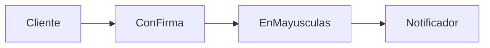
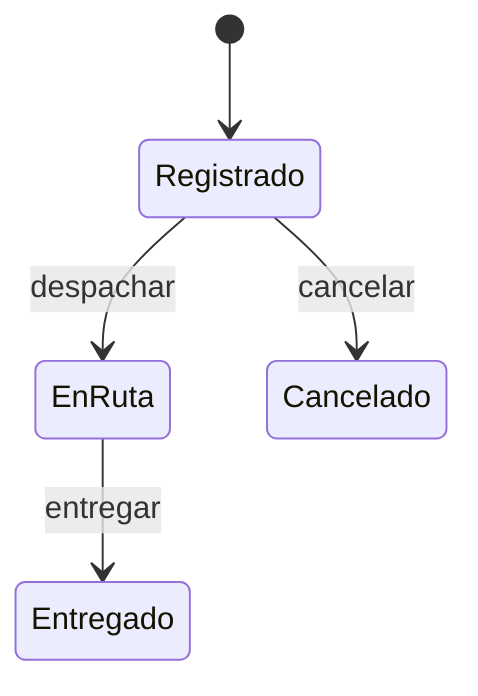
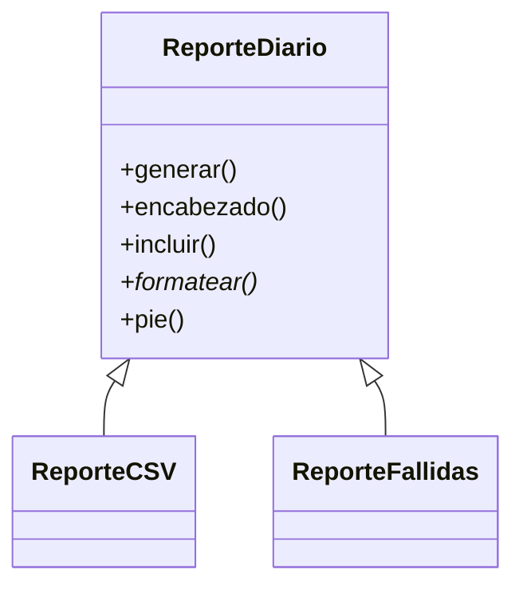
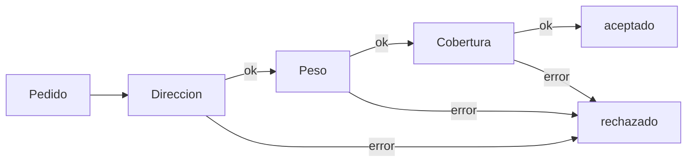
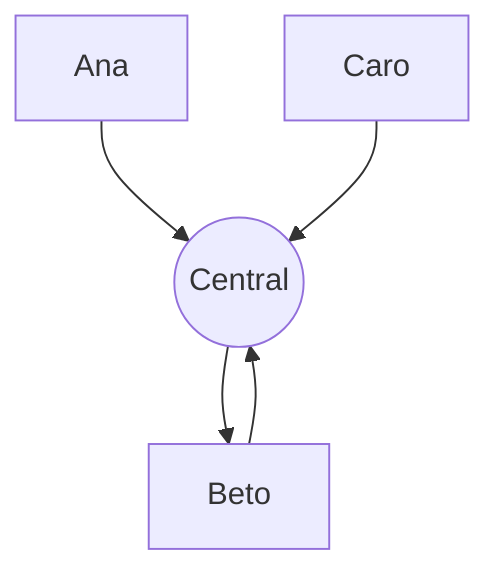
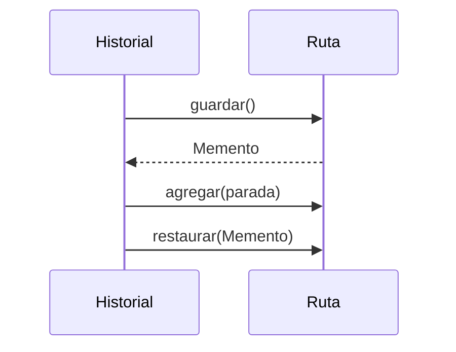
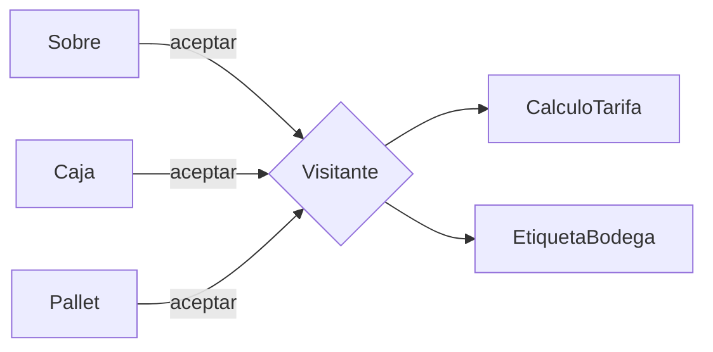
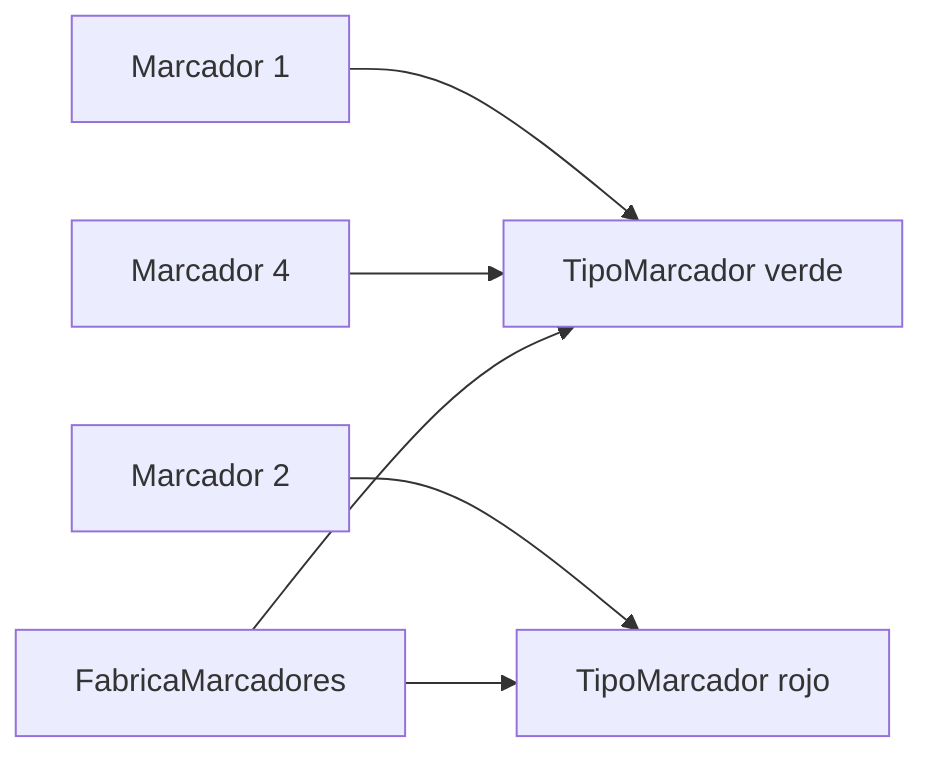

# Módulo 13: Catálogo de patrones de diseño

## Antes de empezar: cómo usar este catálogo

Este módulo es la referencia de patrones del curso; el Módulo 7 (Tema 3) solo practica Repository y Adapter y remite aquí. Un patrón nombra una solución recurrente **con sus consecuencias**. No empieces eligiendo patrón: identifica el problema, las fuerzas que tiran en direcciones distintas y la alternativa más simple. Un patrón innecesario añade archivos, saltos y conceptos. **Analogía con límite:** un patrón es un plano reutilizable; usar el plano de un aeropuerto para una casa demuestra que conoces el plano, no que tengas buen juicio.

**Prerrequisitos:** clases, métodos y `self` (Módulo 1, Tema 6); herencia, composición y `abc` (Módulo 1, Tema 7). La idea de Strategy, pasar un objeto o una función intercambiable, ya la usaste con los avisos del Módulo 1, Tema 7; aquí aparece como alternativa simple en los apartados «Cuándo no usarlo».

## Aprende construyendo


### Tema 1: Decorator: agregar comportamiento sin heredar · Avanzado · 45 min

<details open>
<summary><strong>Capa 1 — Lectura</strong></summary>

#### ► DE QUÉ TRATA
Al finalizar podrás envolver un objeto con decoradores apilables, distinguir el patrón Decorator del decorador @ de Python y decidir cuándo preferirlo a la herencia. Prerrequisitos: Módulo 7, Tema 3 (diseño modular y principios).

#### ► LA IDEA EN UNA FRASE
**Al finalizar podrás envolver un objeto con decoradores apilables, distinguir el patrón Decorator del decorador @ de Python y decidir cuándo preferirlo a la herencia.**

#### ► POR QUÉ EXISTE ESTO
Resuelve un problema real de diseño o implementación y evita decisiones a ciegas.

#### ► LA ANALOGÍA
Piensa en decorator: agregar comportamiento sin heredar como una herramienta de taller: útil cuando conoces su propósito y sus límites.
**Dónde se rompe la analogía:** en software, los efectos dependen del contexto, la escala y los trade-offs.

#### ► CÓMO FUNCIONA


#### ► LO QUE PUEDE SALIR MAL
| Síntoma | Causa probable | Arreglo |
|---|---|---|
| Decorator: agregar comportamiento sin heredar se aplica pero el resultado no mejora | Se usó sin medir el problema real | Mide antes y compara contra la alternativa simple |
| Aparece complejidad inesperada | Se adoptó la técnica sin comprender sus trade-offs | Vuelve a la sección de trade-offs y reduce el alcance |
| Falla en un caso límite | Se asumió un contexto que no se cumple | Prueba el caso límite y documenta cuándo NO usarlo |

#### ► TRADE-OFFS
| Opción | Cuándo usarla | Cuándo NO usarla |
|---|---|---|
| Usar Decorator: agregar comportamiento sin heredar | Cuando el problema coincide con su propósito y el beneficio es observable | Cuando agrega complejidad sin resolver un problema real |
| Alternativa más simple | Cuando el contexto es pequeño, estable o fácil de razonar | Cuando ya demostró no escalar o no cumplir el requisito |
| Postergar la decisión | Cuando falta evidencia del problema | Cuando el costo de esperar es mayor que el costo de probar |

#### ► CUÁNDO NO USAR ESTO
No uses decorator: agregar comportamiento sin heredar por defecto. Aplícalo cuando el problema lo justifique y puedas verificar el beneficio; si una alternativa más simple resuelve igual, prefiérela.

#### ► DE VUELTA A LA ANALOGÍA
Volviendo a la analogía: decorator: agregar comportamiento sin heredar funciona como el modelo inicial, pero recuerda dónde se rompe: en producción importan la evidencia, la escala y el costo de equivocarte.

#### ► LO QUE DEBES RECORDAR
- Decorator: agregar comportamiento sin heredar existe para resolver un problema específico.
- Mide antes de adoptar complejidad.
- Conoce el caso donde NO usarlo.
- Verifica con evidencia observable.

#### ► PREGUNTAS PARA PENSAR
1. ¿Qué problema concreto resuelve decorator: agregar comportamiento sin heredar en tu contexto?
2. ¿Cómo sabrías que decorator: agregar comportamiento sin heredar no está funcionando bien?
3. ¿Qué alternativa más simple considerarías antes de usar decorator: agregar comportamiento sin heredar?

</details>

<details>
<summary><strong>Capa 2 — Construcción</strong></summary>

#### Código y verificación


```bash
mkdir patrones && cd patrones
```

```python
import time
from functools import wraps

class Notificador:                         # componente base
    def enviar(self, guia, mensaje):
        return f"[{guia}] {mensaje}"

class ConFirma:                            # decorador: misma interfaz, envuelve otro notificador
    def __init__(self, envuelto):
        self.envuelto = envuelto
    def enviar(self, guia, mensaje):
        return self.envuelto.enviar(guia, mensaje) + " -- RutaFlow"

class EnMayusculas:
    def __init__(self, envuelto):
        self.envuelto = envuelto
    def enviar(self, guia, mensaje):
        return self.envuelto.enviar(guia, mensaje.upper())

def cronometrado(funcion):                 # decorador de función de Python (@)
    @wraps(funcion)
    def envoltura(*args):
        inicio = time.perf_counter()
        resultado = funcion(*args)
        print(f"  {funcion.__name__} tardó {(time.perf_counter() - inicio) * 1000:.0f} ms")
        return resultado
    return envoltura

@cronometrado
def calcular_tarifa(kilos):
    time.sleep(0.05)
    return 4000 + kilos * 1200

simple = Notificador()
completo = ConFirma(EnMayusculas(Notificador()))
print(simple.enviar("G-101", "Tu paquete salió"))
print(completo.enviar("G-101", "Tu paquete salió"))
print("Tarifa:", calcular_tarifa(3))
```

```bash
python3 decorator.py
```

```text
[G-101] Tu paquete salió
[G-101] TU PAQUETE SALIÓ -- RutaFlow
  calcular_tarifa tardó 55 ms
Tarifa: 7600
```

</details>

### Tema 2: State: un objeto que cambia de comportamiento según su estado · Avanzado · 45 min

<details open>
<summary><strong>Capa 1 — Lectura</strong></summary>

#### ► DE QUÉ TRATA
Al finalizar podrás reemplazar cadenas de if estado == ... por objetos estado, impedir transiciones inválidas y dibujar la máquina de estados de un envío. Prerrequisitos: Tema 1 de este módulo, que a su vez usa las clases del Módulo 1. La máquina de estados se define aquí, en el…

#### ► LA IDEA EN UNA FRASE
**Al finalizar podrás reemplazar cadenas de if estado == ...**

#### ► POR QUÉ EXISTE ESTO
Resuelve un problema real de diseño o implementación y evita decisiones a ciegas.

#### ► LA ANALOGÍA
Piensa en state: un objeto que cambia de comportamiento según su estado como una herramienta de taller: útil cuando conoces su propósito y sus límites.
**Dónde se rompe la analogía:** en software, los efectos dependen del contexto, la escala y los trade-offs.

#### ► CÓMO FUNCIONA


#### ► LO QUE PUEDE SALIR MAL
| Síntoma | Causa probable | Arreglo |
|---|---|---|
| State: un objeto que cambia de comportamiento según su estado se aplica pero el resultado no mejora | Se usó sin medir el problema real | Mide antes y compara contra la alternativa simple |
| Aparece complejidad inesperada | Se adoptó la técnica sin comprender sus trade-offs | Vuelve a la sección de trade-offs y reduce el alcance |
| Falla en un caso límite | Se asumió un contexto que no se cumple | Prueba el caso límite y documenta cuándo NO usarlo |

#### ► TRADE-OFFS
| Opción | Cuándo usarla | Cuándo NO usarla |
|---|---|---|
| Usar State: un objeto que cambia de comportamiento según su estado | Cuando el problema coincide con su propósito y el beneficio es observable | Cuando agrega complejidad sin resolver un problema real |
| Alternativa más simple | Cuando el contexto es pequeño, estable o fácil de razonar | Cuando ya demostró no escalar o no cumplir el requisito |
| Postergar la decisión | Cuando falta evidencia del problema | Cuando el costo de esperar es mayor que el costo de probar |

#### ► CUÁNDO NO USAR ESTO
No uses state: un objeto que cambia de comportamiento según su estado por defecto. Aplícalo cuando el problema lo justifique y puedas verificar el beneficio; si una alternativa más simple resuelve igual, prefiérela.

#### ► DE VUELTA A LA ANALOGÍA
Volviendo a la analogía: state: un objeto que cambia de comportamiento según su estado funciona como el modelo inicial, pero recuerda dónde se rompe: en producción importan la evidencia, la escala y el costo de equivocarte.

#### ► LO QUE DEBES RECORDAR
- State: un objeto que cambia de comportamiento según su estado existe para resolver un problema específico.
- Mide antes de adoptar complejidad.
- Conoce el caso donde NO usarlo.
- Verifica con evidencia observable.

#### ► PREGUNTAS PARA PENSAR
1. ¿Qué problema concreto resuelve state: un objeto que cambia de comportamiento según su estado en tu contexto?
2. ¿Cómo sabrías que state: un objeto que cambia de comportamiento según su estado no está funcionando bien?
3. ¿Qué alternativa más simple considerarías antes de usar state: un objeto que cambia de comportamiento según su estado?

</details>

<details>
<summary><strong>Capa 2 — Construcción</strong></summary>

#### Código y verificación


```bash
mkdir patrones && cd patrones
```

```python
class Estado:
    nombre = "?"
    def despachar(self, envio): raise ValueError(f"No se puede despachar en estado {self.nombre}")
    def entregar(self, envio):  raise ValueError(f"No se puede entregar en estado {self.nombre}")
    def cancelar(self, envio):  raise ValueError(f"No se puede cancelar en estado {self.nombre}")

class Registrado(Estado):
    nombre = "registrado"
    def despachar(self, envio): envio.estado = EnRuta()
    def cancelar(self, envio):  envio.estado = Cancelado()

class EnRuta(Estado):
    nombre = "en ruta"
    def entregar(self, envio):  envio.estado = Entregado()

class Entregado(Estado):
    nombre = "entregado"

class Cancelado(Estado):
    nombre = "cancelado"

class Envio:
    def __init__(self, guia):
        self.guia, self.estado = guia, Registrado()
    def ejecutar(self, accion):
        getattr(self.estado, accion)(self)    # delega en el objeto estado actual
        print(f"{self.guia}: {accion:<9} -> {self.estado.nombre}")

envio = Envio("G-202")
envio.ejecutar("despachar")
envio.ejecutar("entregar")
try:
    envio.ejecutar("cancelar")
except ValueError as error:
    print("Rechazado:", error)
```

```bash
python3 state.py
```

```text
G-202: despachar -> en ruta
G-202: entregar  -> entregado
Rechazado: No se puede cancelar en estado entregado
```

</details>

### Tema 3: Template Method: un algoritmo fijo con pasos variables · Avanzado · 45 min

<details open>
<summary><strong>Capa 1 — Lectura</strong></summary>

#### ► DE QUÉ TRATA
Al finalizar podrás definir el esqueleto de un algoritmo en una clase base, dejar pasos obligatorios abstractos y pasos opcionales con valor por defecto (ganchos). Prerrequisito: herencia y clases abstractas con abc (Módulo 1, Tema 7).

#### ► LA IDEA EN UNA FRASE
**Al finalizar podrás definir el esqueleto de un algoritmo en una clase base, dejar pasos obligatorios abstractos y pasos opcionales con valor por defecto (ganchos).**

#### ► POR QUÉ EXISTE ESTO
Resuelve un problema real de diseño o implementación y evita decisiones a ciegas.

#### ► LA ANALOGÍA
Piensa en template method: un algoritmo fijo con pasos variables como una herramienta de taller: útil cuando conoces su propósito y sus límites.
**Dónde se rompe la analogía:** en software, los efectos dependen del contexto, la escala y los trade-offs.

#### ► CÓMO FUNCIONA


#### ► LO QUE PUEDE SALIR MAL
| Síntoma | Causa probable | Arreglo |
|---|---|---|
| Template Method: un algoritmo fijo con pasos variables se aplica pero el resultado no mejora | Se usó sin medir el problema real | Mide antes y compara contra la alternativa simple |
| Aparece complejidad inesperada | Se adoptó la técnica sin comprender sus trade-offs | Vuelve a la sección de trade-offs y reduce el alcance |
| Falla en un caso límite | Se asumió un contexto que no se cumple | Prueba el caso límite y documenta cuándo NO usarlo |

#### ► TRADE-OFFS
| Opción | Cuándo usarla | Cuándo NO usarla |
|---|---|---|
| Usar Template Method: un algoritmo fijo con pasos variables | Cuando el problema coincide con su propósito y el beneficio es observable | Cuando agrega complejidad sin resolver un problema real |
| Alternativa más simple | Cuando el contexto es pequeño, estable o fácil de razonar | Cuando ya demostró no escalar o no cumplir el requisito |
| Postergar la decisión | Cuando falta evidencia del problema | Cuando el costo de esperar es mayor que el costo de probar |

#### ► CUÁNDO NO USAR ESTO
No uses template method: un algoritmo fijo con pasos variables por defecto. Aplícalo cuando el problema lo justifique y puedas verificar el beneficio; si una alternativa más simple resuelve igual, prefiérela.

#### ► DE VUELTA A LA ANALOGÍA
Volviendo a la analogía: template method: un algoritmo fijo con pasos variables funciona como el modelo inicial, pero recuerda dónde se rompe: en producción importan la evidencia, la escala y el costo de equivocarte.

#### ► LO QUE DEBES RECORDAR
- Template Method: un algoritmo fijo con pasos variables existe para resolver un problema específico.
- Mide antes de adoptar complejidad.
- Conoce el caso donde NO usarlo.
- Verifica con evidencia observable.

#### ► PREGUNTAS PARA PENSAR
1. ¿Qué problema concreto resuelve template method: un algoritmo fijo con pasos variables en tu contexto?
2. ¿Cómo sabrías que template method: un algoritmo fijo con pasos variables no está funcionando bien?
3. ¿Qué alternativa más simple considerarías antes de usar template method: un algoritmo fijo con pasos variables?

</details>

<details>
<summary><strong>Capa 2 — Construcción</strong></summary>

#### Código y verificación


```bash
mkdir patrones && cd patrones
```

```python
from abc import ABC, abstractmethod

class ReporteDiario(ABC):
    def generar(self, entregas):             # método plantilla: fija el orden de los pasos
        datos = [e for e in entregas if self.incluir(e)]
        cuerpo = self.formatear(datos)
        return self.encabezado() + cuerpo + self.pie(len(datos))

    def encabezado(self):                    # paso con implementación por defecto (gancho)
        return "Reporte RutaFlow\n"
    def incluir(self, entrega):
        return True
    @abstractmethod
    def formatear(self, datos): ...         # paso obligatorio para cada subclase
    def pie(self, total):
        return f"Total: {total}\n"

class ReporteCSV(ReporteDiario):
    def formatear(self, datos):
        return "guia,estado\n" + "".join(f"{g},{e}\n" for g, e in datos)

class ReporteFallidas(ReporteDiario):
    def encabezado(self):
        return "Entregas fallidas\n"
    def incluir(self, entrega):
        return entrega[1] == "fallida"
    def formatear(self, datos):
        return "".join(f"- {g}\n" for g, _ in datos)

entregas = [("G-1", "entregada"), ("G-2", "fallida"), ("G-3", "entregada"), ("G-4", "fallida")]
print(ReporteCSV().generar(entregas))
print(ReporteFallidas().generar(entregas))
```

```bash
python3 template_method.py
```

```text
Reporte RutaFlow
guia,estado
G-1,entregada
G-2,fallida
G-3,entregada
G-4,fallida
Total: 4

Entregas fallidas
- G-2
- G-4
Total: 2
```

</details>

### Tema 4: Chain of Responsibility: una cadena de validadores · Avanzado · 45 min

<details open>
<summary><strong>Capa 1 — Lectura</strong></summary>

#### ► DE QUÉ TRATA
Al finalizar podrás encadenar manejadores independientes, cortar la cadena en el primer error y razonar sobre el orden de la cadena. Prerrequisito: Tema 1 de este módulo.

#### ► LA IDEA EN UNA FRASE
**Al finalizar podrás encadenar manejadores independientes, cortar la cadena en el primer error y razonar sobre el orden de la cadena.**

#### ► POR QUÉ EXISTE ESTO
Resuelve un problema real de diseño o implementación y evita decisiones a ciegas.

#### ► LA ANALOGÍA
Piensa en chain of responsibility: una cadena de validadores como una herramienta de taller: útil cuando conoces su propósito y sus límites.
**Dónde se rompe la analogía:** en software, los efectos dependen del contexto, la escala y los trade-offs.

#### ► CÓMO FUNCIONA


#### ► LO QUE PUEDE SALIR MAL
| Síntoma | Causa probable | Arreglo |
|---|---|---|
| Chain of Responsibility: una cadena de validadores se aplica pero el resultado no mejora | Se usó sin medir el problema real | Mide antes y compara contra la alternativa simple |
| Aparece complejidad inesperada | Se adoptó la técnica sin comprender sus trade-offs | Vuelve a la sección de trade-offs y reduce el alcance |
| Falla en un caso límite | Se asumió un contexto que no se cumple | Prueba el caso límite y documenta cuándo NO usarlo |

#### ► TRADE-OFFS
| Opción | Cuándo usarla | Cuándo NO usarla |
|---|---|---|
| Usar Chain of Responsibility: una cadena de validadores | Cuando el problema coincide con su propósito y el beneficio es observable | Cuando agrega complejidad sin resolver un problema real |
| Alternativa más simple | Cuando el contexto es pequeño, estable o fácil de razonar | Cuando ya demostró no escalar o no cumplir el requisito |
| Postergar la decisión | Cuando falta evidencia del problema | Cuando el costo de esperar es mayor que el costo de probar |

#### ► CUÁNDO NO USAR ESTO
No uses chain of responsibility: una cadena de validadores por defecto. Aplícalo cuando el problema lo justifique y puedas verificar el beneficio; si una alternativa más simple resuelve igual, prefiérela.

#### ► DE VUELTA A LA ANALOGÍA
Volviendo a la analogía: chain of responsibility: una cadena de validadores funciona como el modelo inicial, pero recuerda dónde se rompe: en producción importan la evidencia, la escala y el costo de equivocarte.

#### ► LO QUE DEBES RECORDAR
- Chain of Responsibility: una cadena de validadores existe para resolver un problema específico.
- Mide antes de adoptar complejidad.
- Conoce el caso donde NO usarlo.
- Verifica con evidencia observable.

#### ► PREGUNTAS PARA PENSAR
1. ¿Qué problema concreto resuelve chain of responsibility: una cadena de validadores en tu contexto?
2. ¿Cómo sabrías que chain of responsibility: una cadena de validadores no está funcionando bien?
3. ¿Qué alternativa más simple considerarías antes de usar chain of responsibility: una cadena de validadores?

</details>

<details>
<summary><strong>Capa 2 — Construcción</strong></summary>

#### Código y verificación


```bash
mkdir patrones && cd patrones
```

```python
class Validador:
    def __init__(self, siguiente=None):
        self.siguiente = siguiente
    def manejar(self, pedido):
        error = self.revisar(pedido)
        if error:
            return f"rechazado por {type(self).__name__}: {error}"
        return self.siguiente.manejar(pedido) if self.siguiente else "aceptado"
    def revisar(self, pedido):
        return None

class Direccion(Validador):
    def revisar(self, pedido):
        return None if pedido.get("direccion") else "falta la dirección"

class Peso(Validador):
    def revisar(self, pedido):
        return None if 0 < pedido["kilos"] <= 30 else f"{pedido['kilos']} kg fuera de rango"

class Cobertura(Validador):
    CIUDADES = {"Bogotá", "Medellín", "Cali"}
    def revisar(self, pedido):
        return None if pedido["ciudad"] in self.CIUDADES else f"sin cobertura en {pedido['ciudad']}"

cadena = Direccion(Peso(Cobertura()))       # el orden de la cadena es una decisión de diseño
pedidos = [
    {"direccion": "Cra 7 # 10-20", "kilos": 4, "ciudad": "Cali"},
    {"direccion": "", "kilos": 4, "ciudad": "Cali"},
    {"direccion": "Cl 80 # 5-12", "kilos": 45, "ciudad": "Bogotá"},
    {"direccion": "Av 30 # 2-1", "kilos": 2, "ciudad": "Leticia"},
]
for pedido in pedidos:
    print(cadena.manejar(pedido))
```

```bash
python3 chain.py
```

```text
aceptado
rechazado por Direccion: falta la dirección
rechazado por Peso: 45 kg fuera de rango
rechazado por Cobertura: sin cobertura en Leticia
```

</details>

### Tema 5: Mediator: coordinar objetos sin que se conozcan · Avanzado · 45 min

<details open>
<summary><strong>Capa 1 — Lectura</strong></summary>

#### ► DE QUÉ TRATA
Al finalizar podrás centralizar la coordinación entre objetos en un mediador, reducir dependencias cruzadas y reconocer cuándo el mediador se vuelve demasiado grande. Prerrequisito: Tema 4 de este módulo.

#### ► LA IDEA EN UNA FRASE
**Al finalizar podrás centralizar la coordinación entre objetos en un mediador, reducir dependencias cruzadas y reconocer cuándo el mediador se vuelve demasiado grande.**

#### ► POR QUÉ EXISTE ESTO
Resuelve un problema real de diseño o implementación y evita decisiones a ciegas.

#### ► LA ANALOGÍA
Piensa en mediator: coordinar objetos sin que se conozcan como una herramienta de taller: útil cuando conoces su propósito y sus límites.
**Dónde se rompe la analogía:** en software, los efectos dependen del contexto, la escala y los trade-offs.

#### ► CÓMO FUNCIONA


#### ► LO QUE PUEDE SALIR MAL
| Síntoma | Causa probable | Arreglo |
|---|---|---|
| Mediator: coordinar objetos sin que se conozcan se aplica pero el resultado no mejora | Se usó sin medir el problema real | Mide antes y compara contra la alternativa simple |
| Aparece complejidad inesperada | Se adoptó la técnica sin comprender sus trade-offs | Vuelve a la sección de trade-offs y reduce el alcance |
| Falla en un caso límite | Se asumió un contexto que no se cumple | Prueba el caso límite y documenta cuándo NO usarlo |

#### ► TRADE-OFFS
| Opción | Cuándo usarla | Cuándo NO usarla |
|---|---|---|
| Usar Mediator: coordinar objetos sin que se conozcan | Cuando el problema coincide con su propósito y el beneficio es observable | Cuando agrega complejidad sin resolver un problema real |
| Alternativa más simple | Cuando el contexto es pequeño, estable o fácil de razonar | Cuando ya demostró no escalar o no cumplir el requisito |
| Postergar la decisión | Cuando falta evidencia del problema | Cuando el costo de esperar es mayor que el costo de probar |

#### ► CUÁNDO NO USAR ESTO
No uses mediator: coordinar objetos sin que se conozcan por defecto. Aplícalo cuando el problema lo justifique y puedas verificar el beneficio; si una alternativa más simple resuelve igual, prefiérela.

#### ► DE VUELTA A LA ANALOGÍA
Volviendo a la analogía: mediator: coordinar objetos sin que se conozcan funciona como el modelo inicial, pero recuerda dónde se rompe: en producción importan la evidencia, la escala y el costo de equivocarte.

#### ► LO QUE DEBES RECORDAR
- Mediator: coordinar objetos sin que se conozcan existe para resolver un problema específico.
- Mide antes de adoptar complejidad.
- Conoce el caso donde NO usarlo.
- Verifica con evidencia observable.

#### ► PREGUNTAS PARA PENSAR
1. ¿Qué problema concreto resuelve mediator: coordinar objetos sin que se conozcan en tu contexto?
2. ¿Cómo sabrías que mediator: coordinar objetos sin que se conozcan no está funcionando bien?
3. ¿Qué alternativa más simple considerarías antes de usar mediator: coordinar objetos sin que se conozcan?

</details>

<details>
<summary><strong>Capa 2 — Construcción</strong></summary>

#### Código y verificación


```bash
mkdir patrones && cd patrones
```

```python
class Central:                                # mediador: único punto que conoce a todos
    def __init__(self):
        self.mensajeros, self.registro = {}, []
    def registrar(self, mensajero):
        self.mensajeros[mensajero.nombre] = mensajero
        mensajero.central = self
    def notificar(self, emisor, evento, dato):
        self.registro.append((emisor.nombre, evento, dato))
        if evento == "averia":
            libres = [m for m in self.mensajeros.values() if m is not emisor and m.libre]
            if libres:
                libres[0].asignar(dato)
            else:
                print(f"  Central: nadie libre para {dato}, queda en espera")

class Mensajero:
    def __init__(self, nombre, libre=True):
        self.nombre, self.libre, self.central = nombre, libre, None
    def reportar_averia(self, guia):
        print(f"{self.nombre} reporta avería con {guia}")
        self.central.notificar(self, "averia", guia)   # no conoce a los otros mensajeros
    def asignar(self, guia):
        self.libre = False
        print(f"  {self.nombre} recibe {guia}")

central = Central()
ana, beto, caro = Mensajero("Ana", libre=False), Mensajero("Beto"), Mensajero("Caro")
for m in (ana, beto, caro):
    central.registrar(m)
ana.reportar_averia("G-301")
caro.reportar_averia("G-302")
print("Eventos registrados:", len(central.registro))
```

```bash
python3 mediator.py
```

```text
Ana reporta avería con G-301
  Beto recibe G-301
Caro reporta avería con G-302
  Central: nadie libre para G-302, queda en espera
Eventos registrados: 2
```

</details>

### Tema 6: Memento: guardar y restaurar estado para deshacer · Avanzado · 45 min

<details open>
<summary><strong>Capa 1 — Lectura</strong></summary>

#### ► DE QUÉ TRATA
Al finalizar podrás implementar deshacer con instantáneas inmutables, separar a quien guarda el estado de quien lo produce y explicar por qué una copia superficial rompe el historial. Prerrequisito: Módulo 2, Tema 2 (pilas).

#### ► LA IDEA EN UNA FRASE
**Al finalizar podrás implementar deshacer con instantáneas inmutables, separar a quien guarda el estado de quien lo produce y explicar por qué una copia superficial rompe el historial.**

#### ► POR QUÉ EXISTE ESTO
Resuelve un problema real de diseño o implementación y evita decisiones a ciegas.

#### ► LA ANALOGÍA
Piensa en memento: guardar y restaurar estado para deshacer como una herramienta de taller: útil cuando conoces su propósito y sus límites.
**Dónde se rompe la analogía:** en software, los efectos dependen del contexto, la escala y los trade-offs.

#### ► CÓMO FUNCIONA


#### ► LO QUE PUEDE SALIR MAL
| Síntoma | Causa probable | Arreglo |
|---|---|---|
| Memento: guardar y restaurar estado para deshacer se aplica pero el resultado no mejora | Se usó sin medir el problema real | Mide antes y compara contra la alternativa simple |
| Aparece complejidad inesperada | Se adoptó la técnica sin comprender sus trade-offs | Vuelve a la sección de trade-offs y reduce el alcance |
| Falla en un caso límite | Se asumió un contexto que no se cumple | Prueba el caso límite y documenta cuándo NO usarlo |

#### ► TRADE-OFFS
| Opción | Cuándo usarla | Cuándo NO usarla |
|---|---|---|
| Usar Memento: guardar y restaurar estado para deshacer | Cuando el problema coincide con su propósito y el beneficio es observable | Cuando agrega complejidad sin resolver un problema real |
| Alternativa más simple | Cuando el contexto es pequeño, estable o fácil de razonar | Cuando ya demostró no escalar o no cumplir el requisito |
| Postergar la decisión | Cuando falta evidencia del problema | Cuando el costo de esperar es mayor que el costo de probar |

#### ► CUÁNDO NO USAR ESTO
No uses memento: guardar y restaurar estado para deshacer por defecto. Aplícalo cuando el problema lo justifique y puedas verificar el beneficio; si una alternativa más simple resuelve igual, prefiérela.

#### ► DE VUELTA A LA ANALOGÍA
Volviendo a la analogía: memento: guardar y restaurar estado para deshacer funciona como el modelo inicial, pero recuerda dónde se rompe: en producción importan la evidencia, la escala y el costo de equivocarte.

#### ► LO QUE DEBES RECORDAR
- Memento: guardar y restaurar estado para deshacer existe para resolver un problema específico.
- Mide antes de adoptar complejidad.
- Conoce el caso donde NO usarlo.
- Verifica con evidencia observable.

#### ► PREGUNTAS PARA PENSAR
1. ¿Qué problema concreto resuelve memento: guardar y restaurar estado para deshacer en tu contexto?
2. ¿Cómo sabrías que memento: guardar y restaurar estado para deshacer no está funcionando bien?
3. ¿Qué alternativa más simple considerarías antes de usar memento: guardar y restaurar estado para deshacer?

</details>

<details>
<summary><strong>Capa 2 — Construcción</strong></summary>

#### Código y verificación


```bash
mkdir patrones && cd patrones
```

```python
from dataclasses import dataclass

@dataclass(frozen=True)
class Memento:                               # instantánea inmutable y opaca para el historial
    paradas: tuple

class Ruta:
    def __init__(self):
        self._paradas = []
    def agregar(self, parada):
        self._paradas.append(parada)
    def guardar(self):
        return Memento(tuple(self._paradas))
    def restaurar(self, memento):
        self._paradas = list(memento.paradas)
    def __str__(self):
        return " -> ".join(self._paradas) or "(vacía)"

class Historial:                             # cuidador: guarda mementos sin mirar su interior
    def __init__(self, ruta):
        self.ruta, self.pila = ruta, []
    def cambiar(self, parada):
        self.pila.append(self.ruta.guardar())
        self.ruta.agregar(parada)
    def deshacer(self):
        if self.pila:
            self.ruta.restaurar(self.pila.pop())

ruta = Ruta()
historial = Historial(ruta)
for parada in ["Depósito", "Chapinero", "Suba"]:
    historial.cambiar(parada)
print("Actual:  ", ruta)
historial.deshacer()
print("Deshacer:", ruta)
historial.deshacer()
print("Deshacer:", ruta)
```

```bash
python3 memento.py
```

```text
Actual:   Depósito -> Chapinero -> Suba
Deshacer: Depósito -> Chapinero
Deshacer: Depósito
```

</details>

### Tema 7: Visitor: operaciones nuevas sin tocar las clases · Avanzado · 45 min

<details open>
<summary><strong>Capa 1 — Lectura</strong></summary>

#### ► DE QUÉ TRATA
Al finalizar podrás separar operaciones (tarifa, etiqueta) de una jerarquía estable de clases usando doble despacho, y reconocer su costo cuando la jerarquía cambia. Prerrequisitos: Temas 1 y 3 de este módulo.

#### ► LA IDEA EN UNA FRASE
**Al finalizar podrás separar operaciones (tarifa, etiqueta) de una jerarquía estable de clases usando doble despacho, y reconocer su costo cuando la jerarquía cambia.**

#### ► POR QUÉ EXISTE ESTO
Resuelve un problema real de diseño o implementación y evita decisiones a ciegas.

#### ► LA ANALOGÍA
Piensa en visitor: operaciones nuevas sin tocar las clases como una herramienta de taller: útil cuando conoces su propósito y sus límites.
**Dónde se rompe la analogía:** en software, los efectos dependen del contexto, la escala y los trade-offs.

#### ► CÓMO FUNCIONA


#### ► LO QUE PUEDE SALIR MAL
| Síntoma | Causa probable | Arreglo |
|---|---|---|
| Visitor: operaciones nuevas sin tocar las clases se aplica pero el resultado no mejora | Se usó sin medir el problema real | Mide antes y compara contra la alternativa simple |
| Aparece complejidad inesperada | Se adoptó la técnica sin comprender sus trade-offs | Vuelve a la sección de trade-offs y reduce el alcance |
| Falla en un caso límite | Se asumió un contexto que no se cumple | Prueba el caso límite y documenta cuándo NO usarlo |

#### ► TRADE-OFFS
| Opción | Cuándo usarla | Cuándo NO usarla |
|---|---|---|
| Usar Visitor: operaciones nuevas sin tocar las clases | Cuando el problema coincide con su propósito y el beneficio es observable | Cuando agrega complejidad sin resolver un problema real |
| Alternativa más simple | Cuando el contexto es pequeño, estable o fácil de razonar | Cuando ya demostró no escalar o no cumplir el requisito |
| Postergar la decisión | Cuando falta evidencia del problema | Cuando el costo de esperar es mayor que el costo de probar |

#### ► CUÁNDO NO USAR ESTO
No uses visitor: operaciones nuevas sin tocar las clases por defecto. Aplícalo cuando el problema lo justifique y puedas verificar el beneficio; si una alternativa más simple resuelve igual, prefiérela.

#### ► DE VUELTA A LA ANALOGÍA
Volviendo a la analogía: visitor: operaciones nuevas sin tocar las clases funciona como el modelo inicial, pero recuerda dónde se rompe: en producción importan la evidencia, la escala y el costo de equivocarte.

#### ► LO QUE DEBES RECORDAR
- Visitor: operaciones nuevas sin tocar las clases existe para resolver un problema específico.
- Mide antes de adoptar complejidad.
- Conoce el caso donde NO usarlo.
- Verifica con evidencia observable.

#### ► PREGUNTAS PARA PENSAR
1. ¿Qué problema concreto resuelve visitor: operaciones nuevas sin tocar las clases en tu contexto?
2. ¿Cómo sabrías que visitor: operaciones nuevas sin tocar las clases no está funcionando bien?
3. ¿Qué alternativa más simple considerarías antes de usar visitor: operaciones nuevas sin tocar las clases?

</details>

<details>
<summary><strong>Capa 2 — Construcción</strong></summary>

#### Código y verificación


```bash
mkdir patrones && cd patrones
```

```python
class Sobre:
    def __init__(self, gramos): self.gramos = gramos
    def aceptar(self, visitante): return visitante.visitar_sobre(self)

class Caja:
    def __init__(self, kilos, fragil): self.kilos, self.fragil = kilos, fragil
    def aceptar(self, visitante): return visitante.visitar_caja(self)

class Pallet:
    def __init__(self, cajas): self.cajas = cajas
    def aceptar(self, visitante): return visitante.visitar_pallet(self)

class CalculoTarifa:                         # una operación nueva = un visitante nuevo
    def visitar_sobre(self, s):  return 3000
    def visitar_caja(self, c):   return 5000 + c.kilos * 1500 + (4000 if c.fragil else 0)
    def visitar_pallet(self, p): return 50000 + sum(c.aceptar(self) for c in p.cajas)

class EtiquetaBodega:
    def visitar_sobre(self, s):  return f"SOBRE {s.gramos} g"
    def visitar_caja(self, c):   return f"CAJA {c.kilos} kg" + (" FRÁGIL" if c.fragil else "")
    def visitar_pallet(self, p): return f"PALLET con {len(p.cajas)} cajas"

carga = [Sobre(120), Caja(4, fragil=True), Pallet([Caja(10, False), Caja(12, True)])]
for paquete in carga:
    print(f"{paquete.aceptar(EtiquetaBodega()):<22} tarifa ${paquete.aceptar(CalculoTarifa()):,}")
```

```bash
python3 visitor.py
```

```text
SOBRE 120 g            tarifa $3,000
CAJA 4 kg FRÁGIL       tarifa $15,000
PALLET con 2 cajas     tarifa $97,000
```

</details>

### Tema 8: Flyweight: compartir estado para ahorrar memoria · Avanzado · 45 min

<details open>
<summary><strong>Capa 1 — Lectura</strong></summary>

#### ► DE QUÉ TRATA
Al finalizar podrás separar estado intrínseco (compartido) de extrínseco (propio), compartir objetos con una fábrica y medir el ahorro de memoria. Prerrequisito: Módulo 2, Tema 6 (tablas hash).

#### ► LA IDEA EN UNA FRASE
**Al finalizar podrás separar estado intrínseco (compartido) de extrínseco (propio), compartir objetos con una fábrica y medir el ahorro de memoria.**

#### ► POR QUÉ EXISTE ESTO
Resuelve un problema real de diseño o implementación y evita decisiones a ciegas.

#### ► LA ANALOGÍA
Piensa en flyweight: compartir estado para ahorrar memoria como una herramienta de taller: útil cuando conoces su propósito y sus límites.
**Dónde se rompe la analogía:** en software, los efectos dependen del contexto, la escala y los trade-offs.

#### ► CÓMO FUNCIONA


#### ► LO QUE PUEDE SALIR MAL
| Síntoma | Causa probable | Arreglo |
|---|---|---|
| Flyweight: compartir estado para ahorrar memoria se aplica pero el resultado no mejora | Se usó sin medir el problema real | Mide antes y compara contra la alternativa simple |
| Aparece complejidad inesperada | Se adoptó la técnica sin comprender sus trade-offs | Vuelve a la sección de trade-offs y reduce el alcance |
| Falla en un caso límite | Se asumió un contexto que no se cumple | Prueba el caso límite y documenta cuándo NO usarlo |

#### ► TRADE-OFFS
| Opción | Cuándo usarla | Cuándo NO usarla |
|---|---|---|
| Usar Flyweight: compartir estado para ahorrar memoria | Cuando el problema coincide con su propósito y el beneficio es observable | Cuando agrega complejidad sin resolver un problema real |
| Alternativa más simple | Cuando el contexto es pequeño, estable o fácil de razonar | Cuando ya demostró no escalar o no cumplir el requisito |
| Postergar la decisión | Cuando falta evidencia del problema | Cuando el costo de esperar es mayor que el costo de probar |

#### ► CUÁNDO NO USAR ESTO
No uses flyweight: compartir estado para ahorrar memoria por defecto. Aplícalo cuando el problema lo justifique y puedas verificar el beneficio; si una alternativa más simple resuelve igual, prefiérela.

#### ► DE VUELTA A LA ANALOGÍA
Volviendo a la analogía: flyweight: compartir estado para ahorrar memoria funciona como el modelo inicial, pero recuerda dónde se rompe: en producción importan la evidencia, la escala y el costo de equivocarte.

#### ► LO QUE DEBES RECORDAR
- Flyweight: compartir estado para ahorrar memoria existe para resolver un problema específico.
- Mide antes de adoptar complejidad.
- Conoce el caso donde NO usarlo.
- Verifica con evidencia observable.

#### ► PREGUNTAS PARA PENSAR
1. ¿Qué problema concreto resuelve flyweight: compartir estado para ahorrar memoria en tu contexto?
2. ¿Cómo sabrías que flyweight: compartir estado para ahorrar memoria no está funcionando bien?
3. ¿Qué alternativa más simple considerarías antes de usar flyweight: compartir estado para ahorrar memoria?

</details>

<details>
<summary><strong>Capa 2 — Construcción</strong></summary>

#### Código y verificación


```bash
mkdir patrones && cd patrones
```

```python
import sys

class TipoMarcador:                          # estado intrínseco: compartido e inmutable
    def __init__(self, color, icono):
        self.color, self.icono = color, icono * 2000   # simula un ícono pesado en memoria

class FabricaMarcadores:
    _cache = {}
    @classmethod
    def obtener(cls, color, icono):
        clave = (color, icono)
        if clave not in cls._cache:
            cls._cache[clave] = TipoMarcador(color, icono)
        return cls._cache[clave]

class Marcador:                              # estado extrínseco: propio de cada entrega
    __slots__ = ("lat", "lon", "tipo")
    def __init__(self, lat, lon, tipo):
        self.lat, self.lon, self.tipo = lat, lon, tipo

estados = [("verde", "entregado"), ("rojo", "fallido"), ("azul", "en ruta")]
marcadores = [Marcador(4.6 + i * 1e-4, -74.08, FabricaMarcadores.obtener(*estados[i % 3]))
              for i in range(10000)]
tipos = {id(m.tipo) for m in marcadores}
peso_tipos = sum(sys.getsizeof(t.icono) for t in FabricaMarcadores._cache.values())
print("Marcadores:", len(marcadores))
print("Objetos de tipo distintos:", len(tipos))
print(f"Memoria de íconos compartidos: {peso_tipos / 1024:.0f} KB")
sin_compartir = sum(sys.getsizeof(m.tipo.icono) for m in marcadores)   # si cada uno tuviera su copia
print(f"Sin compartir serían: {sin_compartir / 1024 / 1024:.0f} MB")
```

```bash
python3 flyweight.py
```

```text
Marcadores: 10000
Objetos de tipo distintos: 3
Memoria de íconos compartidos: 45 KB
Sin compartir serían: 147 MB
```

</details>

### Proyecto 13: núcleo de envíos con patrones

<details open>
<summary><strong>Capa 1 — Lectura</strong></summary>

#### ► DE QUÉ TRATA
Este tema te guía por proyecto 13: núcleo de envíos con patrones con foco en comprensión antes de implementación.

#### ► LA IDEA EN UNA FRASE
**Entender proyecto 13: núcleo de envíos con patrones te permite tomar mejores decisiones técnicas.**

#### ► POR QUÉ EXISTE ESTO
Resuelve un problema real de diseño o implementación y evita decisiones a ciegas.

#### ► LA ANALOGÍA
Piensa en proyecto 13: núcleo de envíos con patrones como una herramienta de taller: útil cuando conoces su propósito y sus límites.
**Dónde se rompe la analogía:** en software, los efectos dependen del contexto, la escala y los trade-offs.

#### ► CÓMO FUNCIONA
1. Identifica el problema que proyecto 13: núcleo de envíos con patrones resuelve.
2. Observa sus componentes y relaciones.
3. Aplica la opción más simple que funcione.
4. Verifica el resultado y los límites.

#### ► LO QUE PUEDE SALIR MAL
| Síntoma | Causa probable | Arreglo |
|---|---|---|
| Proyecto 13: núcleo de envíos con patrones se aplica pero el resultado no mejora | Se usó sin medir el problema real | Mide antes y compara contra la alternativa simple |
| Aparece complejidad inesperada | Se adoptó la técnica sin comprender sus trade-offs | Vuelve a la sección de trade-offs y reduce el alcance |
| Falla en un caso límite | Se asumió un contexto que no se cumple | Prueba el caso límite y documenta cuándo NO usarlo |

#### ► TRADE-OFFS
| Opción | Cuándo usarla | Cuándo NO usarla |
|---|---|---|
| Usar Proyecto 13: núcleo de envíos con patrones | Cuando el problema coincide con su propósito y el beneficio es observable | Cuando agrega complejidad sin resolver un problema real |
| Alternativa más simple | Cuando el contexto es pequeño, estable o fácil de razonar | Cuando ya demostró no escalar o no cumplir el requisito |
| Postergar la decisión | Cuando falta evidencia del problema | Cuando el costo de esperar es mayor que el costo de probar |

#### ► CUÁNDO NO USAR ESTO
No uses proyecto 13: núcleo de envíos con patrones por defecto. Aplícalo cuando el problema lo justifique y puedas verificar el beneficio; si una alternativa más simple resuelve igual, prefiérela.

#### ► DE VUELTA A LA ANALOGÍA
Volviendo a la analogía: proyecto 13: núcleo de envíos con patrones funciona como el modelo inicial, pero recuerda dónde se rompe: en producción importan la evidencia, la escala y el costo de equivocarte.

#### ► LO QUE DEBES RECORDAR
- Proyecto 13: núcleo de envíos con patrones existe para resolver un problema específico.
- Mide antes de adoptar complejidad.
- Conoce el caso donde NO usarlo.
- Verifica con evidencia observable.

#### ► PREGUNTAS PARA PENSAR
1. ¿Qué problema concreto resuelve proyecto 13: núcleo de envíos con patrones en tu contexto?
2. ¿Cómo sabrías que proyecto 13: núcleo de envíos con patrones no está funcionando bien?
3. ¿Qué alternativa más simple considerarías antes de usar proyecto 13: núcleo de envíos con patrones?

</details>

<details>
<summary><strong>Capa 2 — Construcción</strong></summary>

#### Nota de construcción
Este tema es principalmente conceptual en esta versión. La verificación se realiza con las preguntas de comprensión y el criterio de cuándo NO usar proyecto 13: núcleo de envíos con patrones.

</details>
