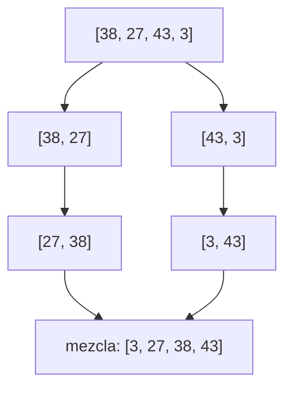
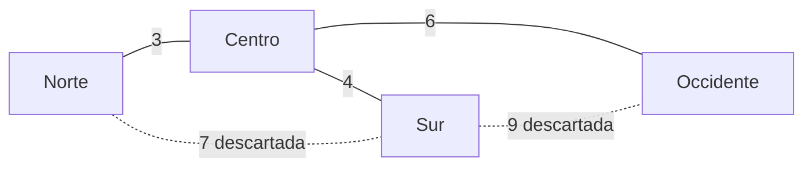
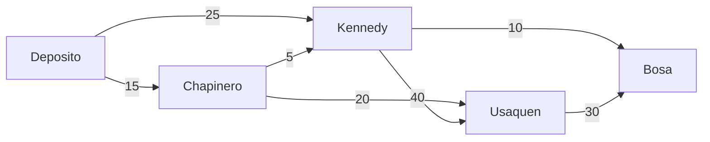
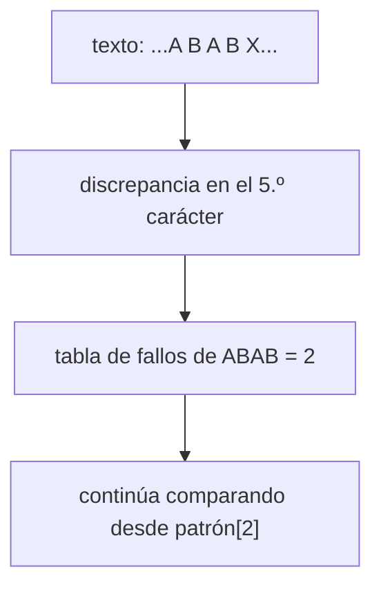
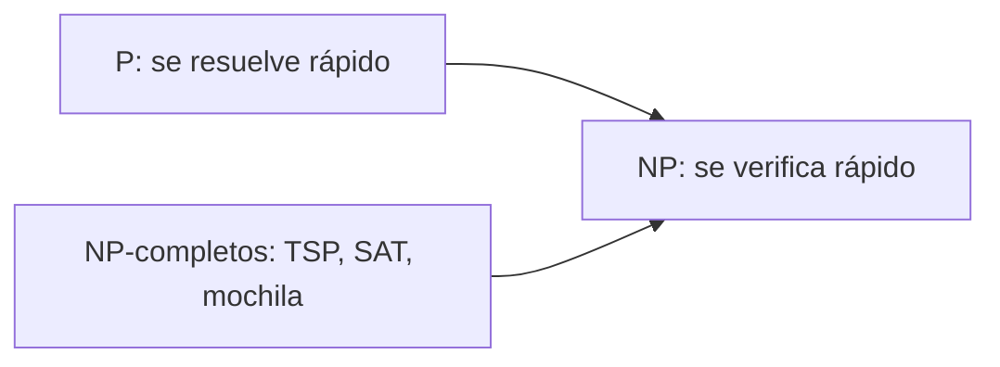

# Módulo 13: Algoritmos clásicos


## Aprende construyendo

### Tema 1: Ordenamientos: insertion, merge y quick sort

#### Paso 1 · Objetivo y preparación
Al finalizar podrás implementar tres algoritmos de ordenamiento, explicar su complejidad (O(n²) frente a O(n log n)) y decidir cuándo uno es mejor que otro. Prerrequisito: Módulo 2, Tema 4 (complejidad y recursión). Necesitas Python 3.10+.

#### Paso 2 · Contexto y caso real
En RutaFlow, antes de cargar un camión se ordenan los paquetes por peso para equilibrar la carga. Con 30 paquetes cualquier método sirve; con 30 000 la elección del algoritmo separa una respuesta instantánea de una pantalla congelada. `sorted()` de Python usa Timsort, una mezcla de merge sort e insertion sort: entender ambos explica por qué es tan rápido.

#### Paso 3 · Teoría, modelo mental y analogía
**Insertion sort** toma cada elemento y lo inserta en su lugar dentro de la parte ya ordenada: O(n²) en el peor caso, pero muy rápido con listas pequeñas o casi ordenadas. **Merge sort** divide la lista en mitades, ordena cada una y las **mezcla**: siempre O(n log n) y **estable** (respeta el orden original de los iguales), a costa de memoria extra. **Quick sort** elige un **pivote** y separa menores, iguales y mayores: O(n log n) en promedio, pero O(n²) si el pivote es siempre el peor.

**Analogía:** insertion sort es ordenar las cartas de tu mano una a una; merge sort es repartir el mazo entre dos amigos, que cada uno ordene su mitad y luego juntar las dos pilas mirando la carta de arriba de cada una; quick sort es separar el mazo en "menores que 7" y "mayores que 7" y repetir en cada montón.

**Diagrama:**



#### Paso 4 · Demostración guiada desde cero
**Ejemplo independiente (desde cero):** este tema se reproduce en una **carpeta vacía**, como **proyecto nuevo**, sin estado de otros temas.

```bash
mkdir algoritmos && cd algoritmos
```

Crea `ordenamientos.py`:

```python
import random
import time

def merge_sort(datos):
    if len(datos) <= 1:
        return datos
    medio = len(datos) // 2
    izquierda = merge_sort(datos[:medio])
    derecha = merge_sort(datos[medio:])
    resultado, i, j = [], 0, 0
    while i < len(izquierda) and j < len(derecha):
        if izquierda[i] <= derecha[j]:          # <= mantiene el orden de los iguales (estable)
            resultado.append(izquierda[i]); i += 1
        else:
            resultado.append(derecha[j]); j += 1
    resultado.extend(izquierda[i:])
    resultado.extend(derecha[j:])
    return resultado

def quick_sort(datos):
    if len(datos) <= 1:
        return datos
    pivote = datos[len(datos) // 2]
    menores = [x for x in datos if x < pivote]
    iguales = [x for x in datos if x == pivote]
    mayores = [x for x in datos if x > pivote]
    return quick_sort(menores) + iguales + quick_sort(mayores)

def insertion_sort(datos):
    datos = list(datos)
    for i in range(1, len(datos)):
        actual, j = datos[i], i - 1
        while j >= 0 and datos[j] > actual:
            datos[j + 1] = datos[j]; j -= 1
        datos[j + 1] = actual
    return datos

random.seed(42)
pesos = [random.randint(1, 5000) for _ in range(3000)]   # pesos de paquetes en gramos
esperado = sorted(pesos)
for nombre, f in [("insertion", insertion_sort), ("merge", merge_sort), ("quick", quick_sort)]:
    inicio = time.perf_counter()
    ok = f(pesos) == esperado
    ms = (time.perf_counter() - inicio) * 1000
    print(f"{nombre:<9} correcto={ok} tiempo={ms:.1f} ms")
```

**Ejecuta el ejemplo:**

```bash
python3 ordenamientos.py
```

**Resultado esperado:**

```text
insertion correcto=True tiempo=88.7 ms
merge     correcto=True tiempo=2.8 ms
quick     correcto=True tiempo=2.0 ms
```

Los tiempos cambian según tu máquina, pero la proporción se mantiene: insertion sort es decenas de veces más lento con 3 000 elementos. Observa que los tres son **correctos**; la diferencia es solo de crecimiento.

**Fallo deliberado:** Cambia `pivote = datos[len(datos) // 2]` por `pivote = datos[0]` y ordena una lista **ya ordenada** de 3 000 elementos (`quick_sort(esperado)`). Obtendrás `RecursionError: maximum recursion depth exceeded`: con el primer elemento como pivote, cada partición deja n-1 elementos de un lado, la recursión tiene profundidad n y el tiempo se vuelve O(n²). Por eso las implementaciones reales eligen el pivote al azar o con la mediana de tres.

#### Paso 5 · Práctica guiada
Agrega un contador de comparaciones a `insertion_sort` y a `merge_sort` y ejecútalos con 100, 1 000 y 3 000 elementos. Construye una tabla: ¿la cantidad de comparaciones crece como n² y n log n? **Pista:** en `merge_sort` cuenta cada vez que se ejecuta el `if izquierda[i] <= derecha[j]`; en `insertion_sort`, cada evaluación de `datos[j] > actual`.

#### Paso 6 · Práctica independiente
Ordena una lista de paquetes `(peso, guia)` por peso con `merge_sort` adaptado y comprueba que dos paquetes con el mismo peso conservan su orden original (estabilidad). Repite con `quick_sort` y explica si se conserva.

#### Paso 7 · Cierre
Entrega la tabla de comparaciones, la prueba de estabilidad y el `RecursionError` del fallo deliberado con su explicación. **¿Por qué es importante?** porque las preguntas de entrevista sobre ordenamiento no buscan que reemplaces `sorted()`, sino que sepas razonar sobre complejidad, estabilidad, memoria y peor caso.
**Fuente oficial:** [Sorting algorithm (Wikipedia)](https://en.wikipedia.org/wiki/Sorting_algorithm), [Sorting HOW TO (docs.python.org)](https://docs.python.org/3/howto/sorting.html); Baase y Van Gelder, cap. 4.
**Conceptos clave:** divide y vencerás, pivote, mezcla, estabilidad, O(n log n) frente a O(n²), peor caso.
**Cuándo no usarlo:** en código de producción usa `sorted()` o `list.sort()` (Timsort): está optimizado en C y es estable. Implementa tu propio ordenamiento solo para aprender o cuando tengas una restricción muy concreta (por ejemplo, datos que no caben en memoria).

**Transferencia al proyecto integrador «Fundamentos: gestor de tareas»:** ordena las tareas por prioridad y fecha límite con una clave compuesta y explica por qué la estabilidad importa cuando dos tareas tienen la misma prioridad.
Como **siguiente** paso, aplica el algoritmo en el proyecto del capítulo y compara tu medición con la complejidad esperada.
**Errores comunes:** dar por hecho que el algoritmo es correcto porque funcionó con un solo ejemplo, y medir una sola vez sin repetir.

### Tema 2: Algoritmos codiciosos y árbol de expansión mínima

#### Paso 1 · Objetivo y preparación
Al finalizar podrás reconocer un algoritmo codicioso, demostrar con un contraejemplo cuándo falla y construir un árbol de expansión mínima con Kruskal. Prerrequisitos: Módulo 2, Temas 7 (grafos) y 8 (programación dinámica).

#### Paso 2 · Contexto y caso real
RutaFlow quiere conectar sus bodegas con fibra óptica gastando lo mínimo y sin cables redundantes. También da cambio en efectivo a los mensajeros. Ambos problemas parecen pedir "lo más barato o lo más grande primero", pero solo uno de ellos funciona siempre así.

#### Paso 3 · Teoría, modelo mental y analogía
Un algoritmo **codicioso** (greedy) toma en cada paso la decisión que parece mejor en ese momento y **nunca la deshace**. Es rápido y simple, pero solo es correcto si el problema tiene la *propiedad de elección codiciosa*: que la mejor decisión local forme parte de alguna solución óptima global. **Kruskal** ordena las aristas por costo y agrega cada una si no forma un ciclo (usa una estructura *union-find* para saberlo); el resultado es un **árbol de expansión mínima** (MST): conecta todos los nodos con el menor costo total.

**Analogía:** el codicioso es el turista que en cada cruce toma la calle que parece más corta; a veces llega rápido, a veces termina en un callejón sin salida.

**Diagrama:**



#### Paso 4 · Demostración guiada desde cero
**Ejemplo independiente (desde cero):** este tema se reproduce en una **carpeta vacía**, como **proyecto nuevo**, sin estado de otros temas.

```bash
mkdir algoritmos && cd algoritmos
```

Crea `codiciosos.py`:

```python
def cambio_codicioso(monto, monedas):
    usadas = []
    for moneda in sorted(monedas, reverse=True):
        while monto >= moneda:
            monto -= moneda
            usadas.append(moneda)
    return usadas

def cambio_optimo(monto, monedas):
    # programación dinámica: mínimo de monedas para cada valor de 0 a monto
    mejor = [0] + [None] * monto
    for valor in range(1, monto + 1):
        opciones = [mejor[valor - m] for m in monedas if m <= valor and mejor[valor - m] is not None]
        mejor[valor] = min(opciones) + 1 if opciones else None
    return mejor[monto]

def kruskal(nodos, aristas):
    padre = {n: n for n in nodos}
    def raiz(n):
        while padre[n] != n:
            padre[n] = padre[padre[n]]
            n = padre[n]
        return n
    arbol, total = [], 0
    for costo, a, b in sorted(aristas):        # decisión codiciosa: la más barata primero
        ra, rb = raiz(a), raiz(b)
        if ra != rb:                            # no forma ciclo
            padre[ra] = rb
            arbol.append((a, b, costo)); total += costo
    return arbol, total

print("Pesos colombianos 1700:", cambio_codicioso(1700, [1000, 500, 200, 100, 50]))
print("Sistema raro 6 con [4,3,1]: codicioso usa", len(cambio_codicioso(6, [4, 3, 1])),
      "monedas; óptimo usa", cambio_optimo(6, [4, 3, 1]))

bodegas = ["Norte", "Sur", "Centro", "Occidente"]
cables = [(7, "Norte", "Sur"), (3, "Norte", "Centro"), (4, "Centro", "Sur"),
          (6, "Centro", "Occidente"), (9, "Sur", "Occidente")]
arbol, total = kruskal(bodegas, cables)
print("Red mínima:", arbol, "costo total:", total)
```

**Ejecuta el ejemplo:**

```bash
python3 codiciosos.py
```

**Resultado esperado:**

```text
Pesos colombianos 1700: [1000, 500, 200]
Sistema raro 6 con [4,3,1]: codicioso usa 3 monedas; óptimo usa 2
Red mínima: [('Norte', 'Centro', 3), ('Centro', 'Sur', 4), ('Centro', 'Occidente', 6)] costo total: 13
```

Con las denominaciones colombianas el cambio codicioso es óptimo, pero con monedas `[4, 3, 1]` y monto 6 elige `4 + 1 + 1` (3 monedas) cuando `3 + 3` (2 monedas) es mejor. La programación dinámica del Módulo 2 sí encuentra el óptimo.

**Fallo deliberado:** Quita la condición `if ra != rb:` de `kruskal`. El árbol incluye las 5 aristas y el costo sube a 29: ya no es un árbol, porque `Norte-Sur` y `Sur-Occidente` cierran ciclos. Sin la comprobación de ciclos, "lo más barato primero" deja de ser correcto.

#### Paso 5 · Práctica guiada
Implementa **Prim** (crece el árbol desde un nodo, agregando siempre la arista más barata que sale del árbol, usando `heapq`) y comprueba que obtiene el mismo costo total que Kruskal. **Pista:** Prim es Dijkstra con otra prioridad: mete en el heap `(costo, destino)` de las aristas que salen del árbol y descarta los destinos ya incluidos.

#### Paso 6 · Práctica independiente
Resuelve el problema de **selección de actividades**: dadas franjas `(inicio, fin)` de citas de entrega, elige el máximo número de citas que no se solapen ordenando por hora de fin. Escribe en dos frases por qué aquí la elección codiciosa sí es óptima.

#### Paso 7 · Cierre
Entrega el contraejemplo del cambio, la comparación Kruskal/Prim y la selección de actividades. **¿Por qué es importante?** porque muchos algoritmos de la industria (Dijkstra, Huffman, planificadores) son codiciosos, y saber demostrar o refutar la elección codiciosa evita bugs que solo aparecen con datos raros.
**Fuente oficial:** [Greedy algorithm (Wikipedia)](https://en.wikipedia.org/wiki/Greedy_algorithm), [Kruskal's algorithm (Wikipedia)](https://en.wikipedia.org/wiki/Kruskal%27s_algorithm); Baase y Van Gelder, cap. 8.
**Conceptos clave:** elección codiciosa, contraejemplo, union-find, árbol de expansión mínima, Kruskal, Prim.
**Cuándo no usarlo:** cuando no puedes justificar la propiedad de elección codiciosa. Si un contraejemplo pequeño la rompe, usa programación dinámica o búsqueda exhaustiva.

**Transferencia al proyecto integrador «Fundamentos: gestor de tareas»:** asigna tareas a franjas horarias con selección de actividades y documenta qué tareas quedan fuera.
Como **siguiente** paso, aplica el algoritmo en el proyecto del capítulo y compara tu medición con la complejidad esperada.
**Errores comunes:** dar por hecho que el algoritmo es correcto porque funcionó con un solo ejemplo, y medir una sola vez sin repetir.

### Tema 3: Caminos más cortos con Dijkstra

#### Paso 1 · Objetivo y preparación
Al finalizar podrás calcular la ruta de menor costo en un grafo con pesos usando Dijkstra y una cola de prioridad, reconstruir el camino y explicar por qué falla con pesos negativos. Prerrequisitos: Tema 2 de este módulo y Módulo 2, Tema 7 (BFS).

#### Paso 2 · Contexto y caso real
BFS encuentra la ruta con **menos tramos**, pero a un mensajero de RutaFlow le importan los **minutos**: dos tramos cortos pueden ser mejores que uno largo. Así funcionan, en esencia, los navegadores GPS y el enrutamiento de paquetes en Internet (OSPF).

#### Paso 3 · Teoría, modelo mental y analogía
**Dijkstra** mantiene la mejor distancia conocida a cada nodo. Usa una **cola de prioridad** (un *heap*) para sacar siempre el nodo pendiente más cercano; desde él **relaja** las aristas: si pasar por él mejora la distancia de un vecino, la actualiza y guarda de dónde vino. Es codicioso: una vez que saca un nodo del heap, su distancia es definitiva. Eso solo es cierto si **ningún peso es negativo**. Con un heap binario cuesta O((V + E) log V).

**Analogía:** es como derramar agua en el depósito: el agua llega primero a los puntos más cercanos y el momento en que moja cada punto es su distancia mínima.

**Diagrama:**



#### Paso 4 · Demostración guiada desde cero
**Ejemplo independiente (desde cero):** este tema se reproduce en una **carpeta vacía**, como **proyecto nuevo**, sin estado de otros temas.

```bash
mkdir algoritmos && cd algoritmos
```

Crea `rutas.py`:

```python
import heapq

# minutos de viaje entre puntos de reparto (grafo dirigido con pesos)
mapa = {
    "Deposito": {"Chapinero": 15, "Kennedy": 25},
    "Chapinero": {"Usaquen": 20, "Kennedy": 5},
    "Kennedy": {"Bosa": 10, "Usaquen": 40},
    "Usaquen": {"Bosa": 30},
    "Bosa": {},
}

def dijkstra(grafo, origen):
    distancia = {nodo: float("inf") for nodo in grafo}
    anterior = {}
    distancia[origen] = 0
    pendientes = [(0, origen)]                 # cola de prioridad: (minutos, nodo)
    while pendientes:
        d, nodo = heapq.heappop(pendientes)
        if d > distancia[nodo]:
            continue                           # entrada vieja: ya encontramos algo mejor
        for vecino, peso in grafo[nodo].items():
            nueva = d + peso
            if nueva < distancia[vecino]:
                distancia[vecino] = nueva
                anterior[vecino] = nodo
                heapq.heappush(pendientes, (nueva, vecino))
    return distancia, anterior

def camino(anterior, destino):
    ruta = [destino]
    while ruta[-1] in anterior:
        ruta.append(anterior[ruta[-1]])
    return list(reversed(ruta))

distancia, anterior = dijkstra(mapa, "Deposito")
for destino in ["Chapinero", "Kennedy", "Usaquen", "Bosa"]:
    print(f"{destino:<9} {distancia[destino]:>3} min  ruta: {' -> '.join(camino(anterior, destino))}")
```

**Ejecuta el ejemplo:**

```bash
python3 rutas.py
```

**Resultado esperado:**

```text
Chapinero  15 min  ruta: Deposito -> Chapinero
Kennedy    20 min  ruta: Deposito -> Chapinero -> Kennedy
Usaquen    35 min  ruta: Deposito -> Chapinero -> Usaquen
Bosa       30 min  ruta: Deposito -> Chapinero -> Kennedy -> Bosa
```

Fíjate en Kennedy: la arista directa cuesta 25, pero pasar por Chapinero cuesta 15 + 5 = 20. BFS habría elegido la directa.

**Fallo deliberado:** En el diccionario de Usaquen agrega `"Kennedy": -50` (un "descuento" mal modelado). El programa **no termina**: Kennedy → Usaquen → Kennedy suma 40 - 50 = -10, un **ciclo negativo**; cada vuelta "mejora" la distancia y el heap nunca se vacía. Detenlo con Ctrl+C. Dijkstra supone pesos no negativos: la versión clásica, que nunca reabre un nodo, da resultados incorrectos, y esta versión puede no terminar. Para pesos negativos se usa **Bellman-Ford**, que relaja todas las aristas V-1 veces y detecta ciclos negativos.

#### Paso 5 · Práctica guiada
Agrega la función `ruta_mas_rapida(origen, destino)` que detenga el algoritmo en cuanto saque `destino` del heap y compara cuántos nodos procesa frente a la versión completa. **Pista:** basta con comprobar `if nodo == destino: break` justo después del `heappop`, porque en ese momento su distancia ya es definitiva.

#### Paso 6 · Práctica independiente
Implementa Bellman-Ford sobre el mismo mapa con la arista negativa y comprueba que detecta el ciclo negativo en vez de quedarse en bucle. Después escribe en un README cuándo usarías BFS, Dijkstra o Bellman-Ford.

#### Paso 7 · Cierre
Entrega las rutas calculadas, la comparación con parada temprana y Bellman-Ford. **¿Por qué es importante?** porque "camino más corto" es una de las preguntas de entrevista más frecuentes y la base de mapas, redes y planificación de rutas.
**Fuente oficial:** [Dijkstra's algorithm (Wikipedia)](https://en.wikipedia.org/wiki/Dijkstra%27s_algorithm), [heapq (docs.python.org)](https://docs.python.org/3/library/heapq.html); Baase y Van Gelder, caps. 8-9.
**Conceptos clave:** grafo con pesos, relajación, cola de prioridad (heapq), camino reconstruido, pesos negativos, Bellman-Ford.
**Cuándo no usarlo:** si todos los tramos cuestan lo mismo, BFS es más simple y rápido. Si hay pesos negativos, usa Bellman-Ford. Para mapas reales enormes se usan variantes como A* con heurística o jerarquías de contracción.

**Transferencia al proyecto integrador «Fundamentos: gestor de tareas»:** modela el tiempo estimado entre tareas dependientes como pesos y calcula la cadena de tareas más larga o la más corta hasta una entrega.
Como **siguiente** paso, aplica el algoritmo en el proyecto del capítulo y compara tu medición con la complejidad esperada.
**Errores comunes:** dar por hecho que el algoritmo es correcto porque funcionó con un solo ejemplo, y medir una sola vez sin repetir.

### Tema 4: Búsqueda en cadenas: de la fuerza bruta a KMP

#### Paso 1 · Objetivo y preparación
Al finalizar podrás implementar la búsqueda ingenua y el algoritmo Knuth-Morris-Pratt (KMP), construir su tabla de fallos y medir la diferencia en comparaciones. Prerrequisito: Módulo 2, Tema 4.

#### Paso 2 · Contexto y caso real
RutaFlow busca códigos de guía dentro de textos enormes (logs, archivos de manifiesto). `str.find` o `in` resuelven el caso normal, pero el mismo problema aparece en buscadores, `grep`, editores y detección de secuencias de ADN, donde un mal algoritmo se vuelve cuadrático.

#### Paso 3 · Teoría, modelo mental y analogía
La búsqueda **ingenua** prueba el patrón en cada posición del texto: O(n·m) en el peor caso. **KMP** precalcula una **tabla de fallos**: para cada prefijo del patrón, cuánto mide el prefijo más largo que también es sufijo. Cuando hay una discrepancia, en vez de retroceder en el texto, salta dentro del patrón usando esa tabla. Así nunca vuelve a leer un carácter del texto: O(n + m).

**Analogía:** si buscas "ABABC" y fallas en la C después de leer "ABAB", ya sabes que las últimas letras leídas ("AB") son el comienzo del patrón: no hace falta volver a leerlas.

**Diagrama:**



#### Paso 4 · Demostración guiada desde cero
**Ejemplo independiente (desde cero):** este tema se reproduce en una **carpeta vacía**, como **proyecto nuevo**, sin estado de otros temas.

```bash
mkdir algoritmos && cd algoritmos
```

Crea `cadenas.py`:

```python
def busqueda_ingenua(texto, patron):
    posiciones, comparaciones = [], 0
    for i in range(len(texto) - len(patron) + 1):
        j = 0
        while j < len(patron):
            comparaciones += 1
            if texto[i + j] != patron[j]:
                break
            j += 1
        if j == len(patron):
            posiciones.append(i)
    return posiciones, comparaciones

def tabla_fallos(patron):
    # fallo[i] = longitud del prefijo más largo que también es sufijo de patron[:i+1]
    fallo, k = [0] * len(patron), 0
    for i in range(1, len(patron)):
        while k > 0 and patron[i] != patron[k]:
            k = fallo[k - 1]
        if patron[i] == patron[k]:
            k += 1
        fallo[i] = k
    return fallo

def kmp(texto, patron):
    fallo, posiciones, k, comparaciones = tabla_fallos(patron), [], 0, 0
    for i, c in enumerate(texto):
        while k > 0 and c != patron[k]:
            comparaciones += 1
            k = fallo[k - 1]
        comparaciones += 1
        if c == patron[k]:
            k += 1
        if k == len(patron):
            posiciones.append(i - k + 1)
            k = fallo[k - 1]
    return posiciones, comparaciones

guia = "A" * 20000 + "B"            # caso adversario: casi coincide en cada posición
patron = "A" * 50 + "B"
print("tabla de fallos de 'ABABC':", tabla_fallos("ABABC"))
print("ingenua:", busqueda_ingenua(guia, patron))
print("kmp:    ", kmp(guia, patron))
```

**Ejecuta el ejemplo:**

```bash
python3 cadenas.py
```

**Resultado esperado:**

```text
tabla de fallos de 'ABABC': [0, 0, 1, 2, 0]
ingenua: ([19950], 1017501)
kmp:     ([19950], 39951)
```

Ambos encuentran la misma posición, pero la ingenua hace más de un millón de comparaciones y KMP menos de 40 000, porque el texto está construido para casi coincidir en cada posición.

**Fallo deliberado:** En `kmp`, después de una coincidencia completa cambia `k = fallo[k - 1]` por `k = 0`. Busca `"AA"` en `"AAAA"`: la versión correcta devuelve `[0, 1, 2]` y la rota `[0, 2]`, porque pierde las coincidencias que se **solapan**.

#### Paso 5 · Práctica guiada
Construye a mano la tabla de fallos de `"AABAAAB"` y compárala con la salida de `tabla_fallos`. Explica cada número. **Pista:** recorre el patrón de izquierda a derecha; en cada posición pregúntate qué prefijo del patrón coincide con el final de lo que llevas leído.

#### Paso 6 · Práctica independiente
Implementa **Rabin-Karp** (hash rodante) y compáralo con KMP buscando varios patrones a la vez. Escribe cuándo preferirías cada uno.

#### Paso 7 · Cierre
Entrega la tabla hecha a mano, el caso de solapamiento y la comparación con Rabin-Karp. **¿Por qué es importante?** porque explica por qué herramientas como `grep` son rápidas y entrena el razonamiento sobre invariantes en bucles.
**Fuente oficial:** [Knuth–Morris–Pratt algorithm (Wikipedia)](https://en.wikipedia.org/wiki/Knuth%E2%80%93Morris%E2%80%93Pratt_algorithm); Baase y Van Gelder, cap. 11.
**Conceptos clave:** búsqueda ingenua, prefijo-sufijo, tabla de fallos, KMP, coincidencias solapadas, hash rodante.
**Cuándo no usarlo:** en Python, `str.find`, `in` y el módulo `re` ya están optimizados en C: úsalos en código real. Implementa KMP para aprender, para entrevistas o cuando trabajes sobre flujos donde no puedes retroceder.

**Transferencia al proyecto integrador «Fundamentos: gestor de tareas»:** agrega una búsqueda por texto en los títulos de las tareas y mide la diferencia entre tu KMP y `in`.
Como **siguiente** paso, aplica el algoritmo en el proyecto del capítulo y compara tu medición con la complejidad esperada.
**Errores comunes:** dar por hecho que el algoritmo es correcto porque funcionó con un solo ejemplo, y medir una sola vez sin repetir.

### Tema 5: Problemas intratables: P, NP y heurísticas

#### Paso 1 · Objetivo y preparación
Al finalizar podrás explicar qué significa que un problema sea NP-completo, observar el crecimiento factorial de una búsqueda exhaustiva y justificar el uso de una heurística con su costo en calidad. Prerrequisitos: los temas anteriores de este módulo.

#### Paso 2 · Contexto y caso real
RutaFlow quiere la ruta más corta que visite **todas** las entregas del día y vuelva al depósito: es el **problema del viajante** (TSP). Con 10 entregas hay 362 880 órdenes posibles; con 20, más de 10^17. Ningún servidor lo resuelve por fuerza bruta, y aun así las empresas de logística planean rutas todos los días.

#### Paso 3 · Teoría, modelo mental y analogía
**P** son los problemas que se resuelven en tiempo polinómico (ordenar, Dijkstra). **NP** son aquellos cuya solución se puede **verificar** rápido. Un problema es **NP-completo** si está en NP y cualquier problema de NP se reduce a él: si alguien resolviera uno en tiempo polinómico, los resolvería todos. Nadie sabe si P = NP. La versión de decisión del TSP, la mochila y la satisfacibilidad (SAT) son NP-completos. En la práctica se usan **heurísticas** (como el vecino más cercano), algoritmos de aproximación o solvers especializados, aceptando soluciones buenas en vez de óptimas.

**Analogía:** comprobar que un sudoku resuelto es correcto toma un minuto; resolverlo desde cero puede tomar horas.

**Diagrama:**



#### Paso 4 · Demostración guiada desde cero
**Ejemplo independiente (desde cero):** este tema se reproduce en una **carpeta vacía**, como **proyecto nuevo**, sin estado de otros temas.

```bash
mkdir algoritmos && cd algoritmos
```

Crea `np.py`:

```python
from itertools import permutations
import random
import time

def distancia_total(ruta, d):
    return sum(d[a][b] for a, b in zip(ruta, ruta[1:]))

def tsp_fuerza_bruta(n, d):
    mejor = None
    for orden in permutations(range(1, n)):
        ruta = (0,) + orden + (0,)
        costo = distancia_total(ruta, d)
        if mejor is None or costo < mejor[0]:
            mejor = (costo, ruta)
    return mejor

def vecino_mas_cercano(n, d):
    ruta, pendientes = [0], set(range(1, n))
    while pendientes:
        siguiente = min(pendientes, key=lambda c: d[ruta[-1]][c])
        ruta.append(siguiente); pendientes.remove(siguiente)
    ruta.append(0)
    return distancia_total(ruta, d), tuple(ruta)

def puntos_de_entrega(n, semilla=1):
    random.seed(semilla)
    p = [(random.randint(0, 100), random.randint(0, 100)) for _ in range(n)]
    return [[round(((a[0] - b[0]) ** 2 + (a[1] - b[1]) ** 2) ** 0.5) for b in p] for a in p]

for n in [6, 8, 10]:
    d = puntos_de_entrega(n)
    t = time.perf_counter(); exacto = tsp_fuerza_bruta(n, d); te = time.perf_counter() - t
    aprox = vecino_mas_cercano(n, d)
    print(f"n={n:>2}  rutas posibles={len(list(permutations(range(1, n)))):>7}  exacto={exacto[0]:>4} ({te*1000:7.1f} ms)  heurística={aprox[0]:>4}")
```

**Ejecuta el ejemplo:**

```bash
python3 np.py
```

**Resultado esperado:**

```text
n= 6  rutas posibles=    120  exacto= 284 (    0.1 ms)  heurística= 318
n= 8  rutas posibles=   5040  exacto= 291 (    2.4 ms)  heurística= 336
n=10  rutas posibles= 362880  exacto= 303 (  197.1 ms)  heurística= 363
```

Cada vez que n sube en 2 el tiempo exacto se multiplica por unas 80. La heurística es instantánea, pero entrega rutas entre 12 % y 20 % más largas.

**Fallo deliberado:** Ejecuta `tsp_fuerza_bruta` con `n = 12`. Revisa unos 40 millones de rutas y tarda decenas de segundos; con `n = 14` serían más de 6 000 millones y tardaría horas. Ese "error" no es un bug: es el crecimiento factorial. Detén el programa con Ctrl+C.

#### Paso 5 · Práctica guiada
Mejora la heurística con **2-opt**: toma la ruta del vecino más cercano y, mientras invertir un tramo la acorte, inviértelo. Mide cuánto se acerca al óptimo para n = 8 y n = 10. **Pista:** 2-opt prueba todos los pares `(i, j)` y evalúa la ruta `ruta[:i] + ruta[i:j+1][::-1] + ruta[j+1:]`; repite mientras alguna inversión la acorte.

#### Paso 6 · Práctica independiente
Investiga y explica con tus palabras otro problema NP-completo que aparezca en logística (por ejemplo, la mochila al cargar un camión) y qué heurística usarías.

#### Paso 7 · Cierre
Entrega la tabla de tiempos, la mejora con 2-opt y tu explicación del segundo problema. **¿Por qué es importante?** porque reconocer un problema intratable te evita prometer una solución "óptima y rápida" imposible y te lleva a negociar requisitos: calidad suficiente, límite de tiempo o tamaño acotado.
**Fuente oficial:** [NP-completeness (Wikipedia)](https://en.wikipedia.org/wiki/NP-completeness), [Travelling salesman problem (Wikipedia)](https://en.wikipedia.org/wiki/Travelling_salesman_problem); Baase y Van Gelder, cap. 13.
**Conceptos clave:** P, NP, NP-completo, reducción, crecimiento factorial, heurística, aproximación, 2-opt.
**Cuándo no usarlo:** no uses heurísticas cuando el tamaño es pequeño y fijo (fuerza bruta es exacta y simple) ni cuando necesitas una garantía de optimalidad que el negocio sí exige: ahí van los solvers de programación entera.

**Transferencia al proyecto integrador «Fundamentos: gestor de tareas»:** planifica el orden de las tareas de un día con un tiempo máximo y justifica por qué aceptas una solución aproximada.
Como **siguiente** paso, aplica el algoritmo en el proyecto del capítulo y compara tu medición con la complejidad esperada.
**Errores comunes:** dar por hecho que el algoritmo es correcto porque funcionó con un solo ejemplo, y medir una sola vez sin repetir.

## Construcción guiada del capítulo

### Proyecto 13: planificador de entregas de RutaFlow

Desde una carpeta vacía crea `planificador/`, inicializa Git y construye una herramienta de consola que reciba un archivo `entregas.json` con puntos de entrega, tiempos entre ellos y peso de cada paquete.

Fases y commits sugeridos:

1. Carga y validación del JSON (pesos positivos, tiempos no negativos).
2. Orden de carga por peso con tu `merge_sort` estable.
3. Tiempo mínimo del depósito a cada punto con Dijkstra.
4. Ruta del día con vecino más cercano y mejora 2-opt.
5. Comparación contra la ruta exacta para 8 puntos o menos.
6. Búsqueda de guías en el manifiesto con KMP.
7. README con complejidad de cada fase, tabla de tiempos y límites conocidos.

**Verificación:** las rutas reconstruidas existen en el grafo; el resultado exacto y el heurístico coinciden en casos pequeños triviales; un tiempo negativo se rechaza con mensaje accionable; el README no afirma optimalidad de la heurística.

**Errores comunes y soluciones**

- Usar Dijkstra con pesos negativos: valida la entrada o usa Bellman-Ford.
- Prometer la ruta óptima para 30 puntos: documenta que es una aproximación y mide su calidad en casos pequeños.
- Implementar un ordenamiento propio en producción: usa `sorted()` salvo que tengas un motivo medido.
- Olvidar marcar visitados o comprobar ciclos: provoca bucles infinitos o árboles con ciclos.
