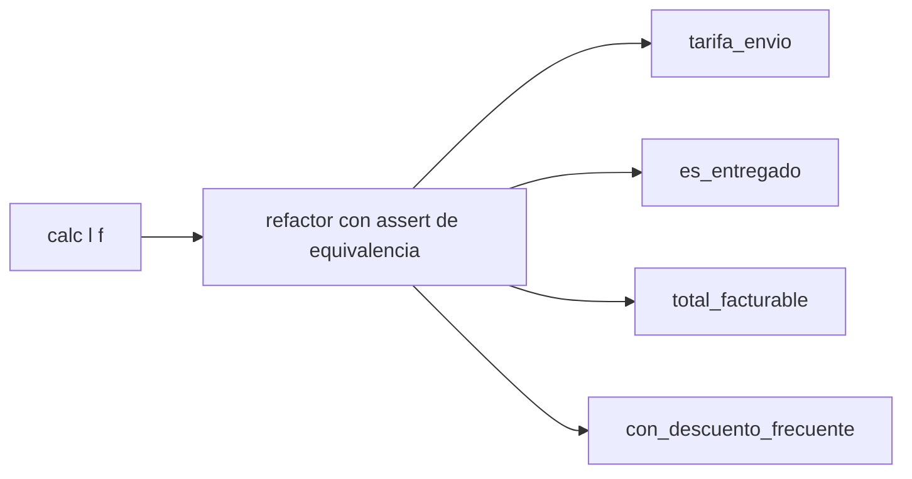
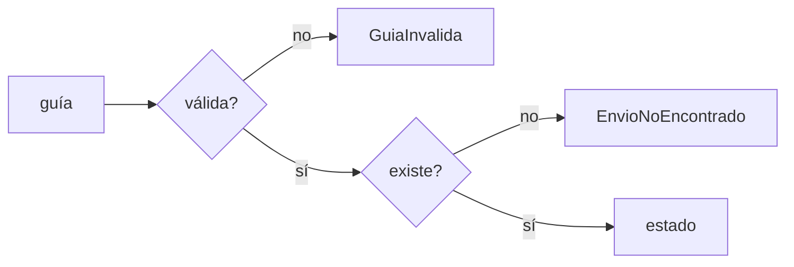
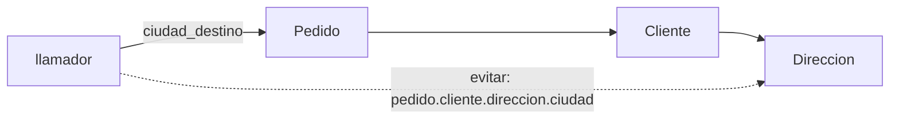
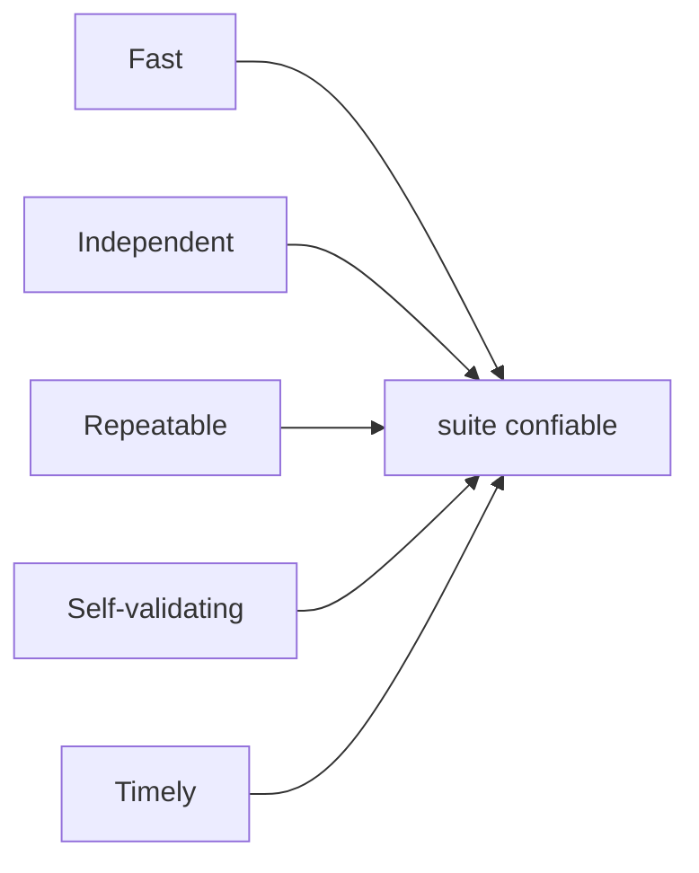

# Módulo 14: Código limpio


## Aprende construyendo


### Tema 1: Nombres que revelan intención y funciones pequeñas · Avanzado · 45 min

<details open>
<summary><strong>Capa 1 — Lectura</strong></summary>

#### ► DE QUÉ TRATA
Al finalizar podrás renombrar variables y funciones para que expliquen su propósito, dividir una función que hace varias cosas en funciones de un solo nivel de abstracción, reemplazar números mágicos por constantes y eliminar argumentos bandera, sin cambiar el comportamiento. Pre…

#### ► LA IDEA EN UNA FRASE
**Al finalizar podrás renombrar variables y funciones para que expliquen su propósito, dividir una función que hace varias cosas en funciones de un solo nivel de abstracción, reemplazar números mágicos por constantes y eliminar argumentos bandera, sin cambiar el comportamiento.**

#### ► POR QUÉ EXISTE ESTO
Resuelve un problema real de diseño o implementación y evita decisiones a ciegas.

#### ► LA ANALOGÍA
Piensa en nombres que revelan intención y funciones pequeñas como una herramienta de taller: útil cuando conoces su propósito y sus límites.
**Dónde se rompe la analogía:** en software, los efectos dependen del contexto, la escala y los trade-offs.

#### ► CÓMO FUNCIONA


#### ► LO QUE PUEDE SALIR MAL
| Síntoma | Causa probable | Arreglo |
|---|---|---|
| Nombres que revelan intención y funciones pequeñas se aplica pero el resultado no mejora | Se usó sin medir el problema real | Mide antes y compara contra la alternativa simple |
| Aparece complejidad inesperada | Se adoptó la técnica sin comprender sus trade-offs | Vuelve a la sección de trade-offs y reduce el alcance |
| Falla en un caso límite | Se asumió un contexto que no se cumple | Prueba el caso límite y documenta cuándo NO usarlo |

#### ► TRADE-OFFS
| Opción | Cuándo usarla | Cuándo NO usarla |
|---|---|---|
| Usar Nombres que revelan intención y funciones pequeñas | Cuando el problema coincide con su propósito y el beneficio es observable | Cuando agrega complejidad sin resolver un problema real |
| Alternativa más simple | Cuando el contexto es pequeño, estable o fácil de razonar | Cuando ya demostró no escalar o no cumplir el requisito |
| Postergar la decisión | Cuando falta evidencia del problema | Cuando el costo de esperar es mayor que el costo de probar |

#### ► CUÁNDO NO USAR ESTO
No uses nombres que revelan intención y funciones pequeñas por defecto. Aplícalo cuando el problema lo justifique y puedas verificar el beneficio; si una alternativa más simple resuelve igual, prefiérela.

#### ► DE VUELTA A LA ANALOGÍA
Volviendo a la analogía: nombres que revelan intención y funciones pequeñas funciona como el modelo inicial, pero recuerda dónde se rompe: en producción importan la evidencia, la escala y el costo de equivocarte.

#### ► LO QUE DEBES RECORDAR
- Nombres que revelan intención y funciones pequeñas existe para resolver un problema específico.
- Mide antes de adoptar complejidad.
- Conoce el caso donde NO usarlo.
- Verifica con evidencia observable.

#### ► PREGUNTAS PARA PENSAR
1. ¿Qué problema concreto resuelve nombres que revelan intención y funciones pequeñas en tu contexto?
2. ¿Cómo sabrías que nombres que revelan intención y funciones pequeñas no está funcionando bien?
3. ¿Qué alternativa más simple considerarías antes de usar nombres que revelan intención y funciones pequeñas?

</details>

<details>
<summary><strong>Capa 2 — Construcción</strong></summary>

#### Código y verificación


```bash
mkdir codigo-limpio && cd codigo-limpio
```

```python
# ANTES: nombres crípticos, una función que hace tres cosas y un argumento bandera
def calc(l, f):
    t = 0
    for x in l:
        if x[2] == "E":
            t += x[1] * 1200 + (5000 if x[0] == "BOG" else 9000)
    if f:
        t = t * 0.9
    return round(t)

# DESPUÉS: nombres que revelan intención y funciones pequeñas de un solo nivel de abstracción
TARIFA_POR_KILO = 1200
TARIFA_BASE = {"BOG": 5000}
TARIFA_BASE_OTRAS_CIUDADES = 9000
DESCUENTO_CLIENTE_FRECUENTE = 0.10

def tarifa_envio(ciudad, kilos):
    return TARIFA_BASE.get(ciudad, TARIFA_BASE_OTRAS_CIUDADES) + kilos * TARIFA_POR_KILO

def es_entregado(envio):
    return envio["estado"] == "entregado"

def total_facturable(envios):
    return sum(tarifa_envio(e["ciudad"], e["kilos"]) for e in envios if es_entregado(e))

def con_descuento_frecuente(total):          # en vez de un booleano que cambia el comportamiento
    return round(total * (1 - DESCUENTO_CLIENTE_FRECUENTE))

tuplas = [("BOG", 2, "E"), ("CAL", 1, "P"), ("MED", 3, "E")]
envios = [{"ciudad": c, "kilos": k, "estado": "entregado" if s == "E" else "pendiente"} for c, k, s in tuplas]

print("Antes:  ", calc(tuplas, False), calc(tuplas, True))
print("Después:", total_facturable(envios), con_descuento_frecuente(total_facturable(envios)))
assert calc(tuplas, True) == con_descuento_frecuente(total_facturable(envios))
print("Mismo resultado, código legible")
```

```bash
python3 nombres_funciones.py
```

```text
Antes:   20000 18000
Después: 20000 18000
Mismo resultado, código legible
```

</details>

### Tema 2: Comentarios honestos y excepciones en lugar de códigos de error · Avanzado · 45 min

<details open>
<summary><strong>Capa 1 — Lectura</strong></summary>

#### ► DE QUÉ TRATA
Al finalizar podrás reemplazar códigos de error por excepciones con nombre, decidir cuándo un comentario aporta y cuándo debe convertirse en código, y separar el camino feliz del manejo de errores. Prerrequisito: Tema 1 de este módulo.

#### ► LA IDEA EN UNA FRASE
**Al finalizar podrás reemplazar códigos de error por excepciones con nombre, decidir cuándo un comentario aporta y cuándo debe convertirse en código, y separar el camino feliz del manejo de errores.**

#### ► POR QUÉ EXISTE ESTO
Resuelve un problema real de diseño o implementación y evita decisiones a ciegas.

#### ► LA ANALOGÍA
Piensa en comentarios honestos y excepciones en lugar de códigos de error como una herramienta de taller: útil cuando conoces su propósito y sus límites.
**Dónde se rompe la analogía:** en software, los efectos dependen del contexto, la escala y los trade-offs.

#### ► CÓMO FUNCIONA


#### ► LO QUE PUEDE SALIR MAL
| Síntoma | Causa probable | Arreglo |
|---|---|---|
| Comentarios honestos y excepciones en lugar de códigos de error se aplica pero el resultado no mejora | Se usó sin medir el problema real | Mide antes y compara contra la alternativa simple |
| Aparece complejidad inesperada | Se adoptó la técnica sin comprender sus trade-offs | Vuelve a la sección de trade-offs y reduce el alcance |
| Falla en un caso límite | Se asumió un contexto que no se cumple | Prueba el caso límite y documenta cuándo NO usarlo |

#### ► TRADE-OFFS
| Opción | Cuándo usarla | Cuándo NO usarla |
|---|---|---|
| Usar Comentarios honestos y excepciones en lugar de códigos de error | Cuando el problema coincide con su propósito y el beneficio es observable | Cuando agrega complejidad sin resolver un problema real |
| Alternativa más simple | Cuando el contexto es pequeño, estable o fácil de razonar | Cuando ya demostró no escalar o no cumplir el requisito |
| Postergar la decisión | Cuando falta evidencia del problema | Cuando el costo de esperar es mayor que el costo de probar |

#### ► CUÁNDO NO USAR ESTO
No uses comentarios honestos y excepciones en lugar de códigos de error por defecto. Aplícalo cuando el problema lo justifique y puedas verificar el beneficio; si una alternativa más simple resuelve igual, prefiérela.

#### ► DE VUELTA A LA ANALOGÍA
Volviendo a la analogía: comentarios honestos y excepciones en lugar de códigos de error funciona como el modelo inicial, pero recuerda dónde se rompe: en producción importan la evidencia, la escala y el costo de equivocarte.

#### ► LO QUE DEBES RECORDAR
- Comentarios honestos y excepciones en lugar de códigos de error existe para resolver un problema específico.
- Mide antes de adoptar complejidad.
- Conoce el caso donde NO usarlo.
- Verifica con evidencia observable.

#### ► PREGUNTAS PARA PENSAR
1. ¿Qué problema concreto resuelve comentarios honestos y excepciones en lugar de códigos de error en tu contexto?
2. ¿Cómo sabrías que comentarios honestos y excepciones en lugar de códigos de error no está funcionando bien?
3. ¿Qué alternativa más simple considerarías antes de usar comentarios honestos y excepciones en lugar de códigos de error?

</details>

<details>
<summary><strong>Capa 2 — Construcción</strong></summary>

#### Código y verificación


```bash
mkdir codigo-limpio && cd codigo-limpio
```

```python
class EnvioNoEncontrado(Exception):
    pass

class GuiaInvalida(ValueError):
    pass

ENVIOS = {"BO-000001": "en ruta"}

# ANTES: devolver códigos de error obliga a cada llamador a recordar revisarlos
def estado_con_codigo(guia):
    if len(guia) != 9:
        return -2          # -2 = guía inválida (comentario que alguien debe mantener sincronizado)
    if guia not in ENVIOS:
        return -1          # -1 = no existe
    return ENVIOS[guia]

# DESPUÉS: excepciones con nombre; el camino feliz se lee sin ruido
def estado(guia):
    if len(guia) != 9:
        raise GuiaInvalida(f"La guía {guia!r} debe tener 9 caracteres")
    try:
        return ENVIOS[guia]
    except KeyError:
        raise EnvioNoEncontrado(guia) from None

for guia in ["BO-000001", "BO-9", "BO-000777"]:
    resultado = estado_con_codigo(guia)
    print(f"{guia:<10} código={resultado!r:<10}", end=" ")
    try:
        print("excepción: ninguna, estado =", estado(guia))
    except (GuiaInvalida, EnvioNoEncontrado) as error:
        print(f"excepción: {type(error).__name__}: {error}")
```

```bash
python3 errores_comentarios.py
```

```text
BO-000001  código='en ruta'  excepción: ninguna, estado = en ruta
BO-9       código=-2         excepción: GuiaInvalida: La guía 'BO-9' debe tener 9 caracteres
BO-000777  código=-1         excepción: EnvioNoEncontrado: BO-000777
```

</details>

### Tema 3: Objetos frente a estructuras de datos y la ley de Demeter · Avanzado · 45 min

<details open>
<summary><strong>Capa 1 — Lectura</strong></summary>

#### ► DE QUÉ TRATA
Al finalizar podrás distinguir un objeto (esconde datos y expone comportamiento) de una estructura de datos (expone datos), aplicar la ley de Demeter y evitar las "cadenas de vagón" que acoplan el código a la estructura interna. Prerrequisitos: Temas 1 y 2 de este módulo.

#### ► LA IDEA EN UNA FRASE
**Al finalizar podrás distinguir un objeto (esconde datos y expone comportamiento) de una estructura de datos (expone datos), aplicar la ley de Demeter y evitar las "cadenas de vagón" que acoplan el código a la estructura interna.**

#### ► POR QUÉ EXISTE ESTO
Resuelve un problema real de diseño o implementación y evita decisiones a ciegas.

#### ► LA ANALOGÍA
Piensa en objetos frente a estructuras de datos y la ley de demeter como una herramienta de taller: útil cuando conoces su propósito y sus límites.
**Dónde se rompe la analogía:** en software, los efectos dependen del contexto, la escala y los trade-offs.

#### ► CÓMO FUNCIONA


#### ► LO QUE PUEDE SALIR MAL
| Síntoma | Causa probable | Arreglo |
|---|---|---|
| Objetos frente a estructuras de datos y la ley de Demeter se aplica pero el resultado no mejora | Se usó sin medir el problema real | Mide antes y compara contra la alternativa simple |
| Aparece complejidad inesperada | Se adoptó la técnica sin comprender sus trade-offs | Vuelve a la sección de trade-offs y reduce el alcance |
| Falla en un caso límite | Se asumió un contexto que no se cumple | Prueba el caso límite y documenta cuándo NO usarlo |

#### ► TRADE-OFFS
| Opción | Cuándo usarla | Cuándo NO usarla |
|---|---|---|
| Usar Objetos frente a estructuras de datos y la ley de Demeter | Cuando el problema coincide con su propósito y el beneficio es observable | Cuando agrega complejidad sin resolver un problema real |
| Alternativa más simple | Cuando el contexto es pequeño, estable o fácil de razonar | Cuando ya demostró no escalar o no cumplir el requisito |
| Postergar la decisión | Cuando falta evidencia del problema | Cuando el costo de esperar es mayor que el costo de probar |

#### ► CUÁNDO NO USAR ESTO
No uses objetos frente a estructuras de datos y la ley de demeter por defecto. Aplícalo cuando el problema lo justifique y puedas verificar el beneficio; si una alternativa más simple resuelve igual, prefiérela.

#### ► DE VUELTA A LA ANALOGÍA
Volviendo a la analogía: objetos frente a estructuras de datos y la ley de demeter funciona como el modelo inicial, pero recuerda dónde se rompe: en producción importan la evidencia, la escala y el costo de equivocarte.

#### ► LO QUE DEBES RECORDAR
- Objetos frente a estructuras de datos y la ley de Demeter existe para resolver un problema específico.
- Mide antes de adoptar complejidad.
- Conoce el caso donde NO usarlo.
- Verifica con evidencia observable.

#### ► PREGUNTAS PARA PENSAR
1. ¿Qué problema concreto resuelve objetos frente a estructuras de datos y la ley de demeter en tu contexto?
2. ¿Cómo sabrías que objetos frente a estructuras de datos y la ley de demeter no está funcionando bien?
3. ¿Qué alternativa más simple considerarías antes de usar objetos frente a estructuras de datos y la ley de demeter?

</details>

<details>
<summary><strong>Capa 2 — Construcción</strong></summary>

#### Código y verificación


```bash
mkdir codigo-limpio && cd codigo-limpio
```

```python
from dataclasses import dataclass
from typing import Optional

# Estructura de datos: expone datos, no tiene comportamiento
@dataclass
class Direccion:
    ciudad: str
    barrio: str

@dataclass
class Cliente:
    nombre: str
    direccion: Optional[Direccion]

# Objeto: esconde sus datos y expone comportamiento ("dile, no le preguntes")
class Pedido:
    def __init__(self, guia, cliente):
        self._guia, self._cliente = guia, cliente

    def ciudad_destino(self):
        direccion = self._cliente.direccion
        return direccion.ciudad if direccion else "sin dirección"

    def puede_despacharse_a(self, ciudades_con_cobertura):
        return self.ciudad_destino() in ciudades_con_cobertura

pedidos = [
    Pedido("G-1", Cliente("Ana", Direccion("Bogotá", "Chapinero"))),
    Pedido("G-2", Cliente("Beto", None)),
]
COBERTURA = {"Bogotá", "Medellín"}
for pedido in pedidos:
    # El llamador habla solo con su vecino inmediato (Pedido), no recorre la cadena interna
    print(pedido._guia, pedido.ciudad_destino(), "despachable:", pedido.puede_despacharse_a(COBERTURA))
```

```bash
python3 demeter.py
```

```text
G-1 Bogotá despachable: True
G-2 sin dirección despachable: False
```

</details>

### Tema 4: Pruebas limpias: F.I.R.S.T. y un concepto por prueba · Avanzado · 45 min

<details open>
<summary><strong>Capa 1 — Lectura</strong></summary>

#### ► DE QUÉ TRATA
Al finalizar podrás escribir pruebas unitarias rápidas, independientes, repetibles, autoevaluadas y oportunas (F.I.R.S.T.), con un concepto por prueba y nombres que describen el comportamiento. Prerrequisitos: Módulo 5, Tema 2 y los temas anteriores de este módulo.

#### ► LA IDEA EN UNA FRASE
**Al finalizar podrás escribir pruebas unitarias rápidas, independientes, repetibles, autoevaluadas y oportunas (F.I.R.S.T.), con un concepto por prueba y nombres que describen el comportamiento.**

#### ► POR QUÉ EXISTE ESTO
Resuelve un problema real de diseño o implementación y evita decisiones a ciegas.

#### ► LA ANALOGÍA
Piensa en pruebas limpias: f.i.r.s.t. y un concepto por prueba como una herramienta de taller: útil cuando conoces su propósito y sus límites.
**Dónde se rompe la analogía:** en software, los efectos dependen del contexto, la escala y los trade-offs.

#### ► CÓMO FUNCIONA


#### ► LO QUE PUEDE SALIR MAL
| Síntoma | Causa probable | Arreglo |
|---|---|---|
| Pruebas limpias: F.I.R.S.T. y un concepto por prueba se aplica pero el resultado no mejora | Se usó sin medir el problema real | Mide antes y compara contra la alternativa simple |
| Aparece complejidad inesperada | Se adoptó la técnica sin comprender sus trade-offs | Vuelve a la sección de trade-offs y reduce el alcance |
| Falla en un caso límite | Se asumió un contexto que no se cumple | Prueba el caso límite y documenta cuándo NO usarlo |

#### ► TRADE-OFFS
| Opción | Cuándo usarla | Cuándo NO usarla |
|---|---|---|
| Usar Pruebas limpias: F.I.R.S.T. y un concepto por prueba | Cuando el problema coincide con su propósito y el beneficio es observable | Cuando agrega complejidad sin resolver un problema real |
| Alternativa más simple | Cuando el contexto es pequeño, estable o fácil de razonar | Cuando ya demostró no escalar o no cumplir el requisito |
| Postergar la decisión | Cuando falta evidencia del problema | Cuando el costo de esperar es mayor que el costo de probar |

#### ► CUÁNDO NO USAR ESTO
No uses pruebas limpias: f.i.r.s.t. y un concepto por prueba por defecto. Aplícalo cuando el problema lo justifique y puedas verificar el beneficio; si una alternativa más simple resuelve igual, prefiérela.

#### ► DE VUELTA A LA ANALOGÍA
Volviendo a la analogía: pruebas limpias: f.i.r.s.t. y un concepto por prueba funciona como el modelo inicial, pero recuerda dónde se rompe: en producción importan la evidencia, la escala y el costo de equivocarte.

#### ► LO QUE DEBES RECORDAR
- Pruebas limpias: F.I.R.S.T. y un concepto por prueba existe para resolver un problema específico.
- Mide antes de adoptar complejidad.
- Conoce el caso donde NO usarlo.
- Verifica con evidencia observable.

#### ► PREGUNTAS PARA PENSAR
1. ¿Qué problema concreto resuelve pruebas limpias: f.i.r.s.t. y un concepto por prueba en tu contexto?
2. ¿Cómo sabrías que pruebas limpias: f.i.r.s.t. y un concepto por prueba no está funcionando bien?
3. ¿Qué alternativa más simple considerarías antes de usar pruebas limpias: f.i.r.s.t. y un concepto por prueba?

</details>

<details>
<summary><strong>Capa 2 — Construcción</strong></summary>

#### Código y verificación


```bash
mkdir codigo-limpio && cd codigo-limpio
```

```python
import unittest

def tarifa(ciudad, kilos):
    if kilos <= 0:
        raise ValueError("kilos debe ser positivo")
    return (5000 if ciudad == "Bogotá" else 9000) + kilos * 1200

class TarifaTest(unittest.TestCase):
    # F.I.R.S.T.: rápidas (Fast), independientes (Independent), repetibles (Repeatable),
    # autoevaluadas (Self-validating) y oportunas (Timely). Un concepto por prueba.

    def test_bogota_cobra_base_local_mas_precio_por_kilo(self):
        self.assertEqual(tarifa("Bogotá", 2), 7400)

    def test_otras_ciudades_cobran_base_nacional(self):
        self.assertEqual(tarifa("Cali", 1), 10200)

    def test_rechaza_kilos_no_positivos(self):
        with self.assertRaisesRegex(ValueError, "positivo"):
            tarifa("Bogotá", 0)

if __name__ == "__main__":
    unittest.main(verbosity=2)
```

```bash
python3 test_pruebas_limpias.py
```

```text
test_bogota_cobra_base_local_mas_precio_por_kilo (__main__.TarifaTest) ... ok
test_otras_ciudades_cobran_base_nacional (__main__.TarifaTest) ... ok
test_rechaza_kilos_no_positivos (__main__.TarifaTest) ... ok

----------------------------------------------------------------------
Ran 3 tests in 0.001s

OK
```

</details>

### Proyecto 14: rescate de código heredado

<details open>
<summary><strong>Capa 1 — Lectura</strong></summary>

#### ► DE QUÉ TRATA
Este tema te guía por proyecto 14: rescate de código heredado con foco en comprensión antes de implementación.

#### ► LA IDEA EN UNA FRASE
**Entender proyecto 14: rescate de código heredado te permite tomar mejores decisiones técnicas.**

#### ► POR QUÉ EXISTE ESTO
Resuelve un problema real de diseño o implementación y evita decisiones a ciegas.

#### ► LA ANALOGÍA
Piensa en proyecto 14: rescate de código heredado como una herramienta de taller: útil cuando conoces su propósito y sus límites.
**Dónde se rompe la analogía:** en software, los efectos dependen del contexto, la escala y los trade-offs.

#### ► CÓMO FUNCIONA
1. Identifica el problema que proyecto 14: rescate de código heredado resuelve.
2. Observa sus componentes y relaciones.
3. Aplica la opción más simple que funcione.
4. Verifica el resultado y los límites.

#### ► LO QUE PUEDE SALIR MAL
| Síntoma | Causa probable | Arreglo |
|---|---|---|
| Proyecto 14: rescate de código heredado se aplica pero el resultado no mejora | Se usó sin medir el problema real | Mide antes y compara contra la alternativa simple |
| Aparece complejidad inesperada | Se adoptó la técnica sin comprender sus trade-offs | Vuelve a la sección de trade-offs y reduce el alcance |
| Falla en un caso límite | Se asumió un contexto que no se cumple | Prueba el caso límite y documenta cuándo NO usarlo |

#### ► TRADE-OFFS
| Opción | Cuándo usarla | Cuándo NO usarla |
|---|---|---|
| Usar Proyecto 14: rescate de código heredado | Cuando el problema coincide con su propósito y el beneficio es observable | Cuando agrega complejidad sin resolver un problema real |
| Alternativa más simple | Cuando el contexto es pequeño, estable o fácil de razonar | Cuando ya demostró no escalar o no cumplir el requisito |
| Postergar la decisión | Cuando falta evidencia del problema | Cuando el costo de esperar es mayor que el costo de probar |

#### ► CUÁNDO NO USAR ESTO
No uses proyecto 14: rescate de código heredado por defecto. Aplícalo cuando el problema lo justifique y puedas verificar el beneficio; si una alternativa más simple resuelve igual, prefiérela.

#### ► DE VUELTA A LA ANALOGÍA
Volviendo a la analogía: proyecto 14: rescate de código heredado funciona como el modelo inicial, pero recuerda dónde se rompe: en producción importan la evidencia, la escala y el costo de equivocarte.

#### ► LO QUE DEBES RECORDAR
- Proyecto 14: rescate de código heredado existe para resolver un problema específico.
- Mide antes de adoptar complejidad.
- Conoce el caso donde NO usarlo.
- Verifica con evidencia observable.

#### ► PREGUNTAS PARA PENSAR
1. ¿Qué problema concreto resuelve proyecto 14: rescate de código heredado en tu contexto?
2. ¿Cómo sabrías que proyecto 14: rescate de código heredado no está funcionando bien?
3. ¿Qué alternativa más simple considerarías antes de usar proyecto 14: rescate de código heredado?

</details>

<details>
<summary><strong>Capa 2 — Construcción</strong></summary>

#### Nota de construcción
Este tema es principalmente conceptual en esta versión. La verificación se realiza con las preguntas de comprensión y el criterio de cuándo NO usar proyecto 14: rescate de código heredado.

</details>
