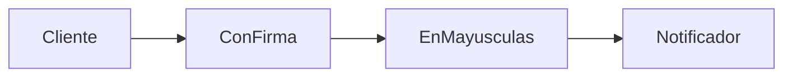
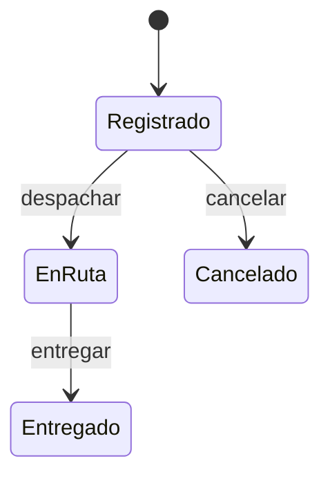
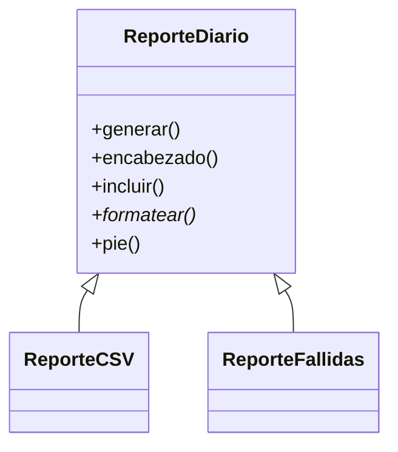
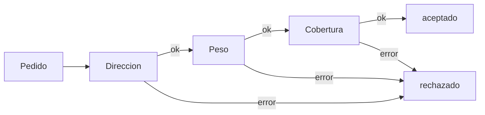
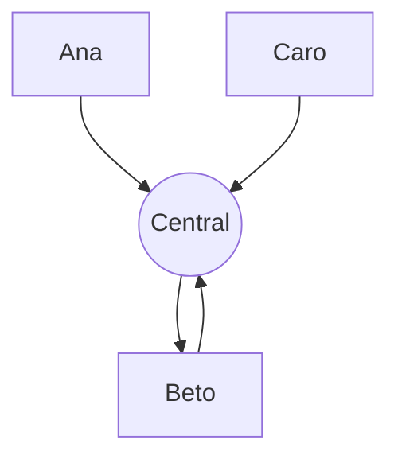
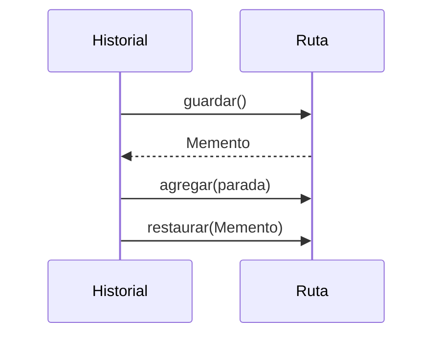
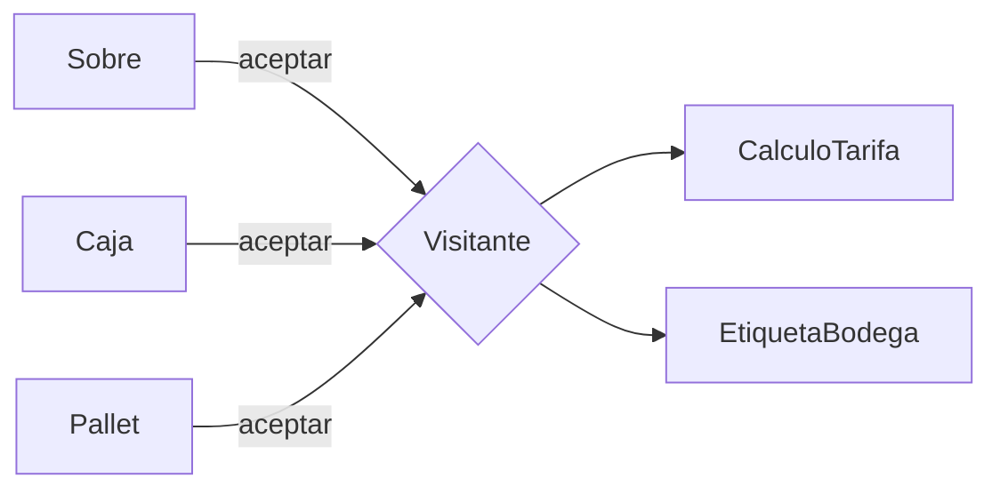
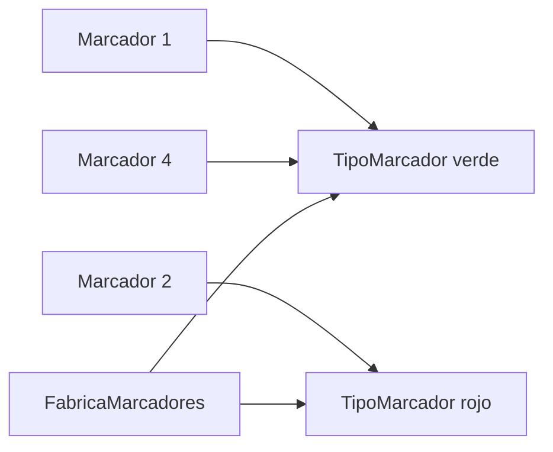

# Módulo 14: Catálogo de patrones de diseño


## Aprende construyendo

### Tema 1: Decorator: agregar comportamiento sin heredar

#### Paso 1 · Objetivo y preparación
Al finalizar podrás envolver un objeto con decoradores apilables, distinguir el patrón Decorator del decorador `@` de Python y decidir cuándo preferirlo a la herencia. Prerrequisitos: Módulo 7, Tema 3 (diseño modular y principios).

#### Paso 2 · Contexto y caso real
RutaFlow envía notificaciones de estado. Unos clientes quieren el texto en mayúsculas, otros con firma, otros ambas cosas. Con herencia necesitarías una subclase por combinación (`NotificadorFirmadoMayusculas`…). Este mismo patrón es el que usan los middlewares de Express, los filtros de Spring y los interceptores de Angular: un caso real que verás en cada framework.

#### Paso 3 · Teoría, modelo mental y analogía
Un **decorador** implementa la misma interfaz que el objeto que envuelve, delega en él y agrega algo antes o después. Como cada decorador también es "un notificador", se pueden apilar en cualquier orden y combinación en tiempo de ejecución. Python además tiene el **decorador de función** (`@cronometrado`): una función que recibe otra y devuelve una envoltura. Son la misma idea aplicada a funciones.

**Analogía:** es como vestirse por capas: la camiseta, el saco y la chaqueta se agregan y se quitan sin cambiar a la persona que está debajo.

**Diagrama:**



#### Paso 4 · Demostración guiada desde cero
**Ejemplo independiente (desde cero):** este tema se reproduce en una **carpeta vacía**, como **proyecto nuevo**, sin estado de otros temas.

```bash
mkdir patrones && cd patrones
```

Crea `decorator.py`:

```python
import time
from functools import wraps

class Notificador:                         # componente base
    def enviar(self, guia, mensaje):
        return f"[{guia}] {mensaje}"

class ConFirma:                            # decorador: misma interfaz, envuelve otro notificador
    def __init__(self, envuelto):
        self.envuelto = envuelto
    def enviar(self, guia, mensaje):
        return self.envuelto.enviar(guia, mensaje) + " -- RutaFlow"

class EnMayusculas:
    def __init__(self, envuelto):
        self.envuelto = envuelto
    def enviar(self, guia, mensaje):
        return self.envuelto.enviar(guia, mensaje.upper())

def cronometrado(funcion):                 # decorador de función de Python (@)
    @wraps(funcion)
    def envoltura(*args):
        inicio = time.perf_counter()
        resultado = funcion(*args)
        print(f"  {funcion.__name__} tardó {(time.perf_counter() - inicio) * 1000:.0f} ms")
        return resultado
    return envoltura

@cronometrado
def calcular_tarifa(kilos):
    time.sleep(0.05)
    return 4000 + kilos * 1200

simple = Notificador()
completo = ConFirma(EnMayusculas(Notificador()))
print(simple.enviar("G-101", "Tu paquete salió"))
print(completo.enviar("G-101", "Tu paquete salió"))
print("Tarifa:", calcular_tarifa(3))
```

**Ejecuta el ejemplo:**

```bash
python3 decorator.py
```

**Resultado esperado:**

```text
[G-101] Tu paquete salió
[G-101] TU PAQUETE SALIÓ -- RutaFlow
  calcular_tarifa tardó 55 ms
Tarifa: 7600
```

La segunda línea pasó por dos decoradores: primero `EnMayusculas` cambió el mensaje y luego `ConFirma` agregó la firma. El tiempo exacto de `calcular_tarifa` varía unos milisegundos entre ejecuciones.

**Fallo deliberado:** Borra la línea `@wraps(funcion)` y agrega al final `print(calcular_tarifa.__name__)`. Imprime `envoltura` en vez de `calcular_tarifa`: el decorador ocultó el nombre y la documentación de la función original, lo que confunde logs, trazas y herramientas de pruebas. `functools.wraps` copia esos metadatos.

#### Paso 5 · Práctica guiada
Crea un decorador `ConRegistro` que imprima `enviando G-101` antes de delegar, y apílalo encima de los otros dos. **Pista:** el orden de construcción importa: `ConRegistro(ConFirma(EnMayusculas(Notificador())))` registra antes que todo lo demás.

#### Paso 6 · Práctica independiente
Escribe un decorador de función `@reintentar(veces=3)` que repita la llamada si lanza `ConnectionError` y pruébalo con una función que falla dos veces y luego funciona.

#### Paso 7 · Cierre y evidencia
Entrega como evidencia la salida real del Paso 4 y la explicación del fallo deliberado. **¿Por qué es importante?** porque reconocer el patrón te permite entender middlewares, interceptores y anotaciones como `@Transactional` sin magia.
**Fuente oficial:** [Decorator (refactoring.guru)](https://refactoring.guru/es/design-patterns/decorator), [functools.wraps (docs.python.org)](https://docs.python.org/3/library/functools.html#functools.wraps).
**Conceptos clave:** misma interfaz, composición, delegación, apilamiento, `functools.wraps`, decorador de función.
**Cuándo no usarlo:** si solo hay una variante fija, una subclase o un parámetro es más claro. Muchas capas de decoradores dificultan depurar qué capa hizo qué.

**Transferencia al proyecto integrador «Fundamentos: gestor de tareas»:** agrega a las tareas un decorador que registre en un log cada cambio de estado sin modificar la clase `Tarea`.
Como **siguiente** paso, aplica lo aprendido en el proyecto integrador del track y compara el resultado con lo que esperabas.
**Errores comunes:** copiar el ejemplo sin leer la salida real y dar por hecho que funciona con un solo caso.

### Tema 2: State: un objeto que cambia de comportamiento según su estado

#### Paso 1 · Objetivo y preparación
Al finalizar podrás reemplazar cadenas de `if estado == ...` por objetos estado, impedir transiciones inválidas y dibujar la máquina de estados de un envío. Prerrequisitos: Módulo 12, Tema 4 (máquinas de estados) y Tema 1 de este módulo.

#### Paso 2 · Contexto y caso real
Un envío de RutaFlow pasa por registrado, en ruta, entregado o cancelado. Un bug real muy común es cancelar un envío que ya se entregó porque un `if` olvidó un caso. Con el patrón State, cada estado decide qué acciones permite.

#### Paso 3 · Teoría, modelo mental y analogía
El objeto **contexto** (`Envio`) guarda una referencia a su estado actual y le **delega** cada acción. Cada clase de estado implementa solo las transiciones válidas y cambia el estado del contexto; las demás lanzan un error. Agregar un estado nuevo es agregar una clase, no tocar diez `if`.

**Analogía:** un semáforo no tiene un manual de "si estoy en rojo y… si estoy en verde y…": cada luz sabe cuál viene después.

**Diagrama:**



#### Paso 4 · Demostración guiada desde cero
**Ejemplo independiente (desde cero):** este tema se reproduce en una **carpeta vacía**, como **proyecto nuevo**, sin estado de otros temas.

```bash
mkdir patrones && cd patrones
```

Crea `state.py`:

```python
class Estado:
    nombre = "?"
    def despachar(self, envio): raise ValueError(f"No se puede despachar en estado {self.nombre}")
    def entregar(self, envio):  raise ValueError(f"No se puede entregar en estado {self.nombre}")
    def cancelar(self, envio):  raise ValueError(f"No se puede cancelar en estado {self.nombre}")

class Registrado(Estado):
    nombre = "registrado"
    def despachar(self, envio): envio.estado = EnRuta()
    def cancelar(self, envio):  envio.estado = Cancelado()

class EnRuta(Estado):
    nombre = "en ruta"
    def entregar(self, envio):  envio.estado = Entregado()

class Entregado(Estado):
    nombre = "entregado"

class Cancelado(Estado):
    nombre = "cancelado"

class Envio:
    def __init__(self, guia):
        self.guia, self.estado = guia, Registrado()
    def ejecutar(self, accion):
        getattr(self.estado, accion)(self)    # delega en el objeto estado actual
        print(f"{self.guia}: {accion:<9} -> {self.estado.nombre}")

envio = Envio("G-202")
envio.ejecutar("despachar")
envio.ejecutar("entregar")
try:
    envio.ejecutar("cancelar")
except ValueError as error:
    print("Rechazado:", error)
```

**Ejecuta el ejemplo:**

```bash
python3 state.py
```

**Resultado esperado:**

```text
G-202: despachar -> en ruta
G-202: entregar  -> entregado
Rechazado: No se puede cancelar en estado entregado
```

La cancelación se rechaza porque `Entregado` no redefine `cancelar`, así que hereda la versión que lanza `ValueError`.

**Fallo deliberado:** Agrega `envio.ejecutar("pagar")` después de crear el envío. Obtienes `AttributeError: 'Registrado' object has no attribute 'pagar'`: la acción no existe en ningún estado. Diagnostica si debe ser una acción nueva (agrégala a `Estado` con su error por defecto) o un error de quien llama.

#### Paso 5 · Práctica guiada
Agrega el estado `Devuelto`, al que solo se llega desde `EnRuta` con la acción `devolver`. **Pista:** crea la clase `Devuelto(Estado)`, agrega `devolver` a `Estado` con el error por defecto y redefínela solo en `EnRuta`.

#### Paso 6 · Práctica independiente
Guarda en el contexto un historial de transiciones con fecha y hora, e imprímelo al final.

#### Paso 7 · Cierre y evidencia
Entrega como evidencia la salida real del Paso 4 y la explicación del fallo deliberado. **¿Por qué es importante?** porque los flujos de pedidos, pagos y aprobaciones son máquinas de estados, y modelarlas explícitamente elimina transiciones imposibles.
**Fuente oficial:** [State (refactoring.guru)](https://refactoring.guru/es/design-patterns/state).
**Conceptos clave:** contexto, objeto estado, delegación, transición válida, máquina de estados.
**Cuándo no usarlo:** con dos o tres estados y casi sin comportamiento distinto, un `Enum` y un diccionario de transiciones permitidas es más simple.

**Transferencia al proyecto integrador «Fundamentos: gestor de tareas»:** modela los estados de una tarea (pendiente, en progreso, bloqueada, terminada) y rechaza las transiciones imposibles.
Como **siguiente** paso, aplica lo aprendido en el proyecto integrador del track y compara el resultado con lo que esperabas.
**Errores comunes:** copiar el ejemplo sin leer la salida real y dar por hecho que funciona con un solo caso.

### Tema 3: Template Method: un algoritmo fijo con pasos variables

#### Paso 1 · Objetivo y preparación
Al finalizar podrás definir el esqueleto de un algoritmo en una clase base, dejar pasos obligatorios abstractos y pasos opcionales con valor por defecto (ganchos). Prerrequisito: herencia y clases abstractas (`abc`).

#### Paso 2 · Contexto y caso real
RutaFlow genera varios reportes diarios: CSV para contabilidad y una lista de entregas fallidas para soporte. Todos siguen el mismo orden (filtrar, formatear, encabezado y pie); solo cambian algunos pasos. Es el caso real de los frameworks: `unittest.TestCase` llama a `setUp`, la prueba y `tearDown` en un orden fijo.

#### Paso 3 · Teoría, modelo mental y analogía
El **método plantilla** (`generar`) fija el orden de los pasos y no se sobrescribe. Algunos pasos son **abstractos** (cada subclase debe implementarlos) y otros son **ganchos** con un comportamiento por defecto que se puede cambiar. Es el principio de Hollywood: "no nos llames, nosotros te llamamos".

**Analogía:** una receta de pan fija los pasos (mezclar, amasar, hornear); cada panadero decide qué harina usar y cuánto tiempo hornear.

**Diagrama:**



#### Paso 4 · Demostración guiada desde cero
**Ejemplo independiente (desde cero):** este tema se reproduce en una **carpeta vacía**, como **proyecto nuevo**, sin estado de otros temas.

```bash
mkdir patrones && cd patrones
```

Crea `template_method.py`:

```python
from abc import ABC, abstractmethod

class ReporteDiario(ABC):
    def generar(self, entregas):             # método plantilla: fija el orden de los pasos
        datos = [e for e in entregas if self.incluir(e)]
        cuerpo = self.formatear(datos)
        return self.encabezado() + cuerpo + self.pie(len(datos))

    def encabezado(self):                    # paso con implementación por defecto (gancho)
        return "Reporte RutaFlow\n"
    def incluir(self, entrega):
        return True
    @abstractmethod
    def formatear(self, datos): ...         # paso obligatorio para cada subclase
    def pie(self, total):
        return f"Total: {total}\n"

class ReporteCSV(ReporteDiario):
    def formatear(self, datos):
        return "guia,estado\n" + "".join(f"{g},{e}\n" for g, e in datos)

class ReporteFallidas(ReporteDiario):
    def encabezado(self):
        return "Entregas fallidas\n"
    def incluir(self, entrega):
        return entrega[1] == "fallida"
    def formatear(self, datos):
        return "".join(f"- {g}\n" for g, _ in datos)

entregas = [("G-1", "entregada"), ("G-2", "fallida"), ("G-3", "entregada"), ("G-4", "fallida")]
print(ReporteCSV().generar(entregas))
print(ReporteFallidas().generar(entregas))
```

**Ejecuta el ejemplo:**

```bash
python3 template_method.py
```

**Resultado esperado:**

```text
Reporte RutaFlow
guia,estado
G-1,entregada
G-2,fallida
G-3,entregada
G-4,fallida
Total: 4

Entregas fallidas
- G-2
- G-4
Total: 2
```

`ReporteFallidas` solo cambió el encabezado y el filtro; el orden de los pasos lo sigue decidiendo la clase base.

**Fallo deliberado:** Crea `class ReporteVacio(ReporteDiario): pass` e instancia `ReporteVacio()`. Python responde `TypeError: Can't instantiate abstract class ReporteVacio with abstract method formatear`: el paso obligatorio no está implementado y el error aparece al crear el objeto, no en producción.

#### Paso 5 · Práctica guiada
Crea `ReporteJSON` que devuelva las entregas como JSON usando `json.dumps`. **Pista:** solo necesitas redefinir `formatear`; si el JSON no debe llevar encabezado ni pie, redefine también esos dos ganchos para que devuelvan una cadena vacía.

#### Paso 6 · Práctica independiente
Reescribe los dos reportes sin herencia, pasando funciones como parámetros (`generar(entregas, formatear, incluir)`), y compara cuál te parece más fácil de extender.

#### Paso 7 · Cierre y evidencia
Entrega como evidencia la salida real del Paso 4 y la explicación del fallo deliberado. **¿Por qué es importante?** porque explica cómo funcionan los ciclos de vida de los frameworks (pruebas, componentes, servlets) que te llaman a ti.
**Fuente oficial:** [Template Method (refactoring.guru)](https://refactoring.guru/es/design-patterns/template-method), [abc (docs.python.org)](https://docs.python.org/3/library/abc.html).
**Conceptos clave:** método plantilla, paso abstracto, gancho, principio de Hollywood, `abc.abstractmethod`.
**Cuándo no usarlo:** si las variantes difieren en un solo paso, pasar una función o usar Strategy evita una jerarquía de clases.

**Transferencia al proyecto integrador «Fundamentos: gestor de tareas»:** crea un exportador de tareas con el mismo esqueleto y dos formatos (texto y CSV).
Como **siguiente** paso, aplica lo aprendido en el proyecto integrador del track y compara el resultado con lo que esperabas.
**Errores comunes:** copiar el ejemplo sin leer la salida real y dar por hecho que funciona con un solo caso.

### Tema 4: Chain of Responsibility: una cadena de validadores

#### Paso 1 · Objetivo y preparación
Al finalizar podrás encadenar manejadores independientes, cortar la cadena en el primer error y razonar sobre el orden de la cadena. Prerrequisito: Tema 1 de este módulo.

#### Paso 2 · Contexto y caso real
Antes de aceptar un pedido, RutaFlow valida dirección, peso y cobertura. Mañana se agregarán validaciones de seguro y de horario. Es el caso real de los middlewares HTTP y de los filtros de seguridad de Spring: cada eslabón decide si atiende, rechaza o pasa al siguiente.

#### Paso 3 · Teoría, modelo mental y analogía
Cada **manejador** tiene una referencia al **siguiente**. Al recibir una petición la revisa: si encuentra un problema responde y corta; si no, la pasa. El cliente solo conoce el primer eslabón, y agregar una validación es insertar un eslabón sin tocar los demás.

**Analogía:** es la fila de controles de un aeropuerto: documentos, equipaje y puerta de embarque; cualquiera puede detenerte y ninguno necesita saber cómo trabaja el otro.

**Diagrama:**



#### Paso 4 · Demostración guiada desde cero
**Ejemplo independiente (desde cero):** este tema se reproduce en una **carpeta vacía**, como **proyecto nuevo**, sin estado de otros temas.

```bash
mkdir patrones && cd patrones
```

Crea `chain.py`:

```python
class Validador:
    def __init__(self, siguiente=None):
        self.siguiente = siguiente
    def manejar(self, pedido):
        error = self.revisar(pedido)
        if error:
            return f"rechazado por {type(self).__name__}: {error}"
        return self.siguiente.manejar(pedido) if self.siguiente else "aceptado"
    def revisar(self, pedido):
        return None

class Direccion(Validador):
    def revisar(self, pedido):
        return None if pedido.get("direccion") else "falta la dirección"

class Peso(Validador):
    def revisar(self, pedido):
        return None if 0 < pedido["kilos"] <= 30 else f"{pedido['kilos']} kg fuera de rango"

class Cobertura(Validador):
    CIUDADES = {"Bogotá", "Medellín", "Cali"}
    def revisar(self, pedido):
        return None if pedido["ciudad"] in self.CIUDADES else f"sin cobertura en {pedido['ciudad']}"

cadena = Direccion(Peso(Cobertura()))       # el orden de la cadena es una decisión de diseño
pedidos = [
    {"direccion": "Cra 7 # 10-20", "kilos": 4, "ciudad": "Cali"},
    {"direccion": "", "kilos": 4, "ciudad": "Cali"},
    {"direccion": "Cl 80 # 5-12", "kilos": 45, "ciudad": "Bogotá"},
    {"direccion": "Av 30 # 2-1", "kilos": 2, "ciudad": "Leticia"},
]
for pedido in pedidos:
    print(cadena.manejar(pedido))
```

**Ejecuta el ejemplo:**

```bash
python3 chain.py
```

**Resultado esperado:**

```text
aceptado
rechazado por Direccion: falta la dirección
rechazado por Peso: 45 kg fuera de rango
rechazado por Cobertura: sin cobertura en Leticia
```

Cada pedido se detiene en el primer eslabón que encuentra un problema; el primero pasa los tres.

**Fallo deliberado:** Construye la cadena como `Direccion(Peso())`, olvidando `Cobertura`. El pedido a Leticia ahora imprime `aceptado`: no hay ningún error visible, pero se aceptó un envío sin cobertura. Las cadenas mal armadas fallan en silencio, por eso conviene una prueba por cada eslabón.

#### Paso 5 · Práctica guiada
Agrega un eslabón `Horario` que rechace pedidos con `"hora"` fuera de 7 a 19. **Pista:** crea la subclase con su `revisar`, ponle a los pedidos de prueba la clave `"hora"` y decide en qué posición de la cadena colocarla.

#### Paso 6 · Práctica independiente
Haz que la cadena devuelva **todos** los errores en lugar de cortar en el primero y discute cuándo es mejor cada comportamiento (formularios frente a seguridad).

#### Paso 7 · Cierre y evidencia
Entrega como evidencia la salida real del Paso 4 y la explicación del fallo deliberado. **¿Por qué es importante?** porque es la estructura interna de los pipelines de middlewares, filtros de seguridad y manejadores de eventos.
**Fuente oficial:** [Chain Of Responsibility (refactoring.guru)](https://refactoring.guru/es/design-patterns/chain-of-responsibility).
**Conceptos clave:** manejador, siguiente eslabón, corte de la cadena, orden de evaluación, falla silenciosa.
**Cuándo no usarlo:** si todas las validaciones siempre se ejecutan y no importa el orden, una lista de funciones recorrida con un bucle es más simple.

**Transferencia al proyecto integrador «Fundamentos: gestor de tareas»:** valida las tareas nuevas (título, fecha límite, responsable) con una cadena de validadores.
Como **siguiente** paso, aplica lo aprendido en el proyecto integrador del track y compara el resultado con lo que esperabas.
**Errores comunes:** copiar el ejemplo sin leer la salida real y dar por hecho que funciona con un solo caso.

### Tema 5: Mediator: coordinar objetos sin que se conozcan

#### Paso 1 · Objetivo y preparación
Al finalizar podrás centralizar la coordinación entre objetos en un mediador, reducir dependencias cruzadas y reconocer cuándo el mediador se vuelve demasiado grande. Prerrequisito: Tema 4 de este módulo.

#### Paso 2 · Contexto y caso real
Cuando un mensajero de RutaFlow sufre una avería, otro libre debe tomar su paquete. Si cada mensajero conociera a todos los demás, con 50 mensajeros habría cientos de referencias cruzadas. Es el mismo caso real de una torre de control o de un formulario en el que cambiar un campo habilita otros.

#### Paso 3 · Teoría, modelo mental y analogía
El **mediador** (`Central`) es el único que conoce a todos los participantes. Los participantes solo le **notifican eventos** y él decide qué hacer. Las dependencias pasan de "muchos a muchos" a "muchos a uno", y la regla de reasignación vive en un solo lugar.

**Analogía:** los aviones no se hablan entre ellos para decidir quién aterriza: todos hablan con la torre de control.

**Diagrama:**



#### Paso 4 · Demostración guiada desde cero
**Ejemplo independiente (desde cero):** este tema se reproduce en una **carpeta vacía**, como **proyecto nuevo**, sin estado de otros temas.

```bash
mkdir patrones && cd patrones
```

Crea `mediator.py`:

```python
class Central:                                # mediador: único punto que conoce a todos
    def __init__(self):
        self.mensajeros, self.registro = {}, []
    def registrar(self, mensajero):
        self.mensajeros[mensajero.nombre] = mensajero
        mensajero.central = self
    def notificar(self, emisor, evento, dato):
        self.registro.append((emisor.nombre, evento, dato))
        if evento == "averia":
            libres = [m for m in self.mensajeros.values() if m is not emisor and m.libre]
            if libres:
                libres[0].asignar(dato)
            else:
                print(f"  Central: nadie libre para {dato}, queda en espera")

class Mensajero:
    def __init__(self, nombre, libre=True):
        self.nombre, self.libre, self.central = nombre, libre, None
    def reportar_averia(self, guia):
        print(f"{self.nombre} reporta avería con {guia}")
        self.central.notificar(self, "averia", guia)   # no conoce a los otros mensajeros
    def asignar(self, guia):
        self.libre = False
        print(f"  {self.nombre} recibe {guia}")

central = Central()
ana, beto, caro = Mensajero("Ana", libre=False), Mensajero("Beto"), Mensajero("Caro")
for m in (ana, beto, caro):
    central.registrar(m)
ana.reportar_averia("G-301")
caro.reportar_averia("G-302")
print("Eventos registrados:", len(central.registro))
```

**Ejecuta el ejemplo:**

```bash
python3 mediator.py
```

**Resultado esperado:**

```text
Ana reporta avería con G-301
  Beto recibe G-301
Caro reporta avería con G-302
  Central: nadie libre para G-302, queda en espera
Eventos registrados: 2
```

Ana no sabe que Beto existe; la Central eligió a Beto porque era el primero libre. Para G-302 ya no quedaba nadie disponible.

**Fallo deliberado:** Crea `dani = Mensajero("Dani")` sin registrarlo y llama `dani.reportar_averia("G-303")`. Obtienes `AttributeError: 'NoneType' object has no attribute 'notificar'`: un participante sin mediador no puede comunicarse. Diagnostica si conviene exigir la central en el constructor.

#### Paso 5 · Práctica guiada
Haz que la Central elija al mensajero libre con menos entregas asignadas en vez del primero. **Pista:** agrega un contador `entregas` a `Mensajero`, increméntalo en `asignar` y usa `min(libres, key=...)`.

#### Paso 6 · Práctica independiente
Agrega el evento `"libre"`: cuando un mensajero termina, avisa a la Central y esta le asigna el primer paquete en espera.

#### Paso 7 · Cierre y evidencia
Entrega como evidencia la salida real del Paso 4 y la explicación del fallo deliberado. **¿Por qué es importante?** porque te da un lugar claro para reglas de coordinación, y te enseña a detectar el riesgo opuesto: un mediador que lo sabe todo y se convierte en una "clase dios".
**Fuente oficial:** [Mediator (refactoring.guru)](https://refactoring.guru/es/design-patterns/mediator).
**Conceptos clave:** mediador, participante, notificación de eventos, acoplamiento muchos a uno, clase dios.
**Cuándo no usarlo:** si solo dos objetos se comunican, una referencia directa es más clara. Si la coordinación crece mucho, divide el mediador o usa eventos (Observer).

**Transferencia al proyecto integrador «Fundamentos: gestor de tareas»:** crea un coordinador que, al terminar una tarea, desbloquee automáticamente las que dependían de ella.
Como **siguiente** paso, aplica lo aprendido en el proyecto integrador del track y compara el resultado con lo que esperabas.
**Errores comunes:** copiar el ejemplo sin leer la salida real y dar por hecho que funciona con un solo caso.

### Tema 6: Memento: guardar y restaurar estado para deshacer

#### Paso 1 · Objetivo y preparación
Al finalizar podrás implementar deshacer con instantáneas inmutables, separar a quien guarda el estado de quien lo produce y explicar por qué una copia superficial rompe el historial. Prerrequisito: Módulo 2, Tema 2 (pilas).

#### Paso 2 · Contexto y caso real
El planificador de rutas de RutaFlow permite agregar paradas y deshacer cambios. Es el caso real de "Ctrl+Z" en editores, de los borradores de formularios y de los puntos de restauración.

#### Paso 3 · Teoría, modelo mental y analogía
El **originador** (`Ruta`) sabe crear una **instantánea** (memento) de su estado y restaurarse desde ella. El **cuidador** (`Historial`) apila los mementos sin mirar su contenido. La instantánea debe ser una **copia**: si comparte la lista interna con el originador, los cambios posteriores la modifican y el historial deja de servir.

**Analogía:** es la foto que tomas de un rompecabezas antes de moverlo: si algo sale mal, lo armas igual que en la foto.

**Diagrama:**



#### Paso 4 · Demostración guiada desde cero
**Ejemplo independiente (desde cero):** este tema se reproduce en una **carpeta vacía**, como **proyecto nuevo**, sin estado de otros temas.

```bash
mkdir patrones && cd patrones
```

Crea `memento.py`:

```python
from dataclasses import dataclass

@dataclass(frozen=True)
class Memento:                               # instantánea inmutable y opaca para el historial
    paradas: tuple

class Ruta:
    def __init__(self):
        self._paradas = []
    def agregar(self, parada):
        self._paradas.append(parada)
    def guardar(self):
        return Memento(tuple(self._paradas))
    def restaurar(self, memento):
        self._paradas = list(memento.paradas)
    def __str__(self):
        return " -> ".join(self._paradas) or "(vacía)"

class Historial:                             # cuidador: guarda mementos sin mirar su interior
    def __init__(self, ruta):
        self.ruta, self.pila = ruta, []
    def cambiar(self, parada):
        self.pila.append(self.ruta.guardar())
        self.ruta.agregar(parada)
    def deshacer(self):
        if self.pila:
            self.ruta.restaurar(self.pila.pop())

ruta = Ruta()
historial = Historial(ruta)
for parada in ["Depósito", "Chapinero", "Suba"]:
    historial.cambiar(parada)
print("Actual:  ", ruta)
historial.deshacer()
print("Deshacer:", ruta)
historial.deshacer()
print("Deshacer:", ruta)
```

**Ejecuta el ejemplo:**

```bash
python3 memento.py
```

**Resultado esperado:**

```text
Actual:   Depósito -> Chapinero -> Suba
Deshacer: Depósito -> Chapinero
Deshacer: Depósito
```

Cada `deshacer` restaura la instantánea que se tomó antes del último cambio.

**Fallo deliberado:** En `guardar` cambia `Memento(tuple(self._paradas))` por `Memento(self._paradas)`. Ahora `deshacer` no cambia nada: el memento guarda **la misma lista** que la ruta sigue modificando. No aparece ningún error, solo un resultado incorrecto; compara con `id()` las dos listas para demostrarlo.

#### Paso 5 · Práctica guiada
Agrega `rehacer`: al deshacer, guarda el estado actual en una segunda pila. **Pista:** al hacer un cambio nuevo, vacía la pila de rehacer, como hacen todos los editores.

#### Paso 6 · Práctica independiente
Limita el historial a 20 instantáneas y mide cuánta memoria ahorras con `sys.getsizeof` en una ruta de 1 000 paradas.

#### Paso 7 · Cierre y evidencia
Entrega como evidencia la salida real del Paso 4 y la explicación del fallo deliberado. **¿Por qué es importante?** porque deshacer, borradores y versiones son requisitos frecuentes, y el error de la copia superficial aparece también en Redux, NgRx y cualquier estado inmutable.
**Fuente oficial:** [Memento (refactoring.guru)](https://refactoring.guru/es/design-patterns/memento), [dataclasses (docs.python.org)](https://docs.python.org/3/library/dataclasses.html).
**Conceptos clave:** originador, memento, cuidador, instantánea inmutable, copia superficial frente a copia.
**Cuándo no usarlo:** si el estado es enorme, guardar copias completas es caro: usa comandos reversibles (patrón Command) o diferencias.

**Transferencia al proyecto integrador «Fundamentos: gestor de tareas»:** permite deshacer el último cambio de estado de una tarea con un historial de mementos.
Como **siguiente** paso, aplica lo aprendido en el proyecto integrador del track y compara el resultado con lo que esperabas.
**Errores comunes:** copiar el ejemplo sin leer la salida real y dar por hecho que funciona con un solo caso.

### Tema 7: Visitor: operaciones nuevas sin tocar las clases

#### Paso 1 · Objetivo y preparación
Al finalizar podrás separar operaciones (tarifa, etiqueta) de una jerarquía estable de clases usando doble despacho, y reconocer su costo cuando la jerarquía cambia. Prerrequisitos: Temas 1 y 3 de este módulo.

#### Paso 2 · Contexto y caso real
RutaFlow transporta sobres, cajas y pallets. Cada mes contabilidad, bodega y seguros piden una operación nueva sobre esos mismos tipos. El caso real más conocido es el de los compiladores y linters, que recorren el árbol de sintaxis con visitantes (`ast.NodeVisitor` en Python).

#### Paso 3 · Teoría, modelo mental y analogía
Cada elemento implementa `aceptar(visitante)` y llama al método del visitante que corresponde a su tipo (**doble despacho**). Una operación nueva es una clase visitante nueva; las clases de paquetes no cambian. El precio: agregar un **tipo** nuevo obliga a modificar todos los visitantes.

**Analogía:** un inspector de impuestos visita una tienda, una fábrica y una finca; cada lugar le abre la puerta y el inspector aplica las reglas de ese tipo de negocio.

**Diagrama:**



#### Paso 4 · Demostración guiada desde cero
**Ejemplo independiente (desde cero):** este tema se reproduce en una **carpeta vacía**, como **proyecto nuevo**, sin estado de otros temas.

```bash
mkdir patrones && cd patrones
```

Crea `visitor.py`:

```python
class Sobre:
    def __init__(self, gramos): self.gramos = gramos
    def aceptar(self, visitante): return visitante.visitar_sobre(self)

class Caja:
    def __init__(self, kilos, fragil): self.kilos, self.fragil = kilos, fragil
    def aceptar(self, visitante): return visitante.visitar_caja(self)

class Pallet:
    def __init__(self, cajas): self.cajas = cajas
    def aceptar(self, visitante): return visitante.visitar_pallet(self)

class CalculoTarifa:                         # una operación nueva = un visitante nuevo
    def visitar_sobre(self, s):  return 3000
    def visitar_caja(self, c):   return 5000 + c.kilos * 1500 + (4000 if c.fragil else 0)
    def visitar_pallet(self, p): return 50000 + sum(c.aceptar(self) for c in p.cajas)

class EtiquetaBodega:
    def visitar_sobre(self, s):  return f"SOBRE {s.gramos} g"
    def visitar_caja(self, c):   return f"CAJA {c.kilos} kg" + (" FRÁGIL" if c.fragil else "")
    def visitar_pallet(self, p): return f"PALLET con {len(p.cajas)} cajas"

carga = [Sobre(120), Caja(4, fragil=True), Pallet([Caja(10, False), Caja(12, True)])]
for paquete in carga:
    print(f"{paquete.aceptar(EtiquetaBodega()):<22} tarifa ${paquete.aceptar(CalculoTarifa()):,}")
```

**Ejecuta el ejemplo:**

```bash
python3 visitor.py
```

**Resultado esperado:**

```text
SOBRE 120 g            tarifa $3,000
CAJA 4 kg FRÁGIL       tarifa $15,000
PALLET con 2 cajas     tarifa $97,000
```

El pallet visita sus cajas con el mismo visitante, así que su tarifa incluye la de cada caja.

**Fallo deliberado:** Agrega `class Bolsa:` con `def aceptar(self, visitante): return visitante.visitar_bolsa(self)` y ponla en `carga`. Obtienes `AttributeError: 'EtiquetaBodega' object has no attribute 'visitar_bolsa'`: el visitante no conoce el tipo nuevo. Ese es el costo de Visitor, y el motivo de usarlo solo con jerarquías estables.

#### Paso 5 · Práctica guiada
Crea el visitante `PesoTotal` que devuelva los kilos de cada paquete (un sobre pesa sus gramos / 1000). **Pista:** el pallet debe sumar el resultado de visitar cada una de sus cajas, igual que `CalculoTarifa`.

#### Paso 6 · Práctica independiente
Reescribe `CalculoTarifa` con `functools.singledispatch` o `match` por tipo y compara las dos soluciones.

#### Paso 7 · Cierre y evidencia
Entrega como evidencia la salida real del Paso 4 y la explicación del fallo deliberado. **¿Por qué es importante?** porque explica cómo funcionan los linters, compiladores y serializadores, y entrena el análisis de qué cambia más: los tipos o las operaciones.
**Fuente oficial:** [Visitor (refactoring.guru)](https://refactoring.guru/es/design-patterns/visitor), [ast.NodeVisitor (docs.python.org)](https://docs.python.org/3/library/ast.html#ast.NodeVisitor).
**Conceptos clave:** doble despacho, visitante, elemento, jerarquía estable, `ast.NodeVisitor`.
**Cuándo no usarlo:** si los tipos cambian a menudo, o si Python te permite resolverlo con `match` o `singledispatch` en pocas líneas.

**Transferencia al proyecto integrador «Fundamentos: gestor de tareas»:** crea un visitante que calcule horas estimadas de tareas simples y de tareas compuestas por subtareas.
Como **siguiente** paso, aplica lo aprendido en el proyecto integrador del track y compara el resultado con lo que esperabas.
**Errores comunes:** copiar el ejemplo sin leer la salida real y dar por hecho que funciona con un solo caso.

### Tema 8: Flyweight: compartir estado para ahorrar memoria

#### Paso 1 · Objetivo y preparación
Al finalizar podrás separar estado intrínseco (compartido) de extrínseco (propio), compartir objetos con una fábrica y medir el ahorro de memoria. Prerrequisito: Módulo 2, Tema 6 (tablas hash).

#### Paso 2 · Contexto y caso real
El mapa de RutaFlow muestra 10 000 entregas, cada una con un marcador. Si cada marcador guardara su propio ícono, el mapa consumiría cientos de megas. Es el caso real de los videojuegos (miles de árboles con la misma textura) y de los editores de texto (glifos compartidos).

#### Paso 3 · Teoría, modelo mental y analogía
El **estado intrínseco** (color, ícono) es igual para muchos objetos y se guarda una sola vez en un **flyweight** inmutable. El **estado extrínseco** (latitud, longitud) es propio de cada marcador. Una **fábrica** con caché devuelve siempre el mismo flyweight para la misma clave. Python ya hace algo parecido con cadenas cortas y enteros pequeños (*interning*).

**Analogía:** en una biblioteca hay un solo ejemplar de cada libro de referencia; cada lector anota sus apuntes en su propio cuaderno.

**Diagrama:**



#### Paso 4 · Demostración guiada desde cero
**Ejemplo independiente (desde cero):** este tema se reproduce en una **carpeta vacía**, como **proyecto nuevo**, sin estado de otros temas.

```bash
mkdir patrones && cd patrones
```

Crea `flyweight.py`:

```python
import sys

class TipoMarcador:                          # estado intrínseco: compartido e inmutable
    def __init__(self, color, icono):
        self.color, self.icono = color, icono * 2000   # simula un ícono pesado en memoria

class FabricaMarcadores:
    _cache = {}
    @classmethod
    def obtener(cls, color, icono):
        clave = (color, icono)
        if clave not in cls._cache:
            cls._cache[clave] = TipoMarcador(color, icono)
        return cls._cache[clave]

class Marcador:                              # estado extrínseco: propio de cada entrega
    __slots__ = ("lat", "lon", "tipo")
    def __init__(self, lat, lon, tipo):
        self.lat, self.lon, self.tipo = lat, lon, tipo

estados = [("verde", "entregado"), ("rojo", "fallido"), ("azul", "en ruta")]
marcadores = [Marcador(4.6 + i * 1e-4, -74.08, FabricaMarcadores.obtener(*estados[i % 3]))
              for i in range(10000)]
tipos = {id(m.tipo) for m in marcadores}
peso_tipos = sum(sys.getsizeof(t.icono) for t in FabricaMarcadores._cache.values())
print("Marcadores:", len(marcadores))
print("Objetos de tipo distintos:", len(tipos))
print(f"Memoria de íconos compartidos: {peso_tipos / 1024:.0f} KB")
sin_compartir = sum(sys.getsizeof(m.tipo.icono) for m in marcadores)   # si cada uno tuviera su copia
print(f"Sin compartir serían: {sin_compartir / 1024 / 1024:.0f} MB")
```

**Ejecuta el ejemplo:**

```bash
python3 flyweight.py
```

**Resultado esperado:**

```text
Marcadores: 10000
Objetos de tipo distintos: 3
Memoria de íconos compartidos: 45 KB
Sin compartir serían: 147 MB
```

10 000 marcadores comparten solo 3 objetos de tipo. La cifra "sin compartir" suma lo que ocuparía un ícono por marcador.

**Fallo deliberado:** Al final agrega `marcadores[0].tipo.color = "negro"` y cuenta cuántos marcadores quedaron negros con `sum(m.tipo.color == "negro" for m in marcadores)`. Resultado: `3334`. Cambiaste un dato compartido y afectaste a todos los marcadores verdes. Por eso un flyweight debe ser inmutable (por ejemplo, con `@dataclass(frozen=True)`).

#### Paso 5 · Práctica guiada
Haz inmutable `TipoMarcador` y comprueba que el fallo deliberado ahora lanza un error. **Pista:** con `@dataclass(frozen=True)`, asignar un atributo lanza `dataclasses.FrozenInstanceError`.

#### Paso 6 · Práctica independiente
Mide con `tracemalloc` la memoria real de crear 10 000 marcadores con y sin la fábrica, y compárala con la estimación del ejemplo.

#### Paso 7 · Cierre y evidencia
Entrega como evidencia la salida real del Paso 4 y la explicación del fallo deliberado. **¿Por qué es importante?** porque te enseña a medir memoria y a separar datos compartidos de datos propios, algo clave en mapas, juegos y cachés.
**Fuente oficial:** [Flyweight (refactoring.guru)](https://refactoring.guru/es/design-patterns/flyweight), [tracemalloc (docs.python.org)](https://docs.python.org/3/library/tracemalloc.html).
**Conceptos clave:** estado intrínseco, estado extrínseco, fábrica con caché, inmutabilidad, `__slots__`, interning.
**Cuándo no usarlo:** con pocos objetos o sin datos repetidos el ahorro no compensa la complejidad. Mide antes de optimizar.

**Transferencia al proyecto integrador «Fundamentos: gestor de tareas»:** comparte las etiquetas de categoría entre todas las tareas en lugar de crear una cadena por tarea.
Como **siguiente** paso, aplica lo aprendido en el proyecto integrador del track y compara el resultado con lo que esperabas.
**Errores comunes:** copiar el ejemplo sin leer la salida real y dar por hecho que funciona con un solo caso.

## Construcción guiada del capítulo

### Proyecto 14: núcleo de envíos con patrones

Desde una carpeta vacía crea `nucleo-envios/`, inicializa Git y construye una pequeña librería de consola con:

1. Un `Envio` cuyo ciclo de vida es una máquina de estados (State).
2. Una cadena de validadores para aceptar envíos (Chain of Responsibility).
3. Notificaciones decoradas con firma y registro (Decorator).
4. Deshacer y rehacer en la planificación de paradas (Memento).
5. Reportes diarios con un esqueleto común (Template Method).
6. Cálculo de tarifas y etiquetas por tipo de paquete (Visitor).
7. README con un diagrama por patrón y, para cada uno, la alternativa más simple que descartaste y por qué.

**Verificación:** una transición inválida se rechaza; una cadena sin un eslabón tiene una prueba que falla; deshacer restaura exactamente el estado anterior; el README justifica cada patrón con un requisito, no con el nombre del patrón.

**Errores comunes y soluciones**

- Aplicar un patrón porque existe: escribe primero el requisito y la alternativa simple.
- Compartir estado mutable en mementos o flyweights: usa tuplas o `dataclass(frozen=True)`.
- Mediadores que lo saben todo: divide por responsabilidad.
- Visitor sobre jerarquías que cambian cada semana: usa `match` o `singledispatch`.
