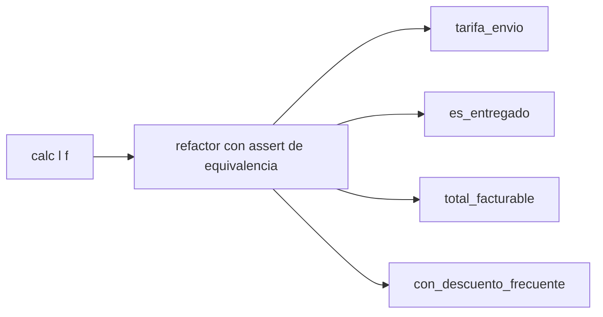
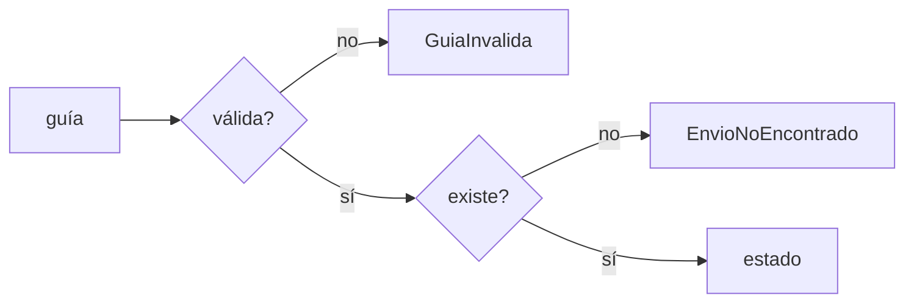
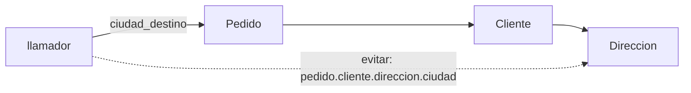
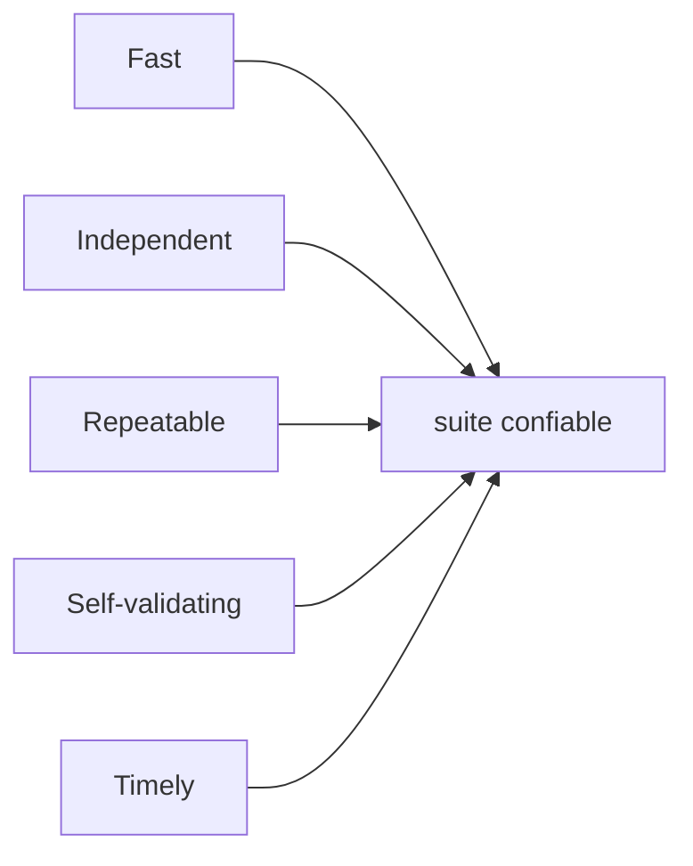

# Módulo 15: Código limpio


## Aprende construyendo

### Tema 1: Nombres que revelan intención y funciones pequeñas

#### Paso 1 · Objetivo y preparación
Al finalizar podrás renombrar variables y funciones para que expliquen su propósito, dividir una función que hace varias cosas en funciones de un solo nivel de abstracción, reemplazar números mágicos por constantes y eliminar argumentos bandera, sin cambiar el comportamiento. Prerrequisitos: Módulo 1, Tema 4 y Módulo 7, Tema 3.

#### Paso 2 · Contexto y caso real
La función `calc` de RutaFlow calculaba lo facturable del día. Nadie se atrevía a tocarla: `l`, `f`, `x[2] == "E"` y `5000` no decían nada, y un cambio de tarifa se hizo en un lugar y se olvidó en otro. Es el caso real más común en código heredado, y el primer capítulo práctico de *Código limpio*.

#### Paso 3 · Teoría, modelo mental y analogía
Un buen **nombre** responde por qué existe algo y cómo se usa (`total_facturable` en lugar de `calc`). Una **función** debe hacer una sola cosa y mantener un solo **nivel de abstracción**: o habla del negocio (facturar entregadas) o del detalle (sumar números), no de ambos. Los **números mágicos** se reemplazan por **constantes con nombre**, y un **argumento bandera** (`f=True`) indica que la función hace dos cosas: mejor dos funciones. Antes de refactorizar, una **verificación** (aquí, un `assert` de equivalencia) garantiza que el comportamiento no cambió.

**Analogía:** es ordenar un taller y rotular cada cajón: las herramientas son las mismas, pero cualquiera encuentra la que necesita sin preguntar.

**Diagrama:**



#### Paso 4 · Demostración guiada desde cero
**Ejemplo independiente (desde cero):** este tema se reproduce en una **carpeta vacía**, como **proyecto nuevo**, sin estado de otros temas.

```bash
mkdir codigo-limpio && cd codigo-limpio
```

Crea `nombres_funciones.py`:

```python
# ANTES: nombres crípticos, una función que hace tres cosas y un argumento bandera
def calc(l, f):
    t = 0
    for x in l:
        if x[2] == "E":
            t += x[1] * 1200 + (5000 if x[0] == "BOG" else 9000)
    if f:
        t = t * 0.9
    return round(t)

# DESPUÉS: nombres que revelan intención y funciones pequeñas de un solo nivel de abstracción
TARIFA_POR_KILO = 1200
TARIFA_BASE = {"BOG": 5000}
TARIFA_BASE_OTRAS_CIUDADES = 9000
DESCUENTO_CLIENTE_FRECUENTE = 0.10

def tarifa_envio(ciudad, kilos):
    return TARIFA_BASE.get(ciudad, TARIFA_BASE_OTRAS_CIUDADES) + kilos * TARIFA_POR_KILO

def es_entregado(envio):
    return envio["estado"] == "entregado"

def total_facturable(envios):
    return sum(tarifa_envio(e["ciudad"], e["kilos"]) for e in envios if es_entregado(e))

def con_descuento_frecuente(total):          # en vez de un booleano que cambia el comportamiento
    return round(total * (1 - DESCUENTO_CLIENTE_FRECUENTE))

tuplas = [("BOG", 2, "E"), ("CAL", 1, "P"), ("MED", 3, "E")]
envios = [{"ciudad": c, "kilos": k, "estado": "entregado" if s == "E" else "pendiente"} for c, k, s in tuplas]

print("Antes:  ", calc(tuplas, False), calc(tuplas, True))
print("Después:", total_facturable(envios), con_descuento_frecuente(total_facturable(envios)))
assert calc(tuplas, True) == con_descuento_frecuente(total_facturable(envios))
print("Mismo resultado, código legible")
```

**Ejecuta el ejemplo:**

```bash
python3 nombres_funciones.py
```

**Resultado esperado:**

```text
Antes:   20000 18000
Después: 20000 18000
Mismo resultado, código legible
```

Ambas versiones producen 20000 y 18000; el `assert` es la red de seguridad del refactor. Cuando tengas pruebas automáticas (Tema 4), esa red será la suite.

**Fallo deliberado:** En la versión **antes** cambia `5000` por `5500`, como si alguien hubiera actualizado la tarifa de Bogotá solo en un lugar. El programa termina con `AssertionError`: hay dos copias de la misma regla y quedaron desincronizadas. Con la constante `TARIFA_BASE` el cambio se hace una sola vez.

#### Paso 5 · Práctica guiada
Renombra y divide esta función: `def p(d): return [x for x in d if x[1] > 30 and x[2] != 'C']` (pedidos de más de 30 kg que no están cancelados). **Pista:** empieza por nombres: `pedidos_pesados_activos`, `es_pesado` y `esta_activo`, y saca el 30 a `PESO_MAXIMO_MOTO`.

#### Paso 6 · Práctica independiente
Toma una función larga de uno de tus proyectos anteriores, escribe primero una verificación de su salida actual y luego refactorízala con estas reglas. Documenta cada paso en un commit separado.

#### Paso 7 · Cierre y evidencia
Entrega como evidencia la salida real del Paso 4 y la explicación del fallo deliberado. **¿Por qué es importante?** porque el código se lee muchas más veces de las que se escribe, y la mayor parte del costo de un sistema está en mantenerlo.
**Fuente oficial:** [PEP 8 — Style Guide for Python Code](https://peps.python.org/pep-0008/), [Martin Fowler: Refactoring](https://refactoring.com/); Robert C. Martin, *Código limpio* (biblioteca externa).
**Conceptos clave:** nombres que revelan intención, una sola responsabilidad, nivel de abstracción, número mágico, argumento bandera, refactor con red de seguridad.
**Cuándo no usarlo:** no renombres de forma masiva código que no entiendes ni tienes cubierto con pruebas: primero agrega la verificación, luego refactoriza en pasos pequeños.

**Transferencia al proyecto integrador «Fundamentos: gestor de tareas»:** renombra y divide la función que calcula el progreso de las tareas hasta que cada función quepa en la pantalla.
Como **siguiente** paso, aplica lo aprendido en el proyecto integrador del track y compara el resultado con lo que esperabas.
**Errores comunes:** repetir una regla de negocio como número suelto en más de un lugar (como la tarifa `5000` de Bogotá dentro de `calc`) en vez de una sola constante con nombre, lo que lleva a actualizarla en un sitio y olvidarla en otro; y mantener un argumento bandera (como `f=True`) que hace que la misma función calcule dos cosas distintas según su valor.

### Tema 2: Comentarios honestos y excepciones en lugar de códigos de error

#### Paso 1 · Objetivo y preparación
Al finalizar podrás reemplazar códigos de error por excepciones con nombre, decidir cuándo un comentario aporta y cuándo debe convertirse en código, y separar el camino feliz del manejo de errores. Prerrequisito: Tema 1 de este módulo.

#### Paso 2 · Contexto y caso real
En RutaFlow, `estado_con_codigo` devolvía `-1` o `-2` y cada llamador debía recordar revisarlo; uno lo olvidó y la app mostró "-1" a un cliente como si fuera un estado. Los comentarios que explicaban los códigos quedaron desactualizados. Es un caso real que *Código limpio* trata en sus capítulos de comentarios y de procesamiento de errores.

#### Paso 3 · Teoría, modelo mental y analogía
Un **código de error** mezcla el resultado con el fallo y obliga a cada llamador a verificarlo: si lo olvida, el error viaja en silencio. Una **excepción con nombre** (`EnvioNoEncontrado`) interrumpe el flujo, lleva contexto y se maneja donde tiene sentido. Sobre **comentarios**: el mejor comentario es el que no hace falta porque el nombre lo dice; los comentarios valiosos explican *por qué* (una decisión, una advertencia legal, una referencia), no *qué* hace la línea. `raise ... from None` oculta la excepción interna cuando no aporta información al llamador.

**Analogía:** un código de error es una nota pegada en el paquete que alguien puede no leer; una excepción es una alarma que obliga a detenerse.

**Diagrama:**



#### Paso 4 · Demostración guiada desde cero
**Ejemplo independiente (desde cero):** este tema se reproduce en una **carpeta vacía**, como **proyecto nuevo**, sin estado de otros temas.

```bash
mkdir codigo-limpio && cd codigo-limpio
```

Crea `errores_comentarios.py`:

```python
class EnvioNoEncontrado(Exception):
    pass

class GuiaInvalida(ValueError):
    pass

ENVIOS = {"BO-000001": "en ruta"}

# ANTES: devolver códigos de error obliga a cada llamador a recordar revisarlos
def estado_con_codigo(guia):
    if len(guia) != 9:
        return -2          # -2 = guía inválida (comentario que alguien debe mantener sincronizado)
    if guia not in ENVIOS:
        return -1          # -1 = no existe
    return ENVIOS[guia]

# DESPUÉS: excepciones con nombre; el camino feliz se lee sin ruido
def estado(guia):
    if len(guia) != 9:
        raise GuiaInvalida(f"La guía {guia!r} debe tener 9 caracteres")
    try:
        return ENVIOS[guia]
    except KeyError:
        raise EnvioNoEncontrado(guia) from None

for guia in ["BO-000001", "BO-9", "BO-000777"]:
    resultado = estado_con_codigo(guia)
    print(f"{guia:<10} código={resultado!r:<10}", end=" ")
    try:
        print("excepción: ninguna, estado =", estado(guia))
    except (GuiaInvalida, EnvioNoEncontrado) as error:
        print(f"excepción: {type(error).__name__}: {error}")
```

**Ejecuta el ejemplo:**

```bash
python3 errores_comentarios.py
```

**Resultado esperado:**

```text
BO-000001  código='en ruta'  excepción: ninguna, estado = en ruta
BO-9       código=-2         excepción: GuiaInvalida: La guía 'BO-9' debe tener 9 caracteres
BO-000777  código=-1         excepción: EnvioNoEncontrado: BO-000777
```

La segunda columna muestra lo que recibía el llamador antes: un número que había que interpretar con un comentario.

**Fallo deliberado:** Agrega al final `print(estado_con_codigo("BO-9").upper())`. El programa termina con `AttributeError: 'int' object has no attribute 'upper'`: el llamador trató `-2` como si fuera un estado. Con la versión con excepciones, el error sale en el punto exacto y con un mensaje que explica la causa.

#### Paso 5 · Práctica guiada
Agrega la excepción `EnvioCancelado` para las guías canceladas y manéjala en el bucle sin tocar las otras ramas. **Pista:** agrega una guía con estado `"cancelado"` a `ENVIOS` y lanza la excepción en `estado` antes de devolverlo.

#### Paso 6 · Práctica independiente
Busca en un proyecto tuyo tres comentarios que expliquen *qué* hace el código y reemplázalos por mejores nombres o funciones; conserva solo los que expliquen *por qué*.

#### Paso 7 · Cierre y evidencia
Entrega como evidencia la salida real del Paso 4 y la explicación del fallo deliberado. **¿Por qué es importante?** porque los errores silenciosos son de los más caros, y los comentarios desactualizados engañan más que la ausencia de comentarios.
**Fuente oficial:** [PEP 8 — Style Guide for Python Code](https://peps.python.org/pep-0008/), [Martin Fowler: Refactoring](https://refactoring.com/); Robert C. Martin, *Código limpio* (biblioteca externa).
**Conceptos clave:** código de error, excepción con nombre, camino feliz, `raise from`, comentario de intención, comentario redundante, comentario desactualizado.
**Cuándo no usarlo:** no uses excepciones para el flujo normal (por ejemplo, para salir de un bucle). En sistemas donde el error es un resultado esperado y frecuente, un tipo resultado explícito también es válido.

**Transferencia al proyecto integrador «Fundamentos: gestor de tareas»:** reemplaza los valores especiales que devuelven las funciones de tareas por excepciones con nombre.
Como **siguiente** paso, aplica lo aprendido en el proyecto integrador del track y compara el resultado con lo que esperabas.
**Errores comunes:** devolver un código de error (como `-2`) que el llamador olvida revisar y trata como si fuera el valor real, provocando un `AttributeError` lejos de la causa (como en el fallo deliberado); y mantener comentarios que explican *qué* hace la línea en vez de *por qué*, que quedan desactualizados en cuanto el código cambia.

### Tema 3: Objetos frente a estructuras de datos y la ley de Demeter

#### Paso 1 · Objetivo y preparación
Al finalizar podrás distinguir un objeto (esconde datos y expone comportamiento) de una estructura de datos (expone datos), aplicar la ley de Demeter y evitar las "cadenas de vagón" que acoplan el código a la estructura interna. Prerrequisitos: Temas 1 y 2 de este módulo.

#### Paso 2 · Contexto y caso real
En RutaFlow, decenas de lugares escribían `pedido.cliente.direccion.ciudad`. Cuando se permitió crear clientes sin dirección, todos esos lugares fallaron a la vez. Es el caso real que *Código limpio* llama "choque de trenes" y que hace frágil cualquier cambio de modelo.

#### Paso 3 · Teoría, modelo mental y analogía
Una **estructura de datos** (como una `dataclass`) expone sus campos y casi no tiene lógica. Un **objeto** esconde sus datos y ofrece operaciones con significado (`puede_despacharse_a`). La **ley de Demeter** dice que un método solo debería hablar con sus "vecinos inmediatos": sus atributos, sus parámetros y los objetos que crea, no con los objetos internos de estos. La regla práctica es **dile, no le preguntes**: en vez de sacar datos y decidir afuera, pide al objeto que decida.

**Analogía:** para enviar un paquete le das la dirección al mensajero; no le abres la mochila para revisar su mapa y su gasolina.

**Diagrama:**



#### Paso 4 · Demostración guiada desde cero
**Ejemplo independiente (desde cero):** este tema se reproduce en una **carpeta vacía**, como **proyecto nuevo**, sin estado de otros temas.

```bash
mkdir codigo-limpio && cd codigo-limpio
```

Crea `demeter.py`:

```python
from dataclasses import dataclass
from typing import Optional

# Estructura de datos: expone datos, no tiene comportamiento
@dataclass
class Direccion:
    ciudad: str
    barrio: str

@dataclass
class Cliente:
    nombre: str
    direccion: Optional[Direccion]

# Objeto: esconde sus datos y expone comportamiento ("dile, no le preguntes")
class Pedido:
    def __init__(self, guia, cliente):
        self._guia, self._cliente = guia, cliente

    def ciudad_destino(self):
        direccion = self._cliente.direccion
        return direccion.ciudad if direccion else "sin dirección"

    def puede_despacharse_a(self, ciudades_con_cobertura):
        return self.ciudad_destino() in ciudades_con_cobertura

pedidos = [
    Pedido("G-1", Cliente("Ana", Direccion("Bogotá", "Chapinero"))),
    Pedido("G-2", Cliente("Beto", None)),
]
COBERTURA = {"Bogotá", "Medellín"}
for pedido in pedidos:
    # El llamador habla solo con su vecino inmediato (Pedido), no recorre la cadena interna
    print(pedido._guia, pedido.ciudad_destino(), "despachable:", pedido.puede_despacharse_a(COBERTURA))
```

**Ejecuta el ejemplo:**

```bash
python3 demeter.py
```

**Resultado esperado:**

```text
G-1 Bogotá despachable: True
G-2 sin dirección despachable: False
```

El pedido sin dirección no rompe nada porque la decisión de qué hacer sin dirección vive en un solo lugar, dentro de `Pedido`.

**Fallo deliberado:** Cambia el `print` del bucle para usar la cadena directa: `pedido._cliente.direccion.ciudad`. El segundo pedido termina con `AttributeError: 'NoneType' object has no attribute 'ciudad'`. El llamador dependía de que cada eslabón existiera; al cambiar el modelo, se rompió fuera de la clase que lo sabía manejar.

#### Paso 5 · Práctica guiada
Agrega a `Pedido` el método `etiqueta()` que devuelva `"BOG-Chapinero"` (o `"SIN-DIRECCION"`) y úsalo en lugar de construir la etiqueta afuera. **Pista:** toma las tres primeras letras de la ciudad en mayúsculas y el barrio; resuelve el caso sin dirección dentro del método.

#### Paso 6 · Práctica independiente
Revisa un proyecto tuyo con `grep -rE "\.\w+\.\w+\.\w+"` y clasifica cada cadena encontrada: ¿es navegación por una estructura de datos (aceptable) o por objetos con comportamiento (a corregir)?

#### Paso 7 · Cierre y evidencia
Entrega como evidencia la salida real del Paso 4 y la explicación del fallo deliberado. **¿Por qué es importante?** porque el acoplamiento a la estructura interna es lo que hace que un cambio pequeño en el modelo rompa medio sistema.
**Fuente oficial:** [PEP 8 — Style Guide for Python Code](https://peps.python.org/pep-0008/), [Martin Fowler: Refactoring](https://refactoring.com/); Robert C. Martin, *Código limpio* (biblioteca externa).
**Conceptos clave:** objeto, estructura de datos, encapsulamiento, ley de Demeter, "dile, no le preguntes", choque de trenes, acoplamiento.
**Cuándo no usarlo:** en DTOs, JSON o resultados de consultas, que son estructuras de datos puras, navegar campos anidados es normal: Demeter aplica a objetos con comportamiento.

**Transferencia al proyecto integrador «Fundamentos: gestor de tareas»:** mueve dentro de la clase `Tarea` las decisiones sobre su responsable y su fecha límite en lugar de consultarlas desde fuera.
Como **siguiente** paso, aplica lo aprendido en el proyecto integrador del track y compara el resultado con lo que esperabas.
**Errores comunes:** navegar directamente la cadena interna de otro objeto (como `pedido._cliente.direccion.ciudad`) en vez de pedirle al objeto que decida (`pedido.ciudad_destino()`), lo que rompe con `AttributeError` apenas un eslabón intermedio es `None`; y duplicar en cada llamador la lógica de qué hacer cuando falta la dirección, en vez de resolverla una sola vez dentro de `Pedido`.

### Tema 4: Pruebas limpias: F.I.R.S.T. y un concepto por prueba

#### Paso 1 · Objetivo y preparación
Al finalizar podrás escribir pruebas unitarias rápidas, independientes, repetibles, autoevaluadas y oportunas (F.I.R.S.T.), con un concepto por prueba y nombres que describen el comportamiento. Prerrequisitos: Módulo 5, Tema 2 y los temas anteriores de este módulo.

#### Paso 2 · Contexto y caso real
La suite de RutaFlow fallaba "a veces": una prueba usaba datos aleatorios y otra dependía del orden de ejecución. Nadie confiaba en ella y se empezó a ignorar. *Código limpio* dedica un capítulo a este caso real: pruebas sucias son peores que no tener pruebas, porque se pudren junto con el código.

#### Paso 3 · Teoría, modelo mental y analogía
**F.I.R.S.T.**: **F**ast (rápidas, para ejecutarlas siempre), **I**ndependent (ninguna depende de otra ni del orden), **R**epeatable (mismo resultado en cualquier entorno y momento), **S**elf-validating (pasan o fallan sin revisar a mano) y **T**imely (se escriben a tiempo, junto al código). Cada prueba verifica **un concepto** y su nombre lo describe como una frase; así, cuando falla, el nombre ya dice qué regla se rompió. El código de prueba merece el mismo cuidado que el de producción.

**Analogía:** una buena prueba es una alarma de humo: suena solo cuando hay humo, siempre que lo hay, y te dice en qué habitación.

**Diagrama:**



#### Paso 4 · Demostración guiada desde cero
**Ejemplo independiente (desde cero):** este tema se reproduce en una **carpeta vacía**, como **proyecto nuevo**, sin estado de otros temas.

```bash
mkdir codigo-limpio && cd codigo-limpio
```

Crea `test_pruebas_limpias.py`:

```python
import unittest

def tarifa(ciudad, kilos):
    if kilos <= 0:
        raise ValueError("kilos debe ser positivo")
    return (5000 if ciudad == "Bogotá" else 9000) + kilos * 1200

class TarifaTest(unittest.TestCase):
    # F.I.R.S.T.: rápidas (Fast), independientes (Independent), repetibles (Repeatable),
    # autoevaluadas (Self-validating) y oportunas (Timely). Un concepto por prueba.

    def test_bogota_cobra_base_local_mas_precio_por_kilo(self):
        self.assertEqual(tarifa("Bogotá", 2), 7400)

    def test_otras_ciudades_cobran_base_nacional(self):
        self.assertEqual(tarifa("Cali", 1), 10200)

    def test_rechaza_kilos_no_positivos(self):
        with self.assertRaisesRegex(ValueError, "positivo"):
            tarifa("Bogotá", 0)

if __name__ == "__main__":
    unittest.main(verbosity=2)
```

**Ejecuta el ejemplo:**

```bash
python3 test_pruebas_limpias.py
```

**Resultado esperado:**

```text
test_bogota_cobra_base_local_mas_precio_por_kilo (__main__.TarifaTest) ... ok
test_otras_ciudades_cobran_base_nacional (__main__.TarifaTest) ... ok
test_rechaza_kilos_no_positivos (__main__.TarifaTest) ... ok

----------------------------------------------------------------------
Ran 3 tests in 0.001s

OK
```

El tiempo total varía, pero debe ser de milésimas de segundo: si una prueba unitaria tarda segundos, probablemente toca red o disco.

**Fallo deliberado:** Agrega una prueba no repetible: `import random` y `def test_tarifa_azar(self): self.assertEqual(tarifa("Bogotá", random.randint(1, 3)), 7400)`. Ejecuta varias veces: unas pasan y otras fallan con `AssertionError: 6200 != 7400` o `8600 != 7400`. Una prueba que depende del azar destruye la confianza en la suite; fija los datos o la semilla.

#### Paso 5 · Práctica guiada
Agrega la regla "más de 30 kg no se aceptan" escribiendo primero una prueba con un nombre que la describa. **Pista:** nómbrala `test_rechaza_paquetes_de_mas_de_30_kilos` y usa `assertRaisesRegex` igual que en la prueba de kilos no positivos.

#### Paso 6 · Práctica independiente
Ejecuta tus pruebas en orden aleatorio (por ejemplo, con `pytest -p random_order`) y corrige cualquier prueba que dependa de otra.

#### Paso 7 · Cierre y evidencia
Entrega como evidencia la salida real del Paso 4 y la explicación del fallo deliberado. **¿Por qué es importante?** porque solo una suite confiable permite refactorizar sin miedo, que es la base de todo lo visto en este módulo.
**Fuente oficial:** [PEP 8 — Style Guide for Python Code](https://peps.python.org/pep-0008/), [Martin Fowler: Refactoring](https://refactoring.com/); Robert C. Martin, *Código limpio* (biblioteca externa).
**Conceptos clave:** F.I.R.S.T., un concepto por prueba, nombre descriptivo, prueba no determinista, independencia, `unittest`.
**Cuándo no usarlo:** las pruebas de integración y extremo a extremo no pueden ser tan rápidas: sepáralas de las unitarias y ejecútalas en otra etapa del pipeline.

**Transferencia al proyecto integrador «Fundamentos: gestor de tareas»:** reescribe las pruebas del gestor de tareas para que cumplan F.I.R.S.T. y ejecútalas en orden aleatorio.
Como **siguiente** paso, aplica lo aprendido en el proyecto integrador del track y compara el resultado con lo que esperabas.
**Errores comunes:** escribir una prueba que depende de datos aleatorios o de la hora sin fijar una semilla, lo que rompe la `R` de Repeatable (pasa o falla según la ejecución, como en el fallo deliberado); y dejar que una prueba dependa del estado que dejó otra o del orden en que corren, lo que rompe la `I` de Independent.

## Construcción guiada del capítulo

### Proyecto 15: rescate de código heredado

Toma el código de un proyecto anterior (o el archivo `heredado.py` que escribas a propósito con malas prácticas) y rescátalo sin cambiar su comportamiento:

1. Escribe una verificación de la salida actual (prueba de caracterización).
2. Renombra variables y funciones hasta que se lean como prosa.
3. Divide funciones largas y elimina argumentos bandera y números mágicos.
4. Reemplaza códigos de error por excepciones con nombre.
5. Mueve decisiones a los objetos que tienen los datos (Demeter).
6. Deja una suite F.I.R.S.T. que corra en orden aleatorio.
7. README con un antes y después y la lista de olores encontrados.

**Verificación:** la prueba de caracterización pasa al inicio y al final; cada commit hace un solo tipo de cambio; ninguna prueba depende del orden ni del azar; el README nombra cada olor (nombre críptico, función larga, código duplicado, choque de trenes).

**Errores comunes y soluciones**

- Refactorizar sin red de seguridad: escribe primero la prueba de caracterización.
- Cambiar comportamiento y estructura en el mismo commit: sepáralos.
- Comentar en vez de renombrar: si el comentario explica qué hace, el nombre está mal.
- Pruebas que se ignoran porque fallan "a veces": arréglalas o bórralas.
