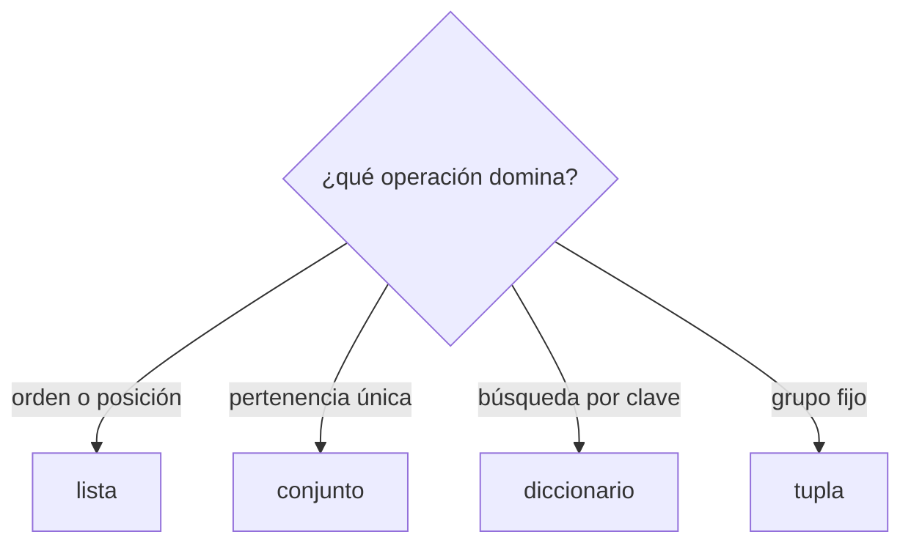
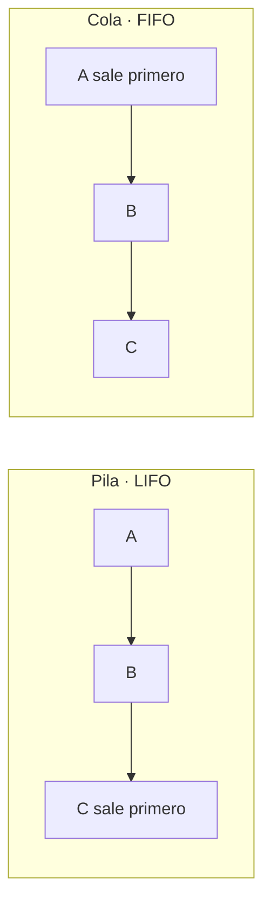
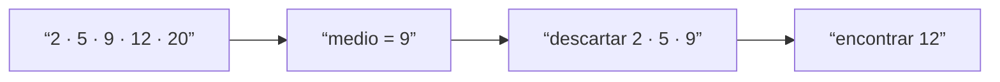
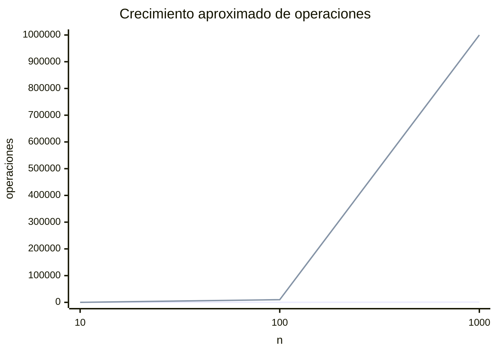
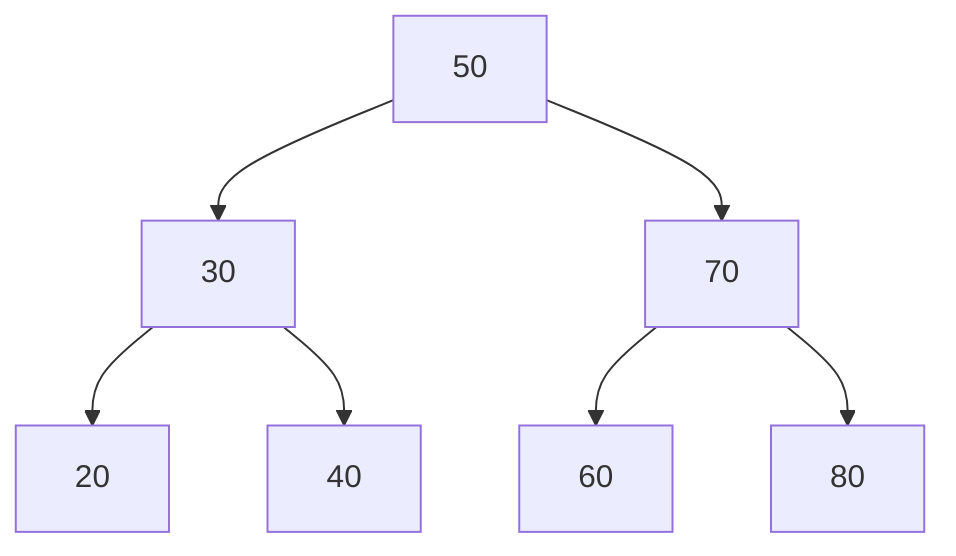
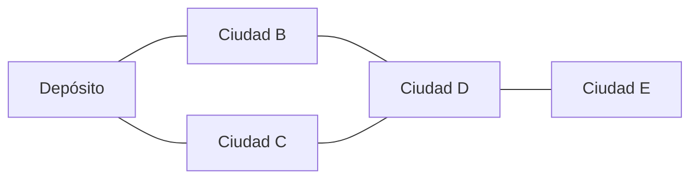

# Módulo 2: Estructuras de datos, algoritmos y complejidad

**Entorno comprobado:** Python 3.14.6 en Linux (2026-11-18), la línea de referencia del curso; se ejecutaron los bloques Python de demostración. No se validaron los comandos de creación de carpetas ni las instrucciones para PowerShell/macOS.

## Aprende construyendo


### Tema 1: Elegir estructuras según las operaciones · Básico · 45 min

<details open>
<summary><strong>Capa 1 — Lectura</strong></summary>

#### ► DE QUÉ TRATA
Al finalizar vas a comparar guardar las tareas de tu gestor en una list contra guardarlas en un dict indexado por id, para la operación "buscar la tarea con id X", y vas a reproducir un bug real de confundir la posición de una lista con la identidad de una tarea. Prerrequisitos:…

#### ► CÓMO FUNCIONA


</details>

<details>
<summary><strong>Capa 2 — Construcción</strong></summary>

#### Código y verificación
```python
productos = [
    {"sku": "A-10", "nombre": "Teclado", "stock": 4},
    {"sku": "B-20", "nombre": "Mouse", "stock": 9},
]

por_sku = {producto["sku"]: producto for producto in productos}
categorias = {"periféricos", "oficina", "periféricos"}
```


```
Lista búsqueda: O(_), inserción: O(_)
Diccionario búsqueda: O(_), inserción: O(_)
Elegida para Fundamentos: _________ (¿por qué?)
Si inserción = 50/seg: cambiarías a _________
```

```bash
mkdir ejemplo-estructuras
cd ejemplo-estructuras
mkdir src
```

```python
tareas = [
    {"id": 1, "descripcion": "comprar leche", "estado": "pendiente"},
    {"id": 2, "descripcion": "pagar factura", "estado": "pendiente"},
    {"id": 3, "descripcion": "llamar al dentista", "estado": "hecho"},
]

def buscar_por_id_lista(tareas, id_buscado):
    for tarea in tareas:
        if tarea["id"] == id_buscado:
            return tarea
    return None

por_id = {tarea["id"]: tarea for tarea in tareas}

indice_guardado = 1  # "la tarea 2 está en la posición 1" — guardado para usar después
print(buscar_por_id_lista(tareas, 2)["descripcion"])
print(por_id[2]["descripcion"])
print(tareas[indice_guardado]["descripcion"])
print(buscar_por_id_lista(tareas, 99))
print(por_id.get(99))

del tareas[0]
del por_id[1]
print(tareas[indice_guardado]["descripcion"])
print(por_id[2]["descripcion"])
```

```bash
python3 src/tareas_estructura.py
```

</details>

### Tema 2: Pilas, colas y abstracciones de comportamiento · Básico · 45 min

<details open>
<summary><strong>Capa 1 — Lectura</strong></summary>

#### ► DE QUÉ TRATA
Al finalizar vas a implementar un "deshacer" (undo) con una pila y un "procesar en el orden en que llegaron" con una cola, y vas a medir por qué usar una lista como cola (con pop(0)) es una trampa de rendimiento que no se nota hasta que la cola crece. Prerrequisitos: Tema 1 de es…

#### ► CÓMO FUNCIONA


</details>

<details>
<summary><strong>Capa 2 — Construcción</strong></summary>

#### Código y verificación
```python
from collections import deque

historial = []
historial.append("abrir archivo")
historial.append("editar título")
ultima_accion = historial.pop()

trabajos = deque()
trabajos.append("generar factura 1")
trabajos.append("generar factura 2")
primero = trabajos.popleft()
```


```
Deshacer = _________ (pila/cola)
Dos pilas: push/pop en undo, cómo se alimenta redo: _________
Estado tras 2 × Deshacer y 1 × Rehacer: _________ items en undo, _________ en redo
Cola vs pila: Perderías _________ (¿qué?)
```

```
> Tras 3 ediciones: undo=[A,B,C], redo=[]
> Tras 2 × Deshacer: undo=[A], redo=[C,B]
> Tras 1 × Rehacer: undo=[A,B], redo=[C]
> ```

```bash
mkdir ejemplo-pila-cola
cd ejemplo-pila-cola
mkdir src
```

```python
import time
from collections import deque

# "Deshacer": cada acción se apila; deshacer = pop() (LIFO, la última entra, sale primero)
acciones = []
acciones.append("crear tarea 1")
acciones.append("marcar tarea 1 como hecha")
acciones.append("crear tarea 2")
print("deshacer:", acciones.pop())

# "Procesar en el orden en que llegaron": dos formas de representar la misma cola
pendientes_lista = list(range(20_000))
pendientes_deque = deque(range(20_000))

inicio = time.perf_counter()
while pendientes_lista:
    pendientes_lista.pop(0)
tiempo_lista = time.perf_counter() - inicio

inicio = time.perf_counter()
while pendientes_deque:
    pendientes_deque.popleft()
tiempo_deque = time.perf_counter() - inicio

print(f"list.pop(0): {tiempo_lista:.4f}s | deque.popleft(): {tiempo_deque:.4f}s")
```

</details>

### Tema 3: Búsqueda, precondiciones y demostración de corrección · Básico · 45 min

<details open>
<summary><strong>Capa 1 — Lectura</strong></summary>

#### ► DE QUÉ TRATA
Al finalizar vas a implementar búsqueda binaria sobre una lista de tareas ordenada por fecha límite, y vas a reproducir el fallo silencioso de aplicarla sobre una lista que no cumple esa precondición. Prerrequisitos: Tema 2 de este módulo.

#### ► CÓMO FUNCIONA


</details>

<details>
<summary><strong>Capa 2 — Construcción</strong></summary>

#### Código y verificación
```python
def buscar_lineal(valores, objetivo):
    for indice, valor in enumerate(valores):
        if valor == objetivo:
            return indice
    return -1
```

```python
def buscar_binaria(valores, objetivo):
    izquierda, derecha = 0, len(valores) - 1
    while izquierda <= derecha:
        medio = (izquierda + derecha) // 2
        if valores[medio] == objetivo:
            return medio
        if valores[medio] < objetivo:
            izquierda = medio + 1
        else:
            derecha = medio - 1
    return -1
```


```
Precondición: lista _________ (¿ordenada?)
Algoritmo para primer_t2: búsqueda binaria pero _________
Algoritmo para ultimo_t2: búsqueda binaria pero _________
Si 0 coincidencias: devuelve _________ (None, -1, excepción)
```

```
> idx = busqueda_binaria(lista, t2)
> primer = idx; ultimo = idx
> mientras primer > 0 y lista[primer-1] == t2: primer -= 1
> mientras ultimo < len(lista)-1 y lista[ultimo+1] == t2: ultimo += 1
> return (primer, ultimo)
> ```

```bash
mkdir ejemplo-busqueda
cd ejemplo-busqueda
mkdir src
```

</details>

### Tema 4: Complejidad, medición, ordenamiento y recursión · Básico · 45 min

<details open>
<summary><strong>Capa 1 — Lectura</strong></summary>

#### ► DE QUÉ TRATA
Al finalizar vas a contar pasos reales —no segundos— para cuatro formas distintas de resolver un problema sobre la misma lista pequeña, vas a duplicar su tamaño dos veces para ver cómo diverge cada una, y vas a medir con `time.perf_counter()` por qué O(n²) deja de ser aceptable mucho antes de lo que parece.

#### ► LA IDEA EN UNA FRASE
**Contar pasos en vez de segundos revela cómo escala un algoritmo; los segundos dependen de la máquina, los pasos dependen solo de n.**

#### ► POR QUÉ EXISTE ESTO
Con una lista de 2 o 3 tareas, casi cualquier código se siente instantáneo — buscar linealmente o mantener la lista ordenada para buscar por mitades tardan lo mismo a simple vista. Las diferencias de complejidad son invisibles con datos pequeños y se vuelven decisivas en cuanto n crece; sin medir pasos, un código que "funciona bien" en desarrollo puede volverse inviable en producción con más datos.

#### ► LA ANALOGÍA
Cuatro corredores en una carrera que se ve pareja en la salida: uno siempre da un paso sin importar la distancia (O(1)), otro avanza a la mitad del tramo que queda (O(log n)), otro recorre cada metro (O(n)) y el último recorre cada metro contra cada metro de un segundo circuito (O(n²)). A 2 metros nadie nota la diferencia. A 1000 metros, el cuarto corredor sigue corriendo cuando los otros tres ya terminaron.
**Dónde se rompe la analogía:** una carrera tiene una sola distancia fija; un programa real procesa entradas de tamaño variable y n cambia con el tiempo —el algoritmo que elegiste hoy sigue corriendo mañana con el doble de datos.
#### ► CÓMO FUNCIONA
Mismo problema —localizar un elemento o recorrer una lista— resuelto de cuatro formas, contando pasos reales (no estimados) para el mismo n pequeño, y viendo qué pasa al duplicarlo dos veces:

| n | O(1) | O(log n) | O(n) | O(n²) |
|---|---|---|---|---|
| 2 | 1 | 1 | 2 | 4 |
| 4 | 1 | 2 | 4 | 16 |
| 8 | 1 | 3 | 8 | 64 |

Verificado contando pasos reales con Python 3.14 (no estimados): acceso por índice para O(1), búsqueda binaria en el peor caso para O(log n), recorrido completo para O(n), bucle anidado completo para O(n²).

#### ► REGLA PRÁCTICA
Con n=2, la diferencia entre el mejor y el peor caso de esta tabla es 4 pasos contra 1. Con n=8 ya es 64 contra 1. Esa brecha, no el tiempo en una máquina concreta, es lo que `O(...)` describe: cuánto crece el trabajo cuando crece la entrada, no cuánto tarda hoy con pocos datos.



#### ► LO QUE PUEDE SALIR MAL
| Síntoma | Causa probable | Arreglo |
|---|---|---|
| El código es "rápido" en desarrollo pero se vuelve inviable en producción | Se probó solo con pocos datos y nadie contó cómo crecen los pasos con n | Mide con `time.perf_counter()` en al menos dos tamaños que difieran 10x, no solo uno |
| Un bucle anidado se agrega "para simplificar" sin notar que ya hay otro bucle alrededor | Nadie contó cuántos bucles anidados hay sobre la misma colección | Cuenta los bucles anidados sobre el mismo n: dos anidados ya es candidato a O(n²) |
| Búsqueda binaria no encuentra un elemento que sí está | La lista no estaba ordenada antes de buscar | Confirma `lista == sorted(lista)` antes de aplicar búsqueda binaria |
#### ► TRADE-OFFS
| Opción | Cuándo usarla | Cuándo NO usarla |
|---|---|---|
| `sorted()` (Timsort, O(n log n)) | Para ordenar cualquier lista de tamaño real; es la opción por defecto en Python | Casi nunca — una implementación propia de orden O(n²) rara vez la supera |
| Bubble sort propio (O(n²)) | Solo con fines didácticos, para ver la diferencia de complejidad en código propio | En cualquier código que procese más de unos pocos cientos de elementos |
| Búsqueda binaria (O(log n)) | Cuando la lista ya está ordenada y se buscará muchas veces | Cuando la lista cambia constantemente y el costo de mantenerla ordenada supera el ahorro en la búsqueda |
#### ► CUÁNDO NO USAR ESTO
No optimices la complejidad de un código que corre una sola vez sobre datos pequeños y fijos: medir y reescribir tiene un costo, y ese costo solo se paga solo cuando n puede crecer de verdad.

#### ► DE VUELTA A LA ANALOGÍA
Volviendo a la carrera: elegir el algoritmo correcto es elegir qué corredor corre por ti antes de saber qué tan larga será la pista. Con 2 elementos cualquiera gana; la pregunta real es qué corredor sigue corriendo cuando la pista se multiplica por mil.

#### ► LO QUE DEBES RECORDAR
- Cuenta pasos, no segundos: los pasos dependen solo de n, los segundos dependen de la máquina.
- Con n pequeño, O(1), O(log n), O(n) y O(n²) casi no se distinguen; la diferencia aparece al duplicar n varias veces.
- Dos bucles anidados sobre la misma colección son la señal más común de O(n²) accidental.
- `sorted()` ya es O(n log n); reescribir tu propio ordenamiento casi nunca mejora eso.
#### ► PREGUNTAS PARA PENSAR
1. Si duplicas n una tercera vez (de 8 a 16), ¿qué valor esperas para cada columna de la tabla, y por qué el de O(n²) crece tanto más rápido?
2. ¿En qué parte de tu propio código hay dos bucles anidados sobre la misma colección, y realmente necesitas ambos?
3. ¿Qué tamaño de entrada haría que la diferencia entre O(n) y O(n²) deje de ser teórica y se vuelva un problema real de rendimiento?

</details>

<details>
<summary><strong>Capa 2 — Construcción</strong></summary>

#### Código y verificación
```python
def contar_constante(lista):
    pasos = 0
    pasos += 1  # acceso por índice: siempre 1 paso, sin importar len(lista)
    return lista[0], pasos

def contar_binaria(lista, objetivo):
    pasos = 0
    lo, hi = 0, len(lista) - 1
    while lo <= hi:
        pasos += 1
        mid = (lo + hi) // 2
        if lista[mid] == objetivo:
            return mid, pasos
        elif lista[mid] < objetivo:
            lo = mid + 1
        else:
            hi = mid - 1
    return -1, pasos  # peor caso: objetivo ausente, recorre todo el camino

def contar_lineal(lista, objetivo):
    pasos = 0
    for x in lista:
        pasos += 1
        if x == objetivo:
            return pasos
    return pasos  # peor caso: objetivo ausente, recorre toda la lista

def contar_cuadratica(lista):
    pasos = 0
    for i in range(len(lista)):
        for j in range(len(lista)):
            pasos += 1
    return pasos
```

```python
def tiene_duplicados_lento(valores):
    for i in range(len(valores)):
        for j in range(i + 1, len(valores)):
            if valores[i] == valores[j]:
                return True
    return False

def tiene_duplicados(valores):
    return len(valores) != len(set(valores))
```

```python
def factorial(n):
    if n < 0:
        raise ValueError("n debe ser no negativo")
    if n <= 1:
        return 1
    return n * factorial(n - 1)
```


```
Para n=2, 4 y 8, corre contar_constante/contar_binaria/contar_lineal/contar_cuadratica
sobre list(range(n)) buscando un valor ausente (peor caso) y completa:

n=2: O(1)=___ O(log n)=___ O(n)=___ O(n²)=___
n=4: O(1)=___ O(log n)=___ O(n)=___ O(n²)=___
n=8: O(1)=___ O(log n)=___ O(n)=___ O(n²)=___
n=16 (predicho antes de correrlo): O(1)=___ O(log n)=___ O(n)=___ O(n²)=___

10M con O(n): _________ operaciones, ~_________ segundos
10M con O(n²): _________ operaciones, ~_________ segundos (¿viable?)
Punto de inflexión (timeout 10s): N máximo = _________
Medición: time.perf_counter() antes/después, imprime diferencia
```

```python
> from timeit import timeit
>
> def lineal(n):
>     total = 0
>     for i in range(n):
>         total += i
>     return total
>
> def cuadratico(n):
>     total = 0
>     for i in range(n):
>         for j in range(n):
>             total += 1
>     return total
>
> for n in (100, 1000):
>     tiempo_lineal = timeit(lambda: lineal(n), number=3)
>     tiempo_cuadratico = timeit(lambda: cuadratico(n), number=3)
>     print(f"n={n}: O(n)={tiempo_lineal:.6f}s, O(n²)={tiempo_cuadratico:.6f}s")
> ```

```bash
mkdir ejemplo-complejidad
cd ejemplo-complejidad
mkdir src
```

</details>

### Tema 5: Árboles y árboles binarios de búsqueda (BST) · Básico · 45 min

<details open>
<summary><strong>Capa 1 — Lectura</strong></summary>

#### ► DE QUÉ TRATA
Al finalizar podrás implementar un árbol binario de búsqueda que inserta y busca elementos manteniendo un orden, y explicar por qué una búsqueda en un BST equilibrado cuesta O(log n) en vez de O(n). Prerrequisitos: Temas 1-4 de este módulo (recursión y complejidad) y Módulo 1, Te…

#### ► CÓMO FUNCIONA


</details>

<details>
<summary><strong>Capa 2 — Construcción</strong></summary>

#### Código y verificación

```bash
mkdir ejemplo
cd ejemplo
```

```python
class Nodo:
    def __init__(self, valor):
        self.valor = valor
        self.izq = None
        self.der = None

class BST:
    def __init__(self):
        self.raiz = None

    def insertar(self, valor):
        self.raiz = self._insertar(self.raiz, valor)

    def _insertar(self, nodo, valor):
        if nodo is None:
            return Nodo(valor)
        if valor < nodo.valor:
            nodo.izq = self._insertar(nodo.izq, valor)
        elif valor > nodo.valor:
            nodo.der = self._insertar(nodo.der, valor)
        return nodo

    def buscar(self, valor):
        nodo = self.raiz
        pasos = 0
        while nodo is not None:
            pasos += 1
            if valor == nodo.valor:
                return pasos          # encontrado en 'pasos' comparaciones
            nodo = nodo.izq if valor < nodo.valor else nodo.der
        return -1                      # no está

arbol = BST()
for v in [50, 30, 70, 20, 40, 60, 80]:
    arbol.insertar(v)
print("Buscar 60:", arbol.buscar(60), "comparaciones")
print("Buscar 99:", arbol.buscar(99))
```

```bash
python3 bst.py
```

</details>

### Tema 6: Tablas hash — búsqueda en tiempo constante · Básico · 45 min

<details open>
<summary><strong>Capa 1 — Lectura</strong></summary>

#### ► DE QUÉ TRATA
Al finalizar podrás implementar una tabla hash con manejo de colisiones por encadenamiento, y explicar por qué el acceso promedio es O(1) y qué lo degrada a O(n). Prerrequisitos: Temas 1-4 de este módulo.

</details>

<details>
<summary><strong>Capa 2 — Construcción</strong></summary>

#### Código y verificación
```bash
mkdir ejemplo
cd ejemplo
```

```python
class TablaHash:
    def __init__(self, capacidad=8):
        self.capacidad = capacidad
        self.cubetas = [[] for _ in range(capacidad)]

    def _indice(self, clave):
        return hash(clave) % self.capacidad   # función hash -> posición

    def poner(self, clave, valor):
        cubeta = self.cubetas[self._indice(clave)]
        for i, (k, _) in enumerate(cubeta):
            if k == clave:
                cubeta[i] = (clave, valor)    # actualiza si ya existe
                return
        cubeta.append((clave, valor))         # inserta si es nueva

    def obtener(self, clave):
        cubeta = self.cubetas[self._indice(clave)]
        for k, v in cubeta:
            if k == clave:
                return v
        raise KeyError(clave)

tabla = TablaHash()
tabla.poner("RF-4471", "en ruta")
tabla.poner("RF-5002", "entregado")
print("RF-4471 ->", tabla.obtener("RF-4471"))
print("Distribución:", [len(c) for c in tabla.cubetas])
```

```bash
python3 tabla_hash.py
```

</details>

### Tema 7: Grafos y recorridos BFS/DFS · Básico · 45 min

<details open>
<summary><strong>Capa 1 — Lectura</strong></summary>

#### ► DE QUÉ TRATA
Al finalizar podrás representar un grafo y recorrerlo en anchura (BFS) y en profundidad (DFS), y decidir cuál usar según el problema. Prerrequisitos: Temas 2 (pilas/colas) y 5 (árboles) de este módulo.

#### ► CÓMO FUNCIONA


</details>

<details>
<summary><strong>Capa 2 — Construcción</strong></summary>

#### Código y verificación


```bash
mkdir ejemplo
cd ejemplo
```

```python
from collections import deque

grafo = {
    "Deposito": ["B", "C"],
    "B": ["Deposito", "D"],
    "C": ["Deposito", "D"],
    "D": ["B", "C", "E"],
    "E": ["D"],
}

def bfs(inicio):
    visitados, cola, orden = {inicio}, deque([inicio]), []
    while cola:
        nodo = cola.popleft()          # cola: primero en entrar, primero en salir
        orden.append(nodo)
        for vecino in grafo[nodo]:
            if vecino not in visitados:
                visitados.add(vecino)
                cola.append(vecino)
    return orden

def dfs(inicio, visitados=None, orden=None):
    if visitados is None:
        visitados, orden = set(), []
    visitados.add(inicio)
    orden.append(inicio)
    for vecino in grafo[inicio]:
        if vecino not in visitados:
            dfs(vecino, visitados, orden)  # recursión = pila implícita
    return orden

print("BFS:", bfs("Deposito"))
print("DFS:", dfs("Deposito"))
```

```bash
python3 grafos.py
```

</details>

### Tema 8: Programación dinámica — resolver una vez, recordar el resultado · Básico · 45 min

<details open>
<summary><strong>Capa 1 — Lectura</strong></summary>

#### ► DE QUÉ TRATA
Al finalizar podrás reconocer un problema con subproblemas repetidos y resolverlo con memoización, convirtiendo una solución exponencial en una lineal. Prerrequisitos: Tema 4 (recursión y complejidad) de este módulo.

</details>

<details>
<summary><strong>Capa 2 — Construcción</strong></summary>

#### Código y verificación
```bash
mkdir ejemplo
cd ejemplo
```

```python
import time

# Versión ingenua: recalcula los mismos subproblemas (exponencial, O(2^n))
def fib_ingenuo(n):
    if n < 2:
        return n
    return fib_ingenuo(n - 1) + fib_ingenuo(n - 2)

# Versión con memoización: cada subproblema se resuelve una sola vez (lineal, O(n))
def fib_dp(n, memo=None):
    if memo is None:
        memo = {}
    if n < 2:
        return n
    if n in memo:
        return memo[n]                     # ya calculado: lo reutiliza
    memo[n] = fib_dp(n - 1, memo) + fib_dp(n - 2, memo)
    return memo[n]

for etiqueta, fn in [("ingenuo", fib_ingenuo), ("con DP", fib_dp)]:
    inicio = time.perf_counter()
    resultado = fn(32)
    print(f"fib(32) {etiqueta}: {resultado} en {time.perf_counter() - inicio:.3f}s")
```

```bash
python3 dp.py
```

</details>

### Proyecto 2: gestor de inventario con análisis de rendimiento

<details open>
<summary><strong>Capa 1 — Lectura</strong></summary>

</details>

<details>
<summary><strong>Capa 2 — Construcción</strong></summary>

#### Nota de construcción
Este tema es principalmente conceptual en esta versión. La verificación se realiza con las preguntas de comprensión y el criterio de cuándo NO usar proyecto 2: gestor de inventario con análisis de rendimiento.

</details>
