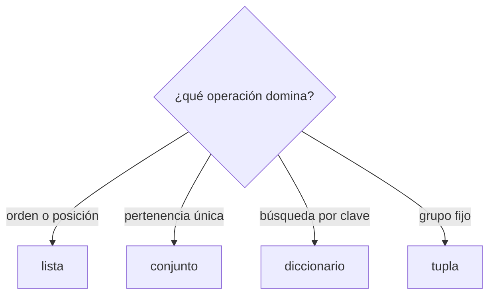
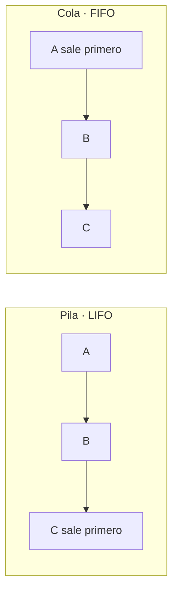
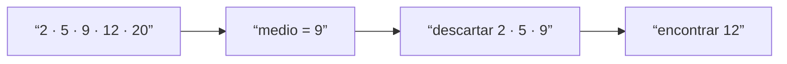
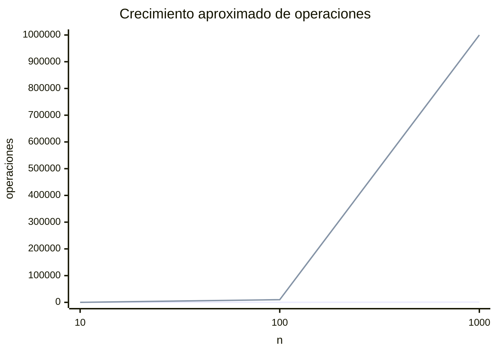
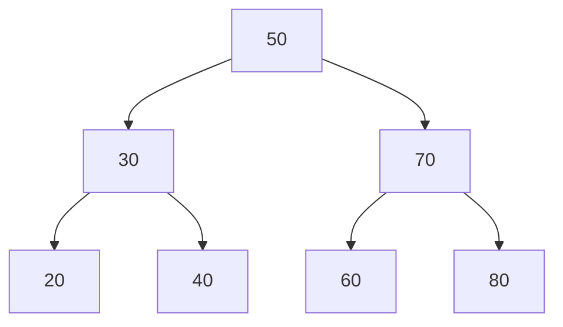
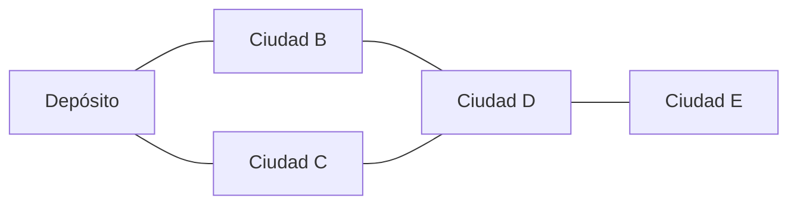

# Módulo 2: Estructuras de datos, algoritmos y complejidad

**Entorno comprobado:** Python 3.14.6 en Linux (2026-11-18), la línea de referencia del curso; se ejecutaron los bloques Python de demostración. No se validaron los comandos de creación de carpetas ni las instrucciones para PowerShell/macOS.

## Aprende construyendo


### Tema 1: Elegir estructuras según las operaciones · Básico · 45 min

<details open>
<summary><strong>Capa 1 — Lectura</strong></summary>

#### ► DE QUÉ TRATA
Al finalizar vas a comparar guardar las tareas de tu gestor en una list contra guardarlas en un dict indexado por id, para la operación "buscar la tarea con id X", y vas a reproducir un bug real de confundir la posición de una lista con la identidad de una tarea. Prerrequisitos:…

#### ► LA IDEA EN UNA FRASE
**Al finalizar vas a comparar guardar las tareas de tu gestor en una list contra guardarlas en un dict indexado por id, para la operación "buscar la tarea con id X", y vas a reproducir un bug real de confundir la posición de una lista con la identidad de una tarea.**

#### ► POR QUÉ EXISTE ESTO
Resuelve un problema real de diseño o implementación y evita decisiones a ciegas.

#### ► LA ANALOGÍA
Piensa en elegir estructuras según las operaciones como una herramienta de taller: útil cuando conoces su propósito y sus límites.
**Dónde se rompe la analogía:** en software, los efectos dependen del contexto, la escala y los trade-offs.

#### ► CÓMO FUNCIONA


#### ► LO QUE PUEDE SALIR MAL
| Síntoma | Causa probable | Arreglo |
|---|---|---|
| Elegir estructuras según las operaciones se aplica pero el resultado no mejora | Se usó sin medir el problema real | Mide antes y compara contra la alternativa simple |
| Aparece complejidad inesperada | Se adoptó la técnica sin comprender sus trade-offs | Vuelve a la sección de trade-offs y reduce el alcance |
| Falla en un caso límite | Se asumió un contexto que no se cumple | Prueba el caso límite y documenta cuándo NO usarlo |

#### ► TRADE-OFFS
| Opción | Cuándo usarla | Cuándo NO usarla |
|---|---|---|
| Usar Elegir estructuras según las operaciones | Cuando el problema coincide con su propósito y el beneficio es observable | Cuando agrega complejidad sin resolver un problema real |
| Alternativa más simple | Cuando el contexto es pequeño, estable o fácil de razonar | Cuando ya demostró no escalar o no cumplir el requisito |
| Postergar la decisión | Cuando falta evidencia del problema | Cuando el costo de esperar es mayor que el costo de probar |

#### ► CUÁNDO NO USAR ESTO
No uses elegir estructuras según las operaciones por defecto. Aplícalo cuando el problema lo justifique y puedas verificar el beneficio; si una alternativa más simple resuelve igual, prefiérela.

#### ► DE VUELTA A LA ANALOGÍA
Volviendo a la analogía: elegir estructuras según las operaciones funciona como el modelo inicial, pero recuerda dónde se rompe: en producción importan la evidencia, la escala y el costo de equivocarte.

#### ► LO QUE DEBES RECORDAR
- Elegir estructuras según las operaciones existe para resolver un problema específico.
- Mide antes de adoptar complejidad.
- Conoce el caso donde NO usarlo.
- Verifica con evidencia observable.

#### ► PREGUNTAS PARA PENSAR
1. ¿Qué problema concreto resuelve elegir estructuras según las operaciones en tu contexto?
2. ¿Cómo sabrías que elegir estructuras según las operaciones no está funcionando bien?
3. ¿Qué alternativa más simple considerarías antes de usar elegir estructuras según las operaciones?

</details>

<details>
<summary><strong>Capa 2 — Construcción</strong></summary>

#### Código y verificación
```python
productos = [
    {"sku": "A-10", "nombre": "Teclado", "stock": 4},
    {"sku": "B-20", "nombre": "Mouse", "stock": 9},
]

por_sku = {producto["sku"]: producto for producto in productos}
categorias = {"periféricos", "oficina", "periféricos"}
```


```
Lista búsqueda: O(_), inserción: O(_)
Diccionario búsqueda: O(_), inserción: O(_)
Elegida para Fundamentos: _________ (¿por qué?)
Si inserción = 50/seg: cambiarías a _________
```

```bash
mkdir ejemplo-estructuras
cd ejemplo-estructuras
mkdir src
```

```python
tareas = [
    {"id": 1, "descripcion": "comprar leche", "estado": "pendiente"},
    {"id": 2, "descripcion": "pagar factura", "estado": "pendiente"},
    {"id": 3, "descripcion": "llamar al dentista", "estado": "hecho"},
]

def buscar_por_id_lista(tareas, id_buscado):
    for tarea in tareas:
        if tarea["id"] == id_buscado:
            return tarea
    return None

por_id = {tarea["id"]: tarea for tarea in tareas}

indice_guardado = 1  # "la tarea 2 está en la posición 1" — guardado para usar después
print(buscar_por_id_lista(tareas, 2)["descripcion"])
print(por_id[2]["descripcion"])
print(tareas[indice_guardado]["descripcion"])
print(buscar_por_id_lista(tareas, 99))
print(por_id.get(99))

del tareas[0]
del por_id[1]
print(tareas[indice_guardado]["descripcion"])
print(por_id[2]["descripcion"])
```

```bash
python3 src/tareas_estructura.py
```

</details>

### Tema 2: Pilas, colas y abstracciones de comportamiento · Básico · 45 min

<details open>
<summary><strong>Capa 1 — Lectura</strong></summary>

#### ► DE QUÉ TRATA
Al finalizar vas a implementar un "deshacer" (undo) con una pila y un "procesar en el orden en que llegaron" con una cola, y vas a medir por qué usar una lista como cola (con pop(0)) es una trampa de rendimiento que no se nota hasta que la cola crece. Prerrequisitos: Tema 1 de es…

#### ► LA IDEA EN UNA FRASE
**Al finalizar vas a implementar un "deshacer" (undo) con una pila y un "procesar en el orden en que llegaron" con una cola, y vas a medir por qué usar una lista como cola (con pop(0)) es una trampa de rendimiento que no se nota hasta que la cola crece.**

#### ► POR QUÉ EXISTE ESTO
Resuelve un problema real de diseño o implementación y evita decisiones a ciegas.

#### ► LA ANALOGÍA
Piensa en pilas, colas y abstracciones de comportamiento como una herramienta de taller: útil cuando conoces su propósito y sus límites.
**Dónde se rompe la analogía:** en software, los efectos dependen del contexto, la escala y los trade-offs.

#### ► CÓMO FUNCIONA


#### ► LO QUE PUEDE SALIR MAL
| Síntoma | Causa probable | Arreglo |
|---|---|---|
| Pilas, colas y abstracciones de comportamiento se aplica pero el resultado no mejora | Se usó sin medir el problema real | Mide antes y compara contra la alternativa simple |
| Aparece complejidad inesperada | Se adoptó la técnica sin comprender sus trade-offs | Vuelve a la sección de trade-offs y reduce el alcance |
| Falla en un caso límite | Se asumió un contexto que no se cumple | Prueba el caso límite y documenta cuándo NO usarlo |

#### ► TRADE-OFFS
| Opción | Cuándo usarla | Cuándo NO usarla |
|---|---|---|
| Usar Pilas, colas y abstracciones de comportamiento | Cuando el problema coincide con su propósito y el beneficio es observable | Cuando agrega complejidad sin resolver un problema real |
| Alternativa más simple | Cuando el contexto es pequeño, estable o fácil de razonar | Cuando ya demostró no escalar o no cumplir el requisito |
| Postergar la decisión | Cuando falta evidencia del problema | Cuando el costo de esperar es mayor que el costo de probar |

#### ► CUÁNDO NO USAR ESTO
No uses pilas, colas y abstracciones de comportamiento por defecto. Aplícalo cuando el problema lo justifique y puedas verificar el beneficio; si una alternativa más simple resuelve igual, prefiérela.

#### ► DE VUELTA A LA ANALOGÍA
Volviendo a la analogía: pilas, colas y abstracciones de comportamiento funciona como el modelo inicial, pero recuerda dónde se rompe: en producción importan la evidencia, la escala y el costo de equivocarte.

#### ► LO QUE DEBES RECORDAR
- Pilas, colas y abstracciones de comportamiento existe para resolver un problema específico.
- Mide antes de adoptar complejidad.
- Conoce el caso donde NO usarlo.
- Verifica con evidencia observable.

#### ► PREGUNTAS PARA PENSAR
1. ¿Qué problema concreto resuelve pilas, colas y abstracciones de comportamiento en tu contexto?
2. ¿Cómo sabrías que pilas, colas y abstracciones de comportamiento no está funcionando bien?
3. ¿Qué alternativa más simple considerarías antes de usar pilas, colas y abstracciones de comportamiento?

</details>

<details>
<summary><strong>Capa 2 — Construcción</strong></summary>

#### Código y verificación
```python
from collections import deque

historial = []
historial.append("abrir archivo")
historial.append("editar título")
ultima_accion = historial.pop()

trabajos = deque()
trabajos.append("generar factura 1")
trabajos.append("generar factura 2")
primero = trabajos.popleft()
```


```
Deshacer = _________ (pila/cola)
Dos pilas: push/pop en undo, cómo se alimenta redo: _________
Estado tras 2 × Deshacer y 1 × Rehacer: _________ items en undo, _________ en redo
Cola vs pila: Perderías _________ (¿qué?)
```

```
> Tras 3 ediciones: undo=[A,B,C], redo=[]
> Tras 2 × Deshacer: undo=[A], redo=[C,B]
> Tras 1 × Rehacer: undo=[A,B], redo=[C]
> ```

```bash
mkdir ejemplo-pila-cola
cd ejemplo-pila-cola
mkdir src
```

```python
import time
from collections import deque

# "Deshacer": cada acción se apila; deshacer = pop() (LIFO, la última entra, sale primero)
acciones = []
acciones.append("crear tarea 1")
acciones.append("marcar tarea 1 como hecha")
acciones.append("crear tarea 2")
print("deshacer:", acciones.pop())

# "Procesar en el orden en que llegaron": dos formas de representar la misma cola
pendientes_lista = list(range(20_000))
pendientes_deque = deque(range(20_000))

inicio = time.perf_counter()
while pendientes_lista:
    pendientes_lista.pop(0)
tiempo_lista = time.perf_counter() - inicio

inicio = time.perf_counter()
while pendientes_deque:
    pendientes_deque.popleft()
tiempo_deque = time.perf_counter() - inicio

print(f"list.pop(0): {tiempo_lista:.4f}s | deque.popleft(): {tiempo_deque:.4f}s")
```

</details>

### Tema 3: Búsqueda, precondiciones y demostración de corrección · Básico · 45 min

<details open>
<summary><strong>Capa 1 — Lectura</strong></summary>

#### ► DE QUÉ TRATA
Al finalizar vas a implementar búsqueda binaria sobre una lista de tareas ordenada por fecha límite, y vas a reproducir el fallo silencioso de aplicarla sobre una lista que no cumple esa precondición. Prerrequisitos: Tema 2 de este módulo.

#### ► LA IDEA EN UNA FRASE
**Al finalizar vas a implementar búsqueda binaria sobre una lista de tareas ordenada por fecha límite, y vas a reproducir el fallo silencioso de aplicarla sobre una lista que no cumple esa precondición.**

#### ► POR QUÉ EXISTE ESTO
Resuelve un problema real de diseño o implementación y evita decisiones a ciegas.

#### ► LA ANALOGÍA
Piensa en búsqueda, precondiciones y demostración de corrección como una herramienta de taller: útil cuando conoces su propósito y sus límites.
**Dónde se rompe la analogía:** en software, los efectos dependen del contexto, la escala y los trade-offs.

#### ► CÓMO FUNCIONA


#### ► LO QUE PUEDE SALIR MAL
| Síntoma | Causa probable | Arreglo |
|---|---|---|
| Búsqueda, precondiciones y demostración de corrección se aplica pero el resultado no mejora | Se usó sin medir el problema real | Mide antes y compara contra la alternativa simple |
| Aparece complejidad inesperada | Se adoptó la técnica sin comprender sus trade-offs | Vuelve a la sección de trade-offs y reduce el alcance |
| Falla en un caso límite | Se asumió un contexto que no se cumple | Prueba el caso límite y documenta cuándo NO usarlo |

#### ► TRADE-OFFS
| Opción | Cuándo usarla | Cuándo NO usarla |
|---|---|---|
| Usar Búsqueda, precondiciones y demostración de corrección | Cuando el problema coincide con su propósito y el beneficio es observable | Cuando agrega complejidad sin resolver un problema real |
| Alternativa más simple | Cuando el contexto es pequeño, estable o fácil de razonar | Cuando ya demostró no escalar o no cumplir el requisito |
| Postergar la decisión | Cuando falta evidencia del problema | Cuando el costo de esperar es mayor que el costo de probar |

#### ► CUÁNDO NO USAR ESTO
No uses búsqueda, precondiciones y demostración de corrección por defecto. Aplícalo cuando el problema lo justifique y puedas verificar el beneficio; si una alternativa más simple resuelve igual, prefiérela.

#### ► DE VUELTA A LA ANALOGÍA
Volviendo a la analogía: búsqueda, precondiciones y demostración de corrección funciona como el modelo inicial, pero recuerda dónde se rompe: en producción importan la evidencia, la escala y el costo de equivocarte.

#### ► LO QUE DEBES RECORDAR
- Búsqueda, precondiciones y demostración de corrección existe para resolver un problema específico.
- Mide antes de adoptar complejidad.
- Conoce el caso donde NO usarlo.
- Verifica con evidencia observable.

#### ► PREGUNTAS PARA PENSAR
1. ¿Qué problema concreto resuelve búsqueda, precondiciones y demostración de corrección en tu contexto?
2. ¿Cómo sabrías que búsqueda, precondiciones y demostración de corrección no está funcionando bien?
3. ¿Qué alternativa más simple considerarías antes de usar búsqueda, precondiciones y demostración de corrección?

</details>

<details>
<summary><strong>Capa 2 — Construcción</strong></summary>

#### Código y verificación
```python
def buscar_lineal(valores, objetivo):
    for indice, valor in enumerate(valores):
        if valor == objetivo:
            return indice
    return -1
```

```python
def buscar_binaria(valores, objetivo):
    izquierda, derecha = 0, len(valores) - 1
    while izquierda <= derecha:
        medio = (izquierda + derecha) // 2
        if valores[medio] == objetivo:
            return medio
        if valores[medio] < objetivo:
            izquierda = medio + 1
        else:
            derecha = medio - 1
    return -1
```


```
Precondición: lista _________ (¿ordenada?)
Algoritmo para primer_t2: búsqueda binaria pero _________
Algoritmo para ultimo_t2: búsqueda binaria pero _________
Si 0 coincidencias: devuelve _________ (None, -1, excepción)
```

```
> idx = busqueda_binaria(lista, t2)
> primer = idx; ultimo = idx
> mientras primer > 0 y lista[primer-1] == t2: primer -= 1
> mientras ultimo < len(lista)-1 y lista[ultimo+1] == t2: ultimo += 1
> return (primer, ultimo)
> ```

```bash
mkdir ejemplo-busqueda
cd ejemplo-busqueda
mkdir src
```

</details>

### Tema 4: Complejidad, medición, ordenamiento y recursión · Básico · 45 min

<details open>
<summary><strong>Capa 1 — Lectura</strong></summary>

#### ► DE QUÉ TRATA
Al finalizar vas a medir con time.perf_counter() cuánto tarda ordenar una lista de tareas con sorted() comparado con una implementación propia de bubble sort, en varios tamaños, y vas a ver en números reales por qué O(n²) deja de ser aceptable mucho antes de lo que parece. Prerre…

#### ► LA IDEA EN UNA FRASE
**Al finalizar vas a medir con time.perf_counter() cuánto tarda ordenar una lista de tareas con sorted() comparado con una implementación propia de bubble sort, en varios tamaños, y vas a ver en números reales por qué O(n²) deja de ser aceptable mucho antes de lo que parece.**

#### ► POR QUÉ EXISTE ESTO
Resuelve un problema real de diseño o implementación y evita decisiones a ciegas.

#### ► LA ANALOGÍA
Piensa en complejidad, medición, ordenamiento y recursión como una herramienta de taller: útil cuando conoces su propósito y sus límites.
**Dónde se rompe la analogía:** en software, los efectos dependen del contexto, la escala y los trade-offs.

#### ► CÓMO FUNCIONA


#### ► LO QUE PUEDE SALIR MAL
| Síntoma | Causa probable | Arreglo |
|---|---|---|
| Complejidad, medición, ordenamiento y recursión se aplica pero el resultado no mejora | Se usó sin medir el problema real | Mide antes y compara contra la alternativa simple |
| Aparece complejidad inesperada | Se adoptó la técnica sin comprender sus trade-offs | Vuelve a la sección de trade-offs y reduce el alcance |
| Falla en un caso límite | Se asumió un contexto que no se cumple | Prueba el caso límite y documenta cuándo NO usarlo |

#### ► TRADE-OFFS
| Opción | Cuándo usarla | Cuándo NO usarla |
|---|---|---|
| Usar Complejidad, medición, ordenamiento y recursión | Cuando el problema coincide con su propósito y el beneficio es observable | Cuando agrega complejidad sin resolver un problema real |
| Alternativa más simple | Cuando el contexto es pequeño, estable o fácil de razonar | Cuando ya demostró no escalar o no cumplir el requisito |
| Postergar la decisión | Cuando falta evidencia del problema | Cuando el costo de esperar es mayor que el costo de probar |

#### ► CUÁNDO NO USAR ESTO
No uses complejidad, medición, ordenamiento y recursión por defecto. Aplícalo cuando el problema lo justifique y puedas verificar el beneficio; si una alternativa más simple resuelve igual, prefiérela.

#### ► DE VUELTA A LA ANALOGÍA
Volviendo a la analogía: complejidad, medición, ordenamiento y recursión funciona como el modelo inicial, pero recuerda dónde se rompe: en producción importan la evidencia, la escala y el costo de equivocarte.

#### ► LO QUE DEBES RECORDAR
- Complejidad, medición, ordenamiento y recursión existe para resolver un problema específico.
- Mide antes de adoptar complejidad.
- Conoce el caso donde NO usarlo.
- Verifica con evidencia observable.

#### ► PREGUNTAS PARA PENSAR
1. ¿Qué problema concreto resuelve complejidad, medición, ordenamiento y recursión en tu contexto?
2. ¿Cómo sabrías que complejidad, medición, ordenamiento y recursión no está funcionando bien?
3. ¿Qué alternativa más simple considerarías antes de usar complejidad, medición, ordenamiento y recursión?

</details>

<details>
<summary><strong>Capa 2 — Construcción</strong></summary>

#### Código y verificación
```python
def tiene_duplicados_lento(valores):
    for i in range(len(valores)):
        for j in range(i + 1, len(valores)):
            if valores[i] == valores[j]:
                return True
    return False

def tiene_duplicados(valores):
    return len(valores) != len(set(valores))
```

```python
def factorial(n):
    if n < 0:
        raise ValueError("n debe ser no negativo")
    if n <= 1:
        return 1
    return n * factorial(n - 1)
```


```
10M con O(n): _________ operaciones, ~_________ segundos
10M con O(n²): _________ operaciones, ~_________ segundos (¿viable?)
Punto de inflexión (timeout 10s): N máximo = _________
Medición: time.perf_counter() antes/después, imprime diferencia
```

```python
> from timeit import timeit
>
> def lineal(n):
>     total = 0
>     for i in range(n):
>         total += i
>     return total
>
> def cuadratico(n):
>     total = 0
>     for i in range(n):
>         for j in range(n):
>             total += 1
>     return total
>
> for n in (100, 1000):
>     tiempo_lineal = timeit(lambda: lineal(n), number=3)
>     tiempo_cuadratico = timeit(lambda: cuadratico(n), number=3)
>     print(f"n={n}: O(n)={tiempo_lineal:.6f}s, O(n²)={tiempo_cuadratico:.6f}s")
> ```

```bash
mkdir ejemplo-complejidad
cd ejemplo-complejidad
mkdir src
```

</details>

### Tema 5: Árboles y árboles binarios de búsqueda (BST) · Básico · 45 min

<details open>
<summary><strong>Capa 1 — Lectura</strong></summary>

#### ► DE QUÉ TRATA
Al finalizar podrás implementar un árbol binario de búsqueda que inserta y busca elementos manteniendo un orden, y explicar por qué una búsqueda en un BST equilibrado cuesta O(log n) en vez de O(n). Prerrequisitos: Temas 1-4 de este módulo (recursión y complejidad) y Módulo 1, Te…

#### ► LA IDEA EN UNA FRASE
**Al finalizar podrás implementar un árbol binario de búsqueda que inserta y busca elementos manteniendo un orden, y explicar por qué una búsqueda en un BST equilibrado cuesta O(log n) en vez de O(n).**

#### ► POR QUÉ EXISTE ESTO
Resuelve un problema real de diseño o implementación y evita decisiones a ciegas.

#### ► LA ANALOGÍA
Piensa en árboles y árboles binarios de búsqueda (bst) como una herramienta de taller: útil cuando conoces su propósito y sus límites.
**Dónde se rompe la analogía:** en software, los efectos dependen del contexto, la escala y los trade-offs.

#### ► CÓMO FUNCIONA


#### ► LO QUE PUEDE SALIR MAL
| Síntoma | Causa probable | Arreglo |
|---|---|---|
| Árboles y árboles binarios de búsqueda (BST) se aplica pero el resultado no mejora | Se usó sin medir el problema real | Mide antes y compara contra la alternativa simple |
| Aparece complejidad inesperada | Se adoptó la técnica sin comprender sus trade-offs | Vuelve a la sección de trade-offs y reduce el alcance |
| Falla en un caso límite | Se asumió un contexto que no se cumple | Prueba el caso límite y documenta cuándo NO usarlo |

#### ► TRADE-OFFS
| Opción | Cuándo usarla | Cuándo NO usarla |
|---|---|---|
| Usar Árboles y árboles binarios de búsqueda (BST) | Cuando el problema coincide con su propósito y el beneficio es observable | Cuando agrega complejidad sin resolver un problema real |
| Alternativa más simple | Cuando el contexto es pequeño, estable o fácil de razonar | Cuando ya demostró no escalar o no cumplir el requisito |
| Postergar la decisión | Cuando falta evidencia del problema | Cuando el costo de esperar es mayor que el costo de probar |

#### ► CUÁNDO NO USAR ESTO
No uses árboles y árboles binarios de búsqueda (bst) por defecto. Aplícalo cuando el problema lo justifique y puedas verificar el beneficio; si una alternativa más simple resuelve igual, prefiérela.

#### ► DE VUELTA A LA ANALOGÍA
Volviendo a la analogía: árboles y árboles binarios de búsqueda (bst) funciona como el modelo inicial, pero recuerda dónde se rompe: en producción importan la evidencia, la escala y el costo de equivocarte.

#### ► LO QUE DEBES RECORDAR
- Árboles y árboles binarios de búsqueda (BST) existe para resolver un problema específico.
- Mide antes de adoptar complejidad.
- Conoce el caso donde NO usarlo.
- Verifica con evidencia observable.

#### ► PREGUNTAS PARA PENSAR
1. ¿Qué problema concreto resuelve árboles y árboles binarios de búsqueda (bst) en tu contexto?
2. ¿Cómo sabrías que árboles y árboles binarios de búsqueda (bst) no está funcionando bien?
3. ¿Qué alternativa más simple considerarías antes de usar árboles y árboles binarios de búsqueda (bst)?

</details>

<details>
<summary><strong>Capa 2 — Construcción</strong></summary>

#### Código y verificación


```bash
mkdir ejemplo
cd ejemplo
```

```python
class Nodo:
    def __init__(self, valor):
        self.valor = valor
        self.izq = None
        self.der = None

class BST:
    def __init__(self):
        self.raiz = None

    def insertar(self, valor):
        self.raiz = self._insertar(self.raiz, valor)

    def _insertar(self, nodo, valor):
        if nodo is None:
            return Nodo(valor)
        if valor < nodo.valor:
            nodo.izq = self._insertar(nodo.izq, valor)
        elif valor > nodo.valor:
            nodo.der = self._insertar(nodo.der, valor)
        return nodo

    def buscar(self, valor):
        nodo = self.raiz
        pasos = 0
        while nodo is not None:
            pasos += 1
            if valor == nodo.valor:
                return pasos          # encontrado en 'pasos' comparaciones
            nodo = nodo.izq if valor < nodo.valor else nodo.der
        return -1                      # no está

arbol = BST()
for v in [50, 30, 70, 20, 40, 60, 80]:
    arbol.insertar(v)
print("Buscar 60:", arbol.buscar(60), "comparaciones")
print("Buscar 99:", arbol.buscar(99))
```

```bash
python3 bst.py
```

</details>

### Tema 6: Tablas hash — búsqueda en tiempo constante · Básico · 45 min

<details open>
<summary><strong>Capa 1 — Lectura</strong></summary>

#### ► DE QUÉ TRATA
Al finalizar podrás implementar una tabla hash con manejo de colisiones por encadenamiento, y explicar por qué el acceso promedio es O(1) y qué lo degrada a O(n). Prerrequisitos: Temas 1-4 de este módulo.

#### ► LA IDEA EN UNA FRASE
**Al finalizar podrás implementar una tabla hash con manejo de colisiones por encadenamiento, y explicar por qué el acceso promedio es O(1) y qué lo degrada a O(n).**

#### ► POR QUÉ EXISTE ESTO
Resuelve un problema real de diseño o implementación y evita decisiones a ciegas.

#### ► LA ANALOGÍA
Piensa en tablas hash — búsqueda en tiempo constante como una herramienta de taller: útil cuando conoces su propósito y sus límites.
**Dónde se rompe la analogía:** en software, los efectos dependen del contexto, la escala y los trade-offs.

#### ► CÓMO FUNCIONA
1. Identifica el problema que tablas hash — búsqueda en tiempo constante resuelve.
2. Observa sus componentes y relaciones.
3. Aplica la opción más simple que funcione.
4. Verifica el resultado y los límites.

#### ► LO QUE PUEDE SALIR MAL
| Síntoma | Causa probable | Arreglo |
|---|---|---|
| Tablas hash — búsqueda en tiempo constante se aplica pero el resultado no mejora | Se usó sin medir el problema real | Mide antes y compara contra la alternativa simple |
| Aparece complejidad inesperada | Se adoptó la técnica sin comprender sus trade-offs | Vuelve a la sección de trade-offs y reduce el alcance |
| Falla en un caso límite | Se asumió un contexto que no se cumple | Prueba el caso límite y documenta cuándo NO usarlo |

#### ► TRADE-OFFS
| Opción | Cuándo usarla | Cuándo NO usarla |
|---|---|---|
| Usar Tablas hash — búsqueda en tiempo constante | Cuando el problema coincide con su propósito y el beneficio es observable | Cuando agrega complejidad sin resolver un problema real |
| Alternativa más simple | Cuando el contexto es pequeño, estable o fácil de razonar | Cuando ya demostró no escalar o no cumplir el requisito |
| Postergar la decisión | Cuando falta evidencia del problema | Cuando el costo de esperar es mayor que el costo de probar |

#### ► CUÁNDO NO USAR ESTO
No uses tablas hash — búsqueda en tiempo constante por defecto. Aplícalo cuando el problema lo justifique y puedas verificar el beneficio; si una alternativa más simple resuelve igual, prefiérela.

#### ► DE VUELTA A LA ANALOGÍA
Volviendo a la analogía: tablas hash — búsqueda en tiempo constante funciona como el modelo inicial, pero recuerda dónde se rompe: en producción importan la evidencia, la escala y el costo de equivocarte.

#### ► LO QUE DEBES RECORDAR
- Tablas hash — búsqueda en tiempo constante existe para resolver un problema específico.
- Mide antes de adoptar complejidad.
- Conoce el caso donde NO usarlo.
- Verifica con evidencia observable.

#### ► PREGUNTAS PARA PENSAR
1. ¿Qué problema concreto resuelve tablas hash — búsqueda en tiempo constante en tu contexto?
2. ¿Cómo sabrías que tablas hash — búsqueda en tiempo constante no está funcionando bien?
3. ¿Qué alternativa más simple considerarías antes de usar tablas hash — búsqueda en tiempo constante?

</details>

<details>
<summary><strong>Capa 2 — Construcción</strong></summary>

#### Código y verificación
```bash
mkdir ejemplo
cd ejemplo
```

```python
class TablaHash:
    def __init__(self, capacidad=8):
        self.capacidad = capacidad
        self.cubetas = [[] for _ in range(capacidad)]

    def _indice(self, clave):
        return hash(clave) % self.capacidad   # función hash -> posición

    def poner(self, clave, valor):
        cubeta = self.cubetas[self._indice(clave)]
        for i, (k, _) in enumerate(cubeta):
            if k == clave:
                cubeta[i] = (clave, valor)    # actualiza si ya existe
                return
        cubeta.append((clave, valor))         # inserta si es nueva

    def obtener(self, clave):
        cubeta = self.cubetas[self._indice(clave)]
        for k, v in cubeta:
            if k == clave:
                return v
        raise KeyError(clave)

tabla = TablaHash()
tabla.poner("RF-4471", "en ruta")
tabla.poner("RF-5002", "entregado")
print("RF-4471 ->", tabla.obtener("RF-4471"))
print("Distribución:", [len(c) for c in tabla.cubetas])
```

```bash
python3 tabla_hash.py
```

</details>

### Tema 7: Grafos y recorridos BFS/DFS · Básico · 45 min

<details open>
<summary><strong>Capa 1 — Lectura</strong></summary>

#### ► DE QUÉ TRATA
Al finalizar podrás representar un grafo y recorrerlo en anchura (BFS) y en profundidad (DFS), y decidir cuál usar según el problema. Prerrequisitos: Temas 2 (pilas/colas) y 5 (árboles) de este módulo.

#### ► LA IDEA EN UNA FRASE
**Al finalizar podrás representar un grafo y recorrerlo en anchura (BFS) y en profundidad (DFS), y decidir cuál usar según el problema.**

#### ► POR QUÉ EXISTE ESTO
Resuelve un problema real de diseño o implementación y evita decisiones a ciegas.

#### ► LA ANALOGÍA
Piensa en grafos y recorridos bfs/dfs como una herramienta de taller: útil cuando conoces su propósito y sus límites.
**Dónde se rompe la analogía:** en software, los efectos dependen del contexto, la escala y los trade-offs.

#### ► CÓMO FUNCIONA


#### ► LO QUE PUEDE SALIR MAL
| Síntoma | Causa probable | Arreglo |
|---|---|---|
| Grafos y recorridos BFS/DFS se aplica pero el resultado no mejora | Se usó sin medir el problema real | Mide antes y compara contra la alternativa simple |
| Aparece complejidad inesperada | Se adoptó la técnica sin comprender sus trade-offs | Vuelve a la sección de trade-offs y reduce el alcance |
| Falla en un caso límite | Se asumió un contexto que no se cumple | Prueba el caso límite y documenta cuándo NO usarlo |

#### ► TRADE-OFFS
| Opción | Cuándo usarla | Cuándo NO usarla |
|---|---|---|
| Usar Grafos y recorridos BFS/DFS | Cuando el problema coincide con su propósito y el beneficio es observable | Cuando agrega complejidad sin resolver un problema real |
| Alternativa más simple | Cuando el contexto es pequeño, estable o fácil de razonar | Cuando ya demostró no escalar o no cumplir el requisito |
| Postergar la decisión | Cuando falta evidencia del problema | Cuando el costo de esperar es mayor que el costo de probar |

#### ► CUÁNDO NO USAR ESTO
No uses grafos y recorridos bfs/dfs por defecto. Aplícalo cuando el problema lo justifique y puedas verificar el beneficio; si una alternativa más simple resuelve igual, prefiérela.

#### ► DE VUELTA A LA ANALOGÍA
Volviendo a la analogía: grafos y recorridos bfs/dfs funciona como el modelo inicial, pero recuerda dónde se rompe: en producción importan la evidencia, la escala y el costo de equivocarte.

#### ► LO QUE DEBES RECORDAR
- Grafos y recorridos BFS/DFS existe para resolver un problema específico.
- Mide antes de adoptar complejidad.
- Conoce el caso donde NO usarlo.
- Verifica con evidencia observable.

#### ► PREGUNTAS PARA PENSAR
1. ¿Qué problema concreto resuelve grafos y recorridos bfs/dfs en tu contexto?
2. ¿Cómo sabrías que grafos y recorridos bfs/dfs no está funcionando bien?
3. ¿Qué alternativa más simple considerarías antes de usar grafos y recorridos bfs/dfs?

</details>

<details>
<summary><strong>Capa 2 — Construcción</strong></summary>

#### Código y verificación


```bash
mkdir ejemplo
cd ejemplo
```

```python
from collections import deque

grafo = {
    "Deposito": ["B", "C"],
    "B": ["Deposito", "D"],
    "C": ["Deposito", "D"],
    "D": ["B", "C", "E"],
    "E": ["D"],
}

def bfs(inicio):
    visitados, cola, orden = {inicio}, deque([inicio]), []
    while cola:
        nodo = cola.popleft()          # cola: primero en entrar, primero en salir
        orden.append(nodo)
        for vecino in grafo[nodo]:
            if vecino not in visitados:
                visitados.add(vecino)
                cola.append(vecino)
    return orden

def dfs(inicio, visitados=None, orden=None):
    if visitados is None:
        visitados, orden = set(), []
    visitados.add(inicio)
    orden.append(inicio)
    for vecino in grafo[inicio]:
        if vecino not in visitados:
            dfs(vecino, visitados, orden)  # recursión = pila implícita
    return orden

print("BFS:", bfs("Deposito"))
print("DFS:", dfs("Deposito"))
```

```bash
python3 grafos.py
```

</details>

### Tema 8: Programación dinámica — resolver una vez, recordar el resultado · Básico · 45 min

<details open>
<summary><strong>Capa 1 — Lectura</strong></summary>

#### ► DE QUÉ TRATA
Al finalizar podrás reconocer un problema con subproblemas repetidos y resolverlo con memoización, convirtiendo una solución exponencial en una lineal. Prerrequisitos: Tema 4 (recursión y complejidad) de este módulo.

#### ► LA IDEA EN UNA FRASE
**Al finalizar podrás reconocer un problema con subproblemas repetidos y resolverlo con memoización, convirtiendo una solución exponencial en una lineal.**

#### ► POR QUÉ EXISTE ESTO
Resuelve un problema real de diseño o implementación y evita decisiones a ciegas.

#### ► LA ANALOGÍA
Piensa en programación dinámica — resolver una vez, recordar el resultado como una herramienta de taller: útil cuando conoces su propósito y sus límites.
**Dónde se rompe la analogía:** en software, los efectos dependen del contexto, la escala y los trade-offs.

#### ► CÓMO FUNCIONA
1. Identifica el problema que programación dinámica — resolver una vez, recordar el resultado resuelve.
2. Observa sus componentes y relaciones.
3. Aplica la opción más simple que funcione.
4. Verifica el resultado y los límites.

#### ► LO QUE PUEDE SALIR MAL
| Síntoma | Causa probable | Arreglo |
|---|---|---|
| Programación dinámica — resolver una vez, recordar el resultado se aplica pero el resultado no mejora | Se usó sin medir el problema real | Mide antes y compara contra la alternativa simple |
| Aparece complejidad inesperada | Se adoptó la técnica sin comprender sus trade-offs | Vuelve a la sección de trade-offs y reduce el alcance |
| Falla en un caso límite | Se asumió un contexto que no se cumple | Prueba el caso límite y documenta cuándo NO usarlo |

#### ► TRADE-OFFS
| Opción | Cuándo usarla | Cuándo NO usarla |
|---|---|---|
| Usar Programación dinámica — resolver una vez, recordar el resultado | Cuando el problema coincide con su propósito y el beneficio es observable | Cuando agrega complejidad sin resolver un problema real |
| Alternativa más simple | Cuando el contexto es pequeño, estable o fácil de razonar | Cuando ya demostró no escalar o no cumplir el requisito |
| Postergar la decisión | Cuando falta evidencia del problema | Cuando el costo de esperar es mayor que el costo de probar |

#### ► CUÁNDO NO USAR ESTO
No uses programación dinámica — resolver una vez, recordar el resultado por defecto. Aplícalo cuando el problema lo justifique y puedas verificar el beneficio; si una alternativa más simple resuelve igual, prefiérela.

#### ► DE VUELTA A LA ANALOGÍA
Volviendo a la analogía: programación dinámica — resolver una vez, recordar el resultado funciona como el modelo inicial, pero recuerda dónde se rompe: en producción importan la evidencia, la escala y el costo de equivocarte.

#### ► LO QUE DEBES RECORDAR
- Programación dinámica — resolver una vez, recordar el resultado existe para resolver un problema específico.
- Mide antes de adoptar complejidad.
- Conoce el caso donde NO usarlo.
- Verifica con evidencia observable.

#### ► PREGUNTAS PARA PENSAR
1. ¿Qué problema concreto resuelve programación dinámica — resolver una vez, recordar el resultado en tu contexto?
2. ¿Cómo sabrías que programación dinámica — resolver una vez, recordar el resultado no está funcionando bien?
3. ¿Qué alternativa más simple considerarías antes de usar programación dinámica — resolver una vez, recordar el resultado?

</details>

<details>
<summary><strong>Capa 2 — Construcción</strong></summary>

#### Código y verificación
```bash
mkdir ejemplo
cd ejemplo
```

```python
import time

# Versión ingenua: recalcula los mismos subproblemas (exponencial, O(2^n))
def fib_ingenuo(n):
    if n < 2:
        return n
    return fib_ingenuo(n - 1) + fib_ingenuo(n - 2)

# Versión con memoización: cada subproblema se resuelve una sola vez (lineal, O(n))
def fib_dp(n, memo=None):
    if memo is None:
        memo = {}
    if n < 2:
        return n
    if n in memo:
        return memo[n]                     # ya calculado: lo reutiliza
    memo[n] = fib_dp(n - 1, memo) + fib_dp(n - 2, memo)
    return memo[n]

for etiqueta, fn in [("ingenuo", fib_ingenuo), ("con DP", fib_dp)]:
    inicio = time.perf_counter()
    resultado = fn(32)
    print(f"fib(32) {etiqueta}: {resultado} en {time.perf_counter() - inicio:.3f}s")
```

```bash
python3 dp.py
```

</details>

### Proyecto 2: gestor de inventario con análisis de rendimiento

<details open>
<summary><strong>Capa 1 — Lectura</strong></summary>

#### ► DE QUÉ TRATA
Este tema te guía por proyecto 2: gestor de inventario con análisis de rendimiento con foco en comprensión antes de implementación.

#### ► LA IDEA EN UNA FRASE
**Entender proyecto 2: gestor de inventario con análisis de rendimiento te permite tomar mejores decisiones técnicas.**

#### ► POR QUÉ EXISTE ESTO
Resuelve un problema real de diseño o implementación y evita decisiones a ciegas.

#### ► LA ANALOGÍA
Piensa en proyecto 2: gestor de inventario con análisis de rendimiento como una herramienta de taller: útil cuando conoces su propósito y sus límites.
**Dónde se rompe la analogía:** en software, los efectos dependen del contexto, la escala y los trade-offs.

#### ► CÓMO FUNCIONA
1. Identifica el problema que proyecto 2: gestor de inventario con análisis de rendimiento resuelve.
2. Observa sus componentes y relaciones.
3. Aplica la opción más simple que funcione.
4. Verifica el resultado y los límites.

#### ► LO QUE PUEDE SALIR MAL
| Síntoma | Causa probable | Arreglo |
|---|---|---|
| Proyecto 2: gestor de inventario con análisis de rendimiento se aplica pero el resultado no mejora | Se usó sin medir el problema real | Mide antes y compara contra la alternativa simple |
| Aparece complejidad inesperada | Se adoptó la técnica sin comprender sus trade-offs | Vuelve a la sección de trade-offs y reduce el alcance |
| Falla en un caso límite | Se asumió un contexto que no se cumple | Prueba el caso límite y documenta cuándo NO usarlo |

#### ► TRADE-OFFS
| Opción | Cuándo usarla | Cuándo NO usarla |
|---|---|---|
| Usar Proyecto 2: gestor de inventario con análisis de rendimiento | Cuando el problema coincide con su propósito y el beneficio es observable | Cuando agrega complejidad sin resolver un problema real |
| Alternativa más simple | Cuando el contexto es pequeño, estable o fácil de razonar | Cuando ya demostró no escalar o no cumplir el requisito |
| Postergar la decisión | Cuando falta evidencia del problema | Cuando el costo de esperar es mayor que el costo de probar |

#### ► CUÁNDO NO USAR ESTO
No uses proyecto 2: gestor de inventario con análisis de rendimiento por defecto. Aplícalo cuando el problema lo justifique y puedas verificar el beneficio; si una alternativa más simple resuelve igual, prefiérela.

#### ► DE VUELTA A LA ANALOGÍA
Volviendo a la analogía: proyecto 2: gestor de inventario con análisis de rendimiento funciona como el modelo inicial, pero recuerda dónde se rompe: en producción importan la evidencia, la escala y el costo de equivocarte.

#### ► LO QUE DEBES RECORDAR
- Proyecto 2: gestor de inventario con análisis de rendimiento existe para resolver un problema específico.
- Mide antes de adoptar complejidad.
- Conoce el caso donde NO usarlo.
- Verifica con evidencia observable.

#### ► PREGUNTAS PARA PENSAR
1. ¿Qué problema concreto resuelve proyecto 2: gestor de inventario con análisis de rendimiento en tu contexto?
2. ¿Cómo sabrías que proyecto 2: gestor de inventario con análisis de rendimiento no está funcionando bien?
3. ¿Qué alternativa más simple considerarías antes de usar proyecto 2: gestor de inventario con análisis de rendimiento?

</details>

<details>
<summary><strong>Capa 2 — Construcción</strong></summary>

#### Nota de construcción
Este tema es principalmente conceptual en esta versión. La verificación se realiza con las preguntas de comprensión y el criterio de cuándo NO usar proyecto 2: gestor de inventario con análisis de rendimiento.

</details>
