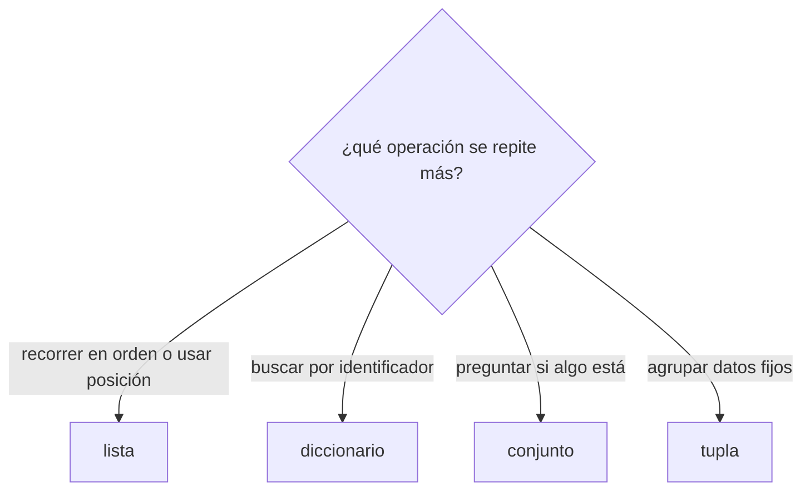
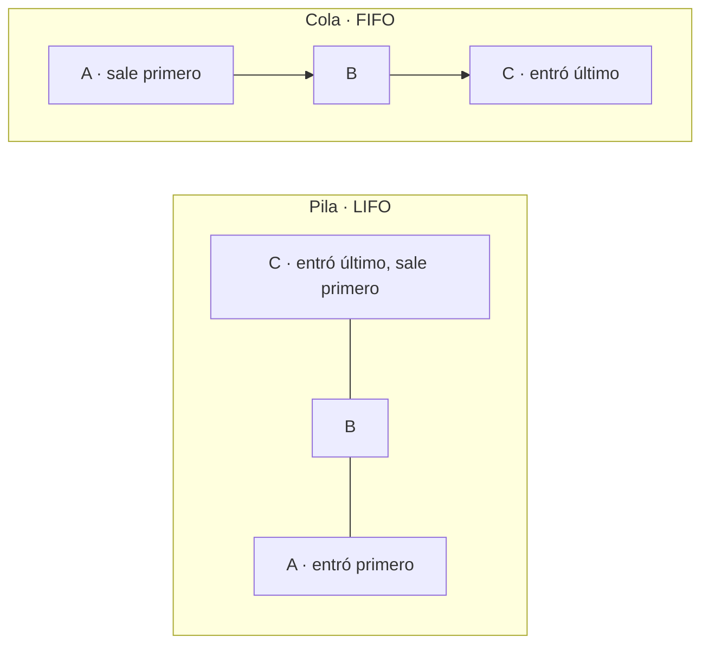
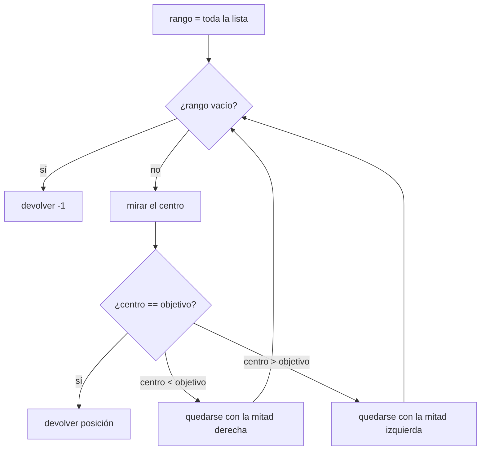
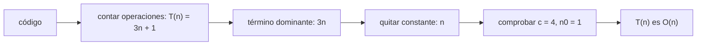
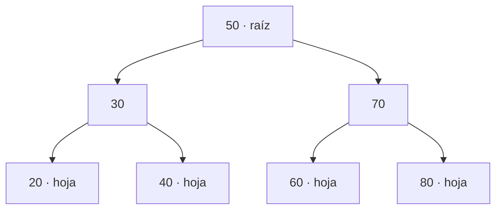
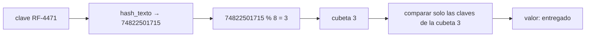
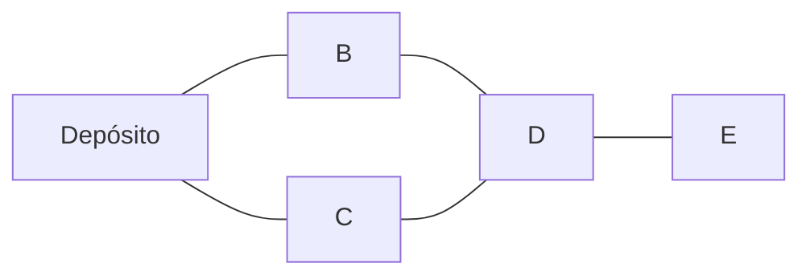
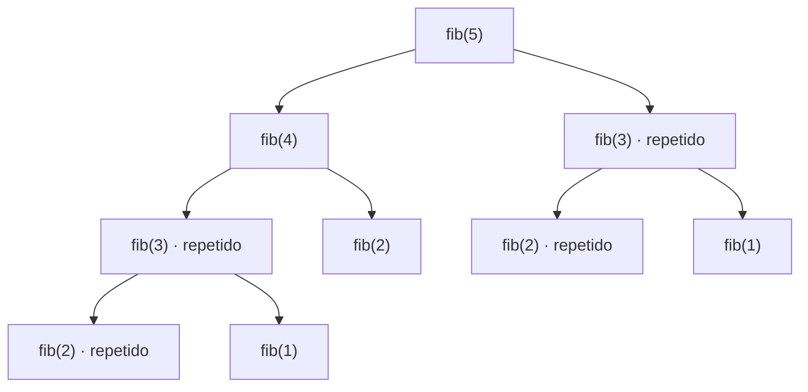

# Módulo 2: Estructuras de datos, algoritmos y complejidad

**Entorno comprobado para esta edición (2026-11-24):** Python 3.13.18 en Linux x86_64. Todas las salidas de
este módulo se obtuvieron ejecutando el código mostrado, sin paquetes externos. Los **tiempos en segundos**
cambian de una máquina a otra y entre ejecuciones; lo que se mantiene es la **proporción** entre ellos. Los
conteos de pasos y comparaciones son exactos y deben coincidir con los tuyos. Los comandos para Windows y
PowerShell no se ejecutaron.

## Apertura del módulo

#### Objetivos del módulo
Al terminar este módulo podrás:
- elegir entre lista, diccionario, conjunto y tupla según la operación que más se repite;
- implementar pilas, colas, búsquedas, ordenamientos, árboles, tablas hash y recorridos de grafos;
- contar operaciones y medir tiempos para comparar dos soluciones del mismo problema;
- expresar el crecimiento de un algoritmo con notación O grande y justificarlo;
- reconocer subproblemas repetidos y resolverlos con programación dinámica.

#### Esquema del módulo
1. Elegir estructuras según las operaciones.
2. Pilas, colas y abstracciones de comportamiento.
3. Búsqueda, precondiciones y demostración de corrección.
4. Complejidad, medición, ordenamiento y recursión.
5. Árboles y árboles binarios de búsqueda (BST).
6. Tablas hash — búsqueda en tiempo constante.
7. Grafos y recorridos BFS/DFS.
8. Programación dinámica — resolver una vez, recordar el resultado.
9. Proyecto 2: gestor de inventario con análisis de rendimiento.

#### Qué necesitas saber antes
El Módulo 1 completo: variables y tipos, condiciones y bucles (`if`, `for`, `while`), funciones con `def` y
`return`, excepciones con `raise`, `try` y `assert`, y clases con `__init__`. Cada término nuevo de este
módulo se define en el tema donde aparece por primera vez.

## Aprende construyendo

### Tema 1: Elegir estructuras según las operaciones · Básico · 50 min

<details open>
<summary><strong>Capa 1 — Lectura</strong></summary>

#### Objetivos
Al terminar este tema podrás:
- crear listas, diccionarios, conjuntos y tuplas, y leer o cambiar sus elementos;
- elegir la estructura según la operación que más se repite: posición, clave, pertenencia o grupo fijo;
- explicar por qué guardar una posición de lista como identificador produce datos equivocados;
- leer los errores `KeyError`, `IndexError` y `TypeError` propios de cada estructura.

**Conceptos clave:** estructura de datos, lista, índice, diccionario, clave, comprensión de diccionario, conjunto, tupla, mutable, None

#### El problema
La coordinadora de RutaFlow tiene los envíos del día en una lista. Cada vez que un cliente llama, alguien
recorre la lista buscando su guía. Un compañero propuso guardar «la posición» de cada envío para ir directo.
Funcionó hasta que se entregó el primer envío: desde ese momento, el sistema mostraba el destino de otro
cliente. ¿Dónde conviene guardar los envíos para encontrarlos por guía sin errores?

#### Glosario del tema

**estructura de datos**
- **Definición técnica:** forma de organizar varios valores en memoria que define qué operaciones son posibles y cuánto trabajo cuesta cada una.
- **En palabras sencillas:** el mueble donde guardas las cosas: un estante, un archivador con etiquetas o una caja.
- **Dónde se rompe la comparación:** un mueble no cambia de precio; una estructura hace barata una operación y cara otra.
- **Ejemplo:** guardar guías en una lista o en un diccionario cambia cómo las buscas.
- **Error típico:** elegir la estructura por costumbre, sin preguntarte qué operación se repetirá más.

**lista**
- **Definición técnica:** secuencia ordenada y mutable de valores (`list`); conserva el orden de inserción y admite repetidos.
- **En palabras sencillas:** una fila numerada de casillas donde cada valor ocupa un puesto.
- **Dónde se rompe la comparación:** si sacas a alguien de la fila, todos los de atrás cambian de número.
- **Ejemplo:** `envios = ["RF-101", "RF-102"]`; `envios.append("RF-103")` agrega al final.
- **Error típico:** confundir la posición de un elemento con su identidad, como en el problema de este tema.

**índice**
- **Definición técnica:** número entero que indica la posición de un elemento en una secuencia; en Python empieza en `0`.
- **En palabras sencillas:** el número del puesto en la fila, contando desde cero.
- **Dónde se rompe la comparación:** en una fila real el primero es el 1; en Python el primero es el 0.
- **Ejemplo:** en `["RF-101", "RF-102"]`, `envios[1]` es `"RF-102"`.
- **Error típico:** pedir `envios[3]` en una lista de 3 elementos produce `IndexError: list index out of range`.

**diccionario**
- **Definición técnica:** colección mutable de pares clave-valor (`dict`) que localiza un valor a partir de su clave sin recorrer los demás.
- **En palabras sencillas:** un archivador con pestañas: buscas por la etiqueta, no por el puesto.
- **Dónde se rompe la comparación:** un archivador puede tener dos pestañas iguales; un diccionario nunca repite una clave.
- **Ejemplo:** `estado = {"RF-101": "pendiente"}`; `estado["RF-101"]` devuelve `"pendiente"`.
- **Error típico:** pedir una clave que no existe con corchetes: `estado["RF-999"]` produce `KeyError: 'RF-999'`.

**clave**
- **Definición técnica:** valor inmutable y único dentro de un diccionario que identifica a otro valor; también lo usan los conjuntos.
- **En palabras sencillas:** la etiqueta de la pestaña, como el número de guía.
- **Dónde se rompe la comparación:** una etiqueta se puede despegar y cambiar; una clave no se modifica, se borra y se crea otra.
- **Ejemplo:** en `{"RF-101": "pendiente"}`, la clave es `"RF-101"`.
- **Error típico:** usar una lista como clave: `{["RF-1"]: 1}` produce `TypeError: unhashable type: 'list'`.

**comprensión de diccionario**
- **Definición técnica:** expresión `{clave: valor for elemento in iterable}` que construye un diccionario recorriendo otra colección.
- **En palabras sencillas:** un bucle `for` escrito en una sola línea que va llenando el archivador.
- **Dónde se rompe la comparación:** no es un bucle aparte: es una expresión que produce el diccionario completo de una vez.
- **Ejemplo:** `{e["guia"]: e for e in envios}` crea un diccionario cuyo índice es la guía.
- **Error típico:** repetir claves: si dos envíos tienen la misma guía, el último reemplaza al primero sin avisar.

**conjunto**
- **Definición técnica:** colección mutable y sin orden de valores únicos (`set`); responde rápido si un valor pertenece o no.
- **En palabras sencillas:** una bolsa donde cada cosa entra una sola vez y solo importa si está o no está.
- **Dónde se rompe la comparación:** en una bolsa puedes meter dos manzanas iguales; en un conjunto, la segunda desaparece.
- **Ejemplo:** `{"Cali", "Cali", "Pasto"}` queda con 2 elementos; `"Cali" in ciudades` da `True`.
- **Error típico:** pedir una posición: `ciudades[0]` produce `TypeError: 'set' object is not subscriptable`.

**tupla**
- **Definición técnica:** secuencia ordenada e inmutable (`tuple`); se usa para grupos de valores de tamaño fijo.
- **En palabras sencillas:** un sobre sellado con varios datos que siempre van juntos, como latitud y longitud.
- **Dónde se rompe la comparación:** un sobre se puede abrir y cambiar; para «cambiar» una tupla creas otra nueva.
- **Ejemplo:** `coordenada = (4.61, -74.08)`; `coordenada[0]` da `4.61`.
- **Error típico:** asignar a una posición: `coordenada[0] = 5` produce `TypeError: 'tuple' object does not support item assignment`.

**mutable**
- **Definición técnica:** propiedad de un objeto cuyo contenido puede cambiar después de creado sin crear otro objeto; lo contrario es inmutable.
- **En palabras sencillas:** algo que puedes editar en el sitio, como una libreta; lo inmutable es como algo impreso.
- **Dónde se rompe la comparación:** un nombre que apunta a algo inmutable sí se puede reasignar a otro valor.
- **Ejemplo:** `list`, `dict` y `set` son mutables; `tuple`, `str` e `int` son inmutables.
- **Error típico:** querer usar algo mutable como clave de diccionario o elemento de conjunto: produce `TypeError: unhashable type`.

**None**
- **Definición técnica:** valor especial de Python, de tipo `NoneType`, que representa la ausencia de un valor; es lo que devuelve una función sin `return`.
- **En palabras sencillas:** «aquí no hay nada», escrito de forma que el programa lo entienda.
- **Dónde se rompe la comparación:** no es `0` ni texto vacío: `None == 0` da `False`.
- **Ejemplo:** `por_guia.get("RF-999")` devuelve `None` porque esa guía no existe.
- **Error típico:** usar el resultado sin comprobarlo: `None["destino"]` produce `TypeError: 'NoneType' object is not subscriptable`.

#### ► CÓMO FUNCIONA
Antes de elegir, escribe la operación que tu programa hará miles de veces. Si importan el orden o la posición,
usa una lista. Si buscas por un identificador, usa un diccionario. Si solo preguntas «¿está o no está?», usa un
conjunto. Si varios datos siempre viajan juntos y no cambian, usa una tupla.

La diferencia de trabajo es real. Para encontrar una guía en una lista, Python compara elemento por elemento.
En un diccionario, la clave lo lleva directo al valor; en el Tema 6 verás cómo lo logra.



#### Problema resuelto 1.1
Representa con cada estructura un dato real de RutaFlow y realiza su operación típica.

**Razonamiento:**
1. Las guías del día tienen orden de llegada: lista. Operación típica: leer por posición y agregar al final.
2. El estado depende de la guía: diccionario. Operación típica: consultar y agregar por clave.
3. Las ciudades visitadas no se repiten: conjunto. Operación típica: preguntar si una ciudad está.
4. Latitud y longitud siempre van juntas: tupla. Operación típica: desempacar sus dos valores.

```python
# estructuras.py — las cuatro estructuras básicas con datos de RutaFlow
envios = ["RF-101", "RF-102", "RF-103"]            # lista: orden y posición
print("lista:", envios, "| primero:", envios[0], "| cantidad:", len(envios))
envios.append("RF-104")                            # la lista crece al final
print("después de append:", envios)

estado_por_guia = {"RF-101": "pendiente", "RF-102": "entregado"}   # diccionario
print("estado de RF-102:", estado_por_guia["RF-102"])
estado_por_guia["RF-103"] = "pendiente"            # agrega una clave nueva
print("claves:", list(estado_por_guia))

ciudades = {"Bogotá", "Cali", "Bogotá", "Medellín"}   # conjunto: sin repetidos
print("ciudades distintas:", len(ciudades))
print("¿pasa por Cali?", "Cali" in ciudades)

coordenada = (4.61, -74.08)                        # tupla: grupo fijo
latitud, longitud = coordenada                     # desempaquetado
print("latitud:", latitud, "| longitud:", longitud)
```

```text
$ python3 estructuras.py
lista: ['RF-101', 'RF-102', 'RF-103'] | primero: RF-101 | cantidad: 3
después de append: ['RF-101', 'RF-102', 'RF-103', 'RF-104']
estado de RF-102: entregado
claves: ['RF-101', 'RF-102', 'RF-103']
ciudades distintas: 3
¿pasa por Cali? True
latitud: 4.61 | longitud: -74.08
```

**Explicación por partes.**
- Línea 2: los corchetes crean una lista; `envios[0]` lee la posición 0 y `len` cuenta los elementos.
- Línea 4: `append` es un método de la lista que agrega un elemento al final.
- Línea 7: las llaves con pares `clave: valor` crean un diccionario.
- Línea 9: asignar a una clave nueva la agrega; si ya existiera, reemplazaría su valor.
- Línea 12: las llaves sin `:` crean un conjunto; `"Bogotá"` repetido se guarda una sola vez, por eso hay 3.
- Línea 14: el operador `in` pregunta si el valor pertenece al conjunto.
- Línea 17: el desempaquetado asigna cada elemento de la tupla a un nombre, en orden.

> **Error común.** Pedir una clave que no existe con corchetes. `estado_por_guia["RF-999"]` termina con
> `KeyError: 'RF-999'`. El mensaje muestra la clave que faltó. Si la ausencia es normal, usa
> `estado_por_guia.get("RF-999")`, que devuelve `None` en vez de fallar.

> **Error común.** Tratar un conjunto como lista. `ciudades[0]` produce
> `TypeError: 'set' object is not subscriptable`: un conjunto no tiene posiciones, solo pertenencia.

#### Problema resuelto 1.2
Reproduce el fallo del problema: guarda la posición de `RF-102`, entrega `RF-101` y vuelve a consultar.

**Razonamiento:**
1. Construye un diccionario indexado por guía a partir de la lista, con una comprensión.
2. Guarda la posición `1` como si identificara a `RF-102`.
3. Borra el primer envío de ambas estructuras y consulta de las dos formas.

```python
# posicion_vs_clave.py — buscar un envío por posición o por guía
envios = [
    {"guia": "RF-101", "destino": "Cali"},
    {"guia": "RF-102", "destino": "Medellín"},
    {"guia": "RF-103", "destino": "Pasto"},
]
por_guia = {envio["guia"]: envio for envio in envios}

posicion_guardada = 1   # "RF-102 está en la posición 1"
print("antes, por posición:", envios[posicion_guardada]["destino"])
print("antes, por guía:    ", por_guia["RF-102"]["destino"])

del envios[0]           # se entrega RF-101 y sale de la lista
del por_guia["RF-101"]  # y del diccionario
print("después, por posición:", envios[posicion_guardada]["destino"])
print("después, por guía:    ", por_guia["RF-102"]["destino"])
print("guía inexistente con get:", por_guia.get("RF-999"))
```

```text
$ python3 posicion_vs_clave.py
antes, por posición: Medellín
antes, por guía:     Medellín
después, por posición: Pasto
después, por guía:     Medellín
guía inexistente con get: None
```

**Explicación por partes.**
- Línea 7: la comprensión recorre `envios` y usa la guía de cada uno como clave.
- Líneas 10–11: antes de borrar, las dos consultas coinciden: `Medellín`.
- Línea 13: `del envios[0]` saca el primero; `RF-102` y `RF-103` corren un puesto hacia adelante.
- Línea 15: la posición `1` ahora pertenece a `RF-103`, y el programa muestra `Pasto` **sin ningún error**.
- Línea 16: la clave `"RF-102"` sigue apuntando al envío correcto, sin importar qué se borre.
- Línea 17: `get` devuelve `None` para una guía inexistente.

> **Buena práctica.** Identifica los datos por un valor propio y estable (guía, cédula, código), no por su posición.
> Las posiciones cambian cada vez que alguien inserta o borra.

> **Prevenir errores.** Cuando construyas un diccionario desde una lista, compara `len(por_guia)` con
> `len(envios)`. Si difieren, había claves repetidas y algunos datos se perdieron.

#### Checkpoint 1.1
Tras `del envios[0]` en el Problema resuelto 1.2, ¿qué produce `envios[2]`?

Respuesta: `IndexError: list index out of range`. Después del borrado la lista tiene 2 elementos, con índices `0` y `1`.

#### Checkpoint 1.2
Necesitas saber si una ciudad ya recibió visita hoy, entre miles. ¿Qué estructura usas?

Respuesta: un conjunto. Solo importa la pertenencia (`ciudad in visitadas`) y las repeticiones sobran.

</details>

<details>
<summary><strong>Capa 2 — Construcción</strong></summary>

#### Paso 1 · Prepara la carpeta
Crea `~/labs/estructuras` y entra con `cd ~/labs/estructuras`.

#### Paso 2 · Prueba las cuatro estructuras
Escribe `estructuras.py` y ejecútalo con `python3 estructuras.py`. Compara cada línea con la salida del tema.

#### Paso 3 · Reproduce el fallo de la posición
Escribe `posicion_vs_clave.py`. Antes de ejecutarlo, anota qué destino esperas en la línea 15. Luego compruébalo.

#### Paso 4 · Provoca los errores
En una copia, cambia `get("RF-999")` por `["RF-999"]` y agrega `coordenada[0] = 5`. Lee cada mensaje y deshaz el cambio.

#### Resumen
- Una **estructura de datos** se elige por la operación que más se repite, no por costumbre.
- La **lista** conserva orden; su **índice** empieza en 0 y cambia al insertar o borrar.
- El **diccionario** encuentra un valor por su **clave** única; la **comprensión de diccionario** lo construye desde una lista.
- El **conjunto** guarda valores únicos y responde rápido a `in`; no tiene posiciones.
- La **tupla** agrupa datos fijos; es inmutable, a diferencia de las estructuras **mutables**.
- `KeyError`: falta la clave. `IndexError`: no existe esa posición. `unhashable type`: usaste algo mutable como clave.

#### Ejercicio verificable 1
Básico. Crea `paquetes = {"RF-101": 3, "RF-102": 1}`, suma 2 paquetes a `RF-102` y muestra el diccionario.

Respuesta esperada: `{'RF-101': 3, 'RF-102': 3}`. Se logra con `paquetes["RF-102"] = paquetes["RF-102"] + 2`.

#### Ejercicio verificable 2
Intermedio. Dada `visitas = ["Cali", "Pasto", "Cali", "Neiva", "Pasto"]`, muestra cuántas ciudades distintas hubo.

Respuesta esperada: `3`. Se obtiene con `len(set(visitas))`: el conjunto descarta los repetidos.

#### Ejercicio verificable 3
Reto. Construye `por_guia` desde `[{"guia": "RF-1"}, {"guia": "RF-2"}, {"guia": "RF-1"}]` y detecta la pérdida de datos.

Respuesta esperada: `len(por_guia)` es `2` y la lista tiene `3`. La guía `RF-1` estaba repetida y el segundo registro reemplazó al primero.

#### En el trabajo
Las respuestas de un servicio web llegan como listas de diccionarios, igual que `envios`. Lo primero que hace un
desarrollador es indexarlas por un identificador para cruzarlas con otra fuente. El fallo de la posición
aparece en interfaces reales: una tabla que se reordena y un botón que borra «la fila 3» equivocada.

</details>

### Tema 2: Pilas, colas y abstracciones de comportamiento · Básico · 50 min

<details open>
<summary><strong>Capa 1 — Lectura</strong></summary>

#### Objetivos
Al terminar este tema podrás:
- distinguir una pila (el último en entrar sale primero) de una cola (el primero en entrar sale primero);
- implementar «deshacer» y «rehacer» con dos pilas y trazar su estado paso a paso;
- atender solicitudes en orden de llegada con `deque` y medir con `perf_counter` por qué no usar `list.pop(0)`;
- reconocer el `IndexError` que produce sacar un elemento de una estructura vacía.

**Conceptos clave:** tipo abstracto de datos, pila, cola, deque, perf_counter

#### El problema
La planificadora de rutas de RutaFlow edita el recorrido del día y a veces se equivoca. Necesita un botón
«Deshacer» que revierta el **último** cambio, y otro «Rehacer» que lo recupere. Al mismo tiempo, las
solicitudes de recogida deben atenderse en el **orden en que llegaron**. Son dos reglas opuestas: ¿qué
estructura respeta cada una?

#### Glosario del tema

**tipo abstracto de datos**
- **Definición técnica:** descripción de una colección por las operaciones que ofrece y sus reglas, sin fijar cómo se guardan los datos por dentro.
- **En palabras sencillas:** el contrato de un servicio: dice qué puedes pedir, no cómo se hace en la cocina.
- **Dónde se rompe la comparación:** el contrato no menciona tiempos, pero la implementación que elijas sí decide cuánto tarda.
- **Ejemplo:** una pila se define por «apilar» y «desapilar»; por dentro puede usar una lista de Python.
- **Error típico:** usar por fuera los datos internos (`pila._datos[0]`) y romper la regla que el tipo promete.

**pila (LIFO)**
- **Definición técnica:** tipo abstracto de datos donde solo se agrega y se quita por el mismo extremo, la cima; sigue la regla LIFO (*last in, first out*).
- **En palabras sencillas:** una torre de platos: pones arriba y sacas de arriba.
- **Dónde se rompe la comparación:** en una torre real puedes sacar un plato del medio con cuidado; en una pila, no.
- **Ejemplo:** con una lista, `append` apila y `pop()` desapila el último.
- **Error típico:** desapilar una pila vacía: `[].pop()` produce `IndexError: pop from empty list`.

**cola (FIFO)**
- **Definición técnica:** tipo abstracto de datos donde se agrega por un extremo y se quita por el otro; sigue la regla FIFO (*first in, first out*).
- **En palabras sencillas:** la fila del banco: el primero que llega es el primero que atienden.
- **Dónde se rompe la comparación:** en un banco alguien se puede colar; en una cola el orden de llegada es la única regla.
- **Ejemplo:** solicitudes de recogida: entra Ana, luego Beto; sale primero Ana.
- **Error típico:** implementarla con `lista.pop(0)`, que funciona pero se vuelve lenta cuando la cola crece.

**deque**
- **Definición técnica:** clase `collections.deque`, cola de dos extremos que agrega y quita por ambos lados sin mover el resto de los elementos.
- **En palabras sencillas:** una fila con puerta adelante y atrás, donde nadie tiene que correrse al salir alguien.
- **Dónde se rompe la comparación:** leer una posición del medio (`d[5000]`) sí es lento en un `deque`.
- **Ejemplo:** `recogidas.append("Ana")` agrega atrás; `recogidas.popleft()` saca de adelante.
- **Error típico:** sacar de un `deque` vacío produce `IndexError: pop from an empty deque`.

**perf_counter**
- **Definición técnica:** función `time.perf_counter()` que devuelve un instante, en segundos, del reloj de mayor resolución disponible; la resta de dos lecturas da el tiempo transcurrido.
- **En palabras sencillas:** un cronómetro: lo lees antes y después, y restas.
- **Dónde se rompe la comparación:** el valor suelto no es la hora del día; solo sirve la diferencia entre dos lecturas.
- **Ejemplo:** `inicio = time.perf_counter()` … `time.perf_counter() - inicio` da, por ejemplo, `0.0307`.
- **Error típico:** medir una sola vez algo que dura microsegundos; el ruido del sistema domina y la cifra engaña.

#### ► CÓMO FUNCIONA
Una pila y una cola guardan lo mismo; cambia **por dónde sale** el siguiente elemento. En la pila sale el más
reciente. En la cola sale el más antiguo.

Deshacer encaja con una pila: el cambio que se revierte es siempre el último. Rehacer usa una segunda pila:
lo que deshaces se apila ahí, para recuperarlo en orden inverso.

La cola tiene una trampa. Una lista de Python guarda sus elementos en casillas seguidas. `pop(0)` saca el
primero y luego **corre todos los demás** una casilla. Con 20 000 elementos, son miles de movimientos por cada
salida. `deque` evita ese corrimiento.



#### Problema resuelto 2.1
Implementa una pila como clase y úsala para tres ediciones, dos «Deshacer» y un «Rehacer».

**Razonamiento:**
1. La clase `Pila` expone solo `apilar`, `desapilar` y `esta_vacia`; la lista interna queda escondida.
2. Deshacer: sacar de la pila `deshacer` y apilar en `rehacer`.
3. Rehacer: el movimiento inverso, de `rehacer` a `deshacer`.
4. Traza esperada: `[A, B, C]` y `[]`; luego `[A]` y `[C, B]`; luego `[A, B]` y `[C]`.

```python
# deshacer.py — deshacer y rehacer cambios de una ruta con dos pilas
class Pila:
    def __init__(self):
        self._datos = []

    def apilar(self, elemento):
        self._datos.append(elemento)

    def desapilar(self):
        return self._datos.pop()

    def esta_vacia(self):
        return len(self._datos) == 0

    def __repr__(self):
        return repr(self._datos)


deshacer = Pila()
rehacer = Pila()
for cambio in ["A", "B", "C"]:          # tres ediciones de la ruta
    deshacer.apilar(cambio)
print("tras 3 ediciones:", "deshacer =", deshacer, "rehacer =", rehacer)

for _ in range(2):                       # dos veces «Deshacer»
    rehacer.apilar(deshacer.desapilar())
print("tras 2 deshacer: ", "deshacer =", deshacer, "rehacer =", rehacer)

deshacer.apilar(rehacer.desapilar())     # una vez «Rehacer»
print("tras 1 rehacer:  ", "deshacer =", deshacer, "rehacer =", rehacer)
```

```text
$ python3 deshacer.py
tras 3 ediciones: deshacer = ['A', 'B', 'C'] rehacer = []
tras 2 deshacer:  deshacer = ['A'] rehacer = ['C', 'B']
tras 1 rehacer:   deshacer = ['A', 'B'] rehacer = ['C']
```

**Explicación por partes.**
- Línea 4: el guion bajo de `_datos` indica, por convención, «uso interno: no lo toques desde fuera».
- Líneas 6–10: apilar agrega al final de la lista y desapilar quita el último; el final es la cima.
- Líneas 15–16: `__repr__` define cómo se muestra el objeto en `print`; aquí muestra la lista interna.
- Línea 26: una sola línea hace el «Deshacer» completo: saca de una pila y apila en la otra.
- Línea 29: el «Rehacer» devuelve `B`, el último deshecho, a la pila de deshacer.

> **Error común.** Pulsar «Deshacer» sin nada que deshacer. `deshacer.desapilar()` con la pila vacía termina con
> `IndexError: pop from empty list`. Comprueba antes con `esta_vacia()` y desactiva el botón.

> **Ingeniería de software.** Encerrar la lista dentro de `Pila` permite cambiar la implementación (por un
> `deque`, por ejemplo) sin tocar el código que usa `apilar` y `desapilar`.

#### Problema resuelto 2.2
Atiende las recogidas en orden de llegada y compara el tiempo de vaciar una cola con `list` y con `deque`.

**Razonamiento:**
1. Llegan Ana, Beto y Carla; debe salir Ana primero.
2. Para medir, vacía la misma cantidad de elementos con cada estructura y cronometra con `perf_counter`.
3. Repite con el doble de elementos para ver cómo crece cada tiempo.

```python
# cola_recogidas.py — atender solicitudes de recogida en orden de llegada
import time
from collections import deque

recogidas = deque()
recogidas.append("Cliente Ana")
recogidas.append("Cliente Beto")
recogidas.append("Cliente Carla")
print("se atiende primero:", recogidas.popleft())
print("quedan:", list(recogidas))

for n in (20_000, 40_000):
    como_lista = list(range(n))
    inicio = time.perf_counter()
    while como_lista:
        como_lista.pop(0)               # saca el primero y corre todos los demás
    t_lista = time.perf_counter() - inicio

    como_deque = deque(range(n))
    inicio = time.perf_counter()
    while como_deque:
        como_deque.popleft()            # saca el primero sin mover el resto
    t_deque = time.perf_counter() - inicio
    print(f"n={n}: list.pop(0) {t_lista:.4f} s | deque.popleft() {t_deque:.4f} s")
```

```text
$ python3 cola_recogidas.py
se atiende primero: Cliente Ana
quedan: ['Cliente Beto', 'Cliente Carla']
n=20000: list.pop(0) 0.0312 s | deque.popleft() 0.0008 s
n=40000: list.pop(0) 0.1442 s | deque.popleft() 0.0014 s
```

**Explicación por partes.**
- Línea 3: `deque` viene en la biblioteca estándar; no se instala nada.
- Línea 9: `popleft` saca el primero que llegó: Ana.
- Línea 16: cada `pop(0)` corre todos los elementos restantes una casilla.
- Línea 22: `popleft` solo mueve la puerta de adelante.
- Línea 24: al duplicar `n`, el tiempo de la lista se multiplicó por cerca de 4 y el del `deque`, por cerca de 2.

> **Rendimiento.** Tus segundos serán distintos, pero la proporción se repite: con `list.pop(0)`, duplicar los
> datos multiplica el tiempo por cerca de 4. En el Tema 4 aprenderás a nombrar ese crecimiento.

> **Buena práctica.** Si necesitas sacar por adelante, usa `deque` desde el principio. Cambiar de estructura
> cuando el sistema ya está lento cuesta mucho más.

#### Checkpoint 2.1
Partiendo de la última línea de la salida de `deshacer.py`, pulsas «Deshacer» una vez más. ¿Cómo quedan las pilas?

Respuesta: `deshacer = ['A']` y `rehacer = ['C', 'B']`. Sale `B` de la cima de deshacer y queda encima de `C` en rehacer.

</details>

<details>
<summary><strong>Capa 2 — Construcción</strong></summary>

#### Paso 1 · Prepara la carpeta
Crea `~/labs/pila-cola` y entra con `cd ~/labs/pila-cola`.

#### Paso 2 · Construye la pila
Escribe `deshacer.py`. Antes de ejecutarlo, escribe en papel la traza esperada. Ejecuta y compara.

#### Paso 3 · Mide la cola
Escribe `cola_recogidas.py` y ejecútalo dos veces. Anota cuánto cambian los segundos y cuánto cambia la proporción.

#### Paso 4 · Provoca el error
Agrega al final de `deshacer.py` cuatro llamadas a `deshacer.desapilar()` y lee el `IndexError`. Corrígelo con `esta_vacia()`.

#### Resumen
- Un **tipo abstracto de datos** se define por sus operaciones, no por cómo guarda los datos.
- La **pila** saca el último que entró (LIFO): sirve para deshacer, rehacer y llamadas anidadas.
- La **cola** saca el primero que entró (FIFO): sirve para atender en orden de llegada.
- **`deque`** agrega y quita por ambos extremos sin correr los demás elementos.
- **`perf_counter`** mide tiempo restando dos lecturas; compara proporciones, no segundos sueltos.
- Sacar de una estructura vacía produce `IndexError`; compruébalo antes.

#### Ejercicio verificable 1
Básico. Apila `"x"`, `"y"`, `"z"` en una `Pila` y desapila dos veces. ¿Qué valores salen y en qué orden?

Respuesta esperada: primero `z`, luego `y`. Queda `['x']`.

#### Ejercicio verificable 2
Intermedio. Con un `deque`, agrega `1`, `2`, `3`, saca uno con `popleft` y agrega `4`. Muestra `list(cola)`.

Respuesta esperada: `[2, 3, 4]`. Salió el `1`, el primero en llegar, y el `4` quedó al final.

#### Ejercicio verificable 3
Reto. Usa una pila para comprobar si los paréntesis de `"(a(b)c)"` y `"(a(b c"` están balanceados.

Respuesta esperada: `True` y `False`. Apila cada `(`; ante cada `)`, desapila (si la pila está vacía, es `False`). Al final, balanceado solo si la pila quedó vacía.

#### En el trabajo
Los editores de texto y de diseño implementan deshacer y rehacer con dos pilas. Las colas aparecen en todo
sistema que recibe trabajo más rápido de lo que lo procesa: pedidos, correos por enviar, facturas por generar.
En producción esas colas viven en servicios como RabbitMQ o Amazon SQS, pero la regla FIFO es la misma.

</details>

### Tema 3: Búsqueda, precondiciones y demostración de corrección · Básico · 55 min

<details open>
<summary><strong>Capa 1 — Lectura</strong></summary>

#### Objetivos
Al terminar este tema podrás:
- implementar búsqueda lineal y búsqueda binaria sin funciones de biblioteca;
- contar las comparaciones de cada una y explicar por qué la binaria hace muchas menos;
- enunciar la precondición de la búsqueda binaria y reproducir su fallo silencioso cuando no se cumple;
- argumentar que la búsqueda binaria es correcta usando un invariante y comprobarlo con `assert`.

**Conceptos clave:** búsqueda lineal, búsqueda binaria, precondición, postcondición, invariante de ciclo

#### El problema
RutaFlow guarda las horas límite de entrega de 1000 envíos, ordenadas de menor a mayor. Un supervisor
pregunta a cada rato si hay un envío que venza a cierta hora. Revisar los 1000 uno por uno funciona, pero es
lento. ¿Se puede aprovechar que la lista está ordenada? ¿Y qué pasa si alguien entrega la lista desordenada?

#### Glosario del tema

**búsqueda lineal**
- **Definición técnica:** algoritmo que compara el objetivo con cada elemento de la secuencia, del primero al último, hasta encontrarlo o agotarla.
- **En palabras sencillas:** buscar un nombre en una lista leyendo renglón por renglón.
- **Dónde se rompe la comparación:** una persona salta con la vista; el programa compara cada elemento, sin excepción.
- **Ejemplo:** buscar `1501` entre 1000 valores donde no está cuesta 1000 comparaciones.
- **Error típico:** devolver `-1` dentro del bucle, en el primer elemento distinto, en vez de después de revisarlos todos.

**búsqueda binaria**
- **Definición técnica:** algoritmo para secuencias ordenadas que compara el objetivo con el elemento central y descarta la mitad donde no puede estar, hasta encontrarlo o vaciar el rango.
- **En palabras sencillas:** buscar una palabra en el diccionario abriendo por la mitad y quedándote con la mitad correcta.
- **Dónde se rompe la comparación:** en papel abres «más o menos» por la mitad; el programa calcula el centro exacto con `//`.
- **Ejemplo:** buscar `1501` entre 1000 valores ordenados cuesta 10 comparaciones.
- **Error típico:** aplicarla a una lista desordenada: no falla, devuelve una respuesta equivocada.

**precondición**
- **Definición técnica:** condición que debe cumplirse antes de llamar a una función para que su resultado sea correcto; si no se cumple, la función no promete nada.
- **En palabras sencillas:** el requisito de entrada, como «el horno debe estar caliente antes de meter el pan».
- **Dónde se rompe la comparación:** con el horno frío notas el problema; con una precondición rota el programa suele seguir sin avisar.
- **Ejemplo:** la búsqueda binaria exige que `valores` esté ordenada de menor a mayor.
- **Error típico:** no escribirla en ningún lado y suponer que quien llama la conoce.

**postcondición**
- **Definición técnica:** condición que la función garantiza al terminar, siempre que la precondición se haya cumplido.
- **En palabras sencillas:** lo que la función promete entregar.
- **Dónde se rompe la comparación:** la promesa solo vale si se cumplió el requisito de entrada.
- **Ejemplo:** «si devuelve `i >= 0`, entonces `valores[i] == objetivo`; si devuelve `-1`, el objetivo no está».
- **Error típico:** devolver `-1` para «no está» y también para «hubo un error», mezclando dos significados.

**invariante de ciclo**
- **Definición técnica:** afirmación que es verdadera antes de cada vuelta de un bucle; si se mantiene y el bucle termina, permite demostrar el resultado.
- **En palabras sencillas:** una regla que el bucle nunca rompe, como «si el objetivo existe, está entre `izquierda` y `derecha`».
- **Dónde se rompe la comparación:** no es una regla que pongas para el bucle: es algo que demuestras que el bucle cumple.
- **Ejemplo:** `assert objetivo not in valores or objetivo in valores[izquierda:derecha + 1]`.
- **Error típico:** escribir `derecha = medio` en vez de `medio - 1`: el rango puede no achicarse y el bucle no termina.

#### ► CÓMO FUNCIONA
La búsqueda lineal no necesita nada de la lista. Por eso, en el peor caso, compara todos los elementos.

La búsqueda binaria aprovecha el orden. Mira el elemento del centro. Si es el objetivo, termina. Si es menor,
el objetivo solo puede estar a la derecha. Si es mayor, solo a la izquierda. Cada comparación descarta la
mitad del rango que queda.

¿Cuántas mitades caben en 1000? 1000, 500, 250, 125, 62, 31, 15, 7, 3, 1: diez pasos. Por eso 10 comparaciones
bastan en el peor caso.

¿Cómo sabes que es correcta? Con el invariante: «si el objetivo está, está entre `izquierda` y `derecha`».
Es cierto al empezar, porque el rango es toda la lista. Cada descarte lo conserva, porque solo elimina valores
distintos del objetivo, gracias al orden. Cuando el rango queda vacío, el objetivo no puede estar.



#### Problema resuelto 3.1
Busca una hora que está y una que no está entre 1000 horas ordenadas. Cuenta comparaciones con cada método.

**Razonamiento:**
1. Las horas son `0, 2, 4, …, 1998`: están ordenadas y son 1000.
2. `1500` está en la posición 750; `1501` no está, porque todas son pares.
3. Ambas funciones devuelven una tupla `(posición, comparaciones)` para poder compararlas.

Pseudocódigo de la búsqueda binaria:

```text
BUSCAR_BINARIA(valores, objetivo):
  izquierda = 0; derecha = último índice
  MIENTRAS izquierda <= derecha:
    medio = parte entera de (izquierda + derecha) / 2
    SI valores[medio] == objetivo: DEVOLVER medio
    SI valores[medio] < objetivo: izquierda = medio + 1
    SI NO: derecha = medio - 1
  DEVOLVER -1
```

```python
# busquedas.py — búsqueda lineal y binaria contando comparaciones
def buscar_lineal(valores, objetivo):
    comparaciones = 0
    for indice, valor in enumerate(valores):
        comparaciones += 1
        if valor == objetivo:
            return indice, comparaciones
    return -1, comparaciones


def buscar_binaria(valores, objetivo):
    izquierda, derecha = 0, len(valores) - 1
    comparaciones = 0
    while izquierda <= derecha:
        medio = (izquierda + derecha) // 2
        comparaciones += 1
        if valores[medio] == objetivo:
            return medio, comparaciones
        if valores[medio] < objetivo:
            izquierda = medio + 1
        else:
            derecha = medio - 1
    return -1, comparaciones


if __name__ == "__main__":
    horas_limite = list(range(0, 2000, 2))   # 1000 valores ordenados: 0, 2, ..., 1998
    for objetivo in (1500, 1501):
        print("objetivo", objetivo,
              "| lineal:", buscar_lineal(horas_limite, objetivo),
              "| binaria:", buscar_binaria(horas_limite, objetivo))
```

```text
$ python3 busquedas.py
objetivo 1500 | lineal: (750, 751) | binaria: (750, 9)
objetivo 1501 | lineal: (-1, 1000) | binaria: (-1, 10)
```

**Explicación por partes.**
- Línea 5: `comparaciones += 1` es la forma corta de `comparaciones = comparaciones + 1`.
- Línea 8: el `-1` va **después** del bucle: solo se decide «no está» tras revisar todos.
- Línea 12: la asignación múltiple da valor a dos nombres a la vez, igual que el desempaquetado del Tema 1.
- Línea 15: `//` es la división entera: `(0 + 999) // 2` da `499`, sin decimales.
- Líneas 20 y 22: `medio + 1` y `medio - 1` sacan el centro del rango, así el rango siempre se achica.
- Línea 26: el bloque `if __name__ == "__main__":` solo corre al ejecutar este archivo, no al importarlo.
- Salida: para `1501`, la lineal hizo 1000 comparaciones y la binaria 10.

> **Error común.** Ordenar una lista que mezcla tipos. `sorted([3, "RF-1"])` termina con
> `TypeError: '<' not supported between instances of 'str' and 'int'`. Python no sabe si un texto va antes o
> después de un número. Normaliza los datos a un solo tipo antes de ordenar y buscar.

#### Problema resuelto 3.2
Reproduce el fallo silencioso de buscar en una lista desordenada y protege la función con su precondición.

**Razonamiento:**
1. En `[9, 2, 20, 5, 12]` el `2` está en la posición 1.
2. La binaria mira el centro (`20`), cree que `2` está a la izquierda y luego se pierde: devuelve `-1`.
3. Una versión segura comprueba el orden antes de buscar y lanza `ValueError` si no se cumple.

```python
# precondicion.py — la búsqueda binaria exige una lista ordenada
from busquedas import buscar_binaria


def esta_ordenada(valores):
    for i in range(len(valores) - 1):
        if valores[i] > valores[i + 1]:
            return False
    return True


def buscar_binaria_segura(valores, objetivo):
    if not esta_ordenada(valores):
        raise ValueError("precondición violada: la lista no está ordenada")
    return buscar_binaria(valores, objetivo)


desordenada = [9, 2, 20, 5, 12]
print("sin comprobar:", buscar_binaria(desordenada, 2))   # 2 sí está, en la posición 1
print("ordenada:     ", buscar_binaria(sorted(desordenada), 2))
try:
    buscar_binaria_segura(desordenada, 2)
except ValueError as error:
    print("rechazado:", error)
```

```text
$ python3 precondicion.py
sin comprobar: (-1, 2)
ordenada:      (0, 2)
rechazado: precondición violada: la lista no está ordenada
```

**Explicación por partes.**
- Líneas 5–9: `esta_ordenada` compara cada elemento con el siguiente; un solo par al revés basta para devolver `False`.
- Línea 14: la precondición rota se convierte en un error con mensaje claro.
- Línea 19: sin comprobar, la función dice «no está» (`-1`) aunque el `2` sí está: es un fallo **silencioso**.
- Línea 20: con la lista ordenada, `[2, 5, 9, 12, 20]`, el `2` aparece en la posición 0.

> **Rendimiento.** Comprobar el orden recorre toda la lista, así que cuesta tanto como una búsqueda lineal.
> Hazlo una vez, al recibir los datos, y no en cada búsqueda.

> **Prevenir errores.** Escribe la precondición en la primera línea de la función, como comentario o como
> `if` que lanza un error. Quien use la función la verá antes de llamarla.

#### Problema resuelto 3.3
Traza la búsqueda binaria en `[2, 5, 9, 12, 20]` y comprueba el invariante en cada vuelta.

**Razonamiento:**
1. El `assert` de la línea 6 comprueba el invariante antes de cada vuelta; si alguna vez fuera falso, fallaría.
2. El `print` muestra cómo se encoge el rango.

```python
# invariante.py — traza la búsqueda binaria y comprueba su invariante
def buscar_binaria_trazada(valores, objetivo):
    izquierda, derecha = 0, len(valores) - 1
    while izquierda <= derecha:
        # invariante: si objetivo está en la lista, está entre izquierda y derecha
        assert objetivo not in valores or objetivo in valores[izquierda:derecha + 1]
        medio = (izquierda + derecha) // 2
        print(f"izq={izquierda} der={derecha} medio={medio} valor={valores[medio]}")
        if valores[medio] == objetivo:
            return medio
        if valores[medio] < objetivo:
            izquierda = medio + 1
        else:
            derecha = medio - 1
    return -1


horas = [2, 5, 9, 12, 20]
print("resultado:", buscar_binaria_trazada(horas, 12))
print("resultado:", buscar_binaria_trazada(horas, 3))
```

```text
$ python3 invariante.py
izq=0 der=4 medio=2 valor=9
izq=3 der=4 medio=3 valor=12
resultado: 3
izq=0 der=4 medio=2 valor=9
izq=0 der=1 medio=0 valor=2
izq=1 der=1 medio=1 valor=5
resultado: -1
```

**Explicación por partes.**
- Primera búsqueda: el rango pasa de 0–4 a 3–4; en la segunda vuelta encuentra `12` en la posición 3.
- Segunda búsqueda: el rango pasa de 0–4 a 0–1 y luego a 1–1; después queda vacío y devuelve `-1`.
- Ningún `assert` falló: el invariante se mantuvo en todas las vueltas.
- El `assert` recorre la lista, así que solo sirve para estudiar o probar, no para producción.

#### Checkpoint 3.1
En `[2, 5, 9, 12, 20]`, ¿cuántas comparaciones hace la binaria para encontrar `9`?

Respuesta: una. `9` es justo el centro: `(0 + 4) // 2 = 2` y `valores[2]` es `9`.

#### Checkpoint 3.2
¿Por qué la binaria necesita 10 comparaciones para 1000 elementos y no 500?

Respuesta: porque cada comparación descarta la mitad del rango, no un solo elemento. Bastan diez mitades para pasar de 1000 a 1.

</details>

<details>
<summary><strong>Capa 2 — Construcción</strong></summary>

#### Paso 1 · Prepara la carpeta
Crea `~/labs/busqueda` y entra con `cd ~/labs/busqueda`.

#### Paso 2 · Implementa las dos búsquedas
Escribe `busquedas.py` desde el pseudocódigo, sin copiar. Ejecuta y comprueba los conteos `751`, `9`, `1000` y `10`.

#### Paso 3 · Rompe la precondición
Escribe `precondicion.py` y ejecútalo. Luego prueba otras listas desordenadas y anota cuáles fallan en silencio.

#### Paso 4 · Traza a mano
Antes de ejecutar `invariante.py`, llena en papel una tabla con `izq`, `der` y `medio`. Compárala con la salida.

#### Resumen
- La **búsqueda lineal** revisa uno por uno; en el peor caso compara todos los elementos.
- La **búsqueda binaria** descarta la mitad en cada comparación; con 1000 elementos le bastan 10.
- Su **precondición** es la lista ordenada; si no se cumple, puede devolver `-1` sin avisar.
- La **postcondición** dice qué garantiza la función al terminar.
- El **invariante de ciclo** («si está, está entre `izquierda` y `derecha`») demuestra que la binaria es correcta.

#### Ejercicio verificable 1
Básico. Con `busquedas.py`, ¿qué devuelve `buscar_binaria([2, 5, 9, 12, 20], 20)`?

Respuesta esperada: `(4, 3)`. Mira `9`, luego `12` y luego `20`, en la posición 4.

#### Ejercicio verificable 2
Intermedio. Escribe `contar_ocurrencias(valores, objetivo)` con búsqueda lineal. Prueba con `[3, 1, 3, 3]` y `3`.

Respuesta esperada: `3`. Debe recorrer toda la lista; no puede detenerse en la primera coincidencia.

#### Ejercicio verificable 3
Reto. En `[1, 4, 4, 4, 7]`, encuentra la primera y la última posición de `4`. Usa una búsqueda binaria y luego extiéndete mientras el vecino sea igual.

Respuesta esperada: `(1, 3)`. La binaria encuentra el `4` central (posición 2) y luego se extiende a izquierda y derecha mientras el vecino valga `4`.

#### En el trabajo
Las bases de datos usan índices ordenados para no recorrer millones de filas: es la misma idea de descartar
mitades. Python trae el módulo `bisect`, que hace búsqueda binaria probada; úsalo en producción. Las
precondiciones aparecen en todo contrato de API: «la fecha debe venir en formato ISO», «la lista no puede
estar vacía».

</details>

### Tema 4: Complejidad, medición, ordenamiento y recursión · Básico · 75 min

<details open>
<summary><strong>Capa 1 — Lectura</strong></summary>

#### Objetivos
Al terminar este tema podrás:
- contar las operaciones de una función en el peor y en el mejor caso, como una fórmula de `n`;
- expresar ese conteo con notación O grande, aplicando la definición con sus constantes `c` y `n0`;
- comparar dos algoritmos midiendo tiempos reales al duplicar el tamaño de la entrada;
- implementar un ordenamiento por inserción y uno por mezcla, y contar sus comparaciones;
- escribir funciones recursivas con caso base y reconocer un `RecursionError`.

**Conceptos clave:** complejidad temporal, operación elemental, peor caso, notación O grande, logaritmo, complejidad espacial, ordenamiento, recursión, caso base

#### El problema
El equipo de RutaFlow probó un validador de guías repetidas con 1000 guías y tardó centésimas de segundo.
En producción llegan 4000 guías por lote y el mismo código tarda varias veces más de lo esperado. Nadie
cambió el código: cambió `n`. ¿Cómo se predice, antes de llegar a producción, cuánto crecerá el trabajo de un
programa cuando crecen sus datos?

#### Glosario del tema

**complejidad temporal**
- **Definición técnica:** función `T(n)` que indica cuántas operaciones elementales ejecuta un algoritmo para una entrada de tamaño `n`.
- **En palabras sencillas:** cuánto trabajo extra da el programa cada vez que le das más datos.
- **Dónde se rompe la comparación:** no mide segundos; dos máquinas con el mismo `T(n)` tardan distinto.
- **Ejemplo:** recorrer una lista de `n` pesos sumándolos hace del orden de `n` operaciones.
- **Error típico:** confundirla con el tiempo medido en tu computador, que depende del hardware y de lo que esté corriendo.

**operación elemental**
- **Definición técnica:** instrucción cuyo costo no depende de `n`, como una asignación, una comparación o una suma de dos números; se cuenta como 1.
- **En palabras sencillas:** el paso mínimo que vas a contar, como contar escalones en vez de medir metros.
- **Dónde se rompe la comparación:** no todos los «pasos» de Python son elementales: `x in lista` recorre la lista entera.
- **Ejemplo:** en `total = total + peso` cuentas 1 operación.
- **Error típico:** contar `sorted(lista)` o `lista.pop(0)` como 1 operación, cuando por dentro hacen muchas.

**peor caso y mejor caso**
- **Definición técnica:** el peor caso es la entrada de tamaño `n` que obliga al máximo de operaciones; el mejor caso, la que necesita el mínimo.
- **En palabras sencillas:** el peor día y el mejor día posibles para el algoritmo, con la misma cantidad de datos.
- **Dónde se rompe la comparación:** el mejor caso casi nunca sirve para planear; se diseña pensando en el peor.
- **Ejemplo:** la búsqueda lineal acierta al primer intento (mejor caso) o revisa los `n` (peor caso).
- **Error típico:** medir solo con datos fáciles y concluir que el algoritmo es rápido.

**notación O grande**
- **Definición técnica:** `T(n)` es `O(f(n))` si existen constantes `c > 0` y `n0` tales que `T(n) <= c · f(n)` para todo `n >= n0`.
- **En palabras sencillas:** una etiqueta que dice cómo crece el trabajo cuando `n` se hace grande, ignorando detalles pequeños.
- **Dónde se rompe la comparación:** es un techo, no una medida exacta: `O(n)` no dice cuántos segundos tarda.
- **Ejemplo:** `3n + 1` es `O(n)`, porque `3n + 1 <= 4n` para todo `n >= 1`.
- **Error típico:** decir «es O(n), así que siempre es rápido»; con constantes enormes, un `O(n)` puede ser lento.

**logaritmo**
- **Definición técnica:** `log2(n)` es el exponente al que hay que elevar 2 para obtener `n`; equivale a cuántas veces se puede dividir `n` entre 2 hasta llegar a 1.
- **En palabras sencillas:** cuántas veces partes por la mitad un montón hasta que queda uno.
- **Dónde se rompe la comparación:** si `n` no es potencia de 2, el resultado tiene decimales y se redondea según el algoritmo.
- **Ejemplo:** `log2(8) = 3`, porque `2 · 2 · 2 = 8`; `log2(1024) = 10`.
- **Error típico:** creer que `O(log n)` crece como `O(n)`: con `n = 1 000 000`, `log2(n)` es apenas 20.

**complejidad espacial**
- **Definición técnica:** cantidad de memoria adicional que usa un algoritmo en función de `n`, sin contar la entrada.
- **En palabras sencillas:** cuánto espacio extra de mesa necesitas para trabajar.
- **Dónde se rompe la comparación:** la memoria se recupera al terminar; el tiempo gastado, no.
- **Ejemplo:** `len(set(guias))` crea un conjunto con hasta `n` elementos: espacio `O(n)`.
- **Error típico:** ganar tiempo creando estructuras enormes y quedarte sin memoria con datos reales.

**ordenamiento**
- **Definición técnica:** algoritmo que reorganiza una secuencia para que cada elemento sea menor o igual que el siguiente según una comparación.
- **En palabras sencillas:** poner en fila de menor a mayor, como ordenar cartas en la mano.
- **Dónde se rompe la comparación:** con cartas ves todo de un vistazo; el programa solo compara dos valores a la vez.
- **Ejemplo:** `sorted([7, 3, 9, 1])` devuelve `[1, 3, 7, 9]`.
- **Error típico:** confundir `lista.sort()`, que cambia la lista y devuelve `None`, con `sorted(lista)`, que devuelve una nueva.

**recursión**
- **Definición técnica:** técnica en la que una función se llama a sí misma con una versión más pequeña del problema; cada llamada pendiente queda en la pila de llamadas.
- **En palabras sencillas:** resolver una tarea pidiéndole a alguien igual a ti que resuelva una parte más pequeña.
- **Dónde se rompe la comparación:** las llamadas no son personas en paralelo: esperan una encima de otra, como la pila del Tema 2.
- **Ejemplo:** `factorial(4) = 4 · factorial(3)`.
- **Error típico:** olvidar el caso base: produce `RecursionError: maximum recursion depth exceeded`.

**caso base**
- **Definición técnica:** condición de una función recursiva que devuelve un resultado sin volver a llamarse; detiene la recursión.
- **En palabras sencillas:** el escalón donde la escalera termina.
- **Dónde se rompe la comparación:** si cada llamada no se acerca al caso base, la escalera nunca termina.
- **Ejemplo:** `if n <= 1: return 1` en el factorial.
- **Error típico:** un caso base que nunca se alcanza, como `n == 0` cuando `n` baja de 2 en 2 desde un impar.

#### ► CÓMO FUNCIONA
**Paso 1: contar.** Toma una función que suma pesos y guarda el mayor. Cuenta cada operación elemental. Antes
del bucle hay 2 asignaciones. En cada vuelta hay una suma y una comparación: 2 por elemento. En el peor caso,
cada peso supera al anterior y se suma una asignación más en `n - 1` vueltas. Total: `T(n) = 2 + 2n + (n - 1) = 3n + 1`.

**Paso 2: quedarse con lo que crece.** Con `n = 1 000 000`, `3n + 1` vale 3 000 001. El `+ 1` no importa. El `3`
depende de qué cuentes y de la máquina. Lo que sí importa es que el trabajo crece **en proporción a `n`**.

**Paso 3: la definición.** Decimos `T(n) = O(n)` si encontramos `c` y `n0` con `T(n) <= c · n` desde `n0`. Prueba
`c = 4`: `3n + 1 <= 4n` equivale a `1 <= n`. Se cumple para todo `n >= 1`, así que `n0 = 1`. Queda demostrado.

**Paso 4: reglas rápidas** que salen de la definición:
- las constantes se descartan: `5n` es `O(n)`;
- se conserva el término que más crece: `n² + 100n` es `O(n²)`;
- bucles uno después de otro se **suman**: `O(n) + O(n) = O(n)`;
- bucles uno dentro de otro se **multiplican**: `n` vueltas de `n` vueltas son `O(n²)`;
- dividir el problema a la mitad en cada paso da `O(log n)`.

**Paso 5: las familias más comunes**, de mejor a peor: `O(1)` constante, `O(log n)` logarítmica, `O(n)` lineal,
`O(n log n)`, `O(n²)` cuadrática y `O(2ⁿ)` exponencial.



#### Problema resuelto 4.1
Cuenta las operaciones de `resumen_pesos` en el peor y el mejor caso, y comprueba la desigualdad de la definición.

**Razonamiento:**
1. Un contador `operaciones` suma 1 por cada asignación o comparación, siguiendo el Paso 1.
2. Peor caso: pesos en orden creciente. Mejor caso: el primero ya es el mayor.
3. Si el conteo es correcto, el peor caso debe coincidir con `3n + 1`.

```python
# contar_operaciones.py — cuenta operaciones de una función según n
def resumen_pesos(pesos):
    operaciones = 0
    total = 0
    mayor = pesos[0]
    operaciones += 2                     # dos asignaciones iniciales
    for peso in pesos:
        total = total + peso
        operaciones += 1                 # una suma con asignación
        operaciones += 1                 # una comparación
        if peso > mayor:
            mayor = peso
            operaciones += 1             # una asignación, solo si hay nuevo mayor
    return total, mayor, operaciones


for n in (4, 8, 16):
    ascendente = list(range(1, n + 1))   # peor caso: cada peso supera al anterior
    descendente = ascendente[::-1]       # mejor caso: el primero ya es el mayor
    peor = resumen_pesos(ascendente)[2]
    mejor = resumen_pesos(descendente)[2]
    print(f"n={n:2}: peor caso {peor:2} operaciones (3n+1 = {3 * n + 1}) | mejor caso {mejor:2}")

# definición de O grande: T(n) <= c·f(n) para todo n >= n0, con c = 4 y n0 = 1
cumple = all(3 * n + 1 <= 4 * n for n in range(1, 100_001))
print("3n+1 <= 4n para n de 1 a 100000:", cumple)
```

```text
$ python3 contar_operaciones.py
n= 4: peor caso 13 operaciones (3n+1 = 13) | mejor caso 10
n= 8: peor caso 25 operaciones (3n+1 = 25) | mejor caso 18
n=16: peor caso 49 operaciones (3n+1 = 49) | mejor caso 34
3n+1 <= 4n para n de 1 a 100000: True
```

**Explicación por partes.**
- Línea 6: las dos asignaciones de las líneas 4 y 5 se cuentan juntas.
- Líneas 9–10: cada vuelta suma 2: la suma y la comparación de la línea 11.
- Línea 13: este conteo solo ocurre cuando aparece un nuevo mayor; ahí está la diferencia entre casos.
- Línea 19: `[::-1]` crea la lista al revés, de mayor a menor.
- Salida: el peor caso coincide con `3n + 1`; el mejor es `2n + 2`. Ambos son `O(n)`.
- Línea 25: `all` devuelve `True` si la condición se cumple para todos los `n` probados. Esto ilustra; la demostración es la del Paso 3.

#### Problema resuelto 4.2
Cuenta los pasos de cuatro algoritmos al duplicar `n` y observa cómo diverge cada familia.

**Razonamiento:**
1. `O(1)`: leer `lista[0]` cuesta 1 sin importar `n`.
2. `O(log n)`: búsqueda binaria de un valor ausente (peor caso).
3. `O(n)`: búsqueda lineal de un valor ausente.
4. `O(n²)`: un bucle de `n` vueltas dentro de otro de `n` vueltas.

```python
# crecimiento.py — pasos de cuatro algoritmos al duplicar n
def pasos_constante(lista):
    _ = lista[0]                         # acceso por índice
    return 1


def pasos_binaria(lista, objetivo):
    pasos = 0
    izquierda, derecha = 0, len(lista) - 1
    while izquierda <= derecha:
        pasos += 1
        medio = (izquierda + derecha) // 2
        if lista[medio] == objetivo:
            return pasos
        if lista[medio] < objetivo:
            izquierda = medio + 1
        else:
            derecha = medio - 1
    return pasos


def pasos_lineal(lista, objetivo):
    pasos = 0
    for valor in lista:
        pasos += 1
        if valor == objetivo:
            return pasos
    return pasos


def pasos_cuadratica(lista):
    pasos = 0
    for _ in lista:
        for _ in lista:
            pasos += 1
    return pasos


print("   n | O(1) | O(log n) | O(n) | O(n²)")
for n in (2, 4, 8, 16, 1024):
    lista = list(range(n))
    ausente = n                          # peor caso: el objetivo no está
    print(f"{n:4} | {pasos_constante(lista):4} | {pasos_binaria(lista, ausente):8} | "
          f"{pasos_lineal(lista, ausente):4} | {pasos_cuadratica(lista)}")
```

```text
$ python3 crecimiento.py
   n | O(1) | O(log n) | O(n) | O(n²)
   2 |    1 |        2 |    2 | 4
   4 |    1 |        3 |    4 | 16
   8 |    1 |        4 |    8 | 64
  16 |    1 |        5 |   16 | 256
1024 |    1 |       11 | 1024 | 1048576
```

**Explicación por partes.**
- Línea 3: el `_` es un nombre válido que, por convención, significa «este valor no se usa».
- Líneas 7–19: la binaria del Tema 3, con un contador de vueltas.
- Líneas 33–35: el bucle interno se ejecuta completo en cada vuelta del externo: `n · n` pasos.
- Salida: la binaria da `log2(n) + 1` pasos (2, 3, 4, 5, 11). Al duplicar `n`, suma 1.
- Salida: al duplicar `n`, la lineal se duplica y la cuadrática se multiplica por 4.
- Con `n = 1024`, la cuadrática hace 1 048 576 pasos; la binaria, 11.

> **Error común.** Creer que una línea de Python es una operación elemental. `if guia in guias:` dentro de un
> `for guia in nuevas:` parece un solo bucle, pero `in` sobre una lista recorre la lista: el total es `O(n²)`.

#### Problema resuelto 4.3
Mide el tiempo real de dos validadores de guías repetidas con 1000, 2000 y 4000 guías.

**Razonamiento:**
1. El validador anidado compara cada par de guías: es `O(n²)`. Al duplicar `n`, su tiempo debería multiplicarse cerca de 4.
2. El validador con `set` recorre la lista una vez: es `O(n)` en tiempo, pero usa `O(n)` de memoria extra.
3. Se usan guías distintas, el peor caso: el anidado nunca encuentra un par y revisa todos.

```python
# medir_duplicados.py — mismo problema, dos algoritmos, tiempos reales
import random
import time


def tiene_duplicados_lento(guias):
    for i in range(len(guias)):
        for j in range(i + 1, len(guias)):
            if guias[i] == guias[j]:
                return True
    return False


def tiene_duplicados(guias):
    return len(guias) != len(set(guias))


random.seed(7)
for n in (1000, 2000, 4000):
    guias = random.sample(range(10 * n), n)   # n guías distintas: peor caso
    inicio = time.perf_counter()
    tiene_duplicados_lento(guias)
    t_lento = time.perf_counter() - inicio
    inicio = time.perf_counter()
    tiene_duplicados(guias)
    t_rapido = time.perf_counter() - inicio
    print(f"n={n}: anidado {t_lento:.4f} s | con set {t_rapido:.6f} s")
```

```text
$ python3 medir_duplicados.py
n=1000: anidado 0.0139 s | con set 0.000036 s
n=2000: anidado 0.0566 s | con set 0.000104 s
n=4000: anidado 0.2250 s | con set 0.000157 s
```

**Explicación por partes.**
- Línea 8: `range(i + 1, ...)` compara cada par una sola vez; aun así son `n(n-1)/2` comparaciones.
- Línea 15: si el conjunto es más corto que la lista, se descartaron repetidos.
- Línea 18: `random.seed(7)` fija la semilla: los mismos números en cada ejecución.
- Línea 20: `random.sample` elige `n` números distintos.
- Salida: el tiempo anidado se multiplica por cerca de 4 al duplicar `n`; el del `set` sigue por debajo de un milisegundo.

> **Rendimiento.** Para estimar el tiempo con más datos, mide en dos tamaños y mira la razón. Una razón cercana a
> 2 al duplicar sugiere `O(n)`; cercana a 4, `O(n²)`. Con 1000 veces más guías, un `O(n²)` tardaría un millón de veces más.

#### Problema resuelto 4.4
Ordena pesos con inserción y con mezcla, comprueba que coinciden con `sorted` y cuenta sus comparaciones.

**Razonamiento:**
1. Inserción: toma cada elemento y córrelo hacia la izquierda hasta su lugar. Peor caso `O(n²)`.
2. Mezcla: divide la lista en dos mitades, ordena cada una **recursivamente** y mezcla ambas.
3. Mezcla tiene `log2(n)` niveles de división y en cada nivel compara cerca de `n` elementos: `O(n log n)`.

Pseudocódigo del ordenamiento por mezcla:

```text
ORDENAR_MEZCLA(valores):
  SI tiene 0 o 1 elementos: DEVOLVER valores          ← caso base
  izquierda = ORDENAR_MEZCLA(primera mitad)
  derecha = ORDENAR_MEZCLA(segunda mitad)
  MIENTRAS queden elementos en ambas: tomar el menor de los dos primeros
  agregar lo que sobre de cualquiera de las dos
```

```python
# ordenar.py — ordenamiento por inserción y por mezcla, contando comparaciones
import random


def ordenar_insercion(valores):
    lista = list(valores)                # copia: no modifica la original
    comparaciones = 0
    for i in range(1, len(lista)):
        actual = lista[i]
        j = i - 1
        while j >= 0:
            comparaciones += 1
            if lista[j] <= actual:
                break
            lista[j + 1] = lista[j]      # corre el mayor una posición a la derecha
            j -= 1
        lista[j + 1] = actual
    return lista, comparaciones


def ordenar_mezcla(valores):
    if len(valores) <= 1:                # caso base: ya está ordenada
        return list(valores), 0
    medio = len(valores) // 2
    izquierda, c_izq = ordenar_mezcla(valores[:medio])    # llamada recursiva
    derecha, c_der = ordenar_mezcla(valores[medio:])      # llamada recursiva
    mezcla, comparaciones = [], c_izq + c_der
    i = j = 0
    while i < len(izquierda) and j < len(derecha):
        comparaciones += 1
        if izquierda[i] <= derecha[j]:
            mezcla.append(izquierda[i])
            i += 1
        else:
            mezcla.append(derecha[j])
            j += 1
    mezcla.extend(izquierda[i:])
    mezcla.extend(derecha[j:])
    return mezcla, comparaciones


print(ordenar_insercion([7, 3, 9, 1]))
print(ordenar_mezcla([7, 3, 9, 1]))
random.seed(7)
for n in (1000, 2000, 4000):
    pesos = [random.randint(1, 50_000) for _ in range(n)]
    lista_i, c_i = ordenar_insercion(pesos)
    lista_m, c_m = ordenar_mezcla(pesos)
    assert lista_i == lista_m == sorted(pesos)
    print(f"n={n}: inserción {c_i:>9,} comparaciones | mezcla {c_m:>6,}")
```

```text
$ python3 ordenar.py
([1, 3, 7, 9], 5)
([1, 3, 7, 9], 5)
n=1000: inserción   249,820 comparaciones | mezcla  8,709
n=2000: inserción   990,909 comparaciones | mezcla 19,419
n=4000: inserción 4,022,319 comparaciones | mezcla 42,817
```

**Explicación por partes.**
- Línea 6: `list(valores)` crea una copia para no modificar la lista que recibió la función.
- Líneas 11–16: el `while` corre a la derecha cada elemento mayor que `actual`; `break` sale del bucle en cuanto encuentra su lugar.
- Líneas 22–23: el caso base: una lista de 0 o 1 elementos ya está ordenada.
- Líneas 25–26: `valores[:medio]` es una **rebanada**, una copia desde el inicio hasta antes de `medio`.
- Líneas 29–36: la mezcla compara los primeros de cada mitad y toma el menor.
- Línea 46: una **comprensión de lista**, como la de diccionario del Tema 1 pero con corchetes, crea `n` pesos al azar.
- Línea 49 (`assert`): ambos resultados son iguales a `sorted(pesos)`; si no, el programa se detendría.
- Salida: al duplicar `n`, inserción multiplica sus comparaciones por cerca de 4; mezcla, por poco más de 2.

> **Buena práctica.** En código real usa `sorted()` o `lista.sort()`. Usan Timsort, `O(n log n)` en el peor caso, y
> están probados por millones de programas. Escribe tus propios ordenamientos solo para aprender.

#### Problema resuelto 4.5
Traza las llamadas recursivas de `factorial(4)`.

**Razonamiento:**
1. `4! = 4 · 3!`, y así hasta `1! = 1`, que es el caso base.
2. Un parámetro `nivel` agrega sangría para ver cómo se apilan las llamadas.

```python
# factorial.py — recursión con caso base y traza de llamadas
def factorial(n, nivel=0):
    sangria = "  " * nivel
    print(f"{sangria}factorial({n})")
    if n < 0:
        raise ValueError("n debe ser no negativo")
    if n <= 1:                           # caso base: no hay más llamadas
        return 1
    resultado = n * factorial(n - 1, nivel + 1)   # caso recursivo
    print(f"{sangria}devuelve {resultado}")
    return resultado


print("resultado:", factorial(4))
```

```text
$ python3 factorial.py
factorial(4)
  factorial(3)
    factorial(2)
      factorial(1)
    devuelve 2
  devuelve 6
devuelve 24
resultado: 24
```

**Explicación por partes.**
- Línea 2: `nivel=0` es un valor por defecto: si no lo pasas, vale `0`.
- Líneas 7–8: el caso base devuelve sin llamar de nuevo.
- Línea 9: la llamada queda en espera hasta que `factorial(n - 1)` responde.
- Salida: las llamadas bajan hasta `factorial(1)` y luego los resultados suben en orden inverso, como una pila.

> **Error común.** Olvidar el caso base. Con `def f(n): return n * f(n - 1)`, la llamada `f(4)` termina con
> `RecursionError: maximum recursion depth exceeded`. Python limita la pila de llamadas a unas 1000; consulta el
> límite con `sys.getrecursionlimit()`.

#### Checkpoint 4.1
Una función tiene un bucle de `n` vueltas y, después, otro bucle de `n` vueltas con un bucle interno de `n` vueltas. ¿Cuál es su O grande?

Respuesta: `O(n²)`. Total `n + n²`; los bucles seguidos se suman y se conserva el término que más crece.

#### Checkpoint 4.2
Si la búsqueda binaria hace 11 pasos con `n = 1024`, ¿cuántos hará con `n = 2048`?

Respuesta: 12. Duplicar `n` agrega solo una división a la mitad.

</details>

<details>
<summary><strong>Capa 2 — Construcción</strong></summary>

#### Paso 1 · Prepara la carpeta
Crea `~/labs/complejidad` y entra con `cd ~/labs/complejidad`.

#### Paso 2 · Cuenta antes de ejecutar
Escribe `contar_operaciones.py`. Antes de ejecutarlo, calcula a mano el peor caso para `n = 8`. Compara con `25`.

#### Paso 3 · Predice la tabla
Escribe `crecimiento.py` y agrega `32` a la tupla de la línea 40. Antes de ejecutar, predice la nueva fila.

#### Paso 4 · Mide en tu máquina
Ejecuta `medir_duplicados.py` y `ordenar.py`. Calcula la razón entre tiempos o comparaciones consecutivas.

#### Paso 5 · Rompe la recursión
Quita el caso base de `factorial.py`, ejecútalo, lee el `RecursionError` y vuelve a ponerlo.

#### Resumen
- La **complejidad temporal** cuenta **operaciones elementales** según `n`; no mide segundos.
- Se analiza el **peor caso**, porque es el que garantiza un límite.
- La **notación O grande** pide `c` y `n0` con `T(n) <= c · f(n)`; en la práctica, quita constantes y conserva el término dominante.
- El **logaritmo** cuenta mitades: `O(log n)` crece muy despacio.
- La **complejidad espacial** mide la memoria extra; ganar tiempo suele costar memoria.
- Un **ordenamiento** por inserción es `O(n²)`; por mezcla, `O(n log n)`.
- La **recursión** necesita un **caso base** alcanzable; si no, aparece `RecursionError`.

#### Ejercicio verificable 1
Básico. Da la O grande de `T(n) = 5n² + 3n + 20` y unas constantes `c` y `n0` que la demuestren.

Respuesta esperada: `O(n²)`. Sirven `c = 6` y `n0 = 7`: para `n >= 7`, `3n + 20 <= n²` (con `n = 7`: `41 <= 49`), así que `5n² + 3n + 20 <= 6n²`.

#### Ejercicio verificable 2
Intermedio. Ejecuta `ordenar_insercion` con `list(range(1000))` (ya ordenada) y con `list(range(1000, 0, -1))` (al revés). Anota las comparaciones.

Respuesta esperada: `999` y `499500`. Ordenada es el mejor caso, `O(n)`; al revés es el peor, `n(n-1)/2`, `O(n²)`.

#### Ejercicio verificable 3
Reto. Escribe `suma_recursiva(lista)` que devuelva `lista[0] + suma_recursiva(lista[1:])`, con caso base para la lista vacía. Pruébala con `[4, 8, 15]` y con `list(range(2000))`.

Respuesta esperada: `27` para la primera. La segunda termina con `RecursionError: maximum recursion depth exceeded`: 2000 llamadas superan el límite de unas 1000.

#### En el trabajo
En una revisión de código, «esto es cuadrático» es un comentario frecuente y concreto. Las empresas prueban
el rendimiento con varios tamaños de datos antes de lanzar un cambio. Las entrevistas técnicas piden justificar
la O grande de cada solución. Y la mayoría de los incidentes de lentitud empiezan con un bucle anidado que con
datos de prueba no se notaba.

</details>

### Tema 5: Árboles y árboles binarios de búsqueda (BST) · Básico · 55 min

<details open>
<summary><strong>Capa 1 — Lectura</strong></summary>

#### Objetivos
Al terminar este tema podrás:
- describir un árbol con sus partes: nodo, raíz, hoja y altura;
- implementar un árbol binario de búsqueda que inserta, busca y recorre en orden;
- explicar por qué buscar en un BST equilibrado cuesta `O(log n)` y en uno degenerado `O(n)`;
- reconocer el `AttributeError` de usar un hijo que no existe.

**Conceptos clave:** árbol, nodo, raíz, hoja, árbol binario de búsqueda, altura, recorrido en orden

#### El problema
RutaFlow recibe códigos postales nuevos durante todo el día y debe responder si cada uno ya tiene cobertura.
Una lista ordenada permite búsqueda binaria, pero insertar en medio corre todos los elementos, como viste
con `pop(0)` en el Tema 2. ¿Existe una estructura que se mantenga ordenada al insertar y que siga buscando
descartando mitades?

#### Glosario del tema

**árbol**
- **Definición técnica:** estructura de datos jerárquica formada por nodos conectados, donde cada nodo tiene un solo padre, salvo la raíz, y no hay ciclos.
- **En palabras sencillas:** un organigrama: una persona arriba y, debajo, quienes dependen de ella.
- **Dónde se rompe la comparación:** en informática el árbol se dibuja al revés: la raíz arriba y las hojas abajo.
- **Ejemplo:** las carpetas de tu computador forman un árbol.
- **Error típico:** conectar un nodo con un antepasado: deja de ser árbol y los recorridos no terminan.

**nodo**
- **Definición técnica:** objeto que guarda un valor y referencias a otros nodos; en un árbol binario, a un hijo izquierdo y uno derecho.
- **En palabras sencillas:** una caja con un dato y dos flechas que señalan a otras cajas.
- **Dónde se rompe la comparación:** una flecha puede no apuntar a nada: en Python vale `None`.
- **Ejemplo:** `Nodo(50)` crea un nodo con `valor = 50`, `izq = None` y `der = None`.
- **Error típico:** leer `nodo.izq.valor` cuando `nodo.izq` es `None`: produce `AttributeError`.

**raíz**
- **Definición técnica:** único nodo del árbol que no tiene padre; todo recorrido empieza en él.
- **En palabras sencillas:** la persona de arriba del organigrama.
- **Dónde se rompe la comparación:** en un BST la raíz es el primer valor insertado, no el más importante.
- **Ejemplo:** al insertar `50, 30, 70`, la raíz es `50`.
- **Error típico:** olvidar actualizar `self.raiz` al insertar en un árbol vacío: el árbol sigue vacío.

**hoja**
- **Definición técnica:** nodo sin hijos: sus dos referencias valen `None`.
- **En palabras sencillas:** quien no tiene a nadie debajo en el organigrama.
- **Dónde se rompe la comparación:** una hoja deja de serlo en cuanto le insertas un hijo.
- **Ejemplo:** en el árbol del tema, `20`, `40`, `60` y `80` son hojas.
- **Error típico:** tratar `None` como si fuera una hoja; `None` es la ausencia de nodo.

**árbol binario de búsqueda**
- **Definición técnica:** árbol binario donde, para cada nodo, todos los valores del subárbol izquierdo son menores y todos los del derecho son mayores (BST, *binary search tree*).
- **En palabras sencillas:** un árbol donde cada nodo dice «los menores, a mi izquierda; los mayores, a mi derecha».
- **Dónde se rompe la comparación:** la regla se cumple con todo el subárbol, no solo con el hijo directo.
- **Ejemplo:** buscar `60` desde `50`: mayor, a la derecha; `70`: menor, a la izquierda; `60`: encontrado.
- **Error típico:** modificar el valor de un nodo después de insertarlo y romper la regla de orden.

**altura**
- **Definición técnica:** número de nodos del camino más largo desde la raíz hasta una hoja; el árbol vacío tiene altura 0.
- **En palabras sencillas:** cuántos pisos tiene el organigrama.
- **Dónde se rompe la comparación:** algunos libros cuentan aristas en vez de nodos y obtienen una unidad menos.
- **Ejemplo:** el árbol `50, 30, 70, 20, 40, 60, 80` tiene altura 3.
- **Error típico:** suponer que la altura es siempre `log2(n)`: con datos ordenados puede llegar a `n`.

**recorrido en orden**
- **Definición técnica:** forma de visitar todos los nodos de un árbol binario: subárbol izquierdo, nodo actual, subárbol derecho (*inorder*).
- **En palabras sencillas:** leer el árbol de izquierda a derecha, como si lo aplastaras sobre una línea.
- **Dónde se rompe la comparación:** solo en un BST el resultado sale ordenado; en otro árbol, no.
- **Ejemplo:** el recorrido en orden del árbol del tema da `[20, 30, 40, 50, 60, 70, 80]`.
- **Error típico:** visitar el nodo antes que su subárbol izquierdo: el resultado ya no sale ordenado.

#### ► CÓMO FUNCIONA
Para **insertar**, empieza en la raíz y compara. Si el valor es menor, baja a la izquierda; si es mayor, a la
derecha. Repite hasta encontrar un lugar vacío (`None`) y ahí crea el nodo.

Para **buscar**, haces el mismo camino. Cada comparación descarta un subárbol completo. Si el árbol está
equilibrado, cada piso duplica los nodos: 7 nodos caben en 3 pisos, 1023 en 10. Buscar cuesta tantas
comparaciones como pisos: `O(log n)`.

El peligro es el orden de llegada. Si los valores llegan ordenados, cada nuevo nodo va a la derecha del
anterior. El árbol se convierte en una fila y la búsqueda vuelve a ser `O(n)`.



#### Problema resuelto 5.1
Inserta siete códigos postales, busca uno presente y uno ausente, y muestra la altura y el recorrido en orden.

**Razonamiento:**
1. Insertar `50, 30, 70, 20, 40, 60, 80` produce el árbol del diagrama, con altura 3.
2. Buscar `60` cuesta 3 comparaciones: `50`, `70`, `60`.
3. Buscar `99` también cuesta 3: `50`, `70`, `80`, y luego `None`.
4. El insertado y la altura son recursivos: cada subárbol es otro árbol.

```python
# bst.py — árbol binario de búsqueda de códigos postales de RutaFlow
class Nodo:
    def __init__(self, valor):
        self.valor = valor
        self.izq = None
        self.der = None


class BST:
    def __init__(self):
        self.raiz = None

    def insertar(self, valor):
        self.raiz = self._insertar(self.raiz, valor)

    def _insertar(self, nodo, valor):
        if nodo is None:                 # caso base: lugar vacío
            return Nodo(valor)
        if valor < nodo.valor:
            nodo.izq = self._insertar(nodo.izq, valor)
        elif valor > nodo.valor:
            nodo.der = self._insertar(nodo.der, valor)
        return nodo                      # valor repetido: no se inserta

    def buscar(self, valor):
        nodo = self.raiz
        comparaciones = 0
        while nodo is not None:
            comparaciones += 1
            if valor == nodo.valor:
                return True, comparaciones
            nodo = nodo.izq if valor < nodo.valor else nodo.der
        return False, comparaciones

    def altura(self):
        return self._altura(self.raiz)

    def _altura(self, nodo):
        if nodo is None:
            return 0
        return 1 + max(self._altura(nodo.izq), self._altura(nodo.der))

    def en_orden(self):
        resultado = []
        self._en_orden(self.raiz, resultado)
        return resultado

    def _en_orden(self, nodo, resultado):
        if nodo is not None:
            self._en_orden(nodo.izq, resultado)
            resultado.append(nodo.valor)
            self._en_orden(nodo.der, resultado)


if __name__ == "__main__":
    arbol = BST()
    for codigo in [50, 30, 70, 20, 40, 60, 80]:
        arbol.insertar(codigo)
    print("buscar 60:", arbol.buscar(60))
    print("buscar 99:", arbol.buscar(99))
    print("altura:", arbol.altura())
    print("en orden:", arbol.en_orden())
```

```text
$ python3 bst.py
buscar 60: (True, 3)
buscar 99: (False, 3)
altura: 3
en orden: [20, 30, 40, 50, 60, 70, 80]
```

**Explicación por partes.**
- Líneas 2–6: cada `Nodo` nace sin hijos: `izq` y `der` valen `None`, el valor de Python que significa «nada».
- Líneas 17–18: caso base del insertado: en un lugar vacío se crea el nodo nuevo.
- Líneas 19–22: caso recursivo: baja por el lado que indica la comparación y reconecta el hijo.
- Línea 14: `insertar` reasigna la raíz; así funciona también con el árbol vacío.
- Línea 32: la expresión `a if condición else b` elige un valor en una línea; aquí, el hijo por donde bajar.
- Línea 41: la altura de un nodo es 1 más la mayor altura de sus dos hijos.
- Líneas 49–52: el recorrido en orden visita izquierda, nodo y derecha; por eso la lista sale ordenada.

> **Error común.** Leer el hijo sin comprobar que existe. Con `n = Nodo(50)`, la expresión `n.izq.valor` termina
> con `AttributeError: 'NoneType' object has no attribute 'valor'`. El mensaje dice que intentaste leer `valor`
> de `None`. Comprueba `if nodo is not None` antes de bajar.

> **Buena práctica.** Compara con `None` usando `is` y `is not`, no `==`. `None` es un objeto único y `is`
> pregunta justamente «¿es ese mismo objeto?».

#### Problema resuelto 5.2
Inserta los mismos 511 códigos dos veces: en orden creciente y mezclados. Compara alturas y comparaciones promedio.

**Razonamiento:**
1. Un árbol perfecto con 511 nodos tendría altura 9, porque `2⁹ - 1 = 511`.
2. En orden creciente, cada nodo queda a la derecha del anterior: altura 511.
3. Mezclados al azar, la altura queda cerca del mínimo.

```python
# bst_degenerado.py — el mismo árbol con datos que llegan ordenados
import random

from bst import BST

ordenados = BST()
for codigo in range(1, 512):             # 511 códigos en orden creciente
    ordenados.insertar(codigo)

random.seed(7)
codigos = list(range(1, 512))
random.shuffle(codigos)
mezclados = BST()
for codigo in codigos:                   # los mismos 511 códigos, desordenados
    mezclados.insertar(codigo)

print("altura con datos ordenados:", ordenados.altura())
print("altura con datos mezclados:", mezclados.altura())
for nombre, arbol in (("ordenados", ordenados), ("mezclados", mezclados)):
    total = sum(arbol.buscar(codigo)[1] for codigo in range(1, 512))
    print(f"comparaciones promedio, {nombre}: {total / 511:.1f}")
```

```text
$ python3 bst_degenerado.py
altura con datos ordenados: 511
altura con datos mezclados: 18
comparaciones promedio, ordenados: 256.0
comparaciones promedio, mezclados: 10.4
```

**Explicación por partes.**
- Línea 4: importa la clase `BST` de `bst.py`; su bloque `__main__` no se ejecuta.
- Línea 12: `random.shuffle` desordena la lista en el sitio, con la semilla fija de la línea 10.
- Línea 20: busca cada código y suma las comparaciones de todas las búsquedas.
- Salida: con datos ordenados, una búsqueda promedio revisa 256 nodos; mezclados, unos 10.

> **Error común.** Insertar datos ordenados en un BST recursivo. Con 1023 códigos en orden creciente, el
> insertado del Problema resuelto 5.1 termina con `RecursionError: maximum recursion depth exceeded`: cada piso
> es una llamada pendiente.

> **Rendimiento.** Un BST sin control de equilibrio es `O(log n)` solo en promedio con datos al azar. Los árboles
> autobalanceados (AVL, rojo-negro) reorganizan los nodos al insertar y garantizan `O(log n)` en el peor caso.

#### Checkpoint 5.1
Insertas `40, 20, 60, 10` en un BST vacío. ¿Cuál es la raíz, cuáles son las hojas y cuál es la altura?

Respuesta: raíz `40`; hojas `10` y `60`; altura 3, por el camino `40 → 20 → 10`.

</details>

<details>
<summary><strong>Capa 2 — Construcción</strong></summary>

#### Paso 1 · Prepara la carpeta
Crea `~/labs/arboles` y entra con `cd ~/labs/arboles`.

#### Paso 2 · Dibuja antes de programar
Dibuja en papel el árbol de `50, 30, 70, 20, 40, 60, 80`. Marca raíz, hojas y altura.

#### Paso 3 · Implementa el BST
Escribe `bst.py` y ejecútalo. Comprueba que la salida coincide con tu dibujo.

#### Paso 4 · Degenera el árbol
Escribe `bst_degenerado.py`. Luego cambia `512` por `1024` en las líneas 7 y 11, y lee el `RecursionError`.

#### Resumen
- Un **árbol** organiza **nodos** en jerarquía: una **raíz**, nodos internos y **hojas** sin hijos.
- En un **árbol binario de búsqueda**, los menores van a la izquierda y los mayores a la derecha.
- Buscar e insertar cuestan tantas comparaciones como la **altura** del árbol.
- Equilibrado, la altura es cerca de `log2(n)`; con datos ordenados, llega a `n`.
- El **recorrido en orden** de un BST entrega los valores ordenados.
- `AttributeError: 'NoneType'…` indica que bajaste a un hijo que no existe.

#### Ejercicio verificable 1
Básico. Inserta `8, 3, 10, 1, 6` en un `BST` y muestra `en_orden()` y `altura()`.

Respuesta esperada: `[1, 3, 6, 8, 10]` y `3`.

#### Ejercicio verificable 2
Intermedio. Agrega a `BST` un método `minimo()` que baje siempre a la izquierda. Pruébalo con el árbol del tema.

Respuesta esperada: `20`. El menor de un BST es el nodo más a la izquierda; cuesta tantos pasos como la altura.

#### Ejercicio verificable 3
Reto. Agrega `contar_hojas()` de forma recursiva. Pruébalo con el árbol del tema y con el de 511 códigos ordenados.

Respuesta esperada: `4` y `1`. En el árbol degenerado solo el último nodo, `511`, no tiene hijos.

#### En el trabajo
Las bases de datos indexan columnas con árboles B, parientes del BST con muchos hijos por nodo. El DOM de una
página web, los archivos JSON y los sistemas de carpetas son árboles. Python no trae un BST en su biblioteca
estándar; cuando necesitas datos ordenados que cambian, se usan paquetes como `sortedcontainers`.

</details>

### Tema 6: Tablas hash — búsqueda en tiempo constante · Básico · 55 min

<details open>
<summary><strong>Capa 1 — Lectura</strong></summary>

#### Objetivos
Al terminar este tema podrás:
- explicar cómo una función hash convierte una clave en una posición;
- implementar una tabla hash con encadenamiento que inserta, actualiza y consulta;
- medir cómo el factor de carga y las colisiones cambian el costo de una búsqueda;
- explicar por qué una lista no puede ser clave de diccionario y leer el `TypeError` correspondiente.

**Conceptos clave:** función hash, tabla hash, cubeta, colisión, encadenamiento, factor de carga, hashable

#### El problema
En el Tema 1 usaste un diccionario para encontrar el estado de una guía sin recorrer la lista. En el Tema 3, la
búsqueda binaria necesitaba unas 10 comparaciones con 1000 guías. El diccionario parece necesitar una sola.
¿Cómo llega directo a la guía sin compararla con las demás? ¿Y hay casos en que esa promesa falla?

#### Glosario del tema

**función hash**
- **Definición técnica:** función que convierte una clave en un número entero de forma determinista: la misma clave siempre produce el mismo número dentro de una ejecución.
- **En palabras sencillas:** una receta que convierte un texto en un número, siempre el mismo para el mismo texto.
- **Dónde se rompe la comparación:** dos textos distintos pueden dar el mismo número; la receta no garantiza números únicos.
- **Ejemplo:** `hash_texto("RF-4471")` devuelve `74822501715`.
- **Error típico:** guardar el `hash()` de Python en un archivo: para textos cambia en cada ejecución.

**tabla hash**
- **Definición técnica:** estructura que guarda pares clave-valor en un arreglo de posiciones y calcula la posición de cada clave con `hash(clave) % capacidad`.
- **En palabras sencillas:** un casillero numerado donde la receta te dice en qué casilla dejar y buscar cada cosa.
- **Dónde se rompe la comparación:** en un casillero cada casilla tiene una cosa; aquí una casilla puede tener varias.
- **Ejemplo:** el `dict` de Python es una tabla hash.
- **Error típico:** esperar que conserve un orden con significado; el `dict` conserva el de inserción, pero eso no es parte de la idea general.

**cubeta**
- **Definición técnica:** cada posición del arreglo interno de una tabla hash; contiene los pares cuyas claves caen en esa posición (*bucket*).
- **En palabras sencillas:** una casilla del casillero.
- **Dónde se rompe la comparación:** una casilla real tiene tamaño fijo; una cubeta con encadenamiento crece lo necesario.
- **Ejemplo:** `TablaHash(8)` empieza con 8 cubetas vacías: `[[], [], …]`.
- **Error típico:** crear las cubetas con `[[]] * 8`: las 8 posiciones apuntan a la **misma** lista.

**colisión**
- **Definición técnica:** situación en la que dos claves distintas obtienen la misma posición en la tabla.
- **En palabras sencillas:** dos paquetes asignados a la misma casilla.
- **Dónde se rompe la comparación:** no es un error: es normal y la tabla debe manejarlo.
- **Ejemplo:** con capacidad 1, todas las claves chocan en la cubeta 0.
- **Error típico:** sobrescribir el valor anterior al haber colisión y perder datos de otra clave.

**encadenamiento**
- **Definición técnica:** técnica para resolver colisiones guardando en cada cubeta una lista de pares; al buscar, se recorre solo esa lista.
- **En palabras sencillas:** si dos paquetes caen en la misma casilla, los pones en fila dentro de ella.
- **Dónde se rompe la comparación:** si la fila crece mucho, buscar vuelve a ser recorrer, como en una lista.
- **Ejemplo:** la cubeta 3 guarda `[("RF-4471", "entregado")]`.
- **Error típico:** comparar solo posiciones y no claves: dentro de una cubeta hay que preguntar `k == clave`.

**factor de carga**
- **Definición técnica:** cociente entre elementos guardados y cubetas: `cantidad / capacidad`; indica cuántos elementos hay por cubeta en promedio.
- **En palabras sencillas:** qué tan lleno está el casillero.
- **Dónde se rompe la comparación:** un promedio bajo no garantiza que ninguna cubeta esté llena; depende del reparto.
- **Ejemplo:** 3 guías en 8 cubetas dan `0.375`.
- **Error típico:** no agrandar la tabla: el `dict` de Python la amplía sola cuando se llena cerca de dos tercios.

**hashable**
- **Definición técnica:** objeto con un valor hash que no cambia durante su vida y que se puede comparar con `==`; en Python, los inmutables como `str`, `int` y `tuple`.
- **En palabras sencillas:** algo que no cambia, así que su casilla siempre será la misma.
- **Dónde se rompe la comparación:** una tupla solo es hashable si todo lo que contiene también lo es.
- **Ejemplo:** `("Bogotá", "Cali")` puede ser clave; `["Bogotá", "Cali"]` no.
- **Error típico:** usar una lista como clave: `d[["RF-1"]] = 1` produce `TypeError: unhashable type: 'list'`.

#### ► CÓMO FUNCIONA
Una tabla hash hace tres pasos para guardar o buscar:
1. Calcula el hash de la clave: un número entero.
2. Lo reduce a una posición con el resto de la división: `hash % capacidad`. Con 8 cubetas, el resto va de 0 a 7.
3. Va a esa cubeta y compara solo con las claves que hay ahí.

Si las claves se reparten bien y el factor de carga es bajo, cada cubeta tiene 0, 1 o 2 elementos. El costo
no depende de cuántas guías haya en total: es `O(1)` en promedio.

Si todas las claves caen en la misma cubeta, el paso 3 recorre todo: `O(n)` en el peor caso. Por eso importan
una buena función hash y agrandar la tabla a tiempo.



#### Problema resuelto 6.1
Guarda tres guías en una tabla de 8 cubetas, actualiza una y consulta su estado.

**Razonamiento:**
1. La función hash recorre los caracteres y combina sus códigos; el resultado se reduce con `% 8`.
2. Si la clave ya está en su cubeta, `poner` actualiza el valor; si no, la agrega.
3. `RF-4471` se pone dos veces: debe quedar una sola entrada, con el valor `entregado`.

```python
# tabla_hash.py — tabla hash con encadenamiento para estados de guías
def hash_texto(texto):
    resultado = 0
    for caracter in texto:
        resultado = resultado * 31 + ord(caracter)   # mezcla cada carácter
    return resultado


class TablaHash:
    def __init__(self, capacidad=8):
        self.capacidad = capacidad
        self.cubetas = [[] for _ in range(capacidad)]
        self.cantidad = 0

    def _indice(self, clave):
        return hash_texto(clave) % self.capacidad    # número -> posición

    def poner(self, clave, valor):
        cubeta = self.cubetas[self._indice(clave)]
        for i, (k, _) in enumerate(cubeta):
            if k == clave:
                cubeta[i] = (clave, valor)           # actualiza si ya existe
                return
        cubeta.append((clave, valor))                # inserta si es nueva
        self.cantidad += 1

    def obtener(self, clave):
        cubeta = self.cubetas[self._indice(clave)]
        for k, v in cubeta:
            if k == clave:
                return v
        raise KeyError(clave)

    def factor_de_carga(self):
        return self.cantidad / self.capacidad


if __name__ == "__main__":
    tabla = TablaHash()
    for guia, estado in [("RF-4471", "en ruta"), ("RF-5002", "entregado"),
                         ("RF-5003", "pendiente"), ("RF-4471", "entregado")]:
        tabla.poner(guia, estado)
    print("hash_texto('RF-4471') =", hash_texto("RF-4471"), "-> cubeta", tabla._indice("RF-4471"))
    print("RF-4471 ->", tabla.obtener("RF-4471"))
    print("elementos por cubeta:", [len(c) for c in tabla.cubetas])
    print("factor de carga:", tabla.factor_de_carga())
```

```text
$ python3 tabla_hash.py
hash_texto('RF-4471') = 74822501715 -> cubeta 3
RF-4471 -> entregado
elementos por cubeta: [0, 0, 0, 1, 0, 0, 1, 1]
factor de carga: 0.375
```

**Explicación por partes.**
- Línea 5: `ord` devuelve el código numérico de un carácter (`ord("R")` es `82`). Multiplicar por 31 hace que el orden de las letras importe.
- Línea 12: una comprensión de lista crea 8 listas **distintas**, una por cubeta.
- Línea 16: `%` da el resto de la división; `74822501715 % 8` es `3`.
- Líneas 20–23: si la clave ya está, se reemplaza el par y la función termina con `return`.
- Línea 32: una clave ausente lanza `KeyError`, igual que un `dict`.
- Salida: hay 3 elementos, no 4, porque `RF-4471` se actualizó. El factor de carga es `3 / 8`.

> **Error común.** Usar una lista como clave. `d = {}; d[["RF-1"]] = 1` termina con
> `TypeError: unhashable type: 'list'`. Una lista puede cambiar, y su casilla cambiaría con ella. Usa una tupla:
> `d[("RF-1",)] = 1`.

> **Error común.** Crear las cubetas con `[[]] * 8`. No hay mensaje de error: las 8 posiciones son la misma
> lista y cada elemento aparece en todas. Usa la comprensión de la línea 12.

#### Problema resuelto 6.2
Guarda 1000 guías con 1, 64 y 2048 cubetas. Mide la peor búsqueda en cada caso.

**Razonamiento:**
1. Con 1 cubeta, todo choca: la tabla es una lista y la peor búsqueda revisa 1000 claves.
2. Con 64 cubetas, el promedio es unas 16 claves por cubeta.
3. Con 2048 cubetas, el factor de carga baja de 1 y las cubetas casi no tienen colisiones.

```python
# colisiones.py — cuándo una tabla hash deja de ser rápida
from tabla_hash import TablaHash


def comparaciones_para(tabla, clave):
    cubeta = tabla.cubetas[tabla._indice(clave)]
    for posicion, (k, _) in enumerate(cubeta, start=1):
        if k == clave:
            return posicion
    return len(cubeta)


guias = [f"RF-{numero}" for numero in range(1000)]
for capacidad in (1, 64, 2048):
    tabla = TablaHash(capacidad)
    for guia in guias:
        tabla.poner(guia, "pendiente")
    peor = max(comparaciones_para(tabla, guia) for guia in guias)
    print(f"capacidad {capacidad:4}: factor de carga {tabla.factor_de_carga():7.2f} | "
          f"peor búsqueda {peor:4} comparaciones")
```

```text
$ python3 colisiones.py
capacidad    1: factor de carga 1000.00 | peor búsqueda 1000 comparaciones
capacidad   64: factor de carga   15.62 | peor búsqueda   39 comparaciones
capacidad 2048: factor de carga    0.49 | peor búsqueda    4 comparaciones
```

**Explicación por partes.**
- Líneas 5–10: cuenta cuántas claves se comparan dentro de la cubeta hasta encontrar la buscada.
- Línea 13: crea `RF-0`, `RF-1`, …, `RF-999` con una comprensión de lista.
- Línea 18: `max` devuelve la peor de las 1000 búsquedas.
- Salida: con 64 cubetas, la peor cubeta tiene 39 claves aunque el promedio sea 15.62: el reparto no es perfecto.
- Salida: con 2048 cubetas, ninguna búsqueda pasa de 4 comparaciones.

> **Rendimiento.** El `O(1)` de una tabla hash es un promedio que depende de mantener bajo el factor de carga.
> El `dict` de Python lo vigila por ti y duplica su capacidad cuando hace falta.

#### Problema resuelto 6.3
Comprueba que el `hash()` de Python para textos cambia entre ejecuciones.

**Razonamiento:**
1. Python agrega un valor al azar al calcular el hash de un texto, distinto en cada ejecución.
2. Lo hace por seguridad: un atacante no puede fabricar claves que choquen todas en la misma cubeta.
3. Los enteros no cambian: el hash de un entero pequeño es el propio número.

```python
# hash_python.py — el hash de Python para textos cambia entre ejecuciones
print("hash del texto 'RF-4471':", hash("RF-4471"))
print("hash del entero 4471:   ", hash(4471))
```

```text
$ python3 hash_python.py
hash del texto 'RF-4471': -7797356069814131026
hash del entero 4471:    4471
```

```text
$ python3 hash_python.py
hash del texto 'RF-4471': -8450966336880297165
hash del entero 4471:    4471
```

**Explicación por partes.**
- La primera línea cambia entre las dos ejecuciones; la segunda no.
- Por eso este tema usa `hash_texto`: sus resultados se pueden reproducir y explicar.
- Dentro de una misma ejecución, el hash de un texto sí es estable, y eso basta para que el `dict` funcione.

> **Prevenir errores.** No guardes valores de `hash()` en archivos ni bases de datos para compararlos después.
> Para una huella estable de un texto, usa el módulo `hashlib`.

#### Checkpoint 6.1
Una tabla tiene 10 cubetas y 25 elementos. ¿Cuál es su factor de carga y qué indica?

Respuesta: `2.5`. En promedio cada cubeta guarda 2,5 elementos; ya conviene agrandar la tabla.

</details>

<details>
<summary><strong>Capa 2 — Construcción</strong></summary>

#### Paso 1 · Prepara la carpeta
Crea `~/labs/hash` y entra con `cd ~/labs/hash`.

#### Paso 2 · Implementa la tabla
Escribe `tabla_hash.py` y ejecútalo. Comprueba que `hash_texto('RF-4471')` da `74822501715` en tu máquina.

#### Paso 3 · Provoca colisiones
Escribe `colisiones.py`, ejecútalo y agrega la capacidad `1000` a la tupla de la línea 14.

#### Paso 4 · Observa el hash de Python
Ejecuta `hash_python.py` tres veces y anota qué línea cambia.

#### Resumen
- Una **función hash** convierte una clave en un entero; `% capacidad` lo vuelve posición.
- La **tabla hash** va directo a una **cubeta** y compara solo las claves de ahí.
- Una **colisión** es normal; el **encadenamiento** la resuelve con una lista por cubeta.
- Con **factor de carga** bajo, buscar es `O(1)` en promedio; si todo choca, es `O(n)`.
- Solo los objetos **hashable** (inmutables) pueden ser claves o elementos de un conjunto.
- El `hash()` de textos en Python cambia entre ejecuciones; no lo guardes.

#### Ejercicio verificable 1
Básico. Calcula a mano `hash_texto("AB")` sabiendo que `ord("A")` es 65 y `ord("B")` es 66. Compruébalo en Python.

Respuesta esperada: `2081`. Primero `0 · 31 + 65 = 65`; luego `65 · 31 + 66 = 2081`.

#### Ejercicio verificable 2
Intermedio. Con `TablaHash(8)`, ¿en qué cubeta cae `"AB"`?

Respuesta esperada: `1`, porque `2081 % 8 = 1` (`8 · 260 = 2080`).

#### Ejercicio verificable 3
Reto. Agrega a `poner` una ampliación: si el factor de carga supera `0.75`, duplica la capacidad y reinserta todo. Inserta 1000 guías empezando con 8 cubetas.

Respuesta esperada: la capacidad final es `2048` y la peor búsqueda baja a pocas comparaciones. Reinsertar es necesario porque `% capacidad` cambia todas las posiciones.

#### En el trabajo
Los diccionarios y conjuntos de Python, los `HashMap` de Java y los objetos de JavaScript son tablas hash. Los
sistemas de caché como Redis también lo son, a escala de servidor. Las tablas que reparten datos entre
servidores usan la misma idea: el hash de la clave decide en qué máquina se guarda cada registro.

</details>

### Tema 7: Grafos y recorridos BFS/DFS · Básico · 55 min

<details open>
<summary><strong>Capa 1 — Lectura</strong></summary>

#### Objetivos
Al terminar este tema podrás:
- representar una red de ciudades como grafo con una lista de adyacencia;
- recorrer un grafo en anchura (BFS) con una cola y en profundidad (DFS) con recursión;
- encontrar la ruta con menos tramos entre dos ciudades y detectar cuándo no existe;
- explicar por qué un recorrido sin registro de visitados no termina.

**Conceptos clave:** grafo, vértice, arista, lista de adyacencia, BFS, DFS, camino más corto

#### El problema
RutaFlow opera entre un depósito y cuatro ciudades. No todas tienen vía directa entre sí. El despachador
necesita dos respuestas: ¿a qué ciudades se puede llegar desde el depósito? y ¿cuál es la ruta con menos
tramos hasta la ciudad E? Un árbol no sirve: aquí hay varios caminos hacia el mismo lugar.

#### Glosario del tema

**grafo**
- **Definición técnica:** estructura formada por un conjunto de vértices y un conjunto de aristas que conectan pares de vértices; a diferencia de un árbol, admite ciclos.
- **En palabras sencillas:** un mapa de ciudades con las carreteras que las unen.
- **Dónde se rompe la comparación:** un grafo no guarda distancias ni posiciones en el mapa, salvo que las agregues.
- **Ejemplo:** la red de RutaFlow: depósito, B, C, D y E con sus vías.
- **Error típico:** recorrerlo como si fuera un árbol, sin recordar lo visitado, y dar vueltas en un ciclo.

**vértice**
- **Definición técnica:** cada elemento del grafo que puede conectarse con otros; también se llama nodo.
- **En palabras sencillas:** cada ciudad del mapa.
- **Dónde se rompe la comparación:** un vértice puede ser cualquier cosa: una persona, una página web, una tarea.
- **Ejemplo:** `"Deposito"` y `"D"` son vértices.
- **Error típico:** usar un vértice que no está en el grafo: `red["Pasto"]` produce `KeyError: 'Pasto'`.

**arista**
- **Definición técnica:** conexión entre dos vértices; puede ser no dirigida (sirve en ambos sentidos) o dirigida (solo en uno).
- **En palabras sencillas:** la carretera entre dos ciudades.
- **Dónde se rompe la comparación:** una arista dirigida es una vía de un solo sentido; en el mapa no siempre se ve.
- **Ejemplo:** `B — D` es una arista no dirigida de la red.
- **Error típico:** anotar una arista no dirigida solo en uno de sus dos vértices.

**lista de adyacencia**
- **Definición técnica:** representación de un grafo como un diccionario que asocia cada vértice con la lista de sus vecinos.
- **En palabras sencillas:** para cada ciudad, la lista de ciudades a las que llega directo.
- **Dónde se rompe la comparación:** no dice cuántos kilómetros hay; para eso cada vecino necesitaría un peso.
- **Ejemplo:** `"D": ["B", "C", "E"]`.
- **Error típico:** olvidar una ciudad sin vecinos; debe aparecer con lista vacía, como `"F": []`.

**BFS (recorrido en anchura)**
- **Definición técnica:** recorrido que visita primero todos los vecinos del vértice inicial, luego los vecinos de esos, y así por niveles; usa una cola (*breadth-first search*).
- **En palabras sencillas:** una onda en el agua: primero lo que está a un tramo, luego lo que está a dos.
- **Dónde se rompe la comparación:** la onda avanza en todas direcciones a la vez; BFS visita un vértice por turno, en orden de cola.
- **Ejemplo:** desde el depósito visita `B` y `C` antes que `D`.
- **Error típico:** marcar visitado al sacar de la cola y no al meter: el mismo vértice entra varias veces.

**DFS (recorrido en profundidad)**
- **Definición técnica:** recorrido que avanza por un camino hasta no poder seguir y luego retrocede al último punto con opciones; usa una pila o recursión (*depth-first search*).
- **En palabras sencillas:** explorar un laberinto siguiendo un pasillo hasta el fondo antes de probar otro.
- **Dónde se rompe la comparación:** en un laberinto puedes perderte; DFS recuerda dónde estuvo con el conjunto de visitados.
- **Ejemplo:** desde el depósito va a `B`, luego a `D`, luego a `C`, y retrocede para ir a `E`.
- **Error típico:** olvidar el conjunto de visitados: en un ciclo termina con `RecursionError`.

**camino más corto**
- **Definición técnica:** secuencia de aristas que conecta dos vértices con el menor número de aristas posible (en un grafo sin pesos).
- **En palabras sencillas:** la ruta con menos tramos, aunque no sea la de menos kilómetros.
- **Dónde se rompe la comparación:** con distancias distintas en cada tramo, menos tramos no significa menos kilómetros; ahí se usa el algoritmo de Dijkstra.
- **Ejemplo:** `Deposito → B → D → E`, con 3 tramos.
- **Error típico:** usar DFS para buscarlo: DFS encuentra **un** camino, no necesariamente el más corto.

#### ► CÓMO FUNCIONA
Los dos recorridos comparten un esqueleto: sacar un vértice pendiente, visitarlo y agregar sus vecinos no vistos.
La diferencia es la estructura de pendientes, que ya conoces del Tema 2.

Con una **cola**, el pendiente más antiguo sale primero. Se visita por niveles: eso es BFS. Como el primer camino
que alcanza un vértice es el de menos tramos, BFS sirve para el camino más corto.

Con una **pila** (o con recursión, que usa la pila de llamadas), sale el más reciente. Se avanza a fondo: eso es DFS.

En ambos, el conjunto de **visitados** evita repetir y hace que el recorrido termine. Cada vértice y cada arista se
procesan una vez: el costo es `O(V + A)`, con `V` vértices y `A` aristas.



#### Problema resuelto 7.1
Recorre la red desde el depósito en anchura y en profundidad. Compara el orden de visita.

**Razonamiento:**
1. La red se guarda como lista de adyacencia: cada vía aparece en las dos ciudades que une.
2. BFS: cola con el depósito; al sacar cada ciudad, encola sus vecinos no visitados.
3. DFS: visita, marca y llama recursivamente para cada vecino no visitado.
4. Predicción BFS: `Deposito, B, C, D, E`. Predicción DFS: `Deposito, B, D, C, E`.

```python
# grafos.py — recorridos en anchura y en profundidad sobre la red de RutaFlow
from collections import deque

red = {
    "Deposito": ["B", "C"],
    "B": ["Deposito", "D"],
    "C": ["Deposito", "D"],
    "D": ["B", "C", "E"],
    "E": ["D"],
}


def bfs(grafo, inicio):
    visitados, cola, orden = {inicio}, deque([inicio]), []
    while cola:
        nodo = cola.popleft()            # cola: primero en entrar, primero en salir
        orden.append(nodo)
        for vecino in grafo[nodo]:
            if vecino not in visitados:
                visitados.add(vecino)
                cola.append(vecino)
    return orden


def dfs(grafo, inicio, visitados=None, orden=None):
    if visitados is None:
        visitados, orden = set(), []
    visitados.add(inicio)
    orden.append(inicio)
    for vecino in grafo[inicio]:
        if vecino not in visitados:
            dfs(grafo, vecino, visitados, orden)   # recursión = pila implícita
    return orden


if __name__ == "__main__":
    print("BFS:", bfs(red, "Deposito"))
    print("DFS:", dfs(red, "Deposito"))
```

```text
$ python3 grafos.py
BFS: ['Deposito', 'B', 'C', 'D', 'E']
DFS: ['Deposito', 'B', 'D', 'C', 'E']
```

**Explicación por partes.**
- Líneas 4–10: la lista de adyacencia. `B` y `C` aparecen en `"Deposito"` y el depósito aparece en ambas.
- Línea 14: la asignación múltiple crea el conjunto de visitados, la cola y la lista de resultados.
- Línea 16: `popleft` da el orden por niveles.
- Líneas 19–21: se marca visitado **al encolar**, para que nadie entre dos veces a la cola.
- Líneas 26–27: los parámetros con `None` por defecto se crean en la primera llamada y se comparten en las demás.
- Línea 32: la llamada recursiva avanza al primer vecino no visitado antes de mirar los demás.
- Salida: BFS visita `C` antes que `D`; DFS llega a `D` por `B` y desde ahí va a `C`.

> **Error común.** Recorrer sin conjunto de visitados. En la red `{"A": ["B"], "B": ["A"]}`, un DFS que llama
> a cada vecino sin comprobar termina con `RecursionError: maximum recursion depth exceeded`: va de `A` a `B` y
> de `B` a `A` sin fin.

> **Error común.** Empezar en un vértice que no existe. `bfs(red, "Pasto")` termina con `KeyError: 'Pasto'`
> en la línea 18. Comprueba antes con `if inicio in grafo`.

> **Buena práctica.** Pasa el grafo como parámetro (`bfs(grafo, inicio)`) en vez de leer una variable global. Así
> la misma función sirve para otra red y se puede probar.

#### Problema resuelto 7.2
Encuentra la ruta con menos tramos del depósito a `E`, y a una ciudad `F` sin vías.

**Razonamiento:**
1. BFS llega a cada ciudad primero por el camino más corto.
2. Al encolar un vecino, se anota desde qué ciudad se llegó: su **padre**.
3. Al final, se sigue la cadena de padres desde el destino hasta el origen y se invierte.
4. Si el destino nunca recibió padre, no hay ruta.

```python
# ruta_corta.py — ruta con menos tramos usando BFS y un registro de padres
from collections import deque

from grafos import red


def ruta_mas_corta(grafo, origen, destino):
    padres = {origen: None}              # de dónde llegué a cada ciudad
    cola = deque([origen])
    while cola:
        nodo = cola.popleft()
        if nodo == destino:
            break
        for vecino in grafo[nodo]:
            if vecino not in padres:
                padres[vecino] = nodo
                cola.append(vecino)
    if destino not in padres:
        return None
    ruta = []
    paso = destino
    while paso is not None:              # reconstruye desde el destino hacia atrás
        ruta.append(paso)
        paso = padres[paso]
    return ruta[::-1]


print("Deposito -> E:", ruta_mas_corta(red, "Deposito", "E"))
red_con_isla = dict(red, F=[])           # F existe, pero ninguna vía llega a ella
print("Deposito -> F:", ruta_mas_corta(red_con_isla, "Deposito", "F"))
```

```text
$ python3 ruta_corta.py
Deposito -> E: ['Deposito', 'B', 'D', 'E']
Deposito -> F: None
```

**Explicación por partes.**
- Línea 8: `padres` hace dos trabajos: registra visitados y guarda de dónde se llegó.
- Líneas 12–13: `break` detiene BFS al sacar el destino; no hace falta recorrer el resto.
- Líneas 18–19: sin padre, el destino es inalcanzable y la función devuelve `None`.
- Líneas 22–25: se reconstruye de `E` hacia atrás y `[::-1]` invierte la lista.
- Línea 29: `dict(red, F=[])` copia la red y agrega `F` sin vecinos.

> **Prevenir errores.** Prueba siempre el caso de destino inalcanzable. Es el caso límite de un grafo y el que
> más se olvida.

#### Checkpoint 7.1
Si en la red agregas una vía directa `Deposito — E`, ¿cuál es la nueva ruta más corta a `E`?

Respuesta: `['Deposito', 'E']`, con un solo tramo. BFS la encuentra en el primer nivel.

</details>

<details>
<summary><strong>Capa 2 — Construcción</strong></summary>

#### Paso 1 · Prepara la carpeta
Crea `~/labs/grafos` y entra con `cd ~/labs/grafos`.

#### Paso 2 · Dibuja y predice
Dibuja la red. Escribe en papel el orden BFS y DFS desde el depósito antes de programar.

#### Paso 3 · Implementa los recorridos
Escribe `grafos.py`, ejecútalo y compara con tu predicción.

#### Paso 4 · Busca rutas
Escribe `ruta_corta.py`. Agrega la vía `Deposito — E` en ambos vértices y comprueba el Checkpoint 7.1.

#### Resumen
- Un **grafo** tiene **vértices** unidos por **aristas** y puede tener ciclos.
- La **lista de adyacencia** guarda los vecinos de cada vértice en un diccionario.
- **BFS** usa una cola y visita por niveles; encuentra el **camino más corto** en tramos.
- **DFS** usa una pila o recursión y avanza a fondo antes de retroceder.
- El conjunto de visitados evita repeticiones; sin él, un ciclo nunca termina.
- Ambos recorridos cuestan `O(V + A)`.

#### Ejercicio verificable 1
Básico. Con la red del tema, ¿qué devuelve `bfs(red, "E")`?

Respuesta esperada: `['E', 'D', 'B', 'C', 'Deposito']`. Primero `D` (nivel 1), luego `B` y `C` (nivel 2) y al final el depósito.

#### Ejercicio verificable 2
Intermedio. Escribe `alcanzables(grafo, inicio)` que devuelva cuántas ciudades se alcanzan, sin contar la inicial. Pruébala con `red_con_isla` desde el depósito y desde `F`.

Respuesta esperada: `4` y `0`. Basta con `len(bfs(grafo, inicio)) - 1`.

#### Ejercicio verificable 3
Reto. Escribe `dfs_con_pila(grafo, inicio)` sin recursión, con una lista como pila. Apila los vecinos en orden inverso (`reversed`) para imitar el orden recursivo.

Respuesta esperada: `['Deposito', 'B', 'D', 'C', 'E']`, igual que `dfs`. Marca visitado al **sacar** de la pila y omite los ya visitados.

#### En el trabajo
Los mapas de rutas, las redes sociales y las dependencias entre paquetes de software son grafos. Los
gestores de paquetes como `pip` resuelven dependencias recorriendo un grafo. Un rastreador web es un BFS sobre
páginas. Para distancias reales entre ciudades, RutaFlow usaría Dijkstra, que extiende BFS con pesos.

</details>

### Tema 8: Programación dinámica — resolver una vez, recordar el resultado · Básico · 60 min

<details open>
<summary><strong>Capa 1 — Lectura</strong></summary>

#### Objetivos
Al terminar este tema podrás:
- reconocer un problema con subproblemas superpuestos dibujando su árbol de llamadas;
- convertir una recursión exponencial en lineal con memoización, y contar las llamadas antes y después;
- resolver un problema de optimización con tabulación y reconstruir la solución;
- explicar con un contraejemplo por qué una estrategia voraz no siempre da el óptimo.

**Conceptos clave:** subproblema, subproblemas superpuestos, memoización, programación dinámica, tabulación, algoritmo voraz

#### El problema
La bodega de RutaFlow empaca pedidos en cajas de 1, 4 y 5 kg, y cada caja cuesta lo mismo. Un pedido de 8 kg
debe usar el **mínimo** de cajas. La regla intuitiva, «usa siempre la caja más grande que quepa», da 5 + 1 + 1 + 1:
cuatro cajas. Pero 4 + 4 son solo dos. ¿Cómo encontrar siempre el mínimo sin probar todas las combinaciones?

#### Glosario del tema

**subproblema**
- **Definición técnica:** instancia más pequeña del mismo problema cuya solución sirve para construir la solución del problema original.
- **En palabras sencillas:** una versión reducida de la misma pregunta.
- **Dónde se rompe la comparación:** no cualquier pedazo sirve; debe ser el mismo tipo de pregunta, con datos más chicos.
- **Ejemplo:** para saber el mínimo de cajas de 8 kg, sirve saber el de 7, 4 y 3 kg.
- **Error típico:** definir subproblemas que no se acercan al caso base y nunca terminan.

**subproblemas superpuestos**
- **Definición técnica:** propiedad de un problema cuya recursión resuelve el mismo subproblema muchas veces por caminos distintos.
- **En palabras sencillas:** hacer la misma cuenta una y otra vez porque nadie anotó el resultado.
- **Dónde se rompe la comparación:** en el ordenamiento por mezcla las mitades no se repiten; ahí no hay superposición y memorizar no ayuda.
- **Ejemplo:** `fib(30)` ingenuo calcula `fib(2)` más de 500 000 veces.
- **Error típico:** memorizar resultados de un problema sin repeticiones: gastas memoria sin ganar tiempo.

**memoización**
- **Definición técnica:** técnica que guarda en un diccionario el resultado de cada llamada según sus argumentos y lo devuelve sin recalcular si se repiten.
- **En palabras sencillas:** anotar cada respuesta en una libreta y consultarla antes de volver a calcular.
- **Dónde se rompe la comparación:** la libreta ocupa memoria: `O(n)` de espacio extra.
- **Ejemplo:** `if n in memo: return memo[n]`.
- **Error típico:** usar `memo={}` como valor por defecto: el mismo diccionario se comparte entre todas las llamadas del programa.

**programación dinámica**
- **Definición técnica:** método para resolver problemas con subproblemas superpuestos y subestructura óptima: cada subproblema se resuelve una sola vez y se combina para obtener la solución.
- **En palabras sencillas:** dividir en preguntas pequeñas, responder cada una una vez y construir la respuesta grande con ellas.
- **Dónde se rompe la comparación:** «dinámica» no significa que cambie en el tiempo; es un nombre histórico.
- **Ejemplo:** `mejor[8] = 1 + mínimo(mejor[7], mejor[4], mejor[3])`.
- **Error típico:** aplicarla sin escribir antes la relación entre un problema y sus subproblemas.

**tabulación**
- **Definición técnica:** forma de programación dinámica que llena una tabla de abajo hacia arriba, desde los casos base, sin recursión.
- **En palabras sencillas:** completar una tabla en orden, de modo que cada casilla usa casillas ya llenas.
- **Dónde se rompe la comparación:** calcula todos los subproblemas, incluso los que la respuesta final no necesitaba.
- **Ejemplo:** `for p in range(1, peso + 1)` llena `mejor[1]`, `mejor[2]`, … hasta `mejor[peso]`.
- **Error típico:** recorrer la tabla en un orden en que una casilla necesita otra que todavía está vacía.

**algoritmo voraz**
- **Definición técnica:** estrategia que en cada paso toma la opción que parece mejor en ese momento, sin reconsiderarla (*greedy*).
- **En palabras sencillas:** decidir siempre lo que conviene ahora, sin pensar en después.
- **Dónde se rompe la comparación:** con monedas de 1, 5 y 10, lo mejor ahora es lo óptimo al final; con cajas de 1, 4 y 5, no.
- **Ejemplo:** para 8 kg toma 5 y luego tres de 1: cuatro cajas.
- **Error típico:** suponer que es óptimo sin buscar un contraejemplo.

#### ► CÓMO FUNCIONA
Mira `fib(5) = fib(4) + fib(3)`. A su vez, `fib(4) = fib(3) + fib(2)`. `fib(3)` ya aparece dos veces, y cada
una vuelve a pedir `fib(2)` y `fib(1)`. El árbol de llamadas se duplica en cada nivel: el costo crece cerca de
`O(2ⁿ)`.

La programación dinámica se aplica en cuatro pasos:
1. **Define el subproblema**: `mejor[p]` = mínimo de cajas para `p` kg.
2. **Escribe la relación**: `mejor[p] = 1 + mínimo de mejor[p - t]` para cada tamaño `t` que quepa.
3. **Fija los casos base**: `mejor[0] = 0`.
4. **Elige el orden**: memoización (de arriba abajo, con recursión) o tabulación (de abajo arriba, con un bucle).

Cada subproblema se calcula una vez. Con `P` kg y `T` tamaños de caja, el costo es `O(P · T)`.



#### Problema resuelto 8.1
Calcula `fib(30)` con recursión ingenua y con memoización. Cuenta llamadas y mide el tiempo.

**Razonamiento:**
1. La versión ingenua repite subproblemas; sus llamadas deberían ser millones.
2. La memoizada calcula cada `fib(k)` una vez: unas `2n` llamadas.
3. Un contador global suma 1 en cada llamada de cualquiera de las dos.

```python
# fibonacci.py — mismo resultado, distinto número de llamadas
import time

llamadas = 0


def fib_ingenuo(n):
    global llamadas
    llamadas += 1
    if n < 2:
        return n
    return fib_ingenuo(n - 1) + fib_ingenuo(n - 2)   # recalcula subproblemas


def fib_memo(n, memo=None):
    global llamadas
    llamadas += 1
    if memo is None:
        memo = {}
    if n < 2:
        return n
    if n in memo:
        return memo[n]                               # ya calculado: lo reutiliza
    memo[n] = fib_memo(n - 1, memo) + fib_memo(n - 2, memo)
    return memo[n]


for nombre, funcion in (("ingenuo", fib_ingenuo), ("memoizado", fib_memo)):
    llamadas = 0
    inicio = time.perf_counter()
    resultado = funcion(30)
    segundos = time.perf_counter() - inicio
    print(f"fib(30) {nombre}: {resultado} | {llamadas:,} llamadas | {segundos:.6f} s")
```

```text
$ python3 fibonacci.py
fib(30) ingenuo: 832040 | 2,692,537 llamadas | 0.155220 s
fib(30) memoizado: 832040 | 59 llamadas | 0.000021 s
```

**Explicación por partes.**
- Línea 8: `global llamadas` permite reasignar la variable de afuera desde la función. Úsalo solo para medir, como aquí.
- Línea 12: dos llamadas recursivas por cada llamada: el árbol del diagrama.
- Líneas 18–19: el diccionario se crea en la primera llamada y se pasa a las siguientes.
- Líneas 22–23: si el resultado ya está anotado, se devuelve sin recursión.
- Línea 24: se calcula una vez y se anota.
- Salida: el mismo resultado con 2 692 537 llamadas contra 59. El tiempo baja de décimas de segundo a microsegundos.

> **Error común.** Memoizar con recursión un `n` muy grande. `fib_memo(5000)` termina con
> `RecursionError: maximum recursion depth exceeded`: la primera bajada encadena 5000 llamadas pendientes. La
> tabulación del Problema resuelto 8.2 no tiene ese límite.

> **Prevenir errores.** No escribas `def fib_memo(n, memo={})`. El `{}` se crea una sola vez, al definir la
> función, y queda compartido entre llamadas independientes. Usa `memo=None` y créalo adentro, como en la línea 19.

#### Problema resuelto 8.2
Encuentra el mínimo de cajas de 1, 4 y 5 kg para 8 y 13 kg. Compáralo con la estrategia voraz.

**Razonamiento:**
1. Voraz: ordena los tamaños de mayor a menor y toma cada uno mientras quepa.
2. Programación dinámica por tabulación: `mejor[0] = 0` y, para cada `p` desde 1, prueba cada caja que quepa.
3. Guarda en `eleccion[p]` qué caja dio el mínimo, para reconstruir la respuesta.
4. Traza a mano de `p = 8`: `mejor[7] = 3`, `mejor[4] = 1`, `mejor[3] = 3`. El mínimo es `1 + 1 = 2`, con caja de 4.

```python
# cajas.py — mínimo de cajas para completar un peso exacto
TAMANOS = [1, 4, 5]                       # kg que caben en cada tipo de caja


def cajas_voraz(peso):
    usadas = []
    for tamano in sorted(TAMANOS, reverse=True):
        while peso >= tamano:             # toma siempre la caja más grande posible
            usadas.append(tamano)
            peso -= tamano
    return usadas


def cajas_dp(peso):
    mejor = [0] + [None] * peso           # mejor[p] = mínimo de cajas para p kg
    eleccion = [0] * (peso + 1)
    for p in range(1, peso + 1):          # resuelve de 1 kg hacia arriba
        for tamano in TAMANOS:
            if tamano <= p and mejor[p - tamano] is not None:
                candidato = mejor[p - tamano] + 1
                if mejor[p] is None or candidato < mejor[p]:
                    mejor[p] = candidato
                    eleccion[p] = tamano
    usadas = []
    while peso > 0:                       # reconstruye qué cajas se eligieron
        usadas.append(eleccion[peso])
        peso -= eleccion[peso]
    return usadas


for peso in (8, 13):
    print(f"{peso} kg -> voraz {cajas_voraz(peso)} | programación dinámica {cajas_dp(peso)}")
```

```text
$ python3 cajas.py
8 kg -> voraz [5, 1, 1, 1] | programación dinámica [4, 4]
13 kg -> voraz [5, 5, 1, 1, 1] | programación dinámica [4, 4, 5]
```

**Explicación por partes.**
- Línea 7: `sorted(..., reverse=True)` ordena de mayor a menor: 5, 4, 1.
- Línea 15: `[None] * peso` crea una lista de `None` que significa «todavía sin resolver».
- Líneas 19–23: para cada caja que cabe, `mejor[p - tamano]` ya está calculado, porque `p - tamano < p`.
- Líneas 25–27: se recorre `eleccion` desde el peso total hacia 0 para saber qué cajas se usaron.
- Salida: para 8 kg, voraz usa 4 cajas y la programación dinámica 2. Para 13 kg, 5 contra 3.

> **Rendimiento.** Probar todas las combinaciones de cajas crece de forma exponencial con el peso. La tabla hace
> `peso · 3` comprobaciones: para 1000 kg son 3000.

#### Checkpoint 8.1
¿Cuál es el mínimo de cajas para 12 kg y cuál da la estrategia voraz?

Respuesta: programación dinámica da 3 (`4 + 4 + 4`); voraz da 4 (`5 + 5 + 1 + 1`).

</details>

<details>
<summary><strong>Capa 2 — Construcción</strong></summary>

#### Paso 1 · Prepara la carpeta
Crea `~/labs/dinamica` y entra con `cd ~/labs/dinamica`.

#### Paso 2 · Dibuja el árbol
Dibuja el árbol de llamadas de `fib(5)` y cuenta cuántas veces aparece `fib(2)`.

#### Paso 3 · Mide las dos versiones
Escribe `fibonacci.py` y ejecútalo. Cambia `30` por `32` y comprueba que las llamadas ingenuas crecen cerca de 2,6 veces.

#### Paso 4 · Llena la tabla a mano
Antes de ejecutar `cajas.py`, llena en papel `mejor[0]` a `mejor[8]`. Luego compáralo imprimiendo la lista `mejor`.

#### Resumen
- Un **subproblema** es la misma pregunta con datos más pequeños.
- Con **subproblemas superpuestos**, la recursión ingenua repite trabajo y crece de forma exponencial.
- La **memoización** anota cada resultado en un diccionario; `fib(30)` pasa de millones de llamadas a 59.
- La **programación dinámica** resuelve cada subproblema una vez y los combina.
- La **tabulación** llena una tabla de abajo arriba y evita el límite de recursión.
- Un **algoritmo voraz** puede fallar: con cajas de 1, 4 y 5, para 8 kg usa 4 cajas en vez de 2.

#### Ejercicio verificable 1
Básico. ¿Cuántas veces se llama `fib_ingenuo` para calcular `fib(5)`? Cuéntalo con el contador.

Respuesta esperada: `15`. El árbol completo de `fib(5)` tiene 15 nodos.

#### Ejercicio verificable 2
Intermedio. Escribe `fib_tabla(n)` con tabulación: una lista donde `tabla[i] = tabla[i - 1] + tabla[i - 2]`. Calcula `fib_tabla(90)`.

Respuesta esperada: `2880067194370816120`, sin recursión y con 89 sumas.

#### Ejercicio verificable 3
Reto. Cambia `TAMANOS` a `[3, 5]` y calcula `cajas_dp(7)`. ¿Qué debería pasar y qué pasa?

Respuesta esperada: 7 kg no se puede completar con cajas de 3 y 5, así que `mejor[7]` queda en `None`. El bucle de reconstrucción no termina: `eleccion[7]` es `0` y `peso` nunca baja. Corrígelo devolviendo `None` si `mejor[peso] is None`.

#### En el trabajo
La programación dinámica está detrás de la corrección ortográfica (distancia de edición entre palabras), la
comparación de archivos de `git diff` y la planificación de cargas en logística. En Python,
`functools.lru_cache` memoiza una función con una sola línea (`@lru_cache`). Es la herramienta habitual cuando
una función pura se llama muchas veces con los mismos argumentos.

</details>

### Proyecto 2: gestor de inventario con análisis de rendimiento

<details open>
<summary><strong>Capa 1 — Lectura</strong></summary>

#### Qué vas a construir
Un inventario de la bodega de RutaFlow con 20 000 productos identificados por SKU (código de producto). El
programa guarda el inventario en un archivo JSON, lo vuelve a cargar y compara tres formas de encontrar un
producto: búsqueda lineal, búsqueda binaria y diccionario. Integra los Temas 1, 3, 4 y 6.

#### Decisiones de estructura
| Operación | Estructura | Justificación |
|---|---|---|
| Consultar un producto por SKU | diccionario | acceso por clave, `O(1)` en promedio (Temas 1 y 6) |
| Listar productos en orden de SKU | lista ordenada | `sorted` una vez, `O(n log n)` (Tema 4) |
| Buscar un SKU en la lista ordenada | búsqueda binaria | `O(log n)`, exige lista ordenada (Tema 3) |
| Guardar entre ejecuciones | archivo JSON | texto legible; un diccionario se convierte directo |

**JSON** (*JavaScript Object Notation*) es un formato de texto para datos estructurados. Sus objetos `{}` se
parecen a los diccionarios de Python y sus arreglos `[]`, a las listas. El módulo `json` convierte en ambos
sentidos: `json.dumps` de Python a texto y `json.loads` de texto a Python.

</details>

<details>
<summary><strong>Capa 2 — Construcción</strong></summary>

#### Paso 1 · Prepara la carpeta
Crea `~/labs/inventario`, entra con `cd ~/labs/inventario` y copia ahí `busquedas.py` del Tema 3.

#### Paso 2 · Escribe el programa

```python
# inventario.py — inventario de la bodega de RutaFlow con persistencia y medición
import json
import random
import time
from pathlib import Path

from busquedas import buscar_binaria, buscar_lineal

ARCHIVO = Path("inventario.json")


def crear_inventario(n):
    random.seed(7)
    return {f"SKU-{i:05d}": {"nombre": f"Caja tipo {i}", "stock": random.randint(0, 50)}
            for i in range(n)}


def guardar(inventario):
    ARCHIVO.write_text(json.dumps(inventario, ensure_ascii=False, indent=1), encoding="utf-8")


def cargar():
    return json.loads(ARCHIVO.read_text(encoding="utf-8"))


def medir(funcion, repeticiones=200):
    inicio = time.perf_counter()
    for _ in range(repeticiones):
        funcion()
    return (time.perf_counter() - inicio) / repeticiones


inventario = crear_inventario(20_000)
guardar(inventario)
cargado = cargar()
print("productos guardados y recargados:", len(cargado), "| iguales:", cargado == inventario)

skus = sorted(cargado)                    # lista ordenada: precondición de la binaria
objetivo = "SKU-19999"                    # el último: peor caso para la lineal
print("lineal :", buscar_lineal(skus, objetivo))
print("binaria:", buscar_binaria(skus, objetivo))
print("dict   :", cargado[objetivo])
print(f"tiempo medio lineal  {medir(lambda: buscar_lineal(skus, objetivo)) * 1e6:10.1f} µs")
print(f"tiempo medio binaria {medir(lambda: buscar_binaria(skus, objetivo)) * 1e6:10.1f} µs")
print(f"tiempo medio dict    {medir(lambda: cargado[objetivo]) * 1e6:10.1f} µs")
```

#### Paso 3 · Ejecuta y lee el reporte

```text
$ python3 inventario.py
productos guardados y recargados: 20000 | iguales: True
lineal : (19999, 20000)
binaria: (19999, 15)
dict   : {'nombre': 'Caja tipo 19999', 'stock': 1}
tiempo medio lineal       893.0 µs
tiempo medio binaria        1.7 µs
tiempo medio dict           0.1 µs
```

**Explicación por partes.**
- Línea 9: `Path` representa una ruta de archivo; `write_text` y `read_text` escriben y leen todo el texto de una vez.
- Líneas 14–15: una comprensión de diccionario crea los productos; `{i:05d}` rellena el número con ceros hasta 5 cifras.
- Línea 19: `ensure_ascii=False` conserva las tildes e `indent=1` deja el archivo legible.
- Línea 36: comparar el diccionario cargado con el original confirma que el JSON no perdió datos.
- Línea 38: `sorted` sobre un diccionario devuelve sus claves ordenadas: se cumple la precondición de la binaria.
- Líneas 26–30: `medir` repite la operación 200 veces y promedia, para que el ruido no domine.
- Líneas 43–45: `lambda: …` crea una función sin nombre de una línea, que `medir` puede llamar varias veces.
- Salida: la lineal hizo 20 000 comparaciones y la binaria 15. En tiempo, el diccionario es el más rápido.

#### Paso 4 · Comprueba el crecimiento
Cambia `20_000` por `40_000` (y el objetivo por `"SKU-39999"`). La lineal debería duplicar su tiempo, la
binaria sumar cerca de una comparación y el diccionario quedarse igual.

#### Entregable
Un `README.md` con la tabla de decisiones, la salida de tu ejecución con dos tamaños y una explicación, en tus
palabras, de por qué cada tiempo creció como creció. Declara tu versión de Python y tu sistema operativo.

</details>
