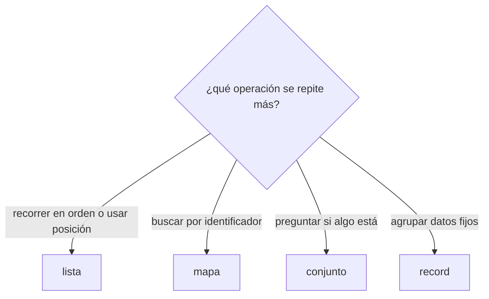
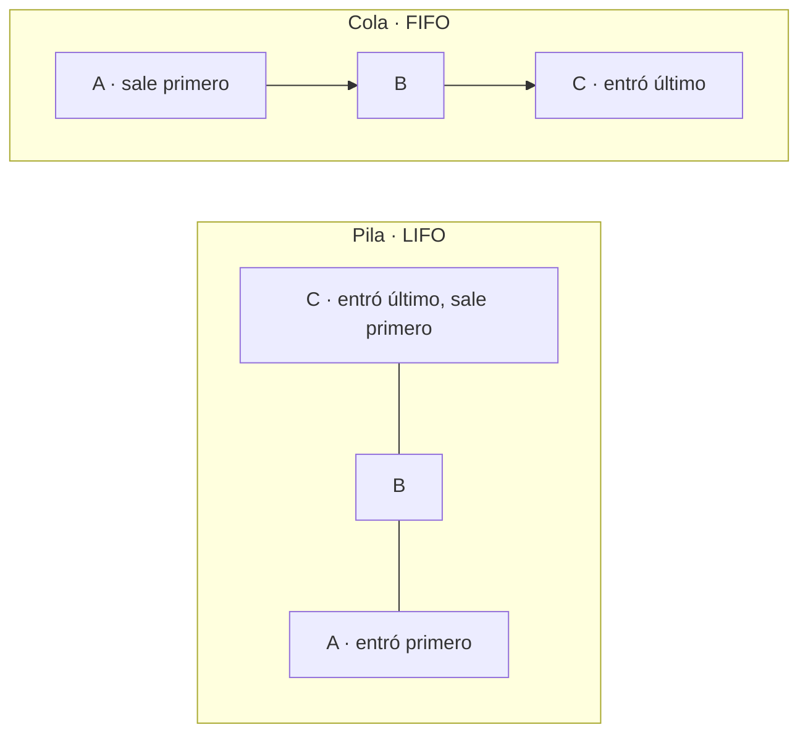
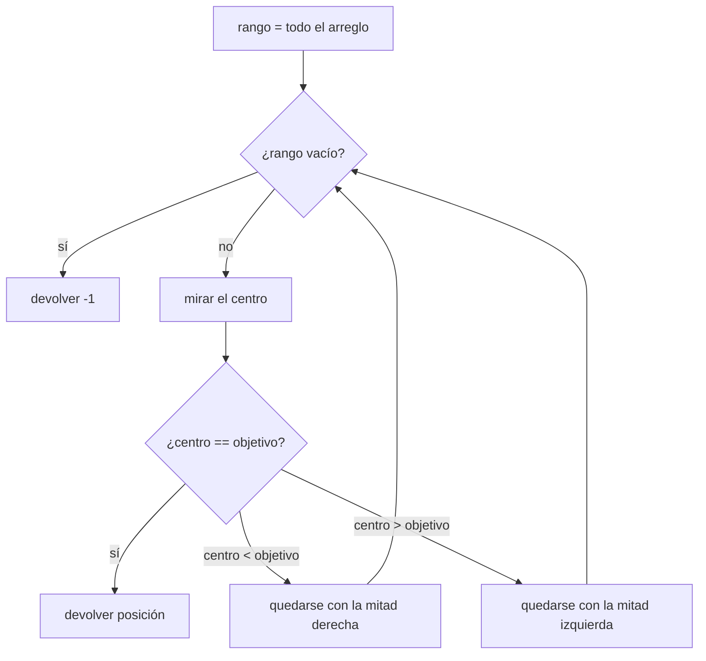
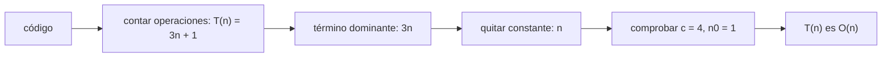
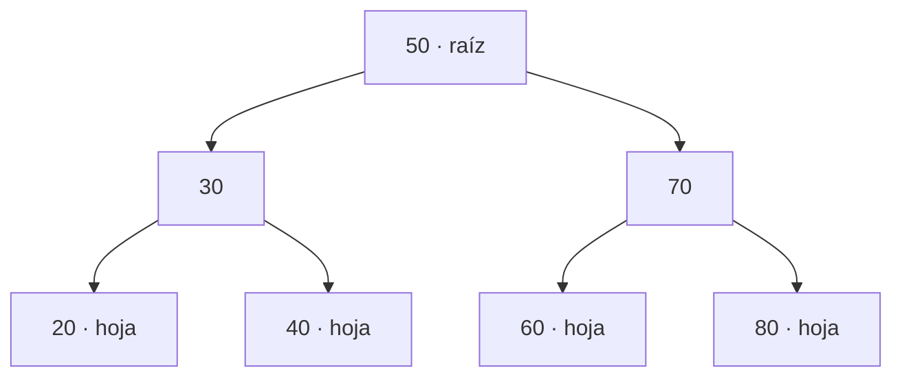
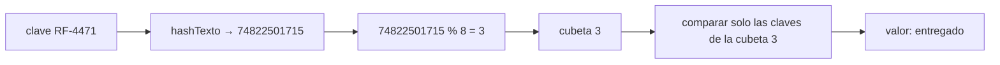
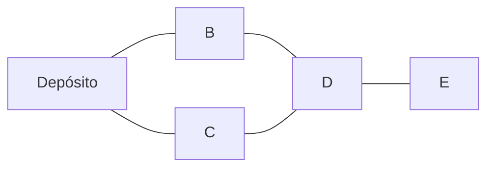
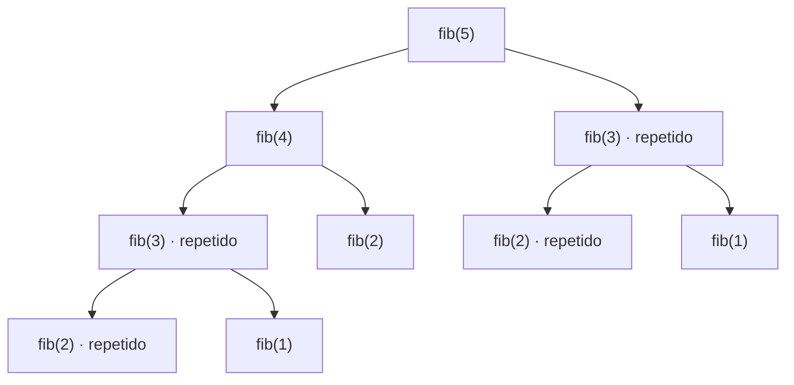

# Módulo 2: Estructuras de datos, algoritmos y complejidad

**Entorno comprobado para esta edición (2026-11-24):** OpenJDK 25.0.5.1 en Linux x86_64. Todas las salidas de
este módulo se obtuvieron ejecutando el código mostrado con `java Archivo.java`, solo con la biblioteca estándar. Los
**tiempos** cambian de una máquina a otra y entre ejecuciones; lo que se mantiene es la **proporción** entre ellos.
Los conteos de pasos y comparaciones son exactos y deben coincidir con los tuyos.

## Apertura del módulo

#### Objetivos del módulo
Al terminar este módulo podrás:
- elegir entre lista, mapa, conjunto y record según la operación que más se repite;
- implementar pilas, colas, búsquedas, ordenamientos, árboles, tablas hash y recorridos de grafos;
- contar operaciones y medir tiempos para comparar dos soluciones del mismo problema;
- expresar el crecimiento de un algoritmo con notación O grande y justificarlo;
- reconocer subproblemas repetidos y resolverlos con programación dinámica.

#### Esquema del módulo
1. Elegir estructuras según las operaciones.
2. Pilas, colas y abstracciones de comportamiento.
3. Búsqueda, precondiciones y demostración de corrección.
4. Complejidad, medición, ordenamiento y recursión.
5. Árboles y árboles binarios de búsqueda (BST).
6. Tablas hash — búsqueda en tiempo constante.
7. Grafos y recorridos BFS/DFS.
8. Programación dinámica — resolver una vez, recordar el resultado.
9. Proyecto 2: gestor de inventario con análisis de rendimiento.

#### Qué necesitas saber antes
El Módulo 1 completo: variables y tipos, condiciones y bucles (`if`, `for`, `while`), funciones con parámetros y
`return`, excepciones con `throw`, `try`/`catch` y `assert`, y clases con constructor y `record`. Cada término nuevo de este
módulo se define en el tema donde aparece por primera vez.

## Aprende construyendo

### Tema 1: Elegir estructuras según las operaciones · Básico · 50 min

<details open>
<summary><strong>Capa 1 — Lectura</strong></summary>

#### Objetivos
Al terminar este tema podrás:
- crear listas, mapas, conjuntos y records, y leer o cambiar sus elementos;
- elegir la estructura según la operación que más se repite: posición, clave, pertenencia o grupo fijo;
- explicar por qué guardar una posición de lista como identificador produce datos equivocados;
- leer los errores `NullPointerException`, `IndexOutOfBoundsException` y los de compilación propios de cada estructura.

**Conceptos clave:** estructura de datos, lista, índice, mapa, clave, conjunto, record, tipo genérico, mutable, null

#### El problema
La coordinadora de RutaFlow tiene los envíos del día en una lista. Cada vez que un cliente llama, alguien
recorre la lista buscando su guía. Un compañero propuso guardar «la posición» de cada envío para ir directo.
Funcionó hasta que se entregó el primer envío: desde ese momento, el sistema mostraba el destino de otro
cliente. ¿Dónde conviene guardar los envíos para encontrarlos por guía sin errores?

#### Glosario del tema

**estructura de datos**
- **Definición técnica:** forma de organizar varios valores en memoria que define qué operaciones son posibles y cuánto trabajo cuesta cada una.
- **En palabras sencillas:** el mueble donde guardas las cosas: un estante, un archivador con etiquetas o una caja.
- **Dónde se rompe la comparación:** un mueble no cambia de precio; una estructura hace barata una operación y cara otra.
- **Ejemplo:** guardar guías en una lista o en un mapa cambia cómo las buscas.
- **Error típico:** elegir la estructura por costumbre, sin preguntarte qué operación se repetirá más.

**lista**
- **Definición técnica:** secuencia ordenada de valores (`List`); conserva el orden de inserción y admite repetidos. `ArrayList` es la implementación que puede crecer.
- **En palabras sencillas:** una fila numerada: cada cosa tiene su puesto.
- **Dónde se rompe la comparación:** en una fila real nadie cambia de puesto si otro se va; en una lista, al borrar uno, los de atrás corren.
- **Ejemplo:** `List<String> envios = new ArrayList<>(List.of("RF-101", "RF-102"));`; `envios.add("RF-103")` agrega al final.
- **Error típico:** confundir la posición de un elemento con su identidad, como en el problema de este tema.

**índice**
- **Definición técnica:** número entero que indica la posición de un elemento en una secuencia; en Java empieza en `0`.
- **En palabras sencillas:** el número del puesto en la fila.
- **Dónde se rompe la comparación:** en una fila real el primero es el 1; en Java el primero es el 0.
- **Ejemplo:** en `List.of("RF-101", "RF-102")`, `envios.get(1)` es `"RF-102"`.
- **Error típico:** pedir `envios.get(2)` en una lista de 2 elementos produce `IndexOutOfBoundsException: Index 2 out of bounds for length 2`.

**mapa**
- **Definición técnica:** colección de pares clave-valor (`Map`) que localiza un valor a partir de su clave sin recorrer los demás. `HashMap` no garantiza orden; `LinkedHashMap` conserva el orden de inserción.
- **En palabras sencillas:** un archivador con pestañas: buscas la pestaña por su nombre y abres directo.
- **Dónde se rompe la comparación:** un archivador puede tener dos pestañas iguales; un mapa nunca repite una clave.
- **Ejemplo:** `estado.put("RF-101", "pendiente")`; `estado.get("RF-101")` devuelve `"pendiente"`.
- **Error típico:** usar sin comprobar el resultado de una clave que no existe: `get` devuelve `null` y el método siguiente falla con `NullPointerException`.

**clave**
- **Definición técnica:** valor único dentro de un mapa que identifica a otro valor; también lo usan los conjuntos. Debe tener bien definidos `equals` y `hashCode` (Tema 6).
- **En palabras sencillas:** el nombre de la pestaña del archivador.
- **Dónde se rompe la comparación:** si la clave cambia después de guardarla, el mapa ya no la encuentra.
- **Ejemplo:** en `estado.put("RF-101", "pendiente")`, la clave es `"RF-101"`.
- **Error típico:** usar como clave un objeto mutable y modificarlo después: el valor queda guardado pero inencontrable.

**tipo genérico (`List<String>`)**
- **Definición técnica:** tipo que se completa con otro entre `< >`; dice qué guarda la colección y el compilador lo vigila.
- **En palabras sencillas:** la etiqueta de la caja dice «solo textos» o «solo envíos».
- **Dónde se rompe la comparación:** `< >` solo admite objetos: para números se usa `Integer` o `Double`, no `int` ni `double`.
- **Ejemplo:** `Map<String, Envio> porGuia` guarda envíos con su guía como clave.
- **Error típico:** escribir `List<int>`: no compila (`unexpected type`).

**conjunto**
- **Definición técnica:** colección de valores únicos (`Set`) que responde rápido si un valor pertenece o no; `HashSet` no tiene orden ni posiciones.
- **En palabras sencillas:** una bolsa donde cada cosa aparece una sola vez.
- **Dónde se rompe la comparación:** en una bolsa puedes meter dos manzanas iguales; en un conjunto, la segunda desaparece.
- **Ejemplo:** `new HashSet<>(List.of("Cali", "Cali", "Pasto"))` queda con 2 elementos; `ciudades.contains("Cali")` da `true`.
- **Error típico:** pedir una posición: `ciudades.get(0)` no compila (`cannot find symbol`). Y `Set.of("Cali", "Cali")` falla al ejecutar con `IllegalArgumentException: duplicate element: Cali`.

**record**
- **Definición técnica:** clase compacta e inmutable que agrupa un número fijo de valores con nombre (Módulo 1, Tema 1).
- **En palabras sencillas:** un sobre sellado con datos que siempre van juntos.
- **Dónde se rompe la comparación:** un sobre se puede abrir y cambiar; para «cambiar» un record creas otro nuevo.
- **Ejemplo:** `Coordenada coordenada = new Coordenada(4.61, -74.08)`; `coordenada.latitud()` da `4.61`.
- **Error típico:** asignar a un componente: `coordenada.latitud = 5` no compila (`cannot assign a value to final variable`).

**mutable**
- **Definición técnica:** propiedad de un objeto cuyo contenido puede cambiar después de creado sin crear otro objeto; lo contrario es inmutable.
- **En palabras sencillas:** algo que puedes editar en el sitio, como una libreta; lo inmutable es como algo impreso.
- **Dónde se rompe la comparación:** una variable que apunta a algo inmutable sí se puede reasignar a otro valor.
- **Ejemplo:** `ArrayList`, `HashMap` y `HashSet` son mutables; `String`, los records y las listas de `List.of` son inmutables.
- **Error típico:** intentar agregar a una lista de `List.of(...)`: `UnsupportedOperationException`. Para una lista que crece, `new ArrayList<>(List.of(...))`.

**null**
- **Definición técnica:** valor especial de Java que significa «no apunta a ningún objeto»; es lo que devuelve `Map.get` para una clave inexistente.
- **En palabras sencillas:** una casilla vacía.
- **Dónde se rompe la comparación:** no produce error hasta que le pides algo: llamar un método sobre `null` lanza `NullPointerException`.
- **Ejemplo:** `porGuia.get("RF-999")` devuelve `null` porque esa guía no existe.
- **Error típico:** usar el resultado sin comprobarlo: `porGuia.get("RF-999").destino()` termina con `NullPointerException`.

#### ► CÓMO FUNCIONA
Antes de elegir, escribe la operación que tu programa hará miles de veces. Si importan el orden o la posición,
usa una lista. Si buscas por un identificador, usa un mapa. Si solo preguntas «¿está o no está?», usa un
conjunto. Si varios datos siempre viajan juntos y no cambian, usa un record.

La diferencia de trabajo es real. Para encontrar una guía en una lista, Java compara elemento por elemento.
En un mapa, la clave lo lleva directo al valor; en el Tema 6 verás cómo lo logra.



#### Problema resuelto 1.1
Representa con cada estructura un dato real de RutaFlow y realiza su operación típica.

**Razonamiento:**
1. Las guías del día tienen orden de llegada: lista. Operación típica: leer por posición y agregar al final.
2. El estado depende de la guía: mapa. Operación típica: consultar y agregar por clave.
3. Las ciudades visitadas no se repiten: conjunto. Operación típica: preguntar si una ciudad está.
4. Latitud y longitud siempre van juntas: record. Operación típica: leer sus dos componentes.

```java
// Estructuras.java — las cuatro estructuras básicas con datos de RutaFlow
record Coordenada(double latitud, double longitud) {}

void main() {
    List<String> envios = new ArrayList<>(List.of("RF-101", "RF-102", "RF-103"));    // lista: orden y posición
    IO.println("lista: " + envios + " | primero: " + envios.get(0) + " | cantidad: " + envios.size());
    envios.add("RF-104");                                                            // la lista crece al final
    IO.println("después de add: " + envios);

    Map<String, String> estadoPorGuia = new LinkedHashMap<>();                         // mapa: valor por clave
    estadoPorGuia.put("RF-101", "pendiente");
    estadoPorGuia.put("RF-102", "entregado");
    IO.println("estado de RF-102: " + estadoPorGuia.get("RF-102"));
    estadoPorGuia.put("RF-103", "pendiente");                                         // agrega una clave nueva
    IO.println("claves: " + estadoPorGuia.keySet());

    Set<String> ciudades = new HashSet<>(List.of("Bogotá", "Cali", "Bogotá", "Medellín"));  // conjunto: sin repetidos
    IO.println("ciudades distintas: " + ciudades.size());
    IO.println("¿pasa por Cali? " + ciudades.contains("Cali"));

    Coordenada coordenada = new Coordenada(4.61, -74.08);                             // record: grupo fijo
    IO.println("latitud: " + coordenada.latitud() + " | longitud: " + coordenada.longitud());
}
```

```text
$ java Estructuras.java
lista: [RF-101, RF-102, RF-103] | primero: RF-101 | cantidad: 3
después de add: [RF-101, RF-102, RF-103, RF-104]
estado de RF-102: entregado
claves: [RF-101, RF-102, RF-103]
ciudades distintas: 3
¿pasa por Cali? true
latitud: 4.61 | longitud: -74.08
```

**Explicación por partes.**
- Línea 2: `record Coordenada` es el grupo fijo de dos valores.
- Línea 5: `List.of(...)` crea una lista fija; `new ArrayList<>(...)` la copia en una que puede crecer. `get(0)` lee
  la posición 0 y `size()` cuenta los elementos.
- Línea 7: `add` agrega un elemento al final.
- Líneas 10–12: `LinkedHashMap` guarda pares clave-valor y conserva el orden en que se agregaron; `put` agrega.
- Línea 14: `put` con una clave nueva la agrega; si ya existiera, reemplazaría su valor.
- Línea 17: el `HashSet` recibe `"Bogotá"` dos veces y lo guarda una sola, por eso hay 3.
- Línea 19: `contains` pregunta si el valor pertenece al conjunto.
- Líneas 21–22: los componentes del record se leen con sus métodos `latitud()` y `longitud()`.

> **Error común.** Pedir una clave que no existe y usar el resultado. `porGuia.get("RF-999").destino()` termina con
> `NullPointerException: Cannot invoke "...destino()" because the return value of "java.util.Map.get(Object)" is null`.
> El mensaje dice exactamente qué fue `null`. Si la ausencia es normal, compruébala antes o usa
> `getOrDefault`.

> **Error común.** Tratar un conjunto como lista. `ciudades.get(0)` no compila: un conjunto no tiene posiciones,
> solo pertenencia.

#### Problema resuelto 1.2
Reproduce el fallo del problema: guarda la posición de `RF-102`, entrega `RF-101` y vuelve a consultar.

**Razonamiento:**
1. Construye un mapa indexado por guía recorriendo la lista con un `for`.
2. Guarda la posición `1` como si identificara a `RF-102`.
3. Borra el primer envío de ambas estructuras y consulta de las dos formas.

```java
// PosicionVsClave.java — buscar un envío por posición o por guía
record Envio(String guia, String destino) {}

void main() {
    List<Envio> envios = new ArrayList<>(List.of(
            new Envio("RF-101", "Cali"),
            new Envio("RF-102", "Medellín"),
            new Envio("RF-103", "Pasto")));
    Map<String, Envio> porGuia = new HashMap<>();
    for (Envio envio : envios) {
        porGuia.put(envio.guia(), envio);
    }

    int posicionGuardada = 1;   // "RF-102 está en la posición 1"
    IO.println("antes, por posición: " + envios.get(posicionGuardada).destino());
    IO.println("antes, por guía:     " + porGuia.get("RF-102").destino());

    envios.remove(0);           // se entrega RF-101 y sale de la lista
    porGuia.remove("RF-101");   // y del mapa
    IO.println("después, por posición: " + envios.get(posicionGuardada).destino());
    IO.println("después, por guía:     " + porGuia.get("RF-102").destino());
    IO.println("guía inexistente con get: " + porGuia.get("RF-999"));
}
```

```text
$ java PosicionVsClave.java
antes, por posición: Medellín
antes, por guía:     Medellín
después, por posición: Pasto
después, por guía:     Medellín
guía inexistente con get: null
```

**Explicación por partes.**
- Líneas 9–12: el `for` recorre `envios` y guarda cada uno en el mapa con su guía como clave.
- Líneas 15–16: antes de borrar, las dos consultas coinciden: `Medellín`.
- Línea 18: `envios.remove(0)` saca el primero; `RF-102` y `RF-103` corren un puesto hacia adelante.
- Línea 20: la posición `1` ahora pertenece a `RF-103`, y el programa muestra `Pasto` **sin ningún error**.
- Línea 21: la clave `"RF-102"` sigue apuntando al envío correcto, sin importar qué se borre.
- Línea 22: `get` devuelve `null` para una guía inexistente.

> **Buena práctica.** Identifica los datos por un valor propio y estable (guía, cédula, código), no por su posición.
> Las posiciones cambian cada vez que alguien inserta o borra.

> **Prevenir errores.** Cuando construyas un mapa desde una lista, compara `porGuia.size()` con
> `envios.size()`. Si difieren, había claves repetidas y algunos datos se perdieron.

#### Checkpoint 1.1
Tras `envios.remove(0)` en el Problema resuelto 1.2, ¿qué produce `envios.get(2)`?

Respuesta: `IndexOutOfBoundsException: Index 2 out of bounds for length 2`. Después del borrado la lista tiene 2 elementos, con índices `0` y `1`.

#### Checkpoint 1.2
Necesitas saber si una ciudad ya recibió visita hoy, entre miles. ¿Qué estructura usas?

Respuesta: un conjunto. Solo importa la pertenencia (`visitadas.contains(ciudad)`) y las repeticiones sobran.

</details>

<details>
<summary><strong>Capa 2 — Construcción</strong></summary>

#### Paso 1 · Prepara la carpeta
Crea `~/labs/estructuras` y entra con `cd ~/labs/estructuras`.

#### Paso 2 · Prueba las cuatro estructuras
Escribe `Estructuras.java` y ejecútalo con `java Estructuras.java`. Compara cada línea con la salida del tema.

#### Paso 3 · Reproduce el fallo de la posición
Escribe `PosicionVsClave.java`. Antes de ejecutarlo, anota qué destino esperas en la línea 20. Luego compruébalo.

#### Paso 4 · Provoca los errores
En una copia, cambia la última línea por `IO.println(porGuia.get("RF-999").destino());` y en `Estructuras.java`
agrega `coordenada.latitud = 5;`. Lee cada mensaje y deshaz el cambio.

#### Resumen
- Una **estructura de datos** se elige por la operación que más se repite, no por costumbre.
- La **lista** conserva orden; su **índice** empieza en 0 y cambia al insertar o borrar.
- El **mapa** encuentra un valor por su **clave** única; el **tipo genérico** (`Map<String, Envio>`) dice qué guarda.
- El **conjunto** guarda valores únicos y responde rápido a `contains`; no tiene posiciones.
- El **record** agrupa datos fijos; es inmutable, a diferencia de las colecciones **mutables** como `ArrayList`.
- `null` + método: `NullPointerException`. Posición inexistente: `IndexOutOfBoundsException`.

#### Ejercicio verificable 1
Básico. Crea un `Map<String, Integer> paquetes` con `RF-101 → 3` y `RF-102 → 1` (usa `LinkedHashMap`), suma 2 paquetes
a `RF-102` y muestra el mapa.

Respuesta esperada: `{RF-101=3, RF-102=3}`. Se logra con `paquetes.put("RF-102", paquetes.get("RF-102") + 2);`.

#### Ejercicio verificable 2
Intermedio. Dada `List.of("Cali", "Pasto", "Cali", "Neiva", "Pasto")`, muestra cuántas ciudades distintas hubo.

Respuesta esperada: `3`. Se obtiene con `new HashSet<>(visitas).size()`: el conjunto descarta los repetidos.

#### Ejercicio verificable 3
Reto. Construye `porGuia` con `put` desde las guías `"RF-1"`, `"RF-2"` y `"RF-1"`, y detecta la pérdida de datos.

Respuesta esperada: `porGuia.size()` es `2` y la lista tiene `3`. La guía `RF-1` estaba repetida y el segundo
registro reemplazó al primero sin aviso. (Si construyes el mapa con `Collectors.toMap`, Java sí avisa:
`IllegalStateException: Duplicate key RF-1`.)

#### En el trabajo
Las respuestas de un servicio web llegan como listas de objetos, igual que `envios`. Lo primero que hace un
desarrollador es indexarlas por un identificador para cruzarlas con otra fuente. El fallo de la posición
aparece en interfaces reales: una tabla que se reordena y un botón que borra «la fila 3» equivocada.

</details>

### Tema 2: Pilas, colas y abstracciones de comportamiento · Básico · 50 min

<details open>
<summary><strong>Capa 1 — Lectura</strong></summary>

#### Objetivos
Al terminar este tema podrás:
- distinguir una pila (el último en entrar sale primero) de una cola (el primero en entrar sale primero);
- implementar «deshacer» y «rehacer» con dos pilas y trazar su estado paso a paso;
- atender solicitudes en orden de llegada con `ArrayDeque` y medir con `System.nanoTime` por qué no usar `ArrayList.remove(0)`;
- reconocer la `NoSuchElementException` que produce sacar un elemento de una estructura vacía.

**Conceptos clave:** tipo abstracto de datos, pila, cola, ArrayDeque, System.nanoTime

#### El problema
La planificadora de rutas de RutaFlow edita el recorrido del día y a veces se equivoca. Necesita un botón
«Deshacer» que revierta el **último** cambio, y otro «Rehacer» que lo recupere. Al mismo tiempo, las
solicitudes de recogida deben atenderse en el **orden en que llegaron**. Son dos reglas opuestas: ¿qué
estructura respeta cada una?

#### Glosario del tema

**tipo abstracto de datos**
- **Definición técnica:** descripción de una colección por las operaciones que ofrece y sus reglas, sin fijar cómo se guardan los datos por dentro.
- **En palabras sencillas:** el contrato de un servicio: dice qué puedes pedir, no cómo se hace en la cocina.
- **Dónde se rompe la comparación:** el contrato no menciona tiempos, pero la implementación que elijas sí decide cuánto tarda.
- **Ejemplo:** una pila se define por «apilar» y «desapilar»; por dentro puede usar un `ArrayList`.
- **Error típico:** dejar los datos internos sin `private` y que otro código los toque directamente, rompiendo la regla que el tipo promete.

**pila (LIFO)**
- **Definición técnica:** tipo abstracto de datos donde solo se agrega y se quita por el mismo extremo, la cima; sigue la regla LIFO (*last in, first out*).
- **En palabras sencillas:** una torre de platos: pones arriba y sacas de arriba.
- **Dónde se rompe la comparación:** en una torre real puedes sacar un plato del medio con cuidado; en una pila, no.
- **Ejemplo:** con una lista, `add` apila y `removeLast()` desapila el último.
- **Error típico:** desapilar una pila vacía: `removeLast()` produce `NoSuchElementException`.

**cola (FIFO)**
- **Definición técnica:** tipo abstracto de datos donde se agrega por un extremo y se quita por el otro; sigue la regla FIFO (*first in, first out*).
- **En palabras sencillas:** la fila del banco: el primero que llega es el primero que atienden.
- **Dónde se rompe la comparación:** en un banco alguien se puede colar; en una cola el orden de llegada es la única regla.
- **Ejemplo:** solicitudes de recogida: entra Ana, luego Beto; sale primero Ana.
- **Error típico:** implementarla con `lista.remove(0)`, que funciona pero se vuelve lenta cuando la cola crece.

**ArrayDeque**
- **Definición técnica:** clase `java.util.ArrayDeque`, cola de dos extremos que agrega y quita por ambos lados sin mover el resto de los elementos; se usa a través del tipo `Deque`.
- **En palabras sencillas:** una fila con puerta adelante y atrás: entrar y salir no obliga a nadie a moverse.
- **Dónde se rompe la comparación:** no tiene acceso por posición: no hay `get(5000)`.
- **Ejemplo:** `recogidas.addLast("Ana")` agrega atrás; `recogidas.pollFirst()` saca de adelante.
- **Error típico:** sacar de una cola vacía: `pollFirst()` devuelve `null` en silencio, y `removeFirst()` lanza `NoSuchElementException`.

**System.nanoTime**
- **Definición técnica:** método que devuelve un contador de nanosegundos con la mayor precisión del sistema; restando dos lecturas se obtiene cuánto duró un trozo de código.
- **En palabras sencillas:** un cronómetro: lo lees al empezar, lo lees al terminar y restas.
- **Dónde se rompe la comparación:** el número por sí solo no es una hora del día; solo sirve la resta.
- **Ejemplo:** `long inicio = System.nanoTime(); ... double segundos = (System.nanoTime() - inicio) / 1e9;`.
- **Error típico:** medir una sola vez algo que dura microsegundos; el ruido del sistema y el compilador JIT de Java dominan y la cifra engaña.

#### ► CÓMO FUNCIONA
Una pila y una cola guardan lo mismo; cambia **por dónde sale** el siguiente elemento. En la pila sale el más
reciente. En la cola sale el más antiguo.

Deshacer encaja con una pila: el cambio que se revierte es siempre el último. Rehacer usa una segunda pila:
lo que deshaces se apila ahí, para recuperarlo en orden inverso.

La cola tiene una trampa. Un `ArrayList` guarda sus elementos en casillas seguidas. `remove(0)` saca el
primero y luego **corre todos los demás** una casilla. Con 20 000 elementos, son miles de movimientos por cada
salida. `ArrayDeque` evita ese corrimiento.



#### Problema resuelto 2.1
Implementa una pila como clase y úsala para tres ediciones, dos «Deshacer» y un «Rehacer».

**Razonamiento:**
1. La clase `Pila` expone solo `apilar`, `desapilar` y `estaVacia`; la lista interna queda escondida con `private`.
2. Deshacer: sacar de la pila `deshacer` y apilar en `rehacer`.
3. Rehacer: el movimiento inverso, de `rehacer` a `deshacer`.
4. Traza esperada: `[A, B, C]` y `[]`; luego `[A]` y `[C, B]`; luego `[A, B]` y `[C]`.

```java
// Deshacer.java — deshacer y rehacer cambios de una ruta con dos pilas
class Pila {
    private final List<String> datos = new ArrayList<>();

    void apilar(String elemento) {
        datos.add(elemento);
    }

    String desapilar() {
        return datos.removeLast();
    }

    boolean estaVacia() {
        return datos.isEmpty();
    }

    @Override
    public String toString() {
        return datos.toString();
    }
}

void main() {
    Pila deshacer = new Pila();
    Pila rehacer = new Pila();
    for (String cambio : List.of("A", "B", "C")) {       // tres ediciones de la ruta
        deshacer.apilar(cambio);
    }
    IO.println("tras 3 ediciones: deshacer = " + deshacer + " rehacer = " + rehacer);

    for (int i = 0; i < 2; i++) {                         // dos veces «Deshacer»
        rehacer.apilar(deshacer.desapilar());
    }
    IO.println("tras 2 deshacer:  deshacer = " + deshacer + " rehacer = " + rehacer);

    deshacer.apilar(rehacer.desapilar());                 // una vez «Rehacer»
    IO.println("tras 1 rehacer:   deshacer = " + deshacer + " rehacer = " + rehacer);
}
```

```text
$ java Deshacer.java
tras 3 ediciones: deshacer = [A, B, C] rehacer = []
tras 2 deshacer:  deshacer = [A] rehacer = [C, B]
tras 1 rehacer:   deshacer = [A, B] rehacer = [C]
```

**Explicación por partes.**
- Línea 3: `private` impide que otro código toque la lista interna; solo los métodos de `Pila` la usan.
- Líneas 5–11: apilar agrega al final de la lista y desapilar quita el último (`removeLast`); el final es la cima.
- Líneas 17–20: `toString` define cómo se muestra la pila; aquí muestra la lista interna.
- Línea 32: una sola línea hace el «Deshacer» completo: saca de una pila y apila en la otra.
- Línea 36: el «Rehacer» devuelve `B`, el último deshecho, a la pila de deshacer.

> **Error común.** Pulsar «Deshacer» sin nada que deshacer. `deshacer.desapilar()` con la pila vacía termina con
> `NoSuchElementException`, con `at Deshacer$Pila.desapilar(Deshacer.java:10)` en la traza. Comprueba antes con
> `estaVacia()` y desactiva el botón.

> **Ingeniería de software.** Encerrar la lista dentro de `Pila` permite cambiar la implementación (por un
> `ArrayDeque`, por ejemplo) sin tocar el código que usa `apilar` y `desapilar`.

#### Problema resuelto 2.2
Atiende las recogidas en orden de llegada y compara el tiempo de vaciar una cola con `ArrayList` y con `ArrayDeque`.

**Razonamiento:**
1. Los clientes se atienden en el orden en que llegaron: cola. `addLast` agrega atrás y `pollFirst` saca de adelante.
2. Para comparar, se vacía la misma cantidad de datos con `ArrayList.remove(0)` y con `ArrayDeque.pollFirst()`.
3. Se mide con `n` y con el doble de `n`, para ver cómo crece el tiempo.

```java
// ColaRecogidas.java — atender solicitudes de recogida en orden de llegada
void main() {
    Deque<String> recogidas = new ArrayDeque<>();
    recogidas.addLast("Cliente Ana");
    recogidas.addLast("Cliente Beto");
    recogidas.addLast("Cliente Carla");
    IO.println("se atiende primero: " + recogidas.pollFirst());
    IO.println("quedan: " + recogidas);

    for (int n : new int[] {100_000, 200_000}) {
        List<Integer> comoLista = new ArrayList<>();
        for (int i = 0; i < n; i++) comoLista.add(i);
        long inicio = System.nanoTime();
        while (!comoLista.isEmpty()) {
            comoLista.remove(0);                 // saca el primero y corre todos los demás
        }
        double tLista = (System.nanoTime() - inicio) / 1e9;

        Deque<Integer> comoDeque = new ArrayDeque<>();
        for (int i = 0; i < n; i++) comoDeque.addLast(i);
        inicio = System.nanoTime();
        while (!comoDeque.isEmpty()) {
            comoDeque.pollFirst();               // saca el primero sin mover el resto
        }
        double tDeque = (System.nanoTime() - inicio) / 1e9;
        IO.println("n=%d: ArrayList.remove(0) %.4f s | ArrayDeque.pollFirst() %.4f s".formatted(n, tLista, tDeque));
    }
}
```

```text
$ java ColaRecogidas.java
se atiende primero: Cliente Ana
quedan: [Cliente Beto, Cliente Carla]
n=100000: ArrayList.remove(0) 0.3920 s | ArrayDeque.pollFirst() 0.0049 s
n=200000: ArrayList.remove(0) 1.5960 s | ArrayDeque.pollFirst() 0.0003 s
```

**Explicación por partes.**
- Línea 3: `Deque<String>` es el tipo; `ArrayDeque` la implementación. Viene en la biblioteca estándar.
- Línea 7: `pollFirst` saca el primero que llegó: Ana.
- Líneas 13–15: cada `remove(0)` corre todos los elementos restantes una casilla.
- Líneas 20–22: `pollFirst` solo mueve la puerta de adelante.
- Al duplicar `n`, el tiempo de `ArrayList` se multiplicó por cerca de 4. El de `ArrayDeque` es tan pequeño que lo
  domina el ruido: en la segunda vuelta bajó porque el compilador JIT de Java ya había optimizado ese código.
- `%.4f` escribe el número con 4 decimales usando el idioma de tu sistema: en un equipo configurado en español
  verás `0,3920` con coma en vez de punto. Es el mismo número.

> **Rendimiento.** Tus segundos serán distintos, pero la proporción se repite: con `ArrayList.remove(0)`, duplicar los
> datos multiplica el tiempo por cerca de 4. En el Tema 4 aprenderás a nombrar ese crecimiento.

> **Buena práctica.** Si necesitas sacar por adelante, usa `ArrayDeque` desde el principio. Cambiar de estructura
> cuando el sistema ya está lento cuesta mucho más.

#### Checkpoint 2.1
Partiendo de la última línea de la salida de `Deshacer.java`, pulsas «Deshacer» una vez más. ¿Cómo quedan las pilas?

Respuesta: `deshacer = [A]` y `rehacer = [C, B]`. Sale `B` de la cima de deshacer y queda encima de `C` en rehacer.

</details>

<details>
<summary><strong>Capa 2 — Construcción</strong></summary>

#### Paso 1 · Prepara la carpeta
Crea `~/labs/pila-cola` y entra con `cd ~/labs/pila-cola`.

#### Paso 2 · Construye la pila
Escribe `Deshacer.java`. Antes de ejecutarlo, escribe en papel la traza esperada. Ejecuta y compara.

#### Paso 3 · Mide la cola
Escribe `ColaRecogidas.java` y ejecútalo dos veces. Anota cuánto cambian los segundos y cuánto cambia la proporción.

#### Paso 4 · Provoca el error
Agrega al final de `main` cuatro llamadas a `deshacer.desapilar();` y lee la `NoSuchElementException`. Corrígelo con
`estaVacia()`.

#### Resumen
- Un **tipo abstracto de datos** se define por sus operaciones, no por cómo guarda los datos.
- La **pila** saca el último que entró (LIFO): sirve para deshacer, rehacer y llamadas anidadas.
- La **cola** saca el primero que entró (FIFO): sirve para atender en orden de llegada.
- **`ArrayDeque`** agrega y quita por ambos extremos sin correr los demás elementos.
- **`System.nanoTime`** mide tiempo restando dos lecturas; compara proporciones, no segundos sueltos.
- Sacar de una estructura vacía produce `NoSuchElementException` (o `null` con `pollFirst`); compruébalo antes.

#### Ejercicio verificable 1
Básico. Apila `"x"`, `"y"`, `"z"` en una `Pila` y desapila dos veces. ¿Qué valores salen y en qué orden?

Respuesta esperada: primero `z`, luego `y`. Queda `[x]`.

#### Ejercicio verificable 2
Intermedio. Con un `ArrayDeque<Integer>`, agrega `1`, `2`, `3` con `addLast`, saca uno con `pollFirst` y agrega `4`.
Muestra la cola.

Respuesta esperada: `[2, 3, 4]`. Salió el `1`, el primero en llegar, y el `4` quedó al final.

#### Ejercicio verificable 3
Reto. Usa una pila para comprobar si los paréntesis de `"(a(b)c)"` y `"(a(b c"` están balanceados.

Respuesta esperada: `true` y `false`. Apila cada `(`; ante cada `)`, desapila (si la pila está vacía, es `false`). Al final, balanceado solo si la pila quedó vacía.

#### En el trabajo
Los editores de texto y de diseño implementan deshacer y rehacer con dos pilas. Las colas aparecen en todo
sistema que recibe trabajo más rápido de lo que lo procesa: pedidos, correos por enviar, facturas por generar.
En producción esas colas viven en servicios como RabbitMQ o Amazon SQS, pero la regla FIFO es la misma.

</details>

### Tema 3: Búsqueda, precondiciones y demostración de corrección · Básico · 55 min

<details open>
<summary><strong>Capa 1 — Lectura</strong></summary>

#### Objetivos
Al terminar este tema podrás:
- implementar búsqueda lineal y búsqueda binaria sin métodos de biblioteca;
- contar las comparaciones de cada una y explicar por qué la binaria hace muchas menos;
- enunciar la precondición de la búsqueda binaria y reproducir su fallo silencioso cuando no se cumple;
- argumentar que la búsqueda binaria es correcta usando un invariante y comprobarlo con `assert`.

**Conceptos clave:** búsqueda lineal, búsqueda binaria, precondición, postcondición, invariante de ciclo

#### El problema
RutaFlow guarda las horas límite de entrega de 1000 envíos, ordenadas de menor a mayor. Un supervisor
pregunta a cada rato si hay un envío que venza a cierta hora. Revisar los 1000 uno por uno funciona, pero es
lento. ¿Se puede aprovechar que el arreglo está ordenado? ¿Y qué pasa si alguien lo entrega desordenado?

#### Glosario del tema

**búsqueda lineal**
- **Definición técnica:** algoritmo que compara el objetivo con cada elemento de la secuencia, del primero al último, hasta encontrarlo o agotarla.
- **En palabras sencillas:** buscar un nombre en una lista leyendo renglón por renglón.
- **Dónde se rompe la comparación:** una persona salta con la vista; el programa compara cada elemento, sin excepción.
- **Ejemplo:** buscar `1501` entre 1000 valores donde no está cuesta 1000 comparaciones.
- **Error típico:** devolver `-1` dentro del bucle, en el primer elemento distinto, en vez de después de revisarlos todos.

**búsqueda binaria**
- **Definición técnica:** algoritmo para secuencias ordenadas que compara el objetivo con el elemento central y descarta la mitad donde no puede estar, hasta encontrarlo o vaciar el rango.
- **En palabras sencillas:** buscar una palabra en el diccionario abriendo por la mitad y quedándote con la mitad correcta.
- **Dónde se rompe la comparación:** en papel abres «más o menos» por la mitad; el programa calcula el centro exacto con la división entera `/` entre dos `int`.
- **Ejemplo:** buscar `1501` entre 1000 valores ordenados cuesta 10 comparaciones.
- **Error típico:** aplicarla a un arreglo desordenado: no falla, devuelve una respuesta equivocada.

**precondición**
- **Definición técnica:** condición que debe cumplirse antes de llamar a un método para que su resultado sea correcto; si no se cumple, el método no promete nada.
- **En palabras sencillas:** el requisito de entrada, como «el horno debe estar caliente antes de meter el pan».
- **Dónde se rompe la comparación:** con el horno frío notas el problema; con una precondición rota el programa suele seguir sin avisar.
- **Ejemplo:** la búsqueda binaria exige que `valores` esté ordenado de menor a mayor.
- **Error típico:** no escribirla en ningún lado y suponer que quien llama la conoce.

**postcondición**
- **Definición técnica:** condición que el método garantiza al terminar, siempre que la precondición se haya cumplido.
- **En palabras sencillas:** lo que el método promete entregar.
- **Dónde se rompe la comparación:** la promesa solo vale si se cumplió el requisito de entrada.
- **Ejemplo:** «si devuelve `i >= 0`, entonces `valores[i] == objetivo`; si devuelve `-1`, el objetivo no está».
- **Error típico:** devolver `-1` para «no está» y también para «hubo un error», mezclando dos significados.

**invariante de ciclo**
- **Definición técnica:** afirmación que es verdadera antes de cada vuelta de un bucle; si se mantiene y el bucle termina, permite demostrar el resultado.
- **En palabras sencillas:** una regla que el bucle nunca rompe, como «si el objetivo existe, está entre `izquierda` y `derecha`».
- **Dónde se rompe la comparación:** no es una regla que pongas para el bucle: es algo que demuestras que el bucle cumple.
- **Ejemplo:** `assert !estaEntre(valores, objetivo, 0, n - 1) || estaEntre(valores, objetivo, izquierda, derecha);`.
- **Error típico:** escribir `derecha = medio` en vez de `medio - 1`: el rango puede no achicarse y el bucle no termina.

#### ► CÓMO FUNCIONA
La búsqueda lineal no necesita nada del arreglo. Por eso, en el peor caso, compara todos los elementos.

La búsqueda binaria aprovecha el orden. Mira el elemento del centro. Si es el objetivo, termina. Si es menor,
el objetivo solo puede estar a la derecha. Si es mayor, solo a la izquierda. Cada comparación descarta la
mitad del rango que queda.

¿Cuántas mitades caben en 1000? 1000, 500, 250, 125, 62, 31, 15, 7, 3, 1: diez pasos. Por eso 10 comparaciones
bastan en el peor caso.

¿Cómo sabes que es correcta? Con el invariante: «si el objetivo está, está entre `izquierda` y `derecha`».
Es cierto al empezar, porque el rango es todo el arreglo. Cada descarte lo conserva, porque solo elimina valores
distintos del objetivo, gracias al orden. Cuando el rango queda vacío, el objetivo no puede estar.



#### Problema resuelto 3.1
Busca una hora que está y una que no está entre 1000 horas ordenadas. Cuenta comparaciones con cada método.

**Razonamiento:**
1. Las horas son `0, 2, 4, …, 1998`: están ordenadas y son 1000.
2. `1500` está en la posición 750; `1501` no está, porque todas son pares.
3. Ambos métodos devuelven un record `Resultado(indice, comparaciones)` para poder compararlos.

Pseudocódigo de la búsqueda binaria:

```text
BUSCAR_BINARIA(valores, objetivo):
  izquierda = 0; derecha = último índice
  MIENTRAS izquierda <= derecha:
    medio = parte entera de (izquierda + derecha) / 2
    SI valores[medio] == objetivo: DEVOLVER medio
    SI valores[medio] < objetivo: izquierda = medio + 1
    SI NO: derecha = medio - 1
  DEVOLVER -1
```

Este problema usa dos archivos en la misma carpeta. El primero define el record que devuelven las búsquedas:

```java
// Resultado.java — posición encontrada (-1 si no está) y comparaciones hechas
record Resultado(int indice, int comparaciones) {
    @Override
    public String toString() {
        return "(" + indice + ", " + comparaciones + ")";
    }
}
```

El segundo tiene las dos búsquedas. Es una clase normal, no un archivo compacto, porque el Problema 3.2 y el
proyecto del módulo la usan desde otros archivos con `Busquedas.buscarBinaria(...)`:

```java
// Busquedas.java — búsqueda lineal y binaria contando comparaciones
class Busquedas {
    static Resultado buscarLineal(int[] valores, int objetivo) {
        int comparaciones = 0;
        for (int indice = 0; indice < valores.length; indice++) {
            comparaciones++;
            if (valores[indice] == objetivo) {
                return new Resultado(indice, comparaciones);
            }
        }
        return new Resultado(-1, comparaciones);
    }

    static Resultado buscarBinaria(int[] valores, int objetivo) {
        int izquierda = 0, derecha = valores.length - 1;
        int comparaciones = 0;
        while (izquierda <= derecha) {
            int medio = (izquierda + derecha) / 2;
            comparaciones++;
            if (valores[medio] == objetivo) {
                return new Resultado(medio, comparaciones);
            }
            if (valores[medio] < objetivo) {
                izquierda = medio + 1;
            } else {
                derecha = medio - 1;
            }
        }
        return new Resultado(-1, comparaciones);
    }

    public static void main(String[] args) {
        int[] horasLimite = new int[1000];                // 1000 valores ordenados: 0, 2, ..., 1998
        for (int i = 0; i < horasLimite.length; i++) horasLimite[i] = i * 2;
        for (int objetivo : new int[] {1500, 1501}) {
            System.out.println("objetivo " + objetivo
                    + " | lineal: " + buscarLineal(horasLimite, objetivo)
                    + " | binaria: " + buscarBinaria(horasLimite, objetivo));
        }
    }
}
```

```text
$ java Busquedas.java
objetivo 1500 | lineal: (750, 751) | binaria: (750, 9)
objetivo 1501 | lineal: (-1, 1000) | binaria: (-1, 10)
```

**Explicación por partes.**
- `Resultado.java`: el record guarda dos números con nombre; su `toString` imprime `(750, 751)` en vez de `Resultado[indice=750, comparaciones=751]`.
- Línea 2: `class Busquedas` con métodos `static`: se llaman con el nombre de la clase, sin crear objetos.
- Línea 6: `comparaciones++` es la forma corta de `comparaciones = comparaciones + 1`.
- Línea 11: el `-1` va **después** del bucle: solo se decide «no está» tras revisar todos.
- Línea 18: `/` entre dos `int` es división entera: `(0 + 999) / 2` da `499`, sin decimales.
- Líneas 24 y 26: `medio + 1` y `medio - 1` sacan el centro del rango, así el rango siempre se achica.
- Línea 32: con `java Busquedas.java`, Java ejecuta el `main` de la primera clase del archivo y busca `Resultado` en `Resultado.java`, en la misma carpeta.
- Salida: para `1501`, la lineal hizo 1000 comparaciones y la binaria 10.

> **Error común.** Ordenar números guardados como texto. Las guías `"RF-9"`, `"RF-10"` y `"RF-2"` ordenadas con
> `Collections.sort` quedan `[RF-10, RF-2, RF-9]`: los `String` se comparan carácter por carácter, y `'1'` va
> antes que `'2'` y que `'9'`. Una binaria sobre ese orden busca con otro criterio que el tuyo. Normaliza los
> datos (por ejemplo, el número de la guía como `int`) antes de ordenar y buscar.

#### Problema resuelto 3.2
Reproduce el fallo silencioso de buscar en un arreglo desordenado y protege el método con su precondición.

**Razonamiento:**
1. En `{9, 2, 20, 5, 12}` el `2` está en la posición 1.
2. La binaria mira el centro (`20`), cree que `2` está a la izquierda y luego se pierde: devuelve `-1`.
3. Una versión segura comprueba el orden antes de buscar y lanza `IllegalArgumentException` si no se cumple.

Guarda `Precondicion.java` en la misma carpeta que `Busquedas.java` y `Resultado.java`:

```java
// Precondicion.java — la búsqueda binaria exige un arreglo ordenado
import java.util.Arrays;

class Precondicion {
    static boolean estaOrdenada(int[] valores) {
        for (int i = 0; i < valores.length - 1; i++) {
            if (valores[i] > valores[i + 1]) {
                return false;
            }
        }
        return true;
    }

    static Resultado buscarBinariaSegura(int[] valores, int objetivo) {
        if (!estaOrdenada(valores)) {
            throw new IllegalArgumentException("precondición violada: el arreglo no está ordenado");
        }
        return Busquedas.buscarBinaria(valores, objetivo);
    }

    public static void main(String[] args) {
        int[] desordenada = {9, 2, 20, 5, 12};
        System.out.println("sin comprobar: " + Busquedas.buscarBinaria(desordenada, 2));   // 2 sí está, en la posición 1
        int[] ordenada = desordenada.clone();
        Arrays.sort(ordenada);
        System.out.println("ordenada:      " + Busquedas.buscarBinaria(ordenada, 2));
        try {
            buscarBinariaSegura(desordenada, 2);
        } catch (IllegalArgumentException error) {
            System.out.println("rechazado: " + error.getMessage());
        }
    }
}
```

```text
$ java Precondicion.java
sin comprobar: (-1, 2)
ordenada:      (0, 2)
rechazado: precondición violada: el arreglo no está ordenado
```

**Explicación por partes.**
- Líneas 5–12: `estaOrdenada` compara cada elemento con el siguiente; un solo par al revés basta para devolver `false`.
- Línea 16: la precondición rota se convierte en una excepción con mensaje claro.
- Línea 23: sin comprobar, el método dice «no está» (`-1`) aunque el `2` sí está: es un fallo **silencioso**.
- Líneas 24–25: `clone()` copia el arreglo y `Arrays.sort` ordena la copia; el original queda como estaba.
- Línea 26: con el arreglo ordenado, `{2, 5, 9, 12, 20}`, el `2` aparece en la posición 0.

> **Rendimiento.** Comprobar el orden recorre todo el arreglo, así que cuesta tanto como una búsqueda lineal.
> Hazlo una vez, al recibir los datos, y no en cada búsqueda.

> **Prevenir errores.** Escribe la precondición en la primera línea del método, como comentario o como
> `if` que lanza una excepción. Quien use el método la verá antes de llamarlo.

#### Problema resuelto 3.3
Traza la búsqueda binaria en `{2, 5, 9, 12, 20}` y comprueba el invariante en cada vuelta.

**Razonamiento:**
1. El `assert` de la línea 13 comprueba el invariante antes de cada vuelta; si alguna vez fuera falso, fallaría.
2. Java ignora los `assert` salvo que ejecutes con `java -ea`: sin esa opción, un invariante falso pasaría en silencio.
3. El `IO.println` muestra cómo se encoge el rango.

```java
// Invariante.java — traza la búsqueda binaria y comprueba su invariante (ejecutar con java -ea)
boolean estaEntre(int[] valores, int objetivo, int desde, int hasta) {
    for (int i = desde; i <= hasta; i++) {
        if (valores[i] == objetivo) return true;
    }
    return false;
}

int buscarBinariaTrazada(int[] valores, int objetivo) {
    int izquierda = 0, derecha = valores.length - 1;
    while (izquierda <= derecha) {
        // invariante: si objetivo está en el arreglo, está entre izquierda y derecha
        assert !estaEntre(valores, objetivo, 0, valores.length - 1) || estaEntre(valores, objetivo, izquierda, derecha);
        int medio = (izquierda + derecha) / 2;
        IO.println("izq=" + izquierda + " der=" + derecha + " medio=" + medio + " valor=" + valores[medio]);
        if (valores[medio] == objetivo) {
            return medio;
        }
        if (valores[medio] < objetivo) {
            izquierda = medio + 1;
        } else {
            derecha = medio - 1;
        }
    }
    return -1;
}

void main() {
    int[] horas = {2, 5, 9, 12, 20};
    IO.println("resultado: " + buscarBinariaTrazada(horas, 12));
    IO.println("resultado: " + buscarBinariaTrazada(horas, 3));
}
```

```text
$ java -ea Invariante.java
izq=0 der=4 medio=2 valor=9
izq=3 der=4 medio=3 valor=12
resultado: 3
izq=0 der=4 medio=2 valor=9
izq=0 der=1 medio=0 valor=2
izq=1 der=1 medio=1 valor=5
resultado: -1
```

**Explicación por partes.**
- Líneas 2–7: `estaEntre` responde si el objetivo aparece entre dos posiciones; el `assert` la usa dos veces.
- Línea 13: se lee «o el objetivo no está en el arreglo, o está entre `izquierda` y `derecha`».
- Primera búsqueda: el rango pasa de 0–4 a 3–4; en la segunda vuelta encuentra `12` en la posición 3.
- Segunda búsqueda: el rango pasa de 0–4 a 0–1 y luego a 1–1; después queda vacío y devuelve `-1`.
- Ningún `assert` falló: el invariante se mantuvo en todas las vueltas.
- El `assert` recorre el arreglo, así que solo sirve para estudiar o probar, no para producción.

> **Error común.** Si cambias la línea 13 por un invariante falso y ejecutas con `java -ea`, el programa se
> detiene con `Exception in thread "main" java.lang.AssertionError`. Sin `-ea`, la misma línea no hace nada.

#### Checkpoint 3.1
En `{2, 5, 9, 12, 20}`, ¿cuántas comparaciones hace la binaria para encontrar `9`?

Respuesta: una. `9` es justo el centro: `(0 + 4) / 2 = 2` y `valores[2]` es `9`.

#### Checkpoint 3.2
¿Por qué la binaria necesita 10 comparaciones para 1000 elementos y no 500?

Respuesta: porque cada comparación descarta la mitad del rango, no un solo elemento. Bastan diez mitades para pasar de 1000 a 1.

</details>

<details>
<summary><strong>Capa 2 — Construcción</strong></summary>

#### Paso 1 · Prepara la carpeta
Crea `~/labs/busqueda` y entra con `cd ~/labs/busqueda`.

#### Paso 2 · Implementa las dos búsquedas
Escribe `Resultado.java` y `Busquedas.java` desde el pseudocódigo, sin copiar. Ejecuta `java Busquedas.java` y comprueba los conteos `751`, `9`, `1000` y `10`.

#### Paso 3 · Rompe la precondición
Escribe `Precondicion.java` y ejecútalo. Luego prueba otros arreglos desordenados y anota cuáles fallan en silencio.

#### Paso 4 · Traza a mano
Antes de ejecutar `java -ea Invariante.java`, llena en papel una tabla con `izq`, `der` y `medio`. Compárala con la salida.

#### Resumen
- La **búsqueda lineal** revisa uno por uno; en el peor caso compara todos los elementos.
- La **búsqueda binaria** descarta la mitad en cada comparación; con 1000 elementos le bastan 10.
- Su **precondición** es el arreglo ordenado; si no se cumple, puede devolver `-1` sin avisar.
- La **postcondición** dice qué garantiza el método al terminar.
- El **invariante de ciclo** («si está, está entre `izquierda` y `derecha`») demuestra que la binaria es correcta; `assert` lo comprueba solo con `java -ea`.

#### Ejercicio verificable 1
Básico. Con `Busquedas.java`, ¿qué imprime `Busquedas.buscarBinaria(new int[] {2, 5, 9, 12, 20}, 20)`?

Respuesta esperada: `(4, 3)`. Mira `9`, luego `12` y luego `20`, en la posición 4.

#### Ejercicio verificable 2
Intermedio. Escribe `int contarOcurrencias(int[] valores, int objetivo)` con búsqueda lineal. Prueba con `{3, 1, 3, 3}` y `3`.

Respuesta esperada: `3`. Debe recorrer todo el arreglo; no puede detenerse en la primera coincidencia.

#### Ejercicio verificable 3
Reto. En `{1, 4, 4, 4, 7}`, encuentra la primera y la última posición de `4`. Usa una búsqueda binaria y luego extiéndete mientras el vecino sea igual.

Respuesta esperada: `(1, 3)`. La binaria encuentra el `4` central (posición 2) y luego se extiende a izquierda y derecha mientras el vecino valga `4`.

#### En el trabajo
Las bases de datos usan índices ordenados para no recorrer millones de filas: es la misma idea de descartar
mitades. Java trae `Arrays.binarySearch` y `Collections.binarySearch`, búsquedas binarias probadas; úsalas en
producción. Por ejemplo, `Arrays.binarySearch(new int[] {2, 5, 9, 12, 20}, 12)` devuelve `3`. Las
precondiciones aparecen en todo contrato de API: «la fecha debe venir en formato ISO», «la lista no puede
estar vacía».

</details>

### Tema 4: Complejidad, medición, ordenamiento y recursión · Básico · 75 min

<details open>
<summary><strong>Capa 1 — Lectura</strong></summary>

#### Objetivos
Al terminar este tema podrás:
- contar las operaciones de un método en el peor y en el mejor caso, como una fórmula de `n`;
- expresar ese conteo con notación O grande, aplicando la definición con sus constantes `c` y `n0`;
- comparar dos algoritmos midiendo tiempos reales al duplicar el tamaño de la entrada;
- implementar un ordenamiento por inserción y uno por mezcla, y contar sus comparaciones;
- escribir métodos recursivos con caso base y reconocer un `StackOverflowError`.

**Conceptos clave:** complejidad temporal, operación elemental, peor caso, notación O grande, logaritmo, complejidad espacial, ordenamiento, recursión, caso base

#### El problema
El equipo de RutaFlow probó un validador de guías repetidas con 1000 guías y tardó centésimas de segundo.
En producción llegan 4000 guías por lote y el mismo código tarda varias veces más de lo esperado. Nadie
cambió el código: cambió `n`. ¿Cómo se predice, antes de llegar a producción, cuánto crecerá el trabajo de un
programa cuando crecen sus datos?

#### Glosario del tema

**complejidad temporal**
- **Definición técnica:** función `T(n)` que indica cuántas operaciones elementales ejecuta un algoritmo para una entrada de tamaño `n`.
- **En palabras sencillas:** cuánto trabajo extra da el programa cada vez que le das más datos.
- **Dónde se rompe la comparación:** no mide segundos; dos máquinas con el mismo `T(n)` tardan distinto.
- **Ejemplo:** recorrer un arreglo de `n` pesos sumándolos hace del orden de `n` operaciones.
- **Error típico:** confundirla con el tiempo medido en tu computador, que depende del hardware y de lo que esté corriendo.

**operación elemental**
- **Definición técnica:** instrucción cuyo costo no depende de `n`, como una asignación, una comparación o una suma de dos números; se cuenta como 1.
- **En palabras sencillas:** el paso mínimo que vas a contar, como contar escalones en vez de medir metros.
- **Dónde se rompe la comparación:** no toda línea de Java es elemental: `lista.contains(x)` recorre la lista entera.
- **Ejemplo:** en `total = total + peso;` cuentas 1 operación.
- **Error típico:** contar `Collections.sort(lista)` o `lista.remove(0)` como 1 operación, cuando por dentro hacen muchas.

**peor caso y mejor caso**
- **Definición técnica:** el peor caso es la entrada de tamaño `n` que obliga al máximo de operaciones; el mejor caso, la que necesita el mínimo.
- **En palabras sencillas:** el peor día y el mejor día posibles para el algoritmo, con la misma cantidad de datos.
- **Dónde se rompe la comparación:** el mejor caso casi nunca sirve para planear; se diseña pensando en el peor.
- **Ejemplo:** la búsqueda lineal acierta al primer intento (mejor caso) o revisa los `n` (peor caso).
- **Error típico:** medir solo con datos fáciles y concluir que el algoritmo es rápido.

**notación O grande**
- **Definición técnica:** `T(n)` es `O(f(n))` si existen constantes `c > 0` y `n0` tales que `T(n) <= c · f(n)` para todo `n >= n0`.
- **En palabras sencillas:** una etiqueta que dice cómo crece el trabajo cuando `n` se hace grande, ignorando detalles pequeños.
- **Dónde se rompe la comparación:** es un techo, no una medida exacta: `O(n)` no dice cuántos segundos tarda.
- **Ejemplo:** `3n + 1` es `O(n)`, porque `3n + 1 <= 4n` para todo `n >= 1`.
- **Error típico:** decir «es O(n), así que siempre es rápido»; con constantes enormes, un `O(n)` puede ser lento.

**logaritmo**
- **Definición técnica:** `log2(n)` es el exponente al que hay que elevar 2 para obtener `n`; equivale a cuántas veces se puede dividir `n` entre 2 hasta llegar a 1.
- **En palabras sencillas:** cuántas veces partes por la mitad un montón hasta que queda uno.
- **Dónde se rompe la comparación:** si `n` no es potencia de 2, el resultado tiene decimales y se redondea según el algoritmo.
- **Ejemplo:** `log2(8) = 3`, porque `2 · 2 · 2 = 8`; `log2(1024) = 10`.
- **Error típico:** creer que `O(log n)` crece como `O(n)`: con `n = 1 000 000`, `log2(n)` es apenas 20.

**complejidad espacial**
- **Definición técnica:** cantidad de memoria adicional que usa un algoritmo en función de `n`, sin contar la entrada.
- **En palabras sencillas:** cuánto espacio extra de mesa necesitas para trabajar.
- **Dónde se rompe la comparación:** la memoria se recupera al terminar; el tiempo gastado, no.
- **Ejemplo:** `new HashSet<>(guias)` crea un conjunto con hasta `n` elementos: espacio `O(n)`.
- **Error típico:** ganar tiempo creando estructuras enormes y quedarte sin memoria con datos reales.

**ordenamiento**
- **Definición técnica:** algoritmo que reorganiza una secuencia para que cada elemento sea menor o igual que el siguiente según una comparación.
- **En palabras sencillas:** poner en fila de menor a mayor, como ordenar cartas en la mano.
- **Dónde se rompe la comparación:** con cartas ves todo de un vistazo; el programa solo compara dos valores a la vez.
- **Ejemplo:** `Arrays.sort` deja `{7, 3, 9, 1}` como `[1, 3, 7, 9]`.
- **Error típico:** ordenar una lista creada con `List.of(...)`: es inmutable y `Collections.sort` lanza `UnsupportedOperationException`. Cópiala antes con `new ArrayList<>(...)`.

**recursión**
- **Definición técnica:** técnica en la que un método se llama a sí mismo con una versión más pequeña del problema; cada llamada pendiente queda en la pila de llamadas.
- **En palabras sencillas:** resolver una tarea pidiéndole a alguien igual a ti que resuelva una parte más pequeña.
- **Dónde se rompe la comparación:** las llamadas no son personas en paralelo: esperan una encima de otra, como la pila del Tema 2.
- **Ejemplo:** `factorial(4) = 4 · factorial(3)`.
- **Error típico:** olvidar el caso base: produce `java.lang.StackOverflowError`.

**caso base**
- **Definición técnica:** condición de un método recursivo que devuelve un resultado sin volver a llamarse; detiene la recursión.
- **En palabras sencillas:** el escalón donde la escalera termina.
- **Dónde se rompe la comparación:** si cada llamada no se acerca al caso base, la escalera nunca termina.
- **Ejemplo:** `if (n <= 1) return 1;` en el factorial.
- **Error típico:** un caso base que nunca se alcanza, como `n == 0` cuando `n` baja de 2 en 2 desde un impar.

#### ► CÓMO FUNCIONA
**Paso 1: contar.** Toma un método que suma pesos y guarda el mayor. Cuenta cada operación elemental. Antes
del bucle hay 2 asignaciones. En cada vuelta hay una suma y una comparación: 2 por elemento. En el peor caso,
cada peso supera al anterior y se suma una asignación más en `n - 1` vueltas. Total: `T(n) = 2 + 2n + (n - 1) = 3n + 1`.

**Paso 2: quedarse con lo que crece.** Con `n = 1 000 000`, `3n + 1` vale 3 000 001. El `+ 1` no importa. El `3`
depende de qué cuentes y de la máquina. Lo que sí importa es que el trabajo crece **en proporción a `n`**.

**Paso 3: la definición.** Decimos `T(n) = O(n)` si encontramos `c` y `n0` con `T(n) <= c · n` desde `n0`. Prueba
`c = 4`: `3n + 1 <= 4n` equivale a `1 <= n`. Se cumple para todo `n >= 1`, así que `n0 = 1`. Queda demostrado.

**Paso 4: reglas rápidas** que salen de la definición:
- las constantes se descartan: `5n` es `O(n)`;
- se conserva el término que más crece: `n² + 100n` es `O(n²)`;
- bucles uno después de otro se **suman**: `O(n) + O(n) = O(n)`;
- bucles uno dentro de otro se **multiplican**: `n` vueltas de `n` vueltas son `O(n²)`;
- dividir el problema a la mitad en cada paso da `O(log n)`.

**Paso 5: las familias más comunes**, de mejor a peor: `O(1)` constante, `O(log n)` logarítmica, `O(n)` lineal,
`O(n log n)`, `O(n²)` cuadrática y `O(2ⁿ)` exponencial.



#### Problema resuelto 4.1
Cuenta las operaciones de `resumenPesos` en el peor y el mejor caso, y comprueba la desigualdad de la definición.

**Razonamiento:**
1. Un contador `operaciones` suma 1 por cada asignación o comparación, siguiendo el Paso 1.
2. Peor caso: pesos en orden creciente. Mejor caso: el primero ya es el mayor.
3. Si el conteo es correcto, el peor caso debe coincidir con `3n + 1`.

```java
// ContarOperaciones.java — cuenta operaciones de un método según n
long operaciones;

long[] resumenPesos(int[] pesos) {
    operaciones = 0;
    long total = 0;
    int mayor = pesos[0];
    operaciones += 2;                     // dos asignaciones iniciales
    for (int peso : pesos) {
        total = total + peso;
        operaciones += 1;                 // una suma con asignación
        operaciones += 1;                 // una comparación
        if (peso > mayor) {
            mayor = peso;
            operaciones += 1;             // una asignación, solo si hay nuevo mayor
        }
    }
    return new long[] {total, mayor};
}

void main() {
    for (int n : new int[] {4, 8, 16}) {
        int[] ascendente = new int[n];    // peor caso: cada peso supera al anterior
        int[] descendente = new int[n];   // mejor caso: el primero ya es el mayor
        for (int i = 0; i < n; i++) {
            ascendente[i] = i + 1;
            descendente[i] = n - i;
        }
        resumenPesos(ascendente);
        long peor = operaciones;
        resumenPesos(descendente);
        long mejor = operaciones;
        IO.println(String.format("n=%2d: peor caso %2d operaciones (3n+1 = %d) | mejor caso %2d", n, peor, 3 * n + 1, mejor));
    }

    // definición de O grande: T(n) <= c·f(n) para todo n >= n0, con c = 4 y n0 = 1
    boolean cumple = true;
    for (long n = 1; n <= 100_000; n++) {
        if (3 * n + 1 > 4 * n) cumple = false;
    }
    IO.println("3n+1 <= 4n para n de 1 a 100000: " + cumple);
}
```

```text
$ java ContarOperaciones.java
n= 4: peor caso 13 operaciones (3n+1 = 13) | mejor caso 10
n= 8: peor caso 25 operaciones (3n+1 = 25) | mejor caso 18
n=16: peor caso 49 operaciones (3n+1 = 49) | mejor caso 34
3n+1 <= 4n para n de 1 a 100000: true
```

**Explicación por partes.**
- Línea 2: `operaciones` está fuera de los métodos, así que `resumenPesos` y `main` comparten el mismo contador.
- Línea 8: las dos asignaciones de las líneas 6 y 7 se cuentan juntas.
- Líneas 11–12: cada vuelta suma 2: la suma de la línea 10 y la comparación de la línea 13.
- Línea 15: este conteo solo ocurre cuando aparece un nuevo mayor; ahí está la diferencia entre casos.
- Línea 18: el método devuelve el total y el mayor en un arreglo de dos `long`; aquí solo importa el contador.
- Salida: el peor caso coincide con `3n + 1`; el mejor es `2n + 2`. Ambos son `O(n)`.
- Líneas 37–40: el bucle prueba la desigualdad para cada `n` de 1 a 100000. Esto ilustra; la demostración es la del Paso 3.

#### Problema resuelto 4.2
Cuenta los pasos de cuatro algoritmos al duplicar `n` y observa cómo diverge cada familia.

**Razonamiento:**
1. `O(1)`: leer `valores[0]` cuesta 1 sin importar `n`.
2. `O(log n)`: búsqueda binaria de un valor ausente (peor caso).
3. `O(n)`: búsqueda lineal de un valor ausente.
4. `O(n²)`: un bucle de `n` vueltas dentro de otro de `n` vueltas.

```java
// Crecimiento.java — pasos de cuatro algoritmos al duplicar n
int pasosConstante(int[] valores) {
    int primero = valores[0];             // acceso por índice
    return 1;
}

int pasosBinaria(int[] valores, int objetivo) {
    int pasos = 0;
    int izquierda = 0, derecha = valores.length - 1;
    while (izquierda <= derecha) {
        pasos++;
        int medio = (izquierda + derecha) / 2;
        if (valores[medio] == objetivo) return pasos;
        if (valores[medio] < objetivo) {
            izquierda = medio + 1;
        } else {
            derecha = medio - 1;
        }
    }
    return pasos;
}

int pasosLineal(int[] valores, int objetivo) {
    int pasos = 0;
    for (int valor : valores) {
        pasos++;
        if (valor == objetivo) return pasos;
    }
    return pasos;
}

long pasosCuadratica(int[] valores) {
    long pasos = 0;
    for (int a : valores) {
        for (int b : valores) {
            pasos++;
        }
    }
    return pasos;
}

void main() {
    IO.println("   n | O(1) | O(log n) | O(n) | O(n²)");
    for (int n : new int[] {2, 4, 8, 16, 1024}) {
        int[] valores = new int[n];
        for (int i = 0; i < n; i++) valores[i] = i;
        int ausente = n;                  // peor caso: el objetivo no está
        IO.println(String.format("%4d | %4d | %8d | %4d | %d", n, pasosConstante(valores),
                pasosBinaria(valores, ausente), pasosLineal(valores, ausente), pasosCuadratica(valores)));
    }
}
```

```text
$ java Crecimiento.java
   n | O(1) | O(log n) | O(n) | O(n²)
   2 |    1 |        2 |    2 | 4
   4 |    1 |        3 |    4 | 16
   8 |    1 |        4 |    8 | 64
  16 |    1 |        5 |   16 | 256
1024 |    1 |       11 | 1024 | 1048576
```

**Explicación por partes.**
- Línea 3: leer una posición del arreglo cuesta lo mismo con 2 o con 1024 elementos.
- Líneas 7–21: la binaria del Tema 3, con un contador de vueltas.
- Líneas 34–36: el bucle interno se ejecuta completo en cada vuelta del externo: `n · n` pasos.
- Línea 48: `%4d` reserva 4 espacios para el número, así las columnas quedan alineadas.
- Salida: la binaria da `log2(n) + 1` pasos (2, 3, 4, 5, 11). Al duplicar `n`, suma 1.
- Salida: al duplicar `n`, la lineal se duplica y la cuadrática se multiplica por 4.
- Con `n = 1024`, la cuadrática hace 1 048 576 pasos; la binaria, 11.

> **Error común.** Creer que una línea de Java es una operación elemental. `if (guias.contains(guia))` dentro de
> un `for (String guia : nuevas)` parece un solo bucle, pero `contains` sobre un `ArrayList` recorre la lista:
> el total es `O(n²)`.

#### Problema resuelto 4.3
Mide el tiempo real de dos validadores de guías repetidas con 10 000, 20 000 y 40 000 guías.

**Razonamiento:**
1. El validador anidado compara cada par de guías: es `O(n²)`. Al duplicar `n`, su tiempo debería multiplicarse cerca de 4.
2. El validador con `HashSet` recorre el arreglo una vez: es `O(n)` en tiempo, pero usa `O(n)` de memoria extra.
3. Se usan guías distintas, el peor caso: el anidado nunca encuentra un par y revisa todos.
4. La JVM compila a código de máquina los métodos que más se ejecutan, mientras el programa corre. Por eso se
   hace una ronda de calentamiento y se mide con miles de guías: con pocas, los tiempos son puro ruido.

```java
// MedirDuplicados.java — mismo problema, dos algoritmos, tiempos reales
boolean tieneDuplicadosLento(int[] guias) {
    for (int i = 0; i < guias.length; i++) {
        for (int j = i + 1; j < guias.length; j++) {
            if (guias[i] == guias[j]) return true;
        }
    }
    return false;
}

boolean tieneDuplicados(int[] guias) {
    Set<Integer> vistas = new HashSet<>();
    for (int guia : guias) {
        if (!vistas.add(guia)) return true;   // add devuelve false si ya estaba
    }
    return false;
}

int[] guiasDistintas(int n, Random azar) {
    List<Integer> candidatas = new ArrayList<>();
    for (int i = 0; i < 10 * n; i++) candidatas.add(i);
    Collections.shuffle(candidatas, azar);
    int[] guias = new int[n];
    for (int i = 0; i < n; i++) guias[i] = candidatas.get(i);
    return guias;
}

void main() {
    Random azar = new Random(7);
    tieneDuplicadosLento(guiasDistintas(5000, azar));   // calentamiento: deja que la JVM compile el método
    for (int n : new int[] {10_000, 20_000, 40_000}) {
        int[] guias = guiasDistintas(n, azar);   // n guías distintas: peor caso
        long inicio = System.nanoTime();
        tieneDuplicadosLento(guias);
        double tLento = (System.nanoTime() - inicio) / 1e9;
        inicio = System.nanoTime();
        tieneDuplicados(guias);
        double tRapido = (System.nanoTime() - inicio) / 1e9;
        IO.println(String.format("n=%d: anidado %.4f s | con HashSet %.6f s", n, tLento, tRapido));
    }
}
```

```text
$ java MedirDuplicados.java
n=10000: anidado 0.0152 s | con HashSet 0.001501 s
n=20000: anidado 0.0602 s | con HashSet 0.002420 s
n=40000: anidado 0.1486 s | con HashSet 0.004918 s
```

**Explicación por partes.**
- Línea 4: `j = i + 1` compara cada par una sola vez; aun así son `n(n-1)/2` comparaciones.
- Línea 14: `add` devuelve `false` si la guía ya estaba en el conjunto: ahí aparece el repetido.
- Líneas 19–26: crea `10n` números, los baraja con `Collections.shuffle` y toma los `n` primeros: `n` guías distintas.
- Línea 29: `new Random(7)` fija la semilla: los mismos números en cada ejecución.
- Línea 30: la ronda de calentamiento no se mide.
- Líneas 33–35: `System.nanoTime()` da un reloj en nanosegundos; la resta, dividida entre `1e9`, da segundos.
- Salida: el tiempo anidado se multiplica por cerca de 4 al duplicar `n`; el del `HashSet`, por cerca de 2. Tus números serán otros, y con el sistema en español saldrán con coma decimal.

> **Rendimiento.** Para estimar el tiempo con más datos, mide en dos tamaños y mira la razón. Una razón cercana a
> 2 al duplicar sugiere `O(n)`; cercana a 4, `O(n²)`. Con 1000 veces más guías, un `O(n²)` tardaría un millón de veces más.
> Repite la medición varias veces: un tiempo suelto puede salir alto porque la JVM estaba haciendo otra cosa.

#### Problema resuelto 4.4
Ordena pesos con inserción y con mezcla, comprueba que coinciden con `Arrays.sort` y cuenta sus comparaciones.

**Razonamiento:**
1. Inserción: toma cada elemento y córrelo hacia la izquierda hasta su lugar. Peor caso `O(n²)`.
2. Mezcla: divide el arreglo en dos mitades, ordena cada una **recursivamente** y mezcla ambas.
3. Mezcla tiene `log2(n)` niveles de división y en cada nivel compara cerca de `n` elementos: `O(n log n)`.

Pseudocódigo del ordenamiento por mezcla:

```text
ORDENAR_MEZCLA(valores):
  SI tiene 0 o 1 elementos: DEVOLVER valores          ← caso base
  izquierda = ORDENAR_MEZCLA(primera mitad)
  derecha = ORDENAR_MEZCLA(segunda mitad)
  MIENTRAS queden elementos en ambas: tomar el menor de los dos primeros
  agregar lo que sobre de cualquiera de las dos
```

```java
// Ordenar.java — ordenamiento por inserción y por mezcla, contando comparaciones
record Orden(int[] valores, long comparaciones) {
    @Override
    public String toString() {
        return "(" + Arrays.toString(valores) + ", " + comparaciones + ")";
    }
}

Orden ordenarInsercion(int[] valores) {
    int[] copia = valores.clone();                 // copia: no modifica el original
    long comparaciones = 0;
    for (int i = 1; i < copia.length; i++) {
        int actual = copia[i];
        int j = i - 1;
        while (j >= 0) {
            comparaciones++;
            if (copia[j] <= actual) break;
            copia[j + 1] = copia[j];               // corre el mayor una posición a la derecha
            j--;
        }
        copia[j + 1] = actual;
    }
    return new Orden(copia, comparaciones);
}

Orden ordenarMezcla(int[] valores) {
    if (valores.length <= 1) {                     // caso base: ya está ordenado
        return new Orden(valores.clone(), 0);
    }
    int medio = valores.length / 2;
    Orden izquierda = ordenarMezcla(Arrays.copyOfRange(valores, 0, medio));            // llamada recursiva
    Orden derecha = ordenarMezcla(Arrays.copyOfRange(valores, medio, valores.length)); // llamada recursiva
    int[] a = izquierda.valores(), b = derecha.valores();
    int[] mezcla = new int[valores.length];
    long comparaciones = izquierda.comparaciones() + derecha.comparaciones();
    int i = 0, j = 0, k = 0;
    while (i < a.length && j < b.length) {
        comparaciones++;
        if (a[i] <= b[j]) {
            mezcla[k++] = a[i++];
        } else {
            mezcla[k++] = b[j++];
        }
    }
    while (i < a.length) mezcla[k++] = a[i++];
    while (j < b.length) mezcla[k++] = b[j++];
    return new Orden(mezcla, comparaciones);
}

void main() {
    IO.println(ordenarInsercion(new int[] {7, 3, 9, 1}));
    IO.println(ordenarMezcla(new int[] {7, 3, 9, 1}));
    Random azar = new Random(7);
    for (int n : new int[] {1000, 2000, 4000}) {
        int[] pesos = new int[n];
        for (int i = 0; i < n; i++) pesos[i] = azar.nextInt(1, 50_001);
        Orden porInsercion = ordenarInsercion(pesos);
        Orden porMezcla = ordenarMezcla(pesos);
        int[] esperado = pesos.clone();
        Arrays.sort(esperado);
        if (!Arrays.equals(porInsercion.valores(), esperado) || !Arrays.equals(porMezcla.valores(), esperado)) {
            throw new IllegalStateException("los ordenamientos no coinciden con Arrays.sort");
        }
        IO.println(String.format(Locale.ROOT, "n=%d: inserción %,9d comparaciones | mezcla %,6d",
                n, porInsercion.comparaciones(), porMezcla.comparaciones()));
    }
}
```

```text
$ java Ordenar.java
([1, 3, 7, 9], 5)
([1, 3, 7, 9], 5)
n=1000: inserción   254,133 comparaciones | mezcla  8,695
n=2000: inserción   984,821 comparaciones | mezcla 19,415
n=4000: inserción 3,977,484 comparaciones | mezcla 42,764
```

**Explicación por partes.**
- Líneas 2–7: el record `Orden` devuelve el arreglo ordenado y el número de comparaciones juntos.
- Línea 10: `clone()` crea una copia para no modificar el arreglo que recibió el método.
- Líneas 15–20: el `while` corre a la derecha cada elemento mayor que `actual`; `break` sale del bucle en cuanto encuentra su lugar.
- Líneas 27–29: el caso base: un arreglo de 0 o 1 elementos ya está ordenado.
- Líneas 31–32: `Arrays.copyOfRange(valores, desde, hasta)` copia desde `desde` hasta antes de `hasta`.
- Líneas 37–44: la mezcla compara los primeros de cada mitad y toma el menor; `a[i++]` usa `a[i]` y después suma 1 a `i`.
- Líneas 45–46: copian lo que sobre de la mitad que no se agotó.
- Línea 56: `azar.nextInt(1, 50_001)` da un entero de 1 a 50000; el `_` solo separa miles para leer mejor.
- Líneas 59–63: ambos resultados deben ser iguales a `Arrays.sort`; si no, el programa se detiene con una excepción.
- Línea 64: `%,9d` agrupa miles con coma; `Locale.ROOT` fija ese formato aunque tu sistema esté en español.
- Salida: al duplicar `n`, inserción multiplica sus comparaciones por cerca de 4; mezcla, por poco más de 2.

> **Buena práctica.** En código real usa `Arrays.sort` o `List.sort`. Están afinados para cada tipo de dato y
> probados por millones de programas: para objetos usan TimSort, `O(n log n)` en el peor caso. Escribe tus
> propios ordenamientos solo para aprender.

#### Problema resuelto 4.5
Traza las llamadas recursivas de `factorial(4)`.

**Razonamiento:**
1. `4! = 4 · 3!`, y así hasta `1! = 1`, que es el caso base.
2. Un parámetro `nivel` agrega sangría para ver cómo se apilan las llamadas.

```java
// Factorial.java — recursión con caso base y traza de llamadas
long factorial(int n, int nivel) {
    String sangria = "  ".repeat(nivel);
    IO.println(sangria + "factorial(" + n + ")");
    if (n < 0) {
        throw new IllegalArgumentException("n debe ser no negativo");
    }
    if (n <= 1) {                                  // caso base: no hay más llamadas
        return 1;
    }
    long resultado = n * factorial(n - 1, nivel + 1);   // caso recursivo
    IO.println(sangria + "devuelve " + resultado);
    return resultado;
}

void main() {
    IO.println("resultado: " + factorial(4, 0));
}
```

```text
$ java Factorial.java
factorial(4)
  factorial(3)
    factorial(2)
      factorial(1)
    devuelve 2
  devuelve 6
devuelve 24
resultado: 24
```

**Explicación por partes.**
- Línea 3: `"  ".repeat(nivel)` repite dos espacios tantas veces como el nivel de la llamada.
- Líneas 8–10: el caso base devuelve sin llamar de nuevo.
- Línea 11: la llamada queda en espera hasta que `factorial(n - 1, nivel + 1)` responde.
- Línea 17: la primera llamada empieza en el nivel `0`.
- Salida: las llamadas bajan hasta `factorial(1)` y luego los resultados suben en orden inverso, como una pila.

> **Error común.** Olvidar el caso base. Con `long f(long n) { return n * f(n - 1); }`, la llamada `f(4)` termina con
> `Exception in thread "main" java.lang.StackOverflowError`, seguido de muchas líneas `at SinBase.f(SinBase.java:2)`.
> La pila de llamadas de Java tiene un tamaño fijo; cuando se llena, el programa se detiene.

#### Checkpoint 4.1
Un método tiene un bucle de `n` vueltas y, después, otro bucle de `n` vueltas con un bucle interno de `n` vueltas. ¿Cuál es su O grande?

Respuesta: `O(n²)`. Total `n + n²`; los bucles seguidos se suman y se conserva el término que más crece.

#### Checkpoint 4.2
Si la búsqueda binaria hace 11 pasos con `n = 1024`, ¿cuántos hará con `n = 2048`?

Respuesta: 12. Duplicar `n` agrega solo una división a la mitad.

</details>

<details>
<summary><strong>Capa 2 — Construcción</strong></summary>

#### Paso 1 · Prepara la carpeta
Crea `~/labs/complejidad` y entra con `cd ~/labs/complejidad`.

#### Paso 2 · Cuenta antes de ejecutar
Escribe `ContarOperaciones.java`. Antes de ejecutarlo, calcula a mano el peor caso para `n = 8`. Compara con `25`.

#### Paso 3 · Predice la tabla
Escribe `Crecimiento.java` y agrega `32` al arreglo de la línea 44. Antes de ejecutar, predice la nueva fila.

#### Paso 4 · Mide en tu máquina
Ejecuta `MedirDuplicados.java` tres veces y `Ordenar.java` una. Calcula la razón entre tiempos o comparaciones consecutivas.

#### Paso 5 · Rompe la recursión
Quita el caso base de `Factorial.java`, ejecútalo, lee el `StackOverflowError` y vuelve a ponerlo.

#### Resumen
- La **complejidad temporal** cuenta **operaciones elementales** según `n`; no mide segundos.
- Se analiza el **peor caso**, porque es el que garantiza un límite.
- La **notación O grande** pide `c` y `n0` con `T(n) <= c · f(n)`; en la práctica, quita constantes y conserva el término dominante.
- El **logaritmo** cuenta mitades: `O(log n)` crece muy despacio.
- La **complejidad espacial** mide la memoria extra; ganar tiempo suele costar memoria.
- Un **ordenamiento** por inserción es `O(n²)`; por mezcla, `O(n log n)`.
- La **recursión** necesita un **caso base** alcanzable; si no, aparece `StackOverflowError`.

#### Ejercicio verificable 1
Básico. Da la O grande de `T(n) = 5n² + 3n + 20` y unas constantes `c` y `n0` que la demuestren.

Respuesta esperada: `O(n²)`. Sirven `c = 6` y `n0 = 7`: para `n >= 7`, `3n + 20 <= n²` (con `n = 7`: `41 <= 49`), así que `5n² + 3n + 20 <= 6n²`.

#### Ejercicio verificable 2
Intermedio. Ejecuta `ordenarInsercion` con los números de 0 a 999 en orden y con los de 1000 a 1 al revés. Anota las comparaciones.

Respuesta esperada: `999` y `499500`. Ordenado es el mejor caso, `O(n)`; al revés es el peor, `n(n-1)/2`, `O(n²)`.

#### Ejercicio verificable 3
Reto. Escribe `long sumaRecursiva(int[] valores, int desde)` que devuelva `valores[desde] + sumaRecursiva(valores, desde + 1)`, con caso base cuando `desde` llega al final. Pruébala con `{4, 8, 15}`, con los números de 0 a 1999 y con un arreglo de un millón de ceros.

Respuesta esperada: `27`, luego `1999000`, y la tercera termina con `java.lang.StackOverflowError`: un millón de llamadas pendientes no caben en la pila.

#### En el trabajo
En una revisión de código, «esto es cuadrático» es un comentario frecuente y concreto. Las empresas prueban
el rendimiento con varios tamaños de datos antes de lanzar un cambio; en Java se usa JMH, una herramienta que
hace el calentamiento y repite las mediciones por ti. Las entrevistas técnicas piden justificar la O grande de
cada solución. Y la mayoría de los incidentes de lentitud empiezan con un bucle anidado que con datos de prueba
no se notaba.

</details>

### Tema 5: Árboles y árboles binarios de búsqueda (BST) · Básico · 55 min

<details open>
<summary><strong>Capa 1 — Lectura</strong></summary>

#### Objetivos
Al terminar este tema podrás:
- describir un árbol con sus partes: nodo, raíz, hoja y altura;
- implementar un árbol binario de búsqueda que inserta, busca y recorre en orden;
- explicar por qué buscar en un BST equilibrado cuesta `O(log n)` y en uno degenerado `O(n)`;
- reconocer la `NullPointerException` de usar un hijo que no existe.

**Conceptos clave:** árbol, nodo, raíz, hoja, árbol binario de búsqueda, altura, recorrido en orden

#### El problema
RutaFlow recibe códigos postales nuevos durante todo el día y debe responder si cada uno ya tiene cobertura.
Un arreglo ordenado permite búsqueda binaria, pero insertar en medio corre todos los elementos, como viste
con `remove(0)` en el Tema 2. ¿Existe una estructura que se mantenga ordenada al insertar y que siga buscando
descartando mitades?

#### Glosario del tema

**árbol**
- **Definición técnica:** estructura de datos jerárquica formada por nodos conectados, donde cada nodo tiene un solo padre, salvo la raíz, y no hay ciclos.
- **En palabras sencillas:** un organigrama: una persona arriba y, debajo, quienes dependen de ella.
- **Dónde se rompe la comparación:** en informática el árbol se dibuja al revés: la raíz arriba y las hojas abajo.
- **Ejemplo:** las carpetas de tu computador forman un árbol.
- **Error típico:** conectar un nodo con un antepasado: deja de ser árbol y los recorridos no terminan.

**nodo**
- **Definición técnica:** objeto que guarda un valor y referencias a otros nodos; en un árbol binario, a un hijo izquierdo y uno derecho.
- **En palabras sencillas:** una caja con un dato y dos flechas que señalan a otras cajas.
- **Dónde se rompe la comparación:** una flecha puede no apuntar a nada: en Java vale `null`.
- **Ejemplo:** `new Nodo(50)` crea un nodo con `valor = 50`, `izq = null` y `der = null`.
- **Error típico:** leer `nodo.izq.valor` cuando `nodo.izq` es `null`: produce `NullPointerException`.

**raíz**
- **Definición técnica:** único nodo del árbol que no tiene padre; todo recorrido empieza en él.
- **En palabras sencillas:** la persona de arriba del organigrama.
- **Dónde se rompe la comparación:** en un BST la raíz es el primer valor insertado, no el más importante.
- **Ejemplo:** al insertar `50, 30, 70`, la raíz es `50`.
- **Error típico:** olvidar actualizar `raiz` al insertar en un árbol vacío: el árbol sigue vacío.

**hoja**
- **Definición técnica:** nodo sin hijos: sus dos referencias valen `null`.
- **En palabras sencillas:** quien no tiene a nadie debajo en el organigrama.
- **Dónde se rompe la comparación:** una hoja deja de serlo en cuanto le insertas un hijo.
- **Ejemplo:** en el árbol del tema, `20`, `40`, `60` y `80` son hojas.
- **Error típico:** tratar `null` como si fuera una hoja; `null` es la ausencia de nodo.

**árbol binario de búsqueda**
- **Definición técnica:** árbol binario donde, para cada nodo, todos los valores del subárbol izquierdo son menores y todos los del derecho son mayores (BST, *binary search tree*).
- **En palabras sencillas:** un árbol donde cada nodo dice «los menores, a mi izquierda; los mayores, a mi derecha».
- **Dónde se rompe la comparación:** la regla se cumple con todo el subárbol, no solo con el hijo directo.
- **Ejemplo:** buscar `60` desde `50`: mayor, a la derecha; `70`: menor, a la izquierda; `60`: encontrado.
- **Error típico:** modificar el valor de un nodo después de insertarlo y romper la regla de orden.

**altura**
- **Definición técnica:** número de nodos del camino más largo desde la raíz hasta una hoja; el árbol vacío tiene altura 0.
- **En palabras sencillas:** cuántos pisos tiene el organigrama.
- **Dónde se rompe la comparación:** algunos libros cuentan aristas en vez de nodos y obtienen una unidad menos.
- **Ejemplo:** el árbol `50, 30, 70, 20, 40, 60, 80` tiene altura 3.
- **Error típico:** suponer que la altura es siempre `log2(n)`: con datos ordenados puede llegar a `n`.

**recorrido en orden**
- **Definición técnica:** forma de visitar todos los nodos de un árbol binario: subárbol izquierdo, nodo actual, subárbol derecho (*inorder*).
- **En palabras sencillas:** leer el árbol de izquierda a derecha, como si lo aplastaras sobre una línea.
- **Dónde se rompe la comparación:** solo en un BST el resultado sale ordenado; en otro árbol, no.
- **Ejemplo:** el recorrido en orden del árbol del tema da `[20, 30, 40, 50, 60, 70, 80]`.
- **Error típico:** visitar el nodo antes que su subárbol izquierdo: el resultado ya no sale ordenado.

#### ► CÓMO FUNCIONA
Para **insertar**, empieza en la raíz y compara. Si el valor es menor, baja a la izquierda; si es mayor, a la
derecha. Repite hasta encontrar un lugar vacío (`null`) y ahí crea el nodo.

Para **buscar**, haces el mismo camino. Cada comparación descarta un subárbol completo. Si el árbol está
equilibrado, cada piso duplica los nodos: 7 nodos caben en 3 pisos, 1023 en 10. Buscar cuesta tantas
comparaciones como pisos: `O(log n)`.

El peligro es el orden de llegada. Si los valores llegan ordenados, cada nuevo nodo va a la derecha del
anterior. El árbol se convierte en una fila y la búsqueda vuelve a ser `O(n)`.



#### Problema resuelto 5.1
Inserta siete códigos postales, busca uno presente y uno ausente, y muestra la altura y el recorrido en orden.

**Razonamiento:**
1. Insertar `50, 30, 70, 20, 40, 60, 80` produce el árbol del diagrama, con altura 3.
2. Buscar `60` cuesta 3 comparaciones: `50`, `70`, `60`.
3. Buscar `99` también cuesta 3: `50`, `70`, `80`, y luego `null`.
4. El insertado y la altura son recursivos: cada subárbol es otro árbol.
5. `Bst` es una clase normal, porque el Problema 5.2 la usa desde otro archivo.

```java
// Bst.java — árbol binario de búsqueda de códigos postales de RutaFlow
import java.util.ArrayList;
import java.util.List;

class Bst {
    static class Nodo {
        int valor;
        Nodo izq;                        // sin asignar, un campo de objeto vale null
        Nodo der;

        Nodo(int valor) {
            this.valor = valor;
        }
    }

    record Busqueda(boolean encontrado, int comparaciones) {}

    private Nodo raiz;

    void insertar(int valor) {
        raiz = insertar(raiz, valor);
    }

    private Nodo insertar(Nodo nodo, int valor) {
        if (nodo == null) {              // caso base: lugar vacío
            return new Nodo(valor);
        }
        if (valor < nodo.valor) {
            nodo.izq = insertar(nodo.izq, valor);
        } else if (valor > nodo.valor) {
            nodo.der = insertar(nodo.der, valor);
        }
        return nodo;                     // valor repetido: no se inserta
    }

    Busqueda buscar(int valor) {
        Nodo nodo = raiz;
        int comparaciones = 0;
        while (nodo != null) {
            comparaciones++;
            if (valor == nodo.valor) {
                return new Busqueda(true, comparaciones);
            }
            nodo = valor < nodo.valor ? nodo.izq : nodo.der;
        }
        return new Busqueda(false, comparaciones);
    }

    int altura() {
        return altura(raiz);
    }

    private int altura(Nodo nodo) {
        if (nodo == null) {
            return 0;
        }
        return 1 + Math.max(altura(nodo.izq), altura(nodo.der));
    }

    List<Integer> enOrden() {
        List<Integer> resultado = new ArrayList<>();
        enOrden(raiz, resultado);
        return resultado;
    }

    private void enOrden(Nodo nodo, List<Integer> resultado) {
        if (nodo != null) {
            enOrden(nodo.izq, resultado);
            resultado.add(nodo.valor);
            enOrden(nodo.der, resultado);
        }
    }

    public static void main(String[] args) {
        Bst arbol = new Bst();
        for (int codigo : new int[] {50, 30, 70, 20, 40, 60, 80}) {
            arbol.insertar(codigo);
        }
        System.out.println("buscar 60: " + arbol.buscar(60));
        System.out.println("buscar 99: " + arbol.buscar(99));
        System.out.println("altura: " + arbol.altura());
        System.out.println("en orden: " + arbol.enOrden());
    }
}
```

```text
$ java Bst.java
buscar 60: Busqueda[encontrado=true, comparaciones=3]
buscar 99: Busqueda[encontrado=false, comparaciones=3]
altura: 3
en orden: [20, 30, 40, 50, 60, 70, 80]
```

**Explicación por partes.**
- Líneas 6–14: `Nodo` es una clase anidada `static`: vive dentro de `Bst` y se nombra `Bst.Nodo` desde fuera.
- Líneas 8–9: un campo de objeto sin asignar vale `null`, el valor de Java que significa «no apunta a nada»: cada nodo nace sin hijos.
- Línea 16: el record `Busqueda` devuelve dos datos; su `toString` automático imprime `Busqueda[encontrado=true, comparaciones=3]`.
- Línea 18: `private` impide que otro archivo cambie la raíz sin pasar por `insertar`.
- Líneas 20–22: `insertar` reasigna la raíz; así funciona también con el árbol vacío.
- Líneas 24–34: dos métodos se llaman `insertar` con parámetros distintos (sobrecarga). El privado hace la recursión: caso base en las líneas 25–27 y caso recursivo en las 28–32.
- Línea 44: el operador `condición ? a : b` elige un valor en una línea; aquí, el hijo por donde bajar.
- Línea 57: la altura de un nodo es 1 más la mayor altura de sus dos hijos.
- Líneas 66–72: el recorrido en orden visita izquierda, nodo y derecha; por eso la lista sale ordenada.

> **Error común.** Leer el hijo sin comprobar que existe. Con `Bst.Nodo n = new Bst.Nodo(50);`, la expresión
> `n.izq.valor` termina con `java.lang.NullPointerException: Cannot read field "valor" because "<local1>.izq" is null`.
> El mensaje dice qué campo intentaste leer y qué referencia era `null` (`<local1>` es la variable `n`).
> Comprueba `if (nodo != null)` antes de bajar.

> **Buena práctica.** Compara con `null` usando `==` y `!=`. Para comparar el contenido de dos objetos usa
> `equals`, pero nunca sobre una referencia que pueda ser `null`: `x.equals(y)` con `x` nulo lanza la misma excepción.

#### Problema resuelto 5.2
Inserta los mismos 511 códigos dos veces: en orden creciente y mezclados. Compara alturas y comparaciones promedio.

**Razonamiento:**
1. Un árbol perfecto con 511 nodos tendría altura 9, porque `2⁹ - 1 = 511`.
2. En orden creciente, cada nodo queda a la derecha del anterior: altura 511.
3. Mezclados al azar, la altura queda cerca del mínimo.

Guarda `BstDegenerado.java` en la misma carpeta que `Bst.java`:

```java
// BstDegenerado.java — el mismo árbol con datos que llegan ordenados
import java.util.ArrayList;
import java.util.Collections;
import java.util.List;
import java.util.Random;

class BstDegenerado {
    public static void main(String[] args) {
        Bst ordenados = new Bst();
        for (int codigo = 1; codigo <= 511; codigo++) {   // 511 códigos en orden creciente
            ordenados.insertar(codigo);
        }

        List<Integer> codigos = new ArrayList<>();
        for (int codigo = 1; codigo <= 511; codigo++) codigos.add(codigo);
        Collections.shuffle(codigos, new Random(7));
        Bst mezclados = new Bst();
        for (int codigo : codigos) {                      // los mismos 511 códigos, desordenados
            mezclados.insertar(codigo);
        }

        System.out.println("altura con datos ordenados: " + ordenados.altura());
        System.out.println("altura con datos mezclados: " + mezclados.altura());
        for (String nombre : List.of("ordenados", "mezclados")) {
            Bst arbol = nombre.equals("ordenados") ? ordenados : mezclados;
            int total = 0;
            for (int codigo = 1; codigo <= 511; codigo++) {
                total += arbol.buscar(codigo).comparaciones();
            }
            System.out.printf("comparaciones promedio, %s: %.1f%n", nombre, total / 511.0);
        }
    }
}
```

```text
$ java BstDegenerado.java
altura con datos ordenados: 511
altura con datos mezclados: 19
comparaciones promedio, ordenados: 256.0
comparaciones promedio, mezclados: 9.8
```

**Explicación por partes.**
- Línea 9: `new Bst()` funciona porque Java encuentra `Bst.java` en la misma carpeta.
- Línea 16: `Collections.shuffle` desordena la lista en el sitio, con la semilla fija `7`.
- Línea 25: el operador `? :` elige el árbol según el nombre.
- Líneas 27–29: busca cada código y suma las comparaciones de todas las búsquedas.
- Línea 30: `511.0` fuerza una división con decimales; `%.1f` muestra un decimal (con coma si tu sistema está en español) y `%n` termina la línea.
- Salida: con datos ordenados, una búsqueda promedio revisa 256 nodos; mezclados, unos 10.

> **Error común.** Insertar muchos datos ordenados en un BST recursivo. Con 10 000 códigos en orden creciente, el
> insertado del Problema resuelto 5.1 termina con `java.lang.StackOverflowError` en `Bst.insertar`: cada piso
> es una llamada pendiente y la pila se llena.

> **Rendimiento.** Un BST sin control de equilibrio es `O(log n)` solo en promedio con datos al azar. Los árboles
> autobalanceados (AVL, rojo-negro) reorganizan los nodos al insertar y garantizan `O(log n)` en el peor caso.

#### Checkpoint 5.1
Insertas `40, 20, 60, 10` en un BST vacío. ¿Cuál es la raíz, cuáles son las hojas y cuál es la altura?

Respuesta: raíz `40`; hojas `10` y `60`; altura 3, por el camino `40 → 20 → 10`.

</details>

<details>
<summary><strong>Capa 2 — Construcción</strong></summary>

#### Paso 1 · Prepara la carpeta
Crea `~/labs/arboles` y entra con `cd ~/labs/arboles`.

#### Paso 2 · Dibuja antes de programar
Dibuja en papel el árbol de `50, 30, 70, 20, 40, 60, 80`. Marca raíz, hojas y altura.

#### Paso 3 · Implementa el BST
Escribe `Bst.java` y ejecútalo con `java Bst.java`. Comprueba que la salida coincide con tu dibujo.

#### Paso 4 · Degenera el árbol
Escribe `BstDegenerado.java`. Luego cambia `511` por `10000` en la línea 10 y lee el `StackOverflowError`.

#### Resumen
- Un **árbol** organiza **nodos** en jerarquía: una **raíz**, nodos internos y **hojas** sin hijos.
- En un **árbol binario de búsqueda**, los menores van a la izquierda y los mayores a la derecha.
- Buscar e insertar cuestan tantas comparaciones como la **altura** del árbol.
- Equilibrado, la altura es cerca de `log2(n)`; con datos ordenados, llega a `n`.
- El **recorrido en orden** de un BST entrega los valores ordenados.
- `NullPointerException: Cannot read field…` indica que bajaste a un hijo que no existe.

#### Ejercicio verificable 1
Básico. Inserta `8, 3, 10, 1, 6` en un `Bst` y muestra `enOrden()` y `altura()`.

Respuesta esperada: `[1, 3, 6, 8, 10]` y `3`.

#### Ejercicio verificable 2
Intermedio. Agrega a `Bst` un método `int minimo()` que baje siempre a la izquierda. Pruébalo con el árbol del tema.

Respuesta esperada: `20`. El menor de un BST es el nodo más a la izquierda; cuesta tantos pasos como la altura.

#### Ejercicio verificable 3
Reto. Agrega `int contarHojas()` de forma recursiva. Pruébalo con el árbol del tema y con el de 511 códigos ordenados.

Respuesta esperada: `4` y `1`. En el árbol degenerado solo el último nodo, `511`, no tiene hijos.

#### En el trabajo
Las bases de datos indexan columnas con árboles B, parientes del BST con muchos hijos por nodo. El DOM de una
página web, los archivos JSON y los sistemas de carpetas son árboles. Java trae `TreeMap` y `TreeSet`, que por
dentro son árboles rojo-negro: se mantienen equilibrados y ordenados al insertar. Úsalos en vez de escribir tu propio BST.

</details>

### Tema 6: Tablas hash — búsqueda en tiempo constante · Básico · 55 min

<details open>
<summary><strong>Capa 1 — Lectura</strong></summary>

#### Objetivos
Al terminar este tema podrás:
- explicar cómo una función hash convierte una clave en una posición;
- implementar una tabla hash con encadenamiento que inserta, actualiza y consulta;
- medir cómo el factor de carga y las colisiones cambian el costo de una búsqueda;
- explicar por qué una clave de `HashMap` no debe cambiar después de guardarla, y reconocer el `null` que aparece cuando cambia.

**Conceptos clave:** función hash, tabla hash, cubeta, colisión, encadenamiento, factor de carga, `equals` y `hashCode`

#### El problema
En el Tema 1 usaste un `HashMap` para encontrar el estado de una guía sin recorrer la lista. En el Tema 3, la
búsqueda binaria necesitaba unas 10 comparaciones con 1000 guías. El mapa parece necesitar una sola.
¿Cómo llega directo a la guía sin compararla con las demás? ¿Y hay casos en que esa promesa falla?

#### Glosario del tema

**función hash**
- **Definición técnica:** función que convierte una clave en un número entero de forma determinista: la misma clave siempre produce el mismo número.
- **En palabras sencillas:** una receta que convierte un texto en un número, siempre el mismo para el mismo texto.
- **Dónde se rompe la comparación:** dos textos distintos pueden dar el mismo número; la receta no garantiza números únicos.
- **Ejemplo:** `hashTexto("RF-4471")` devuelve `74822501715`.
- **Error típico:** usar el hash como identificador único de un registro: dos claves distintas pueden compartirlo.

**tabla hash**
- **Definición técnica:** estructura que guarda pares clave-valor en un arreglo de posiciones y calcula la posición de cada clave con `hash(clave) % capacidad`.
- **En palabras sencillas:** un casillero numerado donde la receta te dice en qué casilla dejar y buscar cada cosa.
- **Dónde se rompe la comparación:** en un casillero cada casilla tiene una cosa; aquí una casilla puede tener varias.
- **Ejemplo:** `HashMap` y `HashSet` de Java son tablas hash.
- **Error típico:** esperar que `HashMap` conserve el orden de inserción; si lo necesitas, usa `LinkedHashMap`, como en el Tema 1.

**cubeta**
- **Definición técnica:** cada posición del arreglo interno de una tabla hash; contiene los pares cuyas claves caen en esa posición (*bucket*).
- **En palabras sencillas:** una casilla del casillero.
- **Dónde se rompe la comparación:** una casilla real tiene tamaño fijo; una cubeta con encadenamiento crece lo necesario.
- **Ejemplo:** `new TablaHash(8)` empieza con 8 cubetas vacías: `[[], [], …]`.
- **Error típico:** crear las cubetas con `Collections.nCopies(8, new ArrayList<>())`: las 8 posiciones apuntan a la **misma** lista.

**colisión**
- **Definición técnica:** situación en la que dos claves distintas obtienen la misma posición en la tabla.
- **En palabras sencillas:** dos paquetes asignados a la misma casilla.
- **Dónde se rompe la comparación:** no es un error: es normal y la tabla debe manejarlo.
- **Ejemplo:** con capacidad 1, todas las claves chocan en la cubeta 0.
- **Error típico:** sobrescribir el valor anterior al haber colisión y perder datos de otra clave.

**encadenamiento**
- **Definición técnica:** técnica para resolver colisiones guardando en cada cubeta una lista de pares; al buscar, se recorre solo esa lista.
- **En palabras sencillas:** si dos paquetes caen en la misma casilla, los pones en fila dentro de ella.
- **Dónde se rompe la comparación:** si la fila crece mucho, buscar vuelve a ser recorrer, como en una lista.
- **Ejemplo:** la cubeta 3 guarda `[Par[clave=RF-4471, valor=entregado]]`.
- **Error típico:** comparar solo posiciones y no claves: dentro de una cubeta hay que preguntar `par.clave().equals(clave)`.

**factor de carga**
- **Definición técnica:** cociente entre elementos guardados y cubetas: `cantidad / capacidad`; indica cuántos elementos hay por cubeta en promedio.
- **En palabras sencillas:** qué tan lleno está el casillero.
- **Dónde se rompe la comparación:** un promedio bajo no garantiza que ninguna cubeta esté llena; depende del reparto.
- **Ejemplo:** 3 guías en 8 cubetas dan `0.375`.
- **Error típico:** no agrandar la tabla: `HashMap` la duplica sola cuando el factor de carga pasa de `0.75`.

**`equals` y `hashCode`**
- **Definición técnica:** los dos métodos que usa `HashMap` con cada clave: `hashCode` elige la cubeta y `equals` confirma que es la misma clave. Dos objetos iguales según `equals` deben tener el mismo `hashCode`.
- **En palabras sencillas:** `hashCode` dice en qué casilla buscar; `equals` dice si lo que hay ahí es lo que buscas.
- **Dónde se rompe la comparación:** si una clave cambia después de guardarla, su `hashCode` cambia y la tabla la busca en otra casilla.
- **Ejemplo:** `String`, `Integer` y los `record` ya traen `equals` y `hashCode` correctos y no cambian: son buenas claves.
- **Error típico:** usar como clave una lista y luego modificarla: `get` devuelve `null` aunque el par siga en la tabla.

#### ► CÓMO FUNCIONA
Una tabla hash hace tres pasos para guardar o buscar:
1. Calcula el hash de la clave: un número entero.
2. Lo reduce a una posición con el resto de la división: `hash % capacidad`. Con 8 cubetas, el resto va de 0 a 7.
3. Va a esa cubeta y compara solo con las claves que hay ahí.

Si las claves se reparten bien y el factor de carga es bajo, cada cubeta tiene 0, 1 o 2 elementos. El costo
no depende de cuántas guías haya en total: es `O(1)` en promedio.

Si todas las claves caen en la misma cubeta, el paso 3 recorre todo: `O(n)` en el peor caso. Por eso importan
una buena función hash y agrandar la tabla a tiempo.



#### Problema resuelto 6.1
Guarda tres guías en una tabla de 8 cubetas, actualiza una y consulta su estado.

**Razonamiento:**
1. La función hash recorre los caracteres y combina sus códigos; el resultado se reduce con `% 8`.
2. Si la clave ya está en su cubeta, `poner` actualiza el valor; si no, la agrega.
3. `RF-4471` se pone dos veces: debe quedar una sola entrada, con el valor `entregado`.
4. `TablaHash` es una clase normal, porque el Problema 6.2 la usa desde otro archivo.

```java
// TablaHash.java — tabla hash con encadenamiento para estados de guías
import java.util.ArrayList;
import java.util.List;
import java.util.NoSuchElementException;

class TablaHash {
    record Par(String clave, String valor) {}

    static long hashTexto(String texto) {
        long resultado = 0;
        for (char caracter : texto.toCharArray()) {
            resultado = resultado * 31 + caracter;       // mezcla cada carácter
        }
        return resultado;
    }

    final int capacidad;
    final List<List<Par>> cubetas = new ArrayList<>();
    int cantidad = 0;

    TablaHash(int capacidad) {
        this.capacidad = capacidad;
        for (int i = 0; i < capacidad; i++) {
            cubetas.add(new ArrayList<>());              // una lista distinta por cubeta
        }
    }

    int indice(String clave) {
        return (int) Math.floorMod(hashTexto(clave), (long) capacidad);   // número -> posición
    }

    void poner(String clave, String valor) {
        List<Par> cubeta = cubetas.get(indice(clave));
        for (int i = 0; i < cubeta.size(); i++) {
            if (cubeta.get(i).clave().equals(clave)) {
                cubeta.set(i, new Par(clave, valor));   // actualiza si ya existe
                return;
            }
        }
        cubeta.add(new Par(clave, valor));              // inserta si es nueva
        cantidad++;
    }

    String obtener(String clave) {
        for (Par par : cubetas.get(indice(clave))) {
            if (par.clave().equals(clave)) {
                return par.valor();
            }
        }
        throw new NoSuchElementException("no existe la clave " + clave);
    }

    double factorDeCarga() {
        return (double) cantidad / capacidad;
    }

    public static void main(String[] args) {
        TablaHash tabla = new TablaHash(8);
        String[][] cambios = {{"RF-4471", "en ruta"}, {"RF-5002", "entregado"},
                              {"RF-5003", "pendiente"}, {"RF-4471", "entregado"}};
        for (String[] cambio : cambios) {
            tabla.poner(cambio[0], cambio[1]);
        }
        System.out.println("hashTexto(\"RF-4471\") = " + hashTexto("RF-4471") + " -> cubeta " + tabla.indice("RF-4471"));
        System.out.println("RF-4471 -> " + tabla.obtener("RF-4471"));
        List<Integer> tamanos = new ArrayList<>();
        for (List<Par> cubeta : tabla.cubetas) tamanos.add(cubeta.size());
        System.out.println("elementos por cubeta: " + tamanos);
        System.out.println("factor de carga: " + tabla.factorDeCarga());
    }
}
```

```text
$ java TablaHash.java
hashTexto("RF-4471") = 74822501715 -> cubeta 3
RF-4471 -> entregado
elementos por cubeta: [0, 0, 0, 1, 0, 0, 1, 1]
factor de carga: 0.375
```

**Explicación por partes.**
- Línea 7: cada entrada es un record `Par` con la clave y el valor.
- Línea 12: un `char` se suma como su código numérico (`'R'` vale `82`). Multiplicar por 31 hace que el orden de las letras importe. Se usa `long` porque el número crece rápido.
- Líneas 18 y 23–25: la tabla es una lista de cubetas, y cada cubeta es una lista **distinta**, creada en el bucle.
- Línea 29: `Math.floorMod` da el resto de la división sin signo negativo; `74822501715 % 8` es `3`.
- Líneas 34–39: si la clave ya está, se reemplaza el par y el método termina con `return`.
- Línea 50: una clave ausente lanza `NoSuchElementException`. `HashMap.get`, en cambio, devuelve `null`.
- Salida: hay 3 elementos, no 4, porque `RF-4471` se actualizó. El factor de carga es `3 / 8`.

> **Error común.** Modificar una clave después de guardarla. Si usas una `List<String>` como clave de un `HashMap`
> y luego le agregas un elemento, `get` con esa misma lista devuelve `null`, aunque `size()` siga diciendo `1`:
> el `hashCode` de la lista cambió y el mapa busca en otra cubeta. Usa claves que no cambian: `String`, `Integer`
> o un `record` con campos inmutables.

> **Error común.** Crear las cubetas con `new ArrayList<>(Collections.nCopies(8, new ArrayList<>()))`. No hay
> mensaje de error: las 8 posiciones son la misma lista y cada elemento aparece en todas. Al agregar `RF-4471` en
> la cubeta 3, imprimir las cubetas muestra `[[RF-4471], [RF-4471], …]`. Crea cada lista con `new` dentro de un bucle, como en las líneas 23–25.

#### Problema resuelto 6.2
Guarda 1000 guías con 1, 64 y 2048 cubetas. Mide la peor búsqueda en cada caso.

**Razonamiento:**
1. Con 1 cubeta, todo choca: la tabla es una lista y la peor búsqueda revisa 1000 claves.
2. Con 64 cubetas, el promedio es unas 16 claves por cubeta.
3. Con 2048 cubetas, el factor de carga baja de 1 y las cubetas casi no tienen colisiones.

Guarda `Colisiones.java` en la misma carpeta que `TablaHash.java`:

```java
// Colisiones.java — cuándo una tabla hash deja de ser rápida
import java.util.ArrayList;
import java.util.List;
import java.util.Locale;

class Colisiones {
    static int comparacionesPara(TablaHash tabla, String clave) {
        List<TablaHash.Par> cubeta = tabla.cubetas.get(tabla.indice(clave));
        for (int posicion = 1; posicion <= cubeta.size(); posicion++) {
            if (cubeta.get(posicion - 1).clave().equals(clave)) {
                return posicion;
            }
        }
        return cubeta.size();
    }

    public static void main(String[] args) {
        List<String> guias = new ArrayList<>();
        for (int numero = 0; numero < 1000; numero++) guias.add("RF-" + numero);
        for (int capacidad : new int[] {1, 64, 2048}) {
            TablaHash tabla = new TablaHash(capacidad);
            for (String guia : guias) {
                tabla.poner(guia, "pendiente");
            }
            int peor = 0;
            for (String guia : guias) {
                peor = Math.max(peor, comparacionesPara(tabla, guia));
            }
            System.out.println(String.format(Locale.ROOT, "capacidad %4d: factor de carga %7.3f | peor búsqueda %4d comparaciones",
                    capacidad, tabla.factorDeCarga(), peor));
        }
    }
}
```

```text
$ java Colisiones.java
capacidad    1: factor de carga 1000.000 | peor búsqueda 1000 comparaciones
capacidad   64: factor de carga  15.625 | peor búsqueda   39 comparaciones
capacidad 2048: factor de carga   0.488 | peor búsqueda    4 comparaciones
```

**Explicación por partes.**
- Líneas 7–15: cuenta cuántas claves se comparan dentro de la cubeta hasta encontrar la buscada.
- Línea 8: `TablaHash.Par` nombra el record anidado desde otro archivo.
- Línea 19: crea `RF-0`, `RF-1`, …, `RF-999`.
- Líneas 25–28: `Math.max` se queda con la peor de las 1000 búsquedas.
- Salida: con 64 cubetas, la peor cubeta tiene 39 claves aunque el promedio sea 15.625: el reparto no es perfecto.
- Salida: con 2048 cubetas, ninguna búsqueda pasa de 4 comparaciones.

> **Rendimiento.** El `O(1)` de una tabla hash es un promedio que depende de mantener bajo el factor de carga.
> `HashMap` lo vigila por ti y duplica su capacidad cuando hace falta. Además, si una cubeta acumula muchas
> claves, la convierte en un árbol rojo-negro, así que su peor caso queda en `O(log n)`.

#### Problema resuelto 6.3
Compara `hashTexto` con el `hashCode` que Java ya trae para `String`.

**Razonamiento:**
1. `String.hashCode` usa la misma receta: multiplicar por 31 y sumar cada carácter.
2. La diferencia es que trabaja con `int` (32 bits). Cuando el número no cabe, se queda con los 32 bits de abajo: se **desborda**.
3. La receta está fijada en la documentación de Java, así que da el mismo número en cada ejecución y en cualquier máquina.

```java
// HashJava.java — String.hashCode es la misma receta, recortada a int
void main() {
    IO.println("hashTexto(\"RF-4471\"):      " + TablaHash.hashTexto("RF-4471"));
    IO.println("\"RF-4471\".hashCode():      " + "RF-4471".hashCode());
    IO.println("(int) hashTexto(\"RF-4471\"): " + (int) TablaHash.hashTexto("RF-4471"));
}
```

```text
$ java HashJava.java
hashTexto("RF-4471"):      74822501715
"RF-4471".hashCode():      1808057683
(int) hashTexto("RF-4471"): 1808057683
```

**Explicación por partes.**
- Línea 3: `TablaHash.hashTexto` usa `long`, así que `74822501715` cabe completo.
- Línea 4: `"RF-4471".hashCode()` da otro número porque el cálculo se desbordó en `int`.
- Línea 5: convertir el `long` a `int` con `(int)` deja los mismos 32 bits de abajo: el resultado es idéntico al de `hashCode`.
- Ejecuta el programa varias veces: los tres números no cambian.

> **Prevenir errores.** Que `String.hashCode` sea estable no lo vuelve una huella segura: es fácil fabricar dos
> textos con el mismo `hashCode`. Para una huella que identifique un contenido, usa `MessageDigest` con SHA-256.

#### Checkpoint 6.1
Una tabla tiene 10 cubetas y 25 elementos. ¿Cuál es su factor de carga y qué indica?

Respuesta: `2.5`. En promedio cada cubeta guarda 2,5 elementos; ya conviene agrandar la tabla.

</details>

<details>
<summary><strong>Capa 2 — Construcción</strong></summary>

#### Paso 1 · Prepara la carpeta
Crea `~/labs/hash` y entra con `cd ~/labs/hash`.

#### Paso 2 · Implementa la tabla
Escribe `TablaHash.java` y ejecútalo. Comprueba que `hashTexto("RF-4471")` da `74822501715` en tu máquina.

#### Paso 3 · Provoca colisiones
Escribe `Colisiones.java`, ejecútalo y agrega la capacidad `1000` al arreglo de la línea 20.

#### Paso 4 · Compara con Java
Ejecuta `HashJava.java` tres veces y comprueba que ningún número cambia.

#### Resumen
- Una **función hash** convierte una clave en un entero; `% capacidad` lo vuelve posición.
- La **tabla hash** va directo a una **cubeta** y compara solo las claves de ahí.
- Una **colisión** es normal; el **encadenamiento** la resuelve con una lista por cubeta.
- Con **factor de carga** bajo, buscar es `O(1)` en promedio; si todo choca, es `O(n)`.
- `HashMap` usa `hashCode` para elegir la cubeta y `equals` para confirmar la clave; una clave no debe cambiar después de guardarla.
- `String.hashCode` es la misma receta de este tema, desbordada a `int`, y es estable entre ejecuciones.

#### Ejercicio verificable 1
Básico. Calcula a mano `hashTexto("AB")` sabiendo que `'A'` vale 65 y `'B'` vale 66. Compruébalo en Java.

Respuesta esperada: `2081`. Primero `0 · 31 + 65 = 65`; luego `65 · 31 + 66 = 2081`.

#### Ejercicio verificable 2
Intermedio. Con `new TablaHash(8)`, ¿en qué cubeta cae `"AB"`?

Respuesta esperada: `1`, porque `2081 % 8 = 1` (`8 · 260 = 2080`).

#### Ejercicio verificable 3
Reto. Agrega a `poner` una ampliación: si el factor de carga supera `0.75`, duplica la capacidad y reinserta todo. Inserta 1000 guías empezando con 8 cubetas. Tendrás que quitar `final` del campo `capacidad`.

Respuesta esperada: la capacidad final es `2048` y la peor búsqueda baja a pocas comparaciones. Reinsertar es necesario porque `% capacidad` cambia todas las posiciones.

#### En el trabajo
`HashMap` y `HashSet` de Java, los objetos de JavaScript y los diccionarios de Python son tablas hash. Los
sistemas de caché como Redis también lo son, a escala de servidor. Las tablas que reparten datos entre
servidores usan la misma idea: el hash de la clave decide en qué máquina se guarda cada registro. Y cuando
escribas una clase propia que vaya a ser clave, conviértela en `record`: Java genera `equals` y `hashCode` por ti.

</details>

### Tema 7: Grafos y recorridos BFS/DFS · Básico · 55 min

<details open>
<summary><strong>Capa 1 — Lectura</strong></summary>

#### Objetivos
Al terminar este tema podrás:
- representar una red de ciudades como grafo con una lista de adyacencia;
- recorrer un grafo en anchura (BFS) con una cola y en profundidad (DFS) con recursión;
- encontrar la ruta con menos tramos entre dos ciudades y detectar cuándo no existe;
- explicar por qué un recorrido sin registro de visitados no termina.

**Conceptos clave:** grafo, vértice, arista, lista de adyacencia, BFS, DFS, camino más corto

#### El problema
RutaFlow opera entre un depósito y cuatro ciudades. No todas tienen vía directa entre sí. El despachador
necesita dos respuestas: ¿a qué ciudades se puede llegar desde el depósito? y ¿cuál es la ruta con menos
tramos hasta la ciudad E? Un árbol no sirve: aquí hay varios caminos hacia el mismo lugar.

#### Glosario del tema

**grafo**
- **Definición técnica:** estructura formada por un conjunto de vértices y un conjunto de aristas que conectan pares de vértices; a diferencia de un árbol, admite ciclos.
- **En palabras sencillas:** un mapa de ciudades con las carreteras que las unen.
- **Dónde se rompe la comparación:** un grafo no guarda distancias ni posiciones en el mapa, salvo que las agregues.
- **Ejemplo:** la red de RutaFlow: depósito, B, C, D y E con sus vías.
- **Error típico:** recorrerlo como si fuera un árbol, sin recordar lo visitado, y dar vueltas en un ciclo.

**vértice**
- **Definición técnica:** cada elemento del grafo que puede conectarse con otros; también se llama nodo.
- **En palabras sencillas:** cada ciudad del mapa.
- **Dónde se rompe la comparación:** un vértice puede ser cualquier cosa: una persona, una página web, una tarea.
- **Ejemplo:** `"Deposito"` y `"D"` son vértices.
- **Error típico:** usar un vértice que no está en el grafo: `red.get("Pasto")` devuelve `null` y recorrerlo produce `NullPointerException`.

**arista**
- **Definición técnica:** conexión entre dos vértices; puede ser no dirigida (sirve en ambos sentidos) o dirigida (solo en uno).
- **En palabras sencillas:** la carretera entre dos ciudades.
- **Dónde se rompe la comparación:** una arista dirigida es una vía de un solo sentido; en el mapa no siempre se ve.
- **Ejemplo:** `B — D` es una arista no dirigida de la red.
- **Error típico:** anotar una arista no dirigida solo en uno de sus dos vértices.

**lista de adyacencia**
- **Definición técnica:** representación de un grafo como un mapa que asocia cada vértice con la lista de sus vecinos.
- **En palabras sencillas:** para cada ciudad, la lista de ciudades a las que llega directo.
- **Dónde se rompe la comparación:** no dice cuántos kilómetros hay; para eso cada vecino necesitaría un peso.
- **Ejemplo:** `"D", List.of("B", "C", "E")`.
- **Error típico:** olvidar una ciudad sin vecinos; debe aparecer con lista vacía, como `"F", List.of()`.

**BFS (recorrido en anchura)**
- **Definición técnica:** recorrido que visita primero todos los vecinos del vértice inicial, luego los vecinos de esos, y así por niveles; usa una cola (*breadth-first search*).
- **En palabras sencillas:** una onda en el agua: primero lo que está a un tramo, luego lo que está a dos.
- **Dónde se rompe la comparación:** la onda avanza en todas direcciones a la vez; BFS visita un vértice por turno, en orden de cola.
- **Ejemplo:** desde el depósito visita `B` y `C` antes que `D`.
- **Error típico:** marcar visitado al sacar de la cola y no al meter: el mismo vértice entra varias veces.

**DFS (recorrido en profundidad)**
- **Definición técnica:** recorrido que avanza por un camino hasta no poder seguir y luego retrocede al último punto con opciones; usa una pila o recursión (*depth-first search*).
- **En palabras sencillas:** explorar un laberinto siguiendo un pasillo hasta el fondo antes de probar otro.
- **Dónde se rompe la comparación:** en un laberinto puedes perderte; DFS recuerda dónde estuvo con el conjunto de visitados.
- **Ejemplo:** desde el depósito va a `B`, luego a `D`, luego a `C`, y retrocede para ir a `E`.
- **Error típico:** olvidar el conjunto de visitados: en un ciclo termina con `StackOverflowError`.

**camino más corto**
- **Definición técnica:** secuencia de aristas que conecta dos vértices con el menor número de aristas posible (en un grafo sin pesos).
- **En palabras sencillas:** la ruta con menos tramos, aunque no sea la de menos kilómetros.
- **Dónde se rompe la comparación:** con distancias distintas en cada tramo, menos tramos no significa menos kilómetros; ahí se usa el algoritmo de Dijkstra.
- **Ejemplo:** `Deposito → B → D → E`, con 3 tramos.
- **Error típico:** usar DFS para buscarlo: DFS encuentra **un** camino, no necesariamente el más corto.

#### ► CÓMO FUNCIONA
Los dos recorridos comparten un esqueleto: sacar un vértice pendiente, visitarlo y agregar sus vecinos no vistos.
La diferencia es la estructura de pendientes, que ya conoces del Tema 2.

Con una **cola**, el pendiente más antiguo sale primero. Se visita por niveles: eso es BFS. Como el primer camino
que alcanza un vértice es el de menos tramos, BFS sirve para el camino más corto.

Con una **pila** (o con recursión, que usa la pila de llamadas), sale el más reciente. Se avanza a fondo: eso es DFS.

En ambos, el conjunto de **visitados** evita repetir y hace que el recorrido termine. Cada vértice y cada arista se
procesan una vez: el costo es `O(V + A)`, con `V` vértices y `A` aristas.



#### Problema resuelto 7.1
Recorre la red desde el depósito en anchura y en profundidad. Compara el orden de visita.

**Razonamiento:**
1. La red se guarda como lista de adyacencia: cada vía aparece en las dos ciudades que une.
2. BFS: cola con el depósito; al sacar cada ciudad, encola sus vecinos no visitados.
3. DFS: visita, marca y llama recursivamente para cada vecino no visitado.
4. Predicción BFS: `Deposito, B, C, D, E`. Predicción DFS: `Deposito, B, D, C, E`.

`Grafos` es una clase normal, porque el Problema 7.2 usa su red y sus recorridos desde otro archivo.

```java
// Grafos.java — recorridos en anchura y en profundidad sobre la red de RutaFlow
import java.util.ArrayDeque;
import java.util.ArrayList;
import java.util.Deque;
import java.util.HashSet;
import java.util.List;
import java.util.Map;
import java.util.Set;

class Grafos {
    static final Map<String, List<String>> RED = Map.of(
            "Deposito", List.of("B", "C"),
            "B", List.of("Deposito", "D"),
            "C", List.of("Deposito", "D"),
            "D", List.of("B", "C", "E"),
            "E", List.of("D"));

    static List<String> bfs(Map<String, List<String>> grafo, String inicio) {
        Set<String> visitados = new HashSet<>(Set.of(inicio));
        Deque<String> cola = new ArrayDeque<>(List.of(inicio));
        List<String> orden = new ArrayList<>();
        while (!cola.isEmpty()) {
            String nodo = cola.pollFirst();               // cola: primero en entrar, primero en salir
            orden.add(nodo);
            for (String vecino : grafo.get(nodo)) {
                if (visitados.add(vecino)) {              // true solo si no estaba
                    cola.addLast(vecino);
                }
            }
        }
        return orden;
    }

    static List<String> dfs(Map<String, List<String>> grafo, String inicio) {
        List<String> orden = new ArrayList<>();
        dfs(grafo, inicio, new HashSet<>(), orden);
        return orden;
    }

    private static void dfs(Map<String, List<String>> grafo, String nodo, Set<String> visitados, List<String> orden) {
        visitados.add(nodo);
        orden.add(nodo);
        for (String vecino : grafo.get(nodo)) {
            if (!visitados.contains(vecino)) {
                dfs(grafo, vecino, visitados, orden);     // recursión = pila implícita
            }
        }
    }

    public static void main(String[] args) {
        System.out.println("BFS: " + bfs(RED, "Deposito"));
        System.out.println("DFS: " + dfs(RED, "Deposito"));
    }
}
```

```text
$ java Grafos.java
BFS: [Deposito, B, C, D, E]
DFS: [Deposito, B, D, C, E]
```

**Explicación por partes.**
- Líneas 11–16: la lista de adyacencia es un `Map` de cada ciudad a la lista de sus vecinas. `B` y `C` aparecen en las vecinas de `"Deposito"` y el depósito aparece en las de ambas.
- Línea 11: `static final` la vuelve una constante de la clase; `Map.of` y `List.of` crean colecciones que no se pueden modificar.
- Líneas 19–21: el conjunto de visitados, la cola y la lista de resultados empiezan con el vértice inicial.
- Línea 23: `pollFirst` saca el más antiguo: da el orden por niveles.
- Línea 26: `visitados.add` devuelve `true` solo si el vecino no estaba. Se marca visitado **al encolar**, para que nadie entre dos veces a la cola.
- Líneas 34–38: el método público crea el conjunto y la lista una sola vez y se los pasa al método recursivo.
- Línea 45: la llamada recursiva avanza al primer vecino no visitado antes de mirar los demás.
- Salida: BFS visita `C` antes que `D`; DFS llega a `D` por `B` y desde ahí va a `C`.

> **Error común.** Recorrer sin conjunto de visitados. En la red `Map.of("A", List.of("B"), "B", List.of("A"))`,
> un DFS que llama a cada vecino sin comprobar termina con `java.lang.StackOverflowError`: va de `A` a `B` y
> de `B` a `A` sin fin.

> **Error común.** Empezar en un vértice que no existe. `Grafos.bfs(Grafos.RED, "Pasto")` termina con
> `NullPointerException: Cannot invoke "java.util.List.iterator()" because the return value of "java.util.Map.get(Object)" is null`
> en la línea 25: `get` no encontró la ciudad y devolvió `null`. Comprueba antes con `grafo.containsKey(inicio)`.

> **Buena práctica.** Pasa el grafo como parámetro (`bfs(grafo, inicio)`) en vez de leer siempre la constante
> `RED`. Así el mismo método sirve para otra red y se puede probar.

#### Problema resuelto 7.2
Encuentra la ruta con menos tramos del depósito a `E`, y a una ciudad `F` sin vías.

**Razonamiento:**
1. BFS llega a cada ciudad primero por el camino más corto.
2. Al encolar un vecino, se anota desde qué ciudad se llegó: su **padre**.
3. Al final, se sigue la cadena de padres desde el destino hasta el origen y se invierte.
4. Si el destino nunca recibió padre, no hay ruta.

Guarda `RutaCorta.java` en la misma carpeta que `Grafos.java`:

```java
// RutaCorta.java — ruta con menos tramos usando BFS y un registro de padres
import java.util.ArrayDeque;
import java.util.ArrayList;
import java.util.Collections;
import java.util.Deque;
import java.util.HashMap;
import java.util.List;
import java.util.Map;

class RutaCorta {
    static List<String> rutaMasCorta(Map<String, List<String>> grafo, String origen, String destino) {
        Map<String, String> padres = new HashMap<>();  // de dónde llegué a cada ciudad
        padres.put(origen, null);
        Deque<String> cola = new ArrayDeque<>(List.of(origen));
        while (!cola.isEmpty()) {
            String nodo = cola.pollFirst();
            if (nodo.equals(destino)) {
                break;
            }
            for (String vecino : grafo.get(nodo)) {
                if (!padres.containsKey(vecino)) {
                    padres.put(vecino, nodo);
                    cola.addLast(vecino);
                }
            }
        }
        if (!padres.containsKey(destino)) {
            return List.of();                          // lista vacía: no hay ruta
        }
        List<String> ruta = new ArrayList<>();
        for (String paso = destino; paso != null; paso = padres.get(paso)) {   // del destino hacia atrás
            ruta.add(paso);
        }
        Collections.reverse(ruta);
        return ruta;
    }

    public static void main(String[] args) {
        System.out.println("Deposito -> E: " + rutaMasCorta(Grafos.RED, "Deposito", "E"));
        Map<String, List<String>> redConIsla = new HashMap<>(Grafos.RED);
        redConIsla.put("F", List.of());                // F existe, pero ninguna vía llega a ella
        System.out.println("Deposito -> F: " + rutaMasCorta(redConIsla, "Deposito", "F"));
    }
}
```

```text
$ java RutaCorta.java
Deposito -> E: [Deposito, B, D, E]
Deposito -> F: []
```

**Explicación por partes.**
- Líneas 12–13: `padres` hace dos trabajos: registra visitados y guarda de dónde se llegó. El origen no tiene padre: `null`.
- Líneas 17–19: `break` detiene BFS al sacar el destino; no hace falta recorrer el resto.
- Línea 21: `containsKey` pregunta si la ciudad ya tiene padre, aunque ese padre sea `null`.
- Líneas 27–29: sin padre, el destino es inalcanzable y el método devuelve una lista vacía.
- Líneas 31–34: se reconstruye de `E` hacia atrás siguiendo los padres y `Collections.reverse` invierte la lista.
- Líneas 40–41: `new HashMap<>(Grafos.RED)` copia la red en un mapa modificable y agrega `F` sin vecinos.

> **Prevenir errores.** Prueba siempre el caso de destino inalcanzable. Es el caso límite de un grafo y el que
> más se olvida.

#### Checkpoint 7.1
Si en la red agregas una vía directa `Deposito — E`, ¿cuál es la nueva ruta más corta a `E`?

Respuesta: `[Deposito, E]`, con un solo tramo. BFS la encuentra en el primer nivel.

</details>

<details>
<summary><strong>Capa 2 — Construcción</strong></summary>

#### Paso 1 · Prepara la carpeta
Crea `~/labs/grafos` y entra con `cd ~/labs/grafos`.

#### Paso 2 · Dibuja y predice
Dibuja la red. Escribe en papel el orden BFS y DFS desde el depósito antes de programar.

#### Paso 3 · Implementa los recorridos
Escribe `Grafos.java`, ejecútalo y compara con tu predicción.

#### Paso 4 · Busca rutas
Escribe `RutaCorta.java`. Agrega la vía `Deposito — E` en ambos vértices y comprueba el Checkpoint 7.1.

#### Resumen
- Un **grafo** tiene **vértices** unidos por **aristas** y puede tener ciclos.
- La **lista de adyacencia** guarda los vecinos de cada vértice en un `Map`.
- **BFS** usa una cola y visita por niveles; encuentra el **camino más corto** en tramos.
- **DFS** usa una pila o recursión y avanza a fondo antes de retroceder.
- El conjunto de visitados evita repeticiones; sin él, un ciclo nunca termina.
- Ambos recorridos cuestan `O(V + A)`.

#### Ejercicio verificable 1
Básico. Con la red del tema, ¿qué devuelve `Grafos.bfs(Grafos.RED, "E")`?

Respuesta esperada: `[E, D, B, C, Deposito]`. Primero `D` (nivel 1), luego `B` y `C` (nivel 2) y al final el depósito.

#### Ejercicio verificable 2
Intermedio. Escribe `int alcanzables(Map<String, List<String>> grafo, String inicio)` que devuelva cuántas ciudades se alcanzan, sin contar la inicial. Pruébalo con la red con isla desde el depósito y desde `F`.

Respuesta esperada: `4` y `0`. Basta con `Grafos.bfs(grafo, inicio).size() - 1`.

#### Ejercicio verificable 3
Reto. Escribe `dfsConPila(grafo, inicio)` sin recursión, con un `ArrayDeque` como pila (`push` y `pop`). Apila los vecinos en orden inverso (`grafo.get(nodo).reversed()`) para imitar el orden recursivo.

Respuesta esperada: `[Deposito, B, D, C, E]`, igual que `dfs`. Marca visitado al **sacar** de la pila y omite los ya visitados.

#### En el trabajo
Los mapas de rutas, las redes sociales y las dependencias entre paquetes de software son grafos. Los
gestores de dependencias como Maven y Gradle resuelven dependencias recorriendo un grafo. Un rastreador web es un BFS sobre
páginas. Para distancias reales entre ciudades, RutaFlow usaría Dijkstra, que extiende BFS con pesos.

</details>

### Tema 8: Programación dinámica — resolver una vez, recordar el resultado · Básico · 60 min

<details open>
<summary><strong>Capa 1 — Lectura</strong></summary>

#### Objetivos
Al terminar este tema podrás:
- reconocer un problema con subproblemas superpuestos dibujando su árbol de llamadas;
- convertir una recursión exponencial en lineal con memoización, y contar las llamadas antes y después;
- resolver un problema de optimización con tabulación y reconstruir la solución;
- explicar con un contraejemplo por qué una estrategia voraz no siempre da el óptimo.

**Conceptos clave:** subproblema, subproblemas superpuestos, memoización, programación dinámica, tabulación, algoritmo voraz

#### El problema
La bodega de RutaFlow empaca pedidos en cajas de 1, 4 y 5 kg, y cada caja cuesta lo mismo. Un pedido de 8 kg
debe usar el **mínimo** de cajas. La regla intuitiva, «usa siempre la caja más grande que quepa», da 5 + 1 + 1 + 1:
cuatro cajas. Pero 4 + 4 son solo dos. ¿Cómo encontrar siempre el mínimo sin probar todas las combinaciones?

#### Glosario del tema

**subproblema**
- **Definición técnica:** instancia más pequeña del mismo problema cuya solución sirve para construir la solución del problema original.
- **En palabras sencillas:** una versión reducida de la misma pregunta.
- **Dónde se rompe la comparación:** no cualquier pedazo sirve; debe ser el mismo tipo de pregunta, con datos más chicos.
- **Ejemplo:** para saber el mínimo de cajas de 8 kg, sirve saber el de 7, 4 y 3 kg.
- **Error típico:** definir subproblemas que no se acercan al caso base y nunca terminan.

**subproblemas superpuestos**
- **Definición técnica:** propiedad de un problema cuya recursión resuelve el mismo subproblema muchas veces por caminos distintos.
- **En palabras sencillas:** hacer la misma cuenta una y otra vez porque nadie anotó el resultado.
- **Dónde se rompe la comparación:** en el ordenamiento por mezcla las mitades no se repiten; ahí no hay superposición y memorizar no ayuda.
- **Ejemplo:** `fib(30)` ingenuo calcula `fib(2)` más de 500 000 veces.
- **Error típico:** memorizar resultados de un problema sin repeticiones: gastas memoria sin ganar tiempo.

**memoización**
- **Definición técnica:** técnica que guarda en un mapa el resultado de cada llamada según sus argumentos y lo devuelve sin recalcular si se repiten.
- **En palabras sencillas:** anotar cada respuesta en una libreta y consultarla antes de volver a calcular.
- **Dónde se rompe la comparación:** la libreta ocupa memoria: `O(n)` de espacio extra.
- **Ejemplo:** `if (memo.containsKey(n)) return memo.get(n);`.
- **Error típico:** guardar el memo en un campo y reutilizarlo para otro problema: devuelve resultados viejos que no corresponden.

**programación dinámica**
- **Definición técnica:** método para resolver problemas con subproblemas superpuestos y subestructura óptima: cada subproblema se resuelve una sola vez y se combina para obtener la solución.
- **En palabras sencillas:** dividir en preguntas pequeñas, responder cada una una vez y construir la respuesta grande con ellas.
- **Dónde se rompe la comparación:** «dinámica» no significa que cambie en el tiempo; es un nombre histórico.
- **Ejemplo:** `mejor[8] = 1 + mínimo(mejor[7], mejor[4], mejor[3])`.
- **Error típico:** aplicarla sin escribir antes la relación entre un problema y sus subproblemas.

**tabulación**
- **Definición técnica:** forma de programación dinámica que llena una tabla de abajo hacia arriba, desde los casos base, sin recursión.
- **En palabras sencillas:** completar una tabla en orden, de modo que cada casilla usa casillas ya llenas.
- **Dónde se rompe la comparación:** calcula todos los subproblemas, incluso los que la respuesta final no necesitaba.
- **Ejemplo:** `for (int p = 1; p <= peso; p++)` llena `mejor[1]`, `mejor[2]`, … hasta `mejor[peso]`.
- **Error típico:** recorrer la tabla en un orden en que una casilla necesita otra que todavía está vacía.

**algoritmo voraz**
- **Definición técnica:** estrategia que en cada paso toma la opción que parece mejor en ese momento, sin reconsiderarla (*greedy*).
- **En palabras sencillas:** decidir siempre lo que conviene ahora, sin pensar en después.
- **Dónde se rompe la comparación:** con monedas de 1, 5 y 10, lo mejor ahora es lo óptimo al final; con cajas de 1, 4 y 5, no.
- **Ejemplo:** para 8 kg toma 5 y luego tres de 1: cuatro cajas.
- **Error típico:** suponer que es óptimo sin buscar un contraejemplo.

#### ► CÓMO FUNCIONA
Mira `fib(5) = fib(4) + fib(3)`. A su vez, `fib(4) = fib(3) + fib(2)`. `fib(3)` ya aparece dos veces, y cada
una vuelve a pedir `fib(2)` y `fib(1)`. El árbol de llamadas se duplica en cada nivel: el costo crece cerca de
`O(2ⁿ)`.

La programación dinámica se aplica en cuatro pasos:
1. **Define el subproblema**: `mejor[p]` = mínimo de cajas para `p` kg.
2. **Escribe la relación**: `mejor[p] = 1 + mínimo de mejor[p - t]` para cada tamaño `t` que quepa.
3. **Fija los casos base**: `mejor[0] = 0`.
4. **Elige el orden**: memoización (de arriba abajo, con recursión) o tabulación (de abajo arriba, con un bucle).

Cada subproblema se calcula una vez. Con `P` kg y `T` tamaños de caja, el costo es `O(P · T)`.



#### Problema resuelto 8.1
Calcula `fib(30)` con recursión ingenua y con memoización. Cuenta llamadas y mide el tiempo.

**Razonamiento:**
1. La versión ingenua repite subproblemas; sus llamadas deberían ser millones.
2. La memoizada calcula cada `fib(k)` una vez: unas `2n` llamadas.
3. Un contador `llamadas`, declarado fuera de los métodos, suma 1 en cada llamada de cualquiera de las dos.

```java
// Fibonacci.java — mismo resultado, distinto número de llamadas
long llamadas = 0;

long fibIngenuo(int n) {
    llamadas++;
    if (n < 2) {
        return n;
    }
    return fibIngenuo(n - 1) + fibIngenuo(n - 2);      // recalcula subproblemas
}

long fibMemo(int n) {
    return fibMemo(n, new HashMap<>());                  // un memo nuevo por cada cálculo
}

long fibMemo(int n, Map<Integer, Long> memo) {
    llamadas++;
    if (n < 2) {
        return n;
    }
    if (memo.containsKey(n)) {
        return memo.get(n);                              // ya calculado: lo reutiliza
    }
    long resultado = fibMemo(n - 1, memo) + fibMemo(n - 2, memo);
    memo.put(n, resultado);
    return resultado;
}

void main() {
    for (String nombre : List.of("ingenuo", "memoizado")) {
        llamadas = 0;
        long inicio = System.nanoTime();
        long resultado = nombre.equals("ingenuo") ? fibIngenuo(30) : fibMemo(30);
        double segundos = (System.nanoTime() - inicio) / 1e9;
        IO.println(String.format(Locale.ROOT, "fib(30) %s: %d | %,d llamadas | %.6f s", nombre, resultado, llamadas, segundos));
    }
}
```

```text
$ java Fibonacci.java
fib(30) ingenuo: 832040 | 2,692,537 llamadas | 0.006424 s
fib(30) memoizado: 832040 | 59 llamadas | 0.000100 s
```

**Explicación por partes.**
- Línea 2: `llamadas` es un campo del archivo: todos los métodos lo leen y lo cambian. Úsalo así solo para medir, como aquí.
- Línea 9: dos llamadas recursivas por cada llamada: el árbol del diagrama.
- Líneas 12–14: el método de un parámetro crea un `HashMap` nuevo y se lo pasa al de dos parámetros (sobrecarga, como en el Tema 5).
- Líneas 21–23: si el resultado ya está anotado, se devuelve sin recursión.
- Líneas 24–25: se calcula una vez y se anota con `put`.
- Salida: el mismo resultado con 2 692 537 llamadas contra 59. El tiempo baja de milisegundos a microsegundos; tus tiempos serán otros.

> **Error común.** Memoizar con recursión un `n` muy grande. `fibMemo(100_000)` termina con
> `java.lang.StackOverflowError`: la primera bajada encadena 100 000 llamadas pendientes. La tabulación del
> Problema resuelto 8.2 no tiene ese límite. (Además, desde `fib(93)` el resultado ya no cabe en un `long` y
> se desborda sin avisar, como el `hashCode` del Tema 6.)

> **Prevenir errores.** No escribas `long valor = memo.get(n);` sin comprobar antes con `containsKey`. Si la
> clave no está, `get` devuelve `null`, y convertir `null` en `long` termina con
> `NullPointerException: Cannot invoke "java.lang.Long.longValue()" because the return value of "java.util.Map.get(Object)" is null`.

#### Problema resuelto 8.2
Encuentra el mínimo de cajas de 1, 4 y 5 kg para 8 y 13 kg. Compáralo con la estrategia voraz.

**Razonamiento:**
1. Voraz: ordena los tamaños de mayor a menor y toma cada uno mientras quepa.
2. Programación dinámica por tabulación: `mejor[0] = 0` y, para cada `p` desde 1, prueba cada caja que quepa.
3. Guarda en `eleccion[p]` qué caja dio el mínimo, para reconstruir la respuesta.
4. Traza a mano de `p = 8`: `mejor[7] = 3`, `mejor[4] = 1`, `mejor[3] = 3`. El mínimo es `1 + 1 = 2`, con caja de 4.

```java
// Cajas.java — mínimo de cajas para completar un peso exacto
final int[] TAMANOS = {1, 4, 5};                      // kg que caben en cada tipo de caja
final int SIN_RESOLVER = -1;

List<Integer> cajasVoraz(int peso) {
    List<Integer> usadas = new ArrayList<>();
    for (int i = TAMANOS.length - 1; i >= 0; i--) {   // de la caja más grande a la más pequeña
        int tamano = TAMANOS[i];
        while (peso >= tamano) {                      // toma siempre la caja más grande posible
            usadas.add(tamano);
            peso -= tamano;
        }
    }
    return usadas;
}

List<Integer> cajasDp(int peso) {
    int[] mejor = new int[peso + 1];                  // mejor[p] = mínimo de cajas para p kg
    int[] eleccion = new int[peso + 1];
    Arrays.fill(mejor, SIN_RESOLVER);
    mejor[0] = 0;
    for (int p = 1; p <= peso; p++) {                 // resuelve de 1 kg hacia arriba
        for (int tamano : TAMANOS) {
            if (tamano <= p && mejor[p - tamano] != SIN_RESOLVER) {
                int candidato = mejor[p - tamano] + 1;
                if (mejor[p] == SIN_RESOLVER || candidato < mejor[p]) {
                    mejor[p] = candidato;
                    eleccion[p] = tamano;
                }
            }
        }
    }
    List<Integer> usadas = new ArrayList<>();
    while (peso > 0) {                                // reconstruye qué cajas se eligieron
        usadas.add(eleccion[peso]);
        peso -= eleccion[peso];
    }
    return usadas;
}

void main() {
    for (int peso : new int[] {8, 13}) {
        IO.println(peso + " kg -> voraz " + cajasVoraz(peso) + " | programación dinámica " + cajasDp(peso));
    }
}
```

```text
$ java Cajas.java
8 kg -> voraz [5, 1, 1, 1] | programación dinámica [4, 4]
13 kg -> voraz [5, 5, 1, 1, 1] | programación dinámica [4, 4, 5]
```

**Explicación por partes.**
- Líneas 2–3: `final` impide reasignar los campos. `SIN_RESOLVER = -1` marca «todavía sin resolver», porque ningún mínimo real es negativo.
- Línea 7: `TAMANOS` está ordenado de menor a mayor, así que recorrerlo al revés prueba 5, 4 y 1.
- Líneas 18–21: `Arrays.fill` marca todas las casillas como sin resolver; luego `mejor[0] = 0` fija el caso base.
- Líneas 24–29: para cada caja que cabe, `mejor[p - tamano]` ya está calculado, porque `p - tamano < p`.
- Líneas 34–37: se recorre `eleccion` desde el peso total hacia 0 para saber qué cajas se usaron.
- Salida: para 8 kg, voraz usa 4 cajas y la programación dinámica 2. Para 13 kg, 5 contra 3.

> **Rendimiento.** Probar todas las combinaciones de cajas crece de forma exponencial con el peso. La tabla hace
> `peso · 3` comprobaciones: para 1000 kg son 3000.

#### Checkpoint 8.1
¿Cuál es el mínimo de cajas para 12 kg y cuál da la estrategia voraz?

Respuesta: programación dinámica da 3 (`4 + 4 + 4`); voraz da 4 (`5 + 5 + 1 + 1`).

</details>

<details>
<summary><strong>Capa 2 — Construcción</strong></summary>

#### Paso 1 · Prepara la carpeta
Crea `~/labs/dinamica` y entra con `cd ~/labs/dinamica`.

#### Paso 2 · Dibuja el árbol
Dibuja el árbol de llamadas de `fib(5)` y cuenta cuántas veces aparece `fib(2)`.

#### Paso 3 · Mide las dos versiones
Escribe `Fibonacci.java` y ejecútalo. Cambia `fibIngenuo(30)` por `fibIngenuo(32)` y comprueba que las llamadas ingenuas crecen cerca de 2,6 veces.

#### Paso 4 · Llena la tabla a mano
Antes de ejecutar `Cajas.java`, llena en papel `mejor[0]` a `mejor[8]`. Luego compáralo imprimiendo `Arrays.toString(mejor)`.

#### Resumen
- Un **subproblema** es la misma pregunta con datos más pequeños.
- Con **subproblemas superpuestos**, la recursión ingenua repite trabajo y crece de forma exponencial.
- La **memoización** anota cada resultado en un mapa; `fib(30)` pasa de millones de llamadas a 59.
- La **programación dinámica** resuelve cada subproblema una vez y los combina.
- La **tabulación** llena una tabla de abajo arriba y evita el límite de recursión.
- Un **algoritmo voraz** puede fallar: con cajas de 1, 4 y 5, para 8 kg usa 4 cajas en vez de 2.

#### Ejercicio verificable 1
Básico. ¿Cuántas veces se llama `fibIngenuo` para calcular `fib(5)`? Cuéntalo con el contador.

Respuesta esperada: `15`. El árbol completo de `fib(5)` tiene 15 nodos.

#### Ejercicio verificable 2
Intermedio. Escribe `long fibTabla(int n)` con tabulación: un arreglo `long[]` donde `tabla[i] = tabla[i - 1] + tabla[i - 2]`. Calcula `fibTabla(90)`.

Respuesta esperada: `2880067194370816120`, sin recursión y con 89 sumas.

#### Ejercicio verificable 3
Reto. Cambia `TAMANOS` a `{3, 5}` y calcula `cajasDp(7)`. ¿Qué debería pasar y qué pasa?

Respuesta esperada: 7 kg no se puede completar con cajas de 3 y 5, así que `mejor[7]` queda en `SIN_RESOLVER`. El bucle de reconstrucción no termina: `eleccion[7]` es `0` y `peso` nunca baja; el programa se queda colgado (detenlo con `Ctrl+C`). Corrígelo devolviendo una lista vacía si `mejor[peso] == SIN_RESOLVER`.

#### En el trabajo
La programación dinámica está detrás de la corrección ortográfica (distancia de edición entre palabras), la
comparación de archivos de `git diff` y la planificación de cargas en logística. En Java, la memoización a
mano usa un `HashMap` como el de este tema; en aplicaciones Spring, la anotación `@Cacheable` guarda el
resultado de un método según sus argumentos. Cuidado con `memo.computeIfAbsent(n, k -> fib(k - 1) + fib(k - 2))`:
parece más corto, pero modificar el mapa dentro de su propio `computeIfAbsent` lanza `ConcurrentModificationException`.

</details>

### Proyecto 2: gestor de inventario con análisis de rendimiento

<details open>
<summary><strong>Capa 1 — Lectura</strong></summary>

#### Qué vas a construir
Un inventario de la bodega de RutaFlow con 20 000 productos identificados por SKU (código de producto). El
programa guarda el inventario en un archivo de texto, lo vuelve a cargar y compara tres formas de encontrar un
producto: búsqueda lineal, búsqueda binaria y `HashMap`. Integra los Temas 1, 3, 4 y 6.

#### Decisiones de estructura
| Operación | Estructura | Justificación |
|---|---|---|
| Consultar un producto por SKU | `HashMap` | acceso por clave, `O(1)` en promedio (Temas 1 y 6) |
| Listar productos en orden de SKU | lista ordenada | `Collections.sort` una vez, `O(n log n)` (Tema 4) |
| Buscar un SKU en la lista ordenada | búsqueda binaria | `O(log n)`, exige lista ordenada (Tema 3) |
| Guardar entre ejecuciones | archivo CSV | texto legible; una línea por producto |

**CSV** (*comma-separated values*) es un formato de texto donde cada línea es un registro y un separador divide
sus campos. Aquí el separador es `;` y la primera línea nombra las columnas: `sku;nombre;stock`. Java lo escribe
y lo lee con `java.nio.file.Files`, sin bibliotecas externas. Para JSON, Java necesita una biblioteca como
Jackson; la usarás en el curso de Java, cuando aprendas a manejar dependencias.

</details>

<details>
<summary><strong>Capa 2 — Construcción</strong></summary>

#### Paso 1 · Prepara la carpeta
Crea `~/labs/inventario`, entra con `cd ~/labs/inventario` y copia ahí `Resultado.java` del Tema 3.

#### Paso 2 · Escribe el programa

```java
// Inventario.java — inventario de la bodega de RutaFlow con persistencia y medición
import java.io.IOException;
import java.nio.charset.StandardCharsets;
import java.nio.file.Files;
import java.nio.file.Path;
import java.util.ArrayList;
import java.util.Collections;
import java.util.HashMap;
import java.util.List;
import java.util.Locale;
import java.util.Map;
import java.util.Random;
import java.util.function.Supplier;

class Inventario {
    record Producto(String nombre, int stock) {}

    static final Path ARCHIVO = Path.of("inventario.csv");

    static Map<String, Producto> crearInventario(int n) {
        Random azar = new Random(7);
        Map<String, Producto> inventario = new HashMap<>();
        for (int i = 0; i < n; i++) {
            inventario.put(String.format("SKU-%05d", i), new Producto("Caja tipo " + i, azar.nextInt(0, 51)));
        }
        return inventario;
    }

    static void guardar(Map<String, Producto> inventario) throws IOException {
        List<String> lineas = new ArrayList<>();
        lineas.add("sku;nombre;stock");
        for (Map.Entry<String, Producto> entrada : inventario.entrySet()) {
            Producto p = entrada.getValue();
            lineas.add(entrada.getKey() + ";" + p.nombre() + ";" + p.stock());
        }
        Files.write(ARCHIVO, lineas, StandardCharsets.UTF_8);
    }

    static Map<String, Producto> cargar() throws IOException {
        Map<String, Producto> inventario = new HashMap<>();
        List<String> lineas = Files.readAllLines(ARCHIVO, StandardCharsets.UTF_8);
        for (String linea : lineas.subList(1, lineas.size())) {     // salta el encabezado
            String[] campos = linea.split(";");
            inventario.put(campos[0], new Producto(campos[1], Integer.parseInt(campos[2])));
        }
        return inventario;
    }

    static Resultado buscarLineal(List<String> valores, String objetivo) {
        int comparaciones = 0;
        for (int indice = 0; indice < valores.size(); indice++) {
            comparaciones++;
            if (valores.get(indice).equals(objetivo)) {
                return new Resultado(indice, comparaciones);
            }
        }
        return new Resultado(-1, comparaciones);
    }

    static Resultado buscarBinaria(List<String> valores, String objetivo) {
        int izquierda = 0, derecha = valores.size() - 1;
        int comparaciones = 0;
        while (izquierda <= derecha) {
            int medio = (izquierda + derecha) / 2;
            comparaciones++;
            int orden = valores.get(medio).compareTo(objetivo);   // negativo, cero o positivo
            if (orden == 0) {
                return new Resultado(medio, comparaciones);
            }
            if (orden < 0) {
                izquierda = medio + 1;
            } else {
                derecha = medio - 1;
            }
        }
        return new Resultado(-1, comparaciones);
    }

    static double medirMicros(Supplier<Object> operacion) {
        int repeticiones = 2000;
        for (int i = 0; i < repeticiones; i++) operacion.get();      // calentamiento
        long inicio = System.nanoTime();
        for (int i = 0; i < repeticiones; i++) operacion.get();
        return (System.nanoTime() - inicio) / 1e3 / repeticiones;
    }

    public static void main(String[] args) throws IOException {
        Map<String, Producto> inventario = crearInventario(20_000);
        guardar(inventario);
        Map<String, Producto> cargado = cargar();
        System.out.println("productos guardados y recargados: " + cargado.size() + " | iguales: " + cargado.equals(inventario));

        List<String> skus = new ArrayList<>(cargado.keySet());
        Collections.sort(skus);                         // lista ordenada: precondición de la binaria
        String objetivo = "SKU-19999";                  // el último: peor caso para la lineal
        System.out.println("lineal : " + buscarLineal(skus, objetivo));
        System.out.println("binaria: " + buscarBinaria(skus, objetivo));
        System.out.println("mapa   : " + cargado.get(objetivo));
        System.out.printf(Locale.ROOT, "tiempo medio lineal  %10.2f µs%n", medirMicros(() -> buscarLineal(skus, objetivo)));
        System.out.printf(Locale.ROOT, "tiempo medio binaria %10.2f µs%n", medirMicros(() -> buscarBinaria(skus, objetivo)));
        System.out.printf(Locale.ROOT, "tiempo medio mapa    %10.2f µs%n", medirMicros(() -> cargado.get(objetivo)));
    }
}
```

#### Paso 3 · Ejecuta y lee el reporte

```text
$ java Inventario.java
productos guardados y recargados: 20000 | iguales: true
lineal : (19999, 20000)
binaria: (19999, 15)
mapa   : Producto[nombre=Caja tipo 19999, stock=34]
tiempo medio lineal      234.73 µs
tiempo medio binaria       0.30 µs
tiempo medio mapa          0.05 µs
```

**Explicación por partes.**
- Línea 16: el record `Producto` agrupa nombre y stock; dos records con los mismos campos son iguales con `equals`.
- Línea 18: `Path.of` representa una ruta de archivo, relativa a la carpeta donde ejecutas.
- Línea 24: `%05d` rellena el número con ceros hasta 5 cifras: `SKU-00042`.
- Líneas 29–36: arma una línea de texto por producto y `Files.write` las escribe todas en UTF-8, para conservar las tildes.
- Líneas 39–46: `Files.readAllLines` lee el archivo, `subList(1, …)` salta el encabezado y `split(";")` separa los campos; `Integer.parseInt` convierte el stock de texto a número.
- Líneas 29 y 39: `throws IOException` avisa que leer o escribir el archivo puede fallar; `main` también lo declara.
- Líneas 49–77: las búsquedas del Tema 3, pero sobre una `List<String>`. En vez de `==` y `<`, los textos se comparan con `equals` y `compareTo`, que devuelve un número negativo, cero o positivo según el orden alfabético.
- Línea 91: comparar el mapa cargado con el original confirma que el archivo no perdió datos.
- Líneas 93–94: las claves del mapa, copiadas en una lista y ordenadas: se cumple la precondición de la binaria. `SKU-%05d` hace que el orden alfabético coincida con el numérico.
- Líneas 79–85: `medirMicros` repite la operación 2000 veces para calentar la JVM, luego 2000 más midiendo, y promedia.
- Líneas 99–101: `() -> …` es una **lambda**: un método sin nombre de una línea, que `medirMicros` puede llamar varias veces a través de `Supplier`.
- Salida: la lineal hizo 20 000 comparaciones y la binaria 15. En tiempo, el `HashMap` es el más rápido. Tus tiempos serán otros.

#### Paso 4 · Comprueba el crecimiento
Cambia `20_000` por `40_000` (y el objetivo por `"SKU-39999"`). La lineal debería duplicar su tiempo, la
binaria sumar cerca de una comparación y el `HashMap` quedarse igual. Ejecuta cada tamaño varias veces: un
tiempo suelto puede salir alto por el ruido de la máquina.

#### Entregable
Un `README.md` con la tabla de decisiones, la salida de tu ejecución con dos tamaños y una explicación, en tus
palabras, de por qué cada tiempo creció como creció. Declara tu versión de Java (`java -version`) y tu sistema operativo.

</details>
