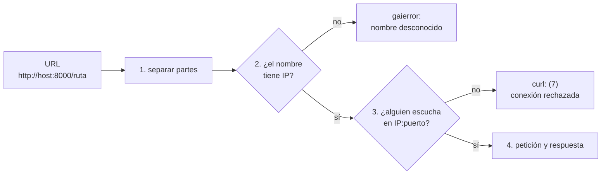
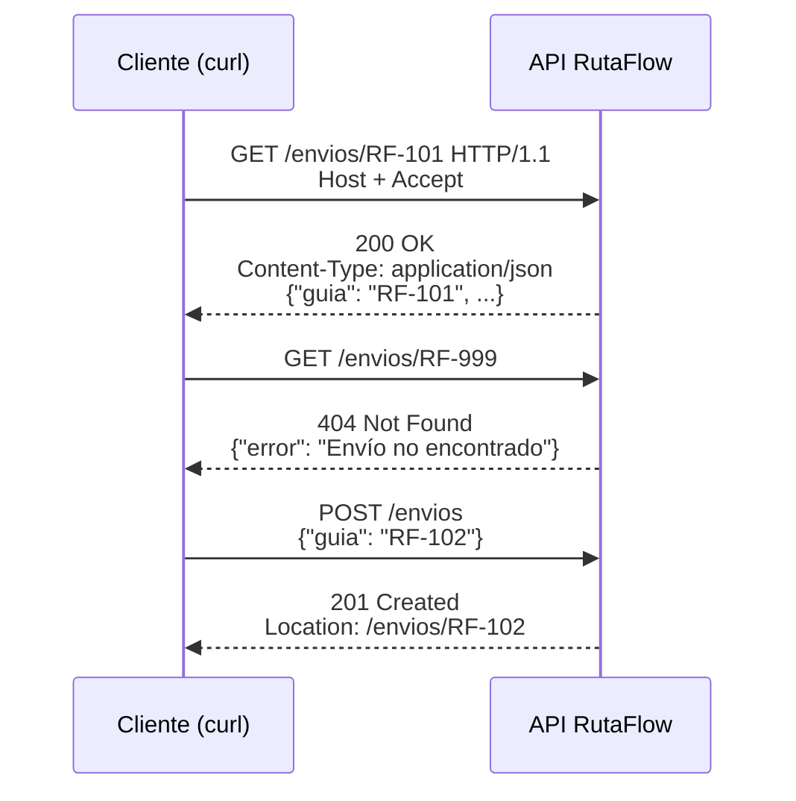
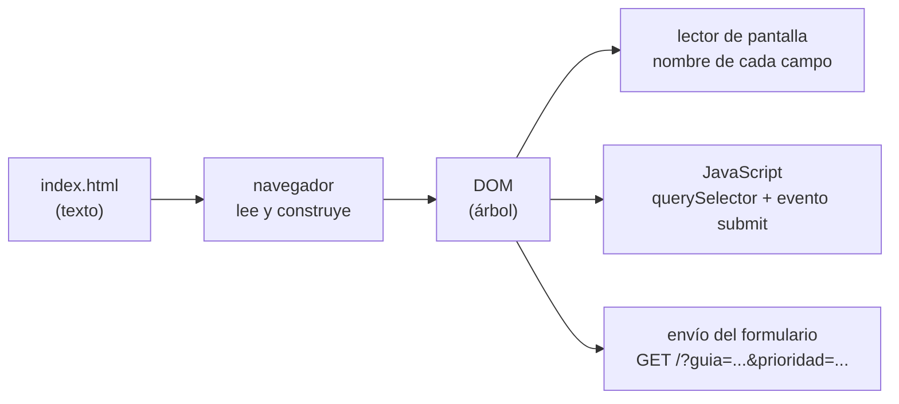
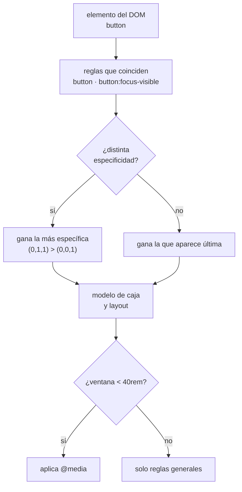
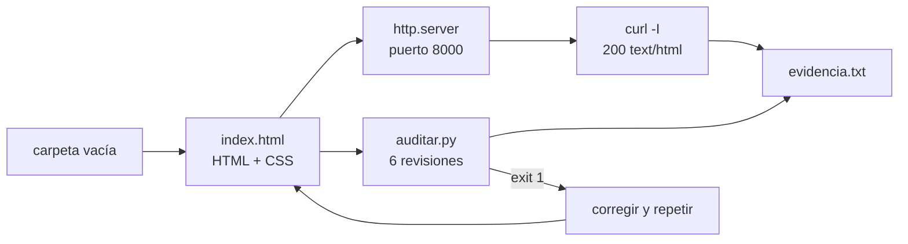

# Módulo 3: Fundamentos de web, redes y accesibilidad

**Entorno comprobado para esta edición (2026-11-24):** Python 3.13.18, curl 8.5.0 y Node.js 22.23.5 en Linux x86_64.
Todas las salidas de este módulo se obtuvieron ejecutando el código mostrado ese día. En las capturas de `curl` se
omite la barra de progreso, que no aparece cuando la salida va a la terminal. Las fechas de las cabeceras `Date`
cambiarán en tu equipo. Los comandos para Windows y macOS se contrastaron solo con la documentación: **no se
ejecutaron en esos sistemas**.

**Al terminar este módulo podrás:**
- trazar el camino desde una URL hasta una respuesta HTTP: nombre, IP, puerto y petición;
- inspeccionar peticiones y respuestas reales con `curl` y leer su código de estado;
- construir una página HTML semántica con un formulario etiquetado y recorrer su DOM;
- dar estilo responsive con CSS y medir el contraste de color con un número;
- auditar una página con un script y dejar evidencia HTTP de que funciona.

**Esquema del módulo:** Tema 1 (de la URL al servidor) → Tema 2 (HTTP) → Tema 3 (HTML, formularios y DOM) →
Tema 4 (CSS y accesibilidad) → Proyecto 3 → Tema 5 (proyecto integrador).

**Qué necesitas saber antes:** usar la terminal y ejecutar un archivo Python (Módulo 0); variables, condiciones,
bucles, funciones y diccionarios (Módulo 1). Comprueba `python3 --version` y `curl --version` antes de empezar.


## Aprende construyendo


### Tema 1: De una URL al servidor: red, DNS, IP y puertos · Básico · 50 min

<details open>
<summary><strong>Capa 1 — Lectura</strong></summary>

#### Objetivos
Al terminar este tema podrás:
- separar una URL en protocolo, host, puerto, ruta y consulta;
- resolver un nombre a una dirección IP y reconocer cuándo la resolución falla;
- levantar un servidor HTTP local en un puerto y comprobar con `curl` que responde;
- distinguir una conexión rechazada de una respuesta de error del servidor.

**Conceptos clave:** red, cliente y servidor, URL, dirección IP, localhost, DNS, puerto, protocolo, curl

#### El problema
La coordinadora de RutaFlow escribe `http://127.0.0.1:8000/` en el navegador y ve la página de prueba. Su compañero
escribe lo mismo en su equipo y recibe «no se puede conectar». Es la misma URL. ¿Qué pasa entre escribir la dirección
y ver la página, y en qué paso se rompió para él?

#### Glosario del tema

**red**
- **Definición técnica:** conjunto de dispositivos conectados que intercambian datos siguiendo reglas comunes; Internet es una red de redes.
- **En palabras sencillas:** el sistema de carreteras por donde viajan los datos entre computadores.
- **Dónde se rompe la comparación:** los datos no viajan enteros como un camión: se parten en paquetes que pueden ir por caminos distintos.
- **Ejemplo:** tu computador y el servidor de RutaFlow se comunican por Internet; dos programas en tu equipo, por una red interna.
- **Error típico:** creer que «sin Internet no hay red»: un servidor local funciona aunque el wifi esté apagado.

**cliente y servidor**
- **Definición técnica:** el cliente es el programa que inicia una comunicación y pide algo; el servidor es el programa que espera peticiones y responde.
- **En palabras sencillas:** el cliente es quien pregunta en la ventanilla; el servidor es quien atiende detrás.
- **Dónde se rompe la comparación:** «servidor» es un papel, no una máquina: tu portátil puede ser cliente y servidor a la vez.
- **Ejemplo:** `curl` (cliente) pide `/` y `python3 -m http.server` (servidor) devuelve `index.html`.
- **Error típico:** cerrar la terminal del servidor y seguir probando desde el cliente: sin servidor no hay quien responda.

**URL**
- **Definición técnica:** localizador uniforme de recursos; texto con la forma `protocolo://host:puerto/ruta?consulta` que identifica un recurso y cómo pedirlo.
- **En palabras sencillas:** la dirección completa de algo en la web: a quién preguntar, por qué puerta y qué pedir.
- **Dónde se rompe la comparación:** una dirección postal no dice cómo hablar; la URL sí lo dice con su protocolo (`http`, `https`).
- **Ejemplo:** en `http://127.0.0.1:8000/envios/RF-4471`, el host es `127.0.0.1`, el puerto `8000` y la ruta `/envios/RF-4471`.
- **Error típico:** olvidar el puerto: `http://127.0.0.1/` va al puerto 80, no al 8000 donde escucha tu servidor.

**dirección IP**
- **Definición técnica:** número que identifica a un dispositivo dentro de una red; en IPv4 son cuatro números de 0 a 255 separados por puntos.
- **En palabras sencillas:** el número de casa de un computador en la red.
- **Dónde se rompe la comparación:** un mismo equipo puede tener varias IP a la vez, una por cada red a la que está conectado.
- **Ejemplo:** `127.0.0.1` es la IP con la que un equipo se habla a sí mismo.
- **Error típico:** compartir `127.0.0.1` con un compañero: en su equipo esa IP apunta a **su** máquina, no a la tuya.

**localhost**
- **Definición técnica:** nombre reservado que se resuelve a la interfaz de bucle local (`127.0.0.1` en IPv4); el tráfico nunca sale del equipo.
- **En palabras sencillas:** «yo mismo»: la forma de que tu computador se llame a sí mismo.
- **Dónde se rompe la comparación:** cada equipo tiene su propio localhost; no es un lugar compartido.
- **Ejemplo:** `getent hosts localhost` muestra `127.0.0.1       localhost`.
- **Error típico:** probar en localhost y suponer que otros equipos ya pueden entrar a tu servidor.

**DNS**
- **Definición técnica:** sistema de nombres de dominio; servicio distribuido que traduce nombres como `ejemplo.com` a direcciones IP.
- **En palabras sencillas:** la agenda de contactos de Internet: buscas el nombre y obtienes el número.
- **Dónde se rompe la comparación:** la agenda no está en un solo lugar: tu equipo pregunta a varios servidores y guarda respuestas un tiempo.
- **Ejemplo:** `socket.gethostbyname("localhost")` devuelve `127.0.0.1`; con un nombre inexistente lanza `socket.gaierror`.
- **Error típico:** escribir mal el dominio y pensar que «el servidor está caído», cuando el nombre ni siquiera se resolvió.

**puerto**
- **Definición técnica:** número de 0 a 65535 que identifica a qué programa entregar los datos dentro de un equipo; un servidor «escucha» en un puerto.
- **En palabras sencillas:** si la IP es el edificio, el puerto es el número de apartamento.
- **Dónde se rompe la comparación:** dos programas no pueden escuchar en el mismo puerto e IP a la vez; el segundo falla al arrancar.
- **Ejemplo:** `python3 -m http.server 8000` escucha en el puerto 8000; HTTP usa el 80 por defecto y HTTPS el 443.
- **Error típico:** arrancar dos servidores en el 8000: el segundo termina con `OSError: [Errno 98] Address already in use`.

**protocolo**
- **Definición técnica:** conjunto de reglas que fija el formato y el orden de los mensajes entre dos programas.
- **En palabras sencillas:** el idioma y los modales de una conversación: quién habla primero y cómo se dice cada cosa.
- **Dónde se rompe la comparación:** las personas toleran errores de gramática; un protocolo no: un mensaje mal formado se rechaza.
- **Ejemplo:** HTTP es el protocolo de la web; lo estudiarás en el Tema 2. En la URL aparece al inicio: `http://`.
- **Error típico:** pedir `https://127.0.0.1:8000/` a un servidor que solo habla `http`: la conexión falla.

**curl**
- **Definición técnica:** programa de línea de comandos que actúa como cliente de red y transfiere datos con una URL.
- **En palabras sencillas:** un navegador sin pantalla: pide la página y te muestra el texto que llega.
- **Dónde se rompe la comparación:** a diferencia del navegador, no ejecuta JavaScript ni dibuja la página.
- **Ejemplo:** `curl -i http://127.0.0.1:8000/` muestra la respuesta con sus cabeceras (opción `-i`).
- **Error típico:** leer el error `curl: (7)` como «página no encontrada»; significa que ni siquiera hubo conexión.

#### ► CÓMO FUNCIONA
Abrir una URL son cuatro pasos. El cliente separa la URL en sus partes. Luego resuelve el nombre del host a una IP
con DNS. Después se conecta a esa IP en el puerto indicado. Solo si alguien escucha ahí, envía la petición y espera
la respuesta. Cada paso puede fallar con un mensaje distinto, y ese mensaje te dice dónde buscar.



#### Problema resuelto 1.1
Descompón la URL de un envío de RutaFlow y averigua a qué IP apunta cada nombre de host.

**Razonamiento:**
1. La URL ya trae el protocolo, el host, el puerto y la ruta; solo hay que separarlos.
2. `urllib.parse.urlsplit` de Python hace esa separación sin que escribas reglas a mano.
3. Para pasar de nombre a IP se pregunta al sistema con `socket.gethostbyname`; si el nombre no existe, falla.

```python
# partes_url.py — separa una URL en sus partes
from urllib.parse import urlsplit

url = "http://127.0.0.1:8000/envios/RF-4471?formato=json"
partes = urlsplit(url)

print("protocolo:", partes.scheme)
print("host:     ", partes.hostname)
print("puerto:   ", partes.port)
print("ruta:     ", partes.path)
print("consulta: ", partes.query)
```

```text
$ python3 partes_url.py
protocolo: http
host:      127.0.0.1
puerto:    8000
ruta:      /envios/RF-4471
consulta:  formato=json
```

```python
# resolver.py — pregunta al sistema qué IP corresponde a un nombre
import socket

for nombre in ["localhost", "rutaflow.invalid"]:
    try:
        ip = socket.gethostbyname(nombre)
        print(f"{nombre} -> {ip}")
    except socket.gaierror as error:
        print(f"{nombre} -> sin respuesta: {error}")
```

```text
$ python3 resolver.py
localhost -> 127.0.0.1
rutaflow.invalid -> sin respuesta: [Errno -2] Name or service not known
```

**Explicación por partes.**
- `partes_url.py`, línea 5: `urlsplit` devuelve un objeto con un atributo por parte de la URL.
- `partes_url.py`, líneas 7–11: `scheme` es el protocolo, `hostname` el host y `port` el puerto ya convertido a número.
- `resolver.py`, línea 6: `gethostbyname` pide al sistema la IP del nombre; el sistema consulta su archivo de hosts y el DNS.
- `resolver.py`, líneas 8–9: `.invalid` es un dominio reservado que nunca existe; la excepción `gaierror` lo confirma.

La misma consulta existe como comando. `getent hosts localhost` imprime `127.0.0.1       localhost` en Linux.
Con un nombre inexistente no imprime nada y termina con código de salida `2`. En Windows y macOS el comando
equivalente es `nslookup`; con conexión a Internet, `nslookup ejemplo.com` lista la IP en la línea `Address`.

`curl` hace la misma resolución antes de conectarse. Si el nombre no existe, se detiene en el paso 2:

```text
$ curl -i http://rutaflow.invalid:8000/
curl: (6) Could not resolve host: rutaflow.invalid
```

#### Problema resuelto 1.2
Levanta un servidor local en el puerto 8000, pídele la página con `curl` y provoca a propósito una conexión rechazada.

**Razonamiento:**
1. Python trae un servidor de archivos: `python3 -m http.server` sirve la carpeta actual.
2. `--bind 127.0.0.1` lo limita a tu equipo; así nadie de la red puede entrar mientras practicas.
3. Un puerto sin programa escuchando (el 8001) muestra cómo se ve el fallo del paso 3.

Crea la carpeta `ejemplo-url-servidor` con este `index.html`:

```html
<!doctype html>
<html lang="es">
  <head><meta charset="utf-8"><title>Servidor local</title></head>
  <body><main><h1>Servidor Fundamentos activo</h1></main></body>
</html>
```

En una terminal, dentro de la carpeta, arranca el servidor:

```text
$ python3 -m http.server 8000 --bind 127.0.0.1
Serving HTTP on 127.0.0.1 port 8000 (http://127.0.0.1:8000/) ...
```

En **otra** terminal, haz de cliente:

```text
$ curl -i http://127.0.0.1:8000/
HTTP/1.0 200 OK
Server: SimpleHTTP/0.6 Python/3.13.18
Date: Tue, 24 Nov 2026 07:18:39 GMT
Content-type: text/html
Content-Length: 173
Last-Modified: Tue, 24 Nov 2026 07:16:25 GMT

<!doctype html>
<html lang="es">
  <head><meta charset="utf-8"><title>Servidor local</title></head>
  <body><main><h1>Servidor Fundamentos activo</h1></main></body>
</html>
```

Para ver los pasos 3 y 4 por dentro, pide la conexión en modo detallado (`-v`) y descarta el cuerpo:

```text
$ curl -sv -o /dev/null http://127.0.0.1:8000/
*   Trying 127.0.0.1:8000...
* Connected to 127.0.0.1 (127.0.0.1) port 8000
> GET / HTTP/1.1
> Host: 127.0.0.1:8000
> User-Agent: curl/8.5.0
> Accept: */*
> 
* HTTP 1.0, assume close after body
< HTTP/1.0 200 OK
< Server: SimpleHTTP/0.6 Python/3.13.18
< Date: Tue, 24 Nov 2026 07:18:39 GMT
< Content-type: text/html
< Content-Length: 173
< Last-Modified: Tue, 24 Nov 2026 07:16:25 GMT
< 
{ [173 bytes data]
* Closing connection
```

Ahora pide un puerto donde no escucha nadie:

```text
$ curl -i http://127.0.0.1:8001/
curl: (7) Failed to connect to 127.0.0.1 port 8001 after 0 ms: Couldn't connect to server
```

**Explicación por partes.**
- La línea `Serving HTTP on 127.0.0.1 port 8000` confirma IP y puerto. El servidor queda esperando: no devuelve el prompt.
- `Trying 127.0.0.1:8000...` y `Connected to` son el paso 3: la conexión al puerto funcionó.
- Las líneas con `>` son lo que envió el cliente; las líneas con `<`, lo que respondió el servidor. Las leerás en el Tema 2.
- `HTTP/1.0 200 OK` significa «encontré lo que pediste». El `Content-Length: 173` coincide con el tamaño de `index.html`.
- En el puerto 8001 no hubo respuesta de ningún servidor: el fallo ocurrió antes, en el paso 3.

> **Error común.** Arrancar el servidor dos veces en el mismo puerto. El segundo intento termina con
> `OSError: [Errno 98] Address already in use` (el número de error puede variar según el sistema). Busca la terminal
> donde ya corre el primero o usa otro puerto: `python3 -m http.server 8080 --bind 127.0.0.1`.

> **Error común.** Confundir `curl: (7) Failed to connect ... Couldn't connect to server` con una página no
> encontrada. El código 7 dice que nadie respondió en ese puerto. Revisa que el servidor esté corriendo y el puerto
> de la URL.

> **Buena práctica.** Usa `--bind 127.0.0.1` mientras practicas. Sin esa opción el servidor acepta conexiones de toda
> tu red y expone los archivos de la carpeta a cualquiera conectado.

> **Prevenir errores.** Ante un fallo, recorre los pasos en orden: ¿el nombre resuelve?, ¿el puerto responde?, ¿qué
> código devolvió? Cada pregunta descarta una causa antes de tocar el código.

#### Checkpoint 1.1
El compañero de la coordinadora abrió `http://127.0.0.1:8000/` en su propio equipo y vio «no se puede conectar».
¿En qué paso falló y por qué?

Respuesta: en el paso 3, la conexión. `127.0.0.1` siempre apunta al equipo que hace la petición. En el equipo del
compañero no hay ningún servidor escuchando en el puerto 8000.

</details>

<details>
<summary><strong>Capa 2 — Construcción</strong></summary>

#### Paso 1 · Prepara la carpeta
Crea la carpeta y entra en ella:

```bash
mkdir ejemplo-url-servidor
cd ejemplo-url-servidor
```

Guarda dentro el `index.html` del Problema resuelto 1.2.

#### Paso 2 · Arranca el servidor
Ejecuta `python3 -m http.server 8000 --bind 127.0.0.1`. Deja esa terminal abierta: es tu servidor.

#### Paso 3 · Pide la página como cliente
En otra terminal ejecuta `curl -i http://127.0.0.1:8000/`. Debes ver `HTTP/1.0 200 OK` y el HTML de tu archivo.

#### Paso 4 · Rompe y diagnostica
Pide `http://127.0.0.1:8001/` y anota el código de `curl`. Luego detén el servidor con Ctrl + C y repite el Paso 3.
Las dos veces debes ver `curl: (7)`.

#### Paso 5 · Resuelve nombres
Ejecuta `resolver.py` y cambia la lista para probar `localhost` y un nombre inventado terminado en `.invalid`.

#### Resumen
- Una **URL** reúne **protocolo**, host, **puerto**, ruta y consulta: dice a quién preguntar, por dónde y qué pedir.
- El **DNS** traduce nombres a una **dirección IP**; si el nombre no existe, falla antes de cualquier conexión.
- **localhost** (`127.0.0.1`) es siempre el propio equipo; no sirve para compartir tu servidor.
- Un **servidor** escucha en un puerto; el **cliente** se conecta y envía la petición.
- `curl: (7)` significa «nadie escucha»; una respuesta con código, aunque sea de error, significa que el servidor sí respondió.
- **curl** muestra la conversación completa con `-i` (cabeceras) y `-v` (detalle de la conexión).

#### Ejercicio verificable 1
Básico. Cambia la URL de `partes_url.py` por `https://rutaflow.test/envios?pagina=2` y predice la salida antes de ejecutar.

Respuesta esperada: protocolo `https`, host `rutaflow.test`, puerto `None`, ruta `/envios`, consulta `pagina=2`.
El puerto sale `None` porque la URL no lo escribe; el cliente usará el 443, el de HTTPS por defecto.

#### Ejercicio verificable 2
Intermedio. Arranca el servidor en el puerto 8080. ¿Qué URL debes pedir con `curl` y qué pasa si pides la del 8000?

Respuesta esperada: `curl -i http://127.0.0.1:8080/` devuelve `200 OK`. La del 8000 devuelve
`curl: (7) Failed to connect to 127.0.0.1 port 8000 ...`, porque ya nadie escucha ahí.

#### Ejercicio verificable 3
Reto. Agrega a `resolver.py` un tercer nombre, `127.0.0.1`. ¿Falla o devuelve algo? Explica por qué.

Respuesta esperada: devuelve `127.0.0.1 -> 127.0.0.1`. Si el texto ya es una IP, no hace falta resolver nada y la
función la devuelve tal cual.

#### En el trabajo
Cuando un servicio «no carga», el primer diagnóstico en un equipo de soporte sigue este mismo orden. Primero se
revisa si el dominio resuelve, luego si el puerto responde y por último qué código devuelve. Los mensajes `Could not
resolve host` y `Couldn't connect to server` de `curl` aparecen a diario en tickets y en registros de despliegue.

</details>

### Tema 2: HTTP como contrato observable · Básico · 50 min

<details open>
<summary><strong>Capa 1 — Lectura</strong></summary>

#### Objetivos
Al terminar este tema podrás:
- leer línea por línea una petición y una respuesta HTTP capturadas con `curl -v`;
- elegir el método HTTP correcto para listar, consultar y crear un recurso;
- interpretar los códigos de estado 200, 201, 400, 404, 500 y 501;
- explicar por qué un 404 es una respuesta válida y un `curl: (52)` no lo es.

**Conceptos clave:** HTTP, petición, método HTTP, cabecera, cuerpo, respuesta, código de estado, JSON, API, idempotencia

#### El problema
La app móvil de RutaFlow consulta el estado de un envío y crea envíos nuevos. El equipo móvil pregunta: «¿qué
tenemos que enviar exactamente y qué nos van a devolver si la guía no existe?». En el Tema 1 viste que el servidor
responde. Ahora necesitas un **acuerdo escrito** sobre qué se pide y qué se responde.

#### Glosario del tema

**HTTP**
- **Definición técnica:** protocolo de transferencia de hipertexto; protocolo de texto en el que el cliente envía una petición y el servidor devuelve una respuesta.
- **En palabras sencillas:** el idioma con el que el navegador y el servidor se piden y entregan páginas y datos.
- **Dónde se rompe la comparación:** HTTP no recuerda conversaciones anteriores: cada petición llega sola, sin memoria de la previa.
- **Ejemplo:** la primera línea `GET / HTTP/1.1` dice método, ruta y versión del protocolo.
- **Error típico:** creer que HTTPS es otro protocolo distinto; es HTTP viajando dentro de una conexión cifrada.

**petición**
- **Definición técnica:** mensaje que el cliente envía al servidor: línea de inicio (método, ruta, versión), cabeceras, una línea vacía y un cuerpo opcional.
- **En palabras sencillas:** el formulario de solicitud que entregas en la ventanilla.
- **Dónde se rompe la comparación:** la ventanilla puede pedirte aclaraciones; el servidor solo ve lo que viene en el mensaje.
- **Ejemplo:** `> GET /envios/RF-101 HTTP/1.1` seguido de `> Host: 127.0.0.1:8000`.
- **Error típico:** olvidar que la línea vacía separa cabeceras y cuerpo; sin ella el servidor no sabe dónde empieza el cuerpo.

**método HTTP**
- **Definición técnica:** verbo de la petición que indica la acción deseada: `GET` obtiene, `POST` crea, `PUT` reemplaza, `PATCH` modifica en parte, `DELETE` borra.
- **En palabras sencillas:** el verbo de la frase: «dame», «crea», «cambia», «borra».
- **Dónde se rompe la comparación:** el verbo es una promesa, no una garantía: el servidor decide qué hace con cada método.
- **Ejemplo:** `curl -X POST ... /envios` crea un envío; `curl /envios` usa `GET` por defecto.
- **Error típico:** usar un método que el servidor no implementa: `DELETE` en la API del tema devuelve `501`.

**cabecera**
- **Definición técnica:** línea `Nombre: valor` de una petición o respuesta que aporta metadatos sobre el mensaje.
- **En palabras sencillas:** la información escrita en el sobre, no en la carta: tipo de contenido, tamaño, fecha.
- **Dónde se rompe la comparación:** algunas cabeceras cambian el comportamiento: `Content-Type` decide cómo se interpreta el cuerpo.
- **Ejemplo:** `Content-Type: application/json; charset=utf-8` anuncia que el cuerpo es JSON en UTF-8.
- **Error típico:** enviar JSON sin `-H 'Content-Type: application/json'`; curl lo etiqueta como formulario y algunos servidores lo rechazan.

**cuerpo**
- **Definición técnica:** contenido del mensaje que va después de la línea vacía; su longitud la declara la cabecera `Content-Length`.
- **En palabras sencillas:** la carta dentro del sobre: los datos de verdad.
- **Dónde se rompe la comparación:** muchas peticiones no llevan cuerpo; un `GET` normal va «con el sobre vacío».
- **Ejemplo:** en el `POST` del tema, el cuerpo es `{"guia": "RF-102"}`.
- **Error típico:** declarar un `Content-Length` distinto del tamaño real; el receptor corta el cuerpo o espera bytes que nunca llegan.

**respuesta**
- **Definición técnica:** mensaje del servidor: línea de estado (versión, código, frase), cabeceras, línea vacía y cuerpo opcional.
- **En palabras sencillas:** el sobre que te devuelven en la ventanilla con el resultado del trámite.
- **Dónde se rompe la comparación:** siempre hay una por petición; no existe «no contestar» en HTTP, salvo que la conexión se corte.
- **Ejemplo:** `HTTP/1.0 404 Not Found` con el cuerpo `{"error": "Envío no encontrado", "code": 404}`.
- **Error típico:** mirar solo el cuerpo y no la línea de estado; un cuerpo bonito puede venir con un código de error.

**código de estado**
- **Definición técnica:** número de tres cifras en la línea de estado; la primera cifra da la clase: 2xx éxito, 3xx redirección, 4xx error del cliente, 5xx error del servidor.
- **En palabras sencillas:** el sello del trámite: aprobado, mal diligenciado o «se nos cayó el sistema».
- **Dónde se rompe la comparación:** un 404 no es un fallo de la comunicación: es una respuesta correcta que informa que el recurso no existe.
- **Ejemplo:** `200 OK`, `201 Created`, `400 Bad Request`, `404 Not Found`, `500 Internal Server Error`, `501 Not Implemented`.
- **Error típico:** devolver `200` con un mensaje de error en el cuerpo; los clientes y monitores creen que todo salió bien.

**JSON**
- **Definición técnica:** notación de objetos de JavaScript; formato de texto para datos con objetos `{}`, listas `[]`, textos, números, booleanos y `null`.
- **En palabras sencillas:** una forma estándar de escribir datos como texto, parecida a un diccionario de Python.
- **Dónde se rompe la comparación:** JSON exige comillas dobles y no admite `True`: se escribe `true`; un diccionario de Python no es JSON.
- **Ejemplo:** `json.dumps({"guia": "RF-101"})` produce el texto `{"guia": "RF-101"}`.
- **Error típico:** enviar `guia=RF-103` creyendo que es JSON; `json.loads` lanza `JSONDecodeError` y la API responde `400`.

**API**
- **Definición técnica:** interfaz de programación de aplicaciones; conjunto de operaciones que un programa ofrece a otros, con sus entradas, salidas y errores.
- **En palabras sencillas:** el menú de un restaurante: qué puedes pedir, cómo pedirlo y qué te traen.
- **Dónde se rompe la comparación:** un menú no avisa qué pasa si pides mal; una buena API documenta también sus errores.
- **Ejemplo:** `GET /envios`, `GET /envios/{guia}` y `POST /envios` forman la API del tema.
- **Error típico:** cambiar la forma de una respuesta sin avisar; los clientes que dependen de ella se rompen.

**idempotencia**
- **Definición técnica:** propiedad de una operación que produce el mismo efecto en el servidor si se repite una o muchas veces.
- **En palabras sencillas:** pulsar dos veces el botón del ascensor no lo llama dos veces.
- **Dónde se rompe la comparación:** idempotente no significa «misma respuesta»: un `GET` repetido puede mostrar datos nuevos si alguien más cambió algo.
- **Ejemplo:** `GET`, `PUT` y `DELETE` son idempotentes por contrato; `POST` no lo es.
- **Error típico:** reintentar un `POST` automáticamente tras un corte de red y crear el envío dos veces.

#### ► CÓMO FUNCIONA
HTTP es un intercambio de texto con forma fija. El cliente abre la conexión del Tema 1 y escribe la petición. El
servidor lee el método y la ruta, decide qué hacer y escribe la respuesta. El código de estado resume el resultado.
Las cabeceras dicen cómo leer el cuerpo.



#### Problema resuelto 2.1
Escribe una API mínima de envíos que liste, consulte y cree envíos, y que responda con el código correcto en cada caso.

**Razonamiento:**
1. El contrato, antes del código: `GET /envios` → 200 con la lista; `GET /envios/{guia}` → 200 o 404; `POST /envios` → 201 o 400.
2. Todas las respuestas son JSON; una función `responder` arma siempre las mismas cabeceras para no repetirlas.
3. Python trae `http.server`: una clase con un método `do_GET` por cada `GET` y `do_POST` por cada `POST`.
4. Si el cuerpo del `POST` no es JSON, se responde 400 en lugar de dejar que el programa falle.

```python
# api_envios.py — API mínima de envíos de RutaFlow
import json
from http.server import BaseHTTPRequestHandler, HTTPServer

ENVIOS = {"RF-101": {"guia": "RF-101", "estado": "pendiente"}}


class Manejador(BaseHTTPRequestHandler):
    server_version = "RutaFlowAPI/0.1"

    def responder(self, codigo, datos, extra=None):
        cuerpo = json.dumps(datos, ensure_ascii=False).encode("utf-8")
        self.send_response(codigo)
        self.send_header("Content-Type", "application/json; charset=utf-8")
        self.send_header("Content-Length", str(len(cuerpo)))
        for nombre, valor in (extra or {}).items():
            self.send_header(nombre, valor)
        self.end_headers()
        self.wfile.write(cuerpo)

    def do_GET(self):
        if self.path == "/envios":
            self.responder(200, list(ENVIOS.values()))
        elif self.path.startswith("/envios/"):
            guia = self.path.removeprefix("/envios/")
            if guia in ENVIOS:
                self.responder(200, ENVIOS[guia])
            else:
                self.responder(404, {"error": "Envío no encontrado", "code": 404})
        else:
            self.responder(404, {"error": "Ruta no existe", "code": 404})

    def do_POST(self):
        largo = int(self.headers.get("Content-Length", 0))
        try:
            datos = json.loads(self.rfile.read(largo))
        except json.JSONDecodeError:
            self.responder(400, {"error": "JSON inválido", "code": 400})
            return
        guia = datos["guia"]
        ENVIOS[guia] = {"guia": guia, "estado": "pendiente"}
        self.responder(201, ENVIOS[guia], {"Location": f"/envios/{guia}"})


HTTPServer(("127.0.0.1", 8000), Manejador).serve_forever()
```

Ejecuta `python3 api_envios.py` en una terminal. No imprime nada al arrancar: queda escuchando en el puerto 8000.
En otra terminal, prueba el contrato:

```text
$ curl -i http://127.0.0.1:8000/envios
HTTP/1.0 200 OK
Server: RutaFlowAPI/0.1 Python/3.13.18
Date: Tue, 24 Nov 2026 07:18:40 GMT
Content-Type: application/json; charset=utf-8
Content-Length: 43

[{"guia": "RF-101", "estado": "pendiente"}]
```

```text
$ curl -i http://127.0.0.1:8000/envios/RF-999
HTTP/1.0 404 Not Found
Server: RutaFlowAPI/0.1 Python/3.13.18
Date: Tue, 24 Nov 2026 07:18:40 GMT
Content-Type: application/json; charset=utf-8
Content-Length: 46

{"error": "Envío no encontrado", "code": 404}
```

```text
$ curl -i -X POST -H 'Content-Type: application/json' -d '{"guia": "RF-102"}' http://127.0.0.1:8000/envios
HTTP/1.0 201 Created
Server: RutaFlowAPI/0.1 Python/3.13.18
Date: Tue, 24 Nov 2026 07:18:40 GMT
Content-Type: application/json; charset=utf-8
Content-Length: 41
Location: /envios/RF-102

{"guia": "RF-102", "estado": "pendiente"}
```

```text
$ curl -i -X POST -d 'guia=RF-103' http://127.0.0.1:8000/envios
HTTP/1.0 400 Bad Request
Server: RutaFlowAPI/0.1 Python/3.13.18
Date: Tue, 24 Nov 2026 07:18:40 GMT
Content-Type: application/json; charset=utf-8
Content-Length: 40

{"error": "JSON inválido", "code": 400}
```

```text
$ curl -s -o /dev/null -w '%{http_code}\n' -X DELETE http://127.0.0.1:8000/envios/RF-101
501
```

Mientras tanto, la terminal del servidor registra cada petición con su código:

```text
127.0.0.1 - - [24/Nov/2026 02:18:40] "GET /envios HTTP/1.1" 200 -
127.0.0.1 - - [24/Nov/2026 02:18:40] "GET /envios/RF-999 HTTP/1.1" 404 -
127.0.0.1 - - [24/Nov/2026 02:18:40] "POST /envios HTTP/1.1" 201 -
127.0.0.1 - - [24/Nov/2026 02:18:40] "POST /envios HTTP/1.1" 400 -
127.0.0.1 - - [24/Nov/2026 02:18:40] code 501, message Unsupported method ('DELETE')
127.0.0.1 - - [24/Nov/2026 02:18:40] "DELETE /envios/RF-101 HTTP/1.1" 501 -
```

**Explicación por partes.**
- Línea 5: `ENVIOS` es un diccionario en memoria. Si detienes el servidor, los envíos creados se pierden.
- Línea 9: `server_version` es el valor de la cabecera `Server` que ves en cada respuesta.
- Líneas 11–19: `responder` convierte los datos a JSON (línea 12), escribe la línea de estado (13), las cabeceras (14–17), la línea vacía (18) y el cuerpo (19).
- Líneas 21–31: `do_GET` decide por la ruta. Una guía desconocida recibe 404 con un cuerpo JSON que explica el error.
- Líneas 34–36: el servidor lee exactamente `Content-Length` bytes del cuerpo y los interpreta como JSON.
- Líneas 37–39: `guia=RF-103` no es JSON; la excepción se atrapa y se responde 400.
- Línea 42: el 201 trae la cabecera `Location` con la ruta del recurso nuevo.
- No existe `do_DELETE`; `http.server` responde por su cuenta `501 Unsupported method ('DELETE')`.
- Las fechas del registro del servidor están en hora local; la cabecera `Date` siempre va en GMT.

#### Problema resuelto 2.2
Observa la petición real que escribe `curl` y comprueba que `GET` es idempotente.

**Razonamiento:**
1. `curl -v` marca con `>` lo que envía y con `<` lo que recibe; ahí se ve el mensaje completo.
2. Para la idempotencia, repite la misma petición dos veces y compara el estado del servidor.

```text
$ curl -sv -o /dev/null http://127.0.0.1:8000/envios/RF-101
*   Trying 127.0.0.1:8000...
* Connected to 127.0.0.1 (127.0.0.1) port 8000
> GET /envios/RF-101 HTTP/1.1
> Host: 127.0.0.1:8000
> User-Agent: curl/8.5.0
> Accept: */*
> 
* HTTP 1.0, assume close after body
< HTTP/1.0 200 OK
< Server: RutaFlowAPI/0.1 Python/3.13.18
< Date: Tue, 24 Nov 2026 07:18:40 GMT
< Content-Type: application/json; charset=utf-8
< Content-Length: 41
< 
{ [41 bytes data]
* Closing connection
```

```text
$ curl -s http://127.0.0.1:8000/envios
[{"guia": "RF-101", "estado": "pendiente"}, {"guia": "RF-102", "estado": "pendiente"}]
$ curl -s http://127.0.0.1:8000/envios
[{"guia": "RF-101", "estado": "pendiente"}, {"guia": "RF-102", "estado": "pendiente"}]
```

**Explicación por partes.**
- `> GET /envios/RF-101 HTTP/1.1` es la línea de inicio: método, ruta y versión.
- `> Host`, `> User-Agent` y `> Accept` son cabeceras que `curl` agrega solo. La línea `> ` vacía cierra la petición.
- El cliente pide HTTP/1.1 y el servidor contesta con HTTP/1.0: por eso `curl` avisa que cerrará al terminar.
- Las dos consultas a `/envios` dejan el servidor igual: dos `GET` no crean ni borran nada.

> **Error común.** Olvidar un campo obligatorio del cuerpo. `-d '{"codigo": "RF-104"}'` hace que la línea 40 falle
> con `KeyError: 'guia'` en la terminal del servidor. El cliente no recibe respuesta y ve
> `curl: (52) Empty reply from server`. Ese mensaje significa «la conexión se cortó sin respuesta»: revisa el registro
> del servidor, no el cliente.

> **Buena práctica.** Responde los errores con el código correcto y un cuerpo JSON con la misma forma siempre:
> `{"error": "...", "code": 404}`. Los clientes pueden leer el error sin adivinar.

> **Prevenir errores.** Escribe el contrato (método, ruta, códigos posibles) antes del código, como en el razonamiento.
> Luego prueba cada fila con `curl -i` y compara el código recibido con el acordado.

#### Checkpoint 2.1
¿Por qué `404 Not Found` cuenta como una respuesta válida y `curl: (52) Empty reply from server` no?

Respuesta: el 404 es un mensaje HTTP completo: línea de estado, cabeceras y cuerpo que explican el problema. El
`(52)` significa que el servidor cerró la conexión sin escribir ninguna respuesta.

</details>

<details>
<summary><strong>Capa 2 — Construcción</strong></summary>

#### Paso 1 · Escribe el contrato
En un archivo `contrato.md`, anota en una tabla: método, ruta, cuerpo de entrada y códigos posibles para listar,
consultar y crear envíos.

#### Paso 2 · Levanta la API
Copia `api_envios.py` en una carpeta nueva y ejecútalo. Si el puerto 8000 sigue ocupado por el Tema 1, detén ese servidor con Ctrl + C.

#### Paso 3 · Prueba cada fila del contrato
Ejecuta los cinco comandos `curl` del Problema resuelto 2.1. Marca en `contrato.md` si el código coincide.

#### Paso 4 · Mira el mensaje por dentro
Ejecuta `curl -sv -o /dev/null http://127.0.0.1:8000/envios/RF-101` y señala la línea de inicio, las cabeceras y la línea vacía.

#### Paso 5 · Provoca el corte
Envía `-d '{"codigo": "RF-104"}'` y lee el `KeyError` en la terminal del servidor.

#### Resumen
- **HTTP** es un protocolo de texto: una **petición** del cliente y una **respuesta** del servidor.
- La petición lleva **método HTTP**, ruta, **cabeceras** y, a veces, **cuerpo**; la respuesta trae un **código de estado**.
- 2xx es éxito, 4xx error del cliente y 5xx error del servidor; un 404 sigue siendo una respuesta válida.
- **JSON** es el formato de datos más común en una **API**; `Content-Type` anuncia ese formato.
- `GET` es **idempotente**; `POST` no: repetirlo puede crear duplicados.
- `curl: (52)` indica que el servidor cortó sin responder: el error está en el servidor.

#### Ejercicio verificable 1
Básico. Sin ejecutar, di qué código devuelve `curl -i http://127.0.0.1:8000/clientes` contra la API del tema.

Respuesta esperada: `404 Not Found` con el cuerpo `{"error": "Ruta no existe", "code": 404}`, por la rama `else` de las líneas 30–31.

#### Ejercicio verificable 2
Intermedio. Escribe la tabla del contrato para listar, crear, editar y borrar envíos, indicando qué métodos son idempotentes.

Respuesta esperada: listar `GET /envios` (sí); crear `POST /envios` (no); editar `PUT /envios/RF-101` (sí);
borrar `DELETE /envios/RF-101` (sí). En la API del tema, `PUT` y `DELETE` responden `501` porque no están implementados.

#### Ejercicio verificable 3
Reto. Cambia `do_POST` para que un cuerpo sin `"guia"` responda 400 en lugar de cortar la conexión.

Respuesta esperada: antes de la línea 40, agrega `if "guia" not in datos:` con
`self.responder(400, {"error": "Falta la guía", "code": 400})` y `return`. La misma petición del error común devuelve
`HTTP/1.0 400 Bad Request` y el cuerpo `{"error": "Falta la guía", "code": 400}`.

#### En el trabajo
En una empresa, el contrato de una API se escribe en un documento OpenAPI antes de programar. El equipo móvil y el de
backend lo revisan juntos. Cuando algo falla en producción, `curl -i` es la primera herramienta: muestra si el
problema es del cliente (4xx), del servidor (5xx) o de la red (`curl: (7)`, `curl: (52)`).

</details>

### Tema 3: HTML semántico, formularios y el DOM · Básico · 50 min

<details open>
<summary><strong>Capa 1 — Lectura</strong></summary>

#### Objetivos
Al terminar este tema podrás:
- escribir una página HTML con elementos semánticos (`header`, `main`, `section`) y un formulario;
- asociar cada campo a su `label` y detectar con un script los campos sin nombre;
- dibujar el árbol DOM de una página y seleccionar elementos con `querySelector` y `getElementById`;
- validar un dato del formulario con JavaScript y probar la regla con Node.js.

**Conceptos clave:** HTML, elemento y atributo, HTML semántico, formulario, label, DOM, selector, JavaScript, evento, validación

#### El problema
Un repartidor de RutaFlow usa un lector de pantalla porque tiene baja visión. El formulario de registro le anuncia
«campo de texto, obligatorio», pero no le dice **qué** escribir. Visualmente todo parece correcto. ¿Qué le falta al
HTML para que la página tenga sentido sin verla?

#### Glosario del tema

**HTML**
- **Definición técnica:** lenguaje de marcado de hipertexto; describe la estructura y el significado del contenido de una página con etiquetas.
- **En palabras sencillas:** el esqueleto de la página: dice qué es un título, qué es un párrafo y qué es un botón.
- **Dónde se rompe la comparación:** no es un lenguaje de programación: no tiene variables ni bucles; solo describe.
- **Ejemplo:** `<h1>RutaFlow</h1>` marca el texto como título principal.
- **Error típico:** olvidar `<!doctype html>` al inicio; el navegador pasa a un modo de compatibilidad antiguo.

**elemento y atributo**
- **Definición técnica:** un elemento es una etiqueta de apertura, su contenido y su cierre; un atributo es un par `nombre="valor"` dentro de la apertura que lo configura.
- **En palabras sencillas:** el elemento es la pieza; el atributo, la etiqueta adhesiva con sus datos.
- **Dónde se rompe la comparación:** algunos elementos no tienen cierre ni contenido, como `<input>` o `<meta>`.
- **Ejemplo:** en `<input id="guia" name="guia" required>`, `id`, `name` y `required` son atributos.
- **Error típico:** repetir el mismo `id` en dos elementos; `getElementById` solo encuentra el primero.

**HTML semántico**
- **Definición técnica:** uso de elementos que expresan el papel del contenido (`header`, `main`, `section`, `nav`, `button`) en lugar de contenedores genéricos (`div`, `span`).
- **En palabras sencillas:** ponerle a cada parte el nombre de lo que es, no solo una caja sin rótulo.
- **Dónde se rompe la comparación:** se ve igual en pantalla; la diferencia la notan el lector de pantalla, el teclado y los buscadores.
- **Ejemplo:** `<main>` le dice al lector de pantalla «aquí empieza el contenido principal» y permite saltar directo ahí.
- **Error típico:** hacer un botón con `<div onclick>`: no recibe foco con Tab ni se activa con Enter.

**formulario**
- **Definición técnica:** elemento `<form>` que agrupa campos y, al enviarse, construye una petición HTTP con sus valores según `action` (ruta) y `method` (`get` o `post`).
- **En palabras sencillas:** la hoja que el usuario llena; al pulsar el botón, el navegador la manda al servidor.
- **Dónde se rompe la comparación:** solo se envían los campos con atributo `name`; un campo sin `name` se llena pero se pierde.
- **Ejemplo:** con `method="get"`, enviar el formulario pide `/?guia=RF-4471&prioridad=alta&urgente=si`.
- **Error típico:** usar `method="get"` para datos sensibles; quedan escritos en la URL y en el historial.

**label**
- **Definición técnica:** elemento `<label>` que da nombre accesible a un campo, ya sea con `for="id-del-campo"` o envolviendo el campo.
- **En palabras sencillas:** el rótulo del campo, unido a él para que todos sepan qué va ahí.
- **Dónde se rompe la comparación:** un texto cerca del campo no es un rótulo: el navegador no los relaciona aunque estén juntos.
- **Ejemplo:** `<label for="guia">Número de guía</label>` y `<input id="guia">`; al pulsar el texto, el foco va al campo.
- **Error típico:** escribir `<p>Número de guía</p>` en vez de `<label>`; el lector de pantalla anuncia un campo sin nombre.

**DOM**
- **Definición técnica:** modelo de objetos del documento; árbol de objetos que el navegador construye a partir del HTML y que los programas pueden leer y cambiar.
- **En palabras sencillas:** el árbol genealógico de la página: cada elemento es hijo del que lo contiene.
- **Dónde se rompe la comparación:** el DOM no es el archivo: si JavaScript lo cambia, la página cambia y el archivo sigue igual.
- **Ejemplo:** `form#form-envio` es hijo de `section` y padre de `input#guia`.
- **Error típico:** buscar un elemento antes de que el navegador lo haya creado; la búsqueda devuelve `null`.

**selector**
- **Definición técnica:** patrón de texto que identifica elementos del DOM: por etiqueta (`button`), por clase (`.productos`) o por id (`#guia`).
- **En palabras sencillas:** la descripción para encontrar a alguien en el árbol: «el que se llama guia».
- **Dónde se rompe la comparación:** un selector puede coincidir con muchos elementos; `querySelector` devuelve solo el primero.
- **Ejemplo:** `document.querySelector("#form-envio")` devuelve el formulario.
- **Error típico:** olvidar el `#`: `querySelector("form-envio")` busca una etiqueta `<form-envio>` y devuelve `null`.

**JavaScript**
- **Definición técnica:** lenguaje de programación que ejecutan los navegadores (y Node.js fuera de ellos); puede leer y modificar el DOM.
- **En palabras sencillas:** el lenguaje que le da comportamiento a la página: reaccionar, validar, cambiar textos.
- **Dónde se rompe la comparación:** no tiene relación con Java salvo el nombre.
- **Ejemplo:** `node prueba_validacion.js` ejecuta JavaScript en la terminal, sin navegador.
- **Error típico:** usar `document` en Node.js; termina con `ReferenceError: document is not defined`.

**evento**
- **Definición técnica:** señal que el navegador emite cuando algo ocurre (clic, tecla, envío de formulario); una función registrada con `addEventListener` reacciona a ella.
- **En palabras sencillas:** un timbre: cuando suena, se ejecuta la función que dejaste preparada.
- **Dónde se rompe la comparación:** algunos eventos traen una acción por defecto que la función puede cancelar con `preventDefault()`.
- **Ejemplo:** `formulario.addEventListener("submit", ...)` reacciona cuando se intenta enviar.
- **Error típico:** escuchar `click` en el botón en vez de `submit` en el formulario; Enter en un campo no pasa por el clic.

**validación**
- **Definición técnica:** comprobación de que un dato cumple las reglas esperadas antes de usarlo, con un mensaje claro si no las cumple.
- **En palabras sencillas:** revisar la hoja antes de recibirla: «aquí falta un dato».
- **Dónde se rompe la comparación:** validar en el navegador ayuda al usuario, pero no protege al servidor: cualquiera puede enviar la petición con `curl`.
- **Ejemplo:** `validarGuia("rf-4471")` devuelve `"La guía debe tener la forma RF-123."`.
- **Error típico:** validar solo en el navegador y confiar en el dato en el servidor sin revisarlo de nuevo.

#### ► CÓMO FUNCIONA
El navegador descarga el HTML con la petición del Tema 2. Luego lo lee de arriba abajo y construye el DOM. El
lector de pantalla, el teclado y JavaScript trabajan sobre ese árbol, no sobre el texto del archivo. Por eso un
`label` bien unido al campo cambia lo que oye el repartidor, aunque en pantalla todo se vea igual.



#### Problema resuelto 3.1
Escribe el formulario de registro de envíos con HTML semántico y comprueba su estructura y sus etiquetas con dos scripts.

**Razonamiento:**
1. La página tiene cabecera, contenido principal y una sección con el formulario: `header`, `main` y `section`.
2. Cada campo necesita `id` (para su `label`) y `name` (para enviarse). La casilla de urgente puede ir envuelta en su `label`.
3. Python trae `html.parser`, que recorre las etiquetas en orden. Con él se dibuja el árbol y se buscan campos sin `label`.

```html
<!doctype html>
<html lang="es">
  <head>
    <meta charset="utf-8">
    <meta name="viewport" content="width=device-width, initial-scale=1">
    <title>Registrar envío</title>
  </head>
  <body>
    <header><h1>RutaFlow</h1></header>
    <main>
      <section aria-labelledby="nuevo-envio">
        <h2 id="nuevo-envio">Nuevo envío</h2>
        <form id="form-envio" action="/" method="get">
          <label for="guia">Número de guía</label>
          <input id="guia" name="guia" required>
          <label for="prioridad">Prioridad</label>
          <select id="prioridad" name="prioridad">
            <option value="baja">Baja</option>
            <option value="media">Media</option>
            <option value="alta">Alta</option>
          </select>
          <label><input id="urgente" name="urgente" type="checkbox" value="si"> Urgente</label>
          <button type="submit">Guardar</button>
          <p id="mensaje" role="alert"></p>
        </form>
      </section>
    </main>
    <script src="validacion.js"></script>
  </body>
</html>
```

```python
# arbol_dom.py — dibuja el árbol de elementos de un archivo HTML
import sys
from html.parser import HTMLParser

VACIOS = {"meta", "input", "br", "img", "link"}  # etiquetas sin cierre


class Arbol(HTMLParser):
    nivel = 0

    def handle_starttag(self, etiqueta, atributos):
        datos = dict(atributos)
        marca = f"#{datos['id']}" if "id" in datos else ""
        print("  " * self.nivel + etiqueta + marca)
        if etiqueta not in VACIOS:
            self.nivel += 1

    def handle_endtag(self, etiqueta):
        if etiqueta not in VACIOS:
            self.nivel -= 1


with open(sys.argv[1], encoding="utf-8") as archivo:
    Arbol().feed(archivo.read())
```

```text
$ python3 arbol_dom.py formulario/index.html
html
  head
    meta
    meta
    title
  body
    header
      h1
    main
      section
        h2#nuevo-envio
        form#form-envio
          label
          input#guia
          label
          select#prioridad
            option
            option
            option
          label
            input#urgente
          button
          p#mensaje
    script
```

```python
# revisar_labels.py — avisa qué campos de un formulario no tienen etiqueta
import sys
from html.parser import HTMLParser

CAMPOS = {"input", "select", "textarea"}


class Revisor(HTMLParser):
    def __init__(self):
        super().__init__()
        self.dentro_de_label = False
        self.nombrados = set()   # ids con <label for="...">
        self.campos = []         # (id, tiene label que lo envuelve)

    def handle_starttag(self, etiqueta, atributos):
        datos = dict(atributos)
        if etiqueta == "label":
            self.dentro_de_label = True
            if "for" in datos:
                self.nombrados.add(datos["for"])
        elif etiqueta in CAMPOS and datos.get("type") != "hidden":
            self.campos.append((datos.get("id", "(sin id)"), self.dentro_de_label))

    def handle_endtag(self, etiqueta):
        if etiqueta == "label":
            self.dentro_de_label = False


revisor = Revisor()
with open(sys.argv[1], encoding="utf-8") as archivo:
    revisor.feed(archivo.read())

sin_nombre = [i for i, envuelto in revisor.campos if not envuelto and i not in revisor.nombrados]
print(f"campos revisados: {len(revisor.campos)}")
for campo in sin_nombre:
    print(f"FALTA label: {campo}")
print("resultado:", "OK" if not sin_nombre else f"{len(sin_nombre)} sin nombre")
```

```text
$ python3 revisar_labels.py formulario/index.html
campos revisados: 3
resultado: OK
```

Ahora reproduce el problema del repartidor. Copia la página como `sin_label.html` y cambia la línea 14 por
`<p>Número de guía</p>`:

```text
$ python3 revisar_labels.py sin_label.html
campos revisados: 3
FALTA label: guia
resultado: 1 sin nombre
```

**Explicación por partes.**
- HTML, líneas 9–11: `header`, `main` y `section` dan el papel de cada zona. `aria-labelledby` nombra la sección con el texto de su `h2`.
- HTML, líneas 14–15: `for="guia"` une el rótulo con el campo de `id="guia"`; `required` impide enviar el campo vacío.
- HTML, línea 22: la casilla va envuelta en su `label`, la otra forma válida de unirlos.
- HTML, línea 24: `role="alert"` hace que el lector de pantalla lea en voz alta el texto que aparezca ahí.
- `arbol_dom.py`, líneas 11–16: cada apertura imprime la etiqueta con su sangría y baja un nivel, salvo las etiquetas sin cierre de la línea 5.
- `revisar_labels.py`, líneas 17–22: anota los `for` de cada `label` y si el campo está dentro de uno.
- `revisar_labels.py`, línea 33: un campo sin `label` envolvente y sin `for` que lo nombre es un campo sin nombre.

#### Problema resuelto 3.2
Valida el número de guía antes de enviar: debe tener la forma `RF-` seguida de dígitos. Prueba la regla sin abrir el navegador.

**Razonamiento:**
1. Separa la **regla** (una función pura que recibe texto y devuelve un mensaje) de la **conexión con el DOM**.
2. En el navegador, el evento `submit` llama a la regla; si hay error, cancela el envío y muestra el mensaje.
3. En Node.js no existe `document`; ahí el archivo solo exporta la función para probarla.

```javascript
// validacion.js — revisa la guía antes de enviar el formulario
function validarGuia(texto) {
  const guia = texto.trim();
  if (guia === "") return "Escribe el número de guía.";
  if (!/^RF-\d+$/.test(guia)) return "La guía debe tener la forma RF-123.";
  return "";
}

if (typeof document !== "undefined") {
  const formulario = document.querySelector("#form-envio");
  const campo = document.getElementById("guia");
  const mensaje = document.getElementById("mensaje");
  formulario.addEventListener("submit", (evento) => {
    const error = validarGuia(campo.value);
    if (error) {
      evento.preventDefault();
      mensaje.textContent = error;
      campo.focus();
    }
  });
} else {
  module.exports = { validarGuia };
}
```

```javascript
// prueba_validacion.js — prueba la regla sin abrir el navegador
const { validarGuia } = require("./formulario/validacion.js");

for (const entrada of ["RF-4471", "  RF-12 ", "", "rf-4471", "RF-"]) {
  const error = validarGuia(entrada);
  console.log(JSON.stringify(entrada), "->", error || "válida");
}
```

```text
$ node prueba_validacion.js
"RF-4471" -> válida
"  RF-12 " -> válida
"" -> Escribe el número de guía.
"rf-4471" -> La guía debe tener la forma RF-123.
"RF-" -> La guía debe tener la forma RF-123.
```

Sirve la carpeta con `python3 -m http.server 8000 --bind 127.0.0.1` y simula el envío del formulario con `curl`:

```text
$ curl -I 'http://127.0.0.1:8000/?guia=RF-4471&prioridad=alta&urgente=si'
HTTP/1.0 200 OK
Server: SimpleHTTP/0.6 Python/3.13.18
Date: Tue, 24 Nov 2026 07:18:42 GMT
Content-type: text/html
Content-Length: 1056
Last-Modified: Tue, 24 Nov 2026 07:17:14 GMT

```

**Explicación por partes.**
- `validacion.js`, líneas 2–7: la regla. `trim()` quita espacios de los extremos; `/^RF-\d+$/` exige `RF-` y al menos un dígito.
- Línea 9: `typeof document` distingue navegador de Node.js.
- Líneas 10–12: dos formas de seleccionar en el DOM: con selector (`querySelector`) y por id (`getElementById`).
- Líneas 13–19: al intentar enviar, si hay error, `preventDefault()` cancela el envío, el mensaje se escribe en `#mensaje` y el foco vuelve al campo.
- Línea 22: en Node.js se exporta la función para que `prueba_validacion.js` la importe con `require`.
- `curl -I` pide solo las cabeceras (método `HEAD`). La ruta lleva los tres campos con `name`, tal como los enviaría el navegador.

En el navegador se observa lo siguiente: con el campo vacío, `required` hace que el propio navegador muestre su
aviso y el evento no llega a la función. Con `rf-4471`, el envío se cancela y debajo del botón aparece «La guía debe
tener la forma RF-123.». Este comportamiento se describe, no se capturó con una herramienta.

> **Error común.** Ejecutar en Node.js un archivo que usa `document` sin comprobarlo antes. Node termina con
> `ReferenceError: document is not defined`. El mensaje dice que ese nombre no existe fuera del navegador. La línea 9
> de `validacion.js` evita el problema.

> **Error común.** Olvidar el atributo `name`. El campo se ve y se llena, pero no aparece en la URL enviada.
> Si en el registro del servidor falta `guia=...`, revisa el `name` antes que el JavaScript.

> **Buena práctica.** Primero HTML semántico y `label`, después JavaScript. Un formulario bien marcado funciona y se
> entiende aunque el script no cargue.

> **Prevenir errores.** Ejecuta `revisar_labels.py` cada vez que agregues un campo. Detecta el campo sin nombre antes
> de que lo descubra un usuario.

#### Checkpoint 3.1
En el árbol de `arbol_dom.py`, ¿quién es el padre de `input#urgente` y por qué no aparece al mismo nivel que `input#guia`?

Respuesta: su padre es un `label`. La casilla está escrita **dentro** del `label` (línea 22 del HTML), mientras que
`input#guia` es hermano de su `label` y se une a él con `for`.

</details>

<details>
<summary><strong>Capa 2 — Construcción</strong></summary>

#### Paso 1 · Crea la página
En una carpeta `formulario`, guarda `index.html` y `validacion.js` del tema.

#### Paso 2 · Dibuja el árbol
Ejecuta `python3 arbol_dom.py formulario/index.html` desde la carpeta superior y compara el árbol con el HTML.

#### Paso 3 · Audita las etiquetas
Ejecuta `revisar_labels.py` sobre la página buena y sobre `sin_label.html`. Debes ver `resultado: OK` y luego `FALTA label: guia`.

#### Paso 4 · Prueba la regla
Ejecuta `node prueba_validacion.js` (comprueba antes `node --version`). Agrega el caso `"RF-12a"` y predice su resultado.

#### Paso 5 · Prueba en el navegador
Sirve la carpeta en el puerto 8000, abre `http://127.0.0.1:8000/` y envía `rf-4471`. Navega con Tab y comprueba que llegas a los cuatro controles.

#### Resumen
- **HTML** describe estructura y significado; cada **elemento** se configura con **atributos**.
- El **HTML semántico** (`header`, `main`, `section`, `button`) da información que el lector de pantalla y el teclado usan.
- Un **formulario** envía solo los campos con `name`; con `method="get"` viajan en la URL.
- Cada campo necesita un **label** unido con `for` o envolviéndolo; un texto cercano no basta.
- El navegador convierte el HTML en el **DOM**; **JavaScript** lo recorre con **selectores** y reacciona a **eventos**.
- La **validación** en el navegador ayuda al usuario; el servidor debe volver a validar.

#### Ejercicio verificable 1
Básico. ¿Qué imprime `node prueba_validacion.js` si agregas la entrada `"RF-12a"` a la lista?

Respuesta esperada: `"RF-12a" -> La guía debe tener la forma RF-123.`, porque `$` exige que después de los dígitos termine el texto.

#### Ejercicio verificable 2
Intermedio. Agrega un campo `<input id="peso" name="peso" type="number">` sin `label` y ejecuta `revisar_labels.py`.

Respuesta esperada: `campos revisados: 4`, `FALTA label: peso` y `resultado: 1 sin nombre`. Se corrige con
`<label for="peso">Peso (kg)</label>` antes del campo.

#### Ejercicio verificable 3
Reto. Con el formulario servido, escribe la URL que pediría el navegador con guía `RF 44/71` y prioridad alta, sin marcar urgente.

Respuesta esperada: `/?guia=RF+44%2F71&prioridad=alta`. El espacio se codifica como `+` y la barra como `%2F`. Lo
confirma `python3 -c "from urllib.parse import urlencode; print(urlencode({'guia': 'RF 44/71', 'prioridad': 'alta'}))"`,
que imprime `guia=RF+44%2F71&prioridad=alta`. La casilla sin marcar no se envía.

#### En el trabajo
Muchas empresas y entidades públicas deben cumplir normas de accesibilidad web. Las auditorías revisan primero lo de
este tema: campos con nombre, estructura semántica y uso con teclado. En los equipos de frontend, la validación se
escribe como funciones puras con pruebas automáticas, igual que `validarGuia`, y el backend repite la validación.

</details>

### Tema 4: CSS, layout responsive y accesibilidad verificable · Básico · 50 min

<details open>
<summary><strong>Capa 1 — Lectura</strong></summary>

#### Objetivos
Al terminar este tema podrás:
- escribir reglas CSS y predecir cuál gana con la cascada y la especificidad;
- construir un layout responsive con `grid` y una media query;
- calcular el contraste entre dos colores y decidir con un número si cumple WCAG AA;
- mantener un foco visible para quien navega con teclado.

**Conceptos clave:** CSS, regla CSS, cascada, especificidad, modelo de caja, layout responsive, media query, accesibilidad, contraste, foco visible

#### El problema
La página de tarifas de RutaFlow usa texto gris claro `#CCCCCC` sobre fondo blanco «porque se ve elegante». En el
celular, bajo el sol, los repartidores no la leen. El diseñador dice que «se ve bien». ¿Cómo se decide con un
número, y no a ojo, si un color se puede leer?

#### Glosario del tema

**CSS**
- **Definición técnica:** hojas de estilo en cascada; lenguaje que describe la presentación de un documento HTML: colores, tipografía, tamaños y distribución.
- **En palabras sencillas:** la ropa y la decoración del esqueleto HTML.
- **Dónde se rompe la comparación:** la ropa no cambia el cuerpo; CSS sí puede ocultar contenido o cambiar su orden visual.
- **Ejemplo:** `<link rel="stylesheet" href="estilos.css">` conecta la hoja de estilos con la página.
- **Error típico:** escribir mal la ruta del archivo; el servidor responde `404` y la página carga sin estilos, sin ningún aviso visible.

**regla CSS**
- **Definición técnica:** bloque formado por un selector y una lista de declaraciones `propiedad: valor;` entre llaves.
- **En palabras sencillas:** una orden: «a estos elementos, ponles estas características».
- **Dónde se rompe la comparación:** varias reglas pueden apuntar al mismo elemento; no gana la primera, gana la de mayor prioridad.
- **Ejemplo:** `body { margin: 0; line-height: 1.6; }`.
- **Error típico:** olvidar el `;` entre declaraciones; el navegador descarta la declaración rota sin mostrar error.

**cascada**
- **Definición técnica:** algoritmo que decide qué declaración se aplica cuando varias compiten: compara origen e importancia, luego especificidad y, por último, el orden de aparición.
- **En palabras sencillas:** el reglamento para resolver órdenes que se contradicen.
- **Dónde se rompe la comparación:** algunas propiedades, como `color`, también se **heredan** de padres a hijos si nadie las define.
- **Ejemplo:** si `p { color: red; }` aparece dos veces con colores distintos, gana la que está más abajo.
- **Error típico:** agregar reglas al final del archivo «para que ganen» sin entender por qué no se aplicaban.

**especificidad**
- **Definición técnica:** peso de un selector calculado como (ids, clases y pseudoclases, etiquetas); se comparan de izquierda a derecha.
- **En palabras sencillas:** qué tan precisa es la orden: «el botón con id enviar» pesa más que «cualquier botón».
- **Dónde se rompe la comparación:** no es una suma: un solo id `(1, 0, 0)` gana a diez clases `(0, 10, 0)`.
- **Ejemplo:** `button:focus-visible` pesa `(0, 1, 1)` y gana a `button`, que pesa `(0, 0, 1)`.
- **Error típico:** usar ids para dar estilo; luego cuesta mucho sobrescribir esas reglas.

**modelo de caja**
- **Definición técnica:** cada elemento se dibuja como una caja con contenido, relleno (`padding`), borde (`border`) y margen (`margin`); `box-sizing` decide si el ancho incluye relleno y borde.
- **En palabras sencillas:** cada elemento es una caja de cartón con su relleno, su pared y su espacio alrededor.
- **Dónde se rompe la comparación:** los márgenes verticales de dos cajas vecinas pueden fusionarse en uno solo.
- **Ejemplo:** con `* { box-sizing: border-box; }`, un `width: 100%` ya incluye el `padding`.
- **Error típico:** poner `width: 100%` y `padding` sin `border-box`; la caja se sale del contenedor.

**layout responsive**
- **Definición técnica:** distribución que se adapta al ancho de la pantalla con unidades relativas, cuadrículas flexibles y media queries, sin una versión por dispositivo.
- **En palabras sencillas:** una página que se reacomoda sola: tres columnas en el portátil y una en el celular.
- **Dónde se rompe la comparación:** sin `<meta name="viewport">` el celular finge ser una pantalla ancha y nada se reacomoda.
- **Ejemplo:** `repeat(auto-fit, minmax(15rem, 1fr))` crea tantas columnas de al menos 15rem como quepan.
- **Error típico:** fijar anchos en píxeles (`width: 960px`); en un celular aparece desplazamiento horizontal.

**media query**
- **Definición técnica:** bloque `@media (condición) { ... }` cuyas reglas solo se aplican si el dispositivo cumple la condición.
- **En palabras sencillas:** reglas con un «si»: «si la pantalla mide menos de 40rem, haz esto».
- **Dónde se rompe la comparación:** mide la ventana, no el dispositivo; un portátil con la ventana angosta también la activa.
- **Ejemplo:** `@media (max-width: 40rem) { body { font-size: 1.125rem; } }`.
- **Error típico:** olvidar cerrar la llave de la media query; las reglas que siguen quedan dentro y solo funcionan en pantallas pequeñas.

**accesibilidad**
- **Definición técnica:** propiedad de un producto digital que pueden usar personas con discapacidad visual, auditiva, motriz o cognitiva; la norma de referencia es WCAG, con niveles A, AA y AAA.
- **En palabras sencillas:** que la página sirva a todos, también a quien no ve bien, no usa ratón o no oye.
- **Dónde se rompe la comparación:** no es un extra para pocos: buen contraste y teclado ayudan también a quien usa el celular al sol o tiene el brazo ocupado.
- **Ejemplo:** el nivel AA de WCAG exige contraste de al menos 4.5:1 para texto normal.
- **Error típico:** declarar «accesible» sin medir nada; la accesibilidad se verifica con números y pruebas.

**contraste**
- **Definición técnica:** razón entre la luminancia relativa del color más claro y la del más oscuro, `(L1 + 0.05) / (L2 + 0.05)`, de 1:1 a 21:1.
- **En palabras sencillas:** cuánto se distingue el texto del fondo.
- **Dónde se rompe la comparación:** dos colores «muy distintos» como rojo y verde pueden tener contraste bajo.
- **Ejemplo:** `#333333` sobre blanco da 12.63:1; `#CCCCCC` sobre blanco, 1.61:1.
- **Error típico:** decidir a ojo en una pantalla con mucho brillo; la cifra no depende de tu pantalla.

**foco visible**
- **Definición técnica:** indicador visual del elemento que recibe las teclas; la pseudoclase `:focus-visible` lo estiliza cuando el usuario navega con teclado.
- **En palabras sencillas:** el cursor de quien usa Tab: muestra dónde estás parado.
- **Dónde se rompe la comparación:** con ratón no hace falta y por eso a algunos les estorba; para quien usa teclado es imprescindible.
- **Ejemplo:** `button:focus-visible { outline: 3px solid #6d5dfc; }`.
- **Error típico:** escribir `outline: none` para quitar «el borde feo»; quien navega con teclado queda a ciegas.

#### ► CÓMO FUNCIONA
El navegador descarga el HTML y, por cada `<link rel="stylesheet">`, pide la hoja de estilos con otra petición HTTP.
Para cada elemento del DOM busca las reglas cuyos selectores coinciden. Si dos declaraciones compiten, decide la
cascada. Después calcula cajas y posiciones según el ancho de la ventana.



#### Problema resuelto 4.1
Mide el contraste de tres grises sobre blanco y decide cuáles cumplen WCAG AA para texto normal.

**Razonamiento:**
1. WCAG define la luminancia de un color a partir de sus canales rojo, verde y azul, corregidos por la curva de brillo de la pantalla.
2. El contraste es `(claro + 0.05) / (oscuro + 0.05)`; AA exige al menos 4.5 para texto normal y 3 para texto grande.
3. Se programa la fórmula una vez y se aplica a cada par de colores.

```python
# contraste.py — calcula el contraste WCAG entre dos colores
def luminancia(hex_color):
    r, g, b = (int(hex_color[i:i + 2], 16) / 255 for i in (1, 3, 5))
    def canal(c):
        return c / 12.92 if c <= 0.04045 else ((c + 0.055) / 1.055) ** 2.4
    return 0.2126 * canal(r) + 0.7152 * canal(g) + 0.0722 * canal(b)


def contraste(color_a, color_b):
    claro, oscuro = sorted((luminancia(color_a), luminancia(color_b)), reverse=True)
    return (claro + 0.05) / (oscuro + 0.05)


for texto, fondo in [("#CCCCCC", "#FFFFFF"), ("#767676", "#FFFFFF"), ("#333333", "#FFFFFF")]:
    razon = contraste(texto, fondo)
    veredicto = "cumple AA" if razon >= 4.5 else "NO cumple AA"
    print(f"{texto} sobre {fondo}: {razon:.2f}:1 -> {veredicto}")
```

```text
$ python3 contraste.py
#CCCCCC sobre #FFFFFF: 1.61:1 -> NO cumple AA
#767676 sobre #FFFFFF: 4.54:1 -> cumple AA
#333333 sobre #FFFFFF: 12.63:1 -> cumple AA
```

**Explicación por partes.**
- Línea 3: `#CCCCCC` se corta en `CC`, `CC`, `CC`; `int(..., 16)` lee cada par en base 16 y `/ 255` lo lleva a un número entre 0 y 1.
- Líneas 4–5: `canal` deshace la curva de brillo de la pantalla, como indica WCAG.
- Línea 6: el ojo es más sensible al verde; por eso pesa 0.7152.
- Líneas 9–11: `sorted(..., reverse=True)` pone primero el más claro, así el resultado siempre es mayor o igual a 1.
- Línea 16: el umbral 4.5 es el de AA para texto normal. `#767676` es casi el gris más claro que lo cumple.

#### Problema resuelto 4.2
Da estilo a la página de tarifas: tres tarjetas que se reacomodan según el ancho, colores que cumplen AA y foco visible. Comprueba cuál regla gana.

**Razonamiento:**
1. `box-sizing: border-box` para que los anchos incluyan relleno y borde.
2. `grid` con `auto-fit` y `minmax` reacomoda las tarjetas sin escribir una regla por dispositivo.
3. Colores medidos en 4.1: texto `#333333` y borde `#767676`. El foco usa `#6d5dfc`, que da 4.54:1 sobre blanco.
4. Para predecir qué regla gana, se calcula la especificidad de cada selector.

```html
<!doctype html>
<html lang="es">
  <head>
    <meta charset="utf-8">
    <meta name="viewport" content="width=device-width, initial-scale=1">
    <title>Tarifas RutaFlow</title>
    <link rel="stylesheet" href="estilos.css">
  </head>
  <body>
    <main>
      <h1>Tarifas</h1>
      <section class="productos" aria-label="Tarifas por peso">
        <article><h2>Hasta 1 kg</h2><p>8000</p><button type="button">Elegir</button></article>
        <article><h2>Hasta 5 kg</h2><p>12000</p><button type="button">Elegir</button></article>
        <article><h2>Más de 5 kg</h2><p>12000 + 1500 por kg extra</p><button type="button">Elegir</button></article>
      </section>
    </main>
  </body>
</html>
```

```css
:root { font-family: system-ui, sans-serif; }

* { box-sizing: border-box; }

body { margin: 0; line-height: 1.6; color: #333333; background: #FFFFFF; }
main { width: min(70rem, 100% - 2rem); margin-inline: auto; }

.productos {
  display: grid;
  grid-template-columns: repeat(auto-fit, minmax(15rem, 1fr));
  gap: 1rem;
}

.productos article { padding: 1rem; border: 1px solid #767676; }

button:focus-visible { outline: 3px solid #6d5dfc; outline-offset: 3px; }

@media (max-width: 40rem) {
  body { font-size: 1.125rem; }
}
```

```python
# especificidad.py — cuenta ids, clases y etiquetas de un selector simple
import re


def especificidad(selector):
    ids = len(re.findall(r"#[\w-]+", selector))
    clases = len(re.findall(r"\.[\w-]+|:[\w-]+", selector))
    sin_ids_ni_clases = re.sub(r"[#.:][\w-]+", " ", selector)
    etiquetas = len(re.findall(r"\b[a-z][\w-]*", sin_ids_ni_clases))
    return (ids, clases, etiquetas)


for selector in ["button", ".boton", "main .productos button", "#enviar", "button:focus-visible"]:
    print(f"{selector:24} -> {especificidad(selector)}")
```

```text
$ python3 especificidad.py
button                   -> (0, 0, 1)
.boton                   -> (0, 1, 0)
main .productos button   -> (0, 1, 2)
#enviar                  -> (1, 0, 0)
button:focus-visible     -> (0, 1, 1)
```

Sirve la carpeta `sitio` en el puerto 8000 y confirma que la hoja de estilos llega con su tipo correcto:

```text
$ curl -I http://127.0.0.1:8000/estilos.css
HTTP/1.0 200 OK
Server: SimpleHTTP/0.6 Python/3.13.18
Date: Tue, 24 Nov 2026 07:18:44 GMT
Content-type: text/css
Content-Length: 528
Last-Modified: Tue, 24 Nov 2026 07:18:08 GMT

```

**Explicación por partes.**
- HTML, línea 5: sin esta `meta viewport` el celular no aplica el layout responsive.
- HTML, línea 7: el navegador hará una segunda petición, `GET /estilos.css`.
- CSS, línea 3: `*` selecciona todos los elementos; todos usan `border-box`.
- CSS, línea 6: `min(70rem, 100% - 2rem)` limita el ancho en pantallas grandes y deja 1rem a cada lado en las pequeñas.
- CSS, líneas 8–12: la cuadrícula crea las columnas de al menos 15rem que quepan; en un celular queda una sola.
- CSS, línea 16: `button:focus-visible` pesa `(0, 1, 1)` y gana a cualquier regla de solo `button`.
- CSS, líneas 18–20: la media query agranda la letra en ventanas de menos de 40rem.
- `especificidad.py`, líneas 6–9: cuenta ids (`#`), clases y pseudoclases (`.` y `:`) y etiquetas. Solo sirve para selectores simples como estos.

En el navegador se observa: con la ventana ancha, tres tarjetas en fila. Al angostarla pasan a dos columnas y luego
a una; por debajo de 40rem, además, la letra crece. Al pulsar Tab, cada botón muestra un borde morado. Esto se describe; no es una
captura de herramienta.

> **Error común.** Escribir mal el nombre de la hoja: `href="estilo.css"`. La página carga sin estilos y no aparece
> ningún mensaje en pantalla. `curl -I http://127.0.0.1:8000/estilo.css` revela la causa: `HTTP/1.0 404 File not found`.

> **Error común.** Quitar el contorno con `:focus { outline: none; }`. No hay mensaje de error: el síntoma es que al
> pulsar Tab no ves dónde estás. Prueba siempre la página solo con teclado.

> **Buena práctica.** Guarda los colores medidos en un solo lugar y anota su contraste junto a cada uno. Así nadie
> cambia un color sin volver a medirlo.

> **Prevenir errores.** Antes de aprobar un color, ejecuta `contraste.py` con el par texto y fondo. Si da menos de 4.5:1 para texto normal, no se usa.

#### Checkpoint 4.1
Un enlace tiene dos reglas: `.productos a { color: #767676; }` y `a { color: #333333; }`, esta última escrita después. ¿De qué color se ve?

Respuesta: `#767676`. La primera pesa `(0, 1, 1)` y la segunda `(0, 0, 1)`. La especificidad se compara antes que el
orden, así que la segunda pierde aunque esté después.

</details>

<details>
<summary><strong>Capa 2 — Construcción</strong></summary>

#### Paso 1 · Crea la carpeta `sitio`
Guarda `index.html` y `estilos.css` del Problema resuelto 4.2.

#### Paso 2 · Sirve y verifica
Ejecuta `python3 -m http.server 8000 --bind 127.0.0.1` dentro de `sitio` y comprueba con `curl -I` que `estilos.css` responde `200` con `Content-type: text/css`.

#### Paso 3 · Mide los colores
Ejecuta `contraste.py`. Agrega el par `("#999999", "#FFFFFF")` y anota si cumple.

#### Paso 4 · Prueba el layout
Abre `http://127.0.0.1:8000/` en el navegador y angosta la ventana. Anota en qué momentos cambia el número de columnas.

#### Paso 5 · Prueba el teclado
Recorre la página solo con Tab y Shift + Tab. Cada botón debe mostrar el contorno de foco.

#### Resumen
- **CSS** se escribe en **reglas CSS**: selector y declaraciones `propiedad: valor;`.
- Cuando dos reglas compiten, la **cascada** decide: primero la **especificidad** `(ids, clases, etiquetas)` y después el orden.
- El **modelo de caja** con `border-box` evita que el relleno saque las cajas de su sitio.
- Un **layout responsive** usa `grid`, unidades relativas y **media queries**, más la `meta viewport`.
- La **accesibilidad** se mide: el **contraste** AA para texto normal es al menos 4.5:1.
- El **foco visible** con `:focus-visible` es obligatorio para quien navega con teclado.

#### Ejercicio verificable 1
Básico. Calcula con `contraste.py` el contraste de `#999999` sobre `#FFFFFF`. ¿Cumple AA para texto normal?

Respuesta esperada: `2.85:1`, no cumple. Tampoco cumple el 3:1 de texto grande.

#### Ejercicio verificable 2
Intermedio. Predice con `especificidad.py` el peso de `#enviar:focus-visible` y di si gana a `main .productos button`.

Respuesta esperada: `(1, 1, 0)`. Gana, porque tiene un id y `main .productos button` tiene cero `(0, 1, 2)`.

#### Ejercicio verificable 3
Reto. El texto de la página del Tema 5 usa `#17253b` sobre blanco y su foco `#315bcc`. Mide ambos y di si cumplen AA para texto normal.

Respuesta esperada: `#17253b` da 15.39:1 y `#315bcc` da 6.00:1. Los dos cumplen AA para texto normal.

#### En el trabajo
Los equipos de diseño definen una paleta con el contraste ya medido, y nadie usa colores fuera de ella. En revisión
de código es habitual rechazar un `outline: none` sin reemplazo. Las herramientas automáticas, como Lighthouse en
las DevTools del navegador, calculan el mismo contraste de este tema en cada página.

</details>

### Proyecto 3: sitio profesional accesible desde carpeta vacía

<details open>
<summary><strong>Capa 1 — Lectura</strong></summary>

El proyecto del módulo une los cuatro temas en un sitio pequeño de RutaFlow, construido desde una carpeta vacía y sin
frameworks. La construcción guiada está en el Tema 5. Al terminar debes entregar:

- el sitio servido localmente con `python3 -m http.server`, con HTML semántico y formulario etiquetado;
- un layout que pase de dos columnas a una en pantallas angostas;
- un informe de red con la salida de `curl -I` de cada archivo del sitio y su código de estado;
- una auditoría de teclado: orden de foco, foco visible y resultado de `auditar.py`.

</details>

<details>
<summary><strong>Capa 2 — Construcción</strong></summary>

Sigue los pasos del Tema 5 y guarda las salidas en un archivo `evidencia.txt` dentro de la carpeta del proyecto.

</details>

### Tema 5: Proyecto integrador — sitio de seguimiento accesible · Básico · 60 min

<details open>
<summary><strong>Capa 1 — Lectura</strong></summary>

#### Objetivos
Al terminar este tema podrás:
- construir desde una carpeta vacía una página de seguimiento con formulario etiquetado y dos columnas adaptables;
- explicar qué hace un servidor de archivos estáticos con la cadena de consulta;
- auditar la página con un script que revisa idioma, título, viewport, encabezados, etiquetas y foco;
- guardar en un archivo la evidencia HTTP y de accesibilidad de que el sitio funciona.

**Conceptos clave:** cadena de consulta, servidor de archivos estáticos, orden de foco, auditoría de accesibilidad, código de salida, evidencia

#### El problema
Los clientes de RutaFlow llaman a preguntar «¿dónde está mi paquete?». La empresa quiere una página donde escriban el
código del envío y consulten. Debe servir en celular, con lector de pantalla y solo con teclado. Además, el jefe pide
**pruebas** de que funciona, no un «a mí me abre». ¿Cómo construyes la página y cómo demuestras que cumple?

#### Glosario del tema

**cadena de consulta**
- **Definición técnica:** parte de la URL después de `?`, formada por pares `nombre=valor` separados por `&`, con los caracteres especiales codificados.
- **En palabras sencillas:** los datos extra que viajan pegados a la dirección.
- **Dónde se rompe la comparación:** no cambia el recurso que se pide; el servidor decide si la lee o la ignora.
- **Ejemplo:** en `/?codigo=ENV-42`, la cadena de consulta es `codigo=ENV-42`.
- **Error típico:** poner datos privados en ella; quedan en el historial del navegador y en los registros del servidor.

**servidor de archivos estáticos**
- **Definición técnica:** servidor HTTP que responde cada ruta con el archivo correspondiente del disco, sin ejecutar lógica propia.
- **En palabras sencillas:** un archivador: le pides un archivo por su nombre y te lo entrega tal cual.
- **Dónde se rompe la comparación:** no «entiende» el formulario: ignora la cadena de consulta y devuelve la misma página.
- **Ejemplo:** `python3 -m http.server` responde `/?codigo=ENV-42` con el mismo `index.html` que `/`.
- **Error típico:** esperar que el servidor estático busque el envío; para eso hace falta una API como la del Tema 2.

**orden de foco**
- **Definición técnica:** secuencia en que la tecla Tab recorre los elementos enfocables (enlaces, botones y campos); por defecto sigue el orden del HTML.
- **En palabras sencillas:** el camino que sigue quien usa teclado al saltar de un control a otro.
- **Dónde se rompe la comparación:** CSS puede mover cosas en pantalla sin cambiar ese camino, y el salto se vuelve confuso.
- **Ejemplo:** en la página del tema, el orden es `input#codigo -> button`.
- **Error típico:** usar `tabindex` con números positivos para «arreglar» el orden; rompe la secuencia natural.

**auditoría de accesibilidad**
- **Definición técnica:** revisión sistemática de una página contra criterios verificables (por ejemplo, de WCAG) que produce una lista de hallazgos.
- **En palabras sencillas:** una lista de chequeo que se pasa a la página, punto por punto, con resultado OK o FALLA.
- **Dónde se rompe la comparación:** un script automático solo revisa lo que se puede contar; la prueba con teclado y lector de pantalla sigue siendo manual.
- **Ejemplo:** `python3 auditar.py seguimiento-html/index.html` termina con `resultado: 6/6 revisiones superadas`.
- **Error típico:** creer que 6/6 significa «totalmente accesible»; significa que pasó esas seis revisiones.

**código de salida**
- **Definición técnica:** número entero que un programa entrega al sistema operativo al terminar; `0` significa éxito y cualquier otro valor, fallo.
- **En palabras sencillas:** el pulgar arriba o abajo que deja un programa al cerrar.
- **Dónde se rompe la comparación:** no se ve en pantalla; hay que pedirlo con `echo $?` justo después del comando.
- **Ejemplo:** `auditar.py` termina con `sys.exit(1)` si alguna revisión falla.
- **Error típico:** mirar solo el texto impreso; las herramientas automáticas deciden por el código de salida.

**evidencia**
- **Definición técnica:** registro reproducible (comando, salida, fecha y versión) que demuestra que un sistema cumple un requisito.
- **En palabras sencillas:** la prueba guardada que cualquiera puede repetir y obtener lo mismo.
- **Dónde se rompe la comparación:** una captura de pantalla muestra, pero no se puede repetir; un comando con su salida sí.
- **Ejemplo:** `evidencia.txt` con las cabeceras de `curl -sI` y el resultado de `auditar.py`.
- **Error típico:** guardar la salida sin el comando que la produjo; nadie sabe cómo repetirla.

#### ► CÓMO FUNCIONA
El proyecto junta los cuatro temas en una sola página. El HTML semántico y el `label` vienen del Tema 3. La cuadrícula
de dos columnas y el foco visible vienen del Tema 4. El servidor y `curl` son los de los Temas 1 y 2. Al final, un
script audita la página y todo queda escrito en un archivo de evidencia.



#### Problema resuelto 5.1
Construye la página «Consulta una entrega» con un formulario y una sección de ayuda en dos columnas que pasan a una en pantallas angostas.

**Razonamiento:**
1. Un solo archivo con el CSS en `<style>`: así el proyecto arranca desde una carpeta vacía sin dependencias.
2. Estructura: `main` con el `h1`, y dentro un `div.panel` con el formulario y la sección de ayuda.
3. Colores ya medidos en el Tema 4: texto `#17253b` (15.39:1) y foco `#315bcc` (6.00:1).
4. Por debajo de 40rem, la media query deja una sola columna.

```bash
mkdir seguimiento-html
cd seguimiento-html
```

```html
<!doctype html>
<html lang="es">
<head>
  <meta charset="utf-8">
  <meta name="viewport" content="width=device-width, initial-scale=1">
  <title>Consulta una entrega</title>
  <style>
    * { box-sizing: border-box; }
    body { margin: 0; font: 1rem/1.6 system-ui; color: #17253b; }
    main { max-width: 60rem; margin: auto; padding: 1.5rem; }
    .panel { display: grid; grid-template-columns: 1fr 1fr; gap: 2rem; }
    label { display: block; }
    input, button { font: inherit; padding: .7rem; max-width: 100%; }
    input { width: 100%; }
    button { margin-top: 1rem; }
    :focus-visible { outline: 3px solid #315bcc; outline-offset: 3px; }
    @media (max-width: 40rem) { .panel { grid-template-columns: 1fr; } }
  </style>
</head>
<body>
  <main>
    <h1>Consulta una entrega</h1>
    <div class="panel">
      <form action="/" method="get">
        <label for="codigo">Código de envío</label>
        <input id="codigo" name="codigo" required maxlength="30">
        <button type="submit">Consultar</button>
      </form>
      <section aria-labelledby="ayuda">
        <h2 id="ayuda">¿Dónde encuentro el código?</h2>
        <p>Está en el comprobante de tu entrega. Ejemplo: ENV-42.</p>
      </section>
    </div>
  </main>
</body>
</html>
```

Sirve la carpeta con `python3 -m http.server 8000 --bind 127.0.0.1` y simula una consulta como lo haría el formulario:

```text
$ curl -I 'http://127.0.0.1:8000/?codigo=ENV-42'
HTTP/1.0 200 OK
Server: SimpleHTTP/0.6 Python/3.13.18
Date: Tue, 24 Nov 2026 07:18:45 GMT
Content-type: text/html
Content-Length: 1261
Last-Modified: Tue, 24 Nov 2026 07:18:08 GMT

```

```text
$ curl -s 'http://127.0.0.1:8000/?codigo=ENV-42' | diff -q - index.html && echo identicos
identicos
```

**Explicación por partes.**
- Líneas 1–6: `doctype`, idioma `es`, codificación, viewport y título: lo mínimo de cualquier página.
- Línea 11: `grid-template-columns: 1fr 1fr` crea dos columnas iguales.
- Línea 16: el foco visible con contraste 6.00:1 sobre el fondo blanco.
- Línea 17: en ventanas de menos de 40rem, una sola columna.
- Líneas 24–28: formulario `get` con `label` unido por `for`; `maxlength="30"` limita lo que se puede escribir.
- Líneas 29–32: la ayuda es una `section` nombrada por su `h2`.
- `diff -q` no encuentra diferencias: el servidor estático ignoró `?codigo=ENV-42` y devolvió el mismo archivo.

#### Problema resuelto 5.2
Audita la página con un script, provoca tres fallos a propósito y guarda la evidencia en un archivo.

**Razonamiento:**
1. Elige revisiones que se puedan comprobar leyendo el HTML: `lang`, título, viewport, un solo `h1`, campos con `label` y foco visible.
2. Recorre el HTML con `html.parser`, como en el Tema 3, y anota lo que encuentras.
3. Imprime OK o FALLA por revisión, el orden de foco y termina con código de salida 1 si algo falla.
4. Para comprobar que el auditor detecta fallos, crea `roto.html` sin `lang`, sin `label` y con `outline: none`.

```python
# auditar.py — revisión automática de accesibilidad básica de una página
import sys
from html.parser import HTMLParser

ENFOCABLES = {"a", "button", "input", "select", "textarea"}


class Auditor(HTMLParser):
    def __init__(self):
        super().__init__()
        self.datos = {"lang": None, "viewport": False, "h1": 0, "titulo": ""}
        self.etiqueta_actual, self.dentro_de_label = None, False
        self.con_label, self.campos, self.foco, self.css = set(), [], [], ""

    def handle_starttag(self, etiqueta, atributos):
        a = dict(atributos)
        self.etiqueta_actual = etiqueta
        if etiqueta == "html":
            self.datos["lang"] = a.get("lang")
        elif etiqueta == "meta" and a.get("name") == "viewport":
            self.datos["viewport"] = True
        elif etiqueta == "h1":
            self.datos["h1"] += 1
        elif etiqueta == "label":
            self.dentro_de_label = True
            self.con_label.add(a.get("for"))
        if etiqueta in {"input", "select", "textarea"}:
            campo = a.get("id", "(sin id)")
            self.campos.append(campo)
            if self.dentro_de_label:
                self.con_label.add(campo)
        if etiqueta in ENFOCABLES:
            self.foco.append(f"{etiqueta}#{a['id']}" if "id" in a else etiqueta)

    def handle_endtag(self, etiqueta):
        self.etiqueta_actual = None
        if etiqueta == "label":
            self.dentro_de_label = False

    def handle_data(self, texto):
        if self.etiqueta_actual == "title":
            self.datos["titulo"] += texto.strip()
        elif self.etiqueta_actual == "style":
            self.css += texto


auditor = Auditor()
with open(sys.argv[1], encoding="utf-8") as archivo:
    auditor.feed(archivo.read())
d = auditor.datos
revisiones = [
    ("idioma declarado (lang)", bool(d["lang"])),
    ("título no vacío", bool(d["titulo"])),
    ("meta viewport", d["viewport"]),
    ("exactamente un h1", d["h1"] == 1),
    ("todos los campos con label", all(c in auditor.con_label for c in auditor.campos)),
    ("foco visible en CSS", ":focus-visible" in auditor.css and "outline: none" not in auditor.css),
]
for nombre, ok in revisiones:
    print(f"[{'OK' if ok else 'FALLA'}] {nombre}")
print("orden de foco:", " -> ".join(auditor.foco))
fallas = sum(not ok for _, ok in revisiones)
print(f"resultado: {len(revisiones) - fallas}/{len(revisiones)} revisiones superadas")
sys.exit(1 if fallas else 0)
```

Desde la carpeta superior:

```text
$ python3 auditar.py seguimiento-html/index.html
[OK] idioma declarado (lang)
[OK] título no vacío
[OK] meta viewport
[OK] exactamente un h1
[OK] todos los campos con label
[OK] foco visible en CSS
orden de foco: input#codigo -> button
resultado: 6/6 revisiones superadas
$ echo $?
0
```

`roto.html` es una copia con tres cambios: `<html>` sin `lang`, `<p>Código de envío</p>` en lugar del `label` y
`:focus-visible { outline: none; }`.

```text
$ python3 auditar.py roto.html
[FALLA] idioma declarado (lang)
[OK] título no vacío
[OK] meta viewport
[OK] exactamente un h1
[FALLA] todos los campos con label
[FALLA] foco visible en CSS
orden de foco: input#codigo -> button
resultado: 3/6 revisiones superadas
$ echo $?
1
```

Con la página buena servida, guarda la evidencia:

```text
$ curl -sI http://127.0.0.1:8000/ > evidencia.txt
$ python3 ../auditar.py index.html >> evidencia.txt
$ cat evidencia.txt
HTTP/1.0 200 OK
Server: SimpleHTTP/0.6 Python/3.13.18
Date: Tue, 24 Nov 2026 07:24:57 GMT
Content-type: text/html
Content-Length: 1261
Last-Modified: Tue, 24 Nov 2026 07:18:08 GMT

[OK] idioma declarado (lang)
[OK] título no vacío
[OK] meta viewport
[OK] exactamente un h1
[OK] todos los campos con label
[OK] foco visible en CSS
orden de foco: input#codigo -> button
resultado: 6/6 revisiones superadas
```

**Explicación por partes.**
- Línea 5: los elementos que reciben foco con Tab en esta página.
- Líneas 11–13: el estado de la auditoría: datos de la página, campos, `label` encontrados, orden de foco y CSS.
- Líneas 18–33: cada etiqueta de apertura actualiza un dato; un campo dentro de un `label` cuenta como nombrado (líneas 30–31).
- Líneas 35–38: al cerrar cualquier etiqueta se olvida la actual; al cerrar un `label` se sale de él.
- Líneas 40–44: el texto se guarda solo si está dentro de `title` o de `style`.
- Líneas 51–58: las seis revisiones, cada una con un nombre y un resultado verdadero o falso.
- Línea 64: `sys.exit(1)` deja el código de salida en 1 si hubo al menos una falla.
- En `evidencia.txt`, `>` crea el archivo y `>>` agrega al final sin borrar lo anterior.

> **Error común.** Abrir `index.html` con doble clic y probar el formulario. La barra de direcciones muestra
> `file:///...` y no pasa por ningún servidor: no habrá cabeceras ni registro. Sirve la carpeta y entra por
> `http://127.0.0.1:8000/`.

> **Error común.** Ejecutar `python3 auditar.py index.html` desde una carpeta equivocada. Python termina con
> `FileNotFoundError: [Errno 2] No such file or directory: 'index.html'`. Comprueba con `pwd` dónde estás o pasa la ruta completa.

> **Buena práctica.** Guarda en la evidencia el comando, la fecha y la versión además de la salida. Quien la lea
> debe poder repetirla y obtener lo mismo.

> **Prevenir errores.** Ejecuta `auditar.py` antes de cada entrega y revisa su código de salida. Si da 1, no se
> entrega: primero se corrige.

#### Checkpoint 5.1
`auditar.py` da 6/6 en la página del tema. ¿Significa eso que la página es accesible para cualquier persona?

Respuesta: no. Significa que pasó esas seis revisiones automáticas. Faltan pruebas manuales: recorrerla con
teclado, escucharla con un lector de pantalla y medir el contraste de cada color.

</details>

<details>
<summary><strong>Capa 2 — Construcción</strong></summary>

#### Paso 1 · Parte de una carpeta vacía
Crea `seguimiento-html` y guarda dentro el `index.html` del Problema resuelto 5.1. No necesitas JavaScript ni un framework.

#### Paso 2 · Sirve la página
Ejecuta `python3 -m http.server 8000 --bind 127.0.0.1` dentro de la carpeta y abre `http://127.0.0.1:8000/`.

#### Paso 3 · Prueba con teclado
Pulsa Tab desde la barra de direcciones. El foco debe ir al campo y luego al botón, con el contorno azul visible.

#### Paso 4 · Audita
Guarda `auditar.py` en la carpeta superior y ejecútalo sobre `index.html` y sobre `roto.html`. Comprueba `echo $?` en los dos casos.

#### Paso 5 · Guarda la evidencia
Genera `evidencia.txt` con `curl -sI` y `auditar.py`, y agrega a mano la fecha y las versiones de `python3 --version` y `curl --version`.

#### Resumen
- Un **servidor de archivos estáticos** devuelve archivos tal cual e ignora la **cadena de consulta**.
- El **orden de foco** sigue el orden del HTML; escribe el HTML en el orden en que se debe recorrer.
- Una **auditoría de accesibilidad** automática revisa lo que se puede contar; el teclado y el lector de pantalla se prueban a mano.
- El **código de salida** 0 o 1 de `auditar.py` permite que otros programas decidan si la página pasa.
- La **evidencia** reúne comando, salida, fecha y versión para que cualquiera la repita.

#### Ejercicio verificable 1
Básico. Ejecuta `auditar.py` sobre el formulario del Tema 3. ¿Qué revisión falla y por qué?

Respuesta esperada: falla solo `foco visible en CSS` y el resultado es `5/6 revisiones superadas`. Esa página no tiene
bloque `<style>` con `:focus-visible`. El orden de foco que muestra es `input#guia -> select#prioridad -> input#urgente -> button`.

#### Ejercicio verificable 2
Intermedio. Ejecuta `auditar.py` sobre la página de tarifas del Tema 4. Explica por qué falla el foco visible aunque `estilos.css` lo define.

Respuesta esperada: da `5/6` con `[FALLA] foco visible en CSS` y orden `button -> button -> button`. El auditor solo
lee el CSS dentro de `<style>`; no descarga hojas externas. Es un límite del script, no de la página.

#### Ejercicio verificable 3
Reto. Agrega a `revisiones` una séptima comprobación: que la página tenga un elemento `main`.

Respuesta esperada: en `handle_starttag`, anota `self.datos["main"] = True` cuando `etiqueta == "main"` (inicializado en
`False`), y agrega `("tiene main", d["main"])` a la lista. La página del tema da `7/7` y la del Tema 4 también tiene `main`.

#### En el trabajo
En un equipo profesional, revisiones como las de `auditar.py` corren en la integración continua en cada cambio, con
herramientas como axe o Lighthouse. Si el código de salida no es 0, el cambio no se publica. La evidencia con comandos
y salidas es lo que se adjunta en un ticket o en una revisión de código para demostrar que algo funciona.

</details>
