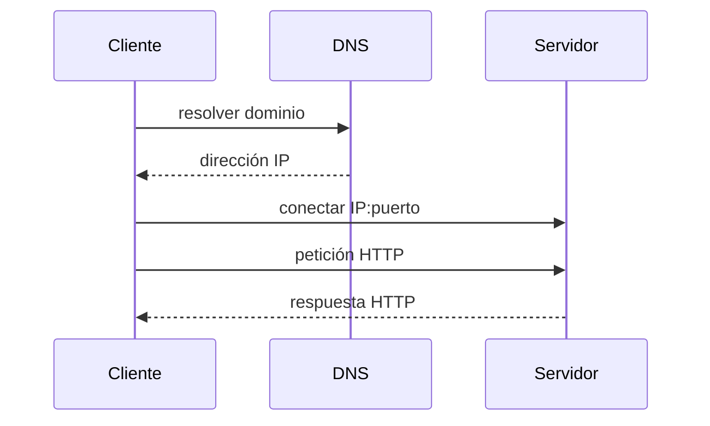
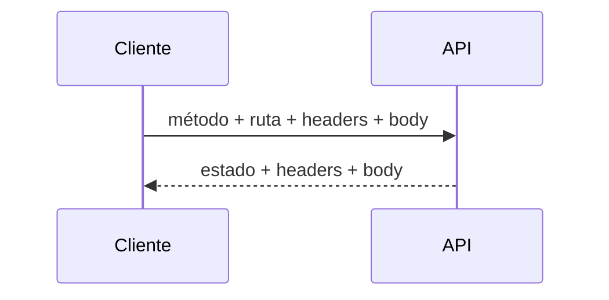
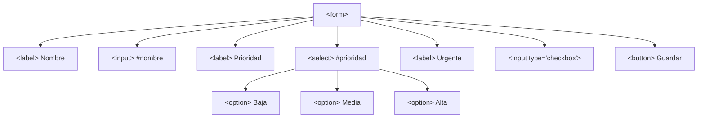
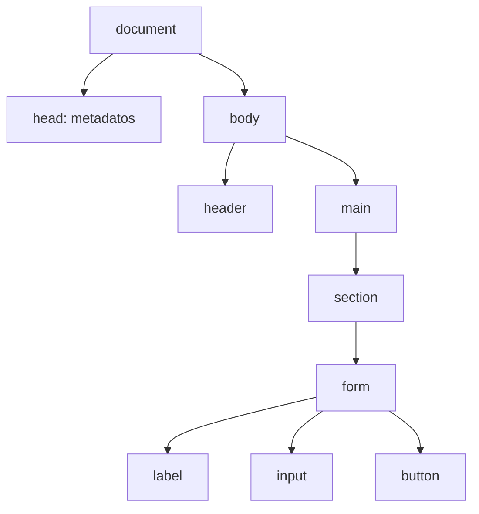
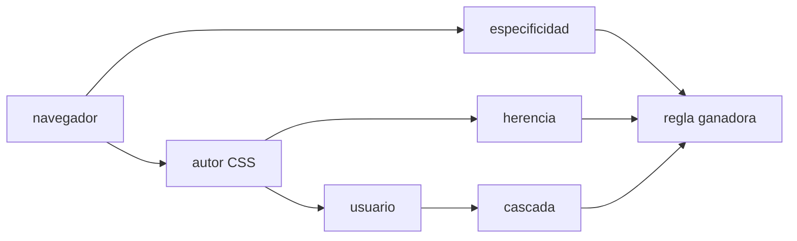
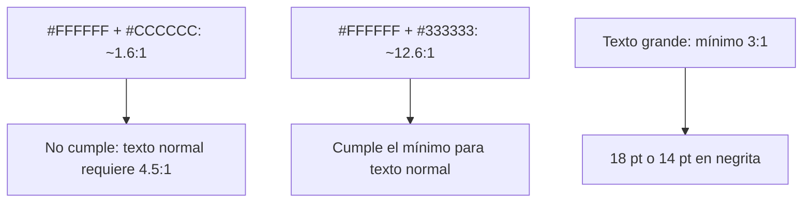
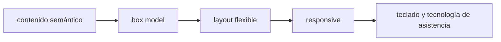

# Módulo 3: Fundamentos de web, redes y accesibilidad


## Aprende construyendo


### Tema 1: De una URL al servidor: red, DNS, IP y puertos · Básico · 45 min

<details open>
<summary><strong>Capa 1 — Lectura</strong></summary>

#### ► DE QUÉ TRATA
Al finalizar vas a levantar un servidor HTTP local, confirmar con curl que responde en el puerto correcto y reproducir el error de conexión rechazada cuando pedís un puerto donde no hay nada escuchando. Prerrequisitos: terminal, Python 3 y curl; comprueba python3 --version (Windo…

#### ► LA IDEA EN UNA FRASE
**Al finalizar vas a levantar un servidor HTTP local, confirmar con curl que responde en el puerto correcto y reproducir el error de conexión rechazada cuando pedís un puerto donde no hay nada escuchando.**

#### ► POR QUÉ EXISTE ESTO
Resuelve un problema real de diseño o implementación y evita decisiones a ciegas.

#### ► LA ANALOGÍA
Piensa en de una url al servidor: red, dns, ip y puertos como una herramienta de taller: útil cuando conoces su propósito y sus límites.
**Dónde se rompe la analogía:** en software, los efectos dependen del contexto, la escala y los trade-offs.

#### ► CÓMO FUNCIONA


#### ► LO QUE PUEDE SALIR MAL
| Síntoma | Causa probable | Arreglo |
|---|---|---|
| De una URL al servidor: red, DNS, IP y puertos se aplica pero el resultado no mejora | Se usó sin medir el problema real | Mide antes y compara contra la alternativa simple |
| Aparece complejidad inesperada | Se adoptó la técnica sin comprender sus trade-offs | Vuelve a la sección de trade-offs y reduce el alcance |
| Falla en un caso límite | Se asumió un contexto que no se cumple | Prueba el caso límite y documenta cuándo NO usarlo |

#### ► TRADE-OFFS
| Opción | Cuándo usarla | Cuándo NO usarla |
|---|---|---|
| Usar De una URL al servidor: red, DNS, IP y puertos | Cuando el problema coincide con su propósito y el beneficio es observable | Cuando agrega complejidad sin resolver un problema real |
| Alternativa más simple | Cuando el contexto es pequeño, estable o fácil de razonar | Cuando ya demostró no escalar o no cumplir el requisito |
| Postergar la decisión | Cuando falta evidencia del problema | Cuando el costo de esperar es mayor que el costo de probar |

#### ► CUÁNDO NO USAR ESTO
No uses de una url al servidor: red, dns, ip y puertos por defecto. Aplícalo cuando el problema lo justifique y puedas verificar el beneficio; si una alternativa más simple resuelve igual, prefiérela.

#### ► DE VUELTA A LA ANALOGÍA
Volviendo a la analogía: de una url al servidor: red, dns, ip y puertos funciona como el modelo inicial, pero recuerda dónde se rompe: en producción importan la evidencia, la escala y el costo de equivocarte.

#### ► LO QUE DEBES RECORDAR
- De una URL al servidor: red, DNS, IP y puertos existe para resolver un problema específico.
- Mide antes de adoptar complejidad.
- Conoce el caso donde NO usarlo.
- Verifica con evidencia observable.

#### ► PREGUNTAS PARA PENSAR
1. ¿Qué problema concreto resuelve de una url al servidor: red, dns, ip y puertos en tu contexto?
2. ¿Cómo sabrías que de una url al servidor: red, dns, ip y puertos no está funcionando bien?
3. ¿Qué alternativa más simple considerarías antes de usar de una url al servidor: red, dns, ip y puertos?

</details>

<details>
<summary><strong>Capa 2 — Construcción</strong></summary>

#### Código y verificación
```bash
python3 -m http.server 8000 --bind 127.0.0.1
```


```
404: _________ (¿qué condición informa?)
500: _________ (¿qué condición informa?)
Tarea 999 inexistente: _________ (código)
Fallo inesperado del servidor: _________ (código)
Respuesta JSON válida: {"error": "_________", "code": _________}
```

```json
> {"error": "Tarea no encontrada", "code": 404}
> ```

```bash
mkdir ejemplo-url-servidor
cd ejemplo-url-servidor
```

```html
<!doctype html>
<html lang="es">
  <head><meta charset="utf-8"><title>Servidor local</title></head>
  <body><main><h1>Servidor Fundamentos activo</h1></main></body>
</html>
```

</details>

### Tema 2: HTTP como contrato observable · Básico · 45 min

<details open>
<summary><strong>Capa 1 — Lectura</strong></summary>

#### ► DE QUÉ TRATA
Al finalizar vas a usar curl -v contra un servidor real para observar línea por línea una petición y una respuesta HTTP completas, y vas a reproducir un 404 real para confirmar que el servidor respondió correctamente aunque el recurso no exista. Prerrequisitos: Tema 1 de este mód…

#### ► LA IDEA EN UNA FRASE
**Al finalizar vas a usar curl -v contra un servidor real para observar línea por línea una petición y una respuesta HTTP completas, y vas a reproducir un 404 real para confirmar que el servidor respondió correctamente aunque el recurso no exista.**

#### ► POR QUÉ EXISTE ESTO
Resuelve un problema real de diseño o implementación y evita decisiones a ciegas.

#### ► LA ANALOGÍA
Piensa en http como contrato observable como una herramienta de taller: útil cuando conoces su propósito y sus límites.
**Dónde se rompe la analogía:** en software, los efectos dependen del contexto, la escala y los trade-offs.

#### ► CÓMO FUNCIONA


#### ► LO QUE PUEDE SALIR MAL
| Síntoma | Causa probable | Arreglo |
|---|---|---|
| HTTP como contrato observable se aplica pero el resultado no mejora | Se usó sin medir el problema real | Mide antes y compara contra la alternativa simple |
| Aparece complejidad inesperada | Se adoptó la técnica sin comprender sus trade-offs | Vuelve a la sección de trade-offs y reduce el alcance |
| Falla en un caso límite | Se asumió un contexto que no se cumple | Prueba el caso límite y documenta cuándo NO usarlo |

#### ► TRADE-OFFS
| Opción | Cuándo usarla | Cuándo NO usarla |
|---|---|---|
| Usar HTTP como contrato observable | Cuando el problema coincide con su propósito y el beneficio es observable | Cuando agrega complejidad sin resolver un problema real |
| Alternativa más simple | Cuando el contexto es pequeño, estable o fácil de razonar | Cuando ya demostró no escalar o no cumplir el requisito |
| Postergar la decisión | Cuando falta evidencia del problema | Cuando el costo de esperar es mayor que el costo de probar |

#### ► CUÁNDO NO USAR ESTO
No uses http como contrato observable por defecto. Aplícalo cuando el problema lo justifique y puedas verificar el beneficio; si una alternativa más simple resuelve igual, prefiérela.

#### ► DE VUELTA A LA ANALOGÍA
Volviendo a la analogía: http como contrato observable funciona como el modelo inicial, pero recuerda dónde se rompe: en producción importan la evidencia, la escala y el costo de equivocarte.

#### ► LO QUE DEBES RECORDAR
- HTTP como contrato observable existe para resolver un problema específico.
- Mide antes de adoptar complejidad.
- Conoce el caso donde NO usarlo.
- Verifica con evidencia observable.

#### ► PREGUNTAS PARA PENSAR
1. ¿Qué problema concreto resuelve http como contrato observable en tu contexto?
2. ¿Cómo sabrías que http como contrato observable no está funcionando bien?
3. ¿Qué alternativa más simple considerarías antes de usar http como contrato observable?

</details>

<details>
<summary><strong>Capa 2 — Construcción</strong></summary>

#### Código y verificación
```http
GET /productos/3 HTTP/1.1
Host: localhost:8000
Accept: application/json

HTTP/1.1 200 OK
Content-Type: application/json

{"id":3,"nombre":"Teclado"}
```

```bash
curl -i http://127.0.0.1:8000/
curl -i http://127.0.0.1:8000/no-existe
```


```
Listar: _________ /tareas
Crear: _________ /tareas (body: {...})
Editar tarea 5: _________ /tareas/5 (body: {...})
Borrar tarea 5: _________ /tareas/5
Idempotencia GET: _________ (sí/no, ¿por qué?)
Header decisivo: _________ (Request-Line: VERBO ...)
```

```bash
mkdir ejemplo-http-contrato
cd ejemplo-http-contrato
```

```html
<!doctype html>
<html lang="es">
  <head><meta charset="utf-8"><title>Tareas</title></head>
  <body><main><h1>Tareas</h1></main></body>
</html>
```

</details>

### Tema 3: HTML semántico, formularios y el DOM · Básico · 45 min

<details open>
<summary><strong>Capa 1 — Lectura</strong></summary>

#### ► DE QUÉ TRATA
Al finalizar vas a construir un formulario HTML real y vas a reproducir qué se rompe concretamente cuando un campo no tiene <label>: no es solo "menos accesible" en abstracto, es que el valor queda sin nombre para quien lo necesita. Prerrequisitos: Tema 2 de este módulo.

#### ► LA IDEA EN UNA FRASE
**Al finalizar vas a construir un formulario HTML real y vas a reproducir qué se rompe concretamente cuando un campo no tiene <label>: no es solo "menos accesible" en abstracto, es que el valor queda sin nombre para quien lo necesita.**

#### ► POR QUÉ EXISTE ESTO
Resuelve un problema real de diseño o implementación y evita decisiones a ciegas.

#### ► LA ANALOGÍA
Piensa en html semántico, formularios y el dom como una herramienta de taller: útil cuando conoces su propósito y sus límites.
**Dónde se rompe la analogía:** en software, los efectos dependen del contexto, la escala y los trade-offs.

#### ► CÓMO FUNCIONA


#### ► LO QUE PUEDE SALIR MAL
| Síntoma | Causa probable | Arreglo |
|---|---|---|
| HTML semántico, formularios y el DOM se aplica pero el resultado no mejora | Se usó sin medir el problema real | Mide antes y compara contra la alternativa simple |
| Aparece complejidad inesperada | Se adoptó la técnica sin comprender sus trade-offs | Vuelve a la sección de trade-offs y reduce el alcance |
| Falla en un caso límite | Se asumió un contexto que no se cumple | Prueba el caso límite y documenta cuándo NO usarlo |

#### ► TRADE-OFFS
| Opción | Cuándo usarla | Cuándo NO usarla |
|---|---|---|
| Usar HTML semántico, formularios y el DOM | Cuando el problema coincide con su propósito y el beneficio es observable | Cuando agrega complejidad sin resolver un problema real |
| Alternativa más simple | Cuando el contexto es pequeño, estable o fácil de razonar | Cuando ya demostró no escalar o no cumplir el requisito |
| Postergar la decisión | Cuando falta evidencia del problema | Cuando el costo de esperar es mayor que el costo de probar |

#### ► CUÁNDO NO USAR ESTO
No uses html semántico, formularios y el dom por defecto. Aplícalo cuando el problema lo justifique y puedas verificar el beneficio; si una alternativa más simple resuelve igual, prefiérela.

#### ► DE VUELTA A LA ANALOGÍA
Volviendo a la analogía: html semántico, formularios y el dom funciona como el modelo inicial, pero recuerda dónde se rompe: en producción importan la evidencia, la escala y el costo de equivocarte.

#### ► LO QUE DEBES RECORDAR
- HTML semántico, formularios y el DOM existe para resolver un problema específico.
- Mide antes de adoptar complejidad.
- Conoce el caso donde NO usarlo.
- Verifica con evidencia observable.

#### ► PREGUNTAS PARA PENSAR
1. ¿Qué problema concreto resuelve html semántico, formularios y el dom en tu contexto?
2. ¿Cómo sabrías que html semántico, formularios y el dom no está funcionando bien?
3. ¿Qué alternativa más simple considerarías antes de usar html semántico, formularios y el dom?

</details>

<details>
<summary><strong>Capa 2 — Construcción</strong></summary>

#### Código y verificación
```html
<!doctype html>
<html lang="es">
  <head>
    <meta charset="utf-8">
    <meta name="viewport" content="width=device-width, initial-scale=1">
    <title>Inventario local</title>
  </head>
  <body>
    <header><h1>Inventario local</h1></header>
    <main>
      <section aria-labelledby="nuevo-producto">
        <h2 id="nuevo-producto">Nuevo producto</h2>
        <form>
          <label for="nombre">Nombre</label>
          <input id="nombre" name="nombre" required>
          <button type="submit">Guardar</button>
        </form>
      </section>
    </main>
  </body>
</html>
```




```
Árbol DOM: form → input, select, input, button (relaciones padre-hijo)
Selector para titulo: document.getElementById("_________")
Selector para prioridad: document.querySelector("_________")
Validación: if (!titulo.value) { _________ }
Label + input: <label for="titulo">...</label> <input id="titulo" ...>
```

```
> form#form-tareas
> ├── input#titulo (type="text")
> ├── select#prioridad
> │   ├── option (value="baja") "Baja"
> │   ├── option (value="media") "Media"
> │   └── option (value="alta") "Alta"
> ├── input#urgente (type="checkbox")
> └── button#enviar "Agregar"
> ```

```javascript
> if (!titulo.value.trim()) {
>     alert("Título vacío");
>     return false;
> }
> ```

</details>

### Tema 4: CSS, layout responsive y accesibilidad verificable · Básico · 45 min

<details open>
<summary><strong>Capa 1 — Lectura</strong></summary>

#### ► DE QUÉ TRATA
Al finalizar vas a verificar con un número concreto, no "a ojo", si una combinación de colores cumple el contraste mínimo de accesibilidad, y vas a corregir una que no cumple. Prerrequisitos: Tema 3 de este módulo.

#### ► LA IDEA EN UNA FRASE
**Al finalizar vas a verificar con un número concreto, no "a ojo", si una combinación de colores cumple el contraste mínimo de accesibilidad, y vas a corregir una que no cumple.**

#### ► POR QUÉ EXISTE ESTO
Resuelve un problema real de diseño o implementación y evita decisiones a ciegas.

#### ► LA ANALOGÍA
Piensa en css, layout responsive y accesibilidad verificable como una herramienta de taller: útil cuando conoces su propósito y sus límites.
**Dónde se rompe la analogía:** en software, los efectos dependen del contexto, la escala y los trade-offs.

#### ► CÓMO FUNCIONA


#### ► LO QUE PUEDE SALIR MAL
| Síntoma | Causa probable | Arreglo |
|---|---|---|
| CSS, layout responsive y accesibilidad verificable se aplica pero el resultado no mejora | Se usó sin medir el problema real | Mide antes y compara contra la alternativa simple |
| Aparece complejidad inesperada | Se adoptó la técnica sin comprender sus trade-offs | Vuelve a la sección de trade-offs y reduce el alcance |
| Falla en un caso límite | Se asumió un contexto que no se cumple | Prueba el caso límite y documenta cuándo NO usarlo |

#### ► TRADE-OFFS
| Opción | Cuándo usarla | Cuándo NO usarla |
|---|---|---|
| Usar CSS, layout responsive y accesibilidad verificable | Cuando el problema coincide con su propósito y el beneficio es observable | Cuando agrega complejidad sin resolver un problema real |
| Alternativa más simple | Cuando el contexto es pequeño, estable o fácil de razonar | Cuando ya demostró no escalar o no cumplir el requisito |
| Postergar la decisión | Cuando falta evidencia del problema | Cuando el costo de esperar es mayor que el costo de probar |

#### ► CUÁNDO NO USAR ESTO
No uses css, layout responsive y accesibilidad verificable por defecto. Aplícalo cuando el problema lo justifique y puedas verificar el beneficio; si una alternativa más simple resuelve igual, prefiérela.

#### ► DE VUELTA A LA ANALOGÍA
Volviendo a la analogía: css, layout responsive y accesibilidad verificable funciona como el modelo inicial, pero recuerda dónde se rompe: en producción importan la evidencia, la escala y el costo de equivocarte.

#### ► LO QUE DEBES RECORDAR
- CSS, layout responsive y accesibilidad verificable existe para resolver un problema específico.
- Mide antes de adoptar complejidad.
- Conoce el caso donde NO usarlo.
- Verifica con evidencia observable.

#### ► PREGUNTAS PARA PENSAR
1. ¿Qué problema concreto resuelve css, layout responsive y accesibilidad verificable en tu contexto?
2. ¿Cómo sabrías que css, layout responsive y accesibilidad verificable no está funcionando bien?
3. ¿Qué alternativa más simple considerarías antes de usar css, layout responsive y accesibilidad verificable?

</details>

<details>
<summary><strong>Capa 2 — Construcción</strong></summary>

#### Código y verificación
```css
:root {
  color-scheme: light dark;
  font-family: system-ui, sans-serif;
}

* { box-sizing: border-box; }

body { margin: 0; line-height: 1.6; }
main { width: min(70rem, 100% - 2rem); margin-inline: auto; }

.productos {
  display: grid;
  grid-template-columns: repeat(auto-fit, minmax(15rem, 1fr));
  gap: 1rem;
}

button:focus-visible { outline: 3px solid #6d5dfc; outline-offset: 3px; }
```






```
WCAG AA requiere contraste: _________:1
Blanco #FFF vs gris #CCC: ratio = _________ (¿cumple?)
Color alternativo: _________ (más oscuro para cumplir)
Herramienta: contrast-ratio.com, comprobación: _________
```

```css
> body { background: #FFF; color: #333; }
> ```

</details>

### Proyecto 3: sitio profesional accesible desde carpeta vacía

<details open>
<summary><strong>Capa 1 — Lectura</strong></summary>

#### ► DE QUÉ TRATA
Este tema te guía por proyecto 3: sitio profesional accesible desde carpeta vacía con foco en comprensión antes de implementación.

#### ► LA IDEA EN UNA FRASE
**Entender proyecto 3: sitio profesional accesible desde carpeta vacía te permite tomar mejores decisiones técnicas.**

#### ► POR QUÉ EXISTE ESTO
Resuelve un problema real de diseño o implementación y evita decisiones a ciegas.

#### ► LA ANALOGÍA
Piensa en proyecto 3: sitio profesional accesible desde carpeta vacía como una herramienta de taller: útil cuando conoces su propósito y sus límites.
**Dónde se rompe la analogía:** en software, los efectos dependen del contexto, la escala y los trade-offs.

#### ► CÓMO FUNCIONA
1. Identifica el problema que proyecto 3: sitio profesional accesible desde carpeta vacía resuelve.
2. Observa sus componentes y relaciones.
3. Aplica la opción más simple que funcione.
4. Verifica el resultado y los límites.

#### ► LO QUE PUEDE SALIR MAL
| Síntoma | Causa probable | Arreglo |
|---|---|---|
| Proyecto 3: sitio profesional accesible desde carpeta vacía se aplica pero el resultado no mejora | Se usó sin medir el problema real | Mide antes y compara contra la alternativa simple |
| Aparece complejidad inesperada | Se adoptó la técnica sin comprender sus trade-offs | Vuelve a la sección de trade-offs y reduce el alcance |
| Falla en un caso límite | Se asumió un contexto que no se cumple | Prueba el caso límite y documenta cuándo NO usarlo |

#### ► TRADE-OFFS
| Opción | Cuándo usarla | Cuándo NO usarla |
|---|---|---|
| Usar Proyecto 3: sitio profesional accesible desde carpeta vacía | Cuando el problema coincide con su propósito y el beneficio es observable | Cuando agrega complejidad sin resolver un problema real |
| Alternativa más simple | Cuando el contexto es pequeño, estable o fácil de razonar | Cuando ya demostró no escalar o no cumplir el requisito |
| Postergar la decisión | Cuando falta evidencia del problema | Cuando el costo de esperar es mayor que el costo de probar |

#### ► CUÁNDO NO USAR ESTO
No uses proyecto 3: sitio profesional accesible desde carpeta vacía por defecto. Aplícalo cuando el problema lo justifique y puedas verificar el beneficio; si una alternativa más simple resuelve igual, prefiérela.

#### ► DE VUELTA A LA ANALOGÍA
Volviendo a la analogía: proyecto 3: sitio profesional accesible desde carpeta vacía funciona como el modelo inicial, pero recuerda dónde se rompe: en producción importan la evidencia, la escala y el costo de equivocarte.

#### ► LO QUE DEBES RECORDAR
- Proyecto 3: sitio profesional accesible desde carpeta vacía existe para resolver un problema específico.
- Mide antes de adoptar complejidad.
- Conoce el caso donde NO usarlo.
- Verifica con evidencia observable.

#### ► PREGUNTAS PARA PENSAR
1. ¿Qué problema concreto resuelve proyecto 3: sitio profesional accesible desde carpeta vacía en tu contexto?
2. ¿Cómo sabrías que proyecto 3: sitio profesional accesible desde carpeta vacía no está funcionando bien?
3. ¿Qué alternativa más simple considerarías antes de usar proyecto 3: sitio profesional accesible desde carpeta vacía?

</details>

<details>
<summary><strong>Capa 2 — Construcción</strong></summary>

#### Nota de construcción
Este tema es principalmente conceptual en esta versión. La verificación se realiza con las preguntas de comprensión y el criterio de cuándo NO usar proyecto 3: sitio profesional accesible desde carpeta vacía.

</details>

### Tema 5: Proyecto integrador — sitio de seguimiento accesible · Básico · 45 min

<details open>
<summary><strong>Capa 1 — Lectura</strong></summary>

#### ► DE QUÉ TRATA
Al finalizar construirás una página de seguimiento con un formulario etiquetado y dos columnas que se adaptan al espacio. Prerrequisitos: guardar archivos y ejecutar Python; no necesitas JavaScript ni un framework. Es un ejemplo independiente desde una carpeta vacía.

#### ► LA IDEA EN UNA FRASE
**Al finalizar construirás una página de seguimiento con un formulario etiquetado y dos columnas que se adaptan al espacio.**

#### ► POR QUÉ EXISTE ESTO
Resuelve un problema real de diseño o implementación y evita decisiones a ciegas.

#### ► LA ANALOGÍA
Piensa en proyecto integrador — sitio de seguimiento accesible como una herramienta de taller: útil cuando conoces su propósito y sus límites.
**Dónde se rompe la analogía:** en software, los efectos dependen del contexto, la escala y los trade-offs.

#### ► CÓMO FUNCIONA
1. Identifica el problema que proyecto integrador — sitio de seguimiento accesible resuelve.
2. Observa sus componentes y relaciones.
3. Aplica la opción más simple que funcione.
4. Verifica el resultado y los límites.

#### ► LO QUE PUEDE SALIR MAL
| Síntoma | Causa probable | Arreglo |
|---|---|---|
| Proyecto integrador — sitio de seguimiento accesible se aplica pero el resultado no mejora | Se usó sin medir el problema real | Mide antes y compara contra la alternativa simple |
| Aparece complejidad inesperada | Se adoptó la técnica sin comprender sus trade-offs | Vuelve a la sección de trade-offs y reduce el alcance |
| Falla en un caso límite | Se asumió un contexto que no se cumple | Prueba el caso límite y documenta cuándo NO usarlo |

#### ► TRADE-OFFS
| Opción | Cuándo usarla | Cuándo NO usarla |
|---|---|---|
| Usar Proyecto integrador — sitio de seguimiento accesible | Cuando el problema coincide con su propósito y el beneficio es observable | Cuando agrega complejidad sin resolver un problema real |
| Alternativa más simple | Cuando el contexto es pequeño, estable o fácil de razonar | Cuando ya demostró no escalar o no cumplir el requisito |
| Postergar la decisión | Cuando falta evidencia del problema | Cuando el costo de esperar es mayor que el costo de probar |

#### ► CUÁNDO NO USAR ESTO
No uses proyecto integrador — sitio de seguimiento accesible por defecto. Aplícalo cuando el problema lo justifique y puedas verificar el beneficio; si una alternativa más simple resuelve igual, prefiérela.

#### ► DE VUELTA A LA ANALOGÍA
Volviendo a la analogía: proyecto integrador — sitio de seguimiento accesible funciona como el modelo inicial, pero recuerda dónde se rompe: en producción importan la evidencia, la escala y el costo de equivocarte.

#### ► LO QUE DEBES RECORDAR
- Proyecto integrador — sitio de seguimiento accesible existe para resolver un problema específico.
- Mide antes de adoptar complejidad.
- Conoce el caso donde NO usarlo.
- Verifica con evidencia observable.

#### ► PREGUNTAS PARA PENSAR
1. ¿Qué problema concreto resuelve proyecto integrador — sitio de seguimiento accesible en tu contexto?
2. ¿Cómo sabrías que proyecto integrador — sitio de seguimiento accesible no está funcionando bien?
3. ¿Qué alternativa más simple considerarías antes de usar proyecto integrador — sitio de seguimiento accesible?

</details>

<details>
<summary><strong>Capa 2 — Construcción</strong></summary>

#### Código y verificación
```bash
mkdir seguimiento-html
cd seguimiento-html
```

```html
<!doctype html>
<html lang="es">
<head>
  <meta charset="utf-8">
  <meta name="viewport" content="width=device-width, initial-scale=1">
  <title>Consulta una entrega</title>
  <style>
    * { box-sizing: border-box; }
    body { margin: 0; font: 1rem/1.6 system-ui; color: #17253b; }
    main { max-width: 60rem; margin: auto; padding: 1.5rem; }
    .panel { display: grid; grid-template-columns: 1fr 1fr; gap: 2rem; }
    label { display: block; }
    input, button { font: inherit; padding: .7rem; max-width: 100%; }
    input { width: 100%; }
    button { margin-top: 1rem; }
    :focus-visible { outline: 3px solid #315bcc; outline-offset: 3px; }
    @media (max-width: 40rem) { .panel { grid-template-columns: 1fr; } }
  </style>
</head>
<body>
  <main>
    <h1>Consulta una entrega</h1>
    <div class="panel">
      <form action="/" method="get">
        <label for="codigo">Código de envío</label>
        <input id="codigo" name="codigo" required maxlength="30">
        <button type="submit">Consultar</button>
      </form>
      <section aria-labelledby="ayuda">
        <h2 id="ayuda">¿Dónde encuentro el código?</h2>
        <p>Está en el comprobante de tu entrega. Ejemplo: ENV-42.</p>
      </section>
    </div>
  </main>
</body>
</html>
```

```bash
python3 -m http.server 8000 --bind 127.0.0.1
```

</details>
