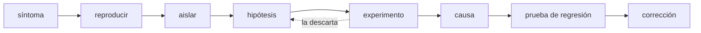
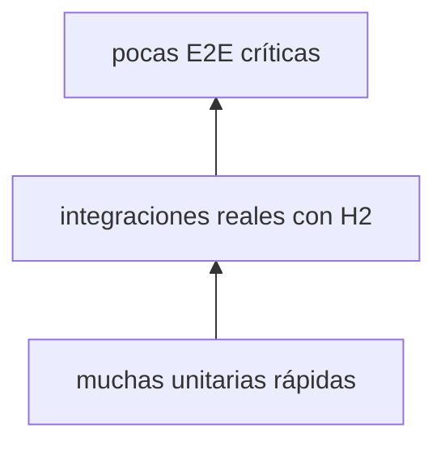
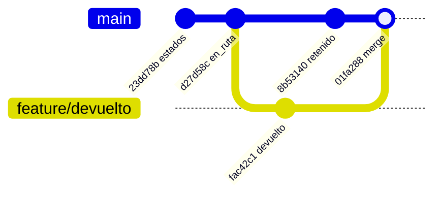
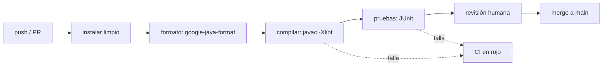

# Módulo 4: Testing, depuración, Git y CI

**Entorno comprobado para esta edición (2026-11-24):** OpenJDK 25.0.5.1 en Linux x86_64, Gradle 8.14.3 (ejecutado sobre el JDK 21 y compilando con el JDK 25 por *toolchain*), JUnit 6.0.3, JaCoCo 0.8.15, H2 2.3.232, google-java-format 1.33.0 y Git 2.43.0. Si instalas Gradle hoy, usa la versión 9.9 o posterior: las órdenes y la salida de este módulo son las mismas salvo detalles de formato. Las bibliotecas se resolvieron desde una copia local de Maven Central con las mismas versiones; en tu equipo Gradle las descargará la primera vez. Todas las transcripciones son literales de esa ejecución, en la carpeta de práctica `/home/estudiante/labs` (tu `~/labs`). Los commits se hicieron con autor y fecha fijos para que los hashes sean reproducibles: si repites los pasos, tus hashes y fechas serán distintos. El workflow de GitHub Actions del Tema 4 no se ejecutó en GitHub: se validó su YAML y sus órdenes se ejecutaron en un clon limpio local.

Al terminar este módulo podrás:
- reproducir y corregir un defecto con una prueba de regresión;
- construir una suite JUnit con Gradle, con pruebas unitarias y de integración sobre H2;
- resolver un conflicto de merge explicando la intención de ambos cambios;
- configurar CI para ejecutar formato, análisis y pruebas en cada pull request.

**Qué necesitas saber antes:** casos de prueba, `assert` y excepciones (Módulo 1, Tema 1); métodos (Módulo 1, Tema 4); records y colecciones (Módulo 2). No hace falta saber SQL ni Gradle: el Tema 2 explica lo justo.


## Aprende construyendo


### Tema 1: Depurar con evidencia, no con cambios aleatorios · Intermedio · 50 min

<details open>
<summary><strong>Capa 1 — Lectura</strong></summary>

#### Objetivos
Al terminar este tema podrás:
- reproducir un defecto con el caso más pequeño posible y escribir tu hipótesis antes de tocar el código;
- leer una traza de pila (*stack trace*) de arriba hacia abajo y ubicar la línea que falló y la que la llamó;
- detener un programa con el depurador `jdb` en un punto de interrupción e inspeccionar sus variables;
- dejar evidencia con `java.util.logging` y cerrar cada corrección con una prueba de regresión.

**Conceptos clave:** defecto, síntoma, reproducción, hipótesis, traza de pila, depurador, punto de interrupción, registro, prueba de regresión

#### El problema
La coordinadora de RutaFlow abre el reporte de la mañana y ve los envíos **entregados** en la lista de pendientes.
Alguien propone «cambiar cosas hasta que salga bien». Ese camino arregla por casualidad o rompe otra parte. ¿Cómo
encuentras la causa real con evidencia y cómo te aseguras de que el error no vuelva?

Este tema usa lo que ya conoces: **caso de prueba**, **caso límite**, **excepción** y **assert** tienen su ficha en
el Módulo 1, Tema 1. Aquí no se redefinen.

#### Glosario del tema

**defecto y síntoma**
- **Definición técnica:** un defecto (*bug*) es la instrucción incorrecta en el código; el síntoma es el comportamiento observable que produce al ejecutarse.
- **En palabras sencillas:** el síntoma es la fiebre; el defecto es la infección que la causa.
- **Dónde se rompe la comparación:** un mismo defecto puede dar síntomas distintos según los datos, y algunos defectos no dan ningún síntoma hasta mucho después.
- **Ejemplo:** síntoma: el reporte muestra `obtenido: [RF-102]`; defecto: la línea 6 de `Envios.java` compara con `"entregado"`.
- **Error típico:** «arreglar» el síntoma (filtrar la salida a mano) y dejar el defecto vivo en el código.

**reproducción**
- **Definición técnica:** conjunto mínimo de pasos y datos que provoca el síntoma de forma repetible.
- **En palabras sencillas:** la receta para hacer que el error aparezca siempre, a voluntad.
- **Dónde se rompe la comparación:** algunos errores dependen del tiempo o del orden de ejecución y no salen en cada intento; ahí la receta incluye esas condiciones.
- **Ejemplo:** `java Reproducir.java` con dos envíos muestra `esperado: [RF-101]` y `obtenido: [RF-102]`.
- **Error típico:** intentar depurar con la base de datos completa de producción en vez de reducir el caso a dos o tres datos.

**hipótesis**
- **Definición técnica:** explicación concreta y comprobable de la causa del síntoma, escrita antes de cambiar el código.
- **En palabras sencillas:** tu sospecha en una línea, lo bastante precisa para poder demostrar que es falsa.
- **Dónde se rompe la comparación:** a diferencia de una corazonada, una hipótesis dice qué experimento la confirma o la descarta.
- **Ejemplo:** «el filtro compara con el estado equivocado; si imprimo los estados, veré `[pendiente]` y aun así no saldrá».
- **Error típico:** escribir una hipótesis vaga («algo falla en el filtro») que ningún experimento puede descartar.

**traza de pila**
- **Definición técnica:** informe que Java imprime cuando una excepción termina el programa (*stack trace*); empieza con el tipo y el mensaje de la excepción y sigue con una línea `at` por cada llamada activa, de la más interna a la más externa.
- **En palabras sencillas:** el rastro de migas que dice por qué métodos pasó el programa hasta caerse.
- **Dónde se rompe la comparación:** se lee de arriba hacia abajo: la causa inmediata está en la **primera** línea `at`; las siguientes dicen quién la llamó.
- **Ejemplo:** la traza de `Bodega.java` empieza con `IllegalArgumentException: Stock insuficiente`, lanzada en la línea 11.
- **Error típico:** saltar hasta la última línea `at` (el `main`) y buscar el error ahí, cuando la falla nació arriba.

**depurador**
- **Definición técnica:** programa que ejecuta otro paso a paso y permite pausarlo, inspeccionar variables y avanzar; el JDK trae `jdb`, que trabaja sobre clases compiladas con `javac -g`.
- **En palabras sencillas:** un control remoto con pausa y lupa para mirar el programa por dentro mientras corre.
- **Dónde se rompe la comparación:** el depurador no adivina la causa; solo te deja mirar. Sin hipótesis, solo das pasos sin rumbo.
- **Ejemplo:** `jdb -sourcepath . -classpath clases Bodega` abre el depurador y espera órdenes en el prompt `>`.
- **Error típico:** confundir `next` (ejecuta la línea sin entrar en métodos) con `step` (entra en el método llamado).

**punto de interrupción**
- **Definición técnica:** marca que hace que el depurador pause la ejecución al llegar a una línea o método; en `jdb` se crea con `stop in Clase.metodo` o `stop at Clase:línea`, y en un IDE con un clic junto al número de línea.
- **En palabras sencillas:** un «alto» pintado en el camino: el programa corre normal hasta ahí y se detiene.
- **Dónde se rompe la comparación:** si la marca está en un método que se llama varias veces, el programa se detiene en **cada** llamada.
- **Ejemplo:** `stop in Bodega.retirar` responde `Deferring breakpoint Bodega.retirar.`: queda pendiente hasta que la clase se cargue.
- **Error típico:** arrancar en producción un servidor con el depurador habilitado (`-agentlib:jdwp`): cualquiera que llegue a ese puerto puede pausarlo y leer sus datos.

**registro**
- **Definición técnica:** mensajes con nivel (`FINE`, `INFO`, `WARNING`, `SEVERE`) que un programa escribe mientras corre; el JDK trae `java.util.logging`, y en proyectos grandes se usa SLF4J con Logback, con niveles `DEBUG`, `INFO`, `WARN` y `ERROR`.
- **En palabras sencillas:** la bitácora del programa: deja anotado qué hizo y con qué datos, aunque nadie esté mirando.
- **Dónde se rompe la comparación:** una bitácora se lee completa; un registro se filtra por nivel, y por defecto `java.util.logging` oculta los niveles por debajo de `INFO`.
- **Ejemplo:** `logger.warning("stock bajo en A-1")` escribe una línea con nivel `WARNING` y el mensaje.
- **Error típico:** usar `IO.println` para depurar y olvidarlo en el código; un registro se apaga cambiando el nivel, sin borrar líneas.

**prueba de regresión**
- **Definición técnica:** caso de prueba que reproduce un defecto ya encontrado; falla mientras el defecto existe y pasa cuando se corrige, y se conserva para siempre.
- **En palabras sencillas:** una alarma instalada justo donde ya entró el ladrón, por si vuelve.
- **Dónde se rompe la comparación:** no protege contra defectos nuevos, solo contra el regreso de uno conocido.
- **Ejemplo:** `PruebaRegresion.java` falla con `AssertionError: se esperaba [RF-101] y llegó [RF-102]` antes de la corrección.
- **Error típico:** escribir la prueba **después** de corregir; entonces nunca la viste fallar y no sabes si detecta el defecto.

#### ► CÓMO FUNCIONA
Depurar es un experimento, no una búsqueda a ciegas. Partes de un **síntoma**, lo **reproduces** con pocos datos y
aíslas la parte del código que lo produce. Luego escribes una **hipótesis**, diseñas un **experimento** que la pueda
descartar y solo entonces conoces la **causa**. Antes de corregir, escribes la **prueba de regresión** y la ves fallar.

| Herramienta | Qué es | Qué haces con ella |
|---|---|---|
| Traza de pila | Informe de la excepción | La lees de arriba hacia abajo para hallar la línea que falló y quién la llamó |
| `IO.println` con `[...]` | Salida temporal | Muestras un valor exacto en un punto, con sus límites visibles |
| `jdb` | Depurador del JDK | Pausas, inspeccionas variables y subes al método que llamó |
| `java.util.logging` | Registro con niveles | Dejas evidencia permanente con datos, sin depender de mirar la pantalla |



#### Problema resuelto 1.1
El reporte de pendientes de RutaFlow muestra envíos entregados. Encuentra la causa con evidencia, escribe una prueba
de regresión que falle y corrige el defecto.

**Razonamiento:**
1. Reproducir: armar la ruta más pequeña que muestra el síntoma, un pendiente y un entregado.
2. Hipótesis en una línea, antes de abrir el editor: «el filtro compara con el estado equivocado».
3. Experimento: imprimir cada estado entre corchetes para ver el texto exacto, con sus espacios.
4. Prueba de regresión primero; corrección después; la misma prueba debe pasar.

Este es el código con el defecto. `Envio.java` define el dato y `Envios.java`, el filtro:

```java
// Envio.java — un envío con su guía y su estado
record Envio(String guia, String estado) {}
```

```java
// Envios.java — filtra los envíos pendientes de una ruta (versión con defecto)
import java.util.List;

class Envios {
    static List<Envio> listarPendientes(List<Envio> envios) {
        return envios.stream().filter(envio -> envio.estado().equals("entregado")).toList();
    }
}
```

```java
// Reproducir.java — reproduce el defecto con el caso más pequeño posible
void main() {
    List<Envio> ruta = List.of(
            new Envio("RF-101", "pendiente"),
            new Envio("RF-102", "entregado"));
    for (Envio envio : ruta) {
        IO.println("revisando " + envio.guia() + " estado: [" + envio.estado() + "]");
    }
    List<Envio> resultado = Envios.listarPendientes(ruta);
    IO.println("esperado: [RF-101]");
    IO.println("obtenido: " + resultado.stream().map(Envio::guia).toList());
}
```

```text
$ java Reproducir.java
revisando RF-101 estado: [pendiente]
revisando RF-102 estado: [entregado]
esperado: [RF-101]
obtenido: [RF-102]
```

El experimento descarta otra sospecha común: los datos están bien escritos (`[pendiente]`, sin mayúsculas ni
espacios). La hipótesis queda confirmada: el filtro deja pasar justo el estado contrario. Ahora la prueba de regresión:

```java
// PruebaRegresion.java — falla mientras el defecto exista
void main() {
    List<Envio> ruta = List.of(
            new Envio("RF-101", "pendiente"),
            new Envio("RF-102", "entregado"));
    List<String> guias = Envios.listarPendientes(ruta).stream().map(Envio::guia).toList();
    if (!guias.equals(List.of("RF-101"))) {
        throw new AssertionError("se esperaba [RF-101] y llegó " + guias);
    }
    IO.println("regresión cubierta: solo se listan pendientes");
}
```

```text
$ java PruebaRegresion.java
Exception in thread "main" java.lang.AssertionError: se esperaba [RF-101] y llegó [RF-102]
	at PruebaRegresion.main(PruebaRegresion.java:8)
```

La corrección cambia una sola palabra en la línea 6 de `Envios.java`:

```java
// Envios.java — filtra los envíos pendientes de una ruta
import java.util.List;

class Envios {
    static List<Envio> listarPendientes(List<Envio> envios) {
        return envios.stream().filter(envio -> envio.estado().equals("pendiente")).toList();
    }
}
```

```text
$ java PruebaRegresion.java
regresión cubierta: solo se listan pendientes
```

**Explicación por partes.**
- `Envio.java`: un record con guía y estado. Los cuatro archivos van en la misma carpeta; Java encuentra `Envio` y `Envios` por su nombre.
- `Envios.java`, línea 6: `stream().filter(...)` conserva los envíos cuya condición es verdadera y `toList()` los junta; con `"entregado"` conserva los equivocados.
- `Reproducir.java`, líneas 3–5: dos envíos bastan; con uno de cada estado, el síntoma se ve a simple vista.
- `Reproducir.java`, línea 7: los corchetes alrededor del estado harían visible un espacio sobrante: `[pendiente ]`.
- `Reproducir.java`, línea 11: `map(Envio::guia)` convierte cada envío en su guía para imprimir solo eso.
- `PruebaRegresion.java`, líneas 7–9: si la lista no es la esperada, lanza `AssertionError` con un mensaje que dice qué se esperaba y qué llegó. No depende de `java -ea`: el `if` se ejecuta siempre.
- La prueba se vio fallar antes de corregir y pasar después: eso demuestra que detecta este defecto.

> **Error común.** Cambiar varias cosas a la vez «a ver si funciona». Si después del tercer cambio el síntoma
> desaparece, no sabes cuál lo arregló ni si otro rompió algo. Cambia una cosa, ejecuta la reproducción y anota el resultado.

> **Buena práctica.** Escribe la hipótesis en una línea antes de tocar el código, por ejemplo en el ticket. Si el
> experimento la descarta, escribe la siguiente; el registro de hipótesis descartadas también ahorra tiempo al equipo.

#### Problema resuelto 1.2
La bodega de RutaFlow despacha pedidos y descuenta cajas del stock. Un pedido de 8 cajas detiene el programa. Ubica
dónde nace el error con la traza de pila, inspecciona los valores con `jdb` y deja registro de cada retirada.

**Razonamiento:**
1. La traza de pila se lee de arriba hacia abajo: primero el mensaje, luego la línea que lo lanzó y después quién la llamó.
2. Un punto de interrupción en `retirar` pausa el programa justo antes de la comparación que falla.
3. `java.util.logging` deja una línea por retirada con el SKU y la cantidad: así queda evidencia aunque nadie esté mirando.

```java
// Bodega.java — despacha pedidos descontando cajas del stock
import java.util.logging.Level;
import java.util.logging.Logger;

record Pedido(String sku, int cantidad) {}

Logger logger;

int retirar(int stock, int cantidad) {
    if (cantidad > stock) {
        throw new IllegalArgumentException("Stock insuficiente");
    }
    return stock - cantidad;
}

int despachar(Pedido pedido, int stock) {
    logger.log(Level.INFO, "retirada_solicitada sku={0} cantidad={1}", new Object[] {pedido.sku(), pedido.cantidad()});
    return retirar(stock, pedido.cantidad());
}

void main() {
    System.setProperty("java.util.logging.SimpleFormatter.format", "%4$s %5$s%n");
    logger = Logger.getLogger("bodega");
    IO.println("quedan: " + despachar(new Pedido("A-1", 3), 5));
    IO.println("quedan: " + despachar(new Pedido("A-1", 8), 5));
}
```

```text
$ java Bodega.java
INFO retirada_solicitada sku=A-1 cantidad=3
quedan: 2
INFO retirada_solicitada sku=A-1 cantidad=8
Exception in thread "main" java.lang.IllegalArgumentException: Stock insuficiente
	at Bodega.retirar(Bodega.java:11)
	at Bodega.despachar(Bodega.java:18)
	at Bodega.main(Bodega.java:25)
```

Léela de arriba hacia abajo. El mensaje es `Stock insuficiente` y lo lanzó la línea 11, dentro de `retirar`. A
`retirar` la llamó la línea 18 de `despachar`, y a `despachar`, la línea 25 de `main`. Ahora confirma los valores con
`jdb`. El depurador trabaja con clases compiladas: `javac -g` compila guardando los nombres de las variables y `-d clases`
deja los `.class` en esa carpeta.

```text
$ javac -g -d clases Bodega.java
$ jdb -sourcepath . -classpath clases Bodega
Initializing jdb ...
> stop in Bodega.retirar
Deferring breakpoint Bodega.retirar.
It will be set after the class is loaded.
> run
run Bodega
Set uncaught java.lang.Throwable
Set deferred uncaught java.lang.Throwable
> 
VM Started: Set deferred breakpoint Bodega.retirar
INFO retirada_solicitada sku=A-1 cantidad=3

Breakpoint hit: "thread=main", Bodega.retirar(), line=10 bci=0
10        if (cantidad > stock) {

main[1] cont
> quedan: 2
INFO retirada_solicitada sku=A-1 cantidad=8

Breakpoint hit: "thread=main", Bodega.retirar(), line=10 bci=0
10        if (cantidad > stock) {

main[1] locals
Method arguments:
stock = 5
cantidad = 8
Local variables:
main[1] up
main[2] print pedido
 pedido = "Pedido[sku=A-1, cantidad=8]"
main[2] exit
```

El programa y `jdb` escriben en la misma terminal y a veces sus líneas se mezclan a mitad de palabra; en esta captura
se dejaron en el orden en que se leen. Al salir con `exit`, el programa termina con la misma excepción de la traza.

**Explicación por partes.**
- `Bodega.java`, línea 5: un record `Pedido` dentro del archivo compacto agrupa el SKU y la cantidad.
- Líneas 9–14: `retirar` rechaza con una excepción (Módulo 1, Tema 1) cuando la cantidad supera el stock.
- Línea 17: cada despacho deja una línea `INFO`. `{0}` y `{1}` se reemplazan por los valores del arreglo, en orden; por eso el registro muestra `cantidad=8` antes de la traza.
- Línea 22: el formato `%4$s %5$s%n` imprime solo el nivel y el mensaje; sin él, cada registro ocupa dos líneas con fecha y clase.
- Sesión de `jdb`: `stop in Bodega.retirar` deja el punto de interrupción pendiente; al cargarse la clase se activa en la primera línea del método (la 10).
- El `run` se detiene en el pedido de 3 cajas; el `cont`, en el de 8. Una pausa por cada llamada.
- `locals` muestra `stock = 5` y `cantidad = 8`: se piden 8 cajas con 5 en stock. `up` sube a `despachar` (el prompt pasa a `main[2]`) y `print pedido` muestra de dónde salió el 8.
- Conclusión: el código hace lo correcto; el defecto está en el pedido. La corrección es validar antes de despachar, no tocar `retirar`.

> **Error común.** Llamar al registro sin los valores cuando el mensaje los nombra. Con
> `logger.log(Level.INFO, "inicio_turno sku={0} cantidad={1}")` el programa sigue, pero el registro dice literalmente
> `INFO inicio_turno sku={0} cantidad={1}`: los datos se perdieron sin ningún aviso. Cada llamada debe traer todos los
> valores que el mensaje nombra.

> **Prevenir errores.** Antes de abrir el depurador, decide qué variable quieres ver y en qué línea. Un punto de
> interrupción con pregunta («¿cuánto vale `cantidad` aquí?») se resuelve en un minuto; sin pregunta, en una tarde.

#### Checkpoint 1.1
En la traza de `Bodega.java`, ¿qué línea lanzó la excepción y qué línea de tu código empezó la cadena de llamadas?

Respuesta: la lanzó la línea 11 (`throw new IllegalArgumentException("Stock insuficiente")`, dentro de `retirar`). La
cadena empezó en la línea 25, la segunda llamada a `despachar`. La traza las lista de la más interna (11) a la más externa (25).

</details>

<details>
<summary><strong>Capa 2 — Construcción</strong></summary>

#### Paso 1 · Prepara la carpeta
Crea `~/labs/depuracion` y entra con `cd ~/labs/depuracion`. Escribe `Envio.java`, `Envios.java` con el defecto y `Reproducir.java`.

#### Paso 2 · Reproduce y escribe la hipótesis
Ejecuta `java Reproducir.java` y confirma que la salida dice `obtenido: [RF-102]`. Escribe tu hipótesis en un
archivo `hipotesis.txt`, en una línea, antes de abrir `Envios.java`.

#### Paso 3 · Mira fallar la prueba de regresión
Escribe `PruebaRegresion.java` y ejecútalo. Debe terminar con `AssertionError: se esperaba [RF-101] y llegó [RF-102]`.
Corrige la línea 6 de `Envios.java` y ejecútalo de nuevo: debe mostrar `regresión cubierta: solo se listan pendientes`.

#### Paso 4 · Traza, jdb y registro
Escribe `Bodega.java`, ejecútalo y señala en la traza las líneas 11, 18 y 25. Luego compila con
`javac -g -d clases Bodega.java` y repite la sesión de `jdb` del Problema resuelto 1.2, escribiendo tú cada orden después del prompt.

#### Resumen
- El **síntoma** es lo que ves; el **defecto** es la instrucción que lo causa. Se corrige el defecto, no el síntoma.
- Una **reproducción** mínima hace que el error aparezca siempre y con pocos datos.
- La **hipótesis** se escribe antes de cambiar el código y se pone a prueba con un experimento que pueda descartarla.
- La **traza de pila** se lee de arriba hacia abajo: mensaje, línea que lanzó y cadena de llamadas.
- El **depurador** `jdb` pausa en un **punto de interrupción** (`stop in`, `stop at`) y deja inspeccionar con `locals`, `print` y `up`.
- El **registro** con `java.util.logging` deja evidencia con nivel y datos; cada `{0}`, `{1}` del mensaje necesita su valor.
- Toda corrección se cierra con una **prueba de regresión** que se vio fallar antes de corregir.

#### Ejercicio verificable 1
Básico. En `Bodega.java`, cambia la línea 25 para pedir 5 cajas en vez de 8. Antes de ejecutar, predice la salida.

Respuesta esperada: no hay traza de pila. La salida es `INFO … cantidad=3`, `quedan: 2`, `INFO … cantidad=5` y `quedan: 0`,
porque `5 > 5` es falso y `retirar` devuelve `5 - 5`.

#### Ejercicio verificable 2
Intermedio. Una compañera reporta que `Inventario.contarPendientes(List.of(new Envio("RF-1", "Pendiente")))` devuelve `0`,
con el método de `Inventario.java` del Tema 2. Escribe la reproducción, la hipótesis y la prueba de regresión.

Respuesta esperada: reproducción: esa misma llamada imprime `0`. Hipótesis: «el estado llega con mayúscula y la
comparación distingue mayúsculas». Experimento: imprimir `"[" + envio.estado() + "]"` muestra `[Pendiente]`. Prueba:
`assertEquals(1, Inventario.contarPendientes(List.of(new Envio("RF-1", "Pendiente"))))`, que falla hasta comparar con
`equalsIgnoreCase` o normalizar con `toLowerCase()`.

#### Ejercicio verificable 3
Reto. Modifica `despachar` para que registre un `WARNING` llamado `retirada_rechazada`, con SKU y cantidad, cuando
`retirar` lance `IllegalArgumentException`, y deje pasar la excepción igual.

Respuesta esperada: guardar los valores en `Object[] datos = {pedido.sku(), pedido.cantidad()};`, envolver la llamada
en `try`, y en `catch (IllegalArgumentException error)` hacer
`logger.log(Level.WARNING, "retirada_rechazada sku={0} cantidad={1}", datos);` seguido de `throw error;`. Con un pedido
de 8 cajas la salida empieza con `INFO retirada_solicitada sku=A-1 cantidad=8`, sigue con
`WARNING retirada_rechazada sku=A-1 cantidad=8` y termina con la traza de `IllegalArgumentException: Stock insuficiente`.

#### En el trabajo
En una empresa, un reporte de error llega como ticket y casi nunca trae la causa. Lo primero que pide un equipo
serio es la reproducción; lo último, la prueba de regresión dentro del cambio que corrige. En producción no hay
depurador: solo quedan los registros. Por eso se escriben con nivel y con los datos del caso (SKU, cantidad, guía),
nunca con contraseñas ni datos personales.

</details>

### Tema 2: Pruebas con propósito y niveles adecuados · Intermedio · 60 min

<details open>
<summary><strong>Capa 1 — Lectura</strong></summary>

#### Objetivos
Al terminar este tema podrás:
- escribir y ejecutar pruebas unitarias con JUnit 6 y Gradle, incluida la comprobación de excepciones con `assertThrows`;
- preparar una base H2 de prueba con `@BeforeEach` y `@AfterEach` y escribir una prueba de integración real;
- demostrar por qué un doble de prueba puede seguir en verde con la consulta SQL rota;
- medir la cobertura y explicar por qué un porcentaje alto no garantiza pruebas valiosas.

**Conceptos clave:** prueba unitaria, prueba de integración, prueba de extremo a extremo, pirámide de pruebas, JUnit y Gradle, preparación de cada prueba, doble de prueba, cobertura

#### El problema
En el Tema 1 escribiste una prueba de regresión en un archivo suelto. RutaFlow ya tiene decenas de reglas: retirar
cajas, contar pendientes, consultar la base de datos. Ejecutar un archivo por regla no escala, y una excepción que se
lanza detiene todo en la primera falla. ¿Cómo ejecutas cientos de pruebas con una orden, y qué conviene probar
con base de datos real y qué sin ella?

Este tema usa **caso de prueba**, **caso límite**, **excepción** y **assert** (Módulo 1, Tema 1), la **prueba de
regresión** (Tema 1 de este módulo) y tres órdenes de SQL que se leen solas: `CREATE TABLE`, `INSERT` y
`SELECT COUNT(*)`. La base es H2, una base de datos escrita en Java que vive en memoria o en un archivo, y el código
habla con ella por JDBC, la interfaz estándar de Java para bases de datos. Ambos se estudian a fondo en el curso de Java.

#### Glosario del tema

**prueba unitaria**
- **Definición técnica:** prueba automática de una unidad pequeña de código, normalmente una función, aislada de bases de datos, red y archivos.
- **En palabras sencillas:** revisar una pieza sola en el banco de trabajo, antes de montarla en la máquina.
- **Dónde se rompe la comparación:** una pieza que funciona sola puede fallar al conectarse con otras; la unitaria no ve esas uniones.
- **Ejemplo:** `retirarDescuentaStock` comprueba que `Inventario.retirar(5, 2)` devuelve `3` y Gradle la marca `PASSED`.
- **Error típico:** llamar «unitaria» a una prueba que abre la base de datos real; se vuelve lenta y falla por motivos ajenos a la función.

**prueba de integración**
- **Definición técnica:** prueba que ejecuta varias piezas juntas a través de una frontera real, como el código más una base H2 verdadera.
- **En palabras sencillas:** montar dos piezas y comprobar que encajan de verdad, no en el plano.
- **Dónde se rompe la comparación:** se usa una base pequeña y desechable, no la de producción; encaja con la real solo si el esquema es el mismo.
- **Ejemplo:** `cuentaPendientesEnH2` ejecuta el `SELECT` real y espera `2`.
- **Error típico:** compartir la misma base entre pruebas: una deja datos y la siguiente falla o pasa según el orden.

**prueba de extremo a extremo**
- **Definición técnica:** prueba que ejecuta el programa completo como lo usaría una persona, desde la entrada (comando, archivo) hasta la salida visible; se abrevia E2E.
- **En palabras sencillas:** probar el carro manejándolo, no revisando el motor por separado.
- **Dónde se rompe la comparación:** cuando falla, no dice qué pieza se rompió; solo que el recorrido completo no llegó.
- **Ejemplo:** `reporteMuestraPendientes` arranca otro proceso `java ... Reporte <base>` y espera la salida `pendientes: 1`.
- **Error típico:** probarlo todo con E2E: la suite se vuelve lenta y cada falla obliga a depurar desde cero.

**pirámide de pruebas**
- **Definición técnica:** guía de proporciones: muchas pruebas unitarias rápidas en la base, menos de integración en el medio y pocas E2E críticas arriba.
- **En palabras sencillas:** muchas revisiones baratas, algunas medianas y pocas caras.
- **Dónde se rompe la comparación:** no es una regla con números fijos; un programa que casi solo consulta SQL necesita más integración.
- **Ejemplo:** la suite de este tema tiene 5 unitarias, 2 de integración y 1 E2E.
- **Error típico:** invertir la pirámide: pocas unitarias y muchas E2E lentas y frágiles.

**JUnit y Gradle**
- **Definición técnica:** JUnit es la biblioteca de pruebas estándar de Java: cada método marcado con `@Test` es una prueba, y `assertEquals`, `assertThrows` y compañía comparan resultados. Gradle es la herramienta de construcción que compila el código, descarga JUnit y ejecuta las pruebas con `gradle test`.
- **En palabras sencillas:** JUnit es el revisor que sabe comparar; Gradle es quien lo trae, compila todo y lo pone a trabajar con una sola orden.
- **Dónde se rompe la comparación:** JUnit solo ejecuta lo marcado: un método sin `@Test` no corre y nadie avisa.
- **Ejemplo:** `gradle test` termina con `BUILD SUCCESSFUL` y una línea `PASSED` por cada prueba.
- **Error típico:** olvidar `@Test` encima de un método: la prueba no se ejecuta y la suite sigue en verde.

**preparación de cada prueba**
- **Definición técnica:** métodos marcados con `@BeforeEach` y `@AfterEach` que JUnit ejecuta antes y después de **cada** prueba de la clase, para preparar un recurso y limpiarlo; JUnit también puede entregar recursos como parámetro, por ejemplo una carpeta temporal con `@TempDir`.
- **En palabras sencillas:** la persona que arma la mesa antes de cada prueba y la recoge al terminar.
- **Dónde se rompe la comparación:** no se llaman a mano; JUnit los ejecuta solo, otra vez para cada prueba.
- **Ejemplo:** `crearBase` abre una base H2 en memoria con tres envíos; `@TempDir Path carpeta` da una carpeta temporal nueva.
- **Error típico:** pedir como parámetro algo que JUnit no sabe crear: `void cuentaPendientes(Connection conexion)` falla con `ParameterResolutionException: No ParameterResolver registered for parameter`.

**doble de prueba**
- **Definición técnica:** objeto que reemplaza una dependencia real (base, red, reloj) durante una prueba e imita solo la parte que el código usa; un *fake* es un doble con respuestas fijas.
- **En palabras sencillas:** el doble de riesgo del cine: se parece al actor en la escena, pero no es él.
- **Dónde se rompe la comparación:** el doble no ejecuta el SQL; si la consulta está rota, el doble sigue respondiendo como si nada.
- **Ejemplo:** `ConteoFalso` devuelve siempre `2` y `reporteConDoble` pasa.
- **Error típico:** probar con dobles lo que solo una frontera real puede comprobar, como una consulta SQL.

**cobertura**
- **Definición técnica:** porcentaje de líneas del código que se ejecutaron durante las pruebas; en Java se mide con JaCoCo, que Gradle trae como complemento (`jacoco`).
- **En palabras sencillas:** un mapa de qué partes del código visitaron las pruebas.
- **Dónde se rompe la comparación:** visitar una línea no es comprobarla: una prueba sin `assert` sube la cobertura y no detecta nada.
- **Ejemplo:** con solo las pruebas unitarias, `ConteoJdbc` queda con `9` líneas sin visitar y `0` visitadas.
- **Error típico:** perseguir el 100 % con pruebas sin comprobaciones, en vez de probar los casos que importan.

#### ► CÓMO FUNCIONA
Un proyecto Gradle separa el código en `src/main/java` y las pruebas en `src/test/java`. `gradle test` compila los
dos, busca en las pruebas los métodos con `@Test` y ejecuta cada uno en un objeto nuevo de su clase. Antes de cada
uno corre los `@BeforeEach`, y después, los `@AfterEach`. Una comparación que falla marca **esa** prueba como
fallida y sigue con las demás.

| Nivel | Qué prueba | Velocidad | En este tema |
|---|---|---|---|
| Unitaria | Un método solo, sin base de datos | Milisegundos | `retirar`, `contarPendientes`, `Reporte.texto` con un doble |
| Integración | Código + H2 real | Algo más lenta | `ConteoJdbc` con la base que prepara `@BeforeEach` |
| E2E | El programa completo en otro proceso | La más lenta | `Reporte` con una base en `@TempDir` |



#### Problema resuelto 2.1
La bodega de RutaFlow necesita que `retirar` descuente cajas, rechace cantidades no positivas y rechace pedidos sin
stock. Escribe las pruebas unitarias con JUnit y ejecútalas con Gradle.

**Razonamiento:**
1. Cada regla es un caso de prueba: un camino feliz y dos excepciones. La lista vacía es el caso límite de `contarPendientes`.
2. Las excepciones se comprueban con `assertThrows`, que devuelve la excepción para revisar su mensaje; no con `try` a mano.
3. El proyecto lleva dos archivos de Gradle en la raíz: `settings.gradle.kts` le da nombre y `build.gradle.kts` dice
   qué complementos usar, qué bibliotecas descargar y cómo ejecutar las pruebas.

Estructura del proyecto `~/labs/pruebas`:

```text
pruebas/
├── settings.gradle.kts
├── build.gradle.kts
└── src/
    ├── main/java/        ← código: Envio.java, Inventario.java…
    └── test/java/        ← pruebas: InventarioTest.java…
```

```kotlin
rootProject.name = "pruebas"
```

```kotlin
plugins {
    java
    jacoco
}

repositories {
    mavenCentral()
}

java {
    toolchain {
        languageVersion = JavaLanguageVersion.of(25)
    }
}

dependencies {
    implementation("com.h2database:h2:2.3.232")
    testImplementation(platform("org.junit:junit-bom:6.0.3"))
    testImplementation("org.junit.jupiter:junit-jupiter")
    testRuntimeOnly("org.junit.platform:junit-platform-launcher")
}

jacoco {
    toolVersion = "0.8.15"
}

tasks.test {
    useJUnitPlatform()
    testLogging {
        events("passed", "failed", "skipped")
        exceptionFormat = org.gradle.api.tasks.testing.logging.TestExceptionFormat.FULL
        showStackTraces = false
    }
}

tasks.jacocoTestReport {
    reports {
        csv.required = true
    }
}
```

```java
// Inventario.java — reglas de la bodega y conteo de envíos de RutaFlow
import java.util.List;

public class Inventario {
    public static int retirar(int stock, int cantidad) {
        if (cantidad <= 0) {
            throw new IllegalArgumentException("La cantidad debe ser positiva");
        }
        if (cantidad > stock) {
            throw new IllegalArgumentException("Stock insuficiente");
        }
        return stock - cantidad;
    }

    public static long contarPendientes(List<Envio> envios) {
        return envios.stream().filter(envio -> envio.estado().equals("pendiente")).count();
    }
}
```

`Envio.java` es el mismo record del Tema 1, ahora con `public` delante de `record` porque las pruebas viven en otra carpeta.

```java
// InventarioTest.java — pruebas unitarias: sin base de datos ni archivos
import static org.junit.jupiter.api.Assertions.assertEquals;
import static org.junit.jupiter.api.Assertions.assertThrows;

import java.util.List;
import org.junit.jupiter.api.Test;

class InventarioTest {
    @Test
    void retirarDescuentaStock() {
        int resultado = Inventario.retirar(5, 2);
        assertEquals(3, resultado);
    }

    @Test
    void retirarRechazaCantidadNegativa() {
        var error = assertThrows(IllegalArgumentException.class, () -> Inventario.retirar(5, -2));
        assertEquals("La cantidad debe ser positiva", error.getMessage());
    }

    @Test
    void retirarRechazaSiNoAlcanza() {
        var error = assertThrows(IllegalArgumentException.class, () -> Inventario.retirar(5, 8));
        assertEquals("Stock insuficiente", error.getMessage());
    }

    @Test
    void contarPendientesRutaVacia() {
        assertEquals(0, Inventario.contarPendientes(List.of()));
    }
}
```

```text
$ gradle test --tests InventarioTest

> Task :compileJava
> Task :processResources NO-SOURCE
> Task :classes
> Task :compileTestJava
> Task :processTestResources NO-SOURCE
> Task :testClasses

> Task :test

InventarioTest > retirarRechazaCantidadNegativa() PASSED

InventarioTest > retirarRechazaSiNoAlcanza() PASSED

InventarioTest > retirarDescuentaStock() PASSED

InventarioTest > contarPendientesRutaVacia() PASSED

BUILD SUCCESSFUL in 2s
3 actionable tasks: 3 executed
```

Para ver cómo reporta una falla, cambia temporalmente la línea 12 de la prueba a `assertEquals(7, resultado);`:

```text
$ gradle test --tests InventarioTest
> Task :compileJava UP-TO-DATE
> Task :processResources NO-SOURCE
> Task :classes UP-TO-DATE
> Task :compileTestJava
> Task :processTestResources NO-SOURCE
> Task :testClasses

> Task :test

InventarioTest > retirarRechazaCantidadNegativa() PASSED

InventarioTest > retirarRechazaSiNoAlcanza() PASSED

InventarioTest > retirarDescuentaStock() FAILED
    org.opentest4j.AssertionFailedError: expected: <7> but was: <3>

InventarioTest > contarPendientesRutaVacia() PASSED

4 tests completed, 1 failed

> Task :test FAILED

FAILURE: Build failed with an exception.

* What went wrong:
Execution failed for task ':test'.
> There were failing tests. See the report at: file:///home/estudiante/labs/pruebas/build/reports/tests/test/index.html

* Try:
> Run with --scan to get full insights.

BUILD FAILED in 3s
3 actionable tasks: 2 executed, 1 up-to-date
```

**Explicación por partes.**
- `build.gradle.kts`, líneas 1–4: el complemento `java` sabe compilar y probar; `jacoco` medirá la cobertura más adelante.
- Líneas 6–8: las bibliotecas se descargan de Maven Central, el repositorio público de Java. La primera ejecución tarda más porque descarga; las siguientes usan la copia local.
- Líneas 10–14: la *toolchain* fija Java 25 para compilar, aunque tengas otras versiones instaladas.
- Líneas 16–21: H2 se usa en el código (`implementation`); JUnit, solo en las pruebas (`testImplementation`). La línea `platform(...)` fija la versión 6.0.3 para todas las piezas de JUnit.
- Líneas 27–33: `useJUnitPlatform()` le dice a Gradle que las pruebas son de JUnit; `testLogging` imprime una línea por prueba y el mensaje de cada falla, sin la traza completa.
- `Inventario.java`, líneas 6–11: dos cláusulas de guarda (Módulo 1, Tema 3) con mensajes distintos; las pruebas los distinguen.
- `InventarioTest.java`, líneas 2–3: `import static` trae `assertEquals` y `assertThrows` para escribirlos sin el nombre de la clase.
- Líneas 10–12: patrón de tres pasos: preparar, ejecutar (`retirar`) y comprobar (`assertEquals(esperado, real)`).
- Líneas 17–18: `assertThrows` pasa solo si el bloque lanza `IllegalArgumentException`; devuelve la excepción y la línea siguiente revisa su mensaje.
- `--tests InventarioTest` ejecuta solo esa clase. Gradle no garantiza el orden de las pruebas: cada una debe funcionar sola.
- En la falla, `expected: <7> but was: <3>` muestra el valor esperado y el real sin que escribas un mensaje. Las otras tres siguieron ejecutándose.
- `UP-TO-DATE`: Gradle no recompila lo que no cambió.

> **Error común.** Olvidar `@Test` encima de un método de prueba. No hay ningún error: JUnit no lo ejecuta, Gradle no
> lo nombra y la suite sigue en verde con una prueba menos. Revisa que el conteo `N tests completed` o la lista de
> `PASSED` incluya la prueba nueva.

> **Error común.** Poner las pruebas en `src/main/java`. Allí JUnit no está disponible: la compilación falla con
> `error: package org.junit.jupiter.api does not exist`. Las pruebas van en `src/test/java`.

> **Buena práctica.** Nombra cada prueba como una frase: `retirarRechazaSiNoAlcanza`. Cuando falle en CI,
> el nombre ya cuenta qué regla se rompió, antes de leer el código.

#### Problema resuelto 2.2
El reporte de pendientes consulta la base. Escribe una prueba con un doble, una de integración con una base
preparada para cada prueba y una E2E. Luego rompe la consulta y observa qué pruebas lo detectan.

**Razonamiento:**
1. El reporte depende de una interfaz pequeña, `ConteoEnvios`. Así se puede reemplazar la base por un doble que
   responde un número fijo; el doble no entiende SQL: sirve para ver si detecta una consulta rota.
2. `@BeforeEach` crea una base H2 en memoria (`jdbc:h2:mem:`), nueva para cada prueba, y `@AfterEach` la cierra.
3. La E2E crea un archivo de base en `@TempDir` y ejecuta `Reporte` en otro proceso Java, como en la terminal.

```java
// ConteoEnvios.java — lo que el reporte necesita saber de la base de datos
public interface ConteoEnvios {
    int contarPendientes();
}
```

```java
// ConteoJdbc.java — cuenta los envíos pendientes con SQL real
import java.sql.Connection;
import java.sql.ResultSet;
import java.sql.SQLException;
import java.sql.Statement;

public class ConteoJdbc implements ConteoEnvios {
    private final Connection conexion;

    public ConteoJdbc(Connection conexion) {
        this.conexion = conexion;
    }

    @Override
    public int contarPendientes() {
        try (Statement sentencia = conexion.createStatement();
             ResultSet fila = sentencia.executeQuery("SELECT COUNT(*) FROM envios WHERE estado = 'pendiente'")) {
            fila.next();
            return fila.getInt(1);
        } catch (SQLException error) {
            throw new IllegalStateException("No se pudo contar los pendientes", error);
        }
    }
}
```

```java
// Reporte.java — muestra cuántos envíos pendientes hay en una base H2
import java.sql.Connection;
import java.sql.DriverManager;
import java.sql.SQLException;

public class Reporte {
    public static String texto(ConteoEnvios conteo) {
        return "pendientes: " + conteo.contarPendientes();
    }

    public static void main(String[] args) throws SQLException {
        try (Connection conexion = DriverManager.getConnection("jdbc:h2:" + args[0])) {
            System.out.println(texto(new ConteoJdbc(conexion)));
        }
    }
}
```

```java
// DobleTest.java — prueba unitaria con un doble del conteo
import static org.junit.jupiter.api.Assertions.assertEquals;

import org.junit.jupiter.api.Test;

class DobleTest {
    static class ConteoFalso implements ConteoEnvios {
        @Override
        public int contarPendientes() {
            return 2;
        }
    }

    @Test
    void reporteConDoble() {
        assertEquals("pendientes: 2", Reporte.texto(new ConteoFalso()));
    }
}
```

```java
// IntegracionTest.java — la consulta SQL real contra H2 en memoria
import static org.junit.jupiter.api.Assertions.assertEquals;

import java.sql.Connection;
import java.sql.DriverManager;
import java.sql.SQLException;
import java.sql.Statement;
import org.junit.jupiter.api.AfterEach;
import org.junit.jupiter.api.BeforeEach;
import org.junit.jupiter.api.Test;

class IntegracionTest {
    Connection conexion;

    @BeforeEach
    void crearBase() throws SQLException {
        conexion = DriverManager.getConnection("jdbc:h2:mem:");
        try (Statement sql = conexion.createStatement()) {
            sql.execute("CREATE TABLE envios (guia VARCHAR PRIMARY KEY, estado VARCHAR NOT NULL)");
            sql.execute("INSERT INTO envios VALUES ('RF-101', 'pendiente'), ('RF-102', 'entregado'), ('RF-103', 'pendiente')");
        }
    }

    @AfterEach
    void cerrarBase() throws SQLException {
        conexion.close();
    }

    @Test
    void cuentaPendientesEnH2() {
        assertEquals(2, new ConteoJdbc(conexion).contarPendientes());
    }

    @Test
    void tablaVaciaDaCero() throws SQLException {
        try (Statement sql = conexion.createStatement()) {
            sql.execute("DELETE FROM envios");
        }
        assertEquals(0, new ConteoJdbc(conexion).contarPendientes());
    }
}
```

```java
// E2eTest.java — ejecuta el programa completo como lo haría una persona
import static org.junit.jupiter.api.Assertions.assertEquals;

import java.nio.file.Path;
import java.sql.Connection;
import java.sql.DriverManager;
import java.sql.Statement;
import org.junit.jupiter.api.Test;
import org.junit.jupiter.api.io.TempDir;

class E2eTest {
    @Test
    void reporteMuestraPendientes(@TempDir Path carpeta) throws Exception {
        String rutaBd = carpeta.resolve("envios").toString();
        try (Connection conexion = DriverManager.getConnection("jdbc:h2:" + rutaBd);
             Statement sql = conexion.createStatement()) {
            sql.execute("CREATE TABLE envios (guia VARCHAR PRIMARY KEY, estado VARCHAR NOT NULL)");
            sql.execute("INSERT INTO envios VALUES ('RF-101', 'pendiente')");
        }

        String java = ProcessHandle.current().info().command().orElseThrow();
        Process proceso = new ProcessBuilder(java, "-cp", System.getProperty("java.class.path"), "Reporte", rutaBd).start();
        String salida = new String(proceso.getInputStream().readAllBytes());
        assertEquals(0, proceso.waitFor());
        assertEquals("pendientes: 1", salida.strip());
    }
}
```

```text
$ gradle test

> Task :compileJava
> Task :processResources NO-SOURCE
> Task :classes
> Task :compileTestJava
> Task :processTestResources NO-SOURCE
> Task :testClasses

> Task :test

DobleTest > reporteConDoble() PASSED

E2eTest > reporteMuestraPendientes(Path) PASSED

IntegracionTest > cuentaPendientesEnH2() PASSED

IntegracionTest > tablaVaciaDaCero() PASSED

InventarioTest > retirarRechazaCantidadNegativa() PASSED

InventarioTest > retirarRechazaSiNoAlcanza() PASSED

InventarioTest > retirarDescuentaStock() PASSED

InventarioTest > contarPendientesRutaVacia() PASSED

BUILD SUCCESSFUL in 3s
3 actionable tasks: 3 executed
```

Ahora rompe la consulta: en la línea 17 de `ConteoJdbc.java` escribe `'pendientes'` (con «s») en vez de `'pendiente'`.

```text
$ gradle test

> Task :compileJava
> Task :processResources NO-SOURCE
> Task :classes
> Task :compileTestJava
> Task :processTestResources NO-SOURCE
> Task :testClasses

> Task :test

DobleTest > reporteConDoble() PASSED

E2eTest > reporteMuestraPendientes(Path) FAILED
    org.opentest4j.AssertionFailedError: expected: <pendientes: 1> but was: <pendientes: 0>

IntegracionTest > cuentaPendientesEnH2() FAILED
    org.opentest4j.AssertionFailedError: expected: <2> but was: <0>

IntegracionTest > tablaVaciaDaCero() PASSED

InventarioTest > retirarRechazaCantidadNegativa() PASSED

InventarioTest > retirarRechazaSiNoAlcanza() PASSED

InventarioTest > retirarDescuentaStock() PASSED

InventarioTest > contarPendientesRutaVacia() PASSED

8 tests completed, 2 failed

> Task :test FAILED

FAILURE: Build failed with an exception.

* What went wrong:
Execution failed for task ':test'.
> There were failing tests. See the report at: file:///home/estudiante/labs/pruebas/build/reports/tests/test/index.html

* Try:
> Run with --scan to get full insights.

BUILD FAILED in 4s
3 actionable tasks: 3 executed
```

**Explicación por partes.**
- `ConteoEnvios.java`: una interfaz con un solo método. `ConteoJdbc` la implementa con SQL real y `ConteoFalso`, con un número fijo.
- `ConteoJdbc.java`, líneas 16–19: `createStatement` prepara una orden SQL, `executeQuery` la ejecuta y `fila.getInt(1)` lee la primera columna del resultado. El `try (...)` cierra ambos recursos al terminar.
- Líneas 20–22: si la base falla, la `SQLException` se envuelve en una excepción con un mensaje propio, sin perder la original.
- `Reporte.java`: `texto` arma el mensaje con cualquier `ConteoEnvios`; `main` abre la base del archivo que recibe como argumento.
- `DobleTest.java`, líneas 7–12: `ConteoFalso` responde `2` sin mirar ninguna base; por eso sigue verde con la consulta rota.
- `IntegracionTest.java`, líneas 15–22: `@BeforeEach` crea la tabla y tres envíos antes de **cada** prueba; líneas 24–27: `@AfterEach` cierra la conexión, aunque la prueba falle.
- Línea 35: `tablaVaciaDaCero` borra todo y sigue pasando: la consulta rota también da 0 con la tabla vacía.
- `E2eTest.java`, línea 13: `@TempDir` le da a la prueba una carpeta temporal nueva que JUnit borra al final.
- Líneas 21–25: arranca otro `java` con el mismo classpath de las pruebas, lee lo que imprime y comprueba que termina con código 0. `strip()` quita el salto de línea, que en Windows es distinto.
- En la falla, cada prueba roja dice qué esperaba y qué obtuvo: la E2E esperaba `pendientes: 1` y la integración `2`.

Por último, mide la cobertura solo con las pruebas unitarias, y después con todas. `jacocoTestReport` escribe el
informe en `build/reports/jacoco/test/`: una página HTML que pinta en rojo cada línea no visitada, y un CSV del que
`cut` saca tres columnas: clase, líneas sin visitar y líneas visitadas.

```text
$ gradle test --tests InventarioTest jacocoTestReport
…
BUILD SUCCESSFUL in 3s
4 actionable tasks: 4 executed
$ cut -d, -f3,8,9 build/reports/jacoco/test/jacocoTestReport.csv
CLASS,LINE_MISSED,LINE_COVERED
Envio,1,0
ConteoJdbc,9,0
Reporte,5,0
Inventario,1,6
$ gradle clean test jacocoTestReport
…
BUILD SUCCESSFUL in 5s
$ cut -d, -f3,8,9 build/reports/jacoco/test/jacocoTestReport.csv
CLASS,LINE_MISSED,LINE_COVERED
Envio,1,0
ConteoJdbc,2,7
Reporte,4,1
Inventario,1,6
```

Las líneas `…` resumen la misma salida de antes. Léelo por clase:
- Con solo las unitarias, `ConteoJdbc` y `Reporte` no se visitaron: la consulta SQL nunca corrió.
- Con todas, `ConteoJdbc` deja 2 líneas sin visitar: el `catch` (líneas 20–21), porque ninguna prueba hace fallar la base.
- `Reporte` sigue con 4 líneas sin visitar aunque la E2E lo ejecutó: corrió en **otro proceso**, sin el agente de JaCoCo. La cobertura solo ve el proceso de las pruebas.
- La línea que falta en `Inventario` es el constructor que Java agrega solo a toda clase; ninguna prueba crea un `Inventario`. En `Envio`, ninguna prueba crea un envío.

La cobertura mide visitas, no comprobaciones: úsala para encontrar zonas sin probar, no como nota.

> **Error común.** Confiar en una prueba sin comprobaciones. Si cambias `return stock - cantidad` por
> `return stock + cantidad` y la única prueba llama `Inventario.retirar(5, 2)` sin ningún `assertEquals`, Gradle
> responde `retirarSinComprobar() PASSED` y JaCoCo marca 3 líneas visitadas de `Inventario`. El defecto pasa en verde.

> **Prevenir errores.** Por cada doble de prueba, pregúntate qué frontera real está ocultando. Si es SQL, red o
> archivos, agrega al menos una prueba de integración que cruce esa frontera de verdad.

#### Checkpoint 2.1
Con la consulta rota (`'pendientes'`), ¿por qué `tablaVaciaDaCero` sigue pasando?

Respuesta: porque con la tabla vacía la consulta correcta y la rota devuelven `0`. Esa prueba no distingue entre las
dos; solo una prueba con filas pendientes, como `cuentaPendientesEnH2`, detecta el defecto.

</details>

<details>
<summary><strong>Capa 2 — Construcción</strong></summary>

#### Paso 1 · Prepara el entorno
Instala Gradle: en macOS, `brew install gradle`; en Linux, con SDKMAN (`sdk install gradle`); en Windows, con
`scoop install gradle` o el instalador de gradle.org. Comprueba con `gradle --version`. Crea `~/labs/pruebas` con
`src/main/java` y `src/test/java`, y escribe `settings.gradle.kts` y `build.gradle.kts`.

#### Paso 2 · Pruebas unitarias
Escribe `Envio.java`, `Inventario.java` y `InventarioTest.java`. Ejecuta `gradle test --tests InventarioTest` y
comprueba los cuatro `PASSED`. Cambia el `3` por `7`, mira la falla y deja el `3` de nuevo.

#### Paso 3 · Doble, integración y E2E
Escribe `ConteoEnvios.java`, `ConteoJdbc.java`, `Reporte.java`, `DobleTest.java`, `IntegracionTest.java` y
`E2eTest.java`. Ejecuta `gradle test`: deben salir ocho `PASSED`.

#### Paso 4 · Rompe la consulta y mide
Escribe `'pendientes'` en la consulta y ejecuta `gradle test`: deben fallar exactamente la integración y la E2E.
Restaura la consulta y mide la cobertura con `gradle clean test jacocoTestReport`. Abre
`build/reports/jacoco/test/html/index.html` en el navegador y busca las líneas en rojo.

#### Resumen
- Una **prueba unitaria** revisa un método aislado; una **prueba de integración** cruza una frontera real como H2.
- La **prueba de extremo a extremo** ejecuta el programa completo; es la más realista y la más lenta.
- La **pirámide de pruebas** pide muchas unitarias, menos integraciones y pocas E2E.
- **JUnit** ejecuta los métodos `@Test`, muestra el valor esperado y el real de cada comparación fallida y comprueba excepciones con `assertThrows`; **Gradle** compila y lo ejecuta todo con `gradle test`.
- `@BeforeEach` y `@AfterEach` preparan y limpian un recurso por prueba; `@TempDir` da una carpeta temporal.
- Un **doble de prueba** no ejecuta lo que reemplaza: puede seguir en verde con el SQL roto.
- La **cobertura** de JaCoCo dice qué líneas se visitaron en el proceso de las pruebas, no si se comprobaron.

#### Ejercicio verificable 1
Básico. Agrega una prueba unitaria para el caso límite de retirar todo el stock: `Inventario.retirar(5, 5)`.

Respuesta esperada: `@Test void retirarTodoElStock() { assertEquals(0, Inventario.retirar(5, 5)); }`. Pasa, porque la
condición es `cantidad > stock` y `5 > 5` es falso. La suite queda con nueve `PASSED`.

#### Ejercicio verificable 2
Intermedio. Agrega una prueba de integración que inserte un envío con estado `'Pendiente'` (mayúscula). ¿Cuánto
devuelve `contarPendientes`? ¿La prueba descubre una regla que falta?

Respuesta esperada: cuenta solo los dos de minúscula, no el nuevo, porque en H2 `=` distingue mayúsculas por defecto. La prueba obliga a decidir:
normalizar el estado al guardar o comparar con `lower(estado) = 'pendiente'`. Es la versión SQL del Ejercicio 2 del Tema 1.

#### Ejercicio verificable 3
Reto. Escribe una prueba E2E que ejecute `Reporte` contra una base H2 vacía, sin tabla, y compruebe que el
programa termina con error y lo explica.

Respuesta esperada: no crear la tabla, leer también `proceso.getErrorStream()`, y comprobar
`assertNotEquals(0, proceso.waitFor())` y que el error contenga `Table "ENVIOS" not found`. El programa termina con
`IllegalStateException: No se pudo contar los pendientes`, causada por
`JdbcSQLSyntaxErrorException: Table "ENVIOS" not found (this database is empty)`.

#### En el trabajo
En un equipo, las pruebas son la red de seguridad que permite cambiar código ajeno sin miedo. La suite unitaria
corre en segundos en cada guardado; las de integración usan una base desechable, a menudo en un contenedor; y las
E2E cubren solo los recorridos que cuestan dinero si fallan, como cobrar un envío. Un informe de cobertura sirve para
encontrar zonas sin probar, no como meta: los revisores leen los `assert`, no el porcentaje.

</details>

### Tema 3: Git como historial de decisiones y colaboración · Intermedio · 60 min

<details open>
<summary><strong>Capa 1 — Lectura</strong></summary>

#### Objetivos
Al terminar este tema podrás:
- crear un repositorio, preparar cambios en el área de preparación y registrarlos en commits con mensajes útiles;
- leer el historial con `git log` y los cambios con `git diff`, de un archivo o entre dos commits;
- trabajar en una rama, unirla con `merge` y resolver un conflicto explicando la intención de ambos cambios;
- deshacer un commit publicado con `git revert` y explicar por qué no se usa `reset` en ramas compartidas.

**Conceptos clave:** Git, repositorio, área de preparación, commit, rama, merge, conflicto, git revert

#### El problema
La tarifa base de RutaFlow cambió dos veces la semana pasada y volvió al valor original. Este es el historial real
del archivo:

```text
$ git log --oneline
bae3c21 fix 2
bff695e fix
a3ae0bf cambios
```

Nadie sabe por qué subió ni por qué bajó. Además, dos personas editan `Estados.java` a la vez y una pisa el trabajo de
la otra. ¿Cómo guardas cada cambio con su motivo y cómo unes el trabajo de dos personas sin perder ninguno?

#### Glosario del tema

**Git**
- **Definición técnica:** sistema de control de versiones distribuido: registra instantáneas del proyecto y cada copia guarda el historial completo.
- **En palabras sencillas:** una máquina del tiempo para tu carpeta, con una nota que explica cada viaje.
- **Dónde se rompe la comparación:** Git no guarda solo: registra únicamente lo que tú decides preparar y confirmar.
- **Ejemplo:** `git --version` responde `git version 2.43.0`.
- **Error típico:** confundir Git (la herramienta, en tu equipo) con GitHub (un servicio web que aloja repositorios Git).

**repositorio**
- **Definición técnica:** carpeta de proyecto más una subcarpeta oculta `.git` donde Git guarda el historial, las ramas y la configuración.
- **En palabras sencillas:** la carpeta del proyecto con su archivo de memoria escondido dentro.
- **Dónde se rompe la comparación:** si borras `.git`, los archivos quedan pero el historial desaparece.
- **Ejemplo:** `git init -b main` responde `Initialized empty Git repository in /home/estudiante/labs/historial-envios/.git/`.
- **Error típico:** ejecutar `git init` en la carpeta personal completa y versionar sin querer miles de archivos ajenos.

**área de preparación**
- **Definición técnica:** zona intermedia (*staging area* o índice) donde `git add` coloca los cambios que entrarán en el siguiente commit.
- **En palabras sencillas:** la caja donde metes lo que vas a enviar, antes de cerrarla y ponerle la etiqueta.
- **Dónde se rompe la comparación:** si editas el archivo después de `git add`, la caja conserva la versión vieja hasta que vuelvas a agregarlo.
- **Ejemplo:** tras `git add Estados.java`, `git status --short` muestra `A  Estados.java` (agregado y preparado).
- **Error típico:** ejecutar `git commit` sin `git add`: Git responde `no changes added to commit`.

**commit**
- **Definición técnica:** instantánea confirmada de los archivos preparados, con autor, fecha, mensaje y un identificador único (hash) calculado a partir de su contenido.
- **En palabras sencillas:** una foto del proyecto pegada en el álbum, con fecha, firma y una nota de por qué la tomaste.
- **Dónde se rompe la comparación:** una foto se puede retocar; cambiar un commit crea uno nuevo con otro hash.
- **Ejemplo:** `git commit -m "Definir estados de un envío"` responde `[main (root-commit) 23dd78b] Definir estados de un envío`.
- **Error típico:** mensajes como `fix` o `cambios`, que dicen que algo cambió pero no qué ni por qué.

**rama**
- **Definición técnica:** puntero con nombre a un commit, que avanza solo cuando confirmas en ella; permite desarrollar en paralelo sin tocar `main`.
- **En palabras sencillas:** un borrador aparte, donde pruebas cambios sin tocar la versión buena.
- **Dónde se rompe la comparación:** crear una rama no copia archivos; es solo una etiqueta, por eso es instantánea.
- **Ejemplo:** `git switch -c feature/devuelto` responde `Switched to a new branch 'feature/devuelto'`.
- **Error típico:** olvidar en qué rama estás y confirmar en `main`; revisa siempre la primera línea de `git status`.

**merge**
- **Definición técnica:** operación que integra en la rama actual los commits de otra; si ambas avanzaron, crea un commit de unión con dos padres.
- **En palabras sencillas:** juntar el borrador con la versión buena, conservando lo que cada uno aportó.
- **Dónde se rompe la comparación:** Git une líneas, no ideas: si los dos cambios son incompatibles en lógica pero tocan líneas distintas, el merge sale «limpio» y el programa queda mal.
- **Ejemplo:** `git merge feature/devuelto` seguido de `git commit --no-edit` crea `[main 01fa288] Merge branch 'feature/devuelto'`.
- **Error típico:** unir sin ejecutar las pruebas después; un merge sin conflictos no garantiza un programa correcto.

**conflicto**
- **Definición técnica:** situación en la que dos ramas cambiaron la misma zona de un archivo de forma distinta; Git detiene el merge y marca ambas versiones con `<<<<<<<`, `=======` y `>>>>>>>`.
- **En palabras sencillas:** dos personas corrigieron la misma frase de dos formas, y Git te pide decidir.
- **Dónde se rompe la comparación:** la solución casi nunca es elegir una de las dos; suele ser combinar la intención de ambas.
- **Ejemplo:** `CONFLICT (content): Merge conflict in Estados.java`.
- **Error típico:** borrar la versión del otro sin preguntar su motivo, o dejar las marcas dentro del archivo.

**git revert**
- **Definición técnica:** orden que crea un commit nuevo con los cambios inversos de uno anterior, sin borrar historial.
- **En palabras sencillas:** en vez de arrancar la página del cuaderno, escribes debajo «anulo lo anterior».
- **Dónde se rompe la comparación:** `git reset` sí mueve la rama hacia atrás y «borra» commits de su historial; en una rama compartida eso rompe las copias de los demás.
- **Ejemplo:** `git revert --no-edit HEAD` responde `[main aeca9ef] Revert "Admitir el estado en_ruta"`.
- **Error típico:** usar `git reset --hard` sobre commits que otros ya descargaron.

#### ► CÓMO FUNCIONA
Un cambio viaja por tres lugares. Lo editas en la **carpeta de trabajo**; con `git add` lo pasas al **área de
preparación**; con `git commit` queda en el **historial**. Las ramas son etiquetas que apuntan a commits, y `merge`
junta dos historias en una.

| Orden | Qué es | Qué haces con ella |
|---|---|---|
| `git status` | Estado de la carpeta | Ves la rama actual y qué está modificado, preparado o sin seguir |
| `git diff` | Diferencia línea a línea | Ves qué cambió antes de prepararlo; `git diff A B` compara dos commits |
| `git log` | Historial | Lees los commits; `git log --oneline -- archivo` filtra por archivo |
| `git switch -c` | Crear y cambiar de rama | Abres un borrador para un cambio concreto |



#### Problema resuelto 3.1
Crea el repositorio de estados de envío de RutaFlow, confirma la primera versión y agrega el estado `en_ruta` con un
mensaje que explique el motivo.

**Razonamiento:**
1. `git status` antes y después de cada paso: te dice dónde está cada cambio.
2. `git diff` antes de preparar: revisas lo que vas a confirmar, línea por línea.
3. El mensaje tiene un título corto en imperativo (qué hace) y un cuerpo con el porqué.

```java
// Estados.java — estados que puede tener un envío de RutaFlow
final String ESTADO_INICIAL = "pendiente";
final List<String> ESTADOS_ADMITIDOS = List.of("pendiente", "entregado");

void main() {
    IO.println("inicial: " + ESTADO_INICIAL + " | admitidos: " + ESTADOS_ADMITIDOS);
}
```

```text
$ git init -b main
Initialized empty Git repository in /home/estudiante/labs/historial-envios/.git/
$ git status
On branch main

No commits yet

Untracked files:
  (use "git add <file>..." to include in what will be committed)
	Estados.java

nothing added to commit but untracked files present (use "git add" to track)
$ git add Estados.java
$ git status --short
A  Estados.java
$ git commit -m "Definir estados de un envío"
[main (root-commit) 23dd78b] Definir estados de un envío
 1 file changed, 7 insertions(+)
 create mode 100644 Estados.java
```

Ahora agrega `"en_ruta"` a la línea 3 de `Estados.java` y revisa el cambio antes de confirmarlo:

```text
$ git diff
diff --git a/Estados.java b/Estados.java
index 5c795f5..931850f 100644
--- a/Estados.java
+++ b/Estados.java
@@ -1,6 +1,6 @@
 // Estados.java — estados que puede tener un envío de RutaFlow
 final String ESTADO_INICIAL = "pendiente";
-final List<String> ESTADOS_ADMITIDOS = List.of("pendiente", "entregado");
+final List<String> ESTADOS_ADMITIDOS = List.of("pendiente", "en_ruta", "entregado");
 
 void main() {
     IO.println("inicial: " + ESTADO_INICIAL + " | admitidos: " + ESTADOS_ADMITIDOS);
$ git commit -m "Admitir el estado en_ruta"
On branch main
Changes not staged for commit:
  (use "git add <file>..." to update what will be committed)
  (use "git restore <file>..." to discard changes in working directory)
	modified:   Estados.java

no changes added to commit (use "git add" and/or "git commit -a")
$ git add Estados.java
$ git commit -m "Admitir el estado en_ruta" -m "El conductor marca el envío al salir de bodega; sin este estado el panel lo mostraba pendiente."
[main d27d58c] Admitir el estado en_ruta
 1 file changed, 1 insertion(+), 1 deletion(-)
$ git log
commit d27d58c2ffc6af822ffefb0b8e46da0cbec631e1
Author: Estudiante <estudiante@example.com>
Date:   Tue Nov 24 09:10:00 2026 -0500

    Admitir el estado en_ruta
    
    El conductor marca el envío al salir de bodega; sin este estado el panel lo mostraba pendiente.

commit 23dd78bf942f3eb3e668af84f73be4700cdeea17
Author: Estudiante <estudiante@example.com>
Date:   Tue Nov 24 09:00:00 2026 -0500

    Definir estados de un envío
$ git log --oneline -- Estados.java
d27d58c Admitir el estado en_ruta
23dd78b Definir estados de un envío
```

**Explicación por partes.**
- `Untracked files`: Git ve el archivo pero todavía no lo sigue. `git add` lo pasa al área de preparación.
- `A  Estados.java`: la `A` en la primera columna significa «agregado y preparado».
- `git diff`: las líneas con `-` salen y las líneas con `+` entran. Solo cambió la línea 3; las de alrededor se muestran como contexto.
- El primer `git commit` del cambio falla a propósito: el archivo estaba modificado, pero no preparado.
- El segundo `-m` agrega el cuerpo del mensaje. `git log` lo muestra completo: dentro de un año seguirá diciendo por qué.
- `git log --oneline -- Estados.java` muestra solo los commits que tocaron ese archivo, uno por línea.

> **Error común.** Ejecutar `git commit -m "…"` sin `git add`. Git no crea nada y responde
> `no changes added to commit (use "git add" and/or "git commit -a")`. Lee la línea `modified:`: ahí está lo que
> falta preparar.

> **Buena práctica.** Título del commit en imperativo, menor de unos 50 caracteres, que complete la frase «este
> commit va a…»: «Admitir el estado en_ruta». El cuerpo responde «¿por qué?». Compáralo con `fix 2`.

#### Problema resuelto 3.2
Tú agregas el estado `devuelto` en una rama. Mientras tanto, una compañera agrega `retenido` (por aduana)
directamente en `main`. Une las dos ramas y resuelve el conflicto sin perder ninguna intención.

**Razonamiento:**
1. Cada cambio va en su rama con un commit que explique su motivo.
2. Al unir, Git detecta que ambos cambiaron la línea 3 y se detiene: no sabe cuál conservar.
3. Las dos intenciones son compatibles: un envío puede quedar retenido **o** ser devuelto. La resolución conserva ambos estados.

```text
$ git switch -c feature/devuelto
Switched to a new branch 'feature/devuelto'
$ git commit -am "Admitir el estado devuelto"
[feature/devuelto fac42c1] Admitir el estado devuelto
 1 file changed, 1 insertion(+), 1 deletion(-)
$ git switch main
Switched to branch 'main'
$ git commit -am "Admitir el estado retenido por aduana"
[main 8b53140] Admitir el estado retenido por aduana
 1 file changed, 1 insertion(+), 1 deletion(-)
$ git merge feature/devuelto
Auto-merging Estados.java
CONFLICT (content): Merge conflict in Estados.java
Automatic merge failed; fix conflicts and then commit the result.
$ git status
On branch main
You have unmerged paths.
  (fix conflicts and run "git commit")
  (use "git merge --abort" to abort the merge)

Unmerged paths:
  (use "git add <file>..." to mark resolution)
	both modified:   Estados.java

no changes added to commit (use "git add" and/or "git commit -a")
$ cat Estados.java
// Estados.java — estados que puede tener un envío de RutaFlow
final String ESTADO_INICIAL = "pendiente";
<<<<<<< HEAD
final List<String> ESTADOS_ADMITIDOS = List.of("pendiente", "en_ruta", "entregado", "retenido");
=======
final List<String> ESTADOS_ADMITIDOS = List.of("pendiente", "en_ruta", "entregado", "devuelto");
>>>>>>> feature/devuelto

void main() {
    IO.println("inicial: " + ESTADO_INICIAL + " | admitidos: " + ESTADOS_ADMITIDOS);
}
```

Antes de cada `git commit -am` se editó la línea 3 en la rama correspondiente. Ahora resuelve: deja una sola línea
con los dos estados, borra las tres marcas y comprueba que el programa compila y corre.

```java
// Estados.java — estados que puede tener un envío de RutaFlow
final String ESTADO_INICIAL = "pendiente";
final List<String> ESTADOS_ADMITIDOS = List.of("pendiente", "en_ruta", "entregado", "retenido", "devuelto");

void main() {
    IO.println("inicial: " + ESTADO_INICIAL + " | admitidos: " + ESTADOS_ADMITIDOS);
}
```

```text
$ java Estados.java
inicial: pendiente | admitidos: [pendiente, en_ruta, entregado, retenido, devuelto]
$ git add Estados.java
$ git commit --no-edit
[main 01fa288] Merge branch 'feature/devuelto'
$ git log --oneline --graph
*   01fa288 Merge branch 'feature/devuelto'
|\  
| * fac42c1 Admitir el estado devuelto
* | 8b53140 Admitir el estado retenido por aduana
|/  
* d27d58c Admitir el estado en_ruta
* 23dd78b Definir estados de un envío
$ git diff HEAD~1 HEAD
diff --git a/Estados.java b/Estados.java
index acb41ad..90296ac 100644
--- a/Estados.java
+++ b/Estados.java
@@ -1,6 +1,6 @@
 // Estados.java — estados que puede tener un envío de RutaFlow
 final String ESTADO_INICIAL = "pendiente";
-final List<String> ESTADOS_ADMITIDOS = List.of("pendiente", "en_ruta", "entregado", "retenido");
+final List<String> ESTADOS_ADMITIDOS = List.of("pendiente", "en_ruta", "entregado", "retenido", "devuelto");
 
 void main() {
     IO.println("inicial: " + ESTADO_INICIAL + " | admitidos: " + ESTADOS_ADMITIDOS);
```

**Explicación por partes.**
- `git commit -am`: la `a` prepara todos los archivos ya seguidos que cambiaron; la `m` da el mensaje. No sirve para archivos nuevos.
- Entre `<<<<<<< HEAD` y `=======` está tu rama actual (`main`); entre `=======` y `>>>>>>> feature/devuelto`, la que llega.
- `both modified`: ambas ramas tocaron el archivo. `git add` marca el conflicto como resuelto.
- `java Estados.java` antes de `git add`: si quedara una marca, el programa no compilaría.
- `git commit --no-edit` acepta el mensaje que Git propone: `Merge branch 'feature/devuelto'`.
- En el grafo, cada `*` es un commit; las dos líneas muestran el trabajo paralelo y cómo se unió.
- `git diff HEAD~1 HEAD` compara el commit anterior de `main` (`HEAD~1`) con el actual: el merge agregó `devuelto`.

> **Error común.** Confirmar el archivo con las marcas todavía dentro. Git lo acepta, pero Java no: al ejecutar
> `java Estados.java` aparece `Estados.java:3: error: class, interface, annotation type, enum, record, method or field expected`
> señalando `<<<<<<< HEAD`, y lo mismo en las líneas 5 y 7. Busca `<<<<<<<` antes de `git add`.

> **Buena práctica.** Una rama por cambio, con nombre que diga qué hace: `feature/devuelto`, `fix/cantidad-negativa`.
> Ramas cortas, de horas o pocos días, tienen menos conflictos que ramas de semanas.

> **Prevenir errores.** Si no entiendes la intención del otro cambio, no resuelvas a ciegas: `git merge --abort`
> devuelve todo a como estaba antes del merge, y puedes preguntar.

#### Checkpoint 3.1
Después del merge, alguien descubre que el estado `en_ruta` causa errores en el panel. El commit `d27d58c` ya está en
`main` y tus compañeros ya lo descargaron. ¿Usas `git reset` o `git revert`?

Respuesta: `git revert d27d58c`. Crea un commit nuevo que deshace ese cambio y conserva el historial que los demás ya
tienen. `git reset` movería `main` hacia atrás y dejaría sus copias en desacuerdo con la tuya.

</details>

<details>
<summary><strong>Capa 2 — Construcción</strong></summary>

#### Paso 1 · Crea el repositorio
Crea `~/labs/historial-envios` y entra. Ejecuta `git init -b main`, `git config user.name "Estudiante"` y
`git config user.email "estudiante@example.com"` (usa tus datos). Escribe `Estados.java` y confírmalo.

#### Paso 2 · Un cambio con motivo
Agrega `en_ruta`, revisa con `git diff`, prepara con `git add` y confirma con título y cuerpo. Comprueba el resultado
con `git log` y con `git log --oneline -- Estados.java`.

#### Paso 3 · Provoca el conflicto
Crea `feature/devuelto`, agrega `devuelto` y confirma. Vuelve a `main`, agrega `retenido` en la misma línea y
confirma. Ejecuta `git merge feature/devuelto` y comprueba que aparece `CONFLICT (content)`.

#### Paso 4 · Resuelve y explica
Deja ambos estados, borra las marcas, ejecuta `git add Estados.java` y `git commit --no-edit`. Escribe en
`resolucion.txt` qué pretendía cada cambio y por qué los dos caben. Verifica con `git log --oneline --graph`.

#### Resumen
- **Git** registra instantáneas del proyecto; el **repositorio** guarda el historial en la carpeta `.git`.
- Un cambio pasa de la carpeta de trabajo al **área de preparación** (`git add`) y al historial (`git commit`).
- Un **commit** lleva hash, autor, fecha y un mensaje que debe decir qué hace y por qué.
- Una **rama** es un puntero a un commit; permite trabajar en paralelo sin tocar `main`.
- Un **merge** une dos ramas; un **conflicto** aparece cuando ambas cambiaron la misma zona.
- Resolver un conflicto es combinar intenciones, no elegir un ganador.
- **git revert** deshace con un commit nuevo; `git reset` reescribe la historia y no se usa en ramas compartidas.

#### Ejercicio verificable 1
Básico. Con el grafo final del Problema resuelto 3.2, ¿qué commit agregó `retenido` y cuántos padres tiene `01fa288`?

Respuesta esperada: `8b53140` («Admitir el estado retenido por aduana»). `01fa288` tiene dos padres, `8b53140` y
`fac42c1`, porque es un commit de merge.

#### Ejercicio verificable 2
Intermedio. ¿Qué orden muestra exactamente lo que cambió entre la primera versión y la que admite `en_ruta`? ¿Qué
línea sale y cuál entra?

Respuesta esperada: `git diff 23dd78b d27d58c`. Sale `-final List<String> ESTADOS_ADMITIDOS = List.of("pendiente", "entregado");`
y entra `+final List<String> ESTADOS_ADMITIDOS = List.of("pendiente", "en_ruta", "entregado");`, igual que el `git diff` previo al commit.

#### Ejercicio verificable 3
Reto. Provoca un conflicto en `ESTADO_INICIAL`: en una rama cámbialo a `"registrado"` y en `main` a `"recibido"`.
Resuélvelo y escribe un mensaje de merge que explique la decisión.

Respuesta esperada: `git merge` muestra `CONFLICT (content): Merge conflict in Estados.java` y `git status` marca
`both modified`. Aquí las intenciones **no** caben juntas: solo hay un estado inicial. Hay que acordar uno con la otra
persona y dejar la decisión en el mensaje. Por ejemplo: `git commit -m "Unir estado inicial: usar recibido" -m
"registrado y recibido significaban lo mismo; se acordó recibido con logística"`.

#### En el trabajo
En una empresa nadie confirma directo en `main`. Cada tarea vive en una rama, se sube a un servidor como GitHub o
GitLab y se une mediante una revisión (lo verás en el Tema 4). El historial es la documentación más fiel del
proyecto. `git blame` muestra, línea por línea, el último commit que la tocó. Cuando algo falla en producción,
`git log` y `git blame` dicen quién cambió esa línea, cuándo y por qué. Un mensaje como `fix` le quita esa
respuesta a la persona que te reemplace.

</details>

### Tema 4: Calidad estática, revisión e integración continua · Intermedio · 60 min

<details open>
<summary><strong>Capa 1 — Lectura</strong></summary>

#### Objetivos
Al terminar este tema podrás:
- usar el compilador y google-java-format para detectar errores y problemas de formato antes de ejecutar el código;
- reproducir la trampa de «funciona en mi máquina» con un clon limpio y corregir la prueba que depende de archivos locales;
- escribir un workflow de GitHub Actions que ejecute formato, análisis y pruebas en cada pull request;
- explicar qué revisa una persona en una revisión de código y qué deja a la máquina.

**Conceptos clave:** análisis estático, compilador y linter, formateador, entorno limpio, integración continua, pipeline, GitHub Actions, pull request, revisión de código

#### El problema
En RutaFlow, las pruebas del Tema 2 pasan en el computador de quien las escribió. Al día siguiente, en el de otra
persona, fallan. Y un error de escritura en una función poco usada llegó a producción porque nadie la ejecutó. ¿Cómo
detectas errores sin ejecutar el código y cómo garantizas que **cada** cambio se prueba igual, en un equipo limpio,
antes de unirse a `main`?

Este tema usa **JUnit y Gradle** y `@TempDir` (Tema 2), **commit**, **rama** y **merge** (Tema 3).

#### Glosario del tema

**análisis estático**
- **Definición técnica:** revisión automática del código fuente sin ejecutarlo, que busca errores, construcciones sospechosas o violaciones de estilo.
- **En palabras sencillas:** un corrector que lee tu código como un texto y subraya lo sospechoso, sin correrlo.
- **Dónde se rompe la comparación:** no sabe qué datos llegarán en ejecución; un error que depende de los datos no lo ve.
- **Ejemplo:** el compilador de Java responde `error: cannot find symbol` en un método que ninguna prueba llamó.
- **Error típico:** creer que «sin avisos» significa «sin defectos»; el análisis estático complementa las pruebas, no las reemplaza.

**compilador y linter**
- **Definición técnica:** en Java, el compilador `javac` ya es un análisis estático: rechaza nombres inexistentes y tipos incompatibles en todo el código, se use o no; con `-Xlint:all` además avisa de construcciones sospechosas, y con `-Werror` convierte esos avisos en errores. Un linter (Checkstyle, PMD, Error Prone) agrega reglas propias con nombre.
- **En palabras sencillas:** un revisor exigente que lee todo el texto antes de dejarlo correr.
- **Dónde se rompe la comparación:** algunas reglas son de gusto y otras de error real; el equipo decide cuáles activa.
- **Ejemplo:** `gradle build` se detiene con `Pendientes.java:11: error: cannot find symbol` y señala la variable con `^`.
- **Error típico:** silenciar avisos con `@SuppressWarnings` sin leerlos, o quitar `-Werror` para que el build pase.

**formateador**
- **Definición técnica:** herramienta que reescribe el código con un estilo único (espacios, saltos de línea, orden de los `import`) sin cambiar lo que hace; en Java uno muy usado es google-java-format, que con `--aosp` usa sangría de 4 espacios como este curso.
- **En palabras sencillas:** el corrector de estilo que deja todos los textos con la misma letra y márgenes.
- **Dónde se rompe la comparación:** solo toca la forma; un programa mal formateado y otro bien formateado hacen exactamente lo mismo.
- **Ejemplo:** google-java-format cambia `tarifa( int pesoKg ){` por `tarifa(int pesoKg) {` y borra los `import` que no se usan.
- **Error típico:** discutir estilo en las revisiones; eso lo decide el formateador y la revisión se dedica a la lógica.

**entorno limpio**
- **Definición técnica:** entorno de ejecución creado desde cero, solo con el código del repositorio y las dependencias declaradas, sin archivos ni configuraciones locales.
- **En palabras sencillas:** una cocina recién lavada: si la receta necesita algo, tiene que estar en la lista de ingredientes.
- **Dónde se rompe la comparación:** «limpio» no significa idéntico a producción; versiones de sistema u horario pueden seguir siendo distintas.
- **Ejemplo:** `git clone` a una carpeta nueva más `gradle build` reproduce lo que verá CI.
- **Error típico:** «funciona en mi máquina»: la prueba depende de un archivo que solo existe en tu carpeta.

**integración continua**
- **Definición técnica:** práctica de unir los cambios a la rama principal con frecuencia y verificarlos automáticamente en un servidor, en entorno limpio, en cada envío; se abrevia CI.
- **En palabras sencillas:** un control de calidad automático en la puerta: ningún cambio entra sin pasar por él.
- **Dónde se rompe la comparación:** el control solo revisa lo que le pediste; si la suite no prueba algo, CI tampoco lo detecta.
- **Ejemplo:** en cada pull request, CI revisa el formato con google-java-format y ejecuta `gradle build`, que compila y prueba.
- **Error típico:** unir con CI en rojo «porque es urgente»; el siguiente cambio ya no sabe si lo rompió él.

**pipeline**
- **Definición técnica:** secuencia ordenada de etapas automáticas (instalar, analizar, probar, construir) que se detiene en la primera que falla.
- **En palabras sencillas:** una línea de ensamblaje: si una estación rechaza la pieza, no pasa a la siguiente.
- **Dónde se rompe la comparación:** algunas etapas pueden correr en paralelo; no siempre es una fila estricta.
- **Ejemplo:** instalar → formato → compilar → probar; con un `cannot find symbol`, las pruebas ni siquiera corren.
- **Error típico:** poner las etapas lentas primero; las rápidas (lint, formato) deben fallar antes.

**GitHub Actions**
- **Definición técnica:** servicio de CI de GitHub que ejecuta *workflows*, archivos YAML en `.github/workflows/`, ante eventos como `push` o `pull_request`; cada *job* corre en una máquina limpia y ejecuta *steps* en orden.
- **En palabras sencillas:** el robot de GitHub que, cada vez que subes código, sigue la receta escrita en un archivo.
- **Dónde se rompe la comparación:** la máquina se crea y se destruye en cada ejecución; no recuerda nada de la anterior.
- **Ejemplo:** `.github/workflows/calidad.yml` con un job `test` que corre en `ubuntu-latest`.
- **Error típico:** indentar mal el YAML; los espacios definen la estructura, y una sangría de más cambia el significado.

**pull request**
- **Definición técnica:** solicitud, en GitHub, para unir una rama con otra (por ejemplo `feature/devuelto` → `main`); agrupa el diff, la discusión, los resultados de CI y las aprobaciones.
- **En palabras sencillas:** «revisen mi borrador antes de pasarlo a la versión buena».
- **Dónde se rompe la comparación:** no es una orden de Git; es una función del servicio web. En GitLab se llama *merge request*.
- **Ejemplo:** subes la rama con `git push -u origin feature/devuelto` y en GitHub eliges «Compare & pull request».
- **Error típico:** pull requests de miles de líneas: nadie los revisa de verdad. Mejor cambios pequeños y frecuentes.

**revisión de código**
- **Definición técnica:** lectura del cambio por otra persona antes de unirlo, para buscar defectos, riesgos y falta de pruebas, y para compartir conocimiento.
- **En palabras sencillas:** que otra persona lea tu trabajo antes de entregarlo, como un compañero que revisa un informe.
- **Dónde se rompe la comparación:** no es un examen al autor; se revisa el cambio, con comentarios concretos y amables.
- **Ejemplo:** «¿Qué pasa si la ruta llega vacía? No veo prueba para ese caso».
- **Error típico:** aprobar sin leer porque CI está en verde; CI no sabe si la regla de negocio es la correcta.

#### ► CÓMO FUNCIONA
Cada push o pull request dispara el pipeline en una máquina limpia. Primero se instalan las dependencias declaradas;
luego van las etapas baratas (lint y formato) y después las pruebas. Si todo pasa, una persona revisa el cambio y
decide si se une. La máquina cuida lo mecánico; la persona, la intención.

| Etapa | Herramienta | Qué detecta |
|---|---|---|
| Formato | google-java-format `--dry-run --set-exit-if-changed` | Código que no sigue el estilo acordado, `import` sin usar |
| Compilación | `gradle build` (`javac -Xlint:all -Werror`) | Nombres inexistentes, tipos incompatibles, avisos del compilador |
| Pruebas | `gradle build` (tarea `test`) | Reglas que no se cumplen al ejecutar |
| Revisión | Una persona | Lógica, riesgos, pruebas que faltan |



#### Problema resuelto 4.1
`Pendientes.java` tiene un import sobrante y un nombre mal escrito en `resumen`, un método que ninguna prueba llama.
Encuéntralos sin ejecutar el programa, con el compilador y el formateador.

**Razonamiento:**
1. En un lenguaje que no compila, el nombre mal escrito solo fallaría cuando alguien llamara a `resumen`. Java compila
   todo el archivo antes de ejecutar nada: lo rechaza aunque nadie llame al método.
2. El compilador no se queja de un `import` sin usar; el formateador sí lo detecta, y lo quita.
3. El proyecto Gradle `~/labs/calidad-envios` es como el del Tema 2, sin H2 ni JaCoCo, y con una línea nueva en
   `build.gradle.kts` que activa todos los avisos del compilador y los vuelve errores:

```kotlin
tasks.withType<JavaCompile> {
    options.compilerArgs.addAll(listOf("-Xlint:all", "-Werror"))
}
```

```java
// Pendientes.java — cuenta los envíos pendientes de una ruta
import java.io.File;
import java.util.List;

public class Pendientes {
    public static long contarPendientes(List<Envio> envios) {
        return envios.stream().filter(envio -> envio.estado().equals("pendiente")).count();
    }

    public static String resumen(List<Envio> envios) {
        return contarPendientes(envio) + " pendientes de " + envios.size();
    }
}
```

```text
$ gradle build
> Task :compileJava FAILED
/home/estudiante/labs/calidad-envios/src/main/java/Pendientes.java:11: error: cannot find symbol
        return contarPendientes(envio) + " pendientes de " + envios.size();
                                ^
  symbol:   variable envio
  location: class Pendientes
1 error

[Incubating] Problems report is available at: file:///home/estudiante/labs/calidad-envios/build/reports/problems/problems-report.html

FAILURE: Build failed with an exception.

* What went wrong:
Execution failed for task ':compileJava'.
> Compilation failed; see the compiler output below.
  /home/estudiante/labs/calidad-envios/src/main/java/Pendientes.java:11: error: cannot find symbol
          return contarPendientes(envio) + " pendientes de " + envios.size();
                                  ^
    symbol:   variable envio
    location: class Pendientes
  1 error

* Try:
> Check your code and dependencies to fix the compilation error(s)
> Run with --scan to get full insights.

BUILD FAILED in 9s
1 actionable task: 1 executed
```

Corrige `envio` por `envios` en la línea 11. El build ya pasa, pero el `import java.io.File;` sigue ahí. Para el
formato se usa google-java-format: descarga una vez `google-java-format-1.33.0-all-deps.jar` desde la página de
versiones del proyecto en GitHub y guárdalo en `~/herramientas`.

```text
$ java -jar ~/herramientas/google-java-format-1.33.0-all-deps.jar --aosp --dry-run --set-exit-if-changed $(find src -name "*.java")
src/main/java/Pendientes.java
$ echo $?
1
$ java -jar ~/herramientas/google-java-format-1.33.0-all-deps.jar --aosp --replace $(find src -name "*.java")
```

`--replace` no imprime nada. Si comparas el archivo con una copia previa, la única diferencia es que desapareció la
línea `import java.io.File;`.
Repite el `--dry-run`: no imprime nada y termina con código 0.

**Explicación por partes.**
- `Pendientes.java:11`: archivo y línea. `cannot find symbol` con `symbol: variable envio` dice qué nombre no existe; el `^` marca la columna.
- El error aparece dos veces: una cuando el compilador lo encuentra y otra en el resumen de Gradle bajo `What went wrong`.
- `-Xlint:all -Werror` no detectó el `import` sobrante: no es una de sus reglas. Para eso está el formateador.
- `--dry-run` solo lista los archivos que cambiaría; `--set-exit-if-changed` hace que termine con código 1 si hay alguno. Así sirve en CI.
- `--replace` reescribe los archivos en su sitio. `--aosp` usa sangría de 4 espacios; sin esa opción usaría 2, el estilo de Google.
- `$(find src -name "*.java")` pasa al formateador la lista de todos los archivos Java bajo `src`.
- En un lenguaje sin compilación, este mismo nombre mal escrito habría fallado en ejecución, frente a un cliente.

> **Error común.** Confiar en el formateador para todo. `--replace` borra el `import` sobrante, pero no toca la
> variable mal escrita: el build sigue fallando con `cannot find symbol`. El formateador cambia la forma; el
> compilador y las pruebas revisan el significado.

> **Error común.** Pasarle a google-java-format un archivo compacto, como `GenerarRuta.java` del problema siguiente. La
> versión 1.33.0 todavía no los entiende y responde `error: expected token: 'void'; generated class instead`. Por eso
> el formato se revisa solo en `src`.

> **Buena práctica.** Ejecuta el formateador con `--replace` y `gradle build` antes de cada commit. Así CI solo confirma
> lo que ya sabías, y la revisión no se gasta en espacios ni imports.

#### Problema resuelto 4.2
Una prueba de RutaFlow lee `datos/ruta.csv`, un archivo que generaste a mano y que `.gitignore` excluye. Pasa en tu
carpeta. Reproduce lo que verá CI con un clon limpio, corrígela y configura el workflow.

**Razonamiento:**
1. CI parte de un `git clone`: solo existe lo confirmado. Un clon local a otra carpeta reproduce esa condición.
2. La prueba debe crear sus propios datos en una carpeta `@TempDir` (Tema 2), no depender de archivos sueltos.
3. El workflow ejecuta las mismas órdenes que ejecutaste a mano, en el mismo orden.

```java
// Pendientes.java — cuenta los envíos pendientes de una ruta
import java.io.IOException;
import java.nio.file.Files;
import java.nio.file.Path;
import java.util.List;

public class Pendientes {
    public static long contarPendientes(List<Envio> envios) {
        return envios.stream().filter(envio -> envio.estado().equals("pendiente")).count();
    }

    public static List<Envio> cargarRuta(Path archivo) throws IOException {
        return Files.readAllLines(archivo).stream()
                .map(linea -> linea.split(";"))
                .map(campos -> new Envio(campos[0], campos[1]))
                .toList();
    }
}
```

```java
// GenerarRuta.java — crea a mano el archivo de la ruta del día
void main() throws IOException {
    Files.createDirectories(Path.of("datos"));
    Files.write(Path.of("datos/ruta.csv"), List.of("RF-101;pendiente", "RF-102;entregado", "RF-103;pendiente"));
    IO.println("ruta guardada en datos/ruta.csv");
}
```

```java
// PendientesTest.java — versión que depende de un archivo local
import static org.junit.jupiter.api.Assertions.assertEquals;

import org.junit.jupiter.api.Test;

import java.nio.file.Path;

class PendientesTest {
    @Test
    void rutaDelDia() throws Exception {
        var envios = Pendientes.cargarRuta(Path.of("datos/ruta.csv"));
        assertEquals(2, Pendientes.contarPendientes(envios));
    }
}
```

El archivo `.gitignore` contiene `build/`, `.gradle/` y `datos/`, uno por línea. `GenerarRuta.java` va en la raíz
del proyecto, fuera de `src`: es una herramienta suelta, no parte del programa. En tu carpeta todo pasa:

```text
$ java GenerarRuta.java
ruta guardada en datos/ruta.csv
$ java -jar ~/herramientas/google-java-format-1.33.0-all-deps.jar --aosp --dry-run --set-exit-if-changed $(find src -name "*.java")
$ gradle build

> Task :compileJava
> Task :processResources NO-SOURCE
> Task :classes
> Task :jar
> Task :assemble
> Task :compileTestJava
> Task :processTestResources NO-SOURCE
> Task :testClasses

> Task :test

PendientesTest > rutaDelDia() PASSED

> Task :check
> Task :build

BUILD SUCCESSFUL in 10s
4 actionable tasks: 4 executed
$ git status --short --ignored
?? .gitignore
?? GenerarRuta.java
?? build.gradle.kts
?? settings.gradle.kts
?? src/
!! .gradle/
!! build/
!! datos/
```

Confirma todo con `git add .` y `git commit`. Luego clona el repositorio en una carpeta nueva y ejecuta allí el
pipeline, como hará CI:

```text
$ git clone /home/estudiante/labs/calidad-envios clon-limpio
Cloning into 'clon-limpio'...
done.
$ cd clon-limpio
$ gradle build

> Task :compileJava
> Task :processResources NO-SOURCE
> Task :classes
> Task :jar
> Task :assemble
> Task :compileTestJava
> Task :processTestResources NO-SOURCE
> Task :testClasses

> Task :test FAILED

PendientesTest > rutaDelDia() FAILED
    java.nio.file.NoSuchFileException: datos/ruta.csv

1 test completed, 1 failed

FAILURE: Build failed with an exception.

* What went wrong:
Execution failed for task ':test'.
> There were failing tests. See the report at: file:///home/estudiante/labs/clon-limpio/build/reports/tests/test/index.html

* Try:
> Run with --scan to get full insights.

BUILD FAILED in 3s
4 actionable tasks: 4 executed
```

La corrección: la prueba fabrica sus datos en una carpeta temporal.

```java
// PendientesTest.java — la prueba crea sus propios datos
import static org.junit.jupiter.api.Assertions.assertEquals;

import org.junit.jupiter.api.Test;
import org.junit.jupiter.api.io.TempDir;

import java.nio.file.Files;
import java.nio.file.Path;
import java.util.List;

class PendientesTest {
    @Test
    void rutaDelDia(@TempDir Path carpeta) throws Exception {
        Path archivo = carpeta.resolve("ruta.csv");
        Files.write(archivo, List.of("RF-101;pendiente", "RF-102;entregado", "RF-103;pendiente"));
        assertEquals(2, Pendientes.contarPendientes(Pendientes.cargarRuta(archivo)));
    }
}
```

```text
$ git commit -am "Hacer que la prueba de la ruta cree sus propios datos"
[main 488b173] Hacer que la prueba de la ruta cree sus propios datos
 1 file changed, 8 insertions(+), 4 deletions(-)
```

De vuelta en `clon-limpio`, trae el cambio y repite el pipeline:

```text
$ git pull -q
$ java -jar ~/herramientas/google-java-format-1.33.0-all-deps.jar --aosp --dry-run --set-exit-if-changed $(find src -name "*.java")
$ gradle build

> Task :compileJava UP-TO-DATE
> Task :processResources NO-SOURCE
> Task :classes UP-TO-DATE
> Task :jar UP-TO-DATE
> Task :assemble UP-TO-DATE
> Task :compileTestJava
> Task :processTestResources NO-SOURCE
> Task :testClasses

> Task :test

PendientesTest > rutaDelDia(Path) PASSED

> Task :check
> Task :build

BUILD SUCCESSFUL in 3s
4 actionable tasks: 2 executed, 2 up-to-date
```

Por último, el workflow que ejecutará estos pasos en GitHub en cada pull request y en cada push a `main`. Va en
`.github/workflows/calidad.yml`:

```yaml
name: calidad
on:
  pull_request:
  push:
    branches: [main]

jobs:
  test:
    runs-on: ubuntu-latest
    steps:
      - uses: actions/checkout@v7
      - uses: actions/setup-java@v5
        with:
          distribution: temurin
          java-version: '25'
      - uses: gradle/actions/setup-gradle@v6
        with:
          gradle-version: '9.9.2'
      - run: curl -sSLo gjf.jar https://github.com/google/google-java-format/releases/download/v1.33.0/google-java-format-1.33.0-all-deps.jar
      - run: java -jar gjf.jar --aosp --dry-run --set-exit-if-changed $(git ls-files 'src/*.java')
      - run: gradle build
```

Este archivo no se ejecutó en GitHub para esta edición; su YAML se validó y sus órdenes son las del clon limpio. Cuando
abras el pull request, la pestaña «Checks» mostrará el job `test`. Cada línea `uses` o `run` aparece como un paso,
en verde o en rojo.

**Explicación por partes.**
- `Pendientes.java`, líneas 12–17: `cargarRuta` lee el archivo que le indiquen, línea por línea, y parte cada una por `;`; no sabe nada de `datos/`.
- `git status --short --ignored`: `!!` marca lo ignorado. `datos/` no viajará con el repositorio: ahí estaba la trampa.
- En el clon, la línea que explica la falla es `java.nio.file.NoSuchFileException: datos/ruta.csv`.
- Prueba corregida, líneas 13–16: `@TempDir` da una carpeta nueva; la prueba escribe ahí su CSV y no depende de nada externo.
- En el clon, `UP-TO-DATE`: Gradle reutilizó lo que no cambió y solo recompiló y ejecutó la prueba.
- YAML, líneas 2–5: se dispara en todo pull request y en cada push a `main`.
- Línea 9: `runs-on: ubuntu-latest` pide una máquina Linux nueva. Líneas 11–18: descargan el código, instalan el JDK 25 y Gradle 9.9.2.
- Líneas 19–21: descargan google-java-format, revisan el formato de los archivos Java seguidos por Git en `src` y ejecutan `gradle build`. Si un paso falla, los siguientes no se ejecutan.

> **Error común.** Olvidar en el workflow la versión de Java. Sin el paso `setup-java`, la máquina usa el JDK que
> traiga instalado, y la *toolchain* de `build.gradle.kts` falla si no encuentra Java 25. Declara siempre la versión
> que el proyecto pide.

> **Prevenir errores.** Antes de abrir un pull request, ejecuta el pipeline en un clon limpio, como en este problema.
> Si pasa ahí, pasará en CI salvo diferencias de versión.

> **Ingeniería de software.** Protege `main` en la configuración del repositorio: exige CI en verde y al menos una
> aprobación antes de unir. Así la regla no depende de la memoria de nadie.

#### Checkpoint 4.1
¿Por qué la prueba original pasaba en tu carpeta y fallaba en el clon, si el código era idéntico?

Respuesta: porque dependía de `datos/ruta.csv`, que creaste a mano con `GenerarRuta.java` y que `.gitignore` excluye.
El clon solo tiene lo confirmado. La prueba probaba tu carpeta, no el código.

</details>

<details>
<summary><strong>Capa 2 — Construcción</strong></summary>

#### Paso 1 · Prepara el proyecto
Crea `~/labs/calidad-envios` como el proyecto del Tema 2, sin H2 ni JaCoCo, y agrega el bloque de `-Xlint:all -Werror`
a `build.gradle.kts`. Descarga google-java-format 1.33.0 (`all-deps`) en `~/herramientas`. Ejecuta `git init -b main`
y configura tu nombre y correo como en el Tema 3.

#### Paso 2 · Compilador y formato
Escribe la versión con defectos de `Pendientes.java` y `Envio.java`, ejecuta `gradle build` y corrige el nombre.
Luego ejecuta el formateador con `--dry-run`, después con `--replace`, y repite hasta que `--dry-run` no imprima nada.

#### Paso 3 · Reproduce «funciona en mi máquina»
Escribe la versión de `Pendientes.java` con `cargarRuta`, `GenerarRuta.java`, la prueba que lee `datos/ruta.csv` y el
`.gitignore`. Ejecuta todo, confirma, clona en `~/labs/clon-limpio` y observa la `NoSuchFileException`.

#### Paso 4 · Corrige y escribe el workflow
Corrige la prueba con `@TempDir`, confirma y comprueba en el clon con `git pull`. Crea
`.github/workflows/calidad.yml` y confírmalo. Si tienes cuenta de GitHub, sube el repositorio y abre un pull request
desde una rama para ver el job `test`.

#### Resumen
- El **análisis estático** revisa el código sin ejecutarlo; en Java, el **compilador** ya rechaza nombres inexistentes y con `-Xlint:all -Werror` vuelve errores sus avisos; un **linter** agrega reglas propias.
- El **formateador** (google-java-format) unifica el estilo, ordena y limpia los `import` y saca esas discusiones de la revisión.
- Un **entorno limpio** solo tiene lo confirmado y lo declarado; reproduce las fallas de «funciona en mi máquina».
- La **integración continua** verifica cada cambio automáticamente antes de unirlo a `main`.
- Un **pipeline** ordena las etapas de la más barata a la más cara y se detiene en la primera falla.
- **GitHub Actions** ejecuta el workflow YAML de `.github/workflows/` en una máquina nueva por cada evento.
- Un **pull request** reúne diff, CI y discusión; la **revisión de código** cuida la lógica que CI no entiende.

#### Ejercicio verificable 1
Básico. Escribe `Avisos.java` con `import java.io.File;` sin usar y un método `aviso(String guia)` que devuelva un
texto. Ejecuta el formateador con `--aosp --replace`. ¿Qué imprime y cómo queda el archivo?

Respuesta esperada: no imprime nada. El `import` desaparece y el archivo conserva el método intacto. Un `--dry-run`
posterior tampoco imprime nada y termina con código 0.

#### Ejercicio verificable 2
Intermedio. Escribe a propósito `public static int tarifa( int pesoKg ){ return pesoKg<=1 ? 8000 : 12000; }` dentro de
una clase `Tarifa` y ejecuta el formateador con `--aosp --dry-run --set-exit-if-changed`. ¿Qué imprime y qué código de
salida da? ¿Cómo ves el cambio que propone?

Respuesta esperada: imprime la ruta `src/main/java/Tarifa.java` y sale con código 1, así que en CI ese paso fallaría.
Para ver el cambio, ejecuta el formateador sin opciones de escritura y compara:
`java -jar … --aosp src/main/java/Tarifa.java | diff src/main/java/Tarifa.java -`. Propone
`public static int tarifa(int pesoKg) {`, el `return` en su propia línea con `pesoKg <= 1` y la llave de cierre aparte.

#### Ejercicio verificable 3
Reto. Haz que el build falle si la cobertura baja de un mínimo, usando JaCoCo (Tema 2).

Respuesta esperada: agregar `jacoco` a `plugins`, configurar `tasks.jacocoTestCoverageVerification` con
`violationRules { rule { limit { minimum = "0.90".toBigDecimal() } } }` y hacer que `tasks.check` dependa de esa tarea.
Con la prueba del tema la cobertura de instrucciones es 0.93 y el build pasa. Si subes el mínimo a `0.99`, `gradle build`
falla con `Rule violated for bundle calidad-envios: instructions covered ratio is 0.93, but expected minimum is 0.99`,
y en CI ese paso termina en rojo.

#### En el trabajo
En un equipo profesional, ningún cambio llega a `main` sin pasar por un pull request con CI en verde y una
aprobación. Las empresas agregan más etapas al mismo pipeline: análisis de seguridad, construcción de la imagen y
despliegue a un entorno de pruebas. El principio no cambia: lo que se puede verificar con una máquina no se deja a la
memoria de una persona, y la persona revisa lo que una máquina no entiende.

</details>

### Proyecto 5: convertir el inventario en un repositorio confiable

<details open>
<summary><strong>Capa 1 — Lectura</strong></summary>

El proyecto une los cuatro temas en un solo repositorio. El inventario del Proyecto 2 (Módulo 2) pasa a tener
regresiones, pruebas aisladas e integradas, un pipeline de CI y una revisión documentada. No hay técnicas nuevas: cada
paso remite al tema donde se explicó.

</details>

<details>
<summary><strong>Capa 2 — Construcción</strong></summary>

#### Entregables
1. **Repositorio.** El inventario en Git, con `.gitignore` para `build/`, `.gradle/` y bases de datos locales, y commits con título y motivo (Tema 3).
2. **Regresión.** Un defecto real del inventario documentado con reproducción, hipótesis y prueba de regresión que se vio fallar antes de la corrección (Tema 1).
3. **Suite.** Pruebas unitarias de las reglas, pruebas de integración con una base H2 preparada en `@BeforeEach` y una prueba E2E del programa principal, ejecutables con `gradle test` (Tema 2).
4. **Conflicto.** Un merge con conflicto resuelto y un mensaje que explique la intención de ambos cambios (Tema 3).
5. **CI.** `.github/workflows/calidad.yml` con google-java-format en modo `--dry-run --set-exit-if-changed` y `gradle build`, comprobado antes en un clon limpio (Tema 4).
6. **Revisión.** Un pull request con descripción del cambio y al menos un comentario de revisión respondido (Tema 4).

#### Criterio de terminado
Un clon limpio del repositorio pasa las órdenes del pipeline (formato y `gradle build`) sin pasos manuales
adicionales.

</details>
