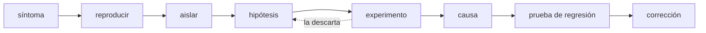
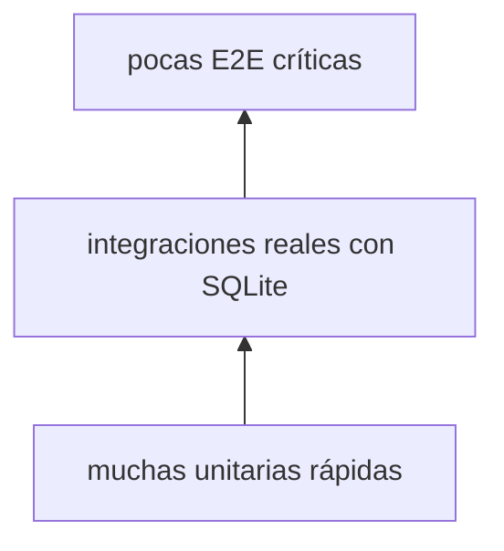
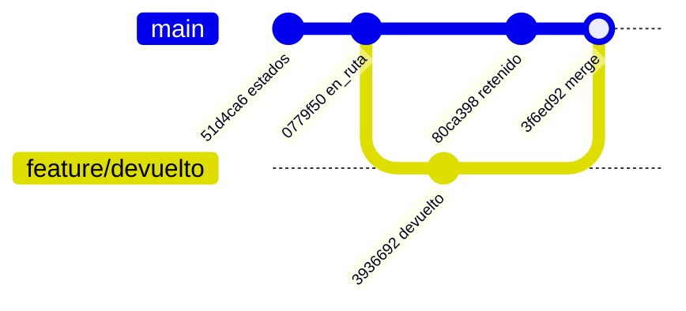
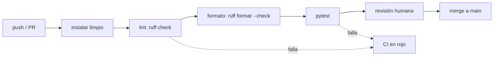

# Módulo 4: Testing, depuración, Git y CI

**Entorno comprobado para esta edición (2026-11-24):** Python 3.13.18 en Linux x86_64, pytest 9.2.0 con pytest-cov 7.1.0, Ruff 0.17.6 y Git 2.43.0. La línea de referencia del curso es Python 3.14 (`docs/VERSIONES.md`); estos ejemplos no usan nada exclusivo de esa versión. Todas las transcripciones son literales de esa ejecución, en la carpeta de práctica `/home/estudiante/labs` (tu `~/labs`). Los commits se hicieron con autor y fecha fijos para que los hashes sean reproducibles: si repites los pasos, tus hashes y fechas serán distintos. El workflow de GitHub Actions del Tema 4 no se ejecutó en GitHub: se validó su YAML y sus órdenes se ejecutaron en un clon limpio local.

Al terminar este módulo podrás:
- reproducir y corregir un defecto con una prueba de regresión;
- construir una suite `pytest` con pruebas unitarias y de integración sobre SQLite;
- resolver un conflicto de merge explicando la intención de ambos cambios;
- configurar CI para ejecutar formato, análisis y pruebas en cada pull request.

**Qué necesitas saber antes:** casos de prueba, `assert` y excepciones (Módulo 1, Tema 1); funciones (Módulo 1, Tema 4); SQLite desde Python (Módulo 4).


## Aprende construyendo


### Tema 1: Depurar con evidencia, no con cambios aleatorios · Intermedio · 50 min

<details open>
<summary><strong>Capa 1 — Lectura</strong></summary>

#### Objetivos
Al terminar este tema podrás:
- reproducir un defecto con el caso más pequeño posible y escribir tu hipótesis antes de tocar el código;
- leer un traceback de abajo hacia arriba y ubicar la línea que falló y la que la llamó;
- detener un programa con el depurador `pdb` en un punto de interrupción e inspeccionar sus variables;
- dejar evidencia con `logging` y cerrar cada corrección con una prueba de regresión.

**Conceptos clave:** defecto, síntoma, reproducción, hipótesis, traceback, depurador, punto de interrupción, registro, prueba de regresión

#### El problema
La coordinadora de RutaFlow abre el reporte de la mañana y ve los envíos **entregados** en la lista de pendientes.
Alguien propone «cambiar cosas hasta que salga bien». Ese camino arregla por casualidad o rompe otra parte. ¿Cómo
encuentras la causa real con evidencia y cómo te aseguras de que el error no vuelva?

Este tema usa lo que ya conoces: **caso de prueba**, **caso límite**, **excepción** y **assert** tienen su ficha en
el Módulo 1, Tema 1. Aquí no se redefinen.

#### Glosario del tema

**defecto y síntoma**
- **Definición técnica:** un defecto (*bug*) es la instrucción incorrecta en el código; el síntoma es el comportamiento observable que produce al ejecutarse.
- **En palabras sencillas:** el síntoma es la fiebre; el defecto es la infección que la causa.
- **Dónde se rompe la comparación:** un mismo defecto puede dar síntomas distintos según los datos, y algunos defectos no dan ningún síntoma hasta mucho después.
- **Ejemplo:** síntoma: el reporte muestra `obtenido: ['RF-102']`; defecto: la línea 3 de `envios.py` compara con `"entregado"`.
- **Error típico:** «arreglar» el síntoma (filtrar la salida a mano) y dejar el defecto vivo en el código.

**reproducción**
- **Definición técnica:** conjunto mínimo de pasos y datos que provoca el síntoma de forma repetible.
- **En palabras sencillas:** la receta para hacer que el error aparezca siempre, a voluntad.
- **Dónde se rompe la comparación:** algunos errores dependen del tiempo o del orden de ejecución y no salen en cada intento; ahí la receta incluye esas condiciones.
- **Ejemplo:** `python3 reproducir.py` con dos envíos muestra `esperado: ['RF-101']` y `obtenido: ['RF-102']`.
- **Error típico:** intentar depurar con la base de datos completa de producción en vez de reducir el caso a dos o tres datos.

**hipótesis**
- **Definición técnica:** explicación concreta y comprobable de la causa del síntoma, escrita antes de cambiar el código.
- **En palabras sencillas:** tu sospecha en una línea, lo bastante precisa para poder demostrar que es falsa.
- **Dónde se rompe la comparación:** a diferencia de una corazonada, una hipótesis dice qué experimento la confirma o la descarta.
- **Ejemplo:** «el filtro compara con el estado equivocado; si imprimo los estados, veré `'pendiente'` y aun así no saldrá».
- **Error típico:** escribir una hipótesis vaga («algo falla en el filtro») que ningún experimento puede descartar.

**traceback**
- **Definición técnica:** informe que Python imprime cuando una excepción termina el programa; lista las llamadas activas, de la más externa a la más interna, y termina con el tipo y el mensaje de la excepción.
- **En palabras sencillas:** el rastro de migas que dice por qué funciones pasó el programa hasta caerse.
- **Dónde se rompe la comparación:** se lee al revés: la causa inmediata está en la **última** línea, no en la primera.
- **Ejemplo:** el traceback de `bodega.py` termina en `ValueError: Stock insuficiente`, lanzado en la línea 10.
- **Error típico:** leer solo la primera línea (`Traceback (most recent call last):`) y no bajar hasta el mensaje.

**depurador**
- **Definición técnica:** programa que ejecuta otro paso a paso y permite pausarlo, inspeccionar variables y avanzar; el de Python es `pdb` y se abre con `python3 -m pdb archivo.py`.
- **En palabras sencillas:** un control remoto con pausa y lupa para mirar el programa por dentro mientras corre.
- **Dónde se rompe la comparación:** el depurador no adivina la causa; solo te deja mirar. Sin hipótesis, solo das pasos sin rumbo.
- **Ejemplo:** `python3 -m pdb bodega.py` se detiene antes de la primera instrucción y muestra `-> import logging`.
- **Error típico:** confundir `next` (ejecuta la línea sin entrar en funciones) con `step` (entra en la función llamada).

**punto de interrupción**
- **Definición técnica:** marca que hace que el depurador pause la ejecución al llegar a una línea o función; en `pdb` se crea con `break` y en el código con la función integrada `breakpoint()`.
- **En palabras sencillas:** un «alto» pintado en el camino: el programa corre normal hasta ahí y se detiene.
- **Dónde se rompe la comparación:** si la marca está en una función que se llama varias veces, el programa se detiene en **cada** llamada.
- **Ejemplo:** `break retirar` responde `Breakpoint 1 at /home/estudiante/labs/depuracion/bodega.py:9`.
- **Error típico:** dejar un `breakpoint()` en el código entregado: el programa se queda esperando órdenes en producción.

**registro**
- **Definición técnica:** mensajes con nivel (`DEBUG`, `INFO`, `WARNING`, `ERROR`) que un programa escribe mientras corre; en Python los produce el módulo estándar `logging`.
- **En palabras sencillas:** la bitácora del programa: deja anotado qué hizo y con qué datos, aunque nadie esté mirando.
- **Dónde se rompe la comparación:** una bitácora se lee completa; un registro se filtra por nivel, y por defecto `logging` oculta `DEBUG` e `INFO`.
- **Ejemplo:** `logging.warning("stock bajo en A-1")` escribe `WARNING:root:stock bajo en A-1`.
- **Error típico:** usar `print` para depurar y olvidarlo en el código; un registro se apaga cambiando el nivel, sin borrar líneas.

**prueba de regresión**
- **Definición técnica:** caso de prueba que reproduce un defecto ya encontrado; falla mientras el defecto existe y pasa cuando se corrige, y se conserva para siempre.
- **En palabras sencillas:** una alarma instalada justo donde ya entró el ladrón, por si vuelve.
- **Dónde se rompe la comparación:** no protege contra defectos nuevos, solo contra el regreso de uno conocido.
- **Ejemplo:** `prueba_regresion.py` falla con `AssertionError: se esperaba ['RF-101'] y llegó ['RF-102']` antes de la corrección.
- **Error típico:** escribir la prueba **después** de corregir; entonces nunca la viste fallar y no sabes si detecta el defecto.

#### ► CÓMO FUNCIONA
Depurar es un experimento, no una búsqueda a ciegas. Partes de un **síntoma**, lo **reproduces** con pocos datos y
aíslas la parte del código que lo produce. Luego escribes una **hipótesis**, diseñas un **experimento** que la pueda
descartar y solo entonces conoces la **causa**. Antes de corregir, escribes la **prueba de regresión** y la ves fallar.

| Herramienta | Qué es | Qué haces con ella |
|---|---|---|
| Traceback | Informe de la excepción | Lo lees de abajo hacia arriba para hallar la línea que falló |
| `print` / `repr` | Salida temporal | Muestras un valor exacto en un punto, con comillas y espacios visibles |
| `pdb` | Depurador de Python | Pausas, inspeccionas variables y subes a la función que llamó |
| `logging` | Registro con niveles | Dejas evidencia permanente con datos, sin depender de mirar la pantalla |



#### Problema resuelto 1.1
El reporte de pendientes de RutaFlow muestra envíos entregados. Encuentra la causa con evidencia, escribe una prueba
de regresión que falle y corrige el defecto.

**Razonamiento:**
1. Reproducir: armar la ruta más pequeña que muestra el síntoma, un pendiente y un entregado.
2. Hipótesis en una línea, antes de abrir el editor: «el filtro compara con el estado equivocado».
3. Experimento: imprimir cada estado con `repr` para ver el texto exacto, comillas incluidas.
4. Prueba de regresión primero; corrección después; la misma prueba debe pasar.

Este es el código con el defecto:

```python
# envios.py — filtra los envíos pendientes de una ruta (versión con defecto)
def listar_pendientes(envios):
    return [envio for envio in envios if envio["estado"] == "entregado"]
```

```python
# reproducir.py — reproduce el defecto con el caso más pequeño posible
from envios import listar_pendientes

ruta = [
    {"guia": "RF-101", "estado": "pendiente"},
    {"guia": "RF-102", "estado": "entregado"},
]
for envio in ruta:
    print("revisando", envio["guia"], "estado:", repr(envio["estado"]))
resultado = listar_pendientes(ruta)
print("esperado: ['RF-101']")
print("obtenido:", [envio["guia"] for envio in resultado])
```

```text
$ python3 reproducir.py
revisando RF-101 estado: 'pendiente'
revisando RF-102 estado: 'entregado'
esperado: ['RF-101']
obtenido: ['RF-102']
```

El experimento descarta otra sospecha común: los datos están bien escritos (`'pendiente'`, sin mayúsculas ni
espacios). La hipótesis queda confirmada: el filtro deja pasar justo el estado contrario. Ahora la prueba de regresión:

```python
# prueba_regresion.py — falla mientras el defecto exista
from envios import listar_pendientes

ruta = [
    {"guia": "RF-101", "estado": "pendiente"},
    {"guia": "RF-102", "estado": "entregado"},
]
guias = [envio["guia"] for envio in listar_pendientes(ruta)]
assert guias == ["RF-101"], f"se esperaba ['RF-101'] y llegó {guias}"
print("regresión cubierta: solo se listan pendientes")
```

```text
$ python3 prueba_regresion.py
Traceback (most recent call last):
  File "/home/estudiante/labs/depuracion/prueba_regresion.py", line 9, in <module>
    assert guias == ["RF-101"], f"se esperaba ['RF-101'] y llegó {guias}"
           ^^^^^^^^^^^^^^^^^^^
AssertionError: se esperaba ['RF-101'] y llegó ['RF-102']
```

La corrección cambia una sola palabra en la línea 3 de `envios.py`:

```python
# envios.py — filtra los envíos pendientes de una ruta
def listar_pendientes(envios):
    return [envio for envio in envios if envio["estado"] == "pendiente"]
```

```text
$ python3 prueba_regresion.py
regresión cubierta: solo se listan pendientes
```

**Explicación por partes.**
- `envios.py`, línea 3: la comprensión de lista conserva los envíos cuya condición es verdadera; con `"entregado"` conserva los equivocados.
- `reproducir.py`, líneas 4–7: dos envíos bastan; con uno de cada estado, el síntoma se ve a simple vista.
- `reproducir.py`, línea 9: `repr` muestra el texto con comillas, así verías un espacio sobrante como `'pendiente '`.
- `prueba_regresion.py`, línea 9: el `assert` lleva un mensaje que dice qué se esperaba y qué llegó.
- La prueba se vio fallar antes de corregir y pasar después: eso demuestra que detecta este defecto.

> **Error común.** Cambiar varias cosas a la vez «a ver si funciona». Si después del tercer cambio el síntoma
> desaparece, no sabes cuál lo arregló ni si otro rompió algo. Cambia una cosa, ejecuta la reproducción y anota el resultado.

> **Buena práctica.** Escribe la hipótesis en una línea antes de tocar el código, por ejemplo en el ticket. Si el
> experimento la descarta, escribe la siguiente; el registro de hipótesis descartadas también ahorra tiempo al equipo.

#### Problema resuelto 1.2
La bodega de RutaFlow despacha pedidos y descuenta cajas del stock. Un pedido de 8 cajas detiene el programa. Ubica
dónde nace el error con el traceback, inspecciona los valores con `pdb` y deja registro de cada retirada.

**Razonamiento:**
1. El traceback se lee de abajo hacia arriba: primero el mensaje, luego la línea que lo lanzó y después quién la llamó.
2. Un punto de interrupción en `retirar` pausa el programa justo antes de la comparación que falla.
3. `logging` deja una línea por retirada con el SKU y la cantidad: así queda evidencia aunque nadie esté mirando.

```python
# bodega.py — despacha pedidos descontando cajas del stock
import logging

logging.basicConfig(level=logging.INFO, format="%(levelname)s %(message)s sku=%(sku)s cantidad=%(cantidad)s")
logger = logging.getLogger(__name__)


def retirar(stock, cantidad):
    if cantidad > stock:
        raise ValueError("Stock insuficiente")
    return stock - cantidad


def despachar(pedido, stock):
    logger.info("retirada_solicitada", extra={"sku": pedido["sku"], "cantidad": pedido["cantidad"]})
    return retirar(stock, pedido["cantidad"])


print("quedan:", despachar({"sku": "A-1", "cantidad": 3}, stock=5))
print("quedan:", despachar({"sku": "A-1", "cantidad": 8}, stock=5))
```

```text
$ python3 bodega.py
INFO retirada_solicitada sku=A-1 cantidad=3
quedan: 2
INFO retirada_solicitada sku=A-1 cantidad=8
Traceback (most recent call last):
  File "/home/estudiante/labs/depuracion/bodega.py", line 20, in <module>
    print("quedan:", despachar({"sku": "A-1", "cantidad": 8}, stock=5))
                     ~~~~~~~~~^^^^^^^^^^^^^^^^^^^^^^^^^^^^^^^^^^^^^^^^
  File "/home/estudiante/labs/depuracion/bodega.py", line 16, in despachar
    return retirar(stock, pedido["cantidad"])
  File "/home/estudiante/labs/depuracion/bodega.py", line 10, in retirar
    raise ValueError("Stock insuficiente")
ValueError: Stock insuficiente
```

Léelo de abajo hacia arriba. El mensaje es `Stock insuficiente` y lo lanzó la línea 10, dentro de `retirar`. A
`retirar` la llamó la línea 16 de `despachar`, y a `despachar`, la línea 20. Ahora confirma los valores con `pdb`:

```text
$ python3 -m pdb bodega.py
> /home/estudiante/labs/depuracion/bodega.py(2)<module>()
-> import logging
(Pdb) break retirar
Breakpoint 1 at /home/estudiante/labs/depuracion/bodega.py:9
(Pdb) continue
INFO retirada_solicitada sku=A-1 cantidad=3
> /home/estudiante/labs/depuracion/bodega.py(9)retirar()
-> if cantidad > stock:
(Pdb) continue
quedan: 2
INFO retirada_solicitada sku=A-1 cantidad=8
> /home/estudiante/labs/depuracion/bodega.py(9)retirar()
-> if cantidad > stock:
(Pdb) p stock, cantidad
(5, 8)
(Pdb) up
> /home/estudiante/labs/depuracion/bodega.py(16)despachar()
-> return retirar(stock, pedido["cantidad"])
(Pdb) p pedido
{'sku': 'A-1', 'cantidad': 8}
(Pdb) quit
```

**Explicación por partes.**
- `bodega.py`, línea 4: `basicConfig` fija el nivel mínimo (`INFO`) y el formato; `%(sku)s` y `%(cantidad)s` salen de `extra`.
- Líneas 8–11: `retirar` rechaza con una excepción (Módulo 1, Tema 1) cuando la cantidad supera el stock.
- Línea 15: cada despacho deja una línea `INFO` con los datos; por eso el registro muestra `cantidad=8` antes del traceback.
- Sesión de `pdb`: `break retirar` crea el punto de interrupción en la primera línea de la función (la 9).
- El primer `continue` se detiene en el pedido de 3 cajas; el segundo, en el de 8. Una pausa por cada llamada.
- `p stock, cantidad` imprime `(5, 8)`: se piden 8 cajas con 5 en stock. `up` sube a `despachar` y `p pedido` muestra de dónde salió el 8.
- Conclusión: el código hace lo correcto; el defecto está en el pedido. La corrección es validar antes de despachar, no tocar `retirar`.

> **Error común.** Llamar al registro sin `extra` cuando el formato pide `%(sku)s`. Con
> `logging.getLogger(__name__).info("inicio_turno")` el programa sigue, pero el mensaje se pierde y aparece
> `--- Logging error ---` seguido de `ValueError: Formatting field not found in record: 'sku'`. Cada llamada debe
> traer todos los campos que el formato nombra.

> **Prevenir errores.** Antes de abrir el depurador, decide qué variable quieres ver y en qué línea. Un punto de
> interrupción con pregunta («¿cuánto vale `cantidad` aquí?») se resuelve en un minuto; sin pregunta, en una tarde.

#### Checkpoint 1.1
En el traceback de `bodega.py`, ¿qué línea lanzó la excepción y qué línea de tu código empezó la cadena de llamadas?

Respuesta: la lanzó la línea 10 (`raise ValueError("Stock insuficiente")`, dentro de `retirar`). La cadena empezó en
la línea 20, la segunda llamada a `despachar`. El traceback las lista de la más externa (20) a la más interna (10).

</details>

<details>
<summary><strong>Capa 2 — Construcción</strong></summary>

#### Paso 1 · Prepara la carpeta
Crea `~/labs/depuracion` y entra con `cd ~/labs/depuracion`. Escribe `envios.py` con el defecto y `reproducir.py`.

#### Paso 2 · Reproduce y escribe la hipótesis
Ejecuta `python3 reproducir.py` y confirma que la salida dice `obtenido: ['RF-102']`. Escribe tu hipótesis en un
archivo `hipotesis.txt`, en una línea, antes de abrir `envios.py`.

#### Paso 3 · Mira fallar la prueba de regresión
Escribe `prueba_regresion.py` y ejecútalo. Debe terminar con `AssertionError: se esperaba ['RF-101'] y llegó ['RF-102']`.
Corrige la línea 3 de `envios.py` y ejecútalo de nuevo: debe mostrar `regresión cubierta: solo se listan pendientes`.

#### Paso 4 · Traceback, pdb y registro
Escribe `bodega.py`, ejecútalo y señala en el traceback las líneas 10, 16 y 20. Luego repite la sesión de
`python3 -m pdb bodega.py` del Problema resuelto 1.2, escribiendo tú cada orden después del `(Pdb)`.

#### Resumen
- El **síntoma** es lo que ves; el **defecto** es la instrucción que lo causa. Se corrige el defecto, no el síntoma.
- Una **reproducción** mínima hace que el error aparezca siempre y con pocos datos.
- La **hipótesis** se escribe antes de cambiar el código y se pone a prueba con un experimento que pueda descartarla.
- El **traceback** se lee de abajo hacia arriba: mensaje, línea que lanzó y cadena de llamadas.
- El **depurador** `pdb` pausa en un **punto de interrupción** (`break`, `breakpoint()`) y deja inspeccionar con `p` y `up`.
- El **registro** con `logging` deja evidencia con nivel y datos; cada campo del formato debe llegar en `extra`.
- Toda corrección se cierra con una **prueba de regresión** que se vio fallar antes de corregir.

#### Ejercicio verificable 1
Básico. En `bodega.py`, cambia la línea 20 para pedir 5 cajas en vez de 8. Antes de ejecutar, predice la salida.

Respuesta esperada: no hay traceback. La salida es `INFO … cantidad=3`, `quedan: 2`, `INFO … cantidad=5` y `quedan: 0`,
porque `5 > 5` es falso y `retirar` devuelve `5 - 5`.

#### Ejercicio verificable 2
Intermedio. Una compañera reporta que `contar_pendientes([{"estado": "Pendiente"}])` devuelve `0`, con la función de
`inventario.py` del Tema 2. Escribe la reproducción, la hipótesis y la prueba de regresión.

Respuesta esperada: reproducción: esa misma llamada imprime `0`. Hipótesis: «el estado llega con mayúscula y la
comparación distingue mayúsculas». Experimento: `print(repr(envio["estado"]))` muestra `'Pendiente'`. Prueba:
`assert contar_pendientes([{"estado": "Pendiente"}]) == 1`, que falla hasta normalizar con `.lower()`.

#### Ejercicio verificable 3
Reto. Modifica `despachar` para que registre un `WARNING` llamado `retirada_rechazada`, con SKU y cantidad, cuando
`retirar` lance `ValueError`, y deje pasar la excepción igual.

Respuesta esperada: guardar los datos en `datos = {"sku": …, "cantidad": …}`, envolver la llamada en `try`, y en
`except ValueError:` hacer `logger.warning("retirada_rechazada", extra=datos)` seguido de `raise`. Con un pedido de 8
cajas la salida empieza con `INFO retirada_solicitada sku=A-1 cantidad=8`, sigue con
`WARNING retirada_rechazada sku=A-1 cantidad=8` y termina con `ValueError: Stock insuficiente`.

#### En el trabajo
En una empresa, un reporte de error llega como ticket y casi nunca trae la causa. Lo primero que pide un equipo
serio es la reproducción; lo último, la prueba de regresión dentro del cambio que corrige. En producción no hay
depurador: solo quedan los registros. Por eso se escriben con nivel y con los datos del caso (SKU, cantidad, guía),
nunca con contraseñas ni datos personales.

</details>

### Tema 2: Pruebas con propósito y niveles adecuados · Intermedio · 60 min

<details open>
<summary><strong>Capa 1 — Lectura</strong></summary>

#### Objetivos
Al terminar este tema podrás:
- escribir y ejecutar pruebas unitarias con `pytest`, incluida la comprobación de excepciones con `pytest.raises`;
- preparar una base SQLite de prueba con una fixture y escribir una prueba de integración real;
- demostrar por qué un doble de prueba puede seguir en verde con la consulta SQL rota;
- medir la cobertura y explicar por qué un porcentaje alto no garantiza pruebas valiosas.

**Conceptos clave:** prueba unitaria, prueba de integración, prueba de extremo a extremo, pirámide de pruebas, pytest, fixture, doble de prueba, cobertura

#### El problema
En el Tema 1 escribiste una prueba de regresión con `assert` en un archivo suelto. RutaFlow ya tiene decenas de
reglas: retirar cajas, contar pendientes, consultar SQLite. Ejecutar un archivo por regla no escala, y un `assert`
que falla detiene todo en la primera falla. ¿Cómo ejecutas cientos de pruebas con una orden, y qué conviene probar
con base de datos real y qué sin ella?

Este tema usa **caso de prueba**, **caso límite**, **excepción** y **assert** (Módulo 1, Tema 1), la **prueba de
regresión** (Tema 1 de este módulo) y SQLite (Módulo 4).

#### Glosario del tema

**prueba unitaria**
- **Definición técnica:** prueba automática de una unidad pequeña de código, normalmente una función, aislada de bases de datos, red y archivos.
- **En palabras sencillas:** revisar una pieza sola en el banco de trabajo, antes de montarla en la máquina.
- **Dónde se rompe la comparación:** una pieza que funciona sola puede fallar al conectarse con otras; la unitaria no ve esas uniones.
- **Ejemplo:** `test_retirar_descuenta_stock` comprueba que `retirar(stock=5, cantidad=2)` devuelve `3` y `pytest` la marca `PASSED`.
- **Error típico:** llamar «unitaria» a una prueba que abre la base de datos real; se vuelve lenta y falla por motivos ajenos a la función.

**prueba de integración**
- **Definición técnica:** prueba que ejecuta varias piezas juntas a través de una frontera real, como el código más una base SQLite verdadera.
- **En palabras sencillas:** montar dos piezas y comprobar que encajan de verdad, no en el plano.
- **Dónde se rompe la comparación:** se usa una base pequeña y desechable, no la de producción; encaja con la real solo si el esquema es el mismo.
- **Ejemplo:** `test_cuenta_pendientes_en_sqlite` ejecuta el `SELECT` real y espera `2`.
- **Error típico:** compartir la misma base entre pruebas: una deja datos y la siguiente falla o pasa según el orden.

**prueba de extremo a extremo**
- **Definición técnica:** prueba que ejecuta el programa completo como lo usaría una persona, desde la entrada (comando, archivo) hasta la salida visible; se abrevia E2E.
- **En palabras sencillas:** probar el carro manejándolo, no revisando el motor por separado.
- **Dónde se rompe la comparación:** cuando falla, no dice qué pieza se rompió; solo que el recorrido completo no llegó.
- **Ejemplo:** `test_reporte_muestra_pendientes` corre `python reporte.py envios.db` y espera la salida `pendientes: 1`.
- **Error típico:** probarlo todo con E2E: la suite se vuelve lenta y cada falla obliga a depurar desde cero.

**pirámide de pruebas**
- **Definición técnica:** guía de proporciones: muchas pruebas unitarias rápidas en la base, menos de integración en el medio y pocas E2E críticas arriba.
- **En palabras sencillas:** muchas revisiones baratas, algunas medianas y pocas caras.
- **Dónde se rompe la comparación:** no es una regla con números fijos; un programa que casi solo consulta SQL necesita más integración.
- **Ejemplo:** la suite de este tema tiene 5 unitarias, 2 de integración y 1 E2E.
- **Error típico:** invertir la pirámide: pocas unitarias y muchas E2E lentas y frágiles.

**pytest**
- **Definición técnica:** herramienta de Python que encuentra archivos `test_*.py`, ejecuta las funciones `test_*` y reporta cada `assert` fallido con los valores comparados; `pytest.raises` comprueba que se lance una excepción.
- **En palabras sencillas:** un revisor automático que corre todas tus pruebas con una orden y te dice cuáles fallaron y por qué.
- **Dónde se rompe la comparación:** solo encuentra lo que sigue sus nombres: un archivo `prueba_inventario.py` no se ejecuta.
- **Ejemplo:** `python -m pytest -q` termina con `8 passed in 0.04s`.
- **Error típico:** ejecutar `pytest` en vez de `python -m pytest` con el código en la raíz: falla con `ModuleNotFoundError: No module named 'inventario'`.

**fixture**
- **Definición técnica:** función marcada con `@pytest.fixture` que prepara un recurso para una prueba y, tras su `yield`, lo limpia; la prueba la recibe nombrándola como parámetro.
- **En palabras sencillas:** la persona que arma la mesa antes de cada prueba y la recoge al terminar.
- **Dónde se rompe la comparación:** no se llama a mano; `pytest` la ejecuta por su nombre, otra vez para cada prueba que la pide.
- **Ejemplo:** la fixture `conexion` crea una base SQLite en memoria con tres envíos; `tmp_path` es una fixture incluida que da una carpeta temporal.
- **Error típico:** escribir mal el nombre del parámetro: `pytest` responde `fixture 'conexion' not found` y la prueba ni empieza.

**doble de prueba**
- **Definición técnica:** objeto que reemplaza una dependencia real (base, red, reloj) durante una prueba e imita solo la parte que el código usa; un *fake* es un doble con respuestas fijas.
- **En palabras sencillas:** el doble de riesgo del cine: se parece al actor en la escena, pero no es él.
- **Dónde se rompe la comparación:** el doble no ejecuta el SQL; si la consulta está rota, el doble sigue respondiendo como si nada.
- **Ejemplo:** `ConexionFalsa` devuelve siempre `(2,)` y `test_cuenta_pendientes_con_doble` pasa.
- **Error típico:** probar con dobles lo que solo una frontera real puede comprobar, como una consulta SQL.

**cobertura**
- **Definición técnica:** porcentaje de líneas del código que se ejecutaron durante las pruebas; en Python se mide con `coverage` o con el complemento `pytest-cov`.
- **En palabras sencillas:** un mapa de qué partes del código visitaron las pruebas.
- **Dónde se rompe la comparación:** visitar una línea no es comprobarla: una prueba sin `assert` sube la cobertura y no detecta nada.
- **Ejemplo:** con solo las pruebas unitarias, `inventario.py` queda en `82%` y faltan las líneas `15-16`.
- **Error típico:** perseguir el 100 % con pruebas sin comprobaciones, en vez de probar los casos que importan.

#### ► CÓMO FUNCIONA
`pytest` recorre la carpeta `tests/`, importa cada archivo `test_*.py` y ejecuta cada función `test_*` por separado.
Si una función pide un parámetro, busca la fixture con ese nombre, la ejecuta y le pasa el resultado. Un `assert` que
falla marca **esa** prueba como fallida y sigue con las demás.

| Nivel | Qué prueba | Velocidad | En este tema |
|---|---|---|---|
| Unitaria | Una función sola, sin base de datos | Milisegundos | `retirar`, `contar_pendientes` |
| Integración | Código + SQLite real | Algo más lenta | `contar_pendientes_bd` con la fixture `conexion` |
| E2E | El programa completo por la terminal | La más lenta | `reporte.py` con una base en `tmp_path` |



#### Problema resuelto 2.1
La bodega de RutaFlow necesita que `retirar` descuente cajas, rechace cantidades no positivas y rechace pedidos sin
stock. Escribe las pruebas unitarias con `pytest` y ejecútalas en un entorno virtual.

**Razonamiento:**
1. Cada regla es un caso de prueba: un camino feliz y dos excepciones. La lista vacía es el caso límite de `contar_pendientes`.
2. Las excepciones se comprueban con `pytest.raises` y un trozo del mensaje (`match`), no con `try` a mano.
3. Las pruebas van en `tests/` y el código en la raíz; por eso se ejecutan con `python -m pytest`.

```python
# inventario.py — reglas de la bodega y conteo de envíos de RutaFlow
def retirar(stock, cantidad):
    if cantidad <= 0:
        raise ValueError("La cantidad debe ser positiva")
    if cantidad > stock:
        raise ValueError("Stock insuficiente")
    return stock - cantidad


def contar_pendientes(envios):
    return len([envio for envio in envios if envio["estado"] == "pendiente"])


def contar_pendientes_bd(conexion):
    cursor = conexion.execute("SELECT COUNT(*) FROM envios WHERE estado = 'pendiente'")
    return cursor.fetchone()[0]
```

```python
# tests/test_inventario.py — pruebas unitarias: sin base de datos ni archivos
import pytest

from inventario import contar_pendientes, retirar


def test_retirar_descuenta_stock():
    resultado = retirar(stock=5, cantidad=2)
    assert resultado == 3


def test_retirar_rechaza_cantidad_negativa():
    with pytest.raises(ValueError, match="positiva"):
        retirar(stock=5, cantidad=-2)


def test_retirar_rechaza_si_no_alcanza():
    with pytest.raises(ValueError, match="insuficiente"):
        retirar(stock=5, cantidad=8)


def test_contar_pendientes_ruta_vacia():
    assert contar_pendientes([]) == 0
```

```text
$ python3 -m venv .venv
$ source .venv/bin/activate
$ python -m pip install -q pytest pytest-cov
$ python -m pytest -v tests/test_inventario.py
============================= test session starts ==============================
platform linux -- Python 3.13.18, pytest-9.2.0, pluggy-1.7.0 -- /home/estudiante/labs/pruebas/.venv/bin/python
cachedir: .pytest_cache
rootdir: /home/estudiante/labs/pruebas
plugins: cov-7.1.0
collecting ... collected 4 items

tests/test_inventario.py::test_retirar_descuenta_stock PASSED            [ 25%]
tests/test_inventario.py::test_retirar_rechaza_cantidad_negativa PASSED  [ 50%]
tests/test_inventario.py::test_retirar_rechaza_si_no_alcanza PASSED      [ 75%]
tests/test_inventario.py::test_contar_pendientes_ruta_vacia PASSED       [100%]

============================== 4 passed in 0.02s ===============================
```

Para ver cómo reporta una falla, cambia temporalmente la línea 9 de la prueba a `assert resultado == 7`:

```text
$ python -m pytest -q tests/test_inventario.py
F...                                                                     [100%]
=================================== FAILURES ===================================
_________________________ test_retirar_descuenta_stock _________________________

    def test_retirar_descuenta_stock():
        resultado = retirar(stock=5, cantidad=2)
>       assert resultado == 7
E       assert 3 == 7

tests/test_inventario.py:9: AssertionError
=========================== short test summary info ============================
FAILED tests/test_inventario.py::test_retirar_descuenta_stock - assert 3 == 7
1 failed, 3 passed in 0.01s
```

**Explicación por partes.**
- `inventario.py`, líneas 3–6: dos cláusulas de guarda (Módulo 1, Tema 3) con mensajes distintos; las pruebas los distinguen con `match`.
- `test_inventario.py`, línea 4: la prueba importa el código igual que cualquier otro programa.
- Líneas 7–9: patrón de tres pasos: preparar, ejecutar (`retirar`) y comprobar (`assert`).
- Líneas 12–14: `pytest.raises` pasa solo si el bloque lanza `ValueError` y el mensaje contiene `positiva`.
- En la falla, `E       assert 3 == 7` muestra el valor real (3) y el esperado (7) sin que escribas un mensaje.
- `F...`: una letra por prueba. `F` es falla y `.` es éxito; las otras tres siguieron ejecutándose.

> **Error común.** Nombrar el archivo `tests/prueba_inventario.py`. `pytest` solo busca `test_*.py` o `*_test.py`,
> así que responde `no tests ran in 0.00s` y termina con código 5. No hay error de Python: simplemente no encontró nada.

> **Error común.** Ejecutar `pytest -q` en lugar de `python -m pytest -q` cuando el código está en la raíz y las pruebas
> en `tests/`. Falla al recoger con `E   ModuleNotFoundError: No module named 'inventario'`. `python -m` agrega la carpeta
> actual a la ruta de importación.

> **Buena práctica.** Nombra cada prueba como una frase: `test_retirar_rechaza_si_no_alcanza`. Cuando falle en CI,
> el nombre ya cuenta qué regla se rompió, antes de leer el código.

#### Problema resuelto 2.2
`contar_pendientes_bd` consulta SQLite. Escribe una prueba con un doble, una de integración con una fixture y una
E2E. Luego rompe la consulta y observa qué pruebas lo detectan.

**Razonamiento:**
1. El doble imita `execute` y `fetchone`, pero no entiende SQL: sirve para ver si detecta una consulta rota.
2. La fixture crea una base en memoria (`:memory:`), nueva para cada prueba, y la cierra al final.
3. La E2E crea un archivo de base en `tmp_path` y ejecuta `reporte.py` con `subprocess`, como en la terminal.

```python
# reporte.py — muestra cuántos envíos pendientes hay en una base SQLite
import sqlite3
import sys

from inventario import contar_pendientes_bd

conexion = sqlite3.connect(sys.argv[1])
print("pendientes:", contar_pendientes_bd(conexion))
conexion.close()
```

```python
# tests/test_doble.py — prueba unitaria con un doble de la conexión
from inventario import contar_pendientes_bd


class CursorFalso:
    def fetchone(self):
        return (2,)


class ConexionFalsa:
    def execute(self, sql):
        return CursorFalso()


def test_cuenta_pendientes_con_doble():
    assert contar_pendientes_bd(ConexionFalsa()) == 2
```

```python
# tests/test_integracion.py — la consulta SQL real contra SQLite
import sqlite3

import pytest

from inventario import contar_pendientes_bd


@pytest.fixture
def conexion():
    conexion = sqlite3.connect(":memory:")
    conexion.execute("CREATE TABLE envios (guia TEXT PRIMARY KEY, estado TEXT NOT NULL)")
    conexion.executemany(
        "INSERT INTO envios VALUES (?, ?)",
        [("RF-101", "pendiente"), ("RF-102", "entregado"), ("RF-103", "pendiente")],
    )
    yield conexion
    conexion.close()


def test_cuenta_pendientes_en_sqlite(conexion):
    assert contar_pendientes_bd(conexion) == 2


def test_tabla_vacia_da_cero(conexion):
    conexion.execute("DELETE FROM envios")
    assert contar_pendientes_bd(conexion) == 0
```

```python
# tests/test_e2e.py — ejecuta el programa completo como lo haría una persona
import sqlite3
import subprocess
import sys


def test_reporte_muestra_pendientes(tmp_path):
    ruta_bd = tmp_path / "envios.db"
    conexion = sqlite3.connect(ruta_bd)
    conexion.execute("CREATE TABLE envios (guia TEXT PRIMARY KEY, estado TEXT NOT NULL)")
    conexion.execute("INSERT INTO envios VALUES ('RF-101', 'pendiente')")
    conexion.commit()
    conexion.close()

    resultado = subprocess.run(
        [sys.executable, "reporte.py", str(ruta_bd)], capture_output=True, text=True, check=True
    )
    assert resultado.stdout == "pendientes: 1\n"
```

```text
$ python -m pytest -v
============================= test session starts ==============================
platform linux -- Python 3.13.18, pytest-9.2.0, pluggy-1.7.0 -- /home/estudiante/labs/pruebas/.venv/bin/python
cachedir: .pytest_cache
rootdir: /home/estudiante/labs/pruebas
plugins: cov-7.1.0
collecting ... collected 8 items

tests/test_doble.py::test_cuenta_pendientes_con_doble PASSED             [ 12%]
tests/test_e2e.py::test_reporte_muestra_pendientes PASSED                [ 25%]
tests/test_integracion.py::test_cuenta_pendientes_en_sqlite PASSED       [ 37%]
tests/test_integracion.py::test_tabla_vacia_da_cero PASSED               [ 50%]
tests/test_inventario.py::test_retirar_descuenta_stock PASSED            [ 62%]
tests/test_inventario.py::test_retirar_rechaza_cantidad_negativa PASSED  [ 75%]
tests/test_inventario.py::test_retirar_rechaza_si_no_alcanza PASSED      [ 87%]
tests/test_inventario.py::test_contar_pendientes_ruta_vacia PASSED       [100%]

============================== 8 passed in 0.06s ===============================
```

Ahora rompe la consulta: en la línea 15 de `inventario.py` escribe `'pendientes'` (con «s») en vez de `'pendiente'`.

```text
$ python -m pytest -q --tb=short
.FF.....                                                                 [100%]
=================================== FAILURES ===================================
_______________________ test_reporte_muestra_pendientes ________________________
tests/test_e2e.py:18: in test_reporte_muestra_pendientes
    assert resultado.stdout == "pendientes: 1\n"
E   AssertionError: assert 'pendientes: 0\n' == 'pendientes: 1\n'
E     
E     - pendientes: 1
E     ?             ^
E     + pendientes: 0
E     ?             ^
_______________________ test_cuenta_pendientes_en_sqlite _______________________
tests/test_integracion.py:22: in test_cuenta_pendientes_en_sqlite
    assert contar_pendientes_bd(conexion) == 2
E   assert 0 == 2
E    +  where 0 = contar_pendientes_bd(<sqlite3.Connection object at 0x7f3100d09b70>)
=========================== short test summary info ============================
FAILED tests/test_e2e.py::test_reporte_muestra_pendientes - AssertionError: a...
FAILED tests/test_integracion.py::test_cuenta_pendientes_en_sqlite - assert 0...
2 failed, 6 passed in 0.05s
```

**Explicación por partes.**
- `test_doble.py`, líneas 10–12: `ConexionFalsa.execute` recibe el SQL y lo ignora; por eso el primer `.` sigue verde con la consulta rota.
- `test_integracion.py`, línea 9: `@pytest.fixture` convierte `conexion` en una fixture; la línea 21 la pide por su nombre.
- Líneas 17–18: lo que va antes de `yield` prepara; lo que va después limpia, aunque la prueba falle.
- Línea 25: `test_tabla_vacia_da_cero` borra todo y sigue pasando: la consulta rota también da 0 con tabla vacía.
- `test_e2e.py`, línea 7: `tmp_path` es una fixture de `pytest`; cada prueba recibe una carpeta temporal nueva.
- Líneas 15–17: `subprocess.run` ejecuta `reporte.py` con el mismo Python (`sys.executable`); `check=True` falla si el programa termina con error.
- La dirección `0x7f3100d09b70` cambia en cada ejecución: es dónde quedó el objeto en memoria.

Por último, mide la cobertura solo con las pruebas unitarias, y después con todas:

```text
$ python -m pytest -q --cov=inventario --cov-report=term-missing tests/test_inventario.py
....                                                                     [100%]
================================ tests coverage ================================
_______________ coverage: platform linux, python 3.13.18-final-0 _______________

Name            Stmts   Miss  Cover   Missing
---------------------------------------------
inventario.py      11      2    82%   15-16
---------------------------------------------
TOTAL              11      2    82%
4 passed in 0.02s
$ python -m pytest -q --cov=inventario --cov-report=term-missing
........                                                                 [100%]
================================ tests coverage ================================
_______________ coverage: platform linux, python 3.13.18-final-0 _______________

Name            Stmts   Miss  Cover   Missing
---------------------------------------------
inventario.py      11      0   100%
---------------------------------------------
TOTAL              11      0   100%
8 passed in 0.06s
```

La columna `Missing` dice que las unitarias nunca visitaron las líneas 15–16, la consulta SQL. Con todas las pruebas
llega al 100 %. Pero cuidado: la cobertura mide visitas, no comprobaciones.

> **Error común.** Confiar en una prueba sin `assert`. Si cambias `return stock - cantidad` por `return stock + cantidad`
> y la única prueba es una que llama `retirar(stock=5, cantidad=2)` sin comprobar nada, `pytest` responde
> `1 passed` con `64%` de cobertura. El defecto pasa en verde.

> **Prevenir errores.** Por cada doble de prueba, pregúntate qué frontera real está ocultando. Si es SQL, red o
> archivos, agrega al menos una prueba de integración que cruce esa frontera de verdad.

#### Checkpoint 2.1
Con la consulta rota (`'pendientes'`), ¿por qué `test_tabla_vacia_da_cero` sigue pasando?

Respuesta: porque con la tabla vacía la consulta correcta y la rota devuelven `0`. Esa prueba no distingue entre las
dos; solo una prueba con filas pendientes, como `test_cuenta_pendientes_en_sqlite`, detecta el defecto.

</details>

<details>
<summary><strong>Capa 2 — Construcción</strong></summary>

#### Paso 1 · Prepara el entorno
Crea `~/labs/pruebas` con una carpeta `tests/`. Dentro de `~/labs/pruebas` ejecuta `python3 -m venv .venv`,
`source .venv/bin/activate` y `python -m pip install pytest pytest-cov`. En Windows la activación es `.venv\Scripts\activate`.

#### Paso 2 · Pruebas unitarias
Escribe `inventario.py` y `tests/test_inventario.py`. Ejecuta `python -m pytest -v tests/test_inventario.py` y
comprueba los cuatro `PASSED`. Cambia el `3` por `7`, mira la falla y deja el `3` de nuevo.

#### Paso 3 · Doble, integración y E2E
Escribe `reporte.py`, `tests/test_doble.py`, `tests/test_integracion.py` y `tests/test_e2e.py`. Ejecuta
`python -m pytest -v`: deben salir `8 passed`.

#### Paso 4 · Rompe la consulta y mide
Escribe `'pendientes'` en la consulta y ejecuta `python -m pytest -q --tb=short`: deben fallar exactamente la
integración y la E2E. Restaura la consulta y mide la cobertura con `--cov=inventario --cov-report=term-missing`.

#### Resumen
- Una **prueba unitaria** revisa una función aislada; una **prueba de integración** cruza una frontera real como SQLite.
- La **prueba de extremo a extremo** ejecuta el programa completo; es la más realista y la más lenta.
- La **pirámide de pruebas** pide muchas unitarias, menos integraciones y pocas E2E.
- **pytest** ejecuta las funciones `test_*`, muestra los valores de cada `assert` fallido y comprueba excepciones con `pytest.raises`.
- Una **fixture** prepara y limpia un recurso por prueba; `tmp_path` da una carpeta temporal.
- Un **doble de prueba** no ejecuta lo que reemplaza: puede seguir en verde con el SQL roto.
- La **cobertura** dice qué líneas se visitaron, no si se comprobaron.

#### Ejercicio verificable 1
Básico. Agrega una prueba unitaria para el caso límite de retirar todo el stock: `retirar(stock=5, cantidad=5)`.

Respuesta esperada: `def test_retirar_todo_el_stock(): assert retirar(stock=5, cantidad=5) == 0`. Pasa, porque la
condición es `cantidad > stock` y `5 > 5` es falso. La suite queda en `9 passed`.

#### Ejercicio verificable 2
Intermedio. Agrega una prueba de integración que inserte un envío con estado `'Pendiente'` (mayúscula). ¿Cuánto
devuelve `contar_pendientes_bd`? ¿La prueba descubre una regla que falta?

Respuesta esperada: devuelve `0`, porque en SQLite `=` distingue mayúsculas por defecto. La prueba obliga a decidir:
normalizar el estado al guardar o comparar con `lower(estado) = 'pendiente'`. Es la versión SQL del Ejercicio 2 del Tema 1.

#### Ejercicio verificable 3
Reto. Escribe una prueba E2E que ejecute `reporte.py` contra una base SQLite vacía, sin tabla, y compruebe que el
programa termina con error y lo explica.

Respuesta esperada: usar `subprocess.run(..., capture_output=True, text=True)` **sin** `check=True`, y comprobar
`resultado.returncode != 0` y `"no such table: envios" in resultado.stderr`. El programa termina con
`sqlite3.OperationalError: no such table: envios`.

#### En el trabajo
En un equipo, las pruebas son la red de seguridad que permite cambiar código ajeno sin miedo. La suite unitaria
corre en segundos en cada guardado; las de integración usan una base desechable, a menudo en un contenedor; y las
E2E cubren solo los recorridos que cuestan dinero si fallan, como cobrar un envío. Un informe de cobertura sirve para
encontrar zonas sin probar, no como meta: los revisores leen los `assert`, no el porcentaje.

</details>

### Tema 3: Git como historial de decisiones y colaboración · Intermedio · 60 min

<details open>
<summary><strong>Capa 1 — Lectura</strong></summary>

#### Objetivos
Al terminar este tema podrás:
- crear un repositorio, preparar cambios en el área de preparación y registrarlos en commits con mensajes útiles;
- leer el historial con `git log` y los cambios con `git diff`, de un archivo o entre dos commits;
- trabajar en una rama, unirla con `merge` y resolver un conflicto explicando la intención de ambos cambios;
- deshacer un commit publicado con `git revert` y explicar por qué no se usa `reset` en ramas compartidas.

**Conceptos clave:** Git, repositorio, área de preparación, commit, rama, merge, conflicto, git revert

#### El problema
La tarifa base de RutaFlow cambió dos veces la semana pasada y volvió al valor original. Este es el historial real
del archivo:

```text
$ git log --oneline
bae3c21 fix 2
bff695e fix
a3ae0bf cambios
```

Nadie sabe por qué subió ni por qué bajó. Además, dos personas editan `estados.py` a la vez y una pisa el trabajo de
la otra. ¿Cómo guardas cada cambio con su motivo y cómo unes el trabajo de dos personas sin perder ninguno?

#### Glosario del tema

**Git**
- **Definición técnica:** sistema de control de versiones distribuido: registra instantáneas del proyecto y cada copia guarda el historial completo.
- **En palabras sencillas:** una máquina del tiempo para tu carpeta, con una nota que explica cada viaje.
- **Dónde se rompe la comparación:** Git no guarda solo: registra únicamente lo que tú decides preparar y confirmar.
- **Ejemplo:** `git --version` responde `git version 2.43.0`.
- **Error típico:** confundir Git (la herramienta, en tu equipo) con GitHub (un servicio web que aloja repositorios Git).

**repositorio**
- **Definición técnica:** carpeta de proyecto más una subcarpeta oculta `.git` donde Git guarda el historial, las ramas y la configuración.
- **En palabras sencillas:** la carpeta del proyecto con su archivo de memoria escondido dentro.
- **Dónde se rompe la comparación:** si borras `.git`, los archivos quedan pero el historial desaparece.
- **Ejemplo:** `git init -b main` responde `Initialized empty Git repository in /home/estudiante/labs/historial-envios/.git/`.
- **Error típico:** ejecutar `git init` en la carpeta personal completa y versionar sin querer miles de archivos ajenos.

**área de preparación**
- **Definición técnica:** zona intermedia (*staging area* o índice) donde `git add` coloca los cambios que entrarán en el siguiente commit.
- **En palabras sencillas:** la caja donde metes lo que vas a enviar, antes de cerrarla y ponerle la etiqueta.
- **Dónde se rompe la comparación:** si editas el archivo después de `git add`, la caja conserva la versión vieja hasta que vuelvas a agregarlo.
- **Ejemplo:** tras `git add estados.py`, `git status --short` muestra `A  estados.py` (agregado y preparado).
- **Error típico:** ejecutar `git commit` sin `git add`: Git responde `no changes added to commit`.

**commit**
- **Definición técnica:** instantánea confirmada de los archivos preparados, con autor, fecha, mensaje y un identificador único (hash) calculado a partir de su contenido.
- **En palabras sencillas:** una foto del proyecto pegada en el álbum, con fecha, firma y una nota de por qué la tomaste.
- **Dónde se rompe la comparación:** una foto se puede retocar; cambiar un commit crea uno nuevo con otro hash.
- **Ejemplo:** `git commit -m "Definir estados de un envío"` responde `[main (root-commit) 51d4ca6] Definir estados de un envío`.
- **Error típico:** mensajes como `fix` o `cambios`, que dicen que algo cambió pero no qué ni por qué.

**rama**
- **Definición técnica:** puntero con nombre a un commit, que avanza solo cuando confirmas en ella; permite desarrollar en paralelo sin tocar `main`.
- **En palabras sencillas:** un borrador aparte, donde pruebas cambios sin tocar la versión buena.
- **Dónde se rompe la comparación:** crear una rama no copia archivos; es solo una etiqueta, por eso es instantánea.
- **Ejemplo:** `git switch -c feature/devuelto` responde `Switched to a new branch 'feature/devuelto'`.
- **Error típico:** olvidar en qué rama estás y confirmar en `main`; revisa siempre la primera línea de `git status`.

**merge**
- **Definición técnica:** operación que integra en la rama actual los commits de otra; si ambas avanzaron, crea un commit de unión con dos padres.
- **En palabras sencillas:** juntar el borrador con la versión buena, conservando lo que cada uno aportó.
- **Dónde se rompe la comparación:** Git une líneas, no ideas: si los dos cambios son incompatibles en lógica pero tocan líneas distintas, el merge sale «limpio» y el programa queda mal.
- **Ejemplo:** `git merge feature/devuelto` seguido de `git commit --no-edit` crea `[main 3f6ed92] Merge branch 'feature/devuelto'`.
- **Error típico:** unir sin ejecutar las pruebas después; un merge sin conflictos no garantiza un programa correcto.

**conflicto**
- **Definición técnica:** situación en la que dos ramas cambiaron la misma zona de un archivo de forma distinta; Git detiene el merge y marca ambas versiones con `<<<<<<<`, `=======` y `>>>>>>>`.
- **En palabras sencillas:** dos personas corrigieron la misma frase de dos formas, y Git te pide decidir.
- **Dónde se rompe la comparación:** la solución casi nunca es elegir una de las dos; suele ser combinar la intención de ambas.
- **Ejemplo:** `CONFLICT (content): Merge conflict in estados.py`.
- **Error típico:** borrar la versión del otro sin preguntar su motivo, o dejar las marcas dentro del archivo.

**git revert**
- **Definición técnica:** orden que crea un commit nuevo con los cambios inversos de uno anterior, sin borrar historial.
- **En palabras sencillas:** en vez de arrancar la página del cuaderno, escribes debajo «anulo lo anterior».
- **Dónde se rompe la comparación:** `git reset` sí mueve la rama hacia atrás y «borra» commits de su historial; en una rama compartida eso rompe las copias de los demás.
- **Ejemplo:** `git revert --no-edit HEAD` responde `[main 149ee96] Revert "Admitir el estado en_ruta"`.
- **Error típico:** usar `git reset --hard` sobre commits que otros ya descargaron.

#### ► CÓMO FUNCIONA
Un cambio viaja por tres lugares. Lo editas en la **carpeta de trabajo**; con `git add` lo pasas al **área de
preparación**; con `git commit` queda en el **historial**. Las ramas son etiquetas que apuntan a commits, y `merge`
junta dos historias en una.

| Orden | Qué es | Qué haces con ella |
|---|---|---|
| `git status` | Estado de la carpeta | Ves la rama actual y qué está modificado, preparado o sin seguir |
| `git diff` | Diferencia línea a línea | Ves qué cambió antes de prepararlo; `git diff A B` compara dos commits |
| `git log` | Historial | Lees los commits; `git log --oneline -- archivo` filtra por archivo |
| `git switch -c` | Crear y cambiar de rama | Abres un borrador para un cambio concreto |



#### Problema resuelto 3.1
Crea el repositorio de estados de envío de RutaFlow, confirma la primera versión y agrega el estado `en_ruta` con un
mensaje que explique el motivo.

**Razonamiento:**
1. `git status` antes y después de cada paso: te dice dónde está cada cambio.
2. `git diff` antes de preparar: revisas lo que vas a confirmar, línea por línea.
3. El mensaje tiene un título corto en imperativo (qué hace) y un cuerpo con el porqué.

```python
# estados.py — estados que puede tener un envío de RutaFlow
ESTADO_INICIAL = "pendiente"
ESTADOS_ADMITIDOS = {"pendiente", "entregado"}
```

```text
$ git init -b main
Initialized empty Git repository in /home/estudiante/labs/historial-envios/.git/
$ git status
On branch main

No commits yet

Untracked files:
  (use "git add <file>..." to include in what will be committed)
	estados.py

nothing added to commit but untracked files present (use "git add" to track)
$ git add estados.py
$ git status --short
A  estados.py
$ git commit -m "Definir estados de un envío"
[main (root-commit) 51d4ca6] Definir estados de un envío
 1 file changed, 3 insertions(+)
 create mode 100644 estados.py
```

Ahora agrega `"en_ruta"` a la línea 3 de `estados.py` y revisa el cambio antes de confirmarlo:

```text
$ git diff
diff --git a/estados.py b/estados.py
index 90b5514..c65907b 100644
--- a/estados.py
+++ b/estados.py
@@ -1,3 +1,3 @@
 # estados.py — estados que puede tener un envío de RutaFlow
 ESTADO_INICIAL = "pendiente"
-ESTADOS_ADMITIDOS = {"pendiente", "entregado"}
+ESTADOS_ADMITIDOS = {"pendiente", "en_ruta", "entregado"}
$ git commit -m "Admitir el estado en_ruta"
On branch main
Changes not staged for commit:
  (use "git add <file>..." to update what will be committed)
  (use "git restore <file>..." to discard changes in working directory)
	modified:   estados.py

no changes added to commit (use "git add" and/or "git commit -a")
$ git add estados.py
$ git commit -m "Admitir el estado en_ruta" -m "El conductor marca el envío al salir de bodega; sin este estado el panel lo mostraba pendiente."
[main 0779f50] Admitir el estado en_ruta
 1 file changed, 1 insertion(+), 1 deletion(-)
$ git log
commit 0779f50bc3aa2d15d41e54826d42930084afeae8
Author: Estudiante <estudiante@example.com>
Date:   Tue Nov 24 09:10:00 2026 -0500

    Admitir el estado en_ruta
    
    El conductor marca el envío al salir de bodega; sin este estado el panel lo mostraba pendiente.

commit 51d4ca6a3527c200417fcbf292bc763a78e36bdc
Author: Estudiante <estudiante@example.com>
Date:   Tue Nov 24 09:00:00 2026 -0500

    Definir estados de un envío
$ git log --oneline -- estados.py
0779f50 Admitir el estado en_ruta
51d4ca6 Definir estados de un envío
```

**Explicación por partes.**
- `Untracked files`: Git ve el archivo pero todavía no lo sigue. `git add` lo pasa al área de preparación.
- `A  estados.py`: la `A` en la primera columna significa «agregado y preparado».
- `git diff`: las líneas con `-` salen y las líneas con `+` entran. Solo cambió la línea 3.
- El primer `git commit` del cambio falla a propósito: el archivo estaba modificado, pero no preparado.
- El segundo `-m` agrega el cuerpo del mensaje. `git log` lo muestra completo: dentro de un año seguirá diciendo por qué.
- `git log --oneline -- estados.py` muestra solo los commits que tocaron ese archivo, uno por línea.

> **Error común.** Ejecutar `git commit -m "…"` sin `git add`. Git no crea nada y responde
> `no changes added to commit (use "git add" and/or "git commit -a")`. Lee la línea `modified:`: ahí está lo que
> falta preparar.

> **Buena práctica.** Título del commit en imperativo, menor de unos 50 caracteres, que complete la frase «este
> commit va a…»: «Admitir el estado en_ruta». El cuerpo responde «¿por qué?». Compáralo con `fix 2`.

#### Problema resuelto 3.2
Tú agregas el estado `devuelto` en una rama. Mientras tanto, una compañera agrega `retenido` (por aduana)
directamente en `main`. Une las dos ramas y resuelve el conflicto sin perder ninguna intención.

**Razonamiento:**
1. Cada cambio va en su rama con un commit que explique su motivo.
2. Al unir, Git detecta que ambos cambiaron la línea 3 y se detiene: no sabe cuál conservar.
3. Las dos intenciones son compatibles: un envío puede quedar retenido **o** ser devuelto. La resolución conserva ambos estados.

```text
$ git switch -c feature/devuelto
Switched to a new branch 'feature/devuelto'
$ git commit -am "Admitir el estado devuelto"
[feature/devuelto 3936692] Admitir el estado devuelto
 1 file changed, 1 insertion(+), 1 deletion(-)
$ git switch main
Switched to branch 'main'
$ git commit -am "Admitir el estado retenido por aduana"
[main 80ca398] Admitir el estado retenido por aduana
 1 file changed, 1 insertion(+), 1 deletion(-)
$ git merge feature/devuelto
Auto-merging estados.py
CONFLICT (content): Merge conflict in estados.py
Automatic merge failed; fix conflicts and then commit the result.
$ git status
On branch main
You have unmerged paths.
  (fix conflicts and run "git commit")
  (use "git merge --abort" to abort the merge)

Unmerged paths:
  (use "git add <file>..." to mark resolution)
	both modified:   estados.py

no changes added to commit (use "git add" and/or "git commit -a")
$ cat estados.py
# estados.py — estados que puede tener un envío de RutaFlow
ESTADO_INICIAL = "pendiente"
<<<<<<< HEAD
ESTADOS_ADMITIDOS = {"pendiente", "en_ruta", "entregado", "retenido"}
=======
ESTADOS_ADMITIDOS = {"pendiente", "en_ruta", "entregado", "devuelto"}
>>>>>>> feature/devuelto
```

Antes de cada `git commit -am` se editó la línea 3 en la rama correspondiente. Ahora resuelve: deja una sola línea
con los dos estados y borra las tres marcas.

```python
# estados.py — estados que puede tener un envío de RutaFlow
ESTADO_INICIAL = "pendiente"
ESTADOS_ADMITIDOS = {"pendiente", "en_ruta", "entregado", "retenido", "devuelto"}
```

```text
$ git add estados.py
$ git commit --no-edit
[main 3f6ed92] Merge branch 'feature/devuelto'
$ git log --oneline --graph
*   3f6ed92 Merge branch 'feature/devuelto'
|\  
| * 3936692 Admitir el estado devuelto
* | 80ca398 Admitir el estado retenido por aduana
|/  
* 0779f50 Admitir el estado en_ruta
* 51d4ca6 Definir estados de un envío
$ git diff HEAD~1 HEAD
diff --git a/estados.py b/estados.py
index 03f250a..38a8d0f 100644
--- a/estados.py
+++ b/estados.py
@@ -1,3 +1,3 @@
 # estados.py — estados que puede tener un envío de RutaFlow
 ESTADO_INICIAL = "pendiente"
-ESTADOS_ADMITIDOS = {"pendiente", "en_ruta", "entregado", "retenido"}
+ESTADOS_ADMITIDOS = {"pendiente", "en_ruta", "entregado", "retenido", "devuelto"}
```

**Explicación por partes.**
- `git commit -am`: la `a` prepara todos los archivos ya seguidos que cambiaron; la `m` da el mensaje. No sirve para archivos nuevos.
- Entre `<<<<<<< HEAD` y `=======` está tu rama actual (`main`); entre `=======` y `>>>>>>> feature/devuelto`, la que llega.
- `both modified`: ambas ramas tocaron el archivo. `git add` marca el conflicto como resuelto.
- `git commit --no-edit` acepta el mensaje que Git propone: `Merge branch 'feature/devuelto'`.
- En el grafo, cada `*` es un commit; las dos líneas muestran el trabajo paralelo y cómo se unió.
- `git diff HEAD~1 HEAD` compara el commit anterior de `main` (`HEAD~1`) con el actual: el merge agregó `devuelto`.

> **Error común.** Confirmar el archivo con las marcas todavía dentro. Git lo acepta, pero Python no: al ejecutar
> `python3 estados.py` aparece `SyntaxError: invalid syntax` señalando la línea 3, `<<<<<<< HEAD`. Busca `<<<<<<<`
> antes de `git add`.

> **Buena práctica.** Una rama por cambio, con nombre que diga qué hace: `feature/devuelto`, `fix/cantidad-negativa`.
> Ramas cortas, de horas o pocos días, tienen menos conflictos que ramas de semanas.

> **Prevenir errores.** Si no entiendes la intención del otro cambio, no resuelvas a ciegas: `git merge --abort`
> devuelve todo a como estaba antes del merge, y puedes preguntar.

#### Checkpoint 3.1
Después del merge, alguien descubre que el estado `en_ruta` causa errores en el panel. El commit `0779f50` ya está en
`main` y tus compañeros ya lo descargaron. ¿Usas `git reset` o `git revert`?

Respuesta: `git revert 0779f50`. Crea un commit nuevo que deshace ese cambio y conserva el historial que los demás ya
tienen. `git reset` movería `main` hacia atrás y dejaría sus copias en desacuerdo con la tuya.

</details>

<details>
<summary><strong>Capa 2 — Construcción</strong></summary>

#### Paso 1 · Crea el repositorio
Crea `~/labs/historial-envios` y entra. Ejecuta `git init -b main`, `git config user.name "Estudiante"` y
`git config user.email "estudiante@example.com"` (usa tus datos). Escribe `estados.py` y confírmalo.

#### Paso 2 · Un cambio con motivo
Agrega `en_ruta`, revisa con `git diff`, prepara con `git add` y confirma con título y cuerpo. Comprueba el resultado
con `git log` y con `git log --oneline -- estados.py`.

#### Paso 3 · Provoca el conflicto
Crea `feature/devuelto`, agrega `devuelto` y confirma. Vuelve a `main`, agrega `retenido` en la misma línea y
confirma. Ejecuta `git merge feature/devuelto` y comprueba que aparece `CONFLICT (content)`.

#### Paso 4 · Resuelve y explica
Deja ambos estados, borra las marcas, ejecuta `git add estados.py` y `git commit --no-edit`. Escribe en
`resolucion.txt` qué pretendía cada cambio y por qué los dos caben. Verifica con `git log --oneline --graph`.

#### Resumen
- **Git** registra instantáneas del proyecto; el **repositorio** guarda el historial en la carpeta `.git`.
- Un cambio pasa de la carpeta de trabajo al **área de preparación** (`git add`) y al historial (`git commit`).
- Un **commit** lleva hash, autor, fecha y un mensaje que debe decir qué hace y por qué.
- Una **rama** es un puntero a un commit; permite trabajar en paralelo sin tocar `main`.
- Un **merge** une dos ramas; un **conflicto** aparece cuando ambas cambiaron la misma zona.
- Resolver un conflicto es combinar intenciones, no elegir un ganador.
- **git revert** deshace con un commit nuevo; `git reset` reescribe la historia y no se usa en ramas compartidas.

#### Ejercicio verificable 1
Básico. Con el grafo final del Problema resuelto 3.2, ¿qué commit agregó `retenido` y cuántos padres tiene `3f6ed92`?

Respuesta esperada: `80ca398` («Admitir el estado retenido por aduana»). `3f6ed92` tiene dos padres, `80ca398` y
`3936692`, porque es un commit de merge.

#### Ejercicio verificable 2
Intermedio. ¿Qué orden muestra exactamente lo que cambió entre la primera versión y la que admite `en_ruta`? ¿Qué
línea sale y cuál entra?

Respuesta esperada: `git diff 51d4ca6 0779f50`. Sale `-ESTADOS_ADMITIDOS = {"pendiente", "entregado"}` y entra
`+ESTADOS_ADMITIDOS = {"pendiente", "en_ruta", "entregado"}`, igual que el `git diff` previo al commit.

#### Ejercicio verificable 3
Reto. Provoca un conflicto en `ESTADO_INICIAL`: en una rama cámbialo a `"registrado"` y en `main` a `"recibido"`.
Resuélvelo y escribe un mensaje de merge que explique la decisión.

Respuesta esperada: `git merge` muestra `CONFLICT (content): Merge conflict in estados.py` y `git status` marca
`both modified`. Aquí las intenciones **no** caben juntas: solo hay un estado inicial. Hay que acordar uno con la otra
persona y dejar la decisión en el mensaje. Por ejemplo: `git commit -m "Unir estado inicial: usar recibido" -m
"registrado y recibido significaban lo mismo; se acordó recibido con logística"`.

#### En el trabajo
En una empresa nadie confirma directo en `main`. Cada tarea vive en una rama, se sube a un servidor como GitHub o
GitLab y se une mediante una revisión (lo verás en el Tema 4). El historial es la documentación más fiel del
proyecto. `git blame` muestra, línea por línea, el último commit que la tocó. Cuando algo falla en producción,
`git log` y `git blame` dicen quién cambió esa línea, cuándo y por qué. Un mensaje como `fix` le quita esa
respuesta a la persona que te reemplace.

</details>

### Tema 4: Calidad estática, revisión e integración continua · Intermedio · 60 min

<details open>
<summary><strong>Capa 1 — Lectura</strong></summary>

#### Objetivos
Al terminar este tema podrás:
- usar Ruff para detectar errores y problemas de formato antes de ejecutar el código;
- reproducir la trampa de «funciona en mi máquina» con un clon limpio y corregir la prueba que depende de archivos locales;
- escribir un workflow de GitHub Actions que ejecute formato, análisis y pruebas en cada pull request;
- explicar qué revisa una persona en una revisión de código y qué deja a la máquina.

**Conceptos clave:** análisis estático, linter, formateador, entorno limpio, integración continua, pipeline, GitHub Actions, pull request, revisión de código

#### El problema
En RutaFlow, las pruebas del Tema 2 pasan en el computador de quien las escribió. Al día siguiente, en el de otra
persona, fallan. Y un error de escritura en una función poco usada llegó a producción porque nadie la ejecutó. ¿Cómo
detectas errores sin ejecutar el código y cómo garantizas que **cada** cambio se prueba igual, en un equipo limpio,
antes de unirse a `main`?

Este tema usa **pytest** y **fixture** (Tema 2), **commit**, **rama** y **merge** (Tema 3).

#### Glosario del tema

**análisis estático**
- **Definición técnica:** revisión automática del código fuente sin ejecutarlo, que busca errores, construcciones sospechosas o violaciones de estilo.
- **En palabras sencillas:** un corrector que lee tu código como un texto y subraya lo sospechoso, sin correrlo.
- **Dónde se rompe la comparación:** no sabe qué datos llegarán en ejecución; un error que depende de los datos no lo ve.
- **Ejemplo:** Ruff encuentra ``F821 Undefined name `envio` `` en una función que ninguna prueba llamó.
- **Error típico:** creer que «sin avisos» significa «sin defectos»; el análisis estático complementa las pruebas, no las reemplaza.

**linter**
- **Definición técnica:** herramienta de análisis estático que aplica un conjunto de reglas con código propio (`F401`, `F821`…) y reporta archivo, línea y columna; Ruff es un linter para Python.
- **En palabras sencillas:** un revisor exigente con una lista de reglas numeradas.
- **Dónde se rompe la comparación:** algunas reglas son de gusto y otras de error real; el equipo decide cuáles activa.
- **Ejemplo:** `ruff check .` responde ``F401 [*] `os` imported but unused`` en `pendientes.py:2:8`.
- **Error típico:** silenciar avisos con `# noqa` sin leerlos, o aplicar `--fix` sin revisar qué cambió.

**formateador**
- **Definición técnica:** herramienta que reescribe el código con un estilo único (espacios, saltos de línea, comillas) sin cambiar lo que hace; Ruff incluye uno en `ruff format`.
- **En palabras sencillas:** el corrector de estilo que deja todos los textos con la misma letra y márgenes.
- **Dónde se rompe la comparación:** solo toca la forma; un programa mal formateado y otro bien formateado hacen exactamente lo mismo.
- **Ejemplo:** `ruff format --diff .` propone cambiar `def tarifa( peso_kg ):` por `def tarifa(peso_kg):`.
- **Error típico:** discutir estilo en las revisiones; eso lo decide el formateador y la revisión se dedica a la lógica.

**entorno limpio**
- **Definición técnica:** entorno de ejecución creado desde cero, solo con el código del repositorio y las dependencias declaradas, sin archivos ni configuraciones locales.
- **En palabras sencillas:** una cocina recién lavada: si la receta necesita algo, tiene que estar en la lista de ingredientes.
- **Dónde se rompe la comparación:** «limpio» no significa idéntico a producción; versiones de sistema u horario pueden seguir siendo distintas.
- **Ejemplo:** `git clone` a una carpeta nueva más `python3 -m venv .venv` reproduce lo que verá CI.
- **Error típico:** «funciona en mi máquina»: la prueba depende de un archivo que solo existe en tu carpeta.

**integración continua**
- **Definición técnica:** práctica de unir los cambios a la rama principal con frecuencia y verificarlos automáticamente en un servidor, en entorno limpio, en cada envío; se abrevia CI.
- **En palabras sencillas:** un control de calidad automático en la puerta: ningún cambio entra sin pasar por él.
- **Dónde se rompe la comparación:** el control solo revisa lo que le pediste; si la suite no prueba algo, CI tampoco lo detecta.
- **Ejemplo:** en cada pull request, CI ejecuta `ruff check .`, `ruff format --check .` y `python -m pytest -q`.
- **Error típico:** unir con CI en rojo «porque es urgente»; el siguiente cambio ya no sabe si lo rompió él.

**pipeline**
- **Definición técnica:** secuencia ordenada de etapas automáticas (instalar, analizar, probar, construir) que se detiene en la primera que falla.
- **En palabras sencillas:** una línea de ensamblaje: si una estación rechaza la pieza, no pasa a la siguiente.
- **Dónde se rompe la comparación:** algunas etapas pueden correr en paralelo; no siempre es una fila estricta.
- **Ejemplo:** instalar → `ruff check` → `ruff format --check` → `pytest`; con un `F821`, las pruebas ni siquiera corren.
- **Error típico:** poner las etapas lentas primero; las rápidas (lint, formato) deben fallar antes.

**GitHub Actions**
- **Definición técnica:** servicio de CI de GitHub que ejecuta *workflows*, archivos YAML en `.github/workflows/`, ante eventos como `push` o `pull_request`; cada *job* corre en una máquina limpia y ejecuta *steps* en orden.
- **En palabras sencillas:** el robot de GitHub que, cada vez que subes código, sigue la receta escrita en un archivo.
- **Dónde se rompe la comparación:** la máquina se crea y se destruye en cada ejecución; no recuerda nada de la anterior.
- **Ejemplo:** `.github/workflows/calidad.yml` con un job `test` que corre en `ubuntu-latest`.
- **Error típico:** indentar mal el YAML; los espacios definen la estructura, como en Python.

**pull request**
- **Definición técnica:** solicitud, en GitHub, para unir una rama con otra (por ejemplo `feature/devuelto` → `main`); agrupa el diff, la discusión, los resultados de CI y las aprobaciones.
- **En palabras sencillas:** «revisen mi borrador antes de pasarlo a la versión buena».
- **Dónde se rompe la comparación:** no es una orden de Git; es una función del servicio web. En GitLab se llama *merge request*.
- **Ejemplo:** subes la rama con `git push -u origin feature/devuelto` y en GitHub eliges «Compare & pull request».
- **Error típico:** pull requests de miles de líneas: nadie los revisa de verdad. Mejor cambios pequeños y frecuentes.

**revisión de código**
- **Definición técnica:** lectura del cambio por otra persona antes de unirlo, para buscar defectos, riesgos y falta de pruebas, y para compartir conocimiento.
- **En palabras sencillas:** que otra persona lea tu trabajo antes de entregarlo, como un compañero que revisa un informe.
- **Dónde se rompe la comparación:** no es un examen al autor; se revisa el cambio, con comentarios concretos y amables.
- **Ejemplo:** «¿Qué pasa si la ruta llega vacía? No veo prueba para ese caso».
- **Error típico:** aprobar sin leer porque CI está en verde; CI no sabe si la regla de negocio es la correcta.

#### ► CÓMO FUNCIONA
Cada push o pull request dispara el pipeline en una máquina limpia. Primero se instalan las dependencias declaradas;
luego van las etapas baratas (lint y formato) y después las pruebas. Si todo pasa, una persona revisa el cambio y
decide si se une. La máquina cuida lo mecánico; la persona, la intención.

| Etapa | Herramienta | Qué detecta |
|---|---|---|
| Lint | `ruff check .` | Nombres inexistentes, imports sin usar, errores probables |
| Formato | `ruff format --check .` | Código que no sigue el estilo acordado |
| Pruebas | `python -m pytest -q` | Reglas que no se cumplen al ejecutar |
| Revisión | Una persona | Lógica, riesgos, pruebas que faltan |



#### Problema resuelto 4.1
`pendientes.py` tiene un import sobrante y un nombre mal escrito en `resumen`, una función que ninguna prueba llama.
Encuéntralos con Ruff sin ejecutar el programa, y comprueba qué habría pasado en ejecución.

**Razonamiento:**
1. El nombre mal escrito solo falla cuando alguien llama a `resumen`: las pruebas no lo ven si no la llaman.
2. Un linter lee todas las funciones, se llamen o no: lo encuentra igual.
3. Después de corregir, `ruff check` y `ruff format --check` deben pasar.

```python
# pendientes.py — cuenta los envíos pendientes de una ruta
import os


def contar_pendientes(envios):
    return len([envio for envio in envios if envio["estado"] == "pendiente"])


def resumen(envios):
    return f"{contar_pendientes(envio)} pendientes de {len(envios)}"
```

```text
$ python -m pip install -q pytest ruff
$ ruff check .
F401 [*] `os` imported but unused
 --> pendientes.py:2:8
  |
1 | # pendientes.py — cuenta los envíos pendientes de una ruta
2 | import os
  |        ^^
help: Remove unused import: `os`
  |
1 | # pendientes.py — cuenta los envíos pendientes de una ruta
  - import os
2 |
  |

F821 Undefined name `envio`
  --> pendientes.py:10:33
   |
 9 | def resumen(envios):
10 |     return f"{contar_pendientes(envio)} pendientes de {len(envios)}"
   |                                 ^^^^^

Found 2 errors.
[*] 1 fixable with `--fix`.
$ ruff format --check .
1 file already formatted
```

Esto es lo que habría pasado al llamar a `resumen` en ejecución, con
`python3 -c 'import pendientes; print(pendientes.resumen([{"estado": "pendiente"}]))'`:

```text
    return f"{contar_pendientes(envio)} pendientes de {len(envios)}"
                                ^^^^^
NameError: name 'envio' is not defined. Did you mean: 'envios'?
```

**Explicación por partes.**
- `pendientes.py:2:8`: archivo, línea y columna. `F401` es la regla «import sin usar»; `[*]` indica que `--fix` puede corregirla.
- `F821` en la línea 10, columna 33: `envio` no existe en esa función; el parámetro se llama `envios`.
- `F821` no lleva `[*]`: Ruff no adivina qué nombre querías. Lo corriges tú.
- `ruff format --check` solo informa; `1 file already formatted` dice que el estilo ya cumple.
- El `NameError` es el mismo defecto, pero descubierto en ejecución: en producción, frente a un cliente.

> **Error común.** Leer `Found 2 errors.` y aplicar `ruff check --fix .` a ciegas. Responde `Found 2 errors (1 fixed, 1 remaining).`:
> borró el import, pero el `F821` sigue ahí y el comando termina con error. Lee cada regla, decide y vuelve a ejecutar hasta ver `All checks passed!`.

> **Buena práctica.** Ejecuta `ruff check .` y `ruff format .` antes de cada commit. Así CI solo confirma lo que ya
> sabías, y la revisión no se gasta en espacios ni imports.

#### Problema resuelto 4.2
Una prueba de RutaFlow lee `datos/ruta.json`, un archivo que generaste a mano y que `.gitignore` excluye. Pasa en tu
carpeta. Reproduce lo que verá CI con un clon limpio, corrígela y configura el workflow.

**Razonamiento:**
1. CI parte de un `git clone`: solo existe lo confirmado. Un clon local a otra carpeta reproduce esa condición.
2. La prueba debe crear sus propios datos con la fixture `tmp_path` (Tema 2), no depender de archivos sueltos.
3. El workflow ejecuta las mismas órdenes que ejecutaste a mano, en el mismo orden.

```python
# pendientes.py — cuenta los envíos pendientes de una ruta
import json


def contar_pendientes(envios):
    return len([envio for envio in envios if envio["estado"] == "pendiente"])


def cargar_ruta(ruta_archivo):
    with open(ruta_archivo, encoding="utf-8") as archivo:
        return json.load(archivo)
```

```python
# generar_ruta.py — crea a mano el archivo de la ruta del día
import json
from pathlib import Path

Path("datos").mkdir(exist_ok=True)
envios = [
    {"guia": "RF-101", "estado": "pendiente"},
    {"guia": "RF-102", "estado": "entregado"},
    {"guia": "RF-103", "estado": "pendiente"},
]
Path("datos/ruta.json").write_text(json.dumps(envios), encoding="utf-8")
print("ruta guardada en datos/ruta.json")
```

```python
# tests/test_pendientes.py — versión que depende de un archivo local
from pendientes import cargar_ruta, contar_pendientes


def test_ruta_del_dia():
    envios = cargar_ruta("datos/ruta.json")
    assert contar_pendientes(envios) == 2
```

El archivo `.gitignore` contiene `.venv/`, `datos/`, `__pycache__/`, `.pytest_cache/` y `.ruff_cache/`, uno por línea.
En tu carpeta todo pasa:

```text
$ python generar_ruta.py
ruta guardada en datos/ruta.json
$ ruff check .
All checks passed!
$ ruff format --check .
3 files already formatted
$ python -m pytest -q
.                                                                        [100%]
1 passed in 0.01s
$ git status --short --ignored
!! .pytest_cache/
!! .ruff_cache/
!! .venv/
!! __pycache__/
!! datos/
!! tests/__pycache__/
```

Confirma todo con `git add .` y `git commit`. Luego clona el repositorio en una carpeta nueva, crea allí su entorno
virtual e instala las dependencias, como hará CI:

```text
$ git clone /home/estudiante/labs/calidad-envios clon-limpio
Cloning into 'clon-limpio'...
done.
$ ruff check .
All checks passed!
$ python -m pytest -q
F                                                                        [100%]
=================================== FAILURES ===================================
______________________________ test_ruta_del_dia _______________________________

    def test_ruta_del_dia():
>       envios = cargar_ruta("datos/ruta.json")
                 ^^^^^^^^^^^^^^^^^^^^^^^^^^^^^^

tests/test_pendientes.py:6: 
_ _ _ _ _ _ _ _ _ _ _ _ _ _ _ _ _ _ _ _ _ _ _ _ _ _ _ _ _ _ _ _ _ _ _ _ _ _ _ _ 

ruta_archivo = 'datos/ruta.json'

    def cargar_ruta(ruta_archivo):
>       with open(ruta_archivo, encoding="utf-8") as archivo:
             ^^^^^^^^^^^^^^^^^^^^^^^^^^^^^^^^^^^^
E       FileNotFoundError: [Errno 2] No such file or directory: 'datos/ruta.json'

pendientes.py:10: FileNotFoundError
=========================== short test summary info ============================
FAILED tests/test_pendientes.py::test_ruta_del_dia - FileNotFoundError: [Errn...
1 failed in 0.02s
```

La corrección: la prueba fabrica sus datos en una carpeta temporal.

```python
# tests/test_pendientes.py — la prueba crea sus propios datos
import json

from pendientes import cargar_ruta, contar_pendientes


def test_ruta_del_dia(tmp_path):
    archivo = tmp_path / "ruta.json"
    envios = [{"estado": "pendiente"}, {"estado": "entregado"}, {"estado": "pendiente"}]
    archivo.write_text(json.dumps(envios), encoding="utf-8")
    assert contar_pendientes(cargar_ruta(archivo)) == 2
```

```text
$ git commit -m "Hacer que la prueba de la ruta cree sus propios datos"
[main 2fca2c5] Hacer que la prueba de la ruta cree sus propios datos
 1 file changed, 8 insertions(+), 4 deletions(-)
```

De vuelta en `clon-limpio`, trae el cambio y repite el pipeline:

```text
$ git pull -q
$ ruff check .
All checks passed!
$ ruff format --check .
3 files already formatted
$ python -m pytest -q
.                                                                        [100%]
1 passed in 0.01s
```

Por último, el workflow que ejecutará estos pasos en GitHub en cada pull request y en cada push a `main`. Va en
`.github/workflows/calidad.yml`:

```yaml
name: calidad
on:
  pull_request:
  push:
    branches: [main]

jobs:
  test:
    runs-on: ubuntu-latest
    steps:
      - uses: actions/checkout@v7
      - uses: actions/setup-python@v7
        with:
          python-version: '3.14'
      - run: python -m pip install pytest ruff
      - run: ruff check .
      - run: ruff format --check .
      - run: python -m pytest -q
```

Este archivo no se ejecutó en GitHub para esta edición; su YAML se validó y sus órdenes son las del clon limpio. Cuando
abras el pull request, la pestaña «Checks» mostrará el job `test`. Cada línea `uses` o `run` aparece como un paso,
en verde o en rojo.

**Explicación por partes.**
- `pendientes.py`, líneas 9–11: `cargar_ruta` abre el archivo que le indiquen; no sabe nada de `datos/`.
- `git status --short --ignored`: `!!` marca lo ignorado. `datos/` no viajará con el repositorio: ahí estaba la trampa.
- En el clon, la última línea útil es `E       FileNotFoundError: [Errno 2] No such file or directory: 'datos/ruta.json'`.
- Prueba corregida, líneas 7–11: `tmp_path` da una carpeta nueva; la prueba escribe ahí su JSON y no depende de nada externo.
- YAML, líneas 2–5: se dispara en todo pull request y en cada push a `main`.
- Línea 9: `runs-on: ubuntu-latest` pide una máquina Linux nueva. Líneas 11–14: descargan el código e instalan Python 3.14.
- Líneas 15–18: las mismas órdenes del clon limpio. Si `ruff check` falla, los pasos siguientes no se ejecutan.

> **Error común.** Escribir `pytest -q` en vez de `python -m pytest -q` en el workflow, con el código en la raíz. En
> el clon limpio, `pytest -q` falla al recoger con `E   ModuleNotFoundError: No module named 'pendientes'` y
> `Interrupted: 1 error during collection`, aunque en tu carpeta parezca que todo está bien configurado.

> **Prevenir errores.** Antes de abrir un pull request, ejecuta el pipeline en un clon limpio, como en este problema.
> Si pasa ahí, pasará en CI salvo diferencias de versión.

> **Ingeniería de software.** Protege `main` en la configuración del repositorio: exige CI en verde y al menos una
> aprobación antes de unir. Así la regla no depende de la memoria de nadie.

#### Checkpoint 4.1
¿Por qué la prueba original pasaba en tu carpeta y fallaba en el clon, si el código era idéntico?

Respuesta: porque dependía de `datos/ruta.json`, que creaste a mano con `generar_ruta.py` y que `.gitignore` excluye.
El clon solo tiene lo confirmado. La prueba probaba tu carpeta, no el código.

</details>

<details>
<summary><strong>Capa 2 — Construcción</strong></summary>

#### Paso 1 · Prepara el proyecto
Crea `~/labs/calidad-envios` con `tests/`, su entorno virtual y `python -m pip install pytest ruff`. Ejecuta
`git init -b main` y configura tu nombre y correo como en el Tema 3.

#### Paso 2 · Lint y formato
Escribe la versión con defectos de `pendientes.py`, ejecuta `ruff check .` y corrige los dos avisos a mano. Repite
hasta ver `All checks passed!`.

#### Paso 3 · Reproduce «funciona en mi máquina»
Escribe la versión de `pendientes.py` con `cargar_ruta`, `generar_ruta.py`, la prueba que lee `datos/ruta.json` y el
`.gitignore`. Ejecuta todo, confirma, clona en `~/labs/clon-limpio` y observa el `FileNotFoundError`.

#### Paso 4 · Corrige y escribe el workflow
Corrige la prueba con `tmp_path`, confirma y comprueba en el clon con `git pull`. Crea
`.github/workflows/calidad.yml` y confírmalo. Si tienes cuenta de GitHub, sube el repositorio y abre un pull request
desde una rama para ver el job `test`.

#### Resumen
- El **análisis estático** revisa el código sin ejecutarlo; un **linter** como Ruff lo hace con reglas numeradas (`F401`, `F821`).
- El **formateador** (`ruff format`) unifica el estilo y saca esas discusiones de la revisión.
- Un **entorno limpio** solo tiene lo confirmado y lo declarado; reproduce las fallas de «funciona en mi máquina».
- La **integración continua** verifica cada cambio automáticamente antes de unirlo a `main`.
- Un **pipeline** ordena las etapas de la más barata a la más cara y se detiene en la primera falla.
- **GitHub Actions** ejecuta el workflow YAML de `.github/workflows/` en una máquina nueva por cada evento.
- Un **pull request** reúne diff, CI y discusión; la **revisión de código** cuida la lógica que CI no entiende.

#### Ejercicio verificable 1
Básico. Escribe `avisos.py` con `import os` sin usar y una función `aviso(guia)` que devuelva un texto. Ejecuta
`ruff check --fix .`. ¿Qué responde y cómo queda el archivo?

Respuesta esperada: `Found 1 error (1 fixed, 0 remaining).` El import desaparece y el archivo conserva la función
intacta. `ruff check .` posterior responde `All checks passed!`.

#### Ejercicio verificable 2
Intermedio. Escribe a propósito `def tarifa( peso_kg ):` con `return 8000 if peso_kg<=1 else 12000` y ejecuta
`ruff format --diff .`. ¿Qué cambios propone y qué código de salida da?

Respuesta esperada: propone `def tarifa(peso_kg):` y `peso_kg <= 1`, con líneas `-` y `+` como un `git diff`, y
termina con `1 file would be reformatted`. Sale con código 1, así que en CI ese paso fallaría hasta ejecutar `ruff format .`.

#### Ejercicio verificable 3
Reto. Haz que el workflow falle si la cobertura baja del 90 %, usando `pytest-cov` (Tema 2).

Respuesta esperada: instalar `pytest-cov` en el paso de `pip` y cambiar el último paso a
`python -m pytest -q --cov=. --cov-fail-under=90`. Si no alcanza, `pytest-cov` imprime una línea como
`FAIL Required test coverage of 90% not reached. Total coverage: 81.82%` y el paso termina en rojo.

#### En el trabajo
En un equipo profesional, ningún cambio llega a `main` sin pasar por un pull request con CI en verde y una
aprobación. Las empresas agregan más etapas al mismo pipeline: análisis de seguridad, construcción de la imagen y
despliegue a un entorno de pruebas. El principio no cambia: lo que se puede verificar con una máquina no se deja a la
memoria de una persona, y la persona revisa lo que una máquina no entiende.

</details>

### Proyecto 5: convertir el inventario en un repositorio confiable

<details open>
<summary><strong>Capa 1 — Lectura</strong></summary>

El proyecto une los cuatro temas en un solo repositorio. El inventario persistente del Módulo 4 pasa a tener
regresiones, pruebas aisladas e integradas, un pipeline de CI y una revisión documentada. No hay técnicas nuevas: cada
paso remite al tema donde se explicó.

</details>

<details>
<summary><strong>Capa 2 — Construcción</strong></summary>

#### Entregables
1. **Repositorio.** El inventario en Git, con `.gitignore` para `.venv/`, cachés y bases de datos locales, y commits con título y motivo (Tema 3).
2. **Regresión.** Un defecto real del inventario documentado con reproducción, hipótesis y prueba de regresión que se vio fallar antes de la corrección (Tema 1).
3. **Suite.** Pruebas unitarias de las reglas, pruebas de integración con una fixture SQLite y una prueba E2E del programa principal, ejecutables con `python -m pytest -q` (Tema 2).
4. **Conflicto.** Un merge con conflicto resuelto y un mensaje que explique la intención de ambos cambios (Tema 3).
5. **CI.** `.github/workflows/calidad.yml` con `ruff check .`, `ruff format --check .` y `python -m pytest -q`, comprobado antes en un clon limpio (Tema 4).
6. **Revisión.** Un pull request con descripción del cambio y al menos un comentario de revisión respondido (Tema 4).

#### Criterio de terminado
Un clon limpio del repositorio, con un entorno virtual nuevo, pasa las tres órdenes del pipeline sin pasos manuales
adicionales.

</details>
