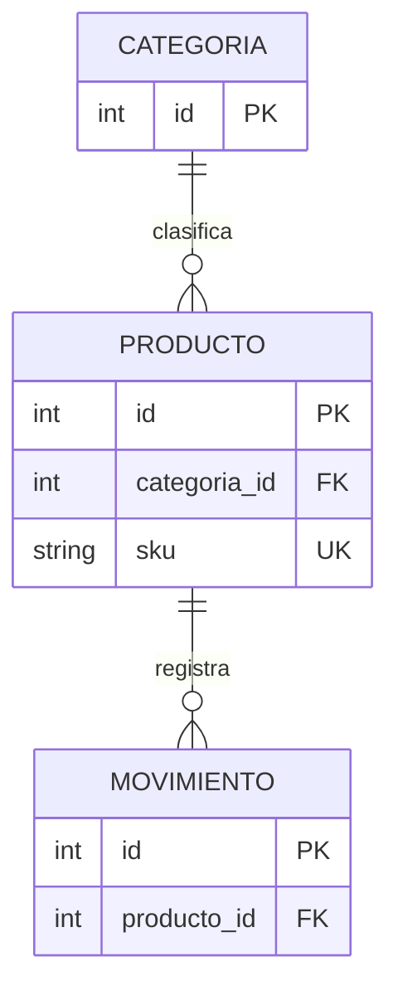
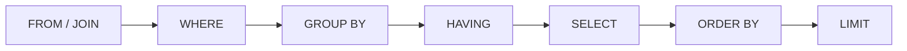
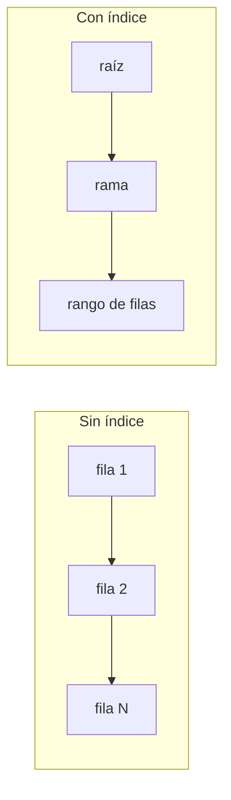
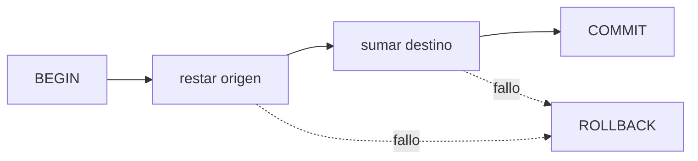
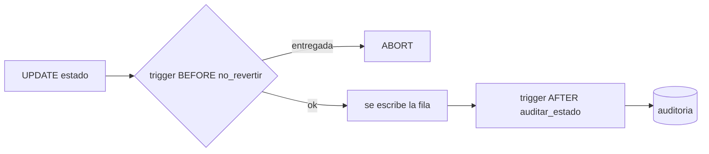
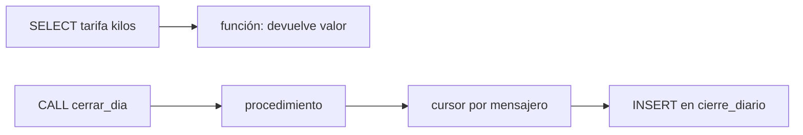
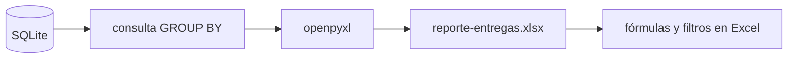

# Módulo 4: Modelado de datos, SQL y persistencia


## Aprende construyendo


### Tema 1: Del mundo real al modelo relacional · Intermedio · 45 min

<details open>
<summary><strong>Capa 1 — Lectura</strong></summary>

#### ► DE QUÉ TRATA
Al finalizar vas a modelar las tareas de Fundamentos como una tabla tareas relacionada por clave foránea con una tabla categorias, y vas a comprobar en SQLite si esa relación protege o no la integridad al borrar una categoría. Prerrequisitos: Python 3 (incluye el módulo sqlite3),…

#### ► LA IDEA EN UNA FRASE
**Al finalizar vas a modelar las tareas de Fundamentos como una tabla tareas relacionada por clave foránea con una tabla categorias, y vas a comprobar en SQLite si esa relación protege o no la integridad al borrar una categoría.**

#### ► POR QUÉ EXISTE ESTO
Resuelve un problema real de diseño o implementación y evita decisiones a ciegas.

#### ► LA ANALOGÍA
Piensa en del mundo real al modelo relacional como una herramienta de taller: útil cuando conoces su propósito y sus límites.
**Dónde se rompe la analogía:** en software, los efectos dependen del contexto, la escala y los trade-offs.

#### ► CÓMO FUNCIONA


#### ► LO QUE PUEDE SALIR MAL
| Síntoma | Causa probable | Arreglo |
|---|---|---|
| Del mundo real al modelo relacional se aplica pero el resultado no mejora | Se usó sin medir el problema real | Mide antes y compara contra la alternativa simple |
| Aparece complejidad inesperada | Se adoptó la técnica sin comprender sus trade-offs | Vuelve a la sección de trade-offs y reduce el alcance |
| Falla en un caso límite | Se asumió un contexto que no se cumple | Prueba el caso límite y documenta cuándo NO usarlo |

#### ► TRADE-OFFS
| Opción | Cuándo usarla | Cuándo NO usarla |
|---|---|---|
| Usar Del mundo real al modelo relacional | Cuando el problema coincide con su propósito y el beneficio es observable | Cuando agrega complejidad sin resolver un problema real |
| Alternativa más simple | Cuando el contexto es pequeño, estable o fácil de razonar | Cuando ya demostró no escalar o no cumplir el requisito |
| Postergar la decisión | Cuando falta evidencia del problema | Cuando el costo de esperar es mayor que el costo de probar |

#### ► CUÁNDO NO USAR ESTO
No uses del mundo real al modelo relacional por defecto. Aplícalo cuando el problema lo justifique y puedas verificar el beneficio; si una alternativa más simple resuelve igual, prefiérela.

#### ► DE VUELTA A LA ANALOGÍA
Volviendo a la analogía: del mundo real al modelo relacional funciona como el modelo inicial, pero recuerda dónde se rompe: en producción importan la evidencia, la escala y el costo de equivocarte.

#### ► LO QUE DEBES RECORDAR
- Del mundo real al modelo relacional existe para resolver un problema específico.
- Mide antes de adoptar complejidad.
- Conoce el caso donde NO usarlo.
- Verifica con evidencia observable.

#### ► PREGUNTAS PARA PENSAR
1. ¿Qué problema concreto resuelve del mundo real al modelo relacional en tu contexto?
2. ¿Cómo sabrías que del mundo real al modelo relacional no está funcionando bien?
3. ¿Qué alternativa más simple considerarías antes de usar del mundo real al modelo relacional?

</details>

<details>
<summary><strong>Capa 2 — Construcción</strong></summary>

#### Código y verificación
```sql
CREATE TABLE categorias (
  id INTEGER PRIMARY KEY,
  nombre TEXT NOT NULL UNIQUE
);

CREATE TABLE productos (
  id INTEGER PRIMARY KEY,
  sku TEXT NOT NULL UNIQUE,
  nombre TEXT NOT NULL,
  stock INTEGER NOT NULL DEFAULT 0 CHECK (stock >= 0),
  categoria_id INTEGER,
  FOREIGN KEY (categoria_id) REFERENCES categorias(id)
);
```


```sql
CREATE TABLE tareas_mal_disenadas(
  id INTEGER PRIMARY KEY,
  titulo TEXT,
  categoria_nombre TEXT,
  categoria_color TEXT
);
```

```
Datos repetidos en el diseño malo: _________
Tablas normalizadas: categorias(_________), tareas(_________)
UPDATE en diseño malo: afecta _________ filas
UPDATE en diseño normalizado: afecta _________ fila(s)
¿El modelo normalizado evita nombres inconsistentes? _________ (¿por qué?)
```

```bash
mkdir -p fundamentos-sqlite/src
cd fundamentos-sqlite
```

```sql
CREATE TABLE categorias(
  id INTEGER PRIMARY KEY,
  nombre TEXT NOT NULL UNIQUE
);
CREATE TABLE tareas(
  id INTEGER PRIMARY KEY,
  titulo TEXT NOT NULL,
  categoria_id INTEGER NOT NULL REFERENCES categorias(id)
);
INSERT INTO categorias(nombre) VALUES ('trabajo'), ('personal');
INSERT INTO tareas(titulo, categoria_id) VALUES ('Pagar factura', 1), ('Comprar pan', 2);
DELETE FROM categorias WHERE nombre='trabajo';
SELECT * FROM tareas;
```

</details>

### Tema 2: SQL para definir, escribir, consultar y relacionar · Intermedio · 45 min

<details open>
<summary><strong>Capa 1 — Lectura</strong></summary>

#### ► DE QUÉ TRATA
Al finalizar vas a escribir las sentencias SQL (CREATE TABLE, INSERT, SELECT con JOIN) sobre el esquema tareas/categorias del Tema 1, y vas a provocar y corregir una inyección SQL real construyendo una consulta con texto concatenado en vez de parámetros. Prerrequisitos: Tema 1 de…

#### ► LA IDEA EN UNA FRASE
**Al finalizar vas a escribir las sentencias SQL (CREATE TABLE, INSERT, SELECT con JOIN) sobre el esquema tareas/categorias del Tema 1, y vas a provocar y corregir una inyección SQL real construyendo una consulta con texto concatenado en vez de parámetros.**

#### ► POR QUÉ EXISTE ESTO
Resuelve un problema real de diseño o implementación y evita decisiones a ciegas.

#### ► LA ANALOGÍA
Piensa en sql para definir, escribir, consultar y relacionar como una herramienta de taller: útil cuando conoces su propósito y sus límites.
**Dónde se rompe la analogía:** en software, los efectos dependen del contexto, la escala y los trade-offs.

#### ► CÓMO FUNCIONA


#### ► LO QUE PUEDE SALIR MAL
| Síntoma | Causa probable | Arreglo |
|---|---|---|
| SQL para definir, escribir, consultar y relacionar se aplica pero el resultado no mejora | Se usó sin medir el problema real | Mide antes y compara contra la alternativa simple |
| Aparece complejidad inesperada | Se adoptó la técnica sin comprender sus trade-offs | Vuelve a la sección de trade-offs y reduce el alcance |
| Falla en un caso límite | Se asumió un contexto que no se cumple | Prueba el caso límite y documenta cuándo NO usarlo |

#### ► TRADE-OFFS
| Opción | Cuándo usarla | Cuándo NO usarla |
|---|---|---|
| Usar SQL para definir, escribir, consultar y relacionar | Cuando el problema coincide con su propósito y el beneficio es observable | Cuando agrega complejidad sin resolver un problema real |
| Alternativa más simple | Cuando el contexto es pequeño, estable o fácil de razonar | Cuando ya demostró no escalar o no cumplir el requisito |
| Postergar la decisión | Cuando falta evidencia del problema | Cuando el costo de esperar es mayor que el costo de probar |

#### ► CUÁNDO NO USAR ESTO
No uses sql para definir, escribir, consultar y relacionar por defecto. Aplícalo cuando el problema lo justifique y puedas verificar el beneficio; si una alternativa más simple resuelve igual, prefiérela.

#### ► DE VUELTA A LA ANALOGÍA
Volviendo a la analogía: sql para definir, escribir, consultar y relacionar funciona como el modelo inicial, pero recuerda dónde se rompe: en producción importan la evidencia, la escala y el costo de equivocarte.

#### ► LO QUE DEBES RECORDAR
- SQL para definir, escribir, consultar y relacionar existe para resolver un problema específico.
- Mide antes de adoptar complejidad.
- Conoce el caso donde NO usarlo.
- Verifica con evidencia observable.

#### ► PREGUNTAS PARA PENSAR
1. ¿Qué problema concreto resuelve sql para definir, escribir, consultar y relacionar en tu contexto?
2. ¿Cómo sabrías que sql para definir, escribir, consultar y relacionar no está funcionando bien?
3. ¿Qué alternativa más simple considerarías antes de usar sql para definir, escribir, consultar y relacionar?

</details>

<details>
<summary><strong>Capa 2 — Construcción</strong></summary>

#### Código y verificación
```
Índice a crear: _________ (¿Por qué esa columna primero?)
Complejidad sin índice: O(_)
Complejidad con índice (estado): O(_)
¿Es idempotente? _________ (¿Por qué?)
EXPLAIN QUERY PLAN output debe mostrar: _________
```

```sql
INSERT INTO categorias(nombre) VALUES ('Periféricos');

INSERT INTO productos(sku, nombre, stock, categoria_id)
VALUES ('A-10', 'Teclado', 4, 1);

SELECT p.sku, p.nombre, p.stock, c.nombre AS categoria
FROM productos AS p
LEFT JOIN categorias AS c ON c.id = p.categoria_id
WHERE p.stock < 5
ORDER BY p.stock ASC;
```

```sql
SELECT c.nombre, COUNT(p.id) AS productos, SUM(p.stock) AS unidades
FROM categorias c
LEFT JOIN productos p ON p.categoria_id = c.id
GROUP BY c.id, c.nombre
ORDER BY unidades DESC;
```

```python
import sqlite3

conexion = sqlite3.connect(":memory:")
cursor = conexion.cursor()
cursor.execute("CREATE TABLE productos (sku TEXT, nombre TEXT)")
cursor.executemany("INSERT INTO productos VALUES (?, ?)", [("A-1", "lápiz"), ("B-2", "regla")])
sku = "x' OR '1'='1"  # entrada maliciosa

# Incorrecto: permite alterar la consulta
cursor.execute("SELECT * FROM productos WHERE sku = '" + sku + "'")
print("concatenando:", cursor.fetchall())

# Correcto: el driver separa código y dato
cursor.execute("SELECT * FROM productos WHERE sku = ?", (sku,))
print("parametrizado:", cursor.fetchall())
```


```bash
mkdir -p fundamentos-sql/src
cd fundamentos-sql
```

</details>

### Tema 3: Índices, restricciones y planes de consulta · Intermedio · 45 min

<details open>
<summary><strong>Capa 1 — Lectura</strong></summary>

#### ► DE QUÉ TRATA
Al finalizar vas a crear un índice sobre la tabla tareas y vas a comparar, con EXPLAIN QUERY PLAN, el plan de consulta antes y después de crearlo — confirmando en tu propia terminal la diferencia entre un SCAN (recorre toda la tabla) y un SEARCH (usa el índice). Prerrequisitos: T…

#### ► LA IDEA EN UNA FRASE
**Al finalizar vas a crear un índice sobre la tabla tareas y vas a comparar, con EXPLAIN QUERY PLAN, el plan de consulta antes y después de crearlo — confirmando en tu propia terminal la diferencia entre un SCAN (recorre toda la tabla) y un SEARCH (usa el índice).**

#### ► POR QUÉ EXISTE ESTO
Resuelve un problema real de diseño o implementación y evita decisiones a ciegas.

#### ► LA ANALOGÍA
Piensa en índices, restricciones y planes de consulta como una herramienta de taller: útil cuando conoces su propósito y sus límites.
**Dónde se rompe la analogía:** en software, los efectos dependen del contexto, la escala y los trade-offs.

#### ► CÓMO FUNCIONA


#### ► LO QUE PUEDE SALIR MAL
| Síntoma | Causa probable | Arreglo |
|---|---|---|
| Índices, restricciones y planes de consulta se aplica pero el resultado no mejora | Se usó sin medir el problema real | Mide antes y compara contra la alternativa simple |
| Aparece complejidad inesperada | Se adoptó la técnica sin comprender sus trade-offs | Vuelve a la sección de trade-offs y reduce el alcance |
| Falla en un caso límite | Se asumió un contexto que no se cumple | Prueba el caso límite y documenta cuándo NO usarlo |

#### ► TRADE-OFFS
| Opción | Cuándo usarla | Cuándo NO usarla |
|---|---|---|
| Usar Índices, restricciones y planes de consulta | Cuando el problema coincide con su propósito y el beneficio es observable | Cuando agrega complejidad sin resolver un problema real |
| Alternativa más simple | Cuando el contexto es pequeño, estable o fácil de razonar | Cuando ya demostró no escalar o no cumplir el requisito |
| Postergar la decisión | Cuando falta evidencia del problema | Cuando el costo de esperar es mayor que el costo de probar |

#### ► CUÁNDO NO USAR ESTO
No uses índices, restricciones y planes de consulta por defecto. Aplícalo cuando el problema lo justifique y puedas verificar el beneficio; si una alternativa más simple resuelve igual, prefiérela.

#### ► DE VUELTA A LA ANALOGÍA
Volviendo a la analogía: índices, restricciones y planes de consulta funciona como el modelo inicial, pero recuerda dónde se rompe: en producción importan la evidencia, la escala y el costo de equivocarte.

#### ► LO QUE DEBES RECORDAR
- Índices, restricciones y planes de consulta existe para resolver un problema específico.
- Mide antes de adoptar complejidad.
- Conoce el caso donde NO usarlo.
- Verifica con evidencia observable.

#### ► PREGUNTAS PARA PENSAR
1. ¿Qué problema concreto resuelve índices, restricciones y planes de consulta en tu contexto?
2. ¿Cómo sabrías que índices, restricciones y planes de consulta no está funcionando bien?
3. ¿Qué alternativa más simple considerarías antes de usar índices, restricciones y planes de consulta?

</details>

<details>
<summary><strong>Capa 2 — Construcción</strong></summary>

#### Código y verificación
```
Selectividad de urgente=1: _________ (¿qué % de tareas?)
Índice compuesto propuesto: _________ (columnas y orden)
¿Importa el orden? _________ (¿Por qué?)
EXPLAIN antes: _________
EXPLAIN después: _________
Número de índices que ralentiza INSERT: _________
```

```sql
CREATE INDEX idx_productos_categoria_stock
ON productos(categoria_id, stock);

EXPLAIN QUERY PLAN
SELECT * FROM productos
WHERE categoria_id = 2 AND stock < 5;
```


```bash
mkdir -p ejemplo-indice && cd ejemplo-indice
```

```python
import sqlite3

conexion = sqlite3.connect(":memory:")
conexion.execute(
    "CREATE TABLE tareas (id INTEGER PRIMARY KEY, titulo TEXT NOT NULL, estado TEXT NOT NULL)"
)
conexion.executemany(
    "INSERT INTO tareas(titulo, estado) VALUES (?, ?)",
    (
        (f"Tarea {numero}", "pendiente" if numero % 100 == 0 else "completada")
        for numero in range(10_000)
    ),
)
conexion.commit()

def mostrar_plan(etiqueta):
    print(etiqueta)
    plan = conexion.execute(
        "EXPLAIN QUERY PLAN SELECT titulo FROM tareas WHERE estado = ?",
        ("pendiente",),
    )
    for fila in plan:
        print(f"  {fila[3]}")

mostrar_plan("Antes del índice:")
conexion.execute("CREATE INDEX idx_tareas_estado ON tareas(estado)")
conexion.execute("ANALYZE")
mostrar_plan("Después del índice:")
conexion.close()
```

```bash
python3 indice.py
```

</details>

### Tema 4: Transacciones, concurrencia y elección SQL/NoSQL · Intermedio · 45 min

<details open>
<summary><strong>Capa 1 — Lectura</strong></summary>

#### ► DE QUÉ TRATA
Al finalizar vas a envolver dos actualizaciones relacionadas (marcar una tarea como completada y registrar ese cambio en un historial) dentro de una transacción, y vas a comprobar que un fallo simulado a mitad de camino deja la base exactamente como estaba antes — ni a medias, ni…

#### ► LA IDEA EN UNA FRASE
**Al finalizar vas a envolver dos actualizaciones relacionadas (marcar una tarea como completada y registrar ese cambio en un historial) dentro de una transacción, y vas a comprobar que un fallo simulado a mitad de camino deja la base exactamente como estaba antes — ni a medias, ni corrupta.**

#### ► POR QUÉ EXISTE ESTO
Resuelve un problema real de diseño o implementación y evita decisiones a ciegas.

#### ► LA ANALOGÍA
Piensa en transacciones, concurrencia y elección sql/nosql como una herramienta de taller: útil cuando conoces su propósito y sus límites.
**Dónde se rompe la analogía:** en software, los efectos dependen del contexto, la escala y los trade-offs.

#### ► CÓMO FUNCIONA


#### ► LO QUE PUEDE SALIR MAL
| Síntoma | Causa probable | Arreglo |
|---|---|---|
| Transacciones, concurrencia y elección SQL/NoSQL se aplica pero el resultado no mejora | Se usó sin medir el problema real | Mide antes y compara contra la alternativa simple |
| Aparece complejidad inesperada | Se adoptó la técnica sin comprender sus trade-offs | Vuelve a la sección de trade-offs y reduce el alcance |
| Falla en un caso límite | Se asumió un contexto que no se cumple | Prueba el caso límite y documenta cuándo NO usarlo |

#### ► TRADE-OFFS
| Opción | Cuándo usarla | Cuándo NO usarla |
|---|---|---|
| Usar Transacciones, concurrencia y elección SQL/NoSQL | Cuando el problema coincide con su propósito y el beneficio es observable | Cuando agrega complejidad sin resolver un problema real |
| Alternativa más simple | Cuando el contexto es pequeño, estable o fácil de razonar | Cuando ya demostró no escalar o no cumplir el requisito |
| Postergar la decisión | Cuando falta evidencia del problema | Cuando el costo de esperar es mayor que el costo de probar |

#### ► CUÁNDO NO USAR ESTO
No uses transacciones, concurrencia y elección sql/nosql por defecto. Aplícalo cuando el problema lo justifique y puedas verificar el beneficio; si una alternativa más simple resuelve igual, prefiérela.

#### ► DE VUELTA A LA ANALOGÍA
Volviendo a la analogía: transacciones, concurrencia y elección sql/nosql funciona como el modelo inicial, pero recuerda dónde se rompe: en producción importan la evidencia, la escala y el costo de equivocarte.

#### ► LO QUE DEBES RECORDAR
- Transacciones, concurrencia y elección SQL/NoSQL existe para resolver un problema específico.
- Mide antes de adoptar complejidad.
- Conoce el caso donde NO usarlo.
- Verifica con evidencia observable.

#### ► PREGUNTAS PARA PENSAR
1. ¿Qué problema concreto resuelve transacciones, concurrencia y elección sql/nosql en tu contexto?
2. ¿Cómo sabrías que transacciones, concurrencia y elección sql/nosql no está funcionando bien?
3. ¿Qué alternativa más simple considerarías antes de usar transacciones, concurrencia y elección sql/nosql?

</details>

<details>
<summary><strong>Capa 2 — Construcción</strong></summary>

#### Código y verificación
```
Sin transacción: tarea se crea _________ (¿sí/no?), etiqueta se crea _________ 
Estado inconsistente: _________ (nombre del problema)
Transacción: BEGIN; _________ ; COMMIT;
Si error entre INSERT: ejecutas _________ y el resultado es _________
```

```sql
> BEGIN;
> INSERT INTO tarea(id, titulo) VALUES (?, ?);
> INSERT INTO etiqueta(tarea_id, tag) VALUES (?, ?);
> COMMIT;
> ```

```python
import sqlite3

def mover_stock(conexion, origen, destino, cantidad):
    if cantidad <= 0:
        raise ValueError("La cantidad debe ser positiva")
    if origen == destino:
        raise ValueError("El origen y el destino deben ser distintos")

    try:
        conexion.execute("BEGIN")
        filas_origen = conexion.execute(
            "UPDATE productos SET stock = stock - ? WHERE id = ? AND stock >= ?",
            (cantidad, origen, cantidad),
        ).rowcount
        if filas_origen != 1:
            raise ValueError("El origen no existe o no tiene stock suficiente")
        filas_destino = conexion.execute(
            "UPDATE productos SET stock = stock + ? WHERE id = ?",
            (cantidad, destino),
        ).rowcount
        if filas_destino != 1:
            raise ValueError("El destino no existe")
        conexion.commit()
    except Exception:
        conexion.rollback()
        raise
```


```bash
mkdir -p ejemplo-transaccion && cd ejemplo-transaccion
```

```python
import sqlite3

conexion = sqlite3.connect("tareas.db")
conexion.executescript("""
CREATE TABLE IF NOT EXISTS tareas(id INTEGER PRIMARY KEY, titulo TEXT, estado TEXT NOT NULL DEFAULT 'pendiente');
CREATE TABLE IF NOT EXISTS historial(id INTEGER PRIMARY KEY, tarea_id INTEGER NOT NULL, accion TEXT NOT NULL);
INSERT OR IGNORE INTO tareas(id, titulo, estado) VALUES (2, 'enviar pedido', 'pendiente');
""")
conexion.commit()

def completar_con_transaccion(tarea_id, simular_fallo=False):
    try:
        conexion.execute("BEGIN")
        conexion.execute("UPDATE tareas SET estado='completada' WHERE id=?", (tarea_id,))
        if simular_fallo:
            raise RuntimeError("fallo simulado: el disco se llenó")
        conexion.execute("INSERT INTO historial(tarea_id, accion) VALUES (?, 'completada')", (tarea_id,))
        conexion.commit()
    except Exception as error:
        conexion.rollback()
        print("Revertido:", error)

completar_con_transaccion(2, simular_fallo=True)
print(conexion.execute("SELECT id, estado FROM tareas WHERE id=2").fetchone())
print(conexion.execute("SELECT * FROM historial WHERE tarea_id=2").fetchall())
```

</details>

### Tema 5: SQL avanzado: subconsultas, vistas, triggers y funciones de ventana · Intermedio · 45 min

<details open>
<summary><strong>Capa 1 — Lectura</strong></summary>

#### ► DE QUÉ TRATA
Al finalizar podrás escribir subconsultas en WHERE, SELECT y FROM, guardar consultas como vistas, automatizar reglas con triggers y ordenar dentro de grupos con funciones de ventana. Prerrequisitos: Temas 2 y 3 de este módulo.

#### ► LA IDEA EN UNA FRASE
**Al finalizar podrás escribir subconsultas en WHERE, SELECT y FROM, guardar consultas como vistas, automatizar reglas con triggers y ordenar dentro de grupos con funciones de ventana.**

#### ► POR QUÉ EXISTE ESTO
Resuelve un problema real de diseño o implementación y evita decisiones a ciegas.

#### ► LA ANALOGÍA
Piensa en sql avanzado: subconsultas, vistas, triggers y funciones de ventana como una herramienta de taller: útil cuando conoces su propósito y sus límites.
**Dónde se rompe la analogía:** en software, los efectos dependen del contexto, la escala y los trade-offs.

#### ► CÓMO FUNCIONA


#### ► LO QUE PUEDE SALIR MAL
| Síntoma | Causa probable | Arreglo |
|---|---|---|
| SQL avanzado: subconsultas, vistas, triggers y funciones de ventana se aplica pero el resultado no mejora | Se usó sin medir el problema real | Mide antes y compara contra la alternativa simple |
| Aparece complejidad inesperada | Se adoptó la técnica sin comprender sus trade-offs | Vuelve a la sección de trade-offs y reduce el alcance |
| Falla en un caso límite | Se asumió un contexto que no se cumple | Prueba el caso límite y documenta cuándo NO usarlo |

#### ► TRADE-OFFS
| Opción | Cuándo usarla | Cuándo NO usarla |
|---|---|---|
| Usar SQL avanzado: subconsultas, vistas, triggers y funciones de ventana | Cuando el problema coincide con su propósito y el beneficio es observable | Cuando agrega complejidad sin resolver un problema real |
| Alternativa más simple | Cuando el contexto es pequeño, estable o fácil de razonar | Cuando ya demostró no escalar o no cumplir el requisito |
| Postergar la decisión | Cuando falta evidencia del problema | Cuando el costo de esperar es mayor que el costo de probar |

#### ► CUÁNDO NO USAR ESTO
No uses sql avanzado: subconsultas, vistas, triggers y funciones de ventana por defecto. Aplícalo cuando el problema lo justifique y puedas verificar el beneficio; si una alternativa más simple resuelve igual, prefiérela.

#### ► DE VUELTA A LA ANALOGÍA
Volviendo a la analogía: sql avanzado: subconsultas, vistas, triggers y funciones de ventana funciona como el modelo inicial, pero recuerda dónde se rompe: en producción importan la evidencia, la escala y el costo de equivocarte.

#### ► LO QUE DEBES RECORDAR
- SQL avanzado: subconsultas, vistas, triggers y funciones de ventana existe para resolver un problema específico.
- Mide antes de adoptar complejidad.
- Conoce el caso donde NO usarlo.
- Verifica con evidencia observable.

#### ► PREGUNTAS PARA PENSAR
1. ¿Qué problema concreto resuelve sql avanzado: subconsultas, vistas, triggers y funciones de ventana en tu contexto?
2. ¿Cómo sabrías que sql avanzado: subconsultas, vistas, triggers y funciones de ventana no está funcionando bien?
3. ¿Qué alternativa más simple considerarías antes de usar sql avanzado: subconsultas, vistas, triggers y funciones de ventana?

</details>

<details>
<summary><strong>Capa 2 — Construcción</strong></summary>

#### Código y verificación


```bash
mkdir sql-avanzado && cd sql-avanzado
```

```python
import sqlite3

db = sqlite3.connect(":memory:")
db.executescript("""
CREATE TABLE mensajero (id INTEGER PRIMARY KEY, nombre TEXT NOT NULL, zona TEXT NOT NULL);
CREATE TABLE entrega (
  id INTEGER PRIMARY KEY,
  mensajero_id INTEGER NOT NULL REFERENCES mensajero(id),
  kilos REAL NOT NULL,
  estado TEXT NOT NULL CHECK (estado IN ('pendiente', 'entregada', 'fallida'))
);
CREATE TABLE auditoria (entrega_id INTEGER, antes TEXT, despues TEXT);

INSERT INTO mensajero VALUES (1, 'Ana', 'Norte'), (2, 'Beto', 'Sur'), (3, 'Caro', 'Norte');
INSERT INTO entrega VALUES
  (10, 1, 2.0, 'entregada'), (11, 1, 8.5, 'entregada'), (12, 2, 1.0, 'fallida'),
  (13, 2, 3.0, 'entregada'), (14, 3, 12.0, 'pendiente'), (15, 3, 4.0, 'entregada');

-- Vista: una consulta guardada con nombre, se consulta como si fuera una tabla
CREATE VIEW resumen_mensajero AS
SELECT m.nombre, m.zona, COUNT(e.id) AS total,
       SUM(e.estado = 'entregada') AS entregadas
FROM mensajero m LEFT JOIN entrega e ON e.mensajero_id = m.id
GROUP BY m.id, m.nombre, m.zona;

-- Trigger de auditoría: se ejecuta solo, después de cada cambio de estado
CREATE TRIGGER auditar_estado AFTER UPDATE OF estado ON entrega
BEGIN
  INSERT INTO auditoria VALUES (OLD.id, OLD.estado, NEW.estado);
END;

-- Trigger de regla de negocio: una entrega entregada no vuelve atrás
CREATE TRIGGER no_revertir BEFORE UPDATE OF estado ON entrega
WHEN OLD.estado = 'entregada'
BEGIN
  SELECT RAISE(ABORT, 'una entrega entregada no puede cambiar de estado');
END;
""")

def mostrar(titulo, sql):
    print(f"-- {titulo}")
    for fila in db.execute(sql):
        print("  ", fila)

mostrar("Subconsulta en WHERE: entregas más pesadas que el promedio",
        "SELECT id, kilos FROM entrega WHERE kilos > (SELECT AVG(kilos) FROM entrega) ORDER BY id")
mostrar("Subconsulta correlacionada en SELECT: entregas por mensajero",
        "SELECT nombre, (SELECT COUNT(*) FROM entrega e WHERE e.mensajero_id = m.id) FROM mensajero m ORDER BY nombre")
mostrar("Subconsulta en FROM: zonas con efectividad",
        """SELECT zona, ROUND(100.0 * SUM(entregadas) / SUM(total)) AS efectividad
           FROM (SELECT * FROM resumen_mensajero) GROUP BY zona ORDER BY zona""")
mostrar("Función de ventana: ranking de kilos dentro de cada mensajero",
        """SELECT mensajero_id, id, kilos,
                  RANK() OVER (PARTITION BY mensajero_id ORDER BY kilos DESC) AS puesto
           FROM entrega ORDER BY mensajero_id, puesto""")

db.execute("UPDATE entrega SET estado = 'entregada' WHERE id = 14")
mostrar("Auditoría generada por el trigger", "SELECT * FROM auditoria ORDER BY entrega_id")
try:
    db.execute("UPDATE entrega SET estado = 'fallida' WHERE id = 10")
except sqlite3.IntegrityError as error:
    print("Rechazado por trigger:", error)
```

```bash
python3 sql_avanzado.py
```

```text
-- Subconsulta en WHERE: entregas más pesadas que el promedio
   (11, 8.5)
   (14, 12.0)
-- Subconsulta correlacionada en SELECT: entregas por mensajero
   ('Ana', 2)
   ('Beto', 2)
   ('Caro', 2)
-- Subconsulta en FROM: zonas con efectividad
   ('Norte', 75.0)
   ('Sur', 50.0)
-- Función de ventana: ranking de kilos dentro de cada mensajero
   (1, 11, 8.5, 1)
   (1, 10, 2.0, 2)
   (2, 13, 3.0, 1)
   (2, 12, 1.0, 2)
   (3, 14, 12.0, 1)
   (3, 15, 4.0, 2)
-- Auditoría generada por el trigger
   (14, 'pendiente', 'entregada')
Rechazado por trigger: una entrega entregada no puede cambiar de estado
```

</details>

### Tema 6: Procedimientos almacenados, funciones y cursores con PL/pgSQL · Intermedio · 45 min

<details open>
<summary><strong>Capa 1 — Lectura</strong></summary>

#### ► DE QUÉ TRATA
Al finalizar podrás escribir funciones y procedimientos almacenados en PL/pgSQL, recorrer resultados con un cursor, lanzar y capturar excepciones, y distinguir cuándo usar SELECT (funciones) y CALL (procedimientos). Prerrequisito: Tema 5 de este módulo.

#### ► LA IDEA EN UNA FRASE
**Al finalizar podrás escribir funciones y procedimientos almacenados en PL/pgSQL, recorrer resultados con un cursor, lanzar y capturar excepciones, y distinguir cuándo usar SELECT (funciones) y CALL (procedimientos).**

#### ► POR QUÉ EXISTE ESTO
Resuelve un problema real de diseño o implementación y evita decisiones a ciegas.

#### ► LA ANALOGÍA
Piensa en procedimientos almacenados, funciones y cursores con pl/pgsql como una herramienta de taller: útil cuando conoces su propósito y sus límites.
**Dónde se rompe la analogía:** en software, los efectos dependen del contexto, la escala y los trade-offs.

#### ► CÓMO FUNCIONA


#### ► LO QUE PUEDE SALIR MAL
| Síntoma | Causa probable | Arreglo |
|---|---|---|
| Procedimientos almacenados, funciones y cursores con PL/pgSQL se aplica pero el resultado no mejora | Se usó sin medir el problema real | Mide antes y compara contra la alternativa simple |
| Aparece complejidad inesperada | Se adoptó la técnica sin comprender sus trade-offs | Vuelve a la sección de trade-offs y reduce el alcance |
| Falla en un caso límite | Se asumió un contexto que no se cumple | Prueba el caso límite y documenta cuándo NO usarlo |

#### ► TRADE-OFFS
| Opción | Cuándo usarla | Cuándo NO usarla |
|---|---|---|
| Usar Procedimientos almacenados, funciones y cursores con PL/pgSQL | Cuando el problema coincide con su propósito y el beneficio es observable | Cuando agrega complejidad sin resolver un problema real |
| Alternativa más simple | Cuando el contexto es pequeño, estable o fácil de razonar | Cuando ya demostró no escalar o no cumplir el requisito |
| Postergar la decisión | Cuando falta evidencia del problema | Cuando el costo de esperar es mayor que el costo de probar |

#### ► CUÁNDO NO USAR ESTO
No uses procedimientos almacenados, funciones y cursores con pl/pgsql por defecto. Aplícalo cuando el problema lo justifique y puedas verificar el beneficio; si una alternativa más simple resuelve igual, prefiérela.

#### ► DE VUELTA A LA ANALOGÍA
Volviendo a la analogía: procedimientos almacenados, funciones y cursores con pl/pgsql funciona como el modelo inicial, pero recuerda dónde se rompe: en producción importan la evidencia, la escala y el costo de equivocarte.

#### ► LO QUE DEBES RECORDAR
- Procedimientos almacenados, funciones y cursores con PL/pgSQL existe para resolver un problema específico.
- Mide antes de adoptar complejidad.
- Conoce el caso donde NO usarlo.
- Verifica con evidencia observable.

#### ► PREGUNTAS PARA PENSAR
1. ¿Qué problema concreto resuelve procedimientos almacenados, funciones y cursores con pl/pgsql en tu contexto?
2. ¿Cómo sabrías que procedimientos almacenados, funciones y cursores con pl/pgsql no está funcionando bien?
3. ¿Qué alternativa más simple considerarías antes de usar procedimientos almacenados, funciones y cursores con pl/pgsql?

</details>

<details>
<summary><strong>Capa 2 — Construcción</strong></summary>

#### Código y verificación


```bash
mkdir plpgsql && cd plpgsql
```

```sql
-- Esquema mínimo de RutaFlow
DROP TABLE IF EXISTS entrega, cierre_diario;
CREATE TABLE entrega (
  id serial PRIMARY KEY,
  guia text UNIQUE NOT NULL,
  mensajero text NOT NULL,
  kilos numeric(6,2) NOT NULL CHECK (kilos > 0),
  estado text NOT NULL DEFAULT 'pendiente'
);
CREATE TABLE cierre_diario (mensajero text PRIMARY KEY, entregadas int, kilos numeric(8,2));
INSERT INTO entrega (guia, mensajero, kilos, estado) VALUES
  ('BO-1', 'ana', 2.5, 'entregada'), ('BO-2', 'ana', 4, 'pendiente'),
  ('BO-3', 'beto', 1, 'entregada'), ('BO-4', 'beto', 7.25, 'entregada');

-- FUNCIÓN: devuelve un valor y se usa dentro de un SELECT
CREATE OR REPLACE FUNCTION tarifa(p_kilos numeric) RETURNS integer
LANGUAGE plpgsql IMMUTABLE AS $$
BEGIN
  IF p_kilos <= 0 THEN
    RAISE EXCEPTION 'kilos debe ser positivo: %', p_kilos;
  END IF;
  RETURN 5000 + ceil(p_kilos) * 1200;
END $$;

-- PROCEDIMIENTO: ejecuta un proceso con un CURSOR y maneja errores por fila
CREATE OR REPLACE PROCEDURE cerrar_dia()
LANGUAGE plpgsql AS $$
DECLARE
  fila record;
  c_mensajeros CURSOR FOR
    SELECT mensajero, count(*) AS n, sum(kilos) AS k
    FROM entrega WHERE estado = 'entregada' GROUP BY mensajero ORDER BY mensajero;
BEGIN
  DELETE FROM cierre_diario;
  FOR fila IN c_mensajeros LOOP                       -- el FOR abre, recorre y cierra el cursor
    INSERT INTO cierre_diario VALUES (fila.mensajero, fila.n, fila.k);
    RAISE NOTICE 'cierre de %: % entregas, % kg', fila.mensajero, fila.n, fila.k;
  END LOOP;
END $$;

SELECT guia, kilos, tarifa(kilos) AS tarifa FROM entrega ORDER BY guia;
CALL cerrar_dia();
SELECT * FROM cierre_diario ORDER BY mensajero;

-- Manejo de excepciones dentro de un bloque anónimo
DO $$
BEGIN
  PERFORM tarifa(0);
EXCEPTION WHEN raise_exception THEN
  RAISE NOTICE 'error controlado: %', SQLERRM;
END $$;
```

```bash
docker run -d --rm --name pg-fundamentos-m4 -e POSTGRES_PASSWORD=dev -p 127.0.0.1:5432:5432 postgres:17
docker cp plpgsql.sql pg-fundamentos-m4:/tmp/
until docker exec pg-fundamentos-m4 pg_isready -U postgres; do sleep 1; done
docker exec pg-fundamentos-m4 psql -U postgres -q -X -f /tmp/plpgsql.sql
```

```text
psql:plpgsql.sql:2: NOTICE:  table "entrega" does not exist, skipping
psql:plpgsql.sql:2: NOTICE:  table "cierre_diario" does not exist, skipping
 guia | kilos | tarifa 
------+-------+--------
 BO-1 |  2.50 |   8600
 BO-2 |  4.00 |   9800
 BO-3 |  1.00 |   6200
 BO-4 |  7.25 |  14600
(4 rows)

psql:plpgsql.sql:42: NOTICE:  cierre de ana: 1 entregas, 2.50 kg
psql:plpgsql.sql:42: NOTICE:  cierre de beto: 2 entregas, 8.25 kg
 mensajero | entregadas | kilos 
-----------+------------+-------
 ana       |          1 |  2.50
 beto      |          2 |  8.25
(2 rows)

psql:plpgsql.sql:51: NOTICE:  error controlado: kilos debe ser positivo: 0
```

</details>

### Tema 7: De SQL a Excel: reportes con tablas y fórmulas vivas · Intermedio · 45 min

<details open>
<summary><strong>Capa 1 — Lectura</strong></summary>

#### ► DE QUÉ TRATA
Al finalizar podrás generar desde una consulta SQL un archivo Excel con encabezados, una tabla con filtros, fórmulas que Excel recalcula y formato de porcentaje, y verificar el archivo leyéndolo de nuevo. Prerrequisitos: Temas 2 y 5 de este módulo.

#### ► LA IDEA EN UNA FRASE
**Al finalizar podrás generar desde una consulta SQL un archivo Excel con encabezados, una tabla con filtros, fórmulas que Excel recalcula y formato de porcentaje, y verificar el archivo leyéndolo de nuevo.**

#### ► POR QUÉ EXISTE ESTO
Resuelve un problema real de diseño o implementación y evita decisiones a ciegas.

#### ► LA ANALOGÍA
Piensa en de sql a excel: reportes con tablas y fórmulas vivas como una herramienta de taller: útil cuando conoces su propósito y sus límites.
**Dónde se rompe la analogía:** en software, los efectos dependen del contexto, la escala y los trade-offs.

#### ► CÓMO FUNCIONA


#### ► LO QUE PUEDE SALIR MAL
| Síntoma | Causa probable | Arreglo |
|---|---|---|
| De SQL a Excel: reportes con tablas y fórmulas vivas se aplica pero el resultado no mejora | Se usó sin medir el problema real | Mide antes y compara contra la alternativa simple |
| Aparece complejidad inesperada | Se adoptó la técnica sin comprender sus trade-offs | Vuelve a la sección de trade-offs y reduce el alcance |
| Falla en un caso límite | Se asumió un contexto que no se cumple | Prueba el caso límite y documenta cuándo NO usarlo |

#### ► TRADE-OFFS
| Opción | Cuándo usarla | Cuándo NO usarla |
|---|---|---|
| Usar De SQL a Excel: reportes con tablas y fórmulas vivas | Cuando el problema coincide con su propósito y el beneficio es observable | Cuando agrega complejidad sin resolver un problema real |
| Alternativa más simple | Cuando el contexto es pequeño, estable o fácil de razonar | Cuando ya demostró no escalar o no cumplir el requisito |
| Postergar la decisión | Cuando falta evidencia del problema | Cuando el costo de esperar es mayor que el costo de probar |

#### ► CUÁNDO NO USAR ESTO
No uses de sql a excel: reportes con tablas y fórmulas vivas por defecto. Aplícalo cuando el problema lo justifique y puedas verificar el beneficio; si una alternativa más simple resuelve igual, prefiérela.

#### ► DE VUELTA A LA ANALOGÍA
Volviendo a la analogía: de sql a excel: reportes con tablas y fórmulas vivas funciona como el modelo inicial, pero recuerda dónde se rompe: en producción importan la evidencia, la escala y el costo de equivocarte.

#### ► LO QUE DEBES RECORDAR
- De SQL a Excel: reportes con tablas y fórmulas vivas existe para resolver un problema específico.
- Mide antes de adoptar complejidad.
- Conoce el caso donde NO usarlo.
- Verifica con evidencia observable.

#### ► PREGUNTAS PARA PENSAR
1. ¿Qué problema concreto resuelve de sql a excel: reportes con tablas y fórmulas vivas en tu contexto?
2. ¿Cómo sabrías que de sql a excel: reportes con tablas y fórmulas vivas no está funcionando bien?
3. ¿Qué alternativa más simple considerarías antes de usar de sql a excel: reportes con tablas y fórmulas vivas?

</details>

<details>
<summary><strong>Capa 2 — Construcción</strong></summary>

#### Código y verificación


```bash
mkdir sql-excel && cd sql-excel
```

```python
import sqlite3
from openpyxl import Workbook, load_workbook
from openpyxl.styles import Font
from openpyxl.worksheet.table import Table, TableStyleInfo

db = sqlite3.connect(":memory:")
db.executescript("""
CREATE TABLE entrega (guia TEXT, zona TEXT, mensajero TEXT, kilos REAL, estado TEXT);
INSERT INTO entrega VALUES
 ('BO-1','Norte','Ana',2.5,'entregada'), ('BO-2','Norte','Ana',4,'fallida'),
 ('BO-3','Sur','Beto',1,'entregada'),    ('BO-4','Sur','Beto',7.25,'entregada'),
 ('BO-5','Norte','Caro',3,'entregada');
""")

# SQL hace el trabajo pesado (agrupar); Excel presenta, filtra y calcula sobre el resultado
consulta = """
SELECT zona, COUNT(*) AS envios,
       SUM(estado = 'entregada') AS entregadas,
       ROUND(SUM(kilos), 2) AS kilos
FROM entrega GROUP BY zona ORDER BY zona
"""
cursor = db.execute(consulta)
columnas = [c[0] for c in cursor.description]
filas = cursor.fetchall()

libro = Workbook()
hoja = libro.active
hoja.title = "Resumen por zona"
hoja.append(columnas + ["efectividad"])
for i, fila in enumerate(filas, start=2):
    hoja.append(list(fila) + [f"=C{i}/B{i}"])        # fórmula viva: Excel la recalcula
    hoja[f"E{i}"].number_format = "0%"
for celda in hoja[1]:
    celda.font = Font(bold=True)
total = len(filas) + 2
hoja[f"A{total}"] = "Total"
hoja[f"B{total}"] = f"=SUM(B2:B{total - 1})"
tabla = Table(displayName="ResumenZonas", ref=f"A1:E{total - 1}")
tabla.tableStyleInfo = TableStyleInfo(name="TableStyleMedium9", showRowStripes=True)
hoja.add_table(tabla)                                # tabla de Excel: filtros y estilo
libro.save("reporte-entregas.xlsx")

# Verificación: volver a leer el archivo generado
leido = load_workbook("reporte-entregas.xlsx")["Resumen por zona"]
for fila in leido.iter_rows(values_only=True):
    print(fila)
```

```bash
pip install openpyxl
python3 reporte_excel.py
```

```text
('zona', 'envios', 'entregadas', 'kilos', 'efectividad')
('Norte', 3, 2, 9.5, '=C2/B2')
('Sur', 2, 2, 8.25, '=C3/B3')
('Total', '=SUM(B2:B3)', None, None, None)
```

</details>

### Proyecto 4: migrar el inventario JSON a SQLite

<details open>
<summary><strong>Capa 1 — Lectura</strong></summary>

#### ► DE QUÉ TRATA
Este tema te guía por proyecto 4: migrar el inventario json a sqlite con foco en comprensión antes de implementación.

#### ► LA IDEA EN UNA FRASE
**Entender proyecto 4: migrar el inventario json a sqlite te permite tomar mejores decisiones técnicas.**

#### ► POR QUÉ EXISTE ESTO
Resuelve un problema real de diseño o implementación y evita decisiones a ciegas.

#### ► LA ANALOGÍA
Piensa en proyecto 4: migrar el inventario json a sqlite como una herramienta de taller: útil cuando conoces su propósito y sus límites.
**Dónde se rompe la analogía:** en software, los efectos dependen del contexto, la escala y los trade-offs.

#### ► CÓMO FUNCIONA
1. Identifica el problema que proyecto 4: migrar el inventario json a sqlite resuelve.
2. Observa sus componentes y relaciones.
3. Aplica la opción más simple que funcione.
4. Verifica el resultado y los límites.

#### ► LO QUE PUEDE SALIR MAL
| Síntoma | Causa probable | Arreglo |
|---|---|---|
| Proyecto 4: migrar el inventario JSON a SQLite se aplica pero el resultado no mejora | Se usó sin medir el problema real | Mide antes y compara contra la alternativa simple |
| Aparece complejidad inesperada | Se adoptó la técnica sin comprender sus trade-offs | Vuelve a la sección de trade-offs y reduce el alcance |
| Falla en un caso límite | Se asumió un contexto que no se cumple | Prueba el caso límite y documenta cuándo NO usarlo |

#### ► TRADE-OFFS
| Opción | Cuándo usarla | Cuándo NO usarla |
|---|---|---|
| Usar Proyecto 4: migrar el inventario JSON a SQLite | Cuando el problema coincide con su propósito y el beneficio es observable | Cuando agrega complejidad sin resolver un problema real |
| Alternativa más simple | Cuando el contexto es pequeño, estable o fácil de razonar | Cuando ya demostró no escalar o no cumplir el requisito |
| Postergar la decisión | Cuando falta evidencia del problema | Cuando el costo de esperar es mayor que el costo de probar |

#### ► CUÁNDO NO USAR ESTO
No uses proyecto 4: migrar el inventario json a sqlite por defecto. Aplícalo cuando el problema lo justifique y puedas verificar el beneficio; si una alternativa más simple resuelve igual, prefiérela.

#### ► DE VUELTA A LA ANALOGÍA
Volviendo a la analogía: proyecto 4: migrar el inventario json a sqlite funciona como el modelo inicial, pero recuerda dónde se rompe: en producción importan la evidencia, la escala y el costo de equivocarte.

#### ► LO QUE DEBES RECORDAR
- Proyecto 4: migrar el inventario JSON a SQLite existe para resolver un problema específico.
- Mide antes de adoptar complejidad.
- Conoce el caso donde NO usarlo.
- Verifica con evidencia observable.

#### ► PREGUNTAS PARA PENSAR
1. ¿Qué problema concreto resuelve proyecto 4: migrar el inventario json a sqlite en tu contexto?
2. ¿Cómo sabrías que proyecto 4: migrar el inventario json a sqlite no está funcionando bien?
3. ¿Qué alternativa más simple considerarías antes de usar proyecto 4: migrar el inventario json a sqlite?

</details>

<details>
<summary><strong>Capa 2 — Construcción</strong></summary>

#### Nota de construcción
Este tema es principalmente conceptual en esta versión. La verificación se realiza con las preguntas de comprensión y el criterio de cuándo NO usar proyecto 4: migrar el inventario json a sqlite.

</details>
