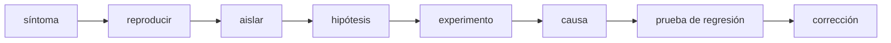
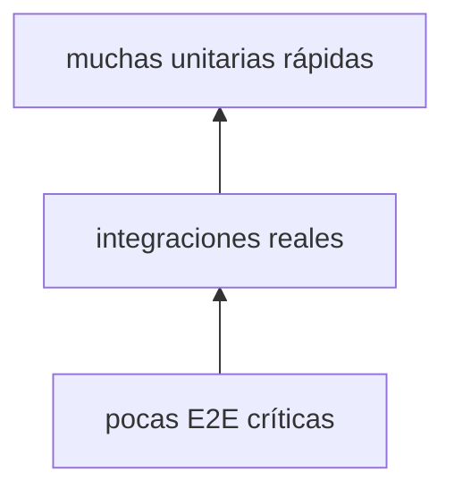
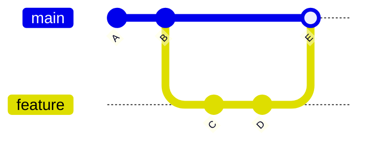
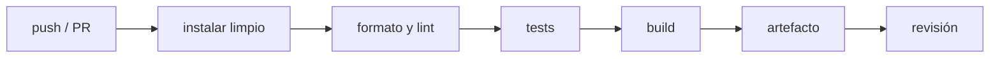

# Módulo 5: Testing, depuración, Git y CI


## Aprende construyendo


### Tema 1: Depurar con evidencia, no con cambios aleatorios · Intermedio · 45 min

<details open>
<summary><strong>Capa 1 — Lectura</strong></summary>

#### ► DE QUÉ TRATA
Al finalizar vas a reproducir un bug real de listar_pendientes en el proyecto Fundamentos, vas a escribir tu hipótesis en una línea ANTES de tocar el código, y vas a distinguir un cambio que corrige la causa real de un cambio que solo parece arreglar algo. Prerrequisitos: tareas.…

#### ► LA IDEA EN UNA FRASE
**Al finalizar vas a reproducir un bug real de listar_pendientes en el proyecto Fundamentos, vas a escribir tu hipótesis en una línea ANTES de tocar el código, y vas a distinguir un cambio que corrige la causa real de un cambio que solo parece arreglar algo.**

#### ► POR QUÉ EXISTE ESTO
Resuelve un problema real de diseño o implementación y evita decisiones a ciegas.

#### ► LA ANALOGÍA
Piensa en depurar con evidencia, no con cambios aleatorios como una herramienta de taller: útil cuando conoces su propósito y sus límites.
**Dónde se rompe la analogía:** en software, los efectos dependen del contexto, la escala y los trade-offs.

#### ► CÓMO FUNCIONA


#### ► LO QUE PUEDE SALIR MAL
| Síntoma | Causa probable | Arreglo |
|---|---|---|
| Depurar con evidencia, no con cambios aleatorios se aplica pero el resultado no mejora | Se usó sin medir el problema real | Mide antes y compara contra la alternativa simple |
| Aparece complejidad inesperada | Se adoptó la técnica sin comprender sus trade-offs | Vuelve a la sección de trade-offs y reduce el alcance |
| Falla en un caso límite | Se asumió un contexto que no se cumple | Prueba el caso límite y documenta cuándo NO usarlo |

#### ► TRADE-OFFS
| Opción | Cuándo usarla | Cuándo NO usarla |
|---|---|---|
| Usar Depurar con evidencia, no con cambios aleatorios | Cuando el problema coincide con su propósito y el beneficio es observable | Cuando agrega complejidad sin resolver un problema real |
| Alternativa más simple | Cuando el contexto es pequeño, estable o fácil de razonar | Cuando ya demostró no escalar o no cumplir el requisito |
| Postergar la decisión | Cuando falta evidencia del problema | Cuando el costo de esperar es mayor que el costo de probar |

#### ► CUÁNDO NO USAR ESTO
No uses depurar con evidencia, no con cambios aleatorios por defecto. Aplícalo cuando el problema lo justifique y puedas verificar el beneficio; si una alternativa más simple resuelve igual, prefiérela.

#### ► DE VUELTA A LA ANALOGÍA
Volviendo a la analogía: depurar con evidencia, no con cambios aleatorios funciona como el modelo inicial, pero recuerda dónde se rompe: en producción importan la evidencia, la escala y el costo de equivocarte.

#### ► LO QUE DEBES RECORDAR
- Depurar con evidencia, no con cambios aleatorios existe para resolver un problema específico.
- Mide antes de adoptar complejidad.
- Conoce el caso donde NO usarlo.
- Verifica con evidencia observable.

#### ► PREGUNTAS PARA PENSAR
1. ¿Qué problema concreto resuelve depurar con evidencia, no con cambios aleatorios en tu contexto?
2. ¿Cómo sabrías que depurar con evidencia, no con cambios aleatorios no está funcionando bien?
3. ¿Qué alternativa más simple considerarías antes de usar depurar con evidencia, no con cambios aleatorios?

</details>

<details>
<summary><strong>Capa 2 — Construcción</strong></summary>

#### Código y verificación
```
Función donde se detiene: _________
Print vs pdb: _________ (¿cuál usas?)
Línea que origina el ValueError y línea que lo llamó: _________
Logs en producción: _________
```

```python
def retirar(stock, cantidad):
    if cantidad > stock:
        raise ValueError("Stock insuficiente")
    return stock - cantidad
```

```python
import logging

logging.basicConfig(level=logging.INFO, format="%(levelname)s %(message)s sku=%(sku)s cantidad=%(cantidad)s")
logger = logging.getLogger(__name__)

sku, cantidad = "A-1", 3
logger.info("retirada_solicitada", extra={"sku": sku, "cantidad": cantidad})
```


```bash
mkdir depuracion-tareas
cd depuracion-tareas
```

```python
def listar_pendientes(tareas):
    # Defecto: compara contra "hecho" en vez de "pendiente".
    return [t for t in tareas if t["estado"] == "hecho"]

tareas = [
    {"descripcion": "comprar pan", "estado": "pendiente"},
    {"descripcion": "pagar luz", "estado": "hecho"},
    {"descripcion": "llamar al dentista", "estado": "pendiente"},
]
print(listar_pendientes(tareas))
```

</details>

### Tema 2: Pruebas con propósito y niveles adecuados · Intermedio · 45 min

<details open>
<summary><strong>Capa 1 — Lectura</strong></summary>

#### ► DE QUÉ TRATA
Al finalizar vas a escribir una prueba unitaria real para contar_pendientes y una prueba de integración real contra SQLite, y vas a comprobar en carne propia por qué una prueba unitaria sobresimulada (fake) puede seguir en verde aunque la consulta SQL real esté rota. Prerrequisit…

#### ► LA IDEA EN UNA FRASE
**Al finalizar vas a escribir una prueba unitaria real para contar_pendientes y una prueba de integración real contra SQLite, y vas a comprobar en carne propia por qué una prueba unitaria sobresimulada (fake) puede seguir en verde aunque la consulta SQL real esté rota.**

#### ► POR QUÉ EXISTE ESTO
Resuelve un problema real de diseño o implementación y evita decisiones a ciegas.

#### ► LA ANALOGÍA
Piensa en pruebas con propósito y niveles adecuados como una herramienta de taller: útil cuando conoces su propósito y sus límites.
**Dónde se rompe la analogía:** en software, los efectos dependen del contexto, la escala y los trade-offs.

#### ► CÓMO FUNCIONA


#### ► LO QUE PUEDE SALIR MAL
| Síntoma | Causa probable | Arreglo |
|---|---|---|
| Pruebas con propósito y niveles adecuados se aplica pero el resultado no mejora | Se usó sin medir el problema real | Mide antes y compara contra la alternativa simple |
| Aparece complejidad inesperada | Se adoptó la técnica sin comprender sus trade-offs | Vuelve a la sección de trade-offs y reduce el alcance |
| Falla en un caso límite | Se asumió un contexto que no se cumple | Prueba el caso límite y documenta cuándo NO usarlo |

#### ► TRADE-OFFS
| Opción | Cuándo usarla | Cuándo NO usarla |
|---|---|---|
| Usar Pruebas con propósito y niveles adecuados | Cuando el problema coincide con su propósito y el beneficio es observable | Cuando agrega complejidad sin resolver un problema real |
| Alternativa más simple | Cuando el contexto es pequeño, estable o fácil de razonar | Cuando ya demostró no escalar o no cumplir el requisito |
| Postergar la decisión | Cuando falta evidencia del problema | Cuando el costo de esperar es mayor que el costo de probar |

#### ► CUÁNDO NO USAR ESTO
No uses pruebas con propósito y niveles adecuados por defecto. Aplícalo cuando el problema lo justifique y puedas verificar el beneficio; si una alternativa más simple resuelve igual, prefiérela.

#### ► DE VUELTA A LA ANALOGÍA
Volviendo a la analogía: pruebas con propósito y niveles adecuados funciona como el modelo inicial, pero recuerda dónde se rompe: en producción importan la evidencia, la escala y el costo de equivocarte.

#### ► LO QUE DEBES RECORDAR
- Pruebas con propósito y niveles adecuados existe para resolver un problema específico.
- Mide antes de adoptar complejidad.
- Conoce el caso donde NO usarlo.
- Verifica con evidencia observable.

#### ► PREGUNTAS PARA PENSAR
1. ¿Qué problema concreto resuelve pruebas con propósito y niveles adecuados en tu contexto?
2. ¿Cómo sabrías que pruebas con propósito y niveles adecuados no está funcionando bien?
3. ¿Qué alternativa más simple considerarías antes de usar pruebas con propósito y niveles adecuados?

</details>

<details>
<summary><strong>Capa 2 — Construcción</strong></summary>

#### Código y verificación
```
Unit (sin BD): _________
Integración (con BD): _________
E2E (CLI completo): _________
Proporción y por qué: _________
```

```python
import pytest
from inventario import retirar

def test_retirar_descuenta_stock():
    resultado = retirar(stock=5, cantidad=2)
    assert resultado == 3

def test_retirar_rechaza_cantidad_negativa():
    with pytest.raises(ValueError, match="positiva"):
        retirar(stock=5, cantidad=-2)
```


```bash
mkdir pruebas-tareas
cd pruebas-tareas
python3 -m venv .venv
```

```bash
python -m pip install pytest
mkdir src
mkdir tests
```

```python
def contar_pendientes(tareas):
    return len([t for t in tareas if t["estado"] == "pendiente"])

def contar_pendientes_bd(conexion):
    cursor = conexion.execute("SELECT COUNT(*) FROM tareas WHERE estado = 'pendiente'")
    return cursor.fetchone()[0]
```

</details>

### Tema 3: Git como historial de decisiones y colaboración · Intermedio · 45 min

<details open>
<summary><strong>Capa 1 — Lectura</strong></summary>

#### ► DE QUÉ TRATA
Al finalizar vas a comprobar en la práctica por qué un mensaje de commit como "fix" no le sirve a nadie dentro de una semana, y vas a reemplazar ese hábito escribiendo mensajes que expliquen el motivo de un cambio, no solo qué archivo tocaron. Prerrequisitos: Git instalado; compr…

#### ► LA IDEA EN UNA FRASE
**Al finalizar vas a comprobar en la práctica por qué un mensaje de commit como "fix" no le sirve a nadie dentro de una semana, y vas a reemplazar ese hábito escribiendo mensajes que expliquen el motivo de un cambio, no solo qué archivo tocaron.**

#### ► POR QUÉ EXISTE ESTO
Resuelve un problema real de diseño o implementación y evita decisiones a ciegas.

#### ► LA ANALOGÍA
Piensa en git como historial de decisiones y colaboración como una herramienta de taller: útil cuando conoces su propósito y sus límites.
**Dónde se rompe la analogía:** en software, los efectos dependen del contexto, la escala y los trade-offs.

#### ► CÓMO FUNCIONA


#### ► LO QUE PUEDE SALIR MAL
| Síntoma | Causa probable | Arreglo |
|---|---|---|
| Git como historial de decisiones y colaboración se aplica pero el resultado no mejora | Se usó sin medir el problema real | Mide antes y compara contra la alternativa simple |
| Aparece complejidad inesperada | Se adoptó la técnica sin comprender sus trade-offs | Vuelve a la sección de trade-offs y reduce el alcance |
| Falla en un caso límite | Se asumió un contexto que no se cumple | Prueba el caso límite y documenta cuándo NO usarlo |

#### ► TRADE-OFFS
| Opción | Cuándo usarla | Cuándo NO usarla |
|---|---|---|
| Usar Git como historial de decisiones y colaboración | Cuando el problema coincide con su propósito y el beneficio es observable | Cuando agrega complejidad sin resolver un problema real |
| Alternativa más simple | Cuando el contexto es pequeño, estable o fácil de razonar | Cuando ya demostró no escalar o no cumplir el requisito |
| Postergar la decisión | Cuando falta evidencia del problema | Cuando el costo de esperar es mayor que el costo de probar |

#### ► CUÁNDO NO USAR ESTO
No uses git como historial de decisiones y colaboración por defecto. Aplícalo cuando el problema lo justifique y puedas verificar el beneficio; si una alternativa más simple resuelve igual, prefiérela.

#### ► DE VUELTA A LA ANALOGÍA
Volviendo a la analogía: git como historial de decisiones y colaboración funciona como el modelo inicial, pero recuerda dónde se rompe: en producción importan la evidencia, la escala y el costo de equivocarte.

#### ► LO QUE DEBES RECORDAR
- Git como historial de decisiones y colaboración existe para resolver un problema específico.
- Mide antes de adoptar complejidad.
- Conoce el caso donde NO usarlo.
- Verifica con evidencia observable.

#### ► PREGUNTAS PARA PENSAR
1. ¿Qué problema concreto resuelve git como historial de decisiones y colaboración en tu contexto?
2. ¿Cómo sabrías que git como historial de decisiones y colaboración no está funcionando bien?
3. ¿Qué alternativa más simple considerarías antes de usar git como historial de decisiones y colaboración?

</details>

<details>
<summary><strong>Capa 2 — Construcción</strong></summary>

#### Código y verificación
```
Ver log de archivo: _________
Ver cambios entre commits: _________
¿Revert crea nuevo commit? _________
Cuándo usas reset vs revert: _________
```

```bash
git status
git diff
git add src/inventario.py tests/test_inventario.py
git commit -m "Rechazar retiradas con cantidad no positiva"
```

```bash
git switch -c fix/cantidad-negativa
# editar y probar
git commit -am "Rechazar cantidades negativas"
git switch main
git merge fix/cantidad-negativa
```


```bash
mkdir historial-tareas
cd historial-tareas
git init -b main
git config user.name "Estudiante"
git config user.email "estudiante@example.com"
```

```python
ESTADO_INICIAL = "pendiente"
```

</details>

### Tema 4: Calidad estática, revisión e integración continua · Intermedio · 45 min

<details open>
<summary><strong>Capa 1 — Lectura</strong></summary>

#### ► DE QUÉ TRATA
Al finalizar vas a usar Ruff para detectar un error antes de ejecutar el código, y vas a reproducir en carne propia la trampa de "funciona en mi máquina": una prueba que pasa localmente solo porque depende de un archivo que quedó de una corrida manual anterior, y que falla en cua…

#### ► LA IDEA EN UNA FRASE
**Al finalizar vas a usar Ruff para detectar un error antes de ejecutar el código, y vas a reproducir en carne propia la trampa de "funciona en mi máquina": una prueba que pasa localmente solo porque depende de un archivo que quedó de una corrida manual anterior, y que falla en cuanto corre en un entorno limpio como el que usa CI.**

#### ► POR QUÉ EXISTE ESTO
Resuelve un problema real de diseño o implementación y evita decisiones a ciegas.

#### ► LA ANALOGÍA
Piensa en calidad estática, revisión e integración continua como una herramienta de taller: útil cuando conoces su propósito y sus límites.
**Dónde se rompe la analogía:** en software, los efectos dependen del contexto, la escala y los trade-offs.

#### ► CÓMO FUNCIONA


#### ► LO QUE PUEDE SALIR MAL
| Síntoma | Causa probable | Arreglo |
|---|---|---|
| Calidad estática, revisión e integración continua se aplica pero el resultado no mejora | Se usó sin medir el problema real | Mide antes y compara contra la alternativa simple |
| Aparece complejidad inesperada | Se adoptó la técnica sin comprender sus trade-offs | Vuelve a la sección de trade-offs y reduce el alcance |
| Falla en un caso límite | Se asumió un contexto que no se cumple | Prueba el caso límite y documenta cuándo NO usarlo |

#### ► TRADE-OFFS
| Opción | Cuándo usarla | Cuándo NO usarla |
|---|---|---|
| Usar Calidad estática, revisión e integración continua | Cuando el problema coincide con su propósito y el beneficio es observable | Cuando agrega complejidad sin resolver un problema real |
| Alternativa más simple | Cuando el contexto es pequeño, estable o fácil de razonar | Cuando ya demostró no escalar o no cumplir el requisito |
| Postergar la decisión | Cuando falta evidencia del problema | Cuando el costo de esperar es mayor que el costo de probar |

#### ► CUÁNDO NO USAR ESTO
No uses calidad estática, revisión e integración continua por defecto. Aplícalo cuando el problema lo justifique y puedas verificar el beneficio; si una alternativa más simple resuelve igual, prefiérela.

#### ► DE VUELTA A LA ANALOGÍA
Volviendo a la analogía: calidad estática, revisión e integración continua funciona como el modelo inicial, pero recuerda dónde se rompe: en producción importan la evidencia, la escala y el costo de equivocarte.

#### ► LO QUE DEBES RECORDAR
- Calidad estática, revisión e integración continua existe para resolver un problema específico.
- Mide antes de adoptar complejidad.
- Conoce el caso donde NO usarlo.
- Verifica con evidencia observable.

#### ► PREGUNTAS PARA PENSAR
1. ¿Qué problema concreto resuelve calidad estática, revisión e integración continua en tu contexto?
2. ¿Cómo sabrías que calidad estática, revisión e integración continua no está funcionando bien?
3. ¿Qué alternativa más simple considerarías antes de usar calidad estática, revisión e integración continua?

</details>

<details>
<summary><strong>Capa 2 — Construcción</strong></summary>

#### Código y verificación
```
Orden de cambios: _________ (BD, código o tests primero?)
Pasos de TDD: red _________, green _________, refactor _________
Tool para cobertura: _________
Código no ejecutado por tests: _________
```

```yaml
name: calidad
on:
  pull_request:
  push:
    branches: [main]

jobs:
  test:
    runs-on: ubuntu-latest
    steps:
      - uses: actions/checkout@v7
      - uses: actions/setup-python@v7
        with:
          python-version: '3.14'
      - run: python -m pip install pytest ruff
      - run: ruff check .
      - run: pytest -q
```


```bash
mkdir calidad-tareas
cd calidad-tareas
python3 -m venv .venv
```

```bash
python -m pip install ruff pytest
mkdir src
mkdir tests
```

```python
import os  # defecto: queda sin usar

def contar_pendientes(tareas):
    return len([t for t in tareas if t["estado"] == "pendiente"])
```

</details>

### Proyecto 5: convertir el inventario en un repositorio confiable

<details open>
<summary><strong>Capa 1 — Lectura</strong></summary>

#### ► DE QUÉ TRATA
Este tema te guía por proyecto 5: convertir el inventario en un repositorio confiable con foco en comprensión antes de implementación.

#### ► LA IDEA EN UNA FRASE
**Entender proyecto 5: convertir el inventario en un repositorio confiable te permite tomar mejores decisiones técnicas.**

#### ► POR QUÉ EXISTE ESTO
Resuelve un problema real de diseño o implementación y evita decisiones a ciegas.

#### ► LA ANALOGÍA
Piensa en proyecto 5: convertir el inventario en un repositorio confiable como una herramienta de taller: útil cuando conoces su propósito y sus límites.
**Dónde se rompe la analogía:** en software, los efectos dependen del contexto, la escala y los trade-offs.

#### ► CÓMO FUNCIONA
1. Identifica el problema que proyecto 5: convertir el inventario en un repositorio confiable resuelve.
2. Observa sus componentes y relaciones.
3. Aplica la opción más simple que funcione.
4. Verifica el resultado y los límites.

#### ► LO QUE PUEDE SALIR MAL
| Síntoma | Causa probable | Arreglo |
|---|---|---|
| Proyecto 5: convertir el inventario en un repositorio confiable se aplica pero el resultado no mejora | Se usó sin medir el problema real | Mide antes y compara contra la alternativa simple |
| Aparece complejidad inesperada | Se adoptó la técnica sin comprender sus trade-offs | Vuelve a la sección de trade-offs y reduce el alcance |
| Falla en un caso límite | Se asumió un contexto que no se cumple | Prueba el caso límite y documenta cuándo NO usarlo |

#### ► TRADE-OFFS
| Opción | Cuándo usarla | Cuándo NO usarla |
|---|---|---|
| Usar Proyecto 5: convertir el inventario en un repositorio confiable | Cuando el problema coincide con su propósito y el beneficio es observable | Cuando agrega complejidad sin resolver un problema real |
| Alternativa más simple | Cuando el contexto es pequeño, estable o fácil de razonar | Cuando ya demostró no escalar o no cumplir el requisito |
| Postergar la decisión | Cuando falta evidencia del problema | Cuando el costo de esperar es mayor que el costo de probar |

#### ► CUÁNDO NO USAR ESTO
No uses proyecto 5: convertir el inventario en un repositorio confiable por defecto. Aplícalo cuando el problema lo justifique y puedas verificar el beneficio; si una alternativa más simple resuelve igual, prefiérela.

#### ► DE VUELTA A LA ANALOGÍA
Volviendo a la analogía: proyecto 5: convertir el inventario en un repositorio confiable funciona como el modelo inicial, pero recuerda dónde se rompe: en producción importan la evidencia, la escala y el costo de equivocarte.

#### ► LO QUE DEBES RECORDAR
- Proyecto 5: convertir el inventario en un repositorio confiable existe para resolver un problema específico.
- Mide antes de adoptar complejidad.
- Conoce el caso donde NO usarlo.
- Verifica con evidencia observable.

#### ► PREGUNTAS PARA PENSAR
1. ¿Qué problema concreto resuelve proyecto 5: convertir el inventario en un repositorio confiable en tu contexto?
2. ¿Cómo sabrías que proyecto 5: convertir el inventario en un repositorio confiable no está funcionando bien?
3. ¿Qué alternativa más simple considerarías antes de usar proyecto 5: convertir el inventario en un repositorio confiable?

</details>

<details>
<summary><strong>Capa 2 — Construcción</strong></summary>

#### Nota de construcción
Este tema es principalmente conceptual en esta versión. La verificación se realiza con las preguntas de comprensión y el criterio de cuándo NO usar proyecto 5: convertir el inventario en un repositorio confiable.

</details>
