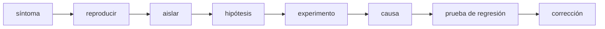
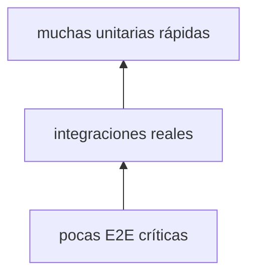
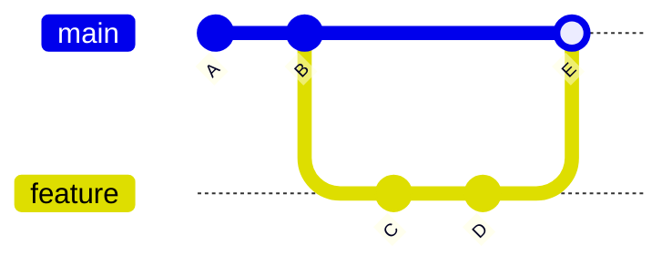
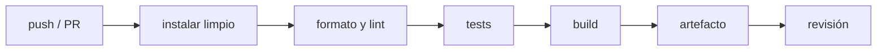

# Módulo 5: Testing, depuración, Git y CI


## Aprende construyendo


### Tema 1: Depurar con evidencia, no con cambios aleatorios · Intermedio · 45 min

<details open>
<summary><strong>Capa 1 — Lectura</strong></summary>

#### ► DE QUÉ TRATA
Al finalizar vas a reproducir un bug real de listar_pendientes en el proyecto Fundamentos, vas a escribir tu hipótesis en una línea ANTES de tocar el código, y vas a distinguir un cambio que corrige la causa real de un cambio que solo parece arreglar algo. Prerrequisitos: tareas.…

#### ► CÓMO FUNCIONA


</details>

<details>
<summary><strong>Capa 2 — Construcción</strong></summary>

#### Código y verificación
```
Función donde se detiene: _________
Print vs pdb: _________ (¿cuál usas?)
Línea que origina el ValueError y línea que lo llamó: _________
Logs en producción: _________
```

```python
def retirar(stock, cantidad):
    if cantidad > stock:
        raise ValueError("Stock insuficiente")
    return stock - cantidad
```

```python
import logging

logging.basicConfig(level=logging.INFO, format="%(levelname)s %(message)s sku=%(sku)s cantidad=%(cantidad)s")
logger = logging.getLogger(__name__)

sku, cantidad = "A-1", 3
logger.info("retirada_solicitada", extra={"sku": sku, "cantidad": cantidad})
```


```bash
mkdir depuracion-tareas
cd depuracion-tareas
```

```python
def listar_pendientes(tareas):
    # Defecto: compara contra "hecho" en vez de "pendiente".
    return [t for t in tareas if t["estado"] == "hecho"]

tareas = [
    {"descripcion": "comprar pan", "estado": "pendiente"},
    {"descripcion": "pagar luz", "estado": "hecho"},
    {"descripcion": "llamar al dentista", "estado": "pendiente"},
]
print(listar_pendientes(tareas))
```

</details>

### Tema 2: Pruebas con propósito y niveles adecuados · Intermedio · 45 min

<details open>
<summary><strong>Capa 1 — Lectura</strong></summary>

#### ► DE QUÉ TRATA
Al finalizar vas a escribir una prueba unitaria real para contar_pendientes y una prueba de integración real contra SQLite, y vas a comprobar en carne propia por qué una prueba unitaria sobresimulada (fake) puede seguir en verde aunque la consulta SQL real esté rota. Prerrequisit…

#### ► CÓMO FUNCIONA


</details>

<details>
<summary><strong>Capa 2 — Construcción</strong></summary>

#### Código y verificación
```
Unit (sin BD): _________
Integración (con BD): _________
E2E (CLI completo): _________
Proporción y por qué: _________
```

```python
import pytest
from inventario import retirar

def test_retirar_descuenta_stock():
    resultado = retirar(stock=5, cantidad=2)
    assert resultado == 3

def test_retirar_rechaza_cantidad_negativa():
    with pytest.raises(ValueError, match="positiva"):
        retirar(stock=5, cantidad=-2)
```


```bash
mkdir pruebas-tareas
cd pruebas-tareas
python3 -m venv .venv
```

```bash
python -m pip install pytest
mkdir src
mkdir tests
```

```python
def contar_pendientes(tareas):
    return len([t for t in tareas if t["estado"] == "pendiente"])

def contar_pendientes_bd(conexion):
    cursor = conexion.execute("SELECT COUNT(*) FROM tareas WHERE estado = 'pendiente'")
    return cursor.fetchone()[0]
```

</details>

### Tema 3: Git como historial de decisiones y colaboración · Intermedio · 45 min

<details open>
<summary><strong>Capa 1 — Lectura</strong></summary>

#### ► DE QUÉ TRATA
Al finalizar vas a comprobar en la práctica por qué un mensaje de commit como "fix" no le sirve a nadie dentro de una semana, y vas a reemplazar ese hábito escribiendo mensajes que expliquen el motivo de un cambio, no solo qué archivo tocaron. Prerrequisitos: Git instalado; compr…

#### ► CÓMO FUNCIONA


</details>

<details>
<summary><strong>Capa 2 — Construcción</strong></summary>

#### Código y verificación
```
Ver log de archivo: _________
Ver cambios entre commits: _________
¿Revert crea nuevo commit? _________
Cuándo usas reset vs revert: _________
```

```bash
git status
git diff
git add src/inventario.py tests/test_inventario.py
git commit -m "Rechazar retiradas con cantidad no positiva"
```

```bash
git switch -c fix/cantidad-negativa
# editar y probar
git commit -am "Rechazar cantidades negativas"
git switch main
git merge fix/cantidad-negativa
```


```bash
mkdir historial-tareas
cd historial-tareas
git init -b main
git config user.name "Estudiante"
git config user.email "estudiante@example.com"
```

```python
ESTADO_INICIAL = "pendiente"
```

</details>

### Tema 4: Calidad estática, revisión e integración continua · Intermedio · 45 min

<details open>
<summary><strong>Capa 1 — Lectura</strong></summary>

#### ► DE QUÉ TRATA
Al finalizar vas a usar Ruff para detectar un error antes de ejecutar el código, y vas a reproducir en carne propia la trampa de "funciona en mi máquina": una prueba que pasa localmente solo porque depende de un archivo que quedó de una corrida manual anterior, y que falla en cua…

#### ► LA IDEA EN UNA FRASE
**Al finalizar vas a usar Ruff para detectar un error antes de ejecutar el código, y vas a reproducir en carne propia la trampa de "funciona en mi máquina": una prueba que pasa localmente solo porque depende de un archivo que quedó de una corrida manual anterior, y que falla en cuanto corre en un entorno limpio como el que usa CI.**

#### ► CÓMO FUNCIONA


</details>

<details>
<summary><strong>Capa 2 — Construcción</strong></summary>

#### Código y verificación
```
Orden de cambios: _________ (BD, código o tests primero?)
Pasos de TDD: red _________, green _________, refactor _________
Tool para cobertura: _________
Código no ejecutado por tests: _________
```

```yaml
name: calidad
on:
  pull_request:
  push:
    branches: [main]

jobs:
  test:
    runs-on: ubuntu-latest
    steps:
      - uses: actions/checkout@v7
      - uses: actions/setup-python@v7
        with:
          python-version: '3.14'
      - run: python -m pip install pytest ruff
      - run: ruff check .
      - run: pytest -q
```


```bash
mkdir calidad-tareas
cd calidad-tareas
python3 -m venv .venv
```

```bash
python -m pip install ruff pytest
mkdir src
mkdir tests
```

```python
import os  # defecto: queda sin usar

def contar_pendientes(tareas):
    return len([t for t in tareas if t["estado"] == "pendiente"])
```

</details>

### Proyecto 5: convertir el inventario en un repositorio confiable

<details open>
<summary><strong>Capa 1 — Lectura</strong></summary>

</details>

<details>
<summary><strong>Capa 2 — Construcción</strong></summary>

#### Nota de construcción
Este tema es principalmente conceptual en esta versión. La verificación se realiza con las preguntas de comprensión y el criterio de cuándo NO usar proyecto 5: convertir el inventario en un repositorio confiable.

</details>
