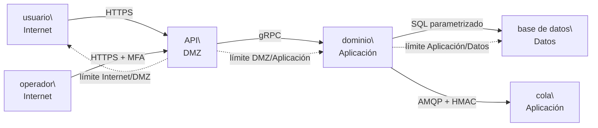
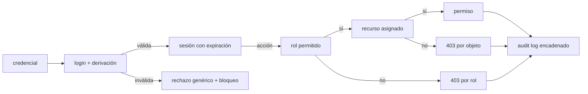
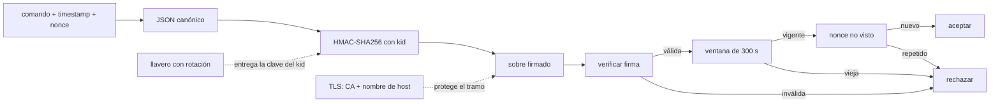
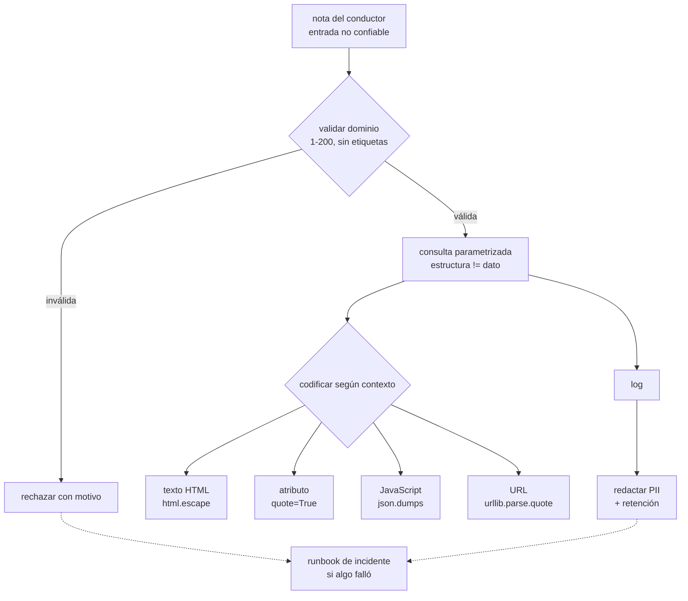
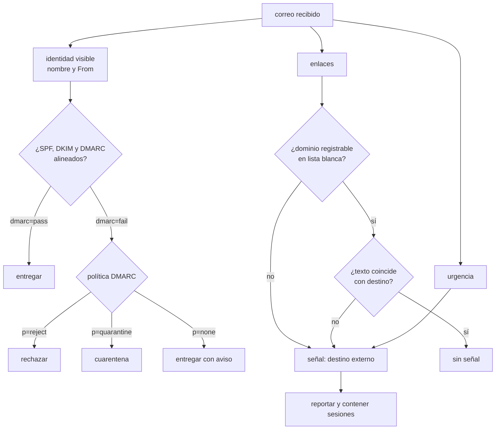

# Módulo 6: Seguridad, privacidad y modelado de amenazas


## Aprende construyendo


### Tema 1: Activos, amenazas, riesgos y límites de confianza · Avanzado · 45 min

<details open>
<summary><strong>Capa 1 — Lectura</strong></summary>

#### ► DE QUÉ TRATA
Al finalizar vas a producir el primer artefacto de una auditoría de seguridad real: un registro de riesgos STRIDE para RutaFlow y un verificador de límites de confianza. El registro no es una lista de miedos: cada fila tendrá activo, escenario, impacto, probabilidad, control, efe…

#### ► LA IDEA EN UNA FRASE
**Al finalizar vas a producir el primer artefacto de una auditoría de seguridad real: un registro de riesgos STRIDE para RutaFlow y un verificador de límites de confianza.**

#### ► POR QUÉ EXISTE ESTO
Resuelve un problema real de diseño o implementación y evita decisiones a ciegas.

#### ► LA ANALOGÍA
Piensa en activos, amenazas, riesgos y límites de confianza como una herramienta de taller: útil cuando conoces su propósito y sus límites.
**Dónde se rompe la analogía:** en software, los efectos dependen del contexto, la escala y los trade-offs.

#### ► CÓMO FUNCIONA


#### ► LO QUE PUEDE SALIR MAL
| Síntoma | Causa probable | Arreglo |
|---|---|---|
| Activos, amenazas, riesgos y límites de confianza se aplica pero el resultado no mejora | Se usó sin medir el problema real | Mide antes y compara contra la alternativa simple |
| Aparece complejidad inesperada | Se adoptó la técnica sin comprender sus trade-offs | Vuelve a la sección de trade-offs y reduce el alcance |
| Falla en un caso límite | Se asumió un contexto que no se cumple | Prueba el caso límite y documenta cuándo NO usarlo |

#### ► TRADE-OFFS
| Opción | Cuándo usarla | Cuándo NO usarla |
|---|---|---|
| Usar Activos, amenazas, riesgos y límites de confianza | Cuando el problema coincide con su propósito y el beneficio es observable | Cuando agrega complejidad sin resolver un problema real |
| Alternativa más simple | Cuando el contexto es pequeño, estable o fácil de razonar | Cuando ya demostró no escalar o no cumplir el requisito |
| Postergar la decisión | Cuando falta evidencia del problema | Cuando el costo de esperar es mayor que el costo de probar |

#### ► CUÁNDO NO USAR ESTO
No uses activos, amenazas, riesgos y límites de confianza por defecto. Aplícalo cuando el problema lo justifique y puedas verificar el beneficio; si una alternativa más simple resuelve igual, prefiérela.

#### ► DE VUELTA A LA ANALOGÍA
Volviendo a la analogía: activos, amenazas, riesgos y límites de confianza funciona como el modelo inicial, pero recuerda dónde se rompe: en producción importan la evidencia, la escala y el costo de equivocarte.

#### ► LO QUE DEBES RECORDAR
- Activos, amenazas, riesgos y límites de confianza existe para resolver un problema específico.
- Mide antes de adoptar complejidad.
- Conoce el caso donde NO usarlo.
- Verifica con evidencia observable.

#### ► PREGUNTAS PARA PENSAR
1. ¿Qué problema concreto resuelve activos, amenazas, riesgos y límites de confianza en tu contexto?
2. ¿Cómo sabrías que activos, amenazas, riesgos y límites de confianza no está funcionando bien?
3. ¿Qué alternativa más simple considerarías antes de usar activos, amenazas, riesgos y límites de confianza?

</details>

<details>
<summary><strong>Capa 2 — Construcción</strong></summary>

#### Código y verificación


```bash
mkdir ejemplo && cd ejemplo
```

```json
[
  {"id": "S-01", "stride": "Spoofing", "activo": "sesión del conductor", "escenario": "robo de token para confirmar entregas ajenas", "impacto": 4, "probabilidad": 3, "control": "sesiones con expiración y revocación", "efectividad": 0.7, "propietario": "identidad", "tratamiento": "mitigar"},
  {"id": "T-01", "stride": "Tampering", "activo": "estado del envío", "escenario": "operador marca entregado un envío que nunca salió", "impacto": 5, "probabilidad": 3, "control": "ALLOWED_TRANSITIONS", "efectividad": 0.6, "propietario": "dominio", "tratamiento": "mitigar"},
  {"id": "R-01", "stride": "Repudiation", "activo": "historial de confirmaciones", "escenario": "conductor niega haber confirmado una entrega", "impacto": 2, "probabilidad": 4, "control": "audit log encadenado", "efectividad": 0.5, "propietario": "operaciones", "tratamiento": "mitigar"},
  {"id": "I-01", "stride": "Information disclosure", "activo": "PIN del destinatario", "escenario": "lectura del PIN en la cola o en logs", "impacto": 4, "probabilidad": 2, "control": "HMAC, TLS y redacción de logs", "efectividad": 0.75, "propietario": "plataforma", "tratamiento": "mitigar"},
  {"id": "D-01", "stride": "Denial of service", "activo": "API de confirmación", "escenario": "ráfaga de confirmaciones falsas agota el servicio", "impacto": 3, "probabilidad": 4, "control": "límite de tasa por conductor", "efectividad": 0.8, "propietario": "plataforma", "tratamiento": "mitigar"},
  {"id": "E-01", "stride": "Elevation of privilege", "activo": "panel de operadores", "escenario": "conductor accede a funciones de administración", "impacto": 5, "probabilidad": 2, "control": "autorización por rol y recurso", "efectividad": 0.8, "propietario": "identidad", "tratamiento": "mitigar"},
  {"id": "S-02", "stride": "Spoofing", "activo": "correo de soporte", "escenario": "correo con nombre visible de RutaFlow desde dominio parecido", "impacto": 4, "probabilidad": 5, "control": "DMARC y formación", "efectividad": 0.4, "propietario": "seguridad", "tratamiento": "mitigar"},
  {"id": "I-02", "stride": "Information disclosure", "activo": "exportación de clientes", "escenario": "log con teléfonos y direcciones completas", "impacto": 4, "probabilidad": 4, "control": "redacción y retención de 30 días", "efectividad": 0.6, "propietario": "datos", "tratamiento": "mitigar"}
]
```

```python
import json
import sys
from pathlib import Path

STRIDE = {"Spoofing", "Tampering", "Repudiation", "Information disclosure", "Denial of service", "Elevation of privilege"}
TRATAMIENTOS = {"mitigar", "aceptar", "transferir", "evitar"}

amenazas = json.loads(Path("amenazas.json").read_text(encoding="utf-8"))
errores = []
for a in amenazas:
    if a["stride"] not in STRIDE:
        errores.append(f"{a['id']} STRIDE desconocido: {a['stride']}")
    for campo in ("impacto", "probabilidad"):
        if not 1 <= a[campo] <= 5:
            errores.append(f"{a['id']} {campo} fuera de rango (1-5): {a[campo]}")
    if not 0 <= a["efectividad"] <= 1:
        errores.append(f"{a['id']} efectividad fuera de rango (0-1): {a['efectividad']}")
    if not a.get("propietario"):
        errores.append(f"{a['id']} sin propietario")
    if a["tratamiento"] not in TRATAMIENTOS:
        errores.append(f"{a['id']} tratamiento inválido: {a['tratamiento']}")
if errores:
    sys.exit("fallo: " + "; ".join(errores))

for a in amenazas:
    a["riesgo"] = a["impacto"] * a["probabilidad"]
    a["residual"] = round(a["riesgo"] * (1 - a["efectividad"]))

amenazas.sort(key=lambda a: a["residual"], reverse=True)
print(f"amenazas: {len(amenazas)}")
for a in amenazas:
    print(f"{a['id']} {a['stride']}: riesgo {a['riesgo']} residual {a['residual']} — {a['tratamiento']} — {a['propietario']}")
print(f"prioridad: {amenazas[0]['id']} (residual {amenazas[0]['residual']})")
conteo = {}
for a in amenazas:
    conteo[a["stride"]] = conteo.get(a["stride"], 0) + 1
print("por STRIDE: " + ", ".join(f"{k}={v}" for k, v in sorted(conteo.items())))
```

```bash
python3 riesgos.py
```

```text
amenazas: 8
S-02 Spoofing: riesgo 20 residual 12 — mitigar — seguridad
T-01 Tampering: riesgo 15 residual 6 — mitigar — dominio
I-02 Information disclosure: riesgo 16 residual 6 — mitigar — datos
S-01 Spoofing: riesgo 12 residual 4 — mitigar — identidad
R-01 Repudiation: riesgo 8 residual 4 — mitigar — operaciones
I-01 Information disclosure: riesgo 8 residual 2 — mitigar — plataforma
D-01 Denial of service: riesgo 12 residual 2 — mitigar — plataforma
E-01 Elevation of privilege: riesgo 10 residual 2 — mitigar — identidad
prioridad: S-02 (residual 12)
por STRIDE: Denial of service=1, Elevation of privilege=1, Information disclosure=2, Repudiation=1, Spoofing=2, Tampering=1
```

</details>

### Tema 2: Identidad, contraseñas, sesiones y autorización · Avanzado · 45 min

<details open>
<summary><strong>Capa 1 — Lectura</strong></summary>

#### ► DE QUÉ TRATA
Al finalizar vas a implementar y auditar el control de acceso de RutaFlow: registrar contraseñas sin guardarlas en claro, emitir sesiones que expiran y se revocan, autorizar una acción sobre un recurso concreto y dejar un rastro verificable de lo ocurrido. El entregable es un pro…

#### ► LA IDEA EN UNA FRASE
**Al finalizar vas a implementar y auditar el control de acceso de RutaFlow: registrar contraseñas sin guardarlas en claro, emitir sesiones que expiran y se revocan, autorizar una acción sobre un recurso concreto y dejar un rastro verificable de lo ocurrido.**

#### ► POR QUÉ EXISTE ESTO
Resuelve un problema real de diseño o implementación y evita decisiones a ciegas.

#### ► LA ANALOGÍA
Piensa en identidad, contraseñas, sesiones y autorización como una herramienta de taller: útil cuando conoces su propósito y sus límites.
**Dónde se rompe la analogía:** en software, los efectos dependen del contexto, la escala y los trade-offs.

#### ► CÓMO FUNCIONA


#### ► LO QUE PUEDE SALIR MAL
| Síntoma | Causa probable | Arreglo |
|---|---|---|
| Identidad, contraseñas, sesiones y autorización se aplica pero el resultado no mejora | Se usó sin medir el problema real | Mide antes y compara contra la alternativa simple |
| Aparece complejidad inesperada | Se adoptó la técnica sin comprender sus trade-offs | Vuelve a la sección de trade-offs y reduce el alcance |
| Falla en un caso límite | Se asumió un contexto que no se cumple | Prueba el caso límite y documenta cuándo NO usarlo |

#### ► TRADE-OFFS
| Opción | Cuándo usarla | Cuándo NO usarla |
|---|---|---|
| Usar Identidad, contraseñas, sesiones y autorización | Cuando el problema coincide con su propósito y el beneficio es observable | Cuando agrega complejidad sin resolver un problema real |
| Alternativa más simple | Cuando el contexto es pequeño, estable o fácil de razonar | Cuando ya demostró no escalar o no cumplir el requisito |
| Postergar la decisión | Cuando falta evidencia del problema | Cuando el costo de esperar es mayor que el costo de probar |

#### ► CUÁNDO NO USAR ESTO
No uses identidad, contraseñas, sesiones y autorización por defecto. Aplícalo cuando el problema lo justifique y puedas verificar el beneficio; si una alternativa más simple resuelve igual, prefiérela.

#### ► DE VUELTA A LA ANALOGÍA
Volviendo a la analogía: identidad, contraseñas, sesiones y autorización funciona como el modelo inicial, pero recuerda dónde se rompe: en producción importan la evidencia, la escala y el costo de equivocarte.

#### ► LO QUE DEBES RECORDAR
- Identidad, contraseñas, sesiones y autorización existe para resolver un problema específico.
- Mide antes de adoptar complejidad.
- Conoce el caso donde NO usarlo.
- Verifica con evidencia observable.

#### ► PREGUNTAS PARA PENSAR
1. ¿Qué problema concreto resuelve identidad, contraseñas, sesiones y autorización en tu contexto?
2. ¿Cómo sabrías que identidad, contraseñas, sesiones y autorización no está funcionando bien?
3. ¿Qué alternativa más simple considerarías antes de usar identidad, contraseñas, sesiones y autorización?

</details>

<details>
<summary><strong>Capa 2 — Construcción</strong></summary>

#### Código y verificación


```bash
mkdir ejemplo && cd ejemplo
```

```python
import hashlib
import hmac
import secrets
import time

ITERACIONES = 600_000
ASIGNACIONES = {"c-891": {"RF-4471", "RF-4472"}, "c-999": {"RF-5000"}}
USUARIOS = {}
SESIONES = {}
INTENTOS = {}
BLOQUEOS = {}


def registrar(usuario, password, rol):
    salt = secrets.token_bytes(16)
    USUARIOS[usuario] = {
        "rol": rol,
        "salt": salt,
        "hash": hashlib.pbkdf2_hmac("sha256", password.encode(), salt, ITERACIONES),
    }


def login(usuario, password):
    ahora = time.time()
    if BLOQUEOS.get(usuario, 0) > ahora:
        raise PermissionError("cuenta bloqueada temporalmente")
    registro = USUARIOS.get(usuario)
    if registro is None:
        raise PermissionError("credenciales inválidas")
    calculado = hashlib.pbkdf2_hmac("sha256", password.encode(), registro["salt"], ITERACIONES)
    if not hmac.compare_digest(calculado, registro["hash"]):
        INTENTOS[usuario] = INTENTOS.get(usuario, 0) + 1
        if INTENTOS[usuario] >= 3:
            BLOQUEOS[usuario] = ahora + 30
            INTENTOS[usuario] = 0
            raise PermissionError("cuenta bloqueada temporalmente")
        raise PermissionError("credenciales inválidas")
    INTENTOS[usuario] = 0
    token = secrets.token_urlsafe(16)
    SESIONES[token] = {"usuario": usuario, "expira": ahora + 900}
    return token


def sesion_activa(token):
    sesion = SESIONES.get(token)
    if sesion is None:
        raise PermissionError("sesión inválida o revocada")
    if sesion["expira"] < time.time():
        SESIONES.pop(token)
        raise PermissionError("sesión vencida")
    return sesion["usuario"]


def confirmar(token, envio_id):
    usuario = sesion_activa(token)
    if USUARIOS[usuario]["rol"] != "conductor":
        raise PermissionError(f"rol {USUARIOS[usuario]['rol']} no puede confirmar entregas")
    if envio_id not in ASIGNACIONES.get(usuario, set()):
        raise PermissionError(f"{usuario} no está asignado a {envio_id}")
    return f"{usuario} confirmó {envio_id}"


def exportar(token):
    usuario = sesion_activa(token)
    if USUARIOS[usuario]["rol"] != "admin":
        raise PermissionError(f"rol {USUARIOS[usuario]['rol']} no autorizado a exportar")
    return sum(len(v) for v in ASIGNACIONES.values())


registrar("c-891", "pin-4471", "conductor")
registrar("c-999", "pin-5000", "conductor")
registrar("a-01", "clave-admin", "admin")
print(f"salts distintos: {USUARIOS['c-891']['salt'] != USUARIOS['c-999']['salt']}")

token_891 = login("c-891", "pin-4471")
token_999 = login("c-999", "pin-5000")
token_admin = login("a-01", "clave-admin")
print(confirmar(token_891, "RF-4471"))
try:
    print(f"otro conductor: {confirmar(token_999, 'RF-4471')}")
except PermissionError as error:
    print(f"otro conductor: denegado: {error}")
try:
    confirmar("token-inventado", "RF-4471")
except PermissionError as error:
    print(f"anónimo: denegado: {error}")
print(f"admin exporta: {exportar(token_admin)} envíos")
try:
    exportar(token_891)
except PermissionError as error:
    print(f"conductor exporta: denegado: {error}")
for _ in range(3):
    try:
        login("c-999", "incorrecta")
    except PermissionError:
        pass
try:
    login("c-999", "pin-5000")
except PermissionError as error:
    print(f"tras 3 fallos: {error}")
SESIONES[token_891]["expira"] = time.time() - 1
try:
    confirmar(token_891, "RF-4471")
except PermissionError as error:
    print(f"sesión vencida: denegado: {error}")
SESIONES.pop(token_admin)
try:
    exportar(token_admin)
except PermissionError as error:
    print(f"sesión revocada: denegado: {error}")
```

```bash
python3 acceso.py
```

```text
salts distintos: True
c-891 confirmó RF-4471
otro conductor: denegado: c-999 no está asignado a RF-4471
anónimo: denegado: sesión inválida o revocada
admin exporta: 3 envíos
conductor exporta: denegado: rol conductor no autorizado a exportar
tras 3 fallos: cuenta bloqueada temporalmente
sesión vencida: denegado: sesión vencida
sesión revocada: denegado: sesión inválida o revocada
```

```python
import hashlib
import json

CERO = "0" * 64


def canonico(datos):
    return json.dumps(datos, sort_keys=True, separators=(",", ":")).encode()


def sello(evento):
    payload = {k: evento[k] for k in ("seq", "ts", "actor", "accion", "recurso", "prev")}
    return hashlib.sha256(canonico(payload)).hexdigest()


def encadenar(eventos):
    prev = CERO
    for evento in eventos:
        evento["prev"] = prev
        evento["hash"] = sello(evento)
        prev = evento["hash"]
    return eventos


def verificar(eventos):
    prev = CERO
    for evento in eventos:
        if evento["prev"] != prev:
            return False, f"corte en {evento['seq']}: prev no coincide"
        if evento["hash"] != sello(evento):
            return False, f"corte en {evento['seq']}: contenido alterado"
        prev = evento["hash"]
    return True, "sin cortes"


base = [
    {"seq": 1, "ts": "2026-10-30T10:00:00Z", "actor": "c-891", "accion": "confirmar", "recurso": "RF-4471"},
    {"seq": 2, "ts": "2026-10-30T10:01:10Z", "actor": "c-999", "accion": "intento_denegado", "recurso": "RF-4471"},
    {"seq": 3, "ts": "2026-10-30T10:02:30Z", "actor": "a-01", "accion": "exportar", "recurso": "clientes"},
]
eventos = encadenar([dict(e) for e in base])


def estado(eventos):
    valida, detalle = verificar(eventos)
    return f"válida={valida} ({detalle})"


print(f"eventos: {len(eventos)}")
print(f"cadena inicial: {estado(eventos)}")

alterados = [dict(e) for e in eventos]
alterados[1]["accion"] = "confirmar"
print(f"tras alterar el evento 2: {estado(alterados)}")

borrados = [dict(e) for e in eventos if e["seq"] != 2]
print(f"tras borrar el evento 2: {estado(borrados)}")

recompuestos = encadenar([dict(e) for e in alterados])
print(f"atacante que recalcula toda la cadena: {estado(recompuestos)}")
```

</details>

### Tema 3: Criptografía aplicada, TLS, claves y secretos · Avanzado · 45 min

<details open>
<summary><strong>Capa 1 — Lectura</strong></summary>

#### ► DE QUÉ TRATA
Al finalizar vas a proteger el comando de confirmación de RutaFlow con una firma HMAC que detecte manipulación y replay, a verificar de verdad el certificado TLS de un servidor local —incluido el nombre de host— y a comprobar por qué borrar un secreto del árbol de trabajo no lo b…

#### ► LA IDEA EN UNA FRASE
**Al finalizar vas a proteger el comando de confirmación de RutaFlow con una firma HMAC que detecte manipulación y replay, a verificar de verdad el certificado TLS de un servidor local —incluido el nombre de host— y a comprobar por qué borrar un secreto del árbol de trabajo no lo borra del historial de Git.**

#### ► POR QUÉ EXISTE ESTO
Resuelve un problema real de diseño o implementación y evita decisiones a ciegas.

#### ► LA ANALOGÍA
Piensa en criptografía aplicada, tls, claves y secretos como una herramienta de taller: útil cuando conoces su propósito y sus límites.
**Dónde se rompe la analogía:** en software, los efectos dependen del contexto, la escala y los trade-offs.

#### ► CÓMO FUNCIONA


#### ► LO QUE PUEDE SALIR MAL
| Síntoma | Causa probable | Arreglo |
|---|---|---|
| Criptografía aplicada, TLS, claves y secretos se aplica pero el resultado no mejora | Se usó sin medir el problema real | Mide antes y compara contra la alternativa simple |
| Aparece complejidad inesperada | Se adoptó la técnica sin comprender sus trade-offs | Vuelve a la sección de trade-offs y reduce el alcance |
| Falla en un caso límite | Se asumió un contexto que no se cumple | Prueba el caso límite y documenta cuándo NO usarlo |

#### ► TRADE-OFFS
| Opción | Cuándo usarla | Cuándo NO usarla |
|---|---|---|
| Usar Criptografía aplicada, TLS, claves y secretos | Cuando el problema coincide con su propósito y el beneficio es observable | Cuando agrega complejidad sin resolver un problema real |
| Alternativa más simple | Cuando el contexto es pequeño, estable o fácil de razonar | Cuando ya demostró no escalar o no cumplir el requisito |
| Postergar la decisión | Cuando falta evidencia del problema | Cuando el costo de esperar es mayor que el costo de probar |

#### ► CUÁNDO NO USAR ESTO
No uses criptografía aplicada, tls, claves y secretos por defecto. Aplícalo cuando el problema lo justifique y puedas verificar el beneficio; si una alternativa más simple resuelve igual, prefiérela.

#### ► DE VUELTA A LA ANALOGÍA
Volviendo a la analogía: criptografía aplicada, tls, claves y secretos funciona como el modelo inicial, pero recuerda dónde se rompe: en producción importan la evidencia, la escala y el costo de equivocarte.

#### ► LO QUE DEBES RECORDAR
- Criptografía aplicada, TLS, claves y secretos existe para resolver un problema específico.
- Mide antes de adoptar complejidad.
- Conoce el caso donde NO usarlo.
- Verifica con evidencia observable.

#### ► PREGUNTAS PARA PENSAR
1. ¿Qué problema concreto resuelve criptografía aplicada, tls, claves y secretos en tu contexto?
2. ¿Cómo sabrías que criptografía aplicada, tls, claves y secretos no está funcionando bien?
3. ¿Qué alternativa más simple considerarías antes de usar criptografía aplicada, tls, claves y secretos?

</details>

<details>
<summary><strong>Capa 2 — Construcción</strong></summary>

#### Código y verificación


```bash
mkdir ejemplo && cd ejemplo
```

```json
{
  "shipmentId": "RF-4471",
  "recipientPin": "837201",
  "timestamp": 1793414990,
  "nonce": "n-7f3a"
}
```

```python
import hashlib
import hmac
import json
import os
import sys
from pathlib import Path

SECRETOS = {"k-2026-10": os.environ.get("SECRETO_ACTUAL", ""), "k-2026-09": "clave-anterior-de-laboratorio"}
VENTANA = 300
AHORA = 1793415000

if not SECRETOS["k-2026-10"]:
    sys.exit("fallo: falta SECRETO_ACTUAL en el entorno")


def canonico(datos):
    return json.dumps(datos, sort_keys=True, separators=(",", ":")).encode()


def firmar(comando, kid):
    return hmac.new(SECRETOS[kid].encode(), canonico(comando), hashlib.sha256).hexdigest()


def verificar(sobre, vistos, ahora=AHORA):
    comando = sobre["comando"]
    if sobre["kid"] not in SECRETOS:
        return False, f"kid desconocido: {sobre['kid']}"
    if not hmac.compare_digest(sobre["firma"], firmar(comando, sobre["kid"])):
        return False, "firma inválida"
    if abs(ahora - comando["timestamp"]) > VENTANA:
        return False, "timestamp fuera de ventana"
    if comando["nonce"] in vistos:
        return False, "nonce ya utilizado"
    vistos.add(comando["nonce"])
    return True, "aceptado"


def resultado(par):
    return f"{par[0]} — {par[1]}"


comando = json.loads(Path("comando.json").read_text(encoding="utf-8"))
sobre = {"comando": comando, "kid": "k-2026-10", "firma": firmar(comando, "k-2026-10")}
vistos = set()
print(f"kid: {sobre['kid']}")
print(f"comando canónico: {canonico(comando).decode()}")
print(f"válido: {resultado(verificar(sobre, vistos))}")

alterado = {"comando": {**comando, "recipientPin": "999999"}, "kid": sobre["kid"], "firma": sobre["firma"]}
print(f"PIN alterado: {resultado(verificar(alterado, vistos))}")

repetido = {"comando": dict(comando), "kid": sobre["kid"], "firma": sobre["firma"]}
print(f"replay del mismo nonce: {resultado(verificar(repetido, vistos))}")

viejo = {"comando": {**comando, "timestamp": comando["timestamp"] - 3600, "nonce": "n-viejo"}, "kid": sobre["kid"]}
viejo["firma"] = firmar(viejo["comando"], sobre["kid"])
print(f"timestamp viejo: {resultado(verificar(viejo, vistos))}")

ajeno = {"comando": {**comando, "nonce": "n-ajeno"}, "kid": "k-2025-01", "firma": "0" * 64}
print(f"kid desconocido: {resultado(verificar(ajeno, vistos))}")
```

```bash
export SECRETO_ACTUAL='clave-actual-de-laboratorio'
python3 firma.py
```

```text
kid: k-2026-10
comando canónico: {"nonce":"n-7f3a","recipientPin":"837201","shipmentId":"RF-4471","timestamp":1793414990}
válido: True — aceptado
PIN alterado: False — firma inválida
replay del mismo nonce: False — nonce ya utilizado
timestamp viejo: False — timestamp fuera de ventana
kid desconocido: False — kid desconocido: k-2025-01
```

</details>

### Tema 4: Validación, vulnerabilidades web, privacidad y respuesta · Avanzado · 45 min

<details open>
<summary><strong>Capa 1 — Lectura</strong></summary>

#### ► DE QUÉ TRATA
Al finalizar vas a endurecer el campo de nota que un conductor escribe al entregar un envío: validar su dominio al guardar, impedir que una consulta concatenada se convierta en inyección SQL, codificar la salida según el contexto donde se muestra y redactar datos personales antes…

#### ► LA IDEA EN UNA FRASE
**Al finalizar vas a endurecer el campo de nota que un conductor escribe al entregar un envío: validar su dominio al guardar, impedir que una consulta concatenada se convierta en inyección SQL, codificar la salida según el contexto donde se muestra y redactar datos personales antes de escribirlos en un log.**

#### ► POR QUÉ EXISTE ESTO
Resuelve un problema real de diseño o implementación y evita decisiones a ciegas.

#### ► LA ANALOGÍA
Piensa en validación, vulnerabilidades web, privacidad y respuesta como una herramienta de taller: útil cuando conoces su propósito y sus límites.
**Dónde se rompe la analogía:** en software, los efectos dependen del contexto, la escala y los trade-offs.

#### ► CÓMO FUNCIONA


#### ► LO QUE PUEDE SALIR MAL
| Síntoma | Causa probable | Arreglo |
|---|---|---|
| Validación, vulnerabilidades web, privacidad y respuesta se aplica pero el resultado no mejora | Se usó sin medir el problema real | Mide antes y compara contra la alternativa simple |
| Aparece complejidad inesperada | Se adoptó la técnica sin comprender sus trade-offs | Vuelve a la sección de trade-offs y reduce el alcance |
| Falla en un caso límite | Se asumió un contexto que no se cumple | Prueba el caso límite y documenta cuándo NO usarlo |

#### ► TRADE-OFFS
| Opción | Cuándo usarla | Cuándo NO usarla |
|---|---|---|
| Usar Validación, vulnerabilidades web, privacidad y respuesta | Cuando el problema coincide con su propósito y el beneficio es observable | Cuando agrega complejidad sin resolver un problema real |
| Alternativa más simple | Cuando el contexto es pequeño, estable o fácil de razonar | Cuando ya demostró no escalar o no cumplir el requisito |
| Postergar la decisión | Cuando falta evidencia del problema | Cuando el costo de esperar es mayor que el costo de probar |

#### ► CUÁNDO NO USAR ESTO
No uses validación, vulnerabilidades web, privacidad y respuesta por defecto. Aplícalo cuando el problema lo justifique y puedas verificar el beneficio; si una alternativa más simple resuelve igual, prefiérela.

#### ► DE VUELTA A LA ANALOGÍA
Volviendo a la analogía: validación, vulnerabilidades web, privacidad y respuesta funciona como el modelo inicial, pero recuerda dónde se rompe: en producción importan la evidencia, la escala y el costo de equivocarte.

#### ► LO QUE DEBES RECORDAR
- Validación, vulnerabilidades web, privacidad y respuesta existe para resolver un problema específico.
- Mide antes de adoptar complejidad.
- Conoce el caso donde NO usarlo.
- Verifica con evidencia observable.

#### ► PREGUNTAS PARA PENSAR
1. ¿Qué problema concreto resuelve validación, vulnerabilidades web, privacidad y respuesta en tu contexto?
2. ¿Cómo sabrías que validación, vulnerabilidades web, privacidad y respuesta no está funcionando bien?
3. ¿Qué alternativa más simple considerarías antes de usar validación, vulnerabilidades web, privacidad y respuesta?

</details>

<details>
<summary><strong>Capa 2 — Construcción</strong></summary>

#### Código y verificación


```bash
mkdir ejemplo && cd ejemplo
```

```python
def validar(nota):
    if not nota.strip():
        return "vacía"
    if len(nota) > 200:
        return "supera 200 caracteres"
    if "<" in nota or ">" in nota:
        return "contiene etiquetas"
    return None


casos = [
    "dejado con el portero",
    "",
    "a" * 201,
    "   ",
]
for nota in casos:
    error = validar(nota)
    etiqueta = nota if len(nota) <= 30 else nota[:27] + "..."
    print(f"{etiqueta!r}: {'válida' if error is None else 'rechazada — ' + error}")
```

```bash
python3 validar.py
```

```text
'dejado con el portero': válida
'': rechazada — contiene etiquetas
'aaaaaaaaaaaaaaaaaaaaaaaaaaa...': rechazada — supera 200 caracteres
'   ': rechazada — vacía
```

```python
import sqlite3

db = sqlite3.connect(":memory:")
db.execute("CREATE TABLE notas (id INTEGER PRIMARY KEY, texto TEXT)")
db.executemany("INSERT INTO notas (texto) VALUES (?)", [("dejado con el portero",), ("entregado en recepción",)])

payloads = [
    "dejado' OR '1'='1",
    "x' UNION SELECT 99, 'dato filtrado' --",
]
for payload in payloads:
    parametrizada = db.execute("SELECT id, texto FROM notas WHERE texto = ?", (payload,)).fetchall()
    concatenada = db.execute(f"SELECT id, texto FROM notas WHERE texto = '{payload}'").fetchall()
    print(f"payload: {payload}")
    print(f"  parametrizada: {len(parametrizada)} filas")
    print(f"  concatenada:   {len(concatenada)} filas -> {concatenada}")
```

</details>

### Tema 5: Ingeniería social, phishing y respuesta: analizar el correo, no solo mirarlo · Avanzado · 45 min

<details open>
<summary><strong>Capa 1 — Lectura</strong></summary>

#### ► DE QUÉ TRATA
Al finalizar vas a analizar un correo sospechoso con código: comparar el remitente visible con las cabeceras reales, detectar enlaces cuyo destino no coincide con el texto, distinguir un dominio parecido de uno legítimo por su dominio registrable, interpretar el resultado de SPF,…

#### ► LA IDEA EN UNA FRASE
**Al finalizar vas a analizar un correo sospechoso con código: comparar el remitente visible con las cabeceras reales, detectar enlaces cuyo destino no coincide con el texto, distinguir un dominio parecido de uno legítimo por su dominio registrable, interpretar el resultado de SPF, DKIM y DMARC y medir el efecto de una campaña de concienciación sin inventar conclusiones con muestras pequeñas.**

#### ► POR QUÉ EXISTE ESTO
Resuelve un problema real de diseño o implementación y evita decisiones a ciegas.

#### ► LA ANALOGÍA
Piensa en ingeniería social, phishing y respuesta: analizar el correo, no solo mirarlo como una herramienta de taller: útil cuando conoces su propósito y sus límites.
**Dónde se rompe la analogía:** en software, los efectos dependen del contexto, la escala y los trade-offs.

#### ► CÓMO FUNCIONA


#### ► LO QUE PUEDE SALIR MAL
| Síntoma | Causa probable | Arreglo |
|---|---|---|
| Ingeniería social, phishing y respuesta: analizar el correo, no solo mirarlo se aplica pero el resultado no mejora | Se usó sin medir el problema real | Mide antes y compara contra la alternativa simple |
| Aparece complejidad inesperada | Se adoptó la técnica sin comprender sus trade-offs | Vuelve a la sección de trade-offs y reduce el alcance |
| Falla en un caso límite | Se asumió un contexto que no se cumple | Prueba el caso límite y documenta cuándo NO usarlo |

#### ► TRADE-OFFS
| Opción | Cuándo usarla | Cuándo NO usarla |
|---|---|---|
| Usar Ingeniería social, phishing y respuesta: analizar el correo, no solo mirarlo | Cuando el problema coincide con su propósito y el beneficio es observable | Cuando agrega complejidad sin resolver un problema real |
| Alternativa más simple | Cuando el contexto es pequeño, estable o fácil de razonar | Cuando ya demostró no escalar o no cumplir el requisito |
| Postergar la decisión | Cuando falta evidencia del problema | Cuando el costo de esperar es mayor que el costo de probar |

#### ► CUÁNDO NO USAR ESTO
No uses ingeniería social, phishing y respuesta: analizar el correo, no solo mirarlo por defecto. Aplícalo cuando el problema lo justifique y puedas verificar el beneficio; si una alternativa más simple resuelve igual, prefiérela.

#### ► DE VUELTA A LA ANALOGÍA
Volviendo a la analogía: ingeniería social, phishing y respuesta: analizar el correo, no solo mirarlo funciona como el modelo inicial, pero recuerda dónde se rompe: en producción importan la evidencia, la escala y el costo de equivocarte.

#### ► LO QUE DEBES RECORDAR
- Ingeniería social, phishing y respuesta: analizar el correo, no solo mirarlo existe para resolver un problema específico.
- Mide antes de adoptar complejidad.
- Conoce el caso donde NO usarlo.
- Verifica con evidencia observable.

#### ► PREGUNTAS PARA PENSAR
1. ¿Qué problema concreto resuelve ingeniería social, phishing y respuesta: analizar el correo, no solo mirarlo en tu contexto?
2. ¿Cómo sabrías que ingeniería social, phishing y respuesta: analizar el correo, no solo mirarlo no está funcionando bien?
3. ¿Qué alternativa más simple considerarías antes de usar ingeniería social, phishing y respuesta: analizar el correo, no solo mirarlo?

</details>

<details>
<summary><strong>Capa 2 — Construcción</strong></summary>

#### Código y verificación


```bash
mkdir ejemplo && cd ejemplo
```

```python
import re
from email import message_from_string
from html.parser import HTMLParser
from urllib.parse import urlsplit

DOMINIOS = {"rutaflow.co"}
PALABRAS = ["urgente", "suspendida", "24 horas", "verifique", "inmediato"]


def dominio(direccion):
    return direccion.rsplit("@", 1)[-1].strip().lower().rstrip(">")


class Enlaces(HTMLParser):
    def __init__(self):
        super().__init__()
        self.enlaces = []
        self._href = None

    def handle_starttag(self, tag, attrs):
        if tag == "a":
            self._href = dict(attrs).get("href")

    def handle_data(self, data):
        if self._href is not None:
            self.enlaces.append((self._href, data.strip()))
            self._href = None


def revisar(crudo):
    msg = message_from_string(crudo)
    de = msg["From"] or ""
    remitente = dominio(de)
    alertas = []

    return_path = msg.get("Return-Path") or ""
    if return_path and dominio(return_path) != remitente:
        alertas.append(f"Return-Path {dominio(return_path)} no coincide con From {remitente}")
    reply_to = msg.get("Reply-To") or ""
    if reply_to and dominio(reply_to) != remitente:
        alertas.append(f"Reply-To {dominio(reply_to)} no coincide con From {remitente}")

    parser = Enlaces()
    parser.feed(msg.get_payload())
    for href, texto in parser.enlaces:
        destino = urlsplit(href)
        host = (destino.hostname or "").lower()
        if destino.username:
            alertas.append(f"URL con userinfo: {href} -> destino real {host}")
        if host.startswith("xn--"):
            alertas.append(f"dominio punycode: {host}")
        raros = [f"{c} (U+{ord(c):04X})" for c in host if ord(c) > 127]
        if raros:
            alertas.append(f"homógrafo en el destino: {raros} en {host}")
        if host and not host.replace(".", "").isdigit() and host not in DOMINIOS:
            alertas.append(f"destino fuera de la lista blanca: {host}")
        if destino.scheme != "https":
            alertas.append(f"enlace sin HTTPS: {href}")
        visible = urlsplit(texto if "://" in texto else "https://" + texto).hostname or ""
        if visible and visible != host:
            alertas.append(f"texto muestra {visible} pero va a {host}")

    texto_total = " ".join([msg["Subject"] or "", msg.get_payload()]).lower()
    urgencia = [p for p in PALABRAS if p in texto_total]
    if urgencia:
        alertas.append(f"urgencia: {', '.join(urgencia)}")
    return alertas


correos = {
    "legítimo": """From: facturas@rutaflow.co
Return-Path: <facturas@rutaflow.co>
Subject: Factura de octubre
Content-Type: text/html; charset=utf-8

<a href="https://rutaflow.co/f/10">rutaflow.co</a>""",
    "typosquat": """From: soporte@rutaf1ow.co
Return-Path: <rebote@mailer.example>
Reply-To: ayuda@otro.example
Subject: URGENTE: cuenta suspendida
Content-Type: text/html; charset=utf-8

Verifique en 24 horas: <a href="https://rutaflow.co@rutaf1ow.co/login">rutaflow.co</a>""",
    "punycode": """From: seguridad@rutaflow.co
Subject: Actualice sus datos
Content-Type: text/html; charset=utf-8

<a href="http://xn--rutflow-4fg.co/datos">rutaflow.co</a>""",
}

for nombre, crudo in correos.items():
    alertas = revisar(crudo)
    print(f"{nombre}: {'SOSPECHOSO' if alertas else 'sin señales'}")
    for alerta in alertas:
        print(f"  - {alerta}")
```

```bash
python3 analizar.py
```

```text
legítimo: sin señales
typosquat: SOSPECHOSO
  - Return-Path mailer.example no coincide con From rutaf1ow.co
  - Reply-To otro.example no coincide con From rutaf1ow.co
  - URL con userinfo: https://rutaflow.co@rutaf1ow.co/login -> destino real rutaf1ow.co
  - destino fuera de la lista blanca: rutaf1ow.co
  - texto muestra rutaflow.co pero va a rutaf1ow.co
  - urgencia: urgente, suspendida, 24 horas, verifique
punycode: SOSPECHOSO
  - dominio punycode: xn--rutflow-4fg.co
  - destino fuera de la lista blanca: xn--rutflow-4fg.co
  - enlace sin HTTPS: http://xn--rutflow-4fg.co/datos
  - texto muestra rutaflow.co pero va a xn--rutflow-4fg.co
```

```python
import ipaddress
from urllib.parse import urlsplit

PERMITIDOS = {"rutaflow.co", "pagos.rutaflow.co"}


def registrable(host):
    etiquetas = host.rstrip(".").split(".")
    return ".".join(etiquetas[-2:]) if len(etiquetas) >= 2 else host


def revisar(url):
    partes = urlsplit(url)
    host = (partes.hostname or "").lower()
    notas = [f"host={host}", f"registrable={registrable(host)}"]
    if partes.username:
        notas.append(f"userinfo oculta el destino real: {partes.username}@{host}")
    try:
        ipaddress.ip_address(host)
        notas.append("el destino es una IP, no un dominio")
    except ValueError:
        pass
    if any(ord(c) > 127 for c in host):
        notas.append("el host tiene caracteres no ASCII (homógrafo)")
    if host.startswith("xn--") or ".xn--" in host:
        try:
            notas.append(f"punycode decodifica a {host.encode('ascii').decode('idna')}")
        except UnicodeError:
            notas.append("punycode inválido")
    if partes.scheme != "https":
        notas.append("sin HTTPS")
    if host not in PERMITIDOS and registrable(host) not in PERMITIDOS:
        notas.append("fuera de la lista blanca por dominio registrable")
    return notas


for url in [
    "https://rutaflow.co@rutaf1ow.co/login",
    "https://pagos.rutaflow.co.evil.example/login",
    "https://xn--rutflow-4fg.co/datos",
    "https://rutaflоw.co/datos",
    "http://45.12.3.9/login",
    "https://pagos.rutaflow.co/f/10",
]:
    print(url)
    for nota in revisar(url):
        print(f"  - {nota}")
```

</details>
