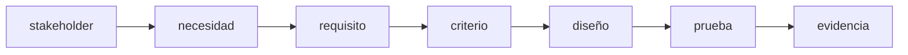
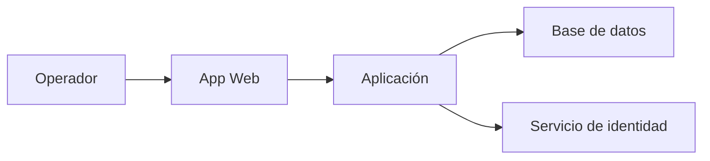
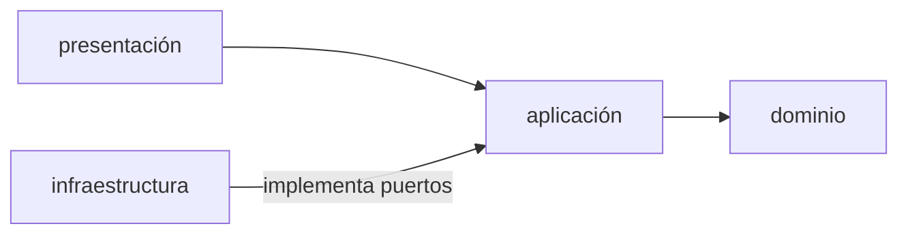
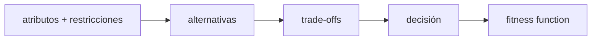
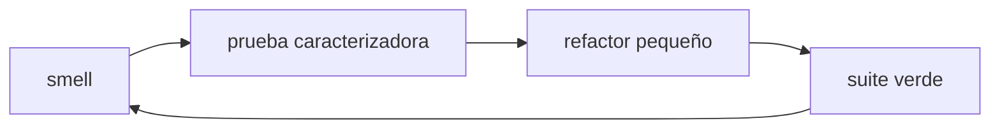
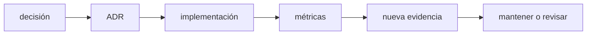
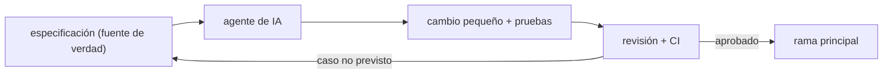
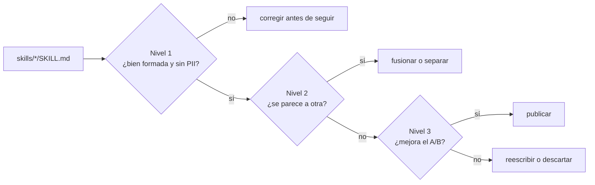

# Módulo 7: Requisitos, diseño, arquitectura y mantenimiento


## Aprende construyendo

### Tema 1: Requisitos, stakeholders y criterios verificables

#### Paso 1 · Objetivo y preparación
Al finalizar vas a convertir "confirmar una entrega debe ser seguro" en un criterio de aceptación verificable, usando la regla de confirmación `recipientPin`: debe tener exactamente 6 dígitos. Prerrequisitos: ninguno adicional.

#### Paso 2 · Contexto y caso real
A lo largo de estos 12 módulos vas a construir el proyecto integrador Fundamentos, y en este módulo en particular vas a organizar el código en módulos para reutilizar funciones. "El sistema debe confirmar entregas de forma segura" no es verificable. El código real ya lo resolvió con una regla concreta: `recipientPin` debe tener exactamente 6 dígitos — esa es la especificación que faltaba poner en palabras antes de escribirse en código.

#### Paso 3 · Teoría, modelo mental y analogía
Un criterio de aceptación convierte una intención vaga en ejemplos con entrada y salida esperada — el contrato de resultado de una obra, no una sensación de "que quede bien".

**Conceptos clave:** stakeholder, necesidad, requisito funcional, atributo de calidad, restricción, historia, criterio de aceptación, supuesto y trazabilidad.

Software exitoso no es el que contiene más funciones, sino el que satisface necesidades relevantes bajo restricciones explícitas. Un stakeholder puede ser usuario, operador, negocio, auditor o equipo de soporte; sus objetivos pueden entrar en tensión.

“El sistema debe ser rápido” no es verificable. “El 95 % de búsquedas por SKU debe responder en menos de 200 ms con 100 000 productos en el entorno de referencia” define operación, métrica, umbral y contexto.

Una historia organiza valor, pero no sustituye especificación:

```text
Como operador de bodega
quiero registrar una retirada por SKU
para mantener el stock actualizado.

Criterios:
- Dado stock 5, cuando retiro 2, entonces queda 3 y se registra auditoría.
- Dado stock 1, cuando retiro 2, entonces se rechaza sin cambio parcial.
- Un lector autenticado no puede retirar.
```

Los criterios usan ejemplos que luego pueden convertirse en pruebas. Registra supuestos (“una sola moneda”), exclusiones (“no sincroniza sucursales todavía”) y fuente. Mantén trazabilidad requisito → decisión → código → prueba → evidencia.

Prioriza por valor, riesgo, dependencia y coste de retraso. “Todo es prioridad alta” elimina la utilidad de priorizar. Descubrimiento continúa durante desarrollo: prototipos y pruebas con usuarios pueden revelar que el problema estaba mal entendido.

**Analogía:** requisitos son el contrato de resultado de una obra; “que sea cómoda” necesita convertirse en medidas y escenarios sin fingir que toda experiencia humana se reduce a números.

**¿Por qué es importante?** Porque `confirmDelivery()` ya fue programado correctamente contra una regla de 6 dígitos: el riesgo real en este tema nunca fue el código, sino quedarse con un requisito ambiguo antes de escribirlo.

**Límite de uso:** escribir un criterio por cada detalle trivial convierte el documento en burocracia; el umbral es que el criterio cambie una decisión de diseño o una prueba observable.

**Casos de uso reales:** historias, contratos API, SLO, accesibilidad, cumplimiento, migraciones y aceptación.

**Diagrama:**



#### Paso 4 · Demostración guiada desde cero
Crea una carpeta nueva con `criterios.md` y `verificar_criterios.py`, los dos archivos del ejemplo:

```bash
mkdir ejemplo && cd ejemplo
```

Archivo `criterios.md`:

```text
- Dado un comando con recipientPin de 6 dígitos y shipmentId válido, cuando se confirma, entonces el envío queda "delivered".
- Dado un recipientPin de 4 dígitos, cuando se confirma, entonces se rechaza con TypeError, sin cambiar el estado del envío.
- Dado un commandId ya procesado antes, cuando se reenvía el mismo comando, entonces se devuelve el resultado anterior sin volver a confirmar.
```

Archivo `verificar_criterios.py`:

```python
import re
import sys
from pathlib import Path

VAGOS = ("rápido", "rapido", "lento", "seguro", "fácil", "facil", "cómodo", "comodo", "estable")
lineas = [l.strip() for l in Path("criterios.md").read_text(encoding="utf-8").splitlines() if l.strip()]
fallos = []
for numero, linea in enumerate(lineas, 1):
    texto = linea.lower()
    if not all(palabra in texto for palabra in ("dado", "cuando", "entonces")):
        fallos.append(f"criterio {numero}: falta dado/cuando/entonces")
    elif any(vago in texto for vago in VAGOS) and not re.search(r"\d", linea):
        fallos.append(f"criterio {numero}: adjetivo sin medida numérica")
if not any("6 dígitos" in l for l in lineas):
    fallos.append("falta la regla del PIN de 6 dígitos")
print(f"criterios: {len(lineas)}")
print(f"verificables: {len(lineas) - len(fallos)}")
for fallo in fallos:
    print("fallo:", fallo)
sys.exit(1 if fallos else 0)
```

```bash
python3 verificar_criterios.py
```

Resultado esperado:

```text
criterios: 3
verificables: 3
```

Las tres líneas tienen dado/cuando/entonces, ninguna usa un adjetivo sin medida y la regla del PIN aparece escrita. El script comprueba la forma del criterio, no que `confirmDelivery()` la cumpla; esa correspondencia exige una prueba sobre el código real.

#### Paso 5 · Práctica guiada
Pista: agregá a `criterios.md` la línea "Dado cualquier comando, cuando se confirma, entonces el sistema debe responder rápido" y volvé a ejecutar el verificador. Ese es el fallo deliberado: imprime `verificables: 3` y `fallo: criterio 4: adjetivo sin medida numérica`, con código de salida 1, porque "rápido" no tiene métrica, umbral ni contexto. Corregilo con "95 % de confirmaciones en menos de 200 ms con el motor de pruebas local" y el criterio pasa.

#### Paso 6 · Práctica independiente
Escribí 5 criterios verificables para el CLI del proyecto integrador Fundamentos. Por ejemplo: "tarea add 'hacer compras' debe guardar y después listar mostrará esa tarea", con una condición observable y sin adjetivos sin número.

#### Paso 7 · Cierre
Entregá los tres criterios verificables del Paso 4, la salida del criterio vago y su corrección del Paso 5, y los cinco criterios del Paso 6; explicá por qué código correcto para un requisito mal escrito sigue siendo un fracaso. Como siguiente paso, usá estos criterios en el proyecto del módulo antes de escribir el código correspondiente. Errores comunes: escribir requisitos sin métrica ni umbral ("debe ser rápido"), confundir una historia de usuario con una especificación completa, y no registrar los supuestos ni las exclusiones del alcance. Fuente oficial primaria: https://www.rfc-editor.org/rfc/rfc2119.
### Tema 2: Arquitectura guiada por atributos de calidad

#### Paso 1 · Objetivo y preparación
Al finalizar vas a escribir el escenario de calidad que justifica una línea real de `confirm-delivery.ts`: la restricción `UNIQUE(command_id)`. Prerrequisitos: Tema 1 de este módulo.

#### Paso 2 · Contexto y caso real
El comentario del código real dice: "La implementación SQL debe insertar `commandId` y cambiar el envío en una única transacción con restricción `UNIQUE(command_id)`" — esa frase es la respuesta a un escenario de calidad que nunca se escribió explícitamente hasta ahora.

#### Paso 3 · Teoría, modelo mental y analogía
Un escenario de calidad tiene fuente, estímulo, artefacto, entorno, respuesta y medida — no es un diagrama bonito, es una frase verificable sobre qué pasa cuando algo sale mal.

**Conceptos clave:** arquitectura, componente, conector, límite, dependencia, atributo de calidad, escenario, trade-off, C4 y fitness function.

Arquitectura son decisiones estructurales difíciles de cambiar: responsabilidades, límites, comunicación y dependencias. No es únicamente un diagrama. Se evalúa contra atributos como mantenibilidad, disponibilidad, rendimiento, seguridad, portabilidad y operabilidad.

Un escenario de calidad tiene fuente, estímulo, artefacto, entorno, respuesta y medida: “durante operación normal, una pérdida del proceso no debe corromper una transacción confirmada; tras reinicio, datos comprometidos permanecen”. Este escenario favorece transacciones/durabilidad. Otro de despliegue frecuente puede favorecer modularidad y automatización.

C4 comunica niveles:



Una arquitectura por capas puede dirigir dependencias hacia el dominio:



El dominio no debería importar SQLite ni HTTP. Define una interfaz/puerto `RepositorioProductos`; infraestructura la implementa. Esto facilita pruebas y cambio de mecanismo, pero añadir abstracciones sin alternativa ni beneficio puede ser sobreingeniería.

Fitness functions automatizan propiedades: reglas de dependencia, presupuesto de bundle, tiempo de build, cobertura de contratos o vulnerabilidades máximas. La arquitectura evoluciona con evidencia.

**Analogía:** arquitectura decide estructura, circulación y servicios de un edificio según uso y riesgos; decorar habitaciones no corrige una salida de emergencia inexistente.

**¿Por qué es importante?** Porque la restricción `UNIQUE(command_id)` no es un capricho de la base de datos: es la respuesta directa a un escenario de calidad real (reintentos de red) que, sin documentarlo, parece una regla arbitraria.

**Casos de uso reales:** monolito modular, microservicios, móvil offline, sistemas regulados y plataformas multi-equipo.

**Diagrama:**



**Transferencia al proyecto integrador «Fundamentos: gestor de tareas»:** Define disponibilidad, facilidad de prueba y recuperación requeridas por el gestor. Compara dos diseños mediante un escenario concreto de archivo corrupto, en vez de elegir capas solo por su nombre.

#### Paso 4 · Demostración guiada desde cero
Crea una carpeta nueva con `escenario.txt` y `escenario.py`, el escenario y su comprobación en SQLite:

```bash
mkdir ejemplo && cd ejemplo
```

Archivo `escenario.txt`:

```text
Fuente: red inestable del conductor
Estímulo: el mismo comando "confirmar entrega" se reenvía dos veces (reintento automático)
Artefacto: confirmDelivery() + repositorio
Entorno: operación normal con conexión intermitente
Respuesta: la segunda llamada devuelve el resultado ya guardado, sin volver a confirmar ni duplicar
Medida: cero entregas duplicadas, verificable con UNIQUE(command_id) en la base real
```

Archivo `escenario.py`:

```python
import sqlite3
from pathlib import Path

CAMPOS = ("Fuente:", "Estímulo:", "Artefacto:", "Entorno:", "Respuesta:", "Medida:")
texto = Path("escenario.txt").read_text(encoding="utf-8")
faltan = [campo for campo in CAMPOS if campo not in texto]
print(f"campos del escenario: {len(CAMPOS) - len(faltan)}/{len(CAMPOS)}")
if faltan:
    print("faltan:", faltan)
    raise SystemExit(1)

def filas(con_restriccion: bool) -> int:
    conexion = sqlite3.connect(":memory:")
    sufijo = " UNIQUE" if con_restriccion else ""
    conexion.execute(f"CREATE TABLE confirmacion(id INTEGER PRIMARY KEY, command_id TEXT{sufijo})")
    for _ in range(2):
        try:
            conexion.execute("INSERT INTO confirmacion(command_id) VALUES ('cmd-1')")
        except sqlite3.IntegrityError:
            pass
    return conexion.execute("SELECT COUNT(*) FROM confirmacion").fetchone()[0]

print("filas sin restricción:", filas(False))
print("filas con UNIQUE(command_id):", filas(True))
```

```bash
python3 escenario.py
```

Resultado esperado:

```text
campos del escenario: 6/6
filas sin restricción: 2
filas con UNIQUE(command_id): 1
```

El escenario completo explica por qué el código del Tema 1 necesita esa restricción: sin ella, dos reintentos del mismo comando dejan dos filas y la medida "cero entregas duplicadas" deja de cumplirse.

#### Paso 5 · Práctica guiada
Pista: en `escenario.py`, quitá `UNIQUE` de la definición de la tabla y volvé a ejecutar. Ese es el fallo deliberado: la última línea pasa a `filas con UNIQUE(command_id): 2`, porque sin la restricción la segunda inserción del mismo `cmd-1` se acepta y la medida del escenario ya no se cumple.

#### Paso 6 · Práctica independiente
Restaurá la restricción y agregá un segundo escenario para otro atributo, por ejemplo rendimiento: "el 95 % de las confirmaciones se procesa en menos de 200 ms con 100 conductores simultáneos". Documentá qué decisión de diseño —no solo de base de datos— favorece ese escenario.

#### Paso 7 · Cierre
Entregá el escenario verificado y las dos corridas del Paso 4, la fila duplicada del Paso 5, y el segundo escenario del Paso 6; explicá por qué los atributos de calidad compiten (durabilidad frente a velocidad) y cómo la arquitectura hace explícito ese trade-off. Como siguiente paso, llevá el escenario al ADR del Tema 4 y dejá registrada la restricción que lo hace cumplir. Errores comunes: diagramar la arquitectura sin un escenario de calidad medible detrás, tratar una restricción de base de datos como detalle de implementación en vez de una decisión arquitectónica, y agregar una fitness function nueva sin decidir si debe bloquear o solo advertir. Fuentes oficiales: https://c4model.com/.
### Tema 3: Diseño modular, principios, patrones y refactoring

#### Paso 1 · Objetivo y preparación
Al finalizar vas a definir el puerto `DeliveryRepository`, implementar `confirmDelivery` y escribir un segundo adaptador sin tocar el caso de uso. Prerrequisitos: Node.js 24 o posterior para ejecutar TypeScript con borrado de tipos, y Python 3 para el verificador estructural.

#### Paso 2 · Contexto y caso real
En esta práctica `DeliveryRepository` será una interfaz con dos operaciones (`findCommandResult`/`confirm`): el mismo patrón `Protocol` + inyección de dependencias que acabás de ver en `RepositorioProductos`. Escribirás todos los archivos en una carpeta vacía para comprobar que el dominio no necesita conocer el mecanismo de persistencia.

#### Paso 3 · Teoría, modelo mental y analogía
Baja cohesión significa que `confirmDelivery` conoce solo lo que necesita del repositorio (dos métodos), nunca cómo esos datos llegan a disco — el mismo principio de "el dominio no importa SQLite" aplicado a un archivo que ya existe.

**Conceptos clave:** cohesión, acoplamiento, encapsulación, abstracción, composición, SOLID, patrón, code smell, refactoring y prueba caracterizadora.

Alta cohesión significa que un módulo reúne responsabilidades relacionadas. Bajo acoplamiento significa que conoce poco de detalles externos. Encapsulación protege invariantes; abstracción presenta un contrato relevante y oculta detalles que pueden cambiar.

```python
from typing import Protocol

class RepositorioProductos(Protocol):
    def obtener_por_sku(self, sku: str): ...
    def guardar(self, producto): ...

class RetirarStock:
    def __init__(self, repositorio: RepositorioProductos):
        self.repositorio = repositorio

    def ejecutar(self, sku: str, cantidad: int):
        producto = self.repositorio.obtener_por_sku(sku)
        producto.retirar(cantidad)
        self.repositorio.guardar(producto)
```

El caso de uso depende de capacidad, no SQLite. Responsabilidad única no significa “una función por línea”; significa una razón coherente de cambio. Inversión de dependencias no obliga a interfaz para todo; se aplica en límites que necesitan sustitución, prueba o aislamiento.

Patrones nombran soluciones recurrentes con consecuencias: Strategy intercambia algoritmos; Adapter traduce interfaces; Repository separa acceso; Observer propaga eventos. No empieces eligiendo patrón: identifica problema, fuerzas y alternativas. Un patrón innecesario añade archivos, saltos y conceptos.

Refactoring cambia estructura preservando comportamiento. Antes de código heredado sin pruebas, escribe pruebas caracterizadoras que documenten lo que hace, incluso si no es ideal. Realiza pasos pequeños con suite verde: extraer función, mover responsabilidad, renombrar, introducir interfaz. Separar refactor y cambio funcional facilita revisión.

**Analogía:** principios son criterios de diseño; patrones son planos reutilizables. Usar un plano de aeropuerto para una casa demuestra conocimiento del patrón, no buen juicio.

**¿Por qué es importante?** Porque poder cambiar de un repositorio real a uno en memoria sin tocar una línea de `confirmDelivery` es la evidencia concreta de que el dominio no depende de cómo se guardan los datos, no solo una afirmación de buenas intenciones.

**Casos de uso reales:** cambio de base, múltiples proveedores, reglas configurables, integraciones y sistemas legacy.

**Diagrama:**



**Transferencia al proyecto integrador «Fundamentos: gestor de tareas»:** Refactoriza el almacenamiento detrás de un contrato pequeño conservando las pruebas de uso. Sustituye el archivo por un fake y demuestra que crear y completar tareas mantienen su comportamiento.

#### Paso 4 · Demostración guiada desde cero
Parte de una carpeta vacía y crea manualmente `confirm-delivery.ts` y `verificar_puerto.py`:

```bash
mkdir ejemplo-puerto && cd ejemplo-puerto
```

Archivo `confirm-delivery.ts`:

```typescript
export type DeliveryCommand = Readonly<{
  commandId: string;
  shipmentId: string;
  occurredAt: string;
  recipientPin: string;
}>;

export interface DeliveryRepository {
  findCommandResult(commandId: string): Promise<DeliveryResult | null>;
  confirm(command: DeliveryCommand): Promise<DeliveryResult>;
}

export type DeliveryResult = Readonly<{ shipmentId: string; status: 'delivered' }>;

export async function confirmDelivery(
  command: DeliveryCommand,
  repository: DeliveryRepository,
): Promise<DeliveryResult> {
  if (!command.commandId || !command.shipmentId) throw new TypeError('command identifiers are required');
  if (!/^\d{6}$/.test(command.recipientPin)) throw new TypeError('recipientPin must contain six digits');

  const previousResult = await repository.findCommandResult(command.commandId);
  if (previousResult) return previousResult;

  // Una implementación SQL debe insertar commandId y cambiar el envío en una
  // única transacción con restricción UNIQUE(command_id).
  return repository.confirm(command);
}
```

Archivo `verificar_puerto.py`:

```python
import re
from pathlib import Path

fuente = Path("confirm-delivery.ts").read_text(encoding="utf-8")
bloque = re.search(r"export interface DeliveryRepository \{(.*?)\n\}", fuente, re.S)
if not bloque:
    raise SystemExit("no se encontró DeliveryRepository")
cuerpo = bloque.group(1)
metodos = re.findall(r"^\s{2}(\w+)\(", cuerpo, re.M)
infra = re.findall(r"(?i)\b(sqlite|sql|http|fetch|dynamodb|aws)\b", cuerpo)
print("métodos:", ", ".join(metodos))
print("métodos esperados:", len(metodos) == 2)
print("referencias de infraestructura:", len(infra))
```

```bash
python3 verificar_puerto.py
```

Resultado esperado:

```text
métodos: findCommandResult, confirm
métodos esperados: True
referencias de infraestructura: 0
```

El contrato expone solo los dos métodos que `confirmDelivery` necesita y ninguna referencia a SQL, HTTP ni DynamoDB. El script verifica la forma del contrato, no que una implementación cumpla el comportamiento; eso se demuestra con el adaptador del Paso 5.

#### Paso 5 · Práctica guiada
Crea `adaptador-memoria.ts` con un repositorio en memoria y un contador de efectos. El fallo deliberado a evitar es volver a confirmar en el segundo intento: `findCommandResult` debe devolver el resultado ya guardado y el contador debe quedar en 1. **Pista:** si el contador llega a 2, revisa primero qué devuelve `findCommandResult` después de la primera confirmación y no cambies la validación del PIN.

```typescript
import { confirmDelivery, type DeliveryRepository, type DeliveryResult } from './confirm-delivery.ts';

const resultados = new Map<string, DeliveryResult>();
let confirmaciones = 0;
const repo: DeliveryRepository = {
  async findCommandResult(commandId) { return resultados.get(commandId) ?? null; },
  async confirm(command) {
    confirmaciones += 1;
    const result = { shipmentId: command.shipmentId, status: 'delivered' as const };
    resultados.set(command.commandId, result);
    return result;
  },
};

const comando = {
  commandId: 'cmd-1', shipmentId: 'env-4471',
  occurredAt: '2026-10-05', recipientPin: '837201',
};
console.log(await confirmDelivery(comando, repo));
console.log(await confirmDelivery(comando, repo));
console.log('confirmaciones reales:', confirmaciones);
if (confirmaciones !== 1) throw new Error('el reintento repitió el efecto');
```

Ejecuta:

```bash
node adaptador-memoria.ts
```

Resultado esperado: dos resultados idénticos con estado `delivered` y `confirmaciones reales: 1`. Si el contador llega a 2, revisa la deduplicación antes de culpar al adaptador.

#### Paso 6 · Práctica independiente
Escribí una prueba caracterizadora sobre `confirmDelivery` usando el adaptador en memoria del Paso 5: documentá qué devuelve con PIN válido, con PIN de 4 dígitos y con `commandId` repetido, antes de proponer cualquier cambio al código real.

#### Paso 7 · Cierre
Entregá la salida del contrato verificada en el Paso 4, el adaptador con su contador de confirmaciones del Paso 5, y la prueba caracterizadora del Paso 6; explicá por qué escribir ese segundo adaptador sin tocar `confirmDelivery` demuestra que el diseño real separó dominio de infraestructura. Como siguiente paso, escribí la prueba caracterizadora sobre el repositorio real antes de refactorizarlo. Errores comunes: introducir una interfaz antes de que exista una segunda implementación real, aplicar un patrón de diseño porque "es lo profesional" sin identificar el problema que resuelve, y refactorizar código heredado sin antes escribir una prueba caracterizadora. Fuentes oficiales: https://refactoring.com/catalog/.
### Tema 4: Decisiones, documentación, deuda y evolución

#### Paso 1 · Objetivo y preparación
Al finalizar vas a escribir el ADR real que justifica por qué RutaFlow usa DynamoDB para `ShipmentEvents` en vez de una base relacional. Prerrequisitos: ninguno adicional (el Módulo 4 del track Cloud profundiza la decisión en sí).

#### Paso 2 · Contexto y caso real
Esa decisión ya está tomada en el código (`ShipmentEvents` con clave `shipmentId`+`sequence`), pero nadie documentó todavía el contexto y las consecuencias — exactamente lo que un ADR existe para registrar antes de que la próxima persona se pregunte "¿por qué no es SQL?". **¿Por qué es importante?** Porque una decisión importante sin contexto documentado se reinterpreta como accidente, y una deuda sin condición de pago se convierte en una reescritura total sin criterio.

#### Paso 3 · Teoría, modelo mental y analogía
Un ADR es la bitácora de navegación: no vende la decisión, registra el contexto que la motivó y qué consecuencias aceptaste a cambio — para que la próxima tripulación no la confunda con un accidente. **Conceptos clave:** ADR, documentación viva, deuda técnica, mantenimiento correctivo/adaptativo/perfectivo/preventivo, compatibilidad, deprecación, migración y observabilidad.

Documentación profesional responde preguntas para una audiencia: README permite ejecutar; arquitectura explica estructura; runbook opera; ADR registra una decisión significativa y su contexto. Deuda técnica es una decisión que aumenta coste futuro, a veces consciente: registra principal (trabajo pendiente), interés (coste recurrente), riesgo, propietario y condición de pago; no es deuda cualquier código desagradable ni sirve para justificar una reescritura total. Mantenimiento incluye corregir defectos, adaptarse a entornos, mejorar capacidad y prevenir degradación; un cambio público requiere versionado, migración, periodo de deprecación, telemetría de uso y rollback. La ética atraviesa esas decisiones: accesibilidad, privacidad, sesgo, sostenibilidad y condiciones laborales; un requisito legal es el mínimo, no siempre el límite de responsabilidad.

**Diagrama:**



Un ADR no vende la decisión; registra consecuencias y disparadores de revisión. Diagramas sin fecha y alcance se vuelven engañosos; validá enlaces, ejemplos y comandos de la documentación en CI. **Límites:** un ADR no sustituye el diseño ni la prueba; si el código y el ADR discrepan, alguno está desactualizado y hay que decidir cuál corregir.

#### Paso 4 · Demostración guiada desde cero
**Ejemplo independiente (desde cero):** crea una **carpeta vacía** y dentro el ADR como archivo real; no hace falta ningún proyecto previo.
```bash
mkdir -p ejemplo-adr/docs/adr && cd ejemplo-adr
```

```markdown
# ADR-004: DynamoDB para ShipmentEvents

Estado: aceptada

### Contexto
El patrón de acceso dominante es "todos los eventos de este envío, en orden" — una
consulta por clave conocida, no joins complejos ni consultas ad hoc.

### Decisión
Usar DynamoDB con clave compuesta (shipmentId HASH, sequence RANGE).

### Consecuencias
Query eficiente por envío sin importar el volumen total de la tabla; a cambio,
ninguna consulta ad hoc nueva ("todos los envíos de este mes") es gratis sin un GSI
diseñado para ese patrón específico.
```

**Ejecuta la verificación** (comprueba que el ADR tiene las tres secciones):

```bash
python3 -c "import pathlib,sys; t=pathlib.Path('docs/adr/ADR-004-dynamodb-shipmentevents.md').read_text(); faltan=[s for s in ('### Contexto','### Decisión','### Consecuencias') if s not in t]; print('faltan:', faltan) if faltan else print('ADR completo'); sys.exit(1 if faltan else 0)"
```
Observa la salida y compárala con el resultado esperado.

Resultado esperado: `ADR completo`. Explica cada parte: `Estado` dice si la decisión sigue vigente; `Contexto` registra las fuerzas y alternativas; `Decisión` responde qué se eligió; `Consecuencias` acepta el costo y deja el disparador de revisión (aquí, un GSI si aparece una consulta ad hoc recurrente).

#### Paso 5 · Práctica guiada
**Fallo deliberado:** borra la sección `### Consecuencias` y vuelve a ejecutar la verificación. Falla con `faltan: ['### Consecuencias']`, porque el ADR ya no registra qué se sacrificó. **Pista:** ese es el fallo de un ADR que solo vende la decisión: cualquiera que necesite una consulta ad hoc nueva en seis meses asumirá que DynamoDB "simplemente no sirve para eso", en vez de entender que fue un trade-off consciente con una salida conocida (agregar un GSI, Módulo 4 Tema 5 del track Cloud). Corrige el archivo y confirma que vuelve a imprimir `ADR completo`.

#### Paso 6 · Práctica independiente
Documentá, como deuda técnica explícita (no como ADR) y en un archivo propio `docs/deuda.md`, que `ShipmentEvents` no tiene todavía un GSI para "envíos por estado actual": escribí principal (el trabajo pendiente), interés (qué cuesta no tenerlo hoy), riesgo, propietario y condición de pago (qué señal dispararía construirlo). Después llevá lo aprendido al **proyecto integrador** Fundamentos: documentá en `docs/adr/0001-almacenamiento-json.md` por qué su `almacenamiento.py` guarda las tareas en un archivo JSON plano y no en SQLite, con las consecuencias de esa elección (simple de inspeccionar a mano, sin escritura concurrente segura), y verificá con `python3 -m pytest tests/test_almacenamiento.py` que el comportamiento documentado sigue siendo el real.

#### Paso 7 · Cierre
Como **siguiente** paso, usá ese estándar en el proyecto del módulo: requisitos con criterios medibles, ADRs para SQLite, arquitectura modular, autenticación y audit log, pruebas caracterizadoras antes de refactorizar y una fitness function que impida que el dominio importe infraestructura. **Errores comunes:** escribir un ADR que solo vende la decisión sin registrar las consecuencias negativas, llamar "deuda técnica" a cualquier código desprolijo sin principal ni condición de pago, y dejar una decisión importante sin documentar porque "ya se sabe por qué se hizo". **Límites y decisión de uso:** un ADR por cada detalle táctico (nombre de variable, `if` frente a ternario) cuesta más de lo que documenta; el umbral es "difícil de cambiar". **Fuentes oficiales:** https://adr.github.io/ y https://refactoring.com/catalog/.

## Aplicación del material de referencia

### Tema 5: Records de C#: igualdad por valor no implica inmutabilidad profunda

#### Paso 1 · Objetivo y preparación
Al finalizar ejecutarás un record C#, crearás una copia con `with` y demostrarás qué ocurre con una lista compartida. **Prerrequisitos:** objetos, referencias y colecciones; es una comparación de diseño, no un curso completo de C#. Instala el SDK .NET 10 y comprueba `dotnet --version`. El ejemplo independiente parte de carpeta vacía.

#### Paso 2 · Contexto y caso real
La captura de referencia propone records para registros de auditoría. En el proyecto integrador, una copia del registro no debería alterar inesperadamente un historial anterior. **¿Por qué es importante?** Menos código generado no elimina la necesidad de decidir mutabilidad y propiedad de los datos.

#### Paso 3 · Teoría, modelo mental y analogía
Un `record class` de C# tiene semántica de igualdad por valor generada por el compilador; un record posicional genera propiedades con acceso `init`. `with` crea una copia superficial: no clona automáticamente los objetos a los que apuntan sus propiedades. También puedes definir records mutables. No es correcto afirmar que todos los records son profundamente inmutables ni que los records de Java y C# tienen exactamente el mismo contrato.

**Analogía:** fotocopiar una ficha que contiene una dirección no duplica el almacén al que esa dirección apunta. El límite es que la igualdad de los miembros también depende de sus tipos: dos listas con elementos iguales no necesariamente comparan como iguales por contenido.

#### Paso 4 · Demostración guiada desde cero
Parte de una carpeta vacía y crea manualmente el proyecto con estos dos archivos:

```bash
mkdir ejemplo-records && cd ejemplo-records
```

Crea `Records.csproj` con esta configuración:

```xml
<Project Sdk="Microsoft.NET.Sdk"><PropertyGroup><OutputType>Exe</OutputType><TargetFramework>net10.0</TargetFramework><ImplicitUsings>enable</ImplicitUsings><Nullable>enable</Nullable></PropertyGroup></Project>
```

Crea `Program.cs` con el programa y sus dos records:
```csharp
using System;
using System.Collections.Generic;

var original = new Registro(7, new List<string> { "creado" });
var copia = original with { Id = 8 };
copia.Estados.Add("asignado");
if (original.Id != 7 || copia.Id != 8) throw new Exception("Copia escalar incorrecta");
if (original.Estados.Count != 2) throw new Exception("Se esperaba referencia compartida");
Console.WriteLine("IDs independientes; lista compartida");
var a = new Punto(4, 5);
var b = new Punto(4, 5);
if (a != b) throw new Exception("Se esperaba igualdad por valor");
Console.WriteLine("Records con valores iguales comparan igual");
public record Registro(int Id, List<string> Estados);
public record Punto(int X, int Y);
```

Ejecuta el proyecto desde la carpeta que contiene ambos archivos:

```bash
dotnet run --project Records.csproj
```

**Resultado esperado:** `IDs independientes; lista compartida` y `Records con valores iguales comparan igual`. Explica cada bloque: `var` deja que el compilador infiera el tipo, `new` crea objetos, `with` cambia un valor escalar y conserva la referencia de Estados. Añadir un estado desde la copia cambia la lista que también observa el original; los checks lanzan una excepción si el contrato deja de cumplirse.

#### Paso 5 · Práctica guiada
**Fallo deliberado:** cambia la expectativa de `original.Estados.Count` a 1. El programa falla porque no se copió profundamente la lista. **Pista:** observa la referencia compartida; no atribuyas el comportamiento a un fallo del compilador.

#### Paso 6 · Práctica independiente
Crea la copia con `Estados = new List<string>(original.Estados)`, modifica la nueva lista y exige que la original conserve su longitud. Explica por qué eso sigue sin ser copia profunda si cada elemento fuera a su vez mutable. Compara el contrato con un record Java del módulo 7 de Java.

#### Paso 7 · Cierre
El siguiente paso es decidir ownership de colecciones en tus DTOs. **Errores comunes:** equiparar record con seguridad, comparar lenguajes por nombre de característica y exponer colecciones mutables de un historial. **Límites y decisión de uso:** el ejemplo no demuestra concurrencia segura, persistencia ni equivalencia estructural arbitraria.

**Fuente oficial:** [Microsoft: records de C#](https://learn.microsoft.com/en-us/dotnet/csharp/language-reference/builtin-types/record).

### Tema 6: Desarrollo guiado por especificación con agentes de IA

#### Paso 1 · Objetivo y preparación
Al finalizar vas a escribir una especificación pequeña con criterios numerados, pedir a un agente de IA un cambio contra esa especificación y comprobar con un script que cada criterio quedó cubierto por una prueba. **Prerrequisitos:** el Tema 1 de este módulo (criterios dado/cuando/entonces), pruebas con `unittest` del Módulo 5 y Git básico.

#### Paso 2 · Contexto y caso real
Pedirle código a un asistente de IA con un mensaje suelto ("haz que confirmar entrega valide el PIN") suele funcionar la primera vez y fallar la tercera: el agente no recuerda qué se acordó, cambia cosas que nadie pidió y rompe lo que ya funcionaba. A ese ciclo de prompt → resultado → corrección → otra vez se le llama coloquialmente *vibe coding*. El desarrollo guiado por especificación (*spec-driven development*) invierte el orden: primero se escribe la especificación como única fuente de verdad, el agente trabaja contra ella y el cambio entra al repositorio solo si pasa revisión y CI. **¿Por qué es importante?** Porque en el proyecto integrador el mismo `confirmDelivery()` lo van a tocar varias sesiones de IA distintas; sin un documento estable, cada sesión reinterpreta la regla del PIN de 6 dígitos.

#### Paso 3 · Teoría, modelo mental y analogía
**Conceptos clave:** especificación como fuente de verdad, criterio con identificador, trazabilidad criterio → prueba, cambio pequeño y revisable, ciclo de mejora de la especificación.

Una especificación útil para un agente tiene tres partes: **contexto** (qué existe y qué no se toca), **criterios numerados** (`C1`, `C2`… en forma dado/cuando/entonces) y **límites** (archivos permitidos, dependencias prohibidas). El agente recibe la especificación completa en cada sesión, no un resumen de memoria. Cada prueba nombra el criterio que verifica, así un script puede detectar criterios sin prueba o pruebas que no corresponden a ningún criterio.

El ciclo no termina en el código: si la revisión descubre un caso no previsto, primero se agrega el criterio a la especificación y después se pide el cambio. Así el conocimiento queda en el repositorio y la próxima sesión empieza con el contexto correcto.

**Analogía:** el *vibe coding* es dictarle una casa a un maestro de obra distinto cada día; la especificación es el plano firmado que cualquier maestro de obra puede leer, y la interventoría (revisión + CI) solo aprueba lo que coincide con el plano.

**Límite de uso:** para un script de una sola vez o una exploración que se va a tirar, escribir una especificación cuesta más de lo que ahorra; el método paga cuando el código vive, lo tocan varias personas o agentes, y un error tiene coste.

**Casos de uso reales:** contratos de API, reglas de negocio con cumplimiento legal, migraciones, y cualquier repositorio donde agentes de IA abren *pull requests*.

**Diagrama:**



#### Paso 4 · Demostración guiada desde cero
Crea una carpeta nueva con la especificación, el código, sus pruebas y el verificador de trazabilidad:

```bash
mkdir -p ejemplo-spec && cd ejemplo-spec
```

Archivo `SPEC.md` (lo que se le entrega al agente en cada sesión):

```text
# Confirmar entrega
Contexto: solo se modifica entregas.py; no se agregan dependencias.
C1: Dado un recipientPin de 6 dígitos, cuando se confirma, entonces el estado es "delivered".
C2: Dado un recipientPin con menos o más de 6 dígitos, cuando se confirma, entonces se lanza ValueError y el estado no cambia.
C3: Dado un recipientPin con letras, cuando se confirma, entonces se lanza ValueError.
```

Archivo `entregas.py` (el cambio que produjo el agente):

```python
def confirmar(envio: dict, pin: str) -> dict:
    """Devuelve una copia del envío confirmado; no muta el original."""
    if len(pin) != 6 or not pin.isdigit():
        raise ValueError("recipientPin debe tener exactamente 6 dígitos")
    return {**envio, "estado": "delivered"}
```

Archivo `test_entregas.py` (cada prueba declara su criterio en el nombre):

```python
import unittest
from entregas import confirmar


class ConfirmarEntrega(unittest.TestCase):
    def test_C1_pin_valido_confirma(self):
        self.assertEqual(confirmar({"estado": "pending"}, "123456")["estado"], "delivered")

    def test_C2_pin_corto_rechaza_sin_cambiar(self):
        envio = {"estado": "pending"}
        with self.assertRaises(ValueError):
            confirmar(envio, "1234")
        self.assertEqual(envio["estado"], "pending")


if __name__ == "__main__":
    unittest.main()
```

Archivo `verificar_trazabilidad.py`:

```python
import re
import sys
from pathlib import Path

# Criterios declarados en la especificación: C1, C2, ...
criterios = set(re.findall(r"^(C\d+):", Path("SPEC.md").read_text(encoding="utf-8"), re.M))
# Criterios que alguna prueba dice verificar: test_C1_..., test_C2_...
cubiertos = set(re.findall(r"def test_(C\d+)_", Path("test_entregas.py").read_text(encoding="utf-8")))

print(f"criterios: {len(criterios)}  cubiertos: {len(criterios & cubiertos)}")
for falta in sorted(criterios - cubiertos):
    print(f"sin prueba: {falta}")
for sobra in sorted(cubiertos - criterios):
    print(f"prueba sin criterio: {sobra}")
sys.exit(1 if criterios != cubiertos else 0)
```

Ejecuta primero las pruebas y luego el verificador:

```bash
python3 -m unittest -q
python3 verificar_trazabilidad.py; echo "salida: $?"
```


**Resultado esperado:** las pruebas pasan (`OK`), pero el verificador imprime `criterios: 3  cubiertos: 2`, `sin prueba: C3` y `salida: 1`. Ese es el **fallo deliberado** del ejemplo: el código del agente sí rechaza letras, pero nadie lo demostró. En *vibe coding* ese hueco pasa desapercibido; aquí lo detecta el script antes de la revisión.

**Explicación por bloques:** `re.findall(r"^(C\d+):", ..., re.M)` extrae los identificadores al inicio de cada línea de la especificación; el conjunto `cubiertos` sale de los nombres de las pruebas; la diferencia de conjuntos dice qué falta y qué sobra, y el código de salida `1` permite usarlo como paso de CI.

#### Paso 5 · Práctica guiada
Agrega `test_C3_pin_con_letras_rechaza` que espere `ValueError` con `"12ab56"` y vuelve a ejecutar ambos comandos: ahora el verificador imprime `criterios: 3  cubiertos: 3` y sale con `0`. **Pista:** si renombras una prueba a `test_C4_...` sin escribir `C4` en `SPEC.md`, el script la reporta como `prueba sin criterio`; esa es la señal de que el agente inventó comportamiento que nadie pidió.

#### Paso 6 · Práctica independiente
En la revisión aparece un caso nuevo: un PIN con espacios al inicio (`" 123456"`). Sin tocar todavía el código, agrega `C4` a `SPEC.md` decidiendo si se rechaza o se recorta, escribe la prueba `test_C4_...` y solo entonces cambia `entregas.py`. Registra en un `git commit` separado la especificación y en otro el código, para que el historial muestre que la decisión fue anterior a la implementación.

#### Paso 7 · Cierre
Entregá la salida del verificador con `C3` sin prueba, la salida corregida con los tres criterios cubiertos y el commit de `C4` antes del commit del código. Explicá en una frase por qué "las pruebas pasan" no es lo mismo que "la especificación está cumplida". Como siguiente paso, agregá `python3 verificar_trazabilidad.py` al flujo de CI del Módulo 5 para que ningún cambio de un agente entre sin cubrir sus criterios.

**Errores comunes:** darle al agente solo el último mensaje en lugar de la especificación completa; aceptar un cambio grande de muchos archivos que nadie puede revisar; corregir el código sin actualizar la especificación, con lo que la siguiente sesión repite el error.

**Cuándo no usarlo:** en prototipos desechables o en exploraciones de una tarde; ahí basta un criterio de salida claro y se borra el código al terminar.

**Fuente oficial:** [GitHub Docs — Prácticas recomendadas para usar Copilot en tareas](https://docs.github.com/en/copilot/how-tos/agents/copilot-coding-agent/best-practices-for-using-copilot-to-work-on-tasks).

### Tema 7: Evaluar una skill de agente antes de usarla: validar, deduplicar y medir · Intermedio · 40 min

**Prerrequisito:** tema «Desarrollo guiado por especificación con agentes de IA» de este módulo.

**Al finalizar podrás:** revisar un conjunto de skills de un agente de IA en tres niveles: que estén bien formadas y sin datos personales, que no repitan otra skill, y que mejoren el resultado en una prueba A/B.

**¿Por qué es importante?** Una skill es una instrucción que el agente sigue sin preguntar. Si filtra datos personales, choca con otra parecida o no mejora nada, el agente trabaja peor y nadie lo nota. Evaluarla antes de publicarla es como revisar código antes de fusionarlo.

#### Paso 1 · Objetivo y preparación

Usa Python 3.10 o superior. Crea la carpeta `academia-labs/fundamentos/evaluar-skills` con una subcarpeta `skills/` que tenga una carpeta por skill y su `SKILL.md`.

#### Paso 2 · Contexto y caso real

El equipo de RutaFlow tenía tres skills para su agente. Una tenía en su ejemplo el correo y la cédula de un revisor real, y otra hacía casi lo mismo que una existente. La evaluación las encontró antes de publicarlas.

#### Paso 3 · Teoría, modelo mental y analogía

**Conceptos clave:** skill de agente, `SKILL.md`, cabecera YAML, datos personales (PII), duplicado, índice de Jaccard, prueba A/B, tasa de éxito, mejora mínima.

NVIDIA publicó SkillEvaluator con tres niveles, de más barato a más caro:

| Nivel | Pregunta | Qué revisa | Costo |
|---|---|---|---|
| 1 · Validación | ¿Está bien formada y es segura? | cabecera, nombre igual a la carpeta, largo de la descripción, datos personales | sin modelo de IA |
| 2 · Duplicados | ¿Ya existe otra igual? | parecido entre descripciones | embeddings o comparación de palabras |
| 3 · Evaluación | ¿Ayuda de verdad? | las mismas tareas con y sin la skill (A/B) | muchas ejecuciones del agente |

Se corre en orden: no tiene sentido medir con A/B una skill que ni siquiera está bien escrita.

Este tema implementa los tres niveles en pequeño. El nivel 2 usa el **índice de Jaccard** (palabras en común divididas entre todas las palabras) en lugar de embeddings, y el nivel 3 lee resultados ya medidos.

**Analogía:** es la revisión de una receta antes de imprimirla en el menú: que tenga ingredientes y pasos claros (nivel 1), que no sea otro plato con distinto nombre (nivel 2) y que los clientes la prefieran en una cata a ciegas (nivel 3).

**Límite de uso:** Jaccard solo ve palabras iguales: dos descripciones con sinónimos parecen distintas. Para eso SkillEvaluator usa embeddings. Una prueba A/B con 10 tareas es una señal, no una prueba estadística; con pocas tareas la diferencia puede ser suerte.



#### Paso 4 · Demostración guiada desde cero

Archivo `academia-labs/fundamentos/evaluar-skills/skills/resumir-pr/SKILL.md`:

```markdown
---
name: resumir-pr
description: Revisa un pull request de RutaFlow buscando errores de lógica y pruebas faltantes en el diff.
---
1. Lee el diff.
2. Resume los cambios. Contacto del equipo: soporte@rutaflow.co, cédula del revisor 1020304050.
```

Archivo `academia-labs/fundamentos/evaluar-skills/resultados-ab.json`:

```json
{
  "skill": "generar-changelog",
  "tareas": 10,
  "sin_skill": [1, 0, 1, 0, 0, 1, 0, 1, 0, 0],
  "con_skill": [1, 1, 1, 1, 0, 1, 1, 1, 1, 0]
}
```

Archivo `academia-labs/fundamentos/evaluar-skills/evaluar_skill.py`:

```python
"""Evalúa skills de agentes en tres niveles, como SkillEvaluator de NVIDIA.

Nivel 1: ¿está bien formada y es segura?  Nivel 2: ¿ya existe otra igual?
Nivel 3: ¿mejora el resultado frente a no usarla (prueba A/B)?
"""
import json
import re
import sys
from pathlib import Path

PII = re.compile(r"[\w.-]+@[\w-]+\.\w+|\b\d{8,10}\b")  # correos y números tipo cédula
UMBRAL_DUPLICADO = 0.6   # parecido de descripciones a partir del cual se revisa a mano
MEJORA_MINIMA = 0.2      # la skill debe subir la tasa de éxito al menos 20 puntos


def leer(ruta: Path) -> dict:
    texto = ruta.read_text(encoding="utf-8")
    cabecera = re.match(r"---\n(.*?)\n---\n(.*)", texto, re.S)
    if not cabecera:
        return {"nombre": ruta.parent.name, "error": "sin cabecera YAML", "cuerpo": texto}
    campos = dict(re.findall(r"^(\w+):\s*(.+)$", cabecera.group(1), re.M))
    return {"nombre": campos.get("name", ""), "descripcion": campos.get("description", ""),
            "cuerpo": cabecera.group(2), "carpeta": ruta.parent.name}


def nivel1(skill: dict) -> list[str]:
    problemas = []
    if "error" in skill:
        return [skill["error"]]
    if skill["nombre"] != skill["carpeta"]:
        problemas.append("el nombre no coincide con la carpeta")
    if not 20 <= len(skill["descripcion"]) <= 1024:
        problemas.append("la descripción debe tener entre 20 y 1024 caracteres")
    if PII.search(skill["cuerpo"]):
        problemas.append("contiene datos personales")
    return problemas


def palabras(texto: str) -> set[str]:
    return {p for p in re.findall(r"\w+", texto.lower()) if len(p) > 3}


def parecido(a: str, b: str) -> float:
    pa, pb = palabras(a), palabras(b)
    return len(pa & pb) / len(pa | pb)  # índice de Jaccard


def nivel2(skills: list[dict]) -> list[str]:
    avisos = []
    for i, a in enumerate(skills):
        for b in skills[i + 1:]:
            valor = parecido(a["descripcion"], b["descripcion"])
            if valor >= UMBRAL_DUPLICADO:
                avisos.append(f"{a['nombre']} y {b['nombre']} se parecen {valor:.0%}")
    return avisos


def nivel3(ruta: Path) -> str:
    datos = json.loads(ruta.read_text(encoding="utf-8"))
    sin = sum(datos["sin_skill"]) / datos["tareas"]
    con = sum(datos["con_skill"]) / datos["tareas"]
    veredicto = "aporta" if con - sin >= MEJORA_MINIMA else "no aporta lo suficiente"
    return f"{datos['skill']}: éxito {sin:.0%} sin la skill -> {con:.0%} con ella ({veredicto})"


skills = [leer(p) for p in sorted(Path("skills").glob("*/SKILL.md"))]
fallas = 0
print("Nivel 1 · validación")
for skill in skills:
    problemas = nivel1(skill)
    fallas += bool(problemas)
    print(f"  {skill['nombre']:<18} {'ok' if not problemas else '; '.join(problemas)}")
print("Nivel 2 · duplicados")
duplicados = nivel2(skills)
for aviso in duplicados or ["sin duplicados"]:
    print(f"  {aviso}")
print("Nivel 3 · prueba A/B")
print(f"  {nivel3(Path('resultados-ab.json'))}")
sys.exit(1 if fallas or duplicados else 0)
```

Crea también `skills/revisar-pr/SKILL.md` (revisa un PR buscando errores, pruebas faltantes y secretos) y `skills/generar-changelog/SKILL.md` (genera el CHANGELOG desde los commits), con la misma cabecera.

```bash
cd academia-labs/fundamentos/evaluar-skills
python3 evaluar_skill.py; echo "salida: $?"
```

**Explicación por bloques:** `leer` separa la cabecera YAML del cuerpo de cada `SKILL.md`. `nivel1` exige que el nombre coincida con la carpeta, que la descripción tenga entre 20 y 1024 caracteres (la especificación de Agent Skills pide de 1 a 1024; el mínimo de 20 es una regla propia contra descripciones vagas) y que el cuerpo no tenga correos ni números de 8 a 10 dígitos. `nivel2` compara cada par de descripciones con Jaccard y avisa desde el 60 %. `nivel3` calcula la tasa de éxito con y sin la skill y exige una mejora de 20 puntos. El script termina con código 1 si hay fallas o duplicados, para que un pipeline lo detenga.


**Resultado esperado:**

```text
Nivel 1 · validación
  generar-changelog  ok
  resumir-pr         contiene datos personales
  revisar-pr         ok
Nivel 2 · duplicados
  resumir-pr y revisar-pr se parecen 91%
Nivel 3 · prueba A/B
  generar-changelog: éxito 40% sin la skill -> 80% con ella (aporta)
salida: 1
```

**Fallo deliberado:** sube `UMBRAL_DUPLICADO` a 0.95. **Error esperado:** el nivel 2 dice «sin duplicados» aunque `resumir-pr` y `revisar-pr` tienen casi la misma descripción. **Diagnóstico:** un umbral muy alto deja pasar duplicados reales. Ajusta el umbral con pares que sepas que son duplicados y pares que no.

#### Paso 5 · Práctica guiada

1. **Reproducción:** ejecuta el evaluador y explica cada línea.
2. **Variación:** quita el correo y la cédula de `resumir-pr` y vuelve a ejecutar.
3. **Diagnóstico:** reproduce el fallo deliberado con el umbral en 0.95.
4. **Integración:** cambia la descripción de `resumir-pr` para que diga qué la diferencia de `revisar-pr` y comprueba que el parecido baja.
5. **Diseño:** cambia `con_skill` en `resultados-ab.json` para que la mejora sea de 10 puntos y explica el nuevo veredicto.

**Pista:** una descripción buena dice cuándo usar la skill y en qué se diferencia de las otras; eso también baja el parecido del nivel 2.

#### Paso 6 · Práctica independiente

Evalúa las skills de este repositorio (`.claude/skills/`) con el nivel 1 de SkillEvaluator: `skillevaluator quality-check`. Compara su reporte con el tuyo y anota qué revisa que tu script no revisa.

#### Paso 7 · Cierre

- [ ] Nombras los tres niveles y por qué van en ese orden.
- [ ] El evaluador detecta los datos personales y el duplicado.
- [ ] Reprodujiste el duplicado perdido con un umbral alto.
- [ ] Sabes por qué 10 tareas no bastan para una conclusión fuerte.

Si fallas dos o más, vuelve al Paso 3. **Errores comunes:** publicar skills sin revisarlas, poner datos reales en ejemplos y medir solo con el promedio de pocas tareas. **Siguiente paso:** el módulo 8 aplica la misma idea de puerta de calidad a las pruebas del código.

**Transferencia al proyecto integrador «RutaFlow»:** agrega la evaluación de skills al pipeline del repositorio de RutaFlow para que una skill con datos personales o duplicada no llegue a la rama principal.

**Fuente oficial:** [NVIDIA SkillEvaluator](https://github.com/NVIDIA/skillevaluator) y [Agent Skills — especificación](https://agentskills.io/specification).

