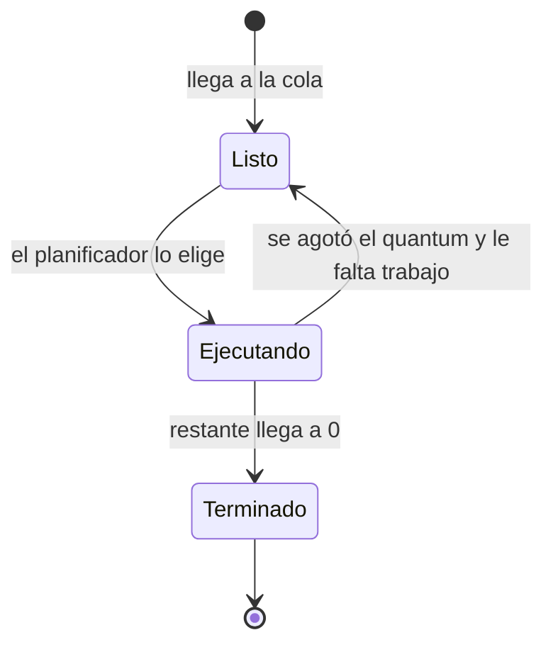
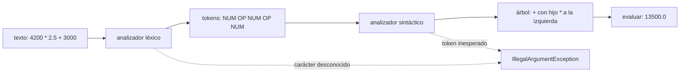
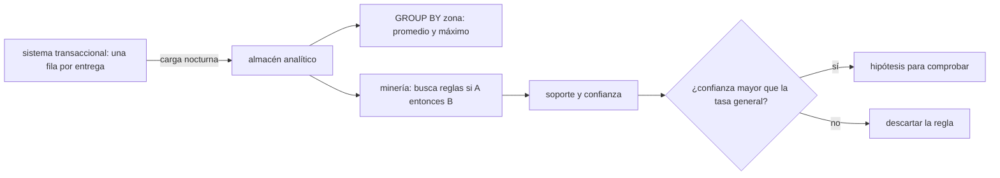
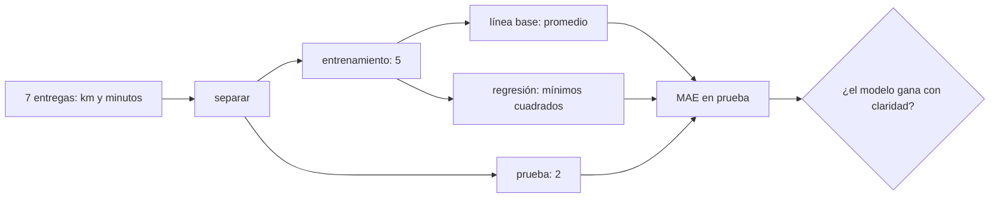
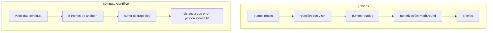
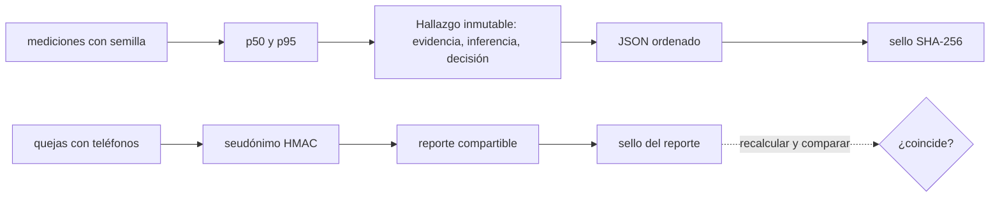

# Módulo 7: Ciencias de la Computación: mapa de especializaciones

**Entorno comprobado para esta edición (2026-11-24):** OpenJDK 25.0.5.1 en Linux x86_64, con la base de datos H2
2.3.232 (el mismo jar del Módulo 5) para el Tema 3. No se usó ninguna otra biblioteca externa. Todas las salidas son
literales de esa ejecución, en la carpeta de práctica `/home/estudiante/labs/especializaciones` (tu
`~/labs/especializaciones`). Los valores aleatorios usan una semilla fija, así que deben coincidir con los tuyos. Los
comandos para Windows no se ejecutaron.

## Apertura del módulo

#### Objetivos del módulo
Al terminar este módulo podrás:
- reconocer seis grandes áreas de las ciencias de la computación y el problema central que resuelve cada una;
- ejecutar un experimento pequeño por área y explicar qué muestra su salida;
- distinguir usar una herramienta de comprender el fundamento que la hace funcionar;
- identificar qué matemáticas y qué módulos previos exige cada especialización antes de profundizar;
- elegir una especialización para estudiar después, con evidencia de tus propios experimentos.

#### Esquema del módulo
1. Sistemas, arquitectura y sistemas operativos.
2. Algoritmos, autómatas, lenguajes y compiladores.
3. Bases de datos, almacenes analíticos y minería de datos.
4. Inteligencia artificial, aprendizaje automático y visión.
5. Gráficos y cómputo científico.
6. Redes, seguridad, web e ingeniería profesional.
7. Proyecto 11: portafolio de orientación.

#### Qué necesitas saber antes
Los Módulos 0, 1 y 2 completos: procesos, métodos, clases, listas, mapas, colas, árboles y complejidad. El
Módulo 3 para redes y HTTP, el Módulo 4 para SQL con H2 y JDBC, y el Módulo 5 para depurar con evidencia. Cada
término nuevo se define en el tema donde aparece por primera vez.

Este módulo es un **mapa**, no un curso de cada área. Un experimento de veinte líneas te muestra la idea central de
una especialización; dominarla exige meses de estudio. Ese límite se repite en cada tema a propósito.

## Aprende construyendo

Crea la carpeta de práctica una sola vez y trabaja dentro de ella en los seis temas:

```text
$ mkdir -p ~/labs/especializaciones
$ cd ~/labs/especializaciones
$ java --version | head -1
openjdk 25.0.5.1 2026-11-17
```

### Tema 1: Sistemas, arquitectura y sistemas operativos · Avanzado · 60 min

<details open>
<summary><strong>Capa 1 — Lectura</strong></summary>

#### Objetivos
Al terminar este tema podrás:
- simular el reparto de la CPU con Round Robin y calcular el tiempo de retorno de cada proceso;
- contar los cambios de contexto y explicar por qué un quantum pequeño los multiplica;
- ejecutar a mano el ciclo de instrucción de una CPU de juguete con registros y contador de programa;
- reconocer qué roles trabajan en sistemas y qué estudian antes de especializarse.

**Conceptos clave:** planificador de procesos, Round Robin, quantum, cambio de contexto, tiempo de retorno, conjunto de instrucciones, registro del procesador, contador de programa, ciclo de instrucción

#### El problema
El dispositivo que lleva cada mensajero de RutaFlow tiene **una sola CPU**. Al mismo tiempo debe leer el GPS,
sincronizar entregas con el servidor y comprimir las fotos de las firmas. Si la compresión ocupa la CPU un minuto
entero, el mapa se congela. ¿Cómo reparte el sistema operativo una CPU entre varios procesos sin que ninguno se
quede esperando para siempre? ¿Y qué hace la CPU, por dentro, con cada instrucción?

Este tema usa lo que ya conoces: **CPU**, **sistema operativo** y **proceso** tienen su ficha en el Módulo 0, Tema 1;
**cola** y **`ArrayDeque`**, en el Módulo 2, Tema 2. Aquí no se redefinen.

#### Glosario del tema

**planificador de procesos**
- **Definición técnica:** parte del sistema operativo que decide qué proceso listo usa la CPU a continuación y durante cuánto tiempo.
- **En palabras sencillas:** el turnero de un banco que dice a quién atiende la única ventanilla.
- **Dónde se rompe la comparación:** el planificador puede interrumpir a quien está siendo atendido y mandarlo al final de la fila.
- **Ejemplo:** en `Planificador.java`, el bucle `while (!procesos.isEmpty())` hace de planificador: saca uno, lo atiende y decide si vuelve.
- **Error típico:** creer que los procesos corren «a la vez» en una sola CPU; se turnan tan rápido que lo parece.

**Round Robin**
- **Definición técnica:** política de planificación que atiende la cola en orden de llegada y da a cada proceso un tiempo máximo fijo antes de pasar al siguiente.
- **En palabras sencillas:** una ronda: cada uno tiene un turno corto y, si no terminó, vuelve al final.
- **Dónde se rompe la comparación:** en una ronda de juego todos tienen el mismo turno; aquí quien termina antes cede el resto de su tiempo.
- **Ejemplo:** con turnos de 2 unidades, `gps` usa 2, `sync` usa 2, `fotos` usa 2 y vuelve `gps`.
- **Error típico:** pensar que Round Robin termina antes todos los trabajos; reparte mejor, pero no reduce el trabajo total.

**quantum**
- **Definición técnica:** duración máxima que el planificador concede a un proceso en cada turno de CPU antes de expulsarlo.
- **En palabras sencillas:** cuántos minutos te deja hablar el moderador antes de dar la palabra al siguiente.
- **Dónde se rompe la comparación:** un sistema real mide el quantum en milisegundos y lo ajusta según la carga.
- **Ejemplo:** `int quantum = 2;` en la línea 15 de `Planificador.java`.
- **Error típico:** escoger un quantum diminuto: la CPU pasa más tiempo cambiando de proceso que trabajando.

**cambio de contexto**
- **Definición técnica:** operación del sistema operativo que guarda el estado de un proceso (registros, contador de programa) y carga el de otro.
- **En palabras sencillas:** marcar la página del libro que lees, cerrarlo y abrir otro donde lo dejaste.
- **Dónde se rompe la comparación:** cambiar de libro no cuesta nada; un cambio de contexto gasta tiempo de CPU que nadie aprovecha.
- **Ejemplo:** la salida de `Planificador.java` cuenta `cambios de contexto: 6`.
- **Error típico:** ignorar su costo al comparar políticas; en la simulación cuesta cero, en un sistema real no.

**tiempo de retorno**
- **Definición técnica:** tiempo transcurrido desde que un proceso llega a la cola hasta que termina; en inglés, *turnaround time*.
- **En palabras sencillas:** cuánto esperaste desde que pediste el trámite hasta que te lo entregaron completo.
- **Dónde se rompe la comparación:** no es lo mismo que el tiempo de respuesta, que mide cuánto tardas en ser atendido la primera vez.
- **Ejemplo:** `sync` llega en `t=0` y termina en `t=9`; su tiempo de retorno es 9.
- **Error típico:** sumar solo el tiempo de CPU del proceso (3) y olvidar el tiempo que pasó esperando en la cola.

**conjunto de instrucciones**
- **Definición técnica:** lista de operaciones que una CPU sabe ejecutar, con su formato; define la arquitectura que ve el software (*ISA*, como x86-64 o ARM).
- **En palabras sencillas:** el vocabulario completo que entiende la CPU; nada fuera de él se puede pedir.
- **Dónde se rompe la comparación:** un idioma acepta palabras nuevas; una CPU rechaza cualquier código que no esté en su conjunto.
- **Ejemplo:** la CPU de juguete de `Maquina.java` solo entiende `CARGAR`, `SUMAR`, `MULTIPLICAR` y `PARAR`.
- **Error típico:** copiar un programa compilado para ARM a una máquina x86-64 y esperar que corra sin recompilar.

**registro del procesador**
- **Definición técnica:** celda de memoria dentro de la CPU, muy pequeña y muy rápida, donde se guardan los valores que la instrucción actual usa.
- **En palabras sencillas:** la mano del cajero: lo que tiene en la mano lo usa ya; lo demás está en el cajón.
- **Dónde se rompe la comparación:** una CPU real tiene decenas de registros, no dos, y cada uno tiene un tamaño fijo en bits.
- **Ejemplo:** `registros`, con `A` y `B` en 0, en la línea 12 de `Maquina.java`.
- **Error típico:** confundirlo con el registro de eventos (`java.util.logging`) del Módulo 5: comparten nombre y nada más.

**contador de programa**
- **Definición técnica:** registro especial que guarda la dirección de la próxima instrucción que la CPU va a buscar.
- **En palabras sencillas:** el dedo que señala en qué renglón de la receta vas.
- **Dónde se rompe la comparación:** un salto (`if`, bucle) cambia el contador a otro renglón; el dedo no siempre baja de a uno.
- **Ejemplo:** `int pc = 0;` en la línea 13 y `pc++;` en la línea 17 de `Maquina.java`.
- **Error típico:** olvidar avanzarlo: la CPU ejecutaría la misma instrucción para siempre.

**ciclo de instrucción**
- **Definición técnica:** secuencia que la CPU repite sin parar: buscar la instrucción que indica el contador, decodificarla y ejecutarla.
- **En palabras sencillas:** leer el renglón, entender qué pide y hacerlo; luego el siguiente renglón.
- **Dónde se rompe la comparación:** las CPU modernas solapan varias instrucciones a la vez (*pipeline*); el orden se respeta solo en el resultado.
- **Ejemplo:** las líneas 15 a 31 de `Maquina.java` son un ciclo de instrucción completo.
- **Error típico:** creer que una línea de Java es una instrucción de CPU; una sola línea puede costar cientos.

#### ► CÓMO FUNCIONA
Un proceso pasa por tres estados. **Listo** significa que espera en la cola; **ejecutando**, que tiene la CPU;
**terminado**, que ya no necesita nada. El planificador saca el primero de la cola y le da como máximo un quantum.
Si el proceso no terminó, vuelve al final de la cola. Cada vez que la CPU pasa a otro proceso, hay un cambio de contexto.

Dentro de la CPU ocurre algo parecido a otra escala. El contador de programa dice qué instrucción sigue. La CPU la
busca, la decodifica, la ejecuta sobre sus registros y avanza el contador. Ese ciclo se repite miles de millones de
veces por segundo.

| Nivel | Qué se reparte | Quién decide | Unidad de trabajo |
|---|---|---|---|
| Sistema operativo | Tiempo de CPU entre procesos | Planificador | Quantum |
| Procesador | Registros y unidades de cálculo | Ciclo de instrucción | Instrucción |



#### Problema resuelto 1.1
Tres procesos del dispositivo llegan juntos: `gps` necesita 5 unidades de CPU, `sync` 3 y `fotos` 4. Simula Round
Robin con quantum 2 e informa el tiempo de retorno de cada uno y los cambios de contexto.

**Razonamiento:**
1. La cola de listos es un `ArrayDeque`: sacar por el frente y meter por el final cuesta O(1) (Módulo 2, Tema 2).
2. En cada turno el proceso usa `Math.min(quantum, restante)`: nunca más de lo que le falta.
3. Un reloj acumula lo usado; cuando un proceso llega a 0, su tiempo de retorno es el reloj en ese momento.
4. Hay cambio de contexto cuando el proceso que entra no es el mismo que acaba de salir.

```java
// Planificador.java — reparte la CPU de un dispositivo de RutaFlow con Round Robin
class Proceso {
    final String id;
    int restante;

    Proceso(String id, int restante) {
        this.id = id;
        this.restante = restante;
    }
}

void main() {
    Deque<Proceso> procesos = new ArrayDeque<>(List.of(
            new Proceso("gps", 5), new Proceso("sync", 3), new Proceso("fotos", 4)));
    int quantum = 2;
    int reloj = 0;
    int cambios = 0;
    String anterior = null;
    Map<String, Integer> fin = new LinkedHashMap<>();

    while (!procesos.isEmpty()) {
        Proceso proceso = procesos.pollFirst();
        if (anterior != null && !anterior.equals(proceso.id)) {
            cambios++;                              // la CPU pasa a otro proceso
        }
        anterior = proceso.id;
        int usado = Math.min(quantum, proceso.restante);
        reloj += usado;
        proceso.restante -= usado;
        IO.println("t=%2d  %-5s usa %d, resta %d".formatted(reloj, proceso.id, usado, proceso.restante));
        if (proceso.restante > 0) {                 // solo vuelve a la cola si le falta trabajo
            procesos.addLast(proceso);
        } else {
            fin.put(proceso.id, reloj);
        }
    }
    IO.println("tiempo de retorno: " + fin);
    IO.println("cambios de contexto: " + cambios);
}
```

```text
$ java Planificador.java
t= 2  gps   usa 2, resta 3
t= 4  sync  usa 2, resta 1
t= 6  fotos usa 2, resta 2
t= 8  gps   usa 2, resta 1
t= 9  sync  usa 1, resta 0
t=11  fotos usa 2, resta 0
t=12  gps   usa 1, resta 0
tiempo de retorno: {sync=9, fotos=11, gps=12}
cambios de contexto: 6
```

**Explicación por partes.**
- Líneas 2–10: cada proceso es un objeto con su nombre y lo que le falta; `restante` no es `final` porque cambia.
- Líneas 13–14: la cola de listos, en orden de llegada.
- Líneas 22–26: el planificador saca el primero con `pollFirst` y cuenta un cambio si la CPU pasa a otro proceso.
- Línea 27: `Math.min` evita que `gps`, con 1 unidad pendiente, gaste un quantum completo.
- Líneas 31–35: si falta trabajo, vuelve al final de la cola con `addLast`; si no, se anota su tiempo de retorno. `LinkedHashMap` conserva el orden en que terminaron.
- La salida confirma la ronda: `sync` termina en `t=9` aunque solo necesitaba 3 unidades de CPU. Esperó 6.

> **Error común.** Declarar la cola como `List<Proceso> procesos = new ArrayList<>(...)`. El programa ni siquiera
> arranca: `Planificador.java:22: error: cannot find symbol`, con `symbol: method pollFirst()`. El compilador dice que
> una `List` no tiene ese método. Usa `ArrayDeque`, o `removeFirst()` de la lista sabiendo que cuesta O(n).

> **Rendimiento.** Con quantum 2 hubo 6 cambios de contexto; con quantum 10 (Ejercicio verificable 1) hay 2. Un
> quantum pequeño mejora la sensación de respuesta y aumenta el tiempo perdido en cambios.

#### Problema resuelto 1.2
Construye una CPU de juguete con dos registros que calcule el costo de un envío: 3 kg a 4200 por kg más un recargo
de 3000. Muestra el estado de los registros después de cada instrucción.

**Razonamiento:**
1. El programa es una lista de instrucciones; cada una es un record `Instruccion(operación, destino, origen)`.
2. El contador de programa empieza en 0 y avanza de a uno; `PARAR` rompe el ciclo.
3. Cada vuelta del `while` es un ciclo de instrucción: buscar, decodificar con `switch` y ejecutar.

```java
// Maquina.java — una CPU de juguete: dos registros, un contador de programa y cuatro instrucciones
record Instruccion(String operacion, String destino, String origen) {}

void main() {
    List<Instruccion> programa = List.of(
            new Instruccion("CARGAR", "A", "4200"),      // tarifa por kg
            new Instruccion("CARGAR", "B", "3"),         // kilos del envío
            new Instruccion("MULTIPLICAR", "A", "B"),    // A = A * B
            new Instruccion("CARGAR", "B", "3000"),      // recargo urgente
            new Instruccion("SUMAR", "A", "B"),          // A = A + B
            new Instruccion("PARAR", null, null));
    Map<String, Integer> registros = new HashMap<>(Map.of("A", 0, "B", 0));
    int pc = 0;                            // contador de programa: índice de la siguiente instrucción

    while (true) {
        Instruccion ins = programa.get(pc);              // 1. buscar
        pc++;
        String d = ins.destino(), o = ins.origen();
        switch (ins.operacion()) {                       // 2. decodificar y 3. ejecutar
            case "CARGAR" -> registros.put(d, Integer.parseInt(o));
            case "SUMAR" -> registros.put(d, registros.get(d) + registros.get(o));
            case "MULTIPLICAR" -> registros.put(d, registros.get(d) * registros.get(o));
            case "PARAR" -> {
                IO.println("total del envío: " + registros.get("A"));
                return;
            }
            default -> throw new IllegalArgumentException("instrucción desconocida: " + ins.operacion());
        }
        IO.println("pc=%d  %-11s  A=%5d  B=%5d".formatted(pc, ins.operacion(), registros.get("A"), registros.get("B")));
    }
}
```

```text
$ java Maquina.java
pc=1  CARGAR       A= 4200  B=    0
pc=2  CARGAR       A= 4200  B=    3
pc=3  MULTIPLICAR  A=12600  B=    3
pc=4  CARGAR       A=12600  B= 3000
pc=5  SUMAR        A=15600  B= 3000
total del envío: 15600
```

**Explicación por partes.**
- Línea 2: una instrucción tiene operación, destino y origen. El origen es texto: un número para `CARGAR` o el nombre de un registro.
- Líneas 5–11: el programa. Es el «código máquina» de esta CPU: solo usa operaciones de su conjunto de instrucciones.
- Línea 16: **buscar**. El contador de programa elige la instrucción.
- Línea 17: el contador avanza antes de ejecutar, como en una CPU real.
- Líneas 19–29: **decodificar y ejecutar**. `PARAR` imprime el total y termina; una operación fuera del conjunto lanza `IllegalArgumentException`.
- La traza muestra que `B` se reutiliza: primero guarda los kilos y después el recargo. Los registros son pocos y se reciclan.

> **Error común.** Agregar `new Instruccion("RESTAR", "A", "B")` al programa sin enseñarle a la CPU esa operación. La
> ejecución termina con `java.lang.IllegalArgumentException: instrucción desconocida: RESTAR`. Es lo mismo que pasa al correr código de otra arquitectura.

> **Buena práctica.** Cuando estudies sistemas, simula antes de medir. Una simulación de 40 líneas te deja cambiar el
> quantum y ver el efecto; después lo compruebas en Linux con herramientas como `top` (Módulo 8).

#### Checkpoint 1.1
En la salida de `Planificador.java`, ¿cuánto tiempo esperó `fotos` en la cola, sin contar el tiempo que usó la CPU?

Respuesta: 7 unidades. Su tiempo de retorno es 11 y necesitaba 4 de CPU: `11 - 4 = 7`.

</details>

<details>
<summary><strong>Capa 2 — Construcción</strong></summary>

#### Paso 1 · Simula el planificador
En `~/labs/especializaciones`, escribe `Planificador.java` y ejecútalo con `java Planificador.java`. Compara tu salida
con la del Problema resuelto 1.1 línea por línea.

#### Paso 2 · Cambia el quantum
Cambia la línea 15 a `int quantum = 1;` y después a `int quantum = 10;`. Anota en `evidencia-tema1.txt` el tiempo de retorno de
`sync` y los cambios de contexto de cada versión.

#### Paso 3 · Ejecuta la CPU de juguete
Escribe `Maquina.java` y ejecútalo. Antes de cada línea de la traza, predice en papel los valores de `A` y `B`.

#### Paso 4 · Provoca el error
Agrega una instrucción `RESTAR` al programa sin cambiar el ciclo. Lee la `IllegalArgumentException` y luego agrega la rama que falta.

#### Resumen
- El **planificador de procesos** decide qué proceso usa la única CPU y por cuánto tiempo.
- **Round Robin** atiende en orden de llegada con un **quantum** fijo; quien no termina vuelve al final de la cola.
- Cada **cambio de contexto** guarda el estado de un proceso y carga otro; cuesta tiempo real.
- El **tiempo de retorno** incluye la espera en la cola, no solo el tiempo de CPU.
- Una CPU ejecuta solo su **conjunto de instrucciones**, sobre unos pocos **registros del procesador**.
- El **contador de programa** señala la próxima instrucción; el **ciclo de instrucción** busca, decodifica y ejecuta.

#### Ejercicio verificable 1
Básico. Cambia `int quantum = 2;` por `int quantum = 10;` en `Planificador.java`. Predice la salida antes de ejecutar.

Respuesta esperada:

```text
t= 5  gps   usa 5, resta 0
t= 8  sync  usa 3, resta 0
t=12  fotos usa 4, resta 0
tiempo de retorno: {gps=5, sync=8, fotos=12}
cambios de contexto: 2
```

Con un quantum mayor que todo trabajo, Round Robin se comporta como «primero en llegar, primero en ser atendido».

#### Ejercicio verificable 2
Intermedio. Agrega a `Maquina.java` la operación `RESTAR` y aplica un descuento de 1000 después del recargo.

Respuesta esperada: una rama
`case "RESTAR" -> registros.put(d, registros.get(d) - registros.get(o));`, y en el programa
`new Instruccion("CARGAR", "B", "1000")` seguido de `new Instruccion("RESTAR", "A", "B")` antes de `PARAR`. Las dos últimas líneas de la traza son `pc=7  RESTAR       A=14600  B= 1000`
y `total del envío: 14600`.

#### Ejercicio verificable 3
Reto. Agrega al planificador el **tiempo de respuesta**: el reloj en el momento en que cada proceso recibe la CPU
por primera vez. Compara quantum 2 y quantum 10.

Respuesta esperada: guarda el reloj antes de sumar `usado`, solo si el proceso aún no tiene respuesta:
`respuesta.putIfAbsent(proceso.id, reloj);`. Con quantum 2: `{gps=0, sync=2, fotos=4}`. Con quantum 10:
`{gps=0, sync=5, fotos=8}`. Round Robin responde
antes a todos; a cambio, el tiempo de retorno promedio sube de 8.33 (quantum 10) a 10.67 (quantum 2).

#### En el trabajo
Sistemas es la especialización que está debajo de todas las demás. Los roles típicos son **ingeniero de sistemas
operativos y kernel**, **ingeniero de sistemas embebidos y firmware**, **ingeniero de rendimiento** y
**arquitecto de procesadores**. Trabajan en fabricantes de chips y dispositivos (Intel, AMD, ARM, NVIDIA, Qualcomm,
Apple, Samsung), en equipos de sistemas operativos (Microsoft, Google con Android, Red Hat, Canonical) y en la
nube (AWS, Azure). Para llegar ahí necesitas C, arquitectura de computadores y el Módulo 8 de este curso. En
RutaFlow, este conocimiento decide si el dispositivo del mensajero agota la batería en cuatro horas o en doce.

</details>

### Tema 2: Algoritmos, autómatas, lenguajes y compiladores · Avanzado · 60 min

<details open>
<summary><strong>Capa 1 — Lectura</strong></summary>

#### Objetivos
Al terminar este tema podrás:
- construir un autómata finito que acepta o rechaza textos según un formato;
- separar un texto en tokens con un analizador léxico escrito a mano;
- construir un árbol de sintaxis a partir de una gramática y evaluarlo respetando la precedencia;
- describir las fases de un compilador y qué hace cada una.

**Conceptos clave:** autómata finito, lenguaje formal, compilador, analizador léxico, token, gramática, analizador sintáctico, árbol de sintaxis

#### El problema
Los operadores de RutaFlow escriben guías a mano y a veces se equivocan: `RF-20A8` o `RF-12345`. Además, el área
comercial quiere escribir tarifas como texto, por ejemplo `4200 * 2.5 + 3000`, y que el sistema las calcule. ¿Cómo
decide un programa si un texto tiene la forma correcta? ¿Cómo entiende que la multiplicación va antes que la suma?

Este tema usa lo que ya conoces: **algoritmo** (Módulo 1, Tema 1), **record** (Módulo 1, Tema 1), **interfaz** (Módulo 1, Tema 7),
**recursión** (Módulo 2, Tema 4), **árbol** (Módulo 2, Tema 5) y los argumentos de `main` (Módulo 0, Tema 4).

#### Glosario del tema

**autómata finito**
- **Definición técnica:** modelo de cómputo con un número finito de estados, un estado inicial, estados de aceptación y una regla que, según el estado actual y el símbolo leído, decide el estado siguiente.
- **En palabras sencillas:** un torniquete con memoria mínima: solo recuerda en qué paso va, no todo lo que pasó.
- **Dónde se rompe la comparación:** un torniquete gira sin fin; un autómata termina al acabarse el texto y entonces dice «acepto» o «rechazo».
- **Ejemplo:** `esGuia` en `Automata.java` pasa por `INICIO`, `VIO_R`, `VIO_F` y `DIGITOS`.
- **Error típico:** querer reconocer paréntesis bien cerrados con un autómata finito; no puede contar sin límite.

**lenguaje formal**
- **Definición técnica:** conjunto de cadenas de símbolos que cumplen unas reglas precisas; las reglas las da un autómata o una gramática.
- **En palabras sencillas:** la lista de todos los textos «válidos», definida por reglas y no por ejemplos.
- **Dónde se rompe la comparación:** un idioma humano tolera errores y ambigüedad; un lenguaje formal acepta o rechaza sin término medio.
- **Ejemplo:** el lenguaje de las guías contiene `RF-2048` y `RF-0000`, y no contiene `RF-204` ni `rf-2048`.
- **Error típico:** definir el formato con ejemplos sueltos («algo como RF-1234») en vez de una regla verificable.

**compilador**
- **Definición técnica:** programa que traduce código fuente de un lenguaje a otro, normalmente a instrucciones de máquina, pasando por análisis léxico, sintáctico y semántico, optimización y generación de código.
- **En palabras sencillas:** un traductor que primero entiende la frase completa y después la reescribe en el idioma de la CPU.
- **Dónde se rompe la comparación:** un traductor humano adivina la intención; un compilador rechaza el texto si no cumple la gramática.
- **Ejemplo:** `Lexico.java` y `Analizador.java` hacen las dos primeras fases; en vez de generar código, evalúa el árbol directamente.
- **Error típico:** creer que `java Archivo.java` no compila; compila en memoria antes de ejecutar, y por eso un `error: ';' expected` aparece antes de que corra una sola línea.

**analizador léxico**
- **Definición técnica:** fase que recorre el texto carácter por carácter y lo agrupa en tokens, descartando espacios y comentarios; también se llama *lexer* o tokenizador.
- **En palabras sencillas:** quien separa una frase en palabras antes de que alguien la lea.
- **Dónde se rompe la comparación:** separar palabras es fácil; aquí `2.5` es un solo token aunque tenga tres caracteres.
- **Ejemplo:** `Lexico.tokenizar("4200 * 2.5")` devuelve `[NUM:4200, OP:*, NUM:2.5]`.
- **Error típico:** dejar pasar caracteres desconocidos en silencio; el error aparece después, más lejos de su causa.

**token**
- **Definición técnica:** unidad mínima con significado que produce el analizador léxico: un par formado por su categoría y su valor.
- **En palabras sencillas:** una ficha con etiqueta: «esto es un número y vale 4200».
- **Dónde se rompe la comparación:** dos fichas iguales pueden tener papeles distintos según dónde aparezcan; eso lo decide la gramática.
- **Ejemplo:** `new Token("OP", "+")`, que se imprime `OP:+`, es un token de categoría operador.
- **Error típico:** guardar los números como texto en el token (`"4200"`) y olvidar convertirlos antes de operar; en este tema lo hace `Double.parseDouble` al construir la hoja.

**gramática**
- **Definición técnica:** conjunto de reglas de producción que describen cómo se combinan los tokens en estructuras válidas; las gramáticas libres de contexto permiten anidar sin límite.
- **En palabras sencillas:** las reglas de construcción de frases: «una suma son términos unidos por más».
- **Dónde se rompe la comparación:** la gramática de un idioma tiene excepciones; una gramática formal no admite ninguna.
- **Ejemplo:** `termino -> factor ('*' factor)*` dice que un término es uno o más factores unidos por `*`.
- **Error típico:** poner suma y multiplicación en la misma regla: entonces `2 + 3 * 4` daría 20 en vez de 14.

**analizador sintáctico**
- **Definición técnica:** fase que recibe los tokens, comprueba que siguen la gramática y construye su estructura; en inglés, *parser*.
- **En palabras sencillas:** quien revisa que las palabras formen una frase bien armada y dibuja cómo se agrupan.
- **Dónde se rompe la comparación:** una persona entiende una frase mal armada; el analizador se detiene en el primer token inesperado.
- **Ejemplo:** la clase `Analizador` tiene un método por regla de la gramática: `expr`, `termino` y `factor`.
- **Error típico:** analizar con trucos de texto (`split("\\+")`); falla en cuanto aparecen paréntesis.

**árbol de sintaxis**
- **Definición técnica:** árbol cuyos nodos internos son operaciones y cuyas hojas son valores; representa la estructura del programa sin paréntesis ni espacios.
- **En palabras sencillas:** el esquema de la cuenta: qué se calcula primero queda más abajo.
- **Dónde se rompe la comparación:** un esquema dibujado se lee de arriba abajo; el árbol se evalúa de las hojas hacia la raíz.
- **Ejemplo:** `(+ (* 4200.0 2.5) 3000.0)`: la multiplicación es hija de la suma, así que va primero.
- **Error típico:** evaluar el texto de izquierda a derecha sin construir el árbol y perder la precedencia.

#### ► CÓMO FUNCIONA
Un compilador trabaja por fases, como una línea de producción. El **analizador léxico** convierte caracteres en
tokens. El **analizador sintáctico** comprueba la gramática y construye el árbol. Después vienen el análisis de
tipos, la optimización y la generación de código. Este tema construye las dos primeras fases y evalúa el árbol.

Hay dos herramientas teóricas detrás. Un **autómata finito** basta para reconocer formatos planos, como una guía o
un correo. Una **gramática** hace falta cuando hay anidamiento, como paréntesis dentro de paréntesis.



#### Problema resuelto 2.1
Escribe un autómata que acepte solo guías con el formato `RF-` seguido de exactamente cuatro dígitos.

**Razonamiento:**
1. Los estados son los pasos del formato: aún no vi nada, vi `R`, vi `F`, ya estoy en los dígitos.
2. Cada símbolo válido para el estado actual avanza; cualquier otro rechaza de inmediato.
3. Al acabar el texto se acepta solo si estás en `DIGITOS` con exactamente cuatro.

```java
// Automata.java — autómata finito que reconoce guías de RutaFlow con el formato RF-####
boolean esGuia(String texto) {
    String estado = "INICIO";
    int digitos = 0;
    for (char simbolo : texto.toCharArray()) {
        if (estado.equals("INICIO") && simbolo == 'R') {
            estado = "VIO_R";
        } else if (estado.equals("VIO_R") && simbolo == 'F') {
            estado = "VIO_F";
        } else if (estado.equals("VIO_F") && simbolo == '-') {
            estado = "DIGITOS";
        } else if (estado.equals("DIGITOS") && Character.isDigit(simbolo)) {
            digitos++;
        } else {
            return false;                 // símbolo inválido para el estado actual
        }
    }
    return estado.equals("DIGITOS") && digitos == 4;
}

void main() {
    for (String valor : List.of("RF-2048", "RF-20A8", "RF-12345", "RF-", "rf-2048")) {
        IO.println("%-9s %s".formatted(valor, esGuia(valor)));
    }
}
```

```text
$ java Automata.java
RF-2048   true
RF-20A8   false
RF-12345  false
RF-       false
rf-2048   false
```

**Explicación por partes.**
- Líneas 3–4: el estado inicial. El autómata solo recuerda dos cosas: su estado y cuántos dígitos vio.
- Líneas 6–13: cada rama es una transición: estado actual más símbolo leído da el estado siguiente.
- Línea 15: cualquier combinación sin transición rechaza; por eso `RF-20A8` muere en la `A`.
- Línea 18: el estado final decide. `RF-` termina en `DIGITOS` con 0 dígitos y `RF-12345` con 5: ambos se rechazan.
- `rf-2048` se rechaza porque el autómata distingue mayúsculas: `'r' == 'R'` es falso.

> **Buena práctica.** Escribe primero la tabla de transiciones (estado, símbolo, siguiente) y después el código. La
> tabla se revisa en papel con el equipo; el código solo la copia.

#### Problema resuelto 2.2
Construye una calculadora de tarifas que acepte `+`, `*`, paréntesis y números con decimales, respetando que la
multiplicación va antes que la suma.

**Razonamiento:**
1. Gramática con un nivel por precedencia: `expr` suma términos, `termino` multiplica factores, `factor` es un número o una `expr` entre paréntesis.
2. El analizador léxico agrupa dígitos y punto en un solo token `NUM`.
   Cada fase vive en su propio archivo, porque `java` busca cada clase en el archivo de su mismo nombre.
3. El analizador sintáctico tiene un método por regla; `factor` llama a `expr` para los paréntesis: es recursión.
4. El árbol es una interfaz sellada con dos records: `Num` (hoja) y `Op` (operación). `evaluar` lo recorre: una hoja
   devuelve su número, un nodo opera los resultados de sus hijos.

```java
// Token.java — unidad mínima del analizador léxico: categoría y texto
record Token(String tipo, String valor) {
    @Override
    public String toString() {
        return tipo + ":" + valor;
    }
}
```

```java
// Lexico.java — analizador léxico: convierte el texto de una tarifa en tokens
import java.util.ArrayList;
import java.util.List;

final class Lexico {
    private Lexico() {}

    static List<Token> tokenizar(String texto) {
        List<Token> tokens = new ArrayList<>();
        int i = 0;
        while (i < texto.length()) {
            char simbolo = texto.charAt(i);
            if (simbolo == ' ') {
                i++;
            } else if (Character.isDigit(simbolo)) {
                int inicio = i;
                while (i < texto.length() && (Character.isDigit(texto.charAt(i)) || texto.charAt(i) == '.')) {
                    i++;
                }
                tokens.add(new Token("NUM", texto.substring(inicio, i)));
            } else if ("+*()".indexOf(simbolo) >= 0) {
                tokens.add(new Token("OP", String.valueOf(simbolo)));
                i++;
            } else {
                throw new IllegalArgumentException(
                        "carácter inesperado '" + simbolo + "' en la posición " + i);
            }
        }
        return tokens;
    }
}
```

```java
// Nodo.java — árbol de sintaxis: una hoja es un número; un nodo interno, una operación
sealed interface Nodo {
    record Num(double valor) implements Nodo {
        @Override
        public String toString() {
            return String.valueOf(valor);
        }
    }

    record Op(char operador, Nodo izquierda, Nodo derecha) implements Nodo {
        @Override
        public String toString() {
            return "(" + operador + " " + izquierda + " " + derecha + ")";
        }
    }

    static double evaluar(Nodo arbol) {
        return switch (arbol) {
            case Num n -> n.valor();
            case Op(char operador, Nodo izq, Nodo der) when operador == '+' -> evaluar(izq) + evaluar(der);
            case Op(char operador, Nodo izq, Nodo der) -> evaluar(izq) * evaluar(der);
        };
    }
}
```

```java
// Analizador.java — analizador sintáctico descendente: un método por regla de la gramática
import java.util.List;

/**
 * Gramática: expr -> termino ('+' termino)* ; termino -> factor ('*' factor)* ;
 * factor -> NUM | '(' expr ')'
 */
final class Analizador {
    private final List<Token> tokens;
    private int pos = 0;

    Analizador(List<Token> tokens) {
        this.tokens = tokens;
    }

    private Token mirar() {
        return pos < tokens.size() ? tokens.get(pos) : new Token("FIN", "fin del texto");
    }

    private void consumir(String esperado) {
        Token actual = mirar();
        if (!actual.valor().equals(esperado)) {
            throw new IllegalArgumentException("se esperaba '" + esperado + "' y llegó " + actual.valor());
        }
        pos++;
    }

    Nodo expr() {
        Nodo arbol = termino();
        while (mirar().valor().equals("+")) {
            consumir("+");
            arbol = new Nodo.Op('+', arbol, termino());
        }
        return arbol;
    }

    Nodo termino() {
        Nodo arbol = factor();
        while (mirar().valor().equals("*")) {
            consumir("*");
            arbol = new Nodo.Op('*', arbol, factor());
        }
        return arbol;
    }

    Nodo factor() {
        Token actual = mirar();
        if (actual.tipo().equals("NUM")) {
            pos++;
            return new Nodo.Num(Double.parseDouble(actual.valor()));
        }
        consumir("(");
        Nodo arbol = expr();
        consumir(")");
        return arbol;
    }
}
```

```java
// Calculadora.java — de texto a tokens, de tokens a árbol, y del árbol al valor
void main() {
    for (String texto : List.of("4200 * 2.5 + 3000", "4200 * (2.5 + 1)")) {
        List<Token> tokens = Lexico.tokenizar(texto);
        Nodo arbol = new Analizador(tokens).expr();
        IO.println("texto:  " + texto);
        IO.println("tokens: " + tokens);
        IO.println("árbol:  " + arbol);
        IO.println("valor:  " + Nodo.evaluar(arbol));
    }
}
```

```text
$ java Calculadora.java
texto:  4200 * 2.5 + 3000
tokens: [NUM:4200, OP:*, NUM:2.5, OP:+, NUM:3000]
árbol:  (+ (* 4200.0 2.5) 3000.0)
valor:  13500.0
texto:  4200 * (2.5 + 1)
tokens: [NUM:4200, OP:*, OP:(, NUM:2.5, OP:+, NUM:1, OP:)]
árbol:  (* 4200.0 (+ 2.5 1.0))
valor:  14700.0
```

**Explicación por partes.**
- `Token.java`: un record con categoría y texto; `toString` lo muestra como `NUM:4200`.
- `Lexico.java`, líneas 15–20: consumen todos los dígitos y puntos seguidos y forman un solo token `NUM`.
- `Lexico.java`, líneas 24–27: un carácter desconocido detiene el análisis con su posición.
- `Nodo.java`, línea 2: `sealed` declara que solo existen dos tipos de nodo; por eso el `switch` de `evaluar` (líneas 17–23) no necesita `default`, y el compilador avisaría si faltara un caso.
- `Nodo.java`, líneas 20–21: `case Op(char operador, Nodo izq, Nodo der)` desarma el record en sus tres partes; `when` filtra por operador.
- `Analizador.java`, líneas 16–26: `mirar` muestra el token actual sin avanzar; `consumir` exige uno concreto o lanza `IllegalArgumentException`.
- `Analizador.java`, líneas 28–44: `expr` y `termino` son la gramática hecha código. Como `expr` llama a `termino`, la multiplicación queda más abajo en el árbol.
- `Analizador.java`, líneas 46–56: `factor` acepta un número (y lo convierte con `Double.parseDouble`) o abre un paréntesis y vuelve a empezar en `expr`: recursión.
- En la segunda expresión el paréntesis cambia el árbol: la suma queda dentro de la multiplicación y el valor sube a `14700.0`.

Para probar otras entradas sin editar ningún archivo, este programa recibe la expresión como argumento:

```java
// Revisar.java — analiza la expresión que recibe como argumento del comando
void main(String[] args) {
    Nodo arbol = new Analizador(Lexico.tokenizar(args[0])).expr();
    IO.println("árbol: " + arbol);
    IO.println("valor: " + Nodo.evaluar(arbol));
}
```

```text
$ java Revisar.java "2 + 3 * 4"
árbol: (+ 2.0 (* 3.0 4.0))
valor: 14.0
```

> **Error común.** Escribir la multiplicación con `x`. El analizador léxico se detiene en el primer carácter que no
> conoce:
>
> ```text
> $ java Revisar.java "4200 x 2.5"
> Exception in thread "main" java.lang.IllegalArgumentException: carácter inesperado 'x' en la posición 5
> 	at Lexico.tokenizar(Lexico.java:25)
> 	at Revisar.main(Revisar.java:3)
> ```
>
> La primera línea dice qué carácter y en qué posición (contando desde 0); la pila dice que falló `Lexico.tokenizar`,
> la fase léxica. Escribe `*`.

> **Error común.** Olvidar cerrar un paréntesis:
>
> ```text
> $ java Revisar.java "4200 * (2.5 + 1"
> Exception in thread "main" java.lang.IllegalArgumentException: se esperaba ')' y llegó fin del texto
> 	at Analizador.consumir(Analizador.java:23)
> 	at Analizador.factor(Analizador.java:54)
> 	at Analizador.termino(Analizador.java:41)
> 	at Analizador.expr(Analizador.java:29)
> 	at Revisar.main(Revisar.java:3)
> ```
>
> Esta vez la fase léxica pasó y falló la sintáctica: la pila atraviesa `expr`, `termino`, `factor` y `consumir`.
> «Fin del texto» significa que la expresión se acabó antes de tiempo.

#### Checkpoint 2.1
¿Qué árbol construye el analizador para `(1 + 2) * 3` y cuánto vale?

Respuesta: `(* (+ 1.0 2.0) 3.0)` y vale `9.0`. El paréntesis hace que la suma sea un `factor` y quede como
hija de la multiplicación.

</details>

<details>
<summary><strong>Capa 2 — Construcción</strong></summary>

#### Paso 1 · Dibuja y programa el autómata
Dibuja en papel los cuatro estados de `Automata.java` con flechas etiquetadas. Luego escribe el archivo y ejecútalo.

#### Paso 2 · Separa en tokens
Escribe `Token.java` y `Lexico.java`. Abre la consola interactiva de Java con `jshell`, carga los dos archivos con
`/open Token.java` y `/open Lexico.java`, y prueba `Lexico.tokenizar("12.5*(3+1)")`. Debe responder
`[NUM:12.5, OP:*, OP:(, NUM:3, OP:+, NUM:1, OP:)]`. Sal con `/exit`.

#### Paso 3 · Construye el árbol
Escribe `Nodo.java`, `Analizador.java` y `Calculadora.java`. Ejecuta `java Calculadora.java` y dibuja a mano los dos
árboles de la salida, con la raíz arriba.

#### Paso 4 · Provoca los dos errores
Escribe `Revisar.java` y ejecútalo con `"4200 x 2.5"` y con `"4200 * (2.5 + 1"`. Señala qué fase falló en cada caso.

#### Resumen
- Un **autómata finito** reconoce un **lenguaje formal** plano con un número fijo de estados.
- Un **compilador** traduce por fases: léxica, sintáctica, semántica, optimización y generación de código.
- El **analizador léxico** convierte caracteres en **tokens** con categoría y valor.
- La **gramática** define cómo se combinan los tokens; un nivel por precedencia ordena las operaciones.
- El **analizador sintáctico** sigue la gramática y construye el **árbol de sintaxis**.
- Evaluar el árbol de las hojas a la raíz respeta la precedencia sin reglas extra.

#### Ejercicio verificable 1
Básico. Predice qué devuelve `esGuia` para `"RF-0000"`, `"RF-204"` y `""` (texto vacío).

Respuesta esperada: `true`, `false` y `false`. El texto vacío no entra al bucle y el estado queda en `INICIO`, que no
es de aceptación.

#### Ejercicio verificable 2
Intermedio. Sin ejecutar, escribe el árbol y el valor de `java Revisar.java "2 + 3 * 4"`. Luego compruébalo.

Respuesta esperada: `árbol: (+ 2.0 (* 3.0 4.0))` y `valor: 14.0`. La multiplicación queda como hija derecha
de la suma porque `termino` la resuelve antes de que `expr` vea el `+`.

#### Ejercicio verificable 3
Reto. Agrega la resta. Debe tener la misma precedencia que la suma y asociar a la izquierda: `10 - 2 - 3` vale 5.

Respuesta esperada: agrega `-` a los símbolos de `Lexico` (`"+-*()"`). En `expr`, repite el bucle mientras el valor
sea `+` o `-`, guarda ese operador, consúmelo y úsalo en el nodo: `new Nodo.Op(operador.charAt(0), arbol, termino())`.
En `evaluar`, agrega `case Op(char operador, Nodo izq, Nodo der) when operador == '-' -> evaluar(izq) - evaluar(der);`
antes del caso de la multiplicación. `java Revisar.java "10 - 2 - 3"` muestra `árbol: (- (- 10.0 2.0) 3.0)` y
`valor: 5.0`.

#### En el trabajo
Esta especialización tiene dos caras. La teórica (autómatas, computabilidad, complejidad) vive en universidades y
centros de investigación. La aplicada construye compiladores, intérpretes y herramientas de desarrollo. Los roles
son **ingeniero de compiladores**, **ingeniero de herramientas de lenguaje** (editores, linters, formateadores) e
**investigador en algoritmos**. Trabajan en equipos de lenguajes y compiladores (LLVM en Apple y Google, Microsoft
con TypeScript y C#, JetBrains con Kotlin, Oracle con Java) y en fabricantes de chips que necesitan compiladores
propios (NVIDIA, Intel). Todo sistema que valida formatos o lee configuraciones usa estas ideas, incluido RutaFlow.

</details>

### Tema 3: Bases de datos, almacenes analíticos y minería de datos · Avanzado · 60 min

<details open>
<summary><strong>Capa 1 — Lectura</strong></summary>

#### Objetivos
Al terminar este tema podrás:
- distinguir un sistema transaccional de un almacén analítico por el tipo de pregunta que responde;
- resumir datos por grupos con funciones de agregación y `GROUP BY`;
- proteger la calidad del dato con una restricción `CHECK` y leer el error que produce;
- calcular soporte y confianza de una regla de asociación e interpretar si aporta algo.

**Conceptos clave:** sistema transaccional, almacén analítico, función de agregación, GROUP BY, restricción CHECK, minería de datos, regla de asociación, soporte, confianza

#### El problema
La gerente de operaciones de RutaFlow no quiere ver cada entrega: quiere saber **qué zona tarda más** y **por qué**.
Además, sospecha que la lluvia retrasa las entregas del sur, pero no tiene más que una corazonada. ¿Cómo convierte
una base de datos miles de filas en una respuesta por zona? ¿Cómo se pone a prueba una sospecha con datos?

Este tema usa lo que ya conoces: tablas, `SELECT`, `INSERT`, consultas con parámetros `?`, H2 y JDBC (Módulos 4 y 5), y
**hipótesis** y **evidencia** (Módulo 5, Tema 1; Módulo 0, Tema 5).

#### Glosario del tema

**sistema transaccional**
- **Definición técnica:** base de datos diseñada para muchas escrituras y lecturas pequeñas y concurrentes, con garantías de consistencia por operación; se le llama OLTP (*online transaction processing*).
- **En palabras sencillas:** la caja registradora: anota cada venta al instante y sin errores.
- **Dónde se rompe la comparación:** una caja no responde «¿cuánto vendimos por zona este año?»; un sistema transaccional puede, pero lento.
- **Ejemplo:** la tabla de RutaFlow donde cada mensajero marca «entregado» al llegar.
- **Error típico:** lanzar reportes pesados contra la base transaccional en hora pico y frenar las entregas.

**almacén analítico**
- **Definición técnica:** base de datos optimizada para leer y agregar grandes volúmenes históricos, alimentada por copias periódicas de los sistemas transaccionales; se le llama OLAP o *data warehouse*.
- **En palabras sencillas:** el archivo del contador: no atiende clientes, pero responde preguntas sobre todo el año.
- **Dónde se rompe la comparación:** el archivo es estático; un almacén se recarga cada hora o cada noche y sus datos llegan con retraso.
- **Ejemplo:** una tabla con todas las entregas de 2026 que solo se consulta para reportes por zona y mes.
- **Error típico:** esperar que el almacén muestre la entrega de hace un minuto; refleja la última carga.

**función de agregación**
- **Definición técnica:** función de SQL que recibe muchas filas y devuelve un solo valor: `COUNT`, `SUM`, `AVG`, `MIN`, `MAX`.
- **En palabras sencillas:** resumir una columna entera en un número.
- **Dónde se rompe la comparación:** `COUNT(*)` cuenta filas, pero `AVG(columna)` ignora las filas con `NULL` en esa columna.
- **Ejemplo:** `ROUND(AVG(minutos), 1)` da el promedio de minutos con un decimal.
- **Error típico:** mezclar una agregación con una columna sin agrupar: el resultado de esa columna queda sin sentido.

**GROUP BY**
- **Definición técnica:** cláusula de SQL que parte las filas en grupos con el mismo valor en las columnas indicadas y aplica las funciones de agregación a cada grupo.
- **En palabras sencillas:** hacer montones por zona y resumir cada montón por separado.
- **Dónde se rompe la comparación:** los montones no tienen orden; si quieres un orden fijo, agrega `ORDER BY`.
- **Ejemplo:** `GROUP BY zona` produce una fila para `centro`, otra para `norte` y otra para `sur`.
- **Error típico:** filtrar grupos con `WHERE COUNT(*) >= 2`; el filtro de grupos se escribe con `HAVING`.

**restricción CHECK**
- **Definición técnica:** regla declarada en la tabla que la base de datos evalúa en cada `INSERT` o `UPDATE`; si es falsa, rechaza la operación.
- **En palabras sencillas:** un portero en la puerta de la tabla que no deja entrar datos imposibles.
- **Dónde se rompe la comparación:** el portero solo revisa lo que le dijiste; un dato posible pero falso (`minutos = 30` cuando fueron 90) entra igual.
- **Ejemplo:** `CONSTRAINT minutos_positivos CHECK (minutos > 0)`.
- **Error típico:** validar solo en el programa; otro programa o una consulta manual inserta el dato imposible.

**minería de datos**
- **Definición técnica:** proceso de descubrir patrones útiles y no evidentes en grandes volúmenes de datos con métodos estadísticos y algorítmicos: reglas de asociación, agrupamiento, detección de anomalías.
- **En palabras sencillas:** buscar regularidades en el historial que nadie había visto a simple vista.
- **Dónde se rompe la comparación:** a diferencia de minar oro, aquí siempre «encuentras» algo; la mitad puede ser casualidad.
- **Ejemplo:** descubrir en el historial que las entregas del sur con lluvia se retrasan más que el promedio.
- **Error típico:** tratar un patrón como causa; la minería muestra asociaciones, no explica por qué ocurren.

**regla de asociación**
- **Definición técnica:** implicación del tipo «si A, entonces B» extraída de los datos, acompañada de medidas que dicen con qué frecuencia y fiabilidad se cumple.
- **En palabras sencillas:** «cuando pasa esto, suele pasar aquello», con números que dicen qué tan seguido.
- **Dónde se rompe la comparación:** «suele pasar» en lenguaje común es vago; aquí se mide con soporte y confianza.
- **Ejemplo:** «si es zona sur con lluvia, entonces hay retraso».
- **Error típico:** aceptar una regla con confianza alta sin compararla con lo que pasa en general.

**soporte**
- **Definición técnica:** fracción de todas las filas que cumplen a la vez la condición y la consecuencia de la regla.
- **En palabras sencillas:** qué tan común es el caso completo en todo el historial.
- **Dónde se rompe la comparación:** un soporte bajo no hace falsa la regla; solo dice que hay pocos casos para creerle.
- **Ejemplo:** 3 de 10 entregas fueron «sur, lluvia y retraso»: soporte `0.30`.
- **Error típico:** sacar conclusiones de una regla que se cumplió dos veces en diez mil filas.

**confianza**
- **Definición técnica:** fracción de las filas que cumplen la condición que también cumplen la consecuencia; estima P(B | A).
- **En palabras sencillas:** cuando se da la condición, qué tan seguido se da el resultado.
- **Dónde se rompe la comparación:** «confianza» aquí es una proporción, no una certeza ni un intervalo estadístico.
- **Ejemplo:** de 4 entregas del sur con lluvia, 3 se retrasaron: confianza `0.75`.
- **Error típico:** dividir entre todas las filas en vez de entre las que cumplen la condición; eso es el soporte.

#### ► CÓMO FUNCIONA
Los datos viven primero en el sistema transaccional, que registra cada entrega. Cada noche, un proceso copia esos
datos al almacén analítico. Allí se responden preguntas agregadas con `GROUP BY`. La minería de datos va un paso más
allá: no responde una pregunta que traes, sino que busca reglas que no habías formulado.

Una regla solo vale si supera a la referencia. Si el 40 % de todas las entregas se retrasa, una regla con confianza
del 40 % no aporta nada. Por eso se divide la confianza entre la tasa general: ese cociente se llama **elevación**.



#### Problema resuelto 3.1
Calcula, por zona, cuántas entregas hubo, el promedio y el máximo de minutos. Después comprueba que la tabla rechaza
un tiempo negativo.

**Razonamiento:**
1. La tabla declara la regla de negocio: los minutos son enteros positivos. La base de datos la hará cumplir.
2. `GROUP BY zona` arma un grupo por zona; `COUNT`, `AVG` y `MAX` resumen cada grupo.
3. Para demostrar la restricción, el programa intenta insertar `-5` al final y debe fallar.
4. La restricción lleva nombre (`minutos_positivos`) para que el error diga cuál regla se violó.

```java
// Entregas.java — tiempos de entrega de RutaFlow agregados por zona con H2
import java.sql.*;

void main() throws SQLException {
    try (Connection db = DriverManager.getConnection("jdbc:h2:mem:")) {
        Statement st = db.createStatement();
        st.execute("""
                CREATE TABLE entrega (
                    zona VARCHAR(20) NOT NULL,
                    minutos INTEGER NOT NULL,
                    CONSTRAINT minutos_positivos CHECK (minutos > 0)
                )""");
        PreparedStatement insertar = db.prepareStatement("INSERT INTO entrega VALUES (?, ?)");
        Object[][] filas = {{"norte", 31}, {"norte", 25}, {"sur", 48}, {"sur", 52}, {"centro", 19}};
        for (Object[] fila : filas) {
            insertar.setString(1, (String) fila[0]);
            insertar.setInt(2, (Integer) fila[1]);
            insertar.executeUpdate();
        }

        String consulta = """
                SELECT zona, COUNT(*), ROUND(AVG(minutos), 1), MAX(minutos)
                FROM entrega GROUP BY zona ORDER BY zona""";
        ResultSet rs = st.executeQuery(consulta);
        while (rs.next()) {
            IO.println("%-7s envíos=%d  promedio=%s  máximo=%d".formatted(
                    rs.getString(1), rs.getInt(2), rs.getDouble(3), rs.getInt(4)));
        }

        insertar.setString(1, "sur");
        insertar.setInt(2, -5);                       // dato imposible
        insertar.executeUpdate();
    }
}
```

```text
$ java -cp ~/herramientas/h2-2.3.232.jar Entregas.java
centro  envíos=1  promedio=19.0  máximo=19
norte   envíos=2  promedio=28.0  máximo=31
sur     envíos=2  promedio=50.0  máximo=52
Exception in thread "main" org.h2.jdbc.JdbcSQLIntegrityConstraintViolationException: Check constraint violation: "MINUTOS_POSITIVOS: "; SQL statement:
INSERT INTO entrega VALUES (?, ?) [23513-232]
	at org.h2.message.DbException.getJdbcSQLException(DbException.java:520)
	... (14 líneas internas de H2 omitidas aquí)
	at Entregas.main(Entregas.java:32)
```

**Explicación por partes.**
- Línea 5: `jdbc:h2:mem:` crea una base de datos temporal en la RAM; desaparece al cerrar la conexión. El `try` la cierra solo.
- Líneas 8–12: la tabla declara `NOT NULL` y la restricción `minutos_positivos`. La regla vive en el esquema, no en el código.
- Líneas 13–19: un `PreparedStatement` con parámetros `?` inserta las cinco filas (Módulo 4).
- Líneas 21–23: una consulta de agregación. Cada fila del resultado es un grupo, no una entrega.
- Líneas 25–28: `rs.next()` avanza fila por fila; `getString(1)`, `getInt(2)`… leen las columnas por posición.
- Línea 32: el `INSERT` con `-5` viola la restricción y H2 lo rechaza con una excepción.

> **Error común.** Insertar un dato imposible y no leer el mensaje. La primera línea dice
> `JdbcSQLIntegrityConstraintViolationException: Check constraint violation: "MINUTOS_POSITIVOS: "`: qué tipo de error
> es (violación de integridad) y qué regla se violó; la última línea de la pila, en qué línea de tu programa. Sin el
> `CONSTRAINT minutos_positivos`, H2 inventa un nombre como `CONSTRAINT_C` y el mensaje ya no dice nada útil. No se corrige quitando la restricción, sino corrigiendo el dato o el programa que lo produjo.

> **Buena práctica.** Declara en la tabla las reglas que nunca deben romperse (`NOT NULL`, `CHECK`, `UNIQUE`). El
> programa puede tener un error; la base de datos las sigue haciendo cumplir para todos los programas.

#### Problema resuelto 3.2
Con un historial de diez entregas, comprueba si «zona sur con lluvia» se asocia con retraso más que el promedio.

**Razonamiento:**
1. Filtra las filas que cumplen la condición; de ellas, las que además cumplen la consecuencia.
2. Soporte: casos completos entre todas las filas. Confianza: casos completos entre los que cumplen la condición.
3. Calcula la tasa general de retraso y compárala con la confianza: ese cociente es la elevación.

```java
// Mineria.java — busca una regla «si llueve en el sur, entonces hay retraso» en el historial
record Entrega(String zona, boolean lluvia, boolean retraso) {}

record Medidas(double soporte, double confianza, double base) {}

final List<Entrega> historial = List.of(
        new Entrega("sur", true, true),
        new Entrega("sur", true, true),
        new Entrega("sur", true, false),
        new Entrega("sur", false, false),
        new Entrega("norte", true, false),
        new Entrega("norte", false, false),
        new Entrega("norte", false, true),
        new Entrega("centro", true, false),
        new Entrega("centro", false, false),
        new Entrega("sur", true, true));

Medidas evaluarRegla(List<Entrega> filas, Predicate<Entrega> condicion, Predicate<Entrega> consecuencia) {
    List<Entrega> cumplenSi = filas.stream().filter(condicion).toList();
    List<Entrega> cumplenAmbas = cumplenSi.stream().filter(consecuencia).toList();
    double soporte = (double) cumplenAmbas.size() / filas.size();
    double confianza = (double) cumplenAmbas.size() / cumplenSi.size();
    double base = (double) filas.stream().filter(consecuencia).count() / filas.size();
    return new Medidas(soporte, confianza, base);
}

void main() {
    Predicate<Entrega> llueveEnSur = e -> e.zona().equals("sur") && e.lluvia();
    Predicate<Entrega> huboRetraso = Entrega::retraso;
    Medidas m = evaluarRegla(historial, llueveEnSur, huboRetraso);
    IO.println(String.format(Locale.ROOT, "soporte=%.2f  confianza=%.2f  retraso en general=%.2f",
            m.soporte(), m.confianza(), m.base()));
    IO.println(String.format(Locale.ROOT, "la regla multiplica la probabilidad de retraso por %.2f",
            m.confianza() / m.base()));
}
```

```text
$ java Mineria.java
soporte=0.30  confianza=0.75  retraso en general=0.40
la regla multiplica la probabilidad de retraso por 1.88
```

**Explicación por partes.**
- Líneas 2–4: un record por entrega y otro para devolver las tres medidas juntas.
- Líneas 6–16: el historial. En la práctica vendría del almacén con una consulta.
- Línea 18: `evaluarRegla` recibe la condición y la consecuencia como `Predicate`. Así sirve para cualquier regla.
- Líneas 19–20: dos `filter` seleccionan primero por la condición y después por la consecuencia.
- Líneas 21–23: soporte, confianza y tasa general, cada una con su denominador distinto. El `(double)` evita la división entera, que daría 0.
- Líneas 33–34: la elevación es 1.88. La regla casi duplica la tasa de retraso: merece una hipótesis y más datos.

> **Error común.** Evaluar una regla cuya condición no se cumple en ninguna fila, por ejemplo con la zona `"oriente"`.
> La línea 22 divide 0.0 entre 0 y Java no se detiene: la salida dice `confianza=NaN` y la elevación también es
> `NaN` («no es un número»). Un `NaN` contamina todo cálculo que lo toque. Antes de dividir, comprueba que `cumplenSi`
> tenga filas.

> **Prevenir errores.** Con diez filas, una regla es solo una pista. Antes de cambiar rutas, repite el cálculo con
> meses de historial y anota el número de casos junto a cada porcentaje.

#### Checkpoint 3.1
En `Mineria.java`, ¿por qué la confianza (0.75) y el soporte (0.30) son distintos si cuentan los mismos tres casos?

Respuesta: porque dividen entre cosas distintas. El soporte divide entre las 10 filas; la confianza, entre las 4 filas
del sur con lluvia: `3 / 10 = 0.30` y `3 / 4 = 0.75`.

</details>

<details>
<summary><strong>Capa 2 — Construcción</strong></summary>

#### Paso 1 · Agrega por zona
Copia en `~/herramientas` el jar de H2 del Módulo 5, escribe `Entregas.java` y ejecútalo con
`java -cp ~/herramientas/h2-2.3.232.jar Entregas.java`. Comprueba a mano el promedio del sur: `(48 + 52) / 2 = 50.0`.

#### Paso 2 · Viola la restricción
Lee la primera y la última línea de la excepción. Cambia `-5` por `0` y confirma que también se rechaza: `0 > 0` es falso.

#### Paso 3 · Mide una regla
Escribe `Mineria.java` y ejecútalo. Cuenta tú las filas del sur con lluvia en las líneas 7–16 y compara con la salida.

#### Paso 4 · Busca una regla que no sirva
Cambia `"sur"` por `"norte"` en `llueveEnSur` y anota en `evidencia-tema3.txt` qué pasa con la elevación.

#### Resumen
- Un **sistema transaccional** registra cada operación; un **almacén analítico** responde preguntas sobre el historial.
- Una **función de agregación** resume muchas filas en un valor; **GROUP BY** la aplica a cada grupo.
- Una **restricción CHECK** hace que la base de datos rechace datos imposibles con una violación de integridad.
- La **minería de datos** busca patrones que no habías preguntado, como una **regla de asociación**.
- El **soporte** mide qué tan común es el caso completo; la **confianza**, qué tan seguido se cumple la consecuencia.
- Una regla solo aporta si su confianza supera la tasa general; ese cociente es la elevación.

#### Ejercicio verificable 1
Básico. Agrega la entrega `{"centro", 23}` al arreglo `filas` de `Entregas.java`. Predice la fila de `centro`.

Respuesta esperada: `centro  envíos=2  promedio=21.0  máximo=23`. Las filas de `norte` y `sur` no cambian.

#### Ejercicio verificable 2
Intermedio. Modifica la consulta para mostrar solo las zonas con al menos dos entregas, sin tocar los datos originales.

Respuesta esperada: `GROUP BY zona HAVING COUNT(*) >= 2 ORDER BY zona`. Solo salen `norte` y `sur`; `centro` tiene una
entrega. `HAVING` filtra grupos después de agregar; `WHERE` filtra filas antes.

#### Ejercicio verificable 3
Reto. Evalúa la regla «zona norte con lluvia, entonces retraso» y explica el resultado. Después, haz que
`evaluarRegla` devuelva `Optional.empty()` cuando ninguna fila cumpla la condición, en vez de producir `NaN`.

Respuesta esperada: la salida es `soporte=0.00  confianza=0.00  retraso en general=0.40`. La única entrega del norte
con lluvia llegó a tiempo: no hay evidencia de esa regla. Para el caso vacío, cambia el tipo de retorno a `Optional<Medidas>`, agrega
`if (cumplenSi.isEmpty()) return Optional.empty();`
después de la línea 19 y comprueba el `Optional` antes de imprimir.

#### En el trabajo
Los datos son una de las especialidades con más vacantes. Los roles son **administrador de bases de datos (DBA)**,
**ingeniero de datos** (mueve datos del sistema transaccional al almacén), **analista de datos** (escribe las
consultas y los tableros) y **científico de datos** (minería y modelos). Trabajan con almacenes como Snowflake,
Google BigQuery, Amazon Redshift y Databricks, y con motores como PostgreSQL, Oracle y SQL Server. Los contratan
bancos, comercio electrónico (Mercado Libre, Rappi), logística y telecomunicaciones. Para profundizar necesitas
SQL avanzado (Módulo 4) y estadística: probabilidad condicional, muestreo y pruebas de hipótesis.

</details>

### Tema 4: Inteligencia artificial, aprendizaje automático y visión · Avanzado · 60 min

<details open>
<summary><strong>Capa 1 — Lectura</strong></summary>

#### Objetivos
Al terminar este tema podrás:
- separar datos de entrenamiento y de prueba y explicar por qué se evalúa solo con los de prueba;
- construir una línea base y medir con el error absoluto medio si un modelo la supera;
- ajustar a mano una regresión lineal por mínimos cuadrados;
- aplicar una convolución a una imagen pequeña para detectar un borde.

**Conceptos clave:** inteligencia artificial, aprendizaje automático, modelo, datos de entrenamiento, datos de prueba, línea base, error absoluto medio, regresión lineal, mínimos cuadrados, sobreajuste, visión por computador, convolución

#### El problema
Los clientes de RutaFlow preguntan «¿a qué hora llega mi paquete?». Hoy el sistema responde siempre «en unos 28
minutos». Alguien propone usar «inteligencia artificial». Antes de comprar nada, ¿cómo sabes si un modelo predice
mejor que esa respuesta fija? Y para la foto de la firma: ¿cómo encuentra un programa dónde empieza la etiqueta?

Este tema usa lo que ya conoces: arreglos y streams (Módulo 2, Tema 1), **métodos** (Módulo 1, Tema 4) y **punto
flotante** (Módulo 1, Tema 5). Para recorrer dos arreglos a la vez, en pares, se usa un mismo índice `i` en ambos.

#### Glosario del tema

**inteligencia artificial y aprendizaje automático**
- **Definición técnica:** la inteligencia artificial (IA) estudia programas que realizan tareas que asociamos con inteligencia. El aprendizaje automático (*machine learning*) es la rama que ajusta parámetros a partir de datos, en vez de programar las reglas a mano.
- **En palabras sencillas:** en lugar de escribir la regla «cada km suma 2.33 minutos», le das ejemplos y el programa calcula ese número.
- **Dónde se rompe la comparación:** el programa no «entiende» las entregas; solo encuentra los números que mejor encajan con los ejemplos.
- **Ejemplo:** `Modelo.java` calcula `a` y `b` a partir de cinco entregas pasadas.
- **Error típico:** llamar «IA» a cualquier `if`; si nada se ajusta con datos, no es aprendizaje automático.

**modelo**
- **Definición técnica:** función matemática con parámetros ajustables que recibe datos de entrada (variables explicativas) y produce una predicción.
- **En palabras sencillas:** una fórmula con perillas; entrenar es girar las perillas hasta que la fórmula acierte en los ejemplos.
- **Dónde se rompe la comparación:** una perilla se gira a mano; los parámetros se calculan con un método, aquí con una fórmula cerrada.
- **Ejemplo:** `minutos = 17.29 + 2.33·km`, donde `a = 17.29` y `b = 2.33` son los parámetros.
- **Error típico:** usar el modelo fuera del rango de los datos (200 km) y creer la predicción igual.

**datos de entrenamiento y datos de prueba**
- **Definición técnica:** partición del conjunto de datos. Los de entrenamiento ajustan los parámetros. Los de prueba, nunca vistos durante el ajuste, estiman el error con datos nuevos.
- **En palabras sencillas:** estudias con unos ejercicios y te evalúan con otros distintos.
- **Dónde se rompe la comparación:** en un examen el profesor elige preguntas nuevas; aquí tú separas los datos y debes resistir la tentación de mirar los de prueba.
- **Ejemplo:** `km_entreno` y `min_entreno` tienen 5 entregas; `km_prueba` y `min_prueba`, 2.
- **Error típico:** medir el error con los mismos datos de entrenamiento: sale optimista.

**línea base**
- **Definición técnica:** predictor trivial que sirve de referencia mínima; un modelo solo se justifica si la supera en datos de prueba.
- **En palabras sencillas:** la respuesta perezosa: «siempre 28 minutos». Si tu modelo no la gana, sobra.
- **Dónde se rompe la comparación:** la respuesta perezosa a veces es muy buena; superarla por poco puede no valer el costo del modelo.
- **Ejemplo:** `promedio = 28.0`, el promedio de las entregas de entrenamiento.
- **Error típico:** presentar el error de un modelo sin el de la línea base; sin referencia, el número no dice nada.

**error absoluto medio**
- **Definición técnica:** promedio de las diferencias absolutas entre valores reales y predichos, MAE = Σ|real − predicho| / n; se mide en las unidades del dato.
- **En palabras sencillas:** en promedio, por cuántos minutos se equivoca la predicción.
- **Dónde se rompe la comparación:** un promedio esconde los casos extremos; un MAE de 2 puede incluir un error de 30 minutos.
- **Ejemplo:** la línea base tiene `MAE=4.00`: se equivoca por 4 minutos en promedio.
- **Error típico:** olvidar el valor absoluto: errores de +4 y −4 se cancelan y el promedio da 0.

**regresión lineal**
- **Definición técnica:** modelo que predice un valor numérico como combinación lineal de las entradas: y = a + b·x en el caso de una variable.
- **En palabras sencillas:** la recta que mejor pasa entre los puntos de un gráfico.
- **Dónde se rompe la comparación:** «mejor» no es a ojo: lo define el criterio de mínimos cuadrados.
- **Ejemplo:** con `b = 2.33`, cada kilómetro extra suma unos 2.33 minutos.
- **Error típico:** usar una recta cuando la relación es curva; el error crece en los extremos.

**mínimos cuadrados**
- **Definición técnica:** método que elige los parámetros que minimizan la suma de los cuadrados de los errores; para una recta da b = Σ(x−x̄)(y−ȳ) / Σ(x−x̄)² y a = ȳ − b·x̄.
- **En palabras sencillas:** de todas las rectas posibles, la que menos se aleja de los puntos, castigando más los errores grandes.
- **Dónde se rompe la comparación:** elevar al cuadrado hace que un solo dato raro tire de la recta con mucha fuerza.
- **Ejemplo:** las líneas 24–32 de `Modelo.java` aplican esa fórmula paso a paso.
- **Error típico:** aplicarla cuando todos los `x` son iguales: el denominador es cero.

**sobreajuste**
- **Definición técnica:** situación en que un modelo se ajusta tanto a los datos de entrenamiento, incluido su ruido, que su error en datos nuevos es mucho mayor; en inglés, *overfitting*.
- **En palabras sencillas:** memorizar las respuestas del taller en vez de aprender el método.
- **Dónde se rompe la comparación:** un estudiante sabe que memorizó; el modelo no, y solo lo delata el error en prueba.
- **Ejemplo:** la recta tiene MAE 0.21 en entrenamiento y 0.51 en prueba; la diferencia es pequeña, no hay sobreajuste grave.
- **Error típico:** agregar variables hasta que el error de entrenamiento sea cero y celebrarlo.

**visión por computador**
- **Definición técnica:** área que extrae información de imágenes y video; una imagen digital es una matriz de números (píxeles) que el programa transforma.
- **En palabras sencillas:** enseñar al programa a «ver» tratando la foto como una tabla de números.
- **Dónde se rompe la comparación:** tú ves una etiqueta; el programa ve números y solo detecta cambios entre ellos.
- **Ejemplo:** en `Vision.java`, `0` es negro y `9` es blanco; la etiqueta blanca empieza en la columna 3.
- **Error típico:** olvidar que la fila 0 está arriba, al revés del eje y de un gráfico matemático.

**convolución**
- **Definición técnica:** operación que desliza un filtro pequeño sobre la imagen y, en cada posición, suma los productos entre el filtro y los píxeles que cubre.
- **En palabras sencillas:** pasar una lupa con una regla de cálculo por toda la foto y anotar un número en cada lugar.
- **Dónde se rompe la comparación:** la lupa no cambia la foto; la convolución produce una imagen nueva, más pequeña que la original.
- **Ejemplo:** el filtro `[-1, 1]` calcula «píxel derecho menos píxel izquierdo»; da 9 justo en el borde.
- **Error típico:** quedarse con el valor máximo y olvidar que un borde de blanco a negro da un número negativo.

#### ► CÓMO FUNCIONA
Todo proyecto de aprendizaje automático sigue el mismo orden. Separa los datos en entrenamiento y prueba. Construye
una línea base. Ajusta el modelo **solo** con los datos de entrenamiento. Mide el error de ambos con los datos de
prueba. Si el modelo no gana con claridad, te quedas con la línea base.

La visión por computador usa la misma idea con otros datos. Una imagen es una matriz de números. Un filtro de
convolución resalta un patrón; las redes neuronales profundas aprenden miles de filtros en vez de escribirlos a mano.



#### Problema resuelto 4.1
Con cinco entregas de entrenamiento (km y minutos), compara la línea base «siempre el promedio» con una regresión
lineal. Mide ambas con dos entregas de prueba.

**Razonamiento:**
1. La línea base no usa los kilómetros: predice siempre el promedio de entrenamiento.
2. La regresión calcula la pendiente `b` y el intercepto `a` con las fórmulas de mínimos cuadrados.
3. Ambas se evalúan con el MAE sobre las entregas de prueba, que ninguna vio al ajustarse.

```java
// Modelo.java — línea base contra regresión lineal para predecir minutos de entrega
final double[] kmEntreno = {2, 3, 4, 6, 8};
final double[] minEntreno = {22, 24, 27, 31, 36};
final double[] kmPrueba = {3.5, 7};
final double[] minPrueba = {25, 33};

double media(double[] valores) {
    return Arrays.stream(valores).average().orElseThrow();
}

double mae(double[] reales, double[] predichos) {
    double suma = 0;
    for (int i = 0; i < reales.length; i++) suma += Math.abs(reales[i] - predichos[i]);
    return suma / reales.length;
}

void main() {
    // 1. Línea base: predecir siempre el promedio del entrenamiento.
    double promedio = media(minEntreno);
    double[] base = new double[kmPrueba.length];
    Arrays.fill(base, promedio);

    // 2. Regresión lineal por mínimos cuadrados: minutos ≈ a + b · km.
    double mediaX = media(kmEntreno);
    double mediaY = promedio;
    double numerador = 0, denominador = 0;
    for (int i = 0; i < kmEntreno.length; i++) {
        numerador += (kmEntreno[i] - mediaX) * (minEntreno[i] - mediaY);
        denominador += (kmEntreno[i] - mediaX) * (kmEntreno[i] - mediaX);
    }
    double b = numerador / denominador;
    double a = mediaY - b * mediaX;
    double[] lineal = Arrays.stream(kmPrueba).map(x -> a + b * x).toArray();

    IO.println(String.format(Locale.ROOT, "línea base: predice %.1f min siempre   MAE=%.2f",
            promedio, mae(minPrueba, base)));
    IO.println(String.format(Locale.ROOT, "regresión:  minutos = %.2f + %.2f·km       MAE=%.2f",
            a, b, mae(minPrueba, lineal)));
    for (int i = 0; i < kmPrueba.length; i++) {
        IO.println(String.format(Locale.ROOT, "  %s km → real %.0f, predicho %.1f",
                kmPrueba[i], minPrueba[i], lineal[i]));
    }
}
```

```text
$ java Modelo.java
línea base: predice 28.0 min siempre   MAE=4.00
regresión:  minutos = 17.29 + 2.33·km       MAE=0.51
  3.5 km → real 25, predicho 25.4
  7.0 km → real 33, predicho 33.6
```

**Explicación por partes.**
- Líneas 2–5: los datos ya separados. Las dos entregas de prueba no se usan hasta la línea 33.
- Líneas 11–15: `mae` recorre reales y predichos con el mismo índice y promedia las diferencias absolutas.
- Líneas 19–21: la línea base repite el promedio, `28.0`, una vez por cada entrega de prueba; `Arrays.fill` llena el arreglo.
- Líneas 24–30: medias, numerador y denominador de mínimos cuadrados, término por término.
- Líneas 31–32: la pendiente y el intercepto. `b = 2.33` minutos por km; `a = 17.29` minutos fijos de cargue.
- Línea 33: `map` aplica la recta a cada distancia de prueba. La lambda puede usar `a` y `b` porque no cambian después de asignarse.
- La regresión baja el MAE de 4.00 a 0.51 en datos nuevos. Aquí el modelo sí se justifica.

> **Error común.** Entrenar con entregas que tienen todas la misma distancia, por ejemplo `kmEntreno = {5, 5, 5, 5, 5}`.
> El denominador de la línea 29 da cero, y la línea 31 divide 0.0 entre 0.0 sin detenerse. La salida dice
> `regresión:  minutos = NaN + NaN·km       MAE=NaN`. Sin variación en `x` no hay recta que ajustar: necesitas datos
> más variados, no otra fórmula. Revisa que `denominador` no sea cero antes de dividir.

> **Prevenir errores.** Separa los datos de prueba antes de mirar nada y no los toques hasta el final. Si ajustas el
> modelo mirando el error de prueba, ese error deja de medir lo que pasará con datos nuevos.

#### Problema resuelto 4.2
Una foto de la etiqueta llega en escala de grises, con un poco de ruido. Encuentra en cada fila la columna donde
empieza la etiqueta blanca.

**Razonamiento:**
1. Un borde es un cambio brusco entre píxeles vecinos: de 0 a 9.
2. El filtro `[-1, 1]` calcula «derecho menos izquierdo»; es grande y positivo en un borde de negro a blanco.
3. En cada fila, la posición del valor máximo marca el borde, aunque haya ruido pequeño.

```java
// Vision.java — detecta el borde de una etiqueta blanca en una foto en escala de grises
final int[][] imagen = {        // 0 = negro, 9 = blanco; la etiqueta empieza en la columna 3
        {0, 0, 0, 9, 9, 9},
        {0, 0, 0, 9, 9, 9},
        {0, 1, 0, 9, 8, 9},
        {0, 0, 0, 9, 9, 9},
};
final int[] filtro = {-1, 1};   // resta cada píxel de su vecino derecho

int[][] convolucionHorizontal(int[][] img, int[] k) {
    int[][] salida = new int[img.length][];
    for (int f = 0; f < img.length; f++) {
        int[] nueva = new int[img[f].length - k.length + 1];
        for (int c = 0; c < nueva.length; c++) {
            for (int j = 0; j < k.length; j++) nueva[c] += img[f][c + j] * k[j];
        }
        salida[f] = nueva;
    }
    return salida;
}

int posicionDelMaximo(int[] fila) {
    int mejor = 0;
    for (int c = 1; c < fila.length; c++) if (fila[c] > fila[mejor]) mejor = c;
    return mejor;
}

void main() {
    int[][] bordes = convolucionHorizontal(imagen, filtro);
    for (int[] fila : bordes) {
        IO.println(Arrays.stream(fila).mapToObj(v -> "%2d".formatted(v)).collect(Collectors.joining(" ")));
    }
    for (int numero = 0; numero < bordes.length; numero++) {
        int c = posicionDelMaximo(bordes[numero]);
        IO.println("fila %d: borde entre las columnas %d y %d".formatted(numero, c, c + 1));
    }
}
```

```text
$ java Vision.java
 0  0  9  0  0
 0  0  9  0  0
 1 -1  9 -1  1
 0  0  9  0  0
fila 0: borde entre las columnas 2 y 3
fila 1: borde entre las columnas 2 y 3
fila 2: borde entre las columnas 2 y 3
fila 3: borde entre las columnas 2 y 3
```

**Explicación por partes.**
- Líneas 2–7: la imagen, como matriz de enteros. La fila 2 tiene ruido: un `1` en la zona negra y un `8` en la blanca.
- Línea 13: hay `6 - 2 + 1 = 5` posiciones donde cabe el filtro; por eso cada fila de salida tiene 5 números.
- Línea 15: la suma de productos aplica el filtro a la ventana de dos píxeles que empieza en la columna `c`.
- Líneas 22–26: `posicionDelMaximo` recorre la fila y recuerda la posición del mayor valor.
- La salida marca el borde entre las columnas 2 y 3 en las cuatro filas. El ruido produce valores de 1 y −1, mucho menores que 9.

> **Buena práctica.** Antes de usar una red neuronal para un problema de imágenes, prueba un filtro simple como
> este. Si un borde basta para encontrar la etiqueta, el sistema será más barato, rápido y fácil de explicar.

#### Checkpoint 4.1
¿Qué predice la regresión de `Modelo.java` para una entrega de 10 km? ¿Por qué debes desconfiar un poco de ese número?

Respuesta: unos 40.57 minutos (`17.29 + 2.33 × 10`, con los valores sin redondear). Hay que desconfiar porque 10 km
está fuera del rango de entrenamiento (2 a 8 km): el modelo nunca vio una entrega así.

</details>

<details>
<summary><strong>Capa 2 — Construcción</strong></summary>

#### Paso 1 · Mide la línea base
Escribe `Modelo.java` hasta la línea 21, cierra `main` con un `IO.println(mae(minPrueba, base));` y ejecútalo. Debe
dar `4.0`.

#### Paso 2 · Ajusta la recta
Completa el archivo y ejecútalo. Comprueba a mano la media de los km de entrenamiento: `(2 + 3 + 4 + 6 + 8) / 5 = 4.6`.

#### Paso 3 · Compara entrenamiento y prueba
Calcula el MAE de la regresión sobre los datos de entrenamiento y anótalo en `evidencia-tema4.txt` junto al de prueba.

#### Paso 4 · Detecta el borde
Escribe `Vision.java` y ejecútalo. Cambia el `8` de la fila 2 por `2` y observa si el borde sigue en su lugar.

#### Resumen
- La **inteligencia artificial** busca comportamiento inteligente; el **aprendizaje automático** lo obtiene ajustando un **modelo** con datos.
- Los **datos de entrenamiento** ajustan los parámetros; los **datos de prueba** estiman el error con casos nuevos.
- Toda comparación empieza con una **línea base**; el **error absoluto medio** dice por cuánto se equivoca cada una.
- La **regresión lineal** ajusta una recta y los **mínimos cuadrados** dan sus parámetros con una fórmula cerrada.
- El **sobreajuste** se detecta cuando el error de prueba es mucho mayor que el de entrenamiento.
- La **visión por computador** trata la imagen como matriz; una **convolución** con un filtro resalta bordes.

#### Ejercicio verificable 1
Básico. Agrega al final de `main` en `Modelo.java` la predicción para 10 km con dos decimales.

Respuesta esperada: `IO.println(String.format(Locale.ROOT, "%.2f", a + b * 10));` muestra `40.57`.

#### Ejercicio verificable 2
Intermedio. Calcula el MAE de la regresión y de la línea base sobre los **datos de entrenamiento**. ¿Qué indican?

Respuesta esperada: regresión `0.21` y línea base `4.40` (redondeados a dos decimales). La regresión se equivoca más
en prueba (0.51) que en entrenamiento (0.21), como es normal. La diferencia es pequeña: no hay sobreajuste grave.

#### Ejercicio verificable 3
Reto. Cambia el filtro de `Vision.java` a `{1, -1}` y ejecuta. Explica por qué la detección falla y corrígela.

Respuesta esperada: la columna del borde vale `-9` y `posicionDelMaximo` elige otra posición; la fila 0 dice «entre las
columnas 0 y 1». Corrige buscando el mayor **valor absoluto**: en la línea 24, compara
`Math.abs(fila[c]) > Math.abs(fila[mejor])`. Así el borde vuelve a estar entre las columnas 2 y 3, sin importar su
dirección.

#### En el trabajo
Los roles son **ingeniero de aprendizaje automático** (lleva modelos a producción), **científico de datos**
(experimenta y mide), **ingeniero de visión por computador** e **investigador en IA**. Las empresas de modelos
grandes (Google DeepMind, OpenAI, Anthropic, Meta) investigan; casi todas las demás aplican: logística (estimación de
llegada en Uber, Rappi o DHL), bancos (fraude), salud (imágenes médicas) y manufactura (inspección visual). Para
profundizar necesitas álgebra lineal, cálculo, probabilidad y estadística, en ese orden. El hábito profesional más
valioso es el de este tema: medir contra una línea base antes de prometer nada.

</details>

### Tema 5: Gráficos y cómputo científico · Avanzado · 60 min

<details open>
<summary><strong>Capa 1 — Lectura</strong></summary>

#### Objetivos
Al terminar este tema podrás:
- rotar puntos con una matriz de rotación y comprobar que las distancias se conservan;
- convertir grados a radianes y explicar por qué las funciones trigonométricas los exigen;
- rasterizar puntos en una cuadrícula de texto, como hace una pantalla con sus píxeles;
- aproximar una integral con la regla del trapecio y medir cómo baja el error de discretización.

**Conceptos clave:** gráficos por computador, transformación geométrica, matriz de rotación, radián, rasterización, cómputo científico, método numérico, regla del trapecio, error de discretización

#### El problema
El mapa de RutaFlow debe girar cuando el mensajero gira, para que «adelante» siempre apunte hacia arriba. Si el giro
deforma el mapa, las distancias mentirían. Además, el camión solo reporta su **velocidad** cada minuto, y finanzas
necesita la **distancia** recorrida para pagar el combustible. ¿Cómo se gira un dibujo sin deformarlo? ¿Cómo se
calcula una distancia si solo conoces velocidades sueltas?

Este tema usa lo que ya conoces: **punto flotante y error de redondeo** (Módulo 1, Tema 5) y métodos que reciben
otras funciones como argumento, como el `Predicate` del Tema 3 de este módulo.

#### Glosario del tema

**gráficos por computador**
- **Definición técnica:** área que genera y manipula imágenes con modelos geométricos: transforma coordenadas, proyecta escenas 3D en 2D y calcula el color de cada píxel.
- **En palabras sencillas:** enseñar al computador a dibujar a partir de números.
- **Dónde se rompe la comparación:** un dibujante ve el dibujo; el programa solo maneja coordenadas hasta el último paso, cuando pinta píxeles.
- **Ejemplo:** girar el mapa del mensajero 90° y volver a dibujarlo.
- **Error típico:** pensar que los gráficos son solo diseño visual; su núcleo es álgebra lineal.

**transformación geométrica**
- **Definición técnica:** función que asigna a cada punto del plano o del espacio un punto nuevo; las básicas son traslación, rotación y escala.
- **En palabras sencillas:** mover, girar o agrandar un dibujo aplicando la misma regla a todos sus puntos.
- **Dónde se rompe la comparación:** mover una hoja de papel no la cambia; una escala sí cambia las distancias.
- **Ejemplo:** `rotar(punto, 90)` es una transformación geométrica.
- **Error típico:** aplicar la transformación a unos puntos y no a otros: el dibujo se rompe.

**matriz de rotación**
- **Definición técnica:** matriz 2×2 que gira un punto un ángulo θ alrededor del origen: x' = x·cos θ − y·sin θ, y' = x·sin θ + y·cos θ.
- **En palabras sencillas:** la receta fija para girar cualquier punto: dos multiplicaciones y una suma por coordenada.
- **Dónde se rompe la comparación:** gira alrededor del origen `(0, 0)`, no alrededor del centro del dibujo; para eso hay que trasladar antes.
- **Ejemplo:** con θ = 90°, el punto `(2, 0)` pasa a `(0, 2)`.
- **Error típico:** cambiar un signo de la fórmula: el dibujo gira al revés o se refleja como en un espejo.

**radián**
- **Definición técnica:** unidad de ángulo en la que una vuelta completa mide 2π; se convierte con radianes = grados · π / 180.
- **En palabras sencillas:** otra forma de medir ángulos, la que usan `Math.cos` y `Math.sin`.
- **Dónde se rompe la comparación:** los grados son cómodos para las personas; los radianes, para las fórmulas.
- **Ejemplo:** 90° son π/2 ≈ 1.5708 radianes.
- **Error típico:** pasar grados directamente: `Math.cos(90)` da `-0.448…`, no `0`.

**rasterización**
- **Definición técnica:** conversión de figuras geométricas con coordenadas reales en una cuadrícula de píxeles con coordenadas enteras.
- **En palabras sencillas:** pasar un dibujo perfecto a una hoja cuadriculada, pintando las casillas más cercanas.
- **Dónde se rompe la comparación:** en la hoja cuadriculada eliges tú; aquí `Math.round` decide, y dos puntos cercanos pueden caer en la misma casilla.
- **Ejemplo:** `rasterizar` convierte `(2.0, 1.0)` en la fila 1, columna 5 de una rejilla de 7×5.
- **Error típico:** olvidar que la fila 0 de la pantalla está arriba: el dibujo sale de cabeza.

**cómputo científico**
- **Definición técnica:** área que resuelve con computador problemas matemáticos de la ciencia y la ingeniería (integrales, ecuaciones diferenciales, sistemas lineales) cuando no hay solución exacta práctica.
- **En palabras sencillas:** usar el computador como calculadora gigante para problemas que a mano no terminarías.
- **Dónde se rompe la comparación:** una calculadora da la respuesta exacta; aquí casi siempre obtienes una aproximación con un error que debes medir.
- **Ejemplo:** estimar la distancia recorrida a partir de la velocidad del camión.
- **Error típico:** reportar todos los decimales de una aproximación como si fueran exactos.

**método numérico**
- **Definición técnica:** algoritmo que aproxima la solución de un problema matemático con operaciones aritméticas finitas, junto con una forma de estimar su error.
- **En palabras sencillas:** una receta para acercarte tanto como quieras a una respuesta que no puedes calcular exacta.
- **Dónde se rompe la comparación:** «tanto como quieras» tiene límite: con pasos demasiado pequeños aparece el error de redondeo.
- **Ejemplo:** la regla del trapecio es un método numérico para integrales.
- **Error típico:** usar un método sin comprobarlo antes en un caso cuya respuesta exacta conoces.

**regla del trapecio**
- **Definición técnica:** método que aproxima la integral de f entre a y b dividiendo el intervalo en n tramos de ancho h y sumando el área de un trapecio en cada tramo.
- **En palabras sencillas:** medir el área bajo una curva cortándola en franjas y tratando cada franja como un trapecio.
- **Dónde se rompe la comparación:** un trapecio tiene lados rectos; la curva no, y esa diferencia es el error.
- **Ejemplo:** con `n=8` franjas, la distancia estimada es `1.171875` km.
- **Error típico:** olvidar dividir entre 2 los extremos `f(a)` y `f(b)`: cada uno pertenece a un solo trapecio.

**error de discretización**
- **Definición técnica:** diferencia entre la solución exacta de un problema continuo y la de su versión dividida en pasos finitos; en el trapecio es proporcional a h².
- **En palabras sencillas:** lo que pierdes por mirar la curva en puntos sueltos en vez de completa.
- **Dónde se rompe la comparación:** no es un error de programación: aparece aunque el código sea perfecto.
- **Ejemplo:** al duplicar `n`, el error de la salida se divide aproximadamente entre 4.
- **Error típico:** confundirlo con el error de redondeo del punto flotante, que es mucho más pequeño aquí.

#### ► CÓMO FUNCIONA
Un programa de gráficos trabaja en dos mundos. En el **mundo geométrico**, los puntos tienen coordenadas reales y
se transforman con fórmulas exactas. En el **mundo de la pantalla**, solo hay píxeles en filas y columnas enteras.
La rasterización es el puente entre los dos.

El cómputo científico tiene un puente parecido. El problema real es continuo: la velocidad cambia en cada instante.
El computador solo maneja pasos finitos. Un método numérico cruza ese puente y te dice cuánto error cometes.



#### Problema resuelto 5.1
Gira 90° una ruta de tres paradas, comprueba que la longitud de cada tramo no cambia y dibuja la ruta antes y
después en una rejilla de texto.

**Razonamiento:**
1. Convertir grados a radianes y aplicar la matriz de rotación a cada punto.
2. Medir cada tramo con `Math.hypot` (la longitud de la hipotenusa) antes y después; una rotación no debe cambiar ninguna distancia.
3. Rasterizar: redondear cada coordenada y llevarla a fila y columna, con el origen en el centro de la rejilla.

```java
// Transformar.java — rota las paradas de una ruta y comprueba que las distancias se conservan
record Punto(double x, double y) {
    @Override
    public String toString() {
        return "(" + x + ", " + y + ")";
    }
}

Punto rotar(Punto p, double grados) {
    double radianes = grados * Math.PI / 180;
    return new Punto(p.x() * Math.cos(radianes) - p.y() * Math.sin(radianes),
            p.x() * Math.sin(radianes) + p.y() * Math.cos(radianes));
}

double distancia(Punto a, Punto b) {
    return Math.hypot(b.x() - a.x(), b.y() - a.y());
}

/** Dibuja cada punto en la celda entera más cercana de una cuadrícula de texto de 7 × 5. */
String rasterizar(List<Punto> puntos) {
    int ancho = 7, alto = 5;
    char[][] rejilla = new char[alto][ancho];
    for (char[] fila : rejilla) Arrays.fill(fila, '.');
    for (int i = 0; i < puntos.size(); i++) {
        int columna = (int) Math.round(puntos.get(i).x()) + ancho / 2;
        int fila = alto / 2 - (int) Math.round(puntos.get(i).y());   // en pantalla, la fila 0 está arriba
        rejilla[fila][columna] = Character.forDigit(i, 10);
    }
    return Arrays.stream(rejilla).map(String::new).collect(Collectors.joining("\n"));
}

double redondear6(double v) {
    return Math.round(v * 1e6) / 1e6;
}

void main() {
    List<Punto> ruta = List.of(new Punto(0, 0), new Punto(2, 0), new Punto(2, 1));   // salida, parada 1, entrega
    List<Punto> rotada = ruta.stream().map(p -> rotar(p, 90)).toList();

    for (int i = 0; i < ruta.size(); i++) {
        Punto d = rotada.get(i);
        IO.println(ruta.get(i) + " → " + new Punto(redondear6(d.x()), redondear6(d.y())));
    }
    for (int i = 0; i < ruta.size() - 1; i++) {
        IO.println(String.format(Locale.ROOT, "tramo %d-%d: antes %.6f  después %.6f", i, i + 1,
                distancia(ruta.get(i), ruta.get(i + 1)), distancia(rotada.get(i), rotada.get(i + 1))));
    }
    IO.println(rasterizar(ruta));
    IO.println();
    IO.println(rasterizar(rotada));
    IO.println("x de la parada 1 sin redondear: " + rotada.get(1).x());
}
```

```text
$ java Transformar.java
(0.0, 0.0) → (0.0, 0.0)
(2.0, 0.0) → (0.0, 2.0)
(2.0, 1.0) → (-1.0, 2.0)
tramo 0-1: antes 2.000000  después 2.000000
tramo 1-2: antes 1.000000  después 1.000000
.......
.....2.
...0.1.
.......
.......

..21...
.......
...0...
.......
.......
x de la parada 1 sin redondear: 1.2246467991473532E-16
```

**Explicación por partes.**
- Líneas 2–7: un record `Punto`; su `toString` lo muestra como par `(x, y)`.
- Línea 10: la conversión a radianes. Sin ella, `Math.cos` y `Math.sin` interpretan 90 como 90 radianes.
- Líneas 11–12: la matriz de rotación escrita como dos expresiones, una por coordenada.
- Líneas 25–26: la rasterización. `ancho / 2` (división entera) centra el origen; la resta en la fila invierte el eje vertical.
- Líneas 44–47: `distancia` mide cada tramo. Antes y después dan `2.000000` y `1.000000`: la rotación conserva distancias.
- En la rejilla, el número es el índice de la parada: `0` es la salida y no se mueve, porque está en el origen.
- Línea 51: `Math.cos(π/2)` no da 0 exacto sino `6.1E-17`; multiplicado por 2 da `1.2246467991473532E-16` (la `E-16` significa «por \(10^{-16}\)»). Es error de redondeo.

> **Error común.** Pasar el ángulo como texto, por ejemplo `rotar(p, "90")` cuando el valor viene de un formulario.
> Java ni siquiera ejecuta el programa: `error: method rotar in class Transformar cannot be applied to given types`,
> con `required: Punto,double` y `found: Punto,String`. El compilador detecta el tipo equivocado antes de calcular
> nada. Convierte primero con `Double.parseDouble(...)` (Módulo 1, Tema 2).

> **Prevenir errores.** Redondea solo al mostrar, nunca al guardar. Si guardas `redondear6(x)` después de cada giro, el
> error se acumula; si guardas el valor completo, solo se redondea lo que ves.

#### Problema resuelto 5.2
La velocidad del camión durante un tramo de 10 minutos es v(t) = 0.01·t + 0.002·t² km por minuto. Aproxima la
distancia con la regla del trapecio para varios `n` y compara con la integral exacta.

**Razonamiento:**
1. La distancia es el área bajo la curva de velocidad entre 0 y 10 minutos.
2. La integral exacta, calculada a mano, es 0.005·t² + 0.002·t³/3 evaluada en 10: 1.166667 km.
3. Con la regla del trapecio, duplica `n` varias veces y observa cómo cambia el error.

```java
// Trapecio.java — distancia recorrida a partir de la velocidad, con la regla del trapecio
import java.util.function.DoubleUnaryOperator;

/** Velocidad del camión en km por minuto: acelera durante los 10 minutos del tramo. */
double velocidad(double t) {
    return 0.01 * t + 0.002 * t * t;
}

double trapecio(DoubleUnaryOperator f, double a, double b, int n) {
    double h = (b - a) / n;
    double suma = (f.applyAsDouble(a) + f.applyAsDouble(b)) / 2;
    for (int i = 1; i < n; i++) {
        suma += f.applyAsDouble(a + i * h);
    }
    return h * suma;
}

void main() {
    double exacta = 0.005 * 10 * 10 + 0.002 * 10 * 10 * 10 / 3.0;   // integral calculada a mano
    for (int n : new int[] {2, 4, 8, 16, 32}) {
        double aprox = trapecio(this::velocidad, 0, 10, n);
        IO.println(String.format(Locale.ROOT, "n=%2d  distancia=%.6f km  error=%.6f", n, aprox, Math.abs(aprox - exacta)));
    }
    IO.println(String.format(Locale.ROOT, "exacta     %.6f km", exacta));
}
```

```text
$ java Trapecio.java
n= 2  distancia=1.250000 km  error=0.083333
n= 4  distancia=1.187500 km  error=0.020833
n= 8  distancia=1.171875 km  error=0.005208
n=16  distancia=1.167969 km  error=0.001302
n=32  distancia=1.166992 km  error=0.000326
exacta     1.166667 km
```

**Explicación por partes.**
- Líneas 5–7: la velocidad como método. Línea 21: `this::velocidad` lo convierte en un `DoubleUnaryOperator` (una función de `double` a `double`) para que `trapecio` lo reciba como argumento.
- Línea 10: `h` es el ancho de cada franja.
- Línea 11: los extremos cuentan la mitad, porque cada uno pertenece a un solo trapecio.
- Líneas 12–14: los puntos interiores cuentan completos, porque cada uno es lado de dos trapecios.
- Línea 19: el valor exacto permite medir el error; sin él solo verías que los números se estabilizan. El `3.0` evita la división entera.
- La columna de error baja de `0.083333` a `0.020833`: cada vez que `n` se duplica, se divide entre 4. Eso es «error proporcional a h²».

> **Buena práctica.** Valida todo método numérico con un caso cuya respuesta exacta conoces, como aquí. Cuando lo
> uses con datos reales sin fórmula, compara dos valores de `n` para estimar el error.

#### Checkpoint 5.1
Si la tendencia se mantiene, ¿qué error esperas con `n=64`?

Respuesta: unos `0.000081`, la cuarta parte de `0.000326`. Al ejecutarlo, la distancia es `1.166748` y el error, `0.000081`.

</details>

<details>
<summary><strong>Capa 2 — Construcción</strong></summary>

#### Paso 1 · Rota y mide
Escribe `Transformar.java` y ejecútalo. Comprueba con papel cuadriculado que la parada 2 pasa de `(2, 1)` a `(-1, 2)`.

#### Paso 2 · Rompe la conversión
Borra `* Math.PI / 180` en la línea 10 y ejecuta. Anota en `evidencia-tema5.txt` qué pasa con las coordenadas y con las distancias.

#### Paso 3 · Integra
Escribe `Trapecio.java` y ejecútalo. Divide cada error entre el siguiente y comprueba que el cociente es cercano a 4.

#### Paso 4 · Rompe los extremos
Cambia la línea 11 por `double suma = f.applyAsDouble(a) + f.applyAsDouble(b);` y ejecuta. El error ahora solo se divide entre 2 al duplicar `n`:
el método perdió su precisión de orden h².

#### Resumen
- Los **gráficos por computador** son geometría primero y píxeles al final.
- Una **transformación geométrica** aplica la misma regla a todos los puntos; la **matriz de rotación** gira sin deformar.
- `cos` y `sin` trabajan en **radianes**: radianes = grados · π / 180.
- La **rasterización** pasa coordenadas reales a píxeles enteros con la fila 0 arriba.
- El **cómputo científico** resuelve problemas continuos con un **método numérico** y mide su error.
- La **regla del trapecio** aproxima una integral; su **error de discretización** se divide entre 4 al duplicar `n`.

#### Ejercicio verificable 1
Básico. Agrega `IO.println(rotar(new Punto(2.0, 0.0), 180));` al final de `main` en `Transformar.java`. Explica el número muy pequeño de la salida.

Respuesta esperada: `(-2.0, 2.4492935982947064E-16)`. La `y` debería ser 0; el valor `2.4e-16` es error de redondeo
porque `Math.sin(π)` no da exactamente 0 en punto flotante.

#### Ejercicio verificable 2
Intermedio. Agrega `64` al arreglo de `n` en `Trapecio.java`. Predice la distancia y el error antes de ejecutar.

Respuesta esperada: `n=64  distancia=1.166748 km  error=0.000081`. El error es la cuarta parte del de `n=32`.

#### Ejercicio verificable 3
Reto. Escribe `escalar(Punto p, double factor)`, que multiplica ambas coordenadas por `factor`. Aplica factor 2 a la ruta y
mide los tramos. ¿Qué diferencia hay con la rotación?

Respuesta esperada: `return new Punto(p.x() * factor, p.y() * factor);`. Los tramos pasan de `2.0` y `1.0` a `4.0` y `2.0`.
La escala también es una transformación geométrica, pero no conserva distancias: las multiplica por el factor.

#### En el trabajo
Los roles de gráficos son **programador de motores gráficos**, **programador de shaders**, **desarrollador de
videojuegos** e **ingeniero de mapas y sistemas de información geográfica**. Trabajan en NVIDIA y AMD, en motores
como Unity y Unreal (Epic Games), en estudios de videojuegos y en mapas (Google Maps, Mapbox, Esri). El cómputo
científico tiene roles de **ingeniero de simulación** e **ingeniero de cómputo de alto rendimiento (HPC)** en
energía, clima, aeroespacial y laboratorios de investigación. Ambas especialidades exigen álgebra lineal, cálculo y
métodos numéricos antes que cualquier herramienta.

</details>

### Tema 6: Redes, seguridad, web e ingeniería profesional · Avanzado · 60 min

<details open>
<summary><strong>Capa 1 — Lectura</strong></summary>

#### Objetivos
Al terminar este tema podrás:
- resumir latencias con percentiles y explicar por qué el promedio esconde la cola lenta;
- separar evidencia, inferencia y decisión en un hallazgo que no se pueda editar en silencio;
- sellar un reporte con un hash criptográfico y detectar si alguien lo alteró;
- seudonimizar datos personales con HMAC antes de compartir un reporte.

**Conceptos clave:** latencia, percentil, semilla, reproducibilidad, inferencia, record, dato inmutable, hash criptográfico, HMAC, seudonimización, ética profesional

#### El problema
Varios clientes de RutaFlow se quejan: «la página de seguimiento a veces tarda una eternidad». Un ingeniero propone
comprar el doble de servidores. Otro dice que el problema es una sola dependencia, la API de mapas. Hay que medir,
escribir un hallazgo honesto y compartirlo con otro equipo sin exponer teléfonos de clientes. ¿Cómo se hace eso de
forma que nadie pueda cambiar los números después?

Este tema usa lo que ya conoces: **red**, **cliente y servidor**, **HTTP** y **petición** (Módulo 3, Temas 1 y 2),
**evidencia** (Módulo 0, Tema 5), **hipótesis** (Módulo 5, Tema 1), **JSON** (Módulo 3, Tema 2) y **función hash**
(Módulo 2, Tema 6).

#### Glosario del tema

**latencia**
- **Definición técnica:** tiempo entre el envío de una petición y la llegada de su respuesta, medido desde el cliente; incluye red, colas y procesamiento.
- **En palabras sencillas:** cuánto esperas desde que pides algo hasta que te contestan.
- **Dónde se rompe la comparación:** no es la velocidad de la conexión: una red rápida con un servidor saturado tiene latencia alta.
- **Ejemplo:** `610` ms en la lista de `Registrar.java` es una petición lenta a la API de mapas.
- **Error típico:** medir la latencia solo desde el servidor y olvidar el tiempo de red que sí sufre el cliente.

**percentil**
- **Definición técnica:** el percentil p de una muestra es el valor por debajo del cual queda el p % de las observaciones; p50 es la mediana y p95 marca la cola lenta.
- **En palabras sencillas:** «el 95 % de las peticiones tardó esto o menos».
- **Dónde se rompe la comparación:** hay varias formas de calcularlo; con muestras pequeñas dan valores distintos y conviene decir cuál usaste.
- **Ejemplo:** `p50=168 ms` y `p95=610 ms`: la petición típica es rápida y la cola es más de tres veces más lenta.
- **Error típico:** reportar solo el promedio; dos peticiones de 700 ms se diluyen entre dieciocho rápidas.

**semilla**
- **Definición técnica:** valor inicial de un generador de números pseudoaleatorios; con la misma semilla, el generador produce siempre la misma secuencia.
- **En palabras sencillas:** el número que hace que el «azar» se repita igual cada vez que ejecutas.
- **Dónde se rompe la comparación:** una semilla fija sirve para experimentos y pruebas; para contraseñas o claves es un error grave.
- **Ejemplo:** `new Random(2026)` en la línea 6 de `Registrar.java`.
- **Error típico:** no fijar la semilla en un experimento y no poder reproducir el resultado que se reportó.

**reproducibilidad**
- **Definición técnica:** propiedad de un resultado que otra persona obtiene de nuevo con el mismo código, datos, versiones y semilla.
- **En palabras sencillas:** que tu compañera ejecute lo mismo y vea exactamente lo mismo.
- **Dónde se rompe la comparación:** reproducir no es repetir a mano; exige anotar versiones, semillas y origen de los datos.
- **Ejemplo:** el sello `8d0c8a2a220fed0b` sale igual en cada ejecución de `Registrar.java`.
- **Error típico:** reportar un número que salió una vez y que nadie, ni tú, puede volver a obtener.

**inferencia**
- **Definición técnica:** conclusión que se razona a partir de la evidencia y que va más allá de ella; debe poder fallar con nueva evidencia.
- **En palabras sencillas:** lo que crees que significan los datos, escrito aparte de los datos.
- **Dónde se rompe la comparación:** en la conversación diaria se mezclan dato y opinión; en un hallazgo técnico van en campos distintos.
- **Ejemplo:** «la latencia alta podría concentrarse en una dependencia» es inferencia; «2 de 20 superaron 500 ms» es evidencia.
- **Error típico:** escribir la inferencia como si fuera evidencia: «la API de mapas es lenta» sin haberla medido aparte.

**record**
- **Definición técnica:** clase de Java declarada con `record`, cuyos campos son privados y `final`; el compilador genera el constructor, los métodos de acceso (`evidencia()`), `equals`, `hashCode` y `toString`.
- **En palabras sencillas:** una clase para guardar datos en la que Java escribe por ti el código repetitivo.
- **Dónde se rompe la comparación:** que el record no tenga métodos para cambiar sus campos no impide que un campo apunte a una lista que sí cambia.
- **Ejemplo:** `record Hallazgo(String evidencia, String inferencia, String decision)` en `Hallazgo.java`.
- **Error típico:** buscar un `setDecision`: no existe. Para cambiar un valor se crea otro record.

**dato inmutable**
- **Definición técnica:** objeto cuyo estado no puede cambiar después de crearse; un record lo es por construcción, porque todos sus campos son `final` y no tiene métodos que los modifiquen.
- **En palabras sencillas:** un acta firmada: si hay que corregir, se escribe otra acta, no se tacha la vieja.
- **Dónde se rompe la comparación:** la inmutabilidad es superficial: si un campo guarda una lista, la lista sí se puede modificar.
- **Ejemplo:** `Hallazgo`: `Congelado.java` intenta cambiar su decisión y el compilador lo rechaza.
- **Error típico:** creer que inmutable protege el archivo guardado; solo protege el objeto en memoria. Para el archivo existe el sello.

**hash criptográfico**
- **Definición técnica:** función hash diseñada para que sea inviable encontrar dos entradas con el mismo resultado o deducir la entrada desde el resultado; SHA-256 produce 256 bits.
- **En palabras sencillas:** una huella digital del texto: cualquier cambio, por mínimo que sea, da otra huella.
- **Dónde se rompe la comparación:** a diferencia de `hashCode()` (Módulo 2, Tema 6), que tiene solo 32 bits y está pensado para tablas hash, SHA-256 hace inviable fabricar a propósito dos textos con la misma huella.
- **Ejemplo:** cambiar `610` por `210` en el reporte cambia el sello de `75c4d6579a39ece3` a `27e959e5fb5e3164`.
- **Error típico:** usar un hash sin clave para ocultar datos con pocos valores posibles, como teléfonos: se prueban todos.

**HMAC**
- **Definición técnica:** código de autenticación de mensajes que combina una función hash con una clave secreta; solo quien tiene la clave puede calcularlo o verificarlo.
- **En palabras sencillas:** una huella digital con sello privado: sin la clave, nadie puede fabricar la misma huella.
- **Dónde se rompe la comparación:** si la clave se filtra, el sello deja de proteger; la clave vale tanto como los datos.
- **Ejemplo:** `Mac.getInstance("HmacSHA256")`, iniciado con la clave, en las líneas 20–22 de `Seudonimo.java`.
- **Error típico:** escribir la clave real dentro del código y subirla al repositorio.

**seudonimización**
- **Definición técnica:** reemplazo de un identificador personal por un seudónimo estable que no revela la identidad sin información adicional guardada aparte.
- **En palabras sencillas:** cambiar el teléfono del cliente por un código que solo tu equipo puede relacionar con él.
- **Dónde se rompe la comparación:** no es anonimizar: con la clave se puede volver a enlazar, así que la ley la sigue tratando como dato personal.
- **Ejemplo:** `+57 300 555 0101` se publica como `5a5959bec9` en las dos quejas de ese cliente.
- **Error típico:** seudonimizar el teléfono y dejar el nombre o la dirección en otra columna.

**ética profesional**
- **Definición técnica:** conjunto de deberes del ingeniero con usuarios, colegas y sociedad: honestidad en los resultados, protección de datos, competencia y responsabilidad por las consecuencias; los recogen códigos como el de ACM.
- **En palabras sencillas:** no inventar números, no exponer a las personas y decir lo que no sabes.
- **Dónde se rompe la comparación:** no es solo seguir la ley: algo legal puede seguir siendo engañoso o dañino.
- **Ejemplo:** recomendar «añadir trazas antes de comprar servidores» en vez de pedir presupuesto sin evidencia.
- **Error típico:** borrar los datos que contradicen la conclusión que el jefe esperaba.

#### ► CÓMO FUNCIONA
Un hallazgo profesional tiene tres partes separadas. La **evidencia** son mediciones reproducibles. La **inferencia**
es lo que crees que significan. La **decisión** es lo que propones hacer y debe ser coherente con ambas.

Después, el hallazgo se protege. Un objeto inmutable evita cambios accidentales en memoria. Un sello SHA-256 detecta
cambios en el texto guardado. Antes de compartir, los datos personales se reemplazan por seudónimos con HMAC.



#### Problema resuelto 6.1
Simula 20 latencias de la página de seguimiento, con dos peticiones lentas a la API de mapas. Calcula p50 y p95,
registra el hallazgo como dato inmutable y séllalo.

**Razonamiento:**
1. Semilla fija para que la muestra sea reproducible; las dos peticiones lentas se agregan explícitamente.
2. Percentil por rango más cercano: ordenar y tomar la posición `ceil(p · n) - 1`, contando desde 0.
3. `Hallazgo` es un record con tres campos; el sello se calcula sobre su JSON con claves en orden alfabético.

```java
// Hallazgo.java — un hallazgo técnico: evidencia, inferencia y decisión, en campos separados e inmutables
record Hallazgo(String evidencia, String inferencia, String decision) {
    /** JSON con las claves en orden alfabético, para que el sello sea siempre el mismo. */
    String aJson() {
        return "{\"decision\":\"" + decision + "\",\"evidencia\":\"" + evidencia
                + "\",\"inferencia\":\"" + inferencia + "\"}";
    }
}
```

```java
// Registrar.java — mide latencias simuladas y registra un hallazgo que no se puede editar en silencio
import java.nio.charset.StandardCharsets;
import java.security.MessageDigest;

void main() throws Exception {
    Random generador = new Random(2026);              // semilla fija: misma muestra en cada ejecución
    List<Integer> latencias = new ArrayList<>();
    for (int i = 0; i < 18; i++) latencias.add(generador.nextInt(80, 221));
    latencias.addAll(List.of(610, 740));              // dos peticiones lentas a la API de mapas
    List<Integer> ordenadas = latencias.stream().sorted().toList();
    int p50 = ordenadas.get(ordenadas.size() / 2);
    int p95 = ordenadas.get((int) Math.ceil(0.95 * ordenadas.size()) - 1);
    long lentas = latencias.stream().filter(ms -> ms > 500).count();

    Hallazgo hallazgo = new Hallazgo(
            "%d de %d peticiones superaron 500 ms; p50=%d ms, p95=%d ms".formatted(lentas, latencias.size(), p50, p95),
            "la latencia alta podría concentrarse en una dependencia, no en todo el servicio",
            "añadir trazas por dependencia antes de comprar más servidores");
    byte[] bytes = hallazgo.aJson().getBytes(StandardCharsets.UTF_8);
    String sello = HexFormat.of().formatHex(MessageDigest.getInstance("SHA-256").digest(bytes));

    IO.println("muestra: " + latencias.subList(0, 5) + " ...");
    IO.println(hallazgo.evidencia());
    IO.println("sello SHA-256: " + sello.substring(0, 16));
}
```

```text
$ java Registrar.java
muestra: [187, 84, 156, 212, 161] ...
2 de 20 peticiones superaron 500 ms; p50=168 ms, p95=610 ms
sello SHA-256: 8d0c8a2a220fed0b
```

**Explicación por partes.**
- `Hallazgo.java`: el record. Los tres campos obligan a escribir la inferencia aparte de la evidencia. `aJson` escribe las claves siempre en el mismo orden para que el sello sea estable. Supone que los textos no traen comillas; con datos de usuarios usarías una biblioteca de JSON.
- `Registrar.java`, línea 6: `new Random(2026)` crea un generador propio con semilla.
- Líneas 7–9: dieciocho latencias normales entre 80 y 220 ms (`nextInt(80, 221)` excluye el 221), más las dos lentas.
- Líneas 11–12: la mediana y el p95. Con 20 datos, el p95 es el 19.º ordenado: la más rápida de las dos lentas.
- Líneas 19–20: SHA-256 de los bytes UTF-8 del JSON; `HexFormat` lo pasa a hexadecimal. Se muestran 16 caracteres; el sello completo tiene 64.

Ahora intenta cambiar la decisión después de registrada:

```java
// Congelado.java — intenta cambiar la decisión de un hallazgo ya registrado
void main() {
    Hallazgo hallazgo = new Hallazgo("2 de 20 peticiones superaron 500 ms", "una dependencia lenta", "añadir trazas");
    hallazgo.decision = "comprar más servidores";
}
```

```text
$ java Congelado.java
Congelado.java:4: error: decision has private access in Hallazgo
    hallazgo.decision = "comprar más servidores";
            ^
1 error
error: compilation failed
```

> **Error común.** Intentar «corregir» un hallazgo asignando a un campo. El compilador responde
> `error: decision has private access in Hallazgo`: el campo es privado y además `final`. No es un obstáculo que haya
> que esquivar: si la decisión cambia, crea un hallazgo nuevo,
> `new Hallazgo(hallazgo.evidencia(), hallazgo.inferencia(), "otra decisión")`, y conserva el anterior.

> **Ingeniería de software.** El error aparece al compilar, antes de ejecutar una sola línea: el programa nunca llega
> a correr con el dato alterado. Es la ventaja de declarar la inmutabilidad en el tipo en vez de comprobarla después.

#### Problema resuelto 6.2
Comparte con el equipo de mapas las quejas de clientes sin exponer sus teléfonos. Sella el reporte y demuestra que
un cambio posterior se detecta.

**Razonamiento:**
1. Reemplazar cada teléfono por un HMAC truncado: el mismo cliente recibe siempre el mismo seudónimo.
2. La clave del HMAC vive fuera del reporte; quien recibe el reporte no puede revertir el seudónimo.
3. Sellar el reporte, simular una alteración y recalcular el sello.

```java
// Seudonimo.java — comparte quejas sin datos personales y detecta si alguien altera el reporte
import java.nio.charset.StandardCharsets;
import java.security.MessageDigest;
import javax.crypto.Mac;
import javax.crypto.spec.SecretKeySpec;

record Queja(String cliente, String guia, int minutos) {
    String aJson() {
        return "{\"cliente\":\"" + cliente + "\",\"guia\":\"" + guia + "\",\"minutos\":" + minutos + "}";
    }
}

final byte[] CLAVE = "clave-de-ejemplo-que-vive-fuera-del-reporte".getBytes(StandardCharsets.UTF_8);
final List<Queja> quejas = List.of(
        new Queja("+57 300 555 0101", "RF-2048", 610),
        new Queja("+57 300 555 0101", "RF-2051", 740),
        new Queja("+57 311 555 0199", "RF-2060", 95));

String seudonimo(String dato) throws Exception {
    Mac hmac = Mac.getInstance("HmacSHA256");
    hmac.init(new SecretKeySpec(CLAVE, "HmacSHA256"));
    return HexFormat.of().formatHex(hmac.doFinal(dato.getBytes(StandardCharsets.UTF_8))).substring(0, 10);
}

String sellar(List<Queja> filas) throws Exception {
    String texto = filas.stream().map(Queja::aJson).collect(Collectors.joining(",", "[", "]"));
    byte[] huella = MessageDigest.getInstance("SHA-256").digest(texto.getBytes(StandardCharsets.UTF_8));
    return HexFormat.of().formatHex(huella).substring(0, 16);
}

void main() throws Exception {
    List<Queja> publicas = new ArrayList<>();
    for (Queja q : quejas) publicas.add(new Queja(seudonimo(q.cliente()), q.guia(), q.minutos()));
    publicas.forEach(IO::println);
    String sello = sellar(publicas);
    IO.println("sello original:    " + sello);

    publicas.set(0, new Queja(publicas.get(0).cliente(), "RF-2048", 210));   // alguien «mejora» un dato sin avisar
    IO.println("sello recalculado: " + sellar(publicas) + " coincide: " + sellar(publicas).equals(sello));
}
```

```text
$ java Seudonimo.java
Queja[cliente=5a5959bec9, guia=RF-2048, minutos=610]
Queja[cliente=5a5959bec9, guia=RF-2051, minutos=740]
Queja[cliente=c850705378, guia=RF-2060, minutos=95]
sello original:    75c4d6579a39ece3
sello recalculado: 27e959e5fb5e3164 coincide: false
```

**Explicación por partes.**
- Línea 13: la clave de ejemplo. En producción vendría de un gestor de secretos, nunca del código.
- Líneas 19–23: el seudónimo. Las dos quejas del mismo teléfono reciben `5a5959bec9`; así el equipo ve que es un cliente recurrente.
- Líneas 25–29: el sello une el JSON de cada fila, en orden, y aplica SHA-256.
- Línea 33: el reporte público solo lleva seudónimo, guía y minutos: minimiza los datos.
- Línea 38: alguien cambia 610 por 210 «para que se vea mejor». Como los records no se modifican, reemplaza la fila entera; el sello recalculado ya no coincide.

> **Error común.** Seudonimizar con un hash sin clave: `MessageDigest.getInstance("SHA-256").digest(telefono.getBytes())`. Los teléfonos
> de un país son pocos millones; un atacante calcula el hash de todos y recupera cada número. Usa HMAC con clave secreta.

> **Buena práctica.** Publica el sello por un canal distinto al del reporte, por ejemplo en el ticket. Si alguien
> cambia el archivo y el sello en el mismo lugar, el sello no protege nada.

#### Checkpoint 6.1
Con 20 latencias, ¿por qué el p95 es 610 ms y no 740 ms? ¿Qué pasaría con el promedio si quitas las dos lentas?

Respuesta: `ceil(0.95 × 20) - 1 = 18`, y la posición 18 (la 19.ª) de la lista ordenada es `610`; `740` es la 20.ª. Sin
las dos lentas, el promedio baja de 211.0 a 159.4 ms, apenas un 24 %. El p95 baja de 610 a 212 ms: el percentil
delata la cola y el promedio la diluye.

</details>

<details>
<summary><strong>Capa 2 — Construcción</strong></summary>

#### Paso 1 · Mide y registra
Escribe `Hallazgo.java` y `Registrar.java`, y ejecuta `java Registrar.java` dos veces. Comprueba que el sello
`8d0c8a2a220fed0b` aparece igual en ambas.

#### Paso 2 · Intenta editar
Escribe `Congelado.java`, ejecútalo y copia la línea `error:` en `evidencia-tema6.txt`.

#### Paso 3 · Seudonimiza y sella
Escribe `Seudonimo.java` y ejecútalo. Confirma que las dos quejas del mismo teléfono tienen el mismo seudónimo.

#### Paso 4 · Cambia la clave
Cambia una letra de `CLAVE` y ejecuta. Anota qué cambia en la salida y qué no.

#### Resumen
- La **latencia** se resume con **percentiles**: p50 para lo típico y p95 para la cola lenta.
- Una **semilla** fija hace reproducible un experimento con números aleatorios; la **reproducibilidad** exige además versiones y datos.
- Un hallazgo separa evidencia, **inferencia** y decisión, cada una en su campo.
- Un **record** es un **dato inmutable**; corregir es crear un hallazgo nuevo.
- Un **hash criptográfico** como SHA-256 sella el texto: cualquier cambio da otro sello.
- La **seudonimización** con **HMAC** protege identidades; la clave se guarda aparte.
- La **ética profesional** exige no inventar, no exponer y decir lo que no sabes.

#### Ejercicio verificable 1
Básico. Cambia la semilla de `Registrar.java` a `7` y ejecuta. ¿Qué cambia y qué se mantiene?

Respuesta esperada: la muestra cambia a `[132, 133, 107, 192, 111] ...`, el p50 a `143 ms` y el sello a
`8becc89d4f353167`. Se mantienen `2 de 20 peticiones superaron 500 ms` y `p95=610 ms`, porque dependen de las dos
latencias lentas agregadas a mano.

#### Ejercicio verificable 2
Intermedio. Calcula el seudónimo de `+57 300 555 0101` con la clave `"otra-clave"` y con SHA-256 sin clave. ¿Cuál
podría revertir un atacante que no conoce ninguna clave?

Respuesta esperada: con `"otra-clave"` da `f8c55fb008`; con `MessageDigest` SHA-256 sin clave, `1ccc7c9dc6`
(10 primeros caracteres en ambos casos). El de
SHA-256 sin clave se revierte probando todos los teléfonos posibles; el HMAC no, mientras la clave siga secreta.

#### Ejercicio verificable 3
Reto. Escribe `verificar(filas, selloEsperado)` en `Seudonimo.java`, que devuelva `true` solo si el reporte no
cambió. Úsalo antes y después de la alteración de la línea 38.

Respuesta esperada: `return sellar(filas).equals(selloEsperado);`. Antes de la línea 38 devuelve `true`; después,
`false`. Para comparar sellos en un sistema real, usa `MessageDigest.isEqual` sobre los bytes, que tarda lo mismo aunque los textos difieran
pronto y no da pistas por el tiempo.

#### En el trabajo
Redes y seguridad tienen roles muy demandados: **ingeniero de redes**, **ingeniero de confiabilidad (SRE)**,
**analista de seguridad (SOC)**, **pentester**, **ingeniero de seguridad de aplicaciones** y **oficial de
protección de datos**. Trabajan en Cisco, Cloudflare, Akamai, en la nube (AWS, Azure, Google Cloud), en empresas
de seguridad (CrowdStrike, Palo Alto Networks) y en los equipos internos de bancos y telecomunicaciones. La web y la
ingeniería profesional atraviesan todas las especialidades: cualquier rol del mapa escribe hallazgos, mide latencias
y maneja datos personales. Para profundizar, vuelve a los Módulos 3, 6 y 10.

</details>

### Proyecto 11: portafolio de orientación

<details open>
<summary><strong>Capa 1 — Lectura</strong></summary>

El proyecto convierte los seis experimentos en una decisión. No hay técnicas nuevas: cada entregable remite al tema
donde se explicó. El objetivo es elegir qué especialización estudiar después, con evidencia propia y no por moda.

</details>

<details>
<summary><strong>Capa 2 — Construcción</strong></summary>

#### Entregables
1. **Seis experimentos.** Los programas de los Temas 1 a 6 en `~/labs/especializaciones`, cada uno con su archivo `evidencia-temaN.txt`.
2. **Una variación propia por tema.** Un cambio que no esté en los ejercicios, con la salida antes y después.
3. **Mapa de prerrequisitos.** Una tabla con una fila por especialización: matemáticas que exige, módulos de este curso que la preparan y un rol de «En el trabajo».
4. **Dos respuestas escritas.** ¿Qué diferencia existe entre usar una herramienta y comprender su fundamento? ¿Qué especializaciones requieren matemáticas adicionales antes de profundizar? Usa un experimento como ejemplo en cada respuesta.
5. **Hallazgo de elección.** Un record `Hallazgo` como el del Tema 6: evidencia (qué experimento disfrutaste y entendiste mejor), inferencia y decisión (qué estudiarás los próximos tres meses), con su sello SHA-256.

#### Criterio de terminado
Otra persona clona tu carpeta, ejecuta los programas con `java` y obtiene las mismas salidas que tus archivos
de evidencia, incluido el sello del hallazgo de elección.

</details>
