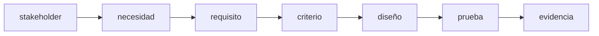
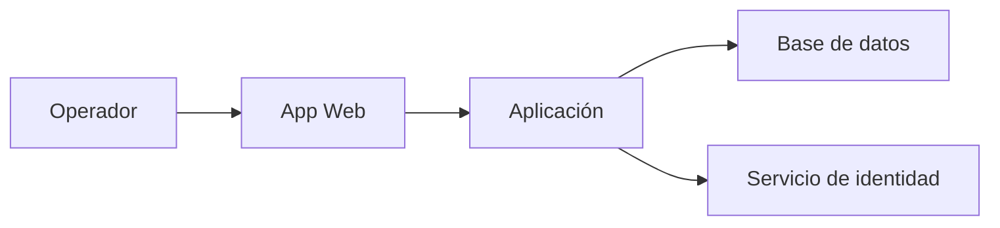
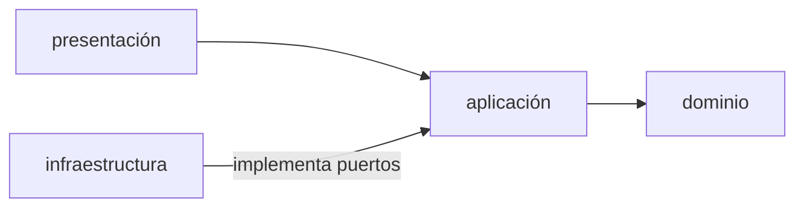
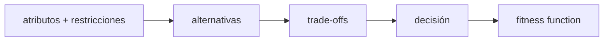
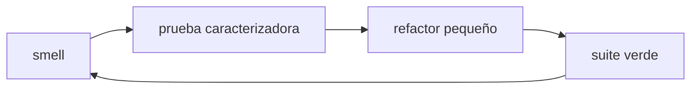
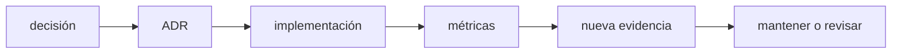
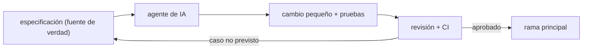
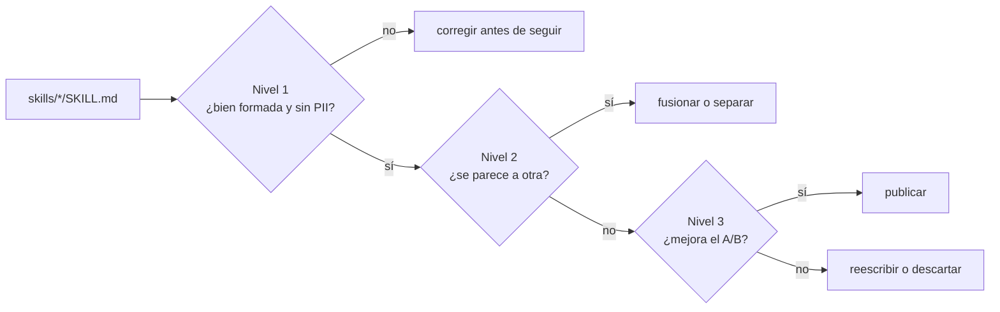

# Módulo 7: Requisitos, diseño, arquitectura y mantenimiento


## Aprende construyendo


### Tema 1: Requisitos, stakeholders y criterios verificables · Avanzado · 45 min

<details open>
<summary><strong>Capa 1 — Lectura</strong></summary>

#### ► DE QUÉ TRATA
Al finalizar vas a convertir "confirmar una entrega debe ser seguro" en un criterio de aceptación verificable, usando la regla de confirmación recipientPin: debe tener exactamente 6 dígitos. Prerrequisitos: ninguno adicional.

#### ► LA IDEA EN UNA FRASE
**Al finalizar vas a convertir "confirmar una entrega debe ser seguro" en un criterio de aceptación verificable, usando la regla de confirmación recipientPin: debe tener exactamente 6 dígitos.**

#### ► POR QUÉ EXISTE ESTO
Resuelve un problema real de diseño o implementación y evita decisiones a ciegas.

#### ► LA ANALOGÍA
Piensa en requisitos, stakeholders y criterios verificables como una herramienta de taller: útil cuando conoces su propósito y sus límites.
**Dónde se rompe la analogía:** en software, los efectos dependen del contexto, la escala y los trade-offs.

#### ► CÓMO FUNCIONA


#### ► LO QUE PUEDE SALIR MAL
| Síntoma | Causa probable | Arreglo |
|---|---|---|
| Requisitos, stakeholders y criterios verificables se aplica pero el resultado no mejora | Se usó sin medir el problema real | Mide antes y compara contra la alternativa simple |
| Aparece complejidad inesperada | Se adoptó la técnica sin comprender sus trade-offs | Vuelve a la sección de trade-offs y reduce el alcance |
| Falla en un caso límite | Se asumió un contexto que no se cumple | Prueba el caso límite y documenta cuándo NO usarlo |

#### ► TRADE-OFFS
| Opción | Cuándo usarla | Cuándo NO usarla |
|---|---|---|
| Usar Requisitos, stakeholders y criterios verificables | Cuando el problema coincide con su propósito y el beneficio es observable | Cuando agrega complejidad sin resolver un problema real |
| Alternativa más simple | Cuando el contexto es pequeño, estable o fácil de razonar | Cuando ya demostró no escalar o no cumplir el requisito |
| Postergar la decisión | Cuando falta evidencia del problema | Cuando el costo de esperar es mayor que el costo de probar |

#### ► CUÁNDO NO USAR ESTO
No uses requisitos, stakeholders y criterios verificables por defecto. Aplícalo cuando el problema lo justifique y puedas verificar el beneficio; si una alternativa más simple resuelve igual, prefiérela.

#### ► DE VUELTA A LA ANALOGÍA
Volviendo a la analogía: requisitos, stakeholders y criterios verificables funciona como el modelo inicial, pero recuerda dónde se rompe: en producción importan la evidencia, la escala y el costo de equivocarte.

#### ► LO QUE DEBES RECORDAR
- Requisitos, stakeholders y criterios verificables existe para resolver un problema específico.
- Mide antes de adoptar complejidad.
- Conoce el caso donde NO usarlo.
- Verifica con evidencia observable.

#### ► PREGUNTAS PARA PENSAR
1. ¿Qué problema concreto resuelve requisitos, stakeholders y criterios verificables en tu contexto?
2. ¿Cómo sabrías que requisitos, stakeholders y criterios verificables no está funcionando bien?
3. ¿Qué alternativa más simple considerarías antes de usar requisitos, stakeholders y criterios verificables?

</details>

<details>
<summary><strong>Capa 2 — Construcción</strong></summary>

#### Código y verificación
```text
Como operador de bodega
quiero registrar una retirada por SKU
para mantener el stock actualizado.

Criterios:
- Dado stock 5, cuando retiro 2, entonces queda 3 y se registra auditoría.
- Dado stock 1, cuando retiro 2, entonces se rechaza sin cambio parcial.
- Un lector autenticado no puede retirar.
```


```bash
mkdir ejemplo && cd ejemplo
```

```text
- Dado un comando con recipientPin de 6 dígitos y shipmentId válido, cuando se confirma, entonces el envío queda "delivered".
- Dado un recipientPin de 4 dígitos, cuando se confirma, entonces se rechaza con TypeError, sin cambiar el estado del envío.
- Dado un commandId ya procesado antes, cuando se reenvía el mismo comando, entonces se devuelve el resultado anterior sin volver a confirmar.
```

```python
import re
import sys
from pathlib import Path

VAGOS = ("rápido", "rapido", "lento", "seguro", "fácil", "facil", "cómodo", "comodo", "estable")
lineas = [l.strip() for l in Path("criterios.md").read_text(encoding="utf-8").splitlines() if l.strip()]
fallos = []
for numero, linea in enumerate(lineas, 1):
    texto = linea.lower()
    if not all(palabra in texto for palabra in ("dado", "cuando", "entonces")):
        fallos.append(f"criterio {numero}: falta dado/cuando/entonces")
    elif any(vago in texto for vago in VAGOS) and not re.search(r"\d", linea):
        fallos.append(f"criterio {numero}: adjetivo sin medida numérica")
if not any("6 dígitos" in l for l in lineas):
    fallos.append("falta la regla del PIN de 6 dígitos")
print(f"criterios: {len(lineas)}")
print(f"verificables: {len(lineas) - len(fallos)}")
for fallo in fallos:
    print("fallo:", fallo)
sys.exit(1 if fallos else 0)
```

```bash
python3 verificar_criterios.py
```

</details>

### Tema 2: Arquitectura guiada por atributos de calidad · Avanzado · 45 min

<details open>
<summary><strong>Capa 1 — Lectura</strong></summary>

#### ► DE QUÉ TRATA
Al finalizar vas a escribir el escenario de calidad que justifica una línea real de confirm-delivery.ts: la restricción UNIQUE(command_id). Prerrequisitos: Tema 1 de este módulo.

#### ► LA IDEA EN UNA FRASE
**Al finalizar vas a escribir el escenario de calidad que justifica una línea real de confirm-delivery.ts: la restricción UNIQUE(command_id).**

#### ► POR QUÉ EXISTE ESTO
Resuelve un problema real de diseño o implementación y evita decisiones a ciegas.

#### ► LA ANALOGÍA
Un escenario de calidad tiene fuente, estímulo, artefacto, entorno, respuesta y medida — no es un diagrama bonito, es una frase verificable sobre qué pasa cuando algo sale mal.

**Conceptos clave:** arquitectura, componente, conector, límite, dependencia, atributo de calidad, escenario, trade-off, C4 y fitness function.

Arquitectura son decisiones estructurales difíciles de cambiar: responsabilidades, límites, comunicación y dependencias. No es únicamente un diagrama. Se evalúa contra atributos como mantenibilidad, disponibilidad, rendimiento, seguridad, portabilidad y operabilidad.

Un escenario de calidad tiene fuente, estímulo, artefacto, entorno, respuesta y medida: “durante operación normal, una pérdida del proceso no debe corromper una transacción confirmada; tras reinicio, datos comprometidos permanecen”. Este escenario favorece transacciones/durabilidad. Otro de despliegue frecuente puede favorecer modularidad y automatización.

C4 comunica niveles:



Una arquitectura por capas puede dirigir dependencias hacia el dominio:



El dominio no debería importar SQLite ni HTTP. Define una interfaz/puerto `RepositorioProductos`; infraestructura la implementa. Esto facilita pruebas y cambio de mecanismo, pero añadir abstracciones sin alternativa ni beneficio puede ser sobreingeniería.

Fitness functions automatizan propiedades: reglas de dependencia, presupuesto de bundle, tiempo de build, cobertura de contratos o vulnerabilidades máximas. La arquitectura evoluciona con evidencia.

**Analogía:** arquitectura decide estructura, circulación y servicios de un edificio según uso y riesgos; decorar habitaciones no corrige una salida de emergencia inexistente.

**¿Por qué es importante?** Porque la restricción `UNIQUE(command_id)` no es un capricho de la base de datos: es la respuesta directa a un escenario de calidad real (reintentos de red) que, sin documentarlo, parece una regla arbitraria.

**Casos de uso reales:** monolito modular, microservicios, móvil offline, sistemas regulados y plataformas multi-equipo.

**Diagrama:**



**Transferencia al proyecto integrador «Fundamentos: gestor de tareas»:** Define disponibilidad, facilidad de prueba y recuperación requeridas por el gestor. Compara dos diseños mediante un escenario concreto de archivo corrupto, en vez de elegir capas solo por su nombre.

**Dónde se rompe la analogía:** el modelo simplifica la realidad; en producción influyen escala, fallos, costo y contexto.

#### ► CÓMO FUNCIONA


#### ► LO QUE PUEDE SALIR MAL
| Síntoma | Causa probable | Arreglo |
|---|---|---|
| Arquitectura guiada por atributos de calidad se aplica pero el resultado no mejora | Se usó sin medir el problema real | Mide antes y compara contra la alternativa simple |
| Aparece complejidad inesperada | Se adoptó la técnica sin comprender sus trade-offs | Vuelve a la sección de trade-offs y reduce el alcance |
| Falla en un caso límite | Se asumió un contexto que no se cumple | Prueba el caso límite y documenta cuándo NO usarlo |

#### ► TRADE-OFFS
| Opción | Cuándo usarla | Cuándo NO usarla |
|---|---|---|
| Usar Arquitectura guiada por atributos de calidad | Cuando el problema coincide con su propósito y el beneficio es observable | Cuando agrega complejidad sin resolver un problema real |
| Alternativa más simple | Cuando el contexto es pequeño, estable o fácil de razonar | Cuando ya demostró no escalar o no cumplir el requisito |
| Postergar la decisión | Cuando falta evidencia del problema | Cuando el costo de esperar es mayor que el costo de probar |

#### ► CUÁNDO NO USAR ESTO
No uses arquitectura guiada por atributos de calidad por defecto. Aplícalo cuando el problema lo justifique y puedas verificar el beneficio; si una alternativa más simple resuelve igual, prefiérela.

#### ► DE VUELTA A LA ANALOGÍA
Volviendo a la analogía: arquitectura guiada por atributos de calidad funciona como el modelo inicial, pero recuerda dónde se rompe: en producción importan la evidencia, la escala y el costo de equivocarte.

#### ► LO QUE DEBES RECORDAR
- Arquitectura guiada por atributos de calidad existe para resolver un problema específico.
- Mide antes de adoptar complejidad.
- Conoce el caso donde NO usarlo.
- Verifica con evidencia observable.

#### ► PREGUNTAS PARA PENSAR
1. ¿Qué problema concreto resuelve arquitectura guiada por atributos de calidad en tu contexto?
2. ¿Cómo sabrías que arquitectura guiada por atributos de calidad no está funcionando bien?
3. ¿Qué alternativa más simple considerarías antes de usar arquitectura guiada por atributos de calidad?

</details>

<details>
<summary><strong>Capa 2 — Construcción</strong></summary>

#### Código y verificación


```bash
mkdir ejemplo && cd ejemplo
```

```text
Fuente: red inestable del conductor
Estímulo: el mismo comando "confirmar entrega" se reenvía dos veces (reintento automático)
Artefacto: confirmDelivery() + repositorio
Entorno: operación normal con conexión intermitente
Respuesta: la segunda llamada devuelve el resultado ya guardado, sin volver a confirmar ni duplicar
Medida: cero entregas duplicadas, verificable con UNIQUE(command_id) en la base real
```

```python
import sqlite3
from pathlib import Path

CAMPOS = ("Fuente:", "Estímulo:", "Artefacto:", "Entorno:", "Respuesta:", "Medida:")
texto = Path("escenario.txt").read_text(encoding="utf-8")
faltan = [campo for campo in CAMPOS if campo not in texto]
print(f"campos del escenario: {len(CAMPOS) - len(faltan)}/{len(CAMPOS)}")
if faltan:
    print("faltan:", faltan)
    raise SystemExit(1)

def filas(con_restriccion: bool) -> int:
    conexion = sqlite3.connect(":memory:")
    sufijo = " UNIQUE" if con_restriccion else ""
    conexion.execute(f"CREATE TABLE confirmacion(id INTEGER PRIMARY KEY, command_id TEXT{sufijo})")
    for _ in range(2):
        try:
            conexion.execute("INSERT INTO confirmacion(command_id) VALUES ('cmd-1')")
        except sqlite3.IntegrityError:
            pass
    return conexion.execute("SELECT COUNT(*) FROM confirmacion").fetchone()[0]

print("filas sin restricción:", filas(False))
print("filas con UNIQUE(command_id):", filas(True))
```

</details>

### Tema 3: Diseño modular, principios, patrones y refactoring · Avanzado · 45 min

<details open>
<summary><strong>Capa 1 — Lectura</strong></summary>

#### ► DE QUÉ TRATA
Al finalizar vas a definir el puerto DeliveryRepository, implementar confirmDelivery y escribir un segundo adaptador sin tocar el caso de uso. Prerrequisitos: Node.js 24 o posterior para ejecutar TypeScript con borrado de tipos, y Python 3 para el verificador estructural.

#### ► LA IDEA EN UNA FRASE
**Al finalizar vas a definir el puerto DeliveryRepository, implementar confirmDelivery y escribir un segundo adaptador sin tocar el caso de uso.**

#### ► POR QUÉ EXISTE ESTO
Resuelve un problema real de diseño o implementación y evita decisiones a ciegas.

#### ► LA ANALOGÍA
Baja cohesión significa que `confirmDelivery` conoce solo lo que necesita del repositorio (dos métodos), nunca cómo esos datos llegan a disco — el mismo principio de "el dominio no importa SQLite" aplicado a un archivo que ya existe.

**Conceptos clave:** cohesión, acoplamiento, encapsulación, abstracción, composición, SOLID, puerto, Repository, Adapter y prueba caracterizadora (el catálogo de patrones está en el Módulo 13 y el refactoring en el Módulo 14).

Alta cohesión significa que un módulo reúne responsabilidades relacionadas. Bajo acoplamiento significa que conoce poco de detalles externos. Encapsulación protege invariantes; abstracción presenta un contrato relevante y oculta detalles que pueden cambiar.

```python
from typing import Protocol

class RepositorioProductos(Protocol):
    def obtener_por_sku(self, sku: str): ...
    def guardar(self, producto): ...

class RetirarStock:
    def __init__(self, repositorio: RepositorioProductos):
        self.repositorio = repositorio

    def ejecutar(self, sku: str, cantidad: int):
        producto = self.repositorio.obtener_por_sku(sku)
        producto.retirar(cantidad)
        self.repositorio.guardar(producto)
```

El caso de uso depende de capacidad, no SQLite. Responsabilidad única no significa “una función por línea”; significa una razón coherente de cambio. Inversión de dependencias no obliga a interfaz para todo; se aplica en límites que necesitan sustitución, prueba o aislamiento.

En este tema practicas dos patrones porque el diseño los necesita: **Repository** (el puerto `DeliveryRepository`) y **Adapter** (cada implementación del puerto). El criterio para elegir cualquier otro patrón y el catálogo completo, con un requisito de RutaFlow y la alternativa más simple en cada caso, viven en el **Módulo 13**; no se repiten aquí.

Para el Paso 6 necesitas una idea de refactoring: antes de cambiar código que ya funciona, una **prueba caracterizadora** registra lo que hace hoy. La técnica completa (pasos pequeños con la suite en verde, nombres, funciones y commits que separan refactor de cambio funcional) es la referencia del **Módulo 14**, Tema 1 y Proyecto 14.

**Analogía:** un puerto es un enchufe estándar en la pared; el adaptador es el cargador concreto que conectas. Cambias de cargador sin tocar la instalación eléctrica. **Límite:** si solo existe un cargador posible y nunca vas a probarlo aparte, el enchufe extra no aporta nada.

**¿Por qué es importante?** Porque poder cambiar de un repositorio real a uno en memoria sin tocar una línea de `confirmDelivery` es la evidencia concreta de que el dominio no depende de cómo se guardan los datos, no solo una afirmación de buenas intenciones.

**Casos de uso reales:** cambio de base, múltiples proveedores, reglas configurables, integraciones y sistemas legacy.

**Diagrama:**



**Transferencia al proyecto integrador «Fundamentos: gestor de tareas»:** Refactoriza el almacenamiento detrás de un contrato pequeño conservando las pruebas de uso. Sustituye el archivo por un fake y demuestra que crear y completar tareas mantienen su comportamiento.

**Dónde se rompe la analogía:** el modelo simplifica la realidad; en producción influyen escala, fallos, costo y contexto.

#### ► CÓMO FUNCIONA


#### ► LO QUE PUEDE SALIR MAL
| Síntoma | Causa probable | Arreglo |
|---|---|---|
| Diseño modular, principios, patrones y refactoring se aplica pero el resultado no mejora | Se usó sin medir el problema real | Mide antes y compara contra la alternativa simple |
| Aparece complejidad inesperada | Se adoptó la técnica sin comprender sus trade-offs | Vuelve a la sección de trade-offs y reduce el alcance |
| Falla en un caso límite | Se asumió un contexto que no se cumple | Prueba el caso límite y documenta cuándo NO usarlo |

#### ► TRADE-OFFS
| Opción | Cuándo usarla | Cuándo NO usarla |
|---|---|---|
| Usar Diseño modular, principios, patrones y refactoring | Cuando el problema coincide con su propósito y el beneficio es observable | Cuando agrega complejidad sin resolver un problema real |
| Alternativa más simple | Cuando el contexto es pequeño, estable o fácil de razonar | Cuando ya demostró no escalar o no cumplir el requisito |
| Postergar la decisión | Cuando falta evidencia del problema | Cuando el costo de esperar es mayor que el costo de probar |

#### ► CUÁNDO NO USAR ESTO
No uses diseño modular, principios, patrones y refactoring por defecto. Aplícalo cuando el problema lo justifique y puedas verificar el beneficio; si una alternativa más simple resuelve igual, prefiérela.

#### ► DE VUELTA A LA ANALOGÍA
Volviendo a la analogía: diseño modular, principios, patrones y refactoring funciona como el modelo inicial, pero recuerda dónde se rompe: en producción importan la evidencia, la escala y el costo de equivocarte.

#### ► LO QUE DEBES RECORDAR
- Diseño modular, principios, patrones y refactoring existe para resolver un problema específico.
- Mide antes de adoptar complejidad.
- Conoce el caso donde NO usarlo.
- Verifica con evidencia observable.

#### ► PREGUNTAS PARA PENSAR
1. ¿Qué problema concreto resuelve diseño modular, principios, patrones y refactoring en tu contexto?
2. ¿Cómo sabrías que diseño modular, principios, patrones y refactoring no está funcionando bien?
3. ¿Qué alternativa más simple considerarías antes de usar diseño modular, principios, patrones y refactoring?

</details>

<details>
<summary><strong>Capa 2 — Construcción</strong></summary>

#### Código y verificación
```python
from typing import Protocol

class RepositorioProductos(Protocol):
    def obtener_por_sku(self, sku: str): ...
    def guardar(self, producto): ...

class RetirarStock:
    def __init__(self, repositorio: RepositorioProductos):
        self.repositorio = repositorio

    def ejecutar(self, sku: str, cantidad: int):
        producto = self.repositorio.obtener_por_sku(sku)
        producto.retirar(cantidad)
        self.repositorio.guardar(producto)
```


```bash
mkdir ejemplo-puerto && cd ejemplo-puerto
```

```typescript
export type DeliveryCommand = Readonly<{
  commandId: string;
  shipmentId: string;
  occurredAt: string;
  recipientPin: string;
}>;

export interface DeliveryRepository {
  findCommandResult(commandId: string): Promise<DeliveryResult | null>;
  confirm(command: DeliveryCommand): Promise<DeliveryResult>;
}

export type DeliveryResult = Readonly<{ shipmentId: string; status: 'delivered' }>;

export async function confirmDelivery(
  command: DeliveryCommand,
  repository: DeliveryRepository,
): Promise<DeliveryResult> {
  if (!command.commandId || !command.shipmentId) throw new TypeError('command identifiers are required');
  if (!/^\d{6}$/.test(command.recipientPin)) throw new TypeError('recipientPin must contain six digits');

  const previousResult = await repository.findCommandResult(command.commandId);
  if (previousResult) return previousResult;

  // Una implementación SQL debe insertar commandId y cambiar el envío en una
  // única transacción con restricción UNIQUE(command_id).
  return repository.confirm(command);
}
```

```python
import re
from pathlib import Path

fuente = Path("confirm-delivery.ts").read_text(encoding="utf-8")
bloque = re.search(r"export interface DeliveryRepository \{(.*?)\n\}", fuente, re.S)
if not bloque:
    raise SystemExit("no se encontró DeliveryRepository")
cuerpo = bloque.group(1)
metodos = re.findall(r"^\s{2}(\w+)\(", cuerpo, re.M)
infra = re.findall(r"(?i)\b(sqlite|sql|http|fetch|dynamodb|aws)\b", cuerpo)
print("métodos:", ", ".join(metodos))
print("métodos esperados:", len(metodos) == 2)
print("referencias de infraestructura:", len(infra))
```

```bash
python3 verificar_puerto.py
```

</details>

### Tema 4: Decisiones, documentación, deuda y evolución · Avanzado · 45 min

<details open>
<summary><strong>Capa 1 — Lectura</strong></summary>

#### ► DE QUÉ TRATA
Al finalizar vas a escribir el ADR real que justifica por qué RutaFlow usa DynamoDB para ShipmentEvents en vez de una base relacional. Prerrequisitos: ninguno adicional (el Módulo 4 del track Cloud profundiza la decisión en sí).

#### ► LA IDEA EN UNA FRASE
**Al finalizar vas a escribir el ADR real que justifica por qué RutaFlow usa DynamoDB para ShipmentEvents en vez de una base relacional.**

#### ► POR QUÉ EXISTE ESTO
Resuelve un problema real de diseño o implementación y evita decisiones a ciegas.

#### ► LA ANALOGÍA
Piensa en decisiones, documentación, deuda y evolución como una herramienta de taller: útil cuando conoces su propósito y sus límites.
**Dónde se rompe la analogía:** en software, los efectos dependen del contexto, la escala y los trade-offs.

#### ► CÓMO FUNCIONA


#### ► LO QUE PUEDE SALIR MAL
| Síntoma | Causa probable | Arreglo |
|---|---|---|
| Decisiones, documentación, deuda y evolución se aplica pero el resultado no mejora | Se usó sin medir el problema real | Mide antes y compara contra la alternativa simple |
| Aparece complejidad inesperada | Se adoptó la técnica sin comprender sus trade-offs | Vuelve a la sección de trade-offs y reduce el alcance |
| Falla en un caso límite | Se asumió un contexto que no se cumple | Prueba el caso límite y documenta cuándo NO usarlo |

#### ► TRADE-OFFS
| Opción | Cuándo usarla | Cuándo NO usarla |
|---|---|---|
| Usar Decisiones, documentación, deuda y evolución | Cuando el problema coincide con su propósito y el beneficio es observable | Cuando agrega complejidad sin resolver un problema real |
| Alternativa más simple | Cuando el contexto es pequeño, estable o fácil de razonar | Cuando ya demostró no escalar o no cumplir el requisito |
| Postergar la decisión | Cuando falta evidencia del problema | Cuando el costo de esperar es mayor que el costo de probar |

#### ► CUÁNDO NO USAR ESTO
No uses decisiones, documentación, deuda y evolución por defecto. Aplícalo cuando el problema lo justifique y puedas verificar el beneficio; si una alternativa más simple resuelve igual, prefiérela.

#### ► DE VUELTA A LA ANALOGÍA
Volviendo a la analogía: decisiones, documentación, deuda y evolución funciona como el modelo inicial, pero recuerda dónde se rompe: en producción importan la evidencia, la escala y el costo de equivocarte.

#### ► LO QUE DEBES RECORDAR
- Decisiones, documentación, deuda y evolución existe para resolver un problema específico.
- Mide antes de adoptar complejidad.
- Conoce el caso donde NO usarlo.
- Verifica con evidencia observable.

#### ► PREGUNTAS PARA PENSAR
1. ¿Qué problema concreto resuelve decisiones, documentación, deuda y evolución en tu contexto?
2. ¿Cómo sabrías que decisiones, documentación, deuda y evolución no está funcionando bien?
3. ¿Qué alternativa más simple considerarías antes de usar decisiones, documentación, deuda y evolución?

</details>

<details>
<summary><strong>Capa 2 — Construcción</strong></summary>

#### Código y verificación


```bash
mkdir -p ejemplo-adr/docs/adr && cd ejemplo-adr
```

</details>

### Contexto

<details open>
<summary><strong>Capa 1 — Lectura</strong></summary>

#### ► DE QUÉ TRATA
Este tema te guía por contexto con foco en comprensión antes de implementación.

#### ► LA IDEA EN UNA FRASE
**Entender contexto te permite tomar mejores decisiones técnicas.**

#### ► POR QUÉ EXISTE ESTO
Resuelve un problema real de diseño o implementación y evita decisiones a ciegas.

#### ► LA ANALOGÍA
Piensa en contexto como una herramienta de taller: útil cuando conoces su propósito y sus límites.
**Dónde se rompe la analogía:** en software, los efectos dependen del contexto, la escala y los trade-offs.

#### ► CÓMO FUNCIONA
1. Identifica el problema que contexto resuelve.
2. Observa sus componentes y relaciones.
3. Aplica la opción más simple que funcione.
4. Verifica el resultado y los límites.

#### ► LO QUE PUEDE SALIR MAL
| Síntoma | Causa probable | Arreglo |
|---|---|---|
| Contexto se aplica pero el resultado no mejora | Se usó sin medir el problema real | Mide antes y compara contra la alternativa simple |
| Aparece complejidad inesperada | Se adoptó la técnica sin comprender sus trade-offs | Vuelve a la sección de trade-offs y reduce el alcance |
| Falla en un caso límite | Se asumió un contexto que no se cumple | Prueba el caso límite y documenta cuándo NO usarlo |

#### ► TRADE-OFFS
| Opción | Cuándo usarla | Cuándo NO usarla |
|---|---|---|
| Usar Contexto | Cuando el problema coincide con su propósito y el beneficio es observable | Cuando agrega complejidad sin resolver un problema real |
| Alternativa más simple | Cuando el contexto es pequeño, estable o fácil de razonar | Cuando ya demostró no escalar o no cumplir el requisito |
| Postergar la decisión | Cuando falta evidencia del problema | Cuando el costo de esperar es mayor que el costo de probar |

#### ► CUÁNDO NO USAR ESTO
No uses contexto por defecto. Aplícalo cuando el problema lo justifique y puedas verificar el beneficio; si una alternativa más simple resuelve igual, prefiérela.

#### ► DE VUELTA A LA ANALOGÍA
Volviendo a la analogía: contexto funciona como el modelo inicial, pero recuerda dónde se rompe: en producción importan la evidencia, la escala y el costo de equivocarte.

#### ► LO QUE DEBES RECORDAR
- Contexto existe para resolver un problema específico.
- Mide antes de adoptar complejidad.
- Conoce el caso donde NO usarlo.
- Verifica con evidencia observable.

#### ► PREGUNTAS PARA PENSAR
1. ¿Qué problema concreto resuelve contexto en tu contexto?
2. ¿Cómo sabrías que contexto no está funcionando bien?
3. ¿Qué alternativa más simple considerarías antes de usar contexto?

</details>

<details>
<summary><strong>Capa 2 — Construcción</strong></summary>

#### Nota de construcción
Este tema es principalmente conceptual en esta versión. La verificación se realiza con las preguntas de comprensión y el criterio de cuándo NO usar contexto.

</details>

### Decisión

<details open>
<summary><strong>Capa 1 — Lectura</strong></summary>

#### ► DE QUÉ TRATA
Este tema te guía por decisión con foco en comprensión antes de implementación.

#### ► LA IDEA EN UNA FRASE
**Entender decisión te permite tomar mejores decisiones técnicas.**

#### ► POR QUÉ EXISTE ESTO
Resuelve un problema real de diseño o implementación y evita decisiones a ciegas.

#### ► LA ANALOGÍA
Piensa en decisión como una herramienta de taller: útil cuando conoces su propósito y sus límites.
**Dónde se rompe la analogía:** en software, los efectos dependen del contexto, la escala y los trade-offs.

#### ► CÓMO FUNCIONA
1. Identifica el problema que decisión resuelve.
2. Observa sus componentes y relaciones.
3. Aplica la opción más simple que funcione.
4. Verifica el resultado y los límites.

#### ► LO QUE PUEDE SALIR MAL
| Síntoma | Causa probable | Arreglo |
|---|---|---|
| Decisión se aplica pero el resultado no mejora | Se usó sin medir el problema real | Mide antes y compara contra la alternativa simple |
| Aparece complejidad inesperada | Se adoptó la técnica sin comprender sus trade-offs | Vuelve a la sección de trade-offs y reduce el alcance |
| Falla en un caso límite | Se asumió un contexto que no se cumple | Prueba el caso límite y documenta cuándo NO usarlo |

#### ► TRADE-OFFS
| Opción | Cuándo usarla | Cuándo NO usarla |
|---|---|---|
| Usar Decisión | Cuando el problema coincide con su propósito y el beneficio es observable | Cuando agrega complejidad sin resolver un problema real |
| Alternativa más simple | Cuando el contexto es pequeño, estable o fácil de razonar | Cuando ya demostró no escalar o no cumplir el requisito |
| Postergar la decisión | Cuando falta evidencia del problema | Cuando el costo de esperar es mayor que el costo de probar |

#### ► CUÁNDO NO USAR ESTO
No uses decisión por defecto. Aplícalo cuando el problema lo justifique y puedas verificar el beneficio; si una alternativa más simple resuelve igual, prefiérela.

#### ► DE VUELTA A LA ANALOGÍA
Volviendo a la analogía: decisión funciona como el modelo inicial, pero recuerda dónde se rompe: en producción importan la evidencia, la escala y el costo de equivocarte.

#### ► LO QUE DEBES RECORDAR
- Decisión existe para resolver un problema específico.
- Mide antes de adoptar complejidad.
- Conoce el caso donde NO usarlo.
- Verifica con evidencia observable.

#### ► PREGUNTAS PARA PENSAR
1. ¿Qué problema concreto resuelve decisión en tu contexto?
2. ¿Cómo sabrías que decisión no está funcionando bien?
3. ¿Qué alternativa más simple considerarías antes de usar decisión?

</details>

<details>
<summary><strong>Capa 2 — Construcción</strong></summary>

#### Nota de construcción
Este tema es principalmente conceptual en esta versión. La verificación se realiza con las preguntas de comprensión y el criterio de cuándo NO usar decisión.

</details>

### Consecuencias

<details open>
<summary><strong>Capa 1 — Lectura</strong></summary>

#### ► DE QUÉ TRATA
Este tema te guía por consecuencias con foco en comprensión antes de implementación.

#### ► LA IDEA EN UNA FRASE
**Entender consecuencias te permite tomar mejores decisiones técnicas.**

#### ► POR QUÉ EXISTE ESTO
Resuelve un problema real de diseño o implementación y evita decisiones a ciegas.

#### ► LA ANALOGÍA
Piensa en consecuencias como una herramienta de taller: útil cuando conoces su propósito y sus límites.
**Dónde se rompe la analogía:** en software, los efectos dependen del contexto, la escala y los trade-offs.

#### ► CÓMO FUNCIONA
1. Identifica el problema que consecuencias resuelve.
2. Observa sus componentes y relaciones.
3. Aplica la opción más simple que funcione.
4. Verifica el resultado y los límites.

#### ► LO QUE PUEDE SALIR MAL
| Síntoma | Causa probable | Arreglo |
|---|---|---|
| Consecuencias se aplica pero el resultado no mejora | Se usó sin medir el problema real | Mide antes y compara contra la alternativa simple |
| Aparece complejidad inesperada | Se adoptó la técnica sin comprender sus trade-offs | Vuelve a la sección de trade-offs y reduce el alcance |
| Falla en un caso límite | Se asumió un contexto que no se cumple | Prueba el caso límite y documenta cuándo NO usarlo |

#### ► TRADE-OFFS
| Opción | Cuándo usarla | Cuándo NO usarla |
|---|---|---|
| Usar Consecuencias | Cuando el problema coincide con su propósito y el beneficio es observable | Cuando agrega complejidad sin resolver un problema real |
| Alternativa más simple | Cuando el contexto es pequeño, estable o fácil de razonar | Cuando ya demostró no escalar o no cumplir el requisito |
| Postergar la decisión | Cuando falta evidencia del problema | Cuando el costo de esperar es mayor que el costo de probar |

#### ► CUÁNDO NO USAR ESTO
No uses consecuencias por defecto. Aplícalo cuando el problema lo justifique y puedas verificar el beneficio; si una alternativa más simple resuelve igual, prefiérela.

#### ► DE VUELTA A LA ANALOGÍA
Volviendo a la analogía: consecuencias funciona como el modelo inicial, pero recuerda dónde se rompe: en producción importan la evidencia, la escala y el costo de equivocarte.

#### ► LO QUE DEBES RECORDAR
- Consecuencias existe para resolver un problema específico.
- Mide antes de adoptar complejidad.
- Conoce el caso donde NO usarlo.
- Verifica con evidencia observable.

#### ► PREGUNTAS PARA PENSAR
1. ¿Qué problema concreto resuelve consecuencias en tu contexto?
2. ¿Cómo sabrías que consecuencias no está funcionando bien?
3. ¿Qué alternativa más simple considerarías antes de usar consecuencias?

</details>

<details>
<summary><strong>Capa 2 — Construcción</strong></summary>

#### Código y verificación
```

**Ejecuta la verificación** (comprueba que el ADR tiene las tres secciones):

```

</details>

### Tema 5: Records de C#: igualdad por valor no implica inmutabilidad profunda · Avanzado · 45 min

<details open>
<summary><strong>Capa 1 — Lectura</strong></summary>

#### ► DE QUÉ TRATA
Al finalizar ejecutarás un record C#, crearás una copia con with y demostrarás qué ocurre con una lista compartida. Prerrequisitos: objetos, referencias y colecciones; es una comparación de diseño, no un curso completo de C#. Instala el SDK .NET 10 y comprueba dotnet --version. E…

#### ► LA IDEA EN UNA FRASE
**Al finalizar ejecutarás un record C#, crearás una copia con with y demostrarás qué ocurre con una lista compartida.**

#### ► POR QUÉ EXISTE ESTO
Resuelve un problema real de diseño o implementación y evita decisiones a ciegas.

#### ► LA ANALOGÍA
Piensa en records de c#: igualdad por valor no implica inmutabilidad profunda como una herramienta de taller: útil cuando conoces su propósito y sus límites.
**Dónde se rompe la analogía:** en software, los efectos dependen del contexto, la escala y los trade-offs.

#### ► CÓMO FUNCIONA
1. Identifica el problema que records de c#: igualdad por valor no implica inmutabilidad profunda resuelve.
2. Observa sus componentes y relaciones.
3. Aplica la opción más simple que funcione.
4. Verifica el resultado y los límites.

#### ► LO QUE PUEDE SALIR MAL
| Síntoma | Causa probable | Arreglo |
|---|---|---|
| Records de C#: igualdad por valor no implica inmutabilidad profunda se aplica pero el resultado no mejora | Se usó sin medir el problema real | Mide antes y compara contra la alternativa simple |
| Aparece complejidad inesperada | Se adoptó la técnica sin comprender sus trade-offs | Vuelve a la sección de trade-offs y reduce el alcance |
| Falla en un caso límite | Se asumió un contexto que no se cumple | Prueba el caso límite y documenta cuándo NO usarlo |

#### ► TRADE-OFFS
| Opción | Cuándo usarla | Cuándo NO usarla |
|---|---|---|
| Usar Records de C#: igualdad por valor no implica inmutabilidad profunda | Cuando el problema coincide con su propósito y el beneficio es observable | Cuando agrega complejidad sin resolver un problema real |
| Alternativa más simple | Cuando el contexto es pequeño, estable o fácil de razonar | Cuando ya demostró no escalar o no cumplir el requisito |
| Postergar la decisión | Cuando falta evidencia del problema | Cuando el costo de esperar es mayor que el costo de probar |

#### ► CUÁNDO NO USAR ESTO
No uses records de c#: igualdad por valor no implica inmutabilidad profunda por defecto. Aplícalo cuando el problema lo justifique y puedas verificar el beneficio; si una alternativa más simple resuelve igual, prefiérela.

#### ► DE VUELTA A LA ANALOGÍA
Volviendo a la analogía: records de c#: igualdad por valor no implica inmutabilidad profunda funciona como el modelo inicial, pero recuerda dónde se rompe: en producción importan la evidencia, la escala y el costo de equivocarte.

#### ► LO QUE DEBES RECORDAR
- Records de C#: igualdad por valor no implica inmutabilidad profunda existe para resolver un problema específico.
- Mide antes de adoptar complejidad.
- Conoce el caso donde NO usarlo.
- Verifica con evidencia observable.

#### ► PREGUNTAS PARA PENSAR
1. ¿Qué problema concreto resuelve records de c#: igualdad por valor no implica inmutabilidad profunda en tu contexto?
2. ¿Cómo sabrías que records de c#: igualdad por valor no implica inmutabilidad profunda no está funcionando bien?
3. ¿Qué alternativa más simple considerarías antes de usar records de c#: igualdad por valor no implica inmutabilidad profunda?

</details>

<details>
<summary><strong>Capa 2 — Construcción</strong></summary>

#### Código y verificación
```bash
mkdir ejemplo-records && cd ejemplo-records
```

```xml
<Project Sdk="Microsoft.NET.Sdk"><PropertyGroup><OutputType>Exe</OutputType><TargetFramework>net10.0</TargetFramework><ImplicitUsings>enable</ImplicitUsings><Nullable>enable</Nullable></PropertyGroup></Project>
```

```csharp
using System;
using System.Collections.Generic;

var original = new Registro(7, new List<string> { "creado" });
var copia = original with { Id = 8 };
copia.Estados.Add("asignado");
if (original.Id != 7 || copia.Id != 8) throw new Exception("Copia escalar incorrecta");
if (original.Estados.Count != 2) throw new Exception("Se esperaba referencia compartida");
Console.WriteLine("IDs independientes; lista compartida");
var a = new Punto(4, 5);
var b = new Punto(4, 5);
if (a != b) throw new Exception("Se esperaba igualdad por valor");
Console.WriteLine("Records con valores iguales comparan igual");
public record Registro(int Id, List<string> Estados);
public record Punto(int X, int Y);
```

```bash
dotnet run --project Records.csproj
```

</details>

### Tema 6: Desarrollo guiado por especificación con agentes de IA · Avanzado · 45 min

<details open>
<summary><strong>Capa 1 — Lectura</strong></summary>

#### ► DE QUÉ TRATA
Al finalizar vas a escribir una especificación pequeña con criterios numerados, pedir a un agente de IA un cambio contra esa especificación y comprobar con un script que cada criterio quedó cubierto por una prueba. Prerrequisitos: el Tema 1 de este módulo (criterios dado/cuando/e…

#### ► LA IDEA EN UNA FRASE
**Al finalizar vas a escribir una especificación pequeña con criterios numerados, pedir a un agente de IA un cambio contra esa especificación y comprobar con un script que cada criterio quedó cubierto por una prueba.**

#### ► POR QUÉ EXISTE ESTO
Resuelve un problema real de diseño o implementación y evita decisiones a ciegas.

#### ► LA ANALOGÍA
Piensa en desarrollo guiado por especificación con agentes de ia como una herramienta de taller: útil cuando conoces su propósito y sus límites.
**Dónde se rompe la analogía:** en software, los efectos dependen del contexto, la escala y los trade-offs.

#### ► CÓMO FUNCIONA


#### ► LO QUE PUEDE SALIR MAL
| Síntoma | Causa probable | Arreglo |
|---|---|---|
| Desarrollo guiado por especificación con agentes de IA se aplica pero el resultado no mejora | Se usó sin medir el problema real | Mide antes y compara contra la alternativa simple |
| Aparece complejidad inesperada | Se adoptó la técnica sin comprender sus trade-offs | Vuelve a la sección de trade-offs y reduce el alcance |
| Falla en un caso límite | Se asumió un contexto que no se cumple | Prueba el caso límite y documenta cuándo NO usarlo |

#### ► TRADE-OFFS
| Opción | Cuándo usarla | Cuándo NO usarla |
|---|---|---|
| Usar Desarrollo guiado por especificación con agentes de IA | Cuando el problema coincide con su propósito y el beneficio es observable | Cuando agrega complejidad sin resolver un problema real |
| Alternativa más simple | Cuando el contexto es pequeño, estable o fácil de razonar | Cuando ya demostró no escalar o no cumplir el requisito |
| Postergar la decisión | Cuando falta evidencia del problema | Cuando el costo de esperar es mayor que el costo de probar |

#### ► CUÁNDO NO USAR ESTO
No uses desarrollo guiado por especificación con agentes de ia por defecto. Aplícalo cuando el problema lo justifique y puedas verificar el beneficio; si una alternativa más simple resuelve igual, prefiérela.

#### ► DE VUELTA A LA ANALOGÍA
Volviendo a la analogía: desarrollo guiado por especificación con agentes de ia funciona como el modelo inicial, pero recuerda dónde se rompe: en producción importan la evidencia, la escala y el costo de equivocarte.

#### ► LO QUE DEBES RECORDAR
- Desarrollo guiado por especificación con agentes de IA existe para resolver un problema específico.
- Mide antes de adoptar complejidad.
- Conoce el caso donde NO usarlo.
- Verifica con evidencia observable.

#### ► PREGUNTAS PARA PENSAR
1. ¿Qué problema concreto resuelve desarrollo guiado por especificación con agentes de ia en tu contexto?
2. ¿Cómo sabrías que desarrollo guiado por especificación con agentes de ia no está funcionando bien?
3. ¿Qué alternativa más simple considerarías antes de usar desarrollo guiado por especificación con agentes de ia?

</details>

<details>
<summary><strong>Capa 2 — Construcción</strong></summary>

#### Código y verificación


```bash
mkdir -p ejemplo-spec && cd ejemplo-spec
```

```text
# Confirmar entrega
Contexto: solo se modifica entregas.py; no se agregan dependencias.
C1: Dado un recipientPin de 6 dígitos, cuando se confirma, entonces el estado es "delivered".
C2: Dado un recipientPin con menos o más de 6 dígitos, cuando se confirma, entonces se lanza ValueError y el estado no cambia.
C3: Dado un recipientPin con letras, cuando se confirma, entonces se lanza ValueError.
```

```python
def confirmar(envio: dict, pin: str) -> dict:
    """Devuelve una copia del envío confirmado; no muta el original."""
    if len(pin) != 6 or not pin.isdigit():
        raise ValueError("recipientPin debe tener exactamente 6 dígitos")
    return {**envio, "estado": "delivered"}
```

```python
import unittest
from entregas import confirmar


class ConfirmarEntrega(unittest.TestCase):
    def test_C1_pin_valido_confirma(self):
        self.assertEqual(confirmar({"estado": "pending"}, "123456")["estado"], "delivered")

    def test_C2_pin_corto_rechaza_sin_cambiar(self):
        envio = {"estado": "pending"}
        with self.assertRaises(ValueError):
            confirmar(envio, "1234")
        self.assertEqual(envio["estado"], "pending")


if __name__ == "__main__":
    unittest.main()
```

```python
import re
import sys
from pathlib import Path

# Criterios declarados en la especificación: C1, C2, ...
criterios = set(re.findall(r"^(C\d+):", Path("SPEC.md").read_text(encoding="utf-8"), re.M))
# Criterios que alguna prueba dice verificar: test_C1_..., test_C2_...
cubiertos = set(re.findall(r"def test_(C\d+)_", Path("test_entregas.py").read_text(encoding="utf-8")))

print(f"criterios: {len(criterios)}  cubiertos: {len(criterios & cubiertos)}")
for falta in sorted(criterios - cubiertos):
    print(f"sin prueba: {falta}")
for sobra in sorted(cubiertos - criterios):
    print(f"prueba sin criterio: {sobra}")
sys.exit(1 if criterios != cubiertos else 0)
```

</details>

### Tema 7: Evaluar una skill de agente antes de usarla: validar, deduplicar y medir · Avanzado · 40 min

<details open>
<summary><strong>Capa 1 — Lectura</strong></summary>

#### ► DE QUÉ TRATA
Usa Python 3.14, la línea del curso. Crea la carpeta academia-labs/fundamentos/evaluar-skills con una subcarpeta skills/ que tenga una carpeta por skill y su SKILL.md.

#### ► LA IDEA EN UNA FRASE
**Usa Python 3.14, la línea del curso.**

#### ► POR QUÉ EXISTE ESTO
Resuelve un problema real de diseño o implementación y evita decisiones a ciegas.

#### ► LA ANALOGÍA
Piensa en evaluar una skill de agente antes de usarla: validar, deduplicar y medir como una herramienta de taller: útil cuando conoces su propósito y sus límites.
**Dónde se rompe la analogía:** en software, los efectos dependen del contexto, la escala y los trade-offs.

#### ► CÓMO FUNCIONA


#### ► LO QUE PUEDE SALIR MAL
| Síntoma | Causa probable | Arreglo |
|---|---|---|
| Evaluar una skill de agente antes de usarla: validar, deduplicar y medir se aplica pero el resultado no mejora | Se usó sin medir el problema real | Mide antes y compara contra la alternativa simple |
| Aparece complejidad inesperada | Se adoptó la técnica sin comprender sus trade-offs | Vuelve a la sección de trade-offs y reduce el alcance |
| Falla en un caso límite | Se asumió un contexto que no se cumple | Prueba el caso límite y documenta cuándo NO usarlo |

#### ► TRADE-OFFS
| Opción | Cuándo usarla | Cuándo NO usarla |
|---|---|---|
| Usar Evaluar una skill de agente antes de usarla: validar, deduplicar y medir | Cuando el problema coincide con su propósito y el beneficio es observable | Cuando agrega complejidad sin resolver un problema real |
| Alternativa más simple | Cuando el contexto es pequeño, estable o fácil de razonar | Cuando ya demostró no escalar o no cumplir el requisito |
| Postergar la decisión | Cuando falta evidencia del problema | Cuando el costo de esperar es mayor que el costo de probar |

#### ► CUÁNDO NO USAR ESTO
No uses evaluar una skill de agente antes de usarla: validar, deduplicar y medir por defecto. Aplícalo cuando el problema lo justifique y puedas verificar el beneficio; si una alternativa más simple resuelve igual, prefiérela.

#### ► DE VUELTA A LA ANALOGÍA
Volviendo a la analogía: evaluar una skill de agente antes de usarla: validar, deduplicar y medir funciona como el modelo inicial, pero recuerda dónde se rompe: en producción importan la evidencia, la escala y el costo de equivocarte.

#### ► LO QUE DEBES RECORDAR
- Evaluar una skill de agente antes de usarla: validar, deduplicar y medir existe para resolver un problema específico.
- Mide antes de adoptar complejidad.
- Conoce el caso donde NO usarlo.
- Verifica con evidencia observable.

#### ► PREGUNTAS PARA PENSAR
1. ¿Qué problema concreto resuelve evaluar una skill de agente antes de usarla: validar, deduplicar y medir en tu contexto?
2. ¿Cómo sabrías que evaluar una skill de agente antes de usarla: validar, deduplicar y medir no está funcionando bien?
3. ¿Qué alternativa más simple considerarías antes de usar evaluar una skill de agente antes de usarla: validar, deduplicar y medir?

</details>

<details>
<summary><strong>Capa 2 — Construcción</strong></summary>

#### Código y verificación


```markdown
---
name: resumir-pr
description: Revisa un pull request de RutaFlow buscando errores de lógica y pruebas faltantes en el diff.
---
1. Lee el diff.
2. Resume los cambios. Contacto del equipo: soporte@rutaflow.co, cédula del revisor 1020304050.
```

```json
{
  "skill": "generar-changelog",
  "tareas": 10,
  "sin_skill": [1, 0, 1, 0, 0, 1, 0, 1, 0, 0],
  "con_skill": [1, 1, 1, 1, 0, 1, 1, 1, 1, 0]
}
```

```python
"""Evalúa skills de agentes en tres niveles, como SkillEvaluator de NVIDIA.

Nivel 1: ¿está bien formada y es segura?  Nivel 2: ¿ya existe otra igual?
Nivel 3: ¿mejora el resultado frente a no usarla (prueba A/B)?
"""
import json
import re
import sys
from pathlib import Path

PII = re.compile(r"[\w.-]+@[\w-]+\.\w+|\b\d{8,10}\b")  # correos y números tipo cédula
UMBRAL_DUPLICADO = 0.6   # parecido de descripciones a partir del cual se revisa a mano
MEJORA_MINIMA = 0.2      # la skill debe subir la tasa de éxito al menos 20 puntos


def leer(ruta: Path) -> dict:
    texto = ruta.read_text(encoding="utf-8")
    cabecera = re.match(r"---\n(.*?)\n---\n(.*)", texto, re.S)
    if not cabecera:
        return {"nombre": ruta.parent.name, "error": "sin cabecera YAML", "cuerpo": texto}
    campos = dict(re.findall(r"^(\w+):\s*(.+)$", cabecera.group(1), re.M))
    return {"nombre": campos.get("name", ""), "descripcion": campos.get("description", ""),
            "cuerpo": cabecera.group(2), "carpeta": ruta.parent.name}


def nivel1(skill: dict) -> list[str]:
    problemas = []
    if "error" in skill:
        return [skill["error"]]
    if skill["nombre"] != skill["carpeta"]:
        problemas.append("el nombre no coincide con la carpeta")
    if not 20 <= len(skill["descripcion"]) <= 1024:
        problemas.append("la descripción debe tener entre 20 y 1024 caracteres")
    if PII.search(skill["cuerpo"]):
        problemas.append("contiene datos personales")
    return problemas


def palabras(texto: str) -> set[str]:
    return {p for p in re.findall(r"\w+", texto.lower()) if len(p) > 3}


def parecido(a: str, b: str) -> float:
    pa, pb = palabras(a), palabras(b)
    return len(pa & pb) / len(pa | pb)  # índice de Jaccard


def nivel2(skills: list[dict]) -> list[str]:
    avisos = []
    for i, a in enumerate(skills):
        for b in skills[i + 1:]:
            valor = parecido(a["descripcion"], b["descripcion"])
            if valor >= UMBRAL_DUPLICADO:
                avisos.append(f"{a['nombre']} y {b['nombre']} se parecen {valor:.0%}")
    return avisos


def nivel3(ruta: Path) -> str:
    datos = json.loads(ruta.read_text(encoding="utf-8"))
    sin = sum(datos["sin_skill"]) / datos["tareas"]
    con = sum(datos["con_skill"]) / datos["tareas"]
    veredicto = "aporta" if con - sin >= MEJORA_MINIMA else "no aporta lo suficiente"
    return f"{datos['skill']}: éxito {sin:.0%} sin la skill -> {con:.0%} con ella ({veredicto})"


skills = [leer(p) for p in sorted(Path("skills").glob("*/SKILL.md"))]
fallas = 0
print("Nivel 1 · validación")
for skill in skills:
    problemas = nivel1(skill)
    fallas += bool(problemas)
    print(f"  {skill['nombre']:<18} {'ok' if not problemas else '; '.join(problemas)}")
print("Nivel 2 · duplicados")
duplicados = nivel2(skills)
for aviso in duplicados or ["sin duplicados"]:
    print(f"  {aviso}")
print("Nivel 3 · prueba A/B")
print(f"  {nivel3(Path('resultados-ab.json'))}")
sys.exit(1 if fallas or duplicados else 0)
```

```bash
cd academia-labs/fundamentos/evaluar-skills
python3 evaluar_skill.py; echo "salida: $?"
```

```text
Nivel 1 · validación
  generar-changelog  ok
  resumir-pr         contiene datos personales
  revisar-pr         ok
Nivel 2 · duplicados
  resumir-pr y revisar-pr se parecen 91%
Nivel 3 · prueba A/B
  generar-changelog: éxito 40% sin la skill -> 80% con ella (aporta)
salida: 1
```

</details>
