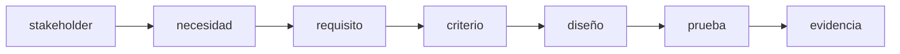
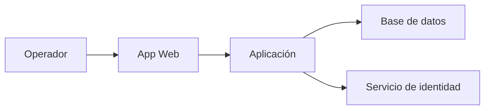
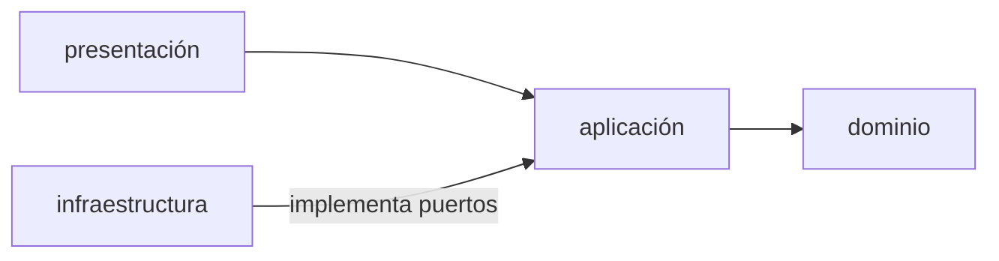
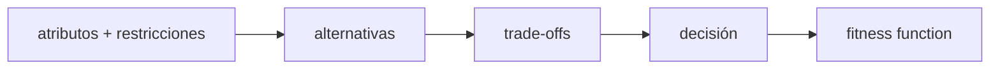
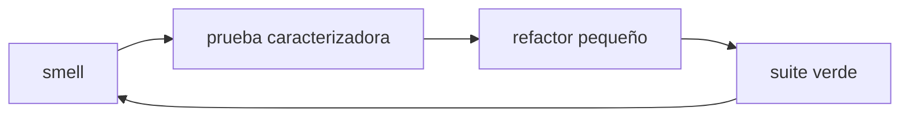
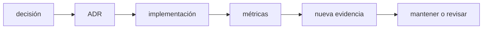

# Módulo 7: Requisitos, diseño, arquitectura y mantenimiento


## Aprende construyendo

### Tema 1: Requisitos, stakeholders y criterios verificables

#### Paso 1 · Objetivo y preparación
Al finalizar vas a convertir "confirmar una entrega debe ser seguro" en un criterio de aceptación verificable, usando la regla real de `examples/rutaflow/node/confirm-delivery.ts`. Prerrequisitos: ninguno adicional.

#### Paso 2 · Contexto y caso real
A lo largo de estos 12 módulos vas a construir el proyecto integrador Fundamentos, y en este módulo en particular vas a organizar el código en módulos para reutilizar funciones. "El sistema debe confirmar entregas de forma segura" no es verificable. El código real ya lo resolvió con una regla concreta: `recipientPin` debe tener exactamente 6 dígitos — esa es la especificación que faltaba poner en palabras antes de escribirse en código.

#### Paso 3 · Teoría, modelo mental y analogía
Un criterio de aceptación convierte una intención vaga en ejemplos con entrada y salida esperada — el contrato de resultado de una obra, no una sensación de "que quede bien".

**Conceptos clave:** stakeholder, necesidad, requisito funcional, atributo de calidad, restricción, historia, criterio de aceptación, supuesto y trazabilidad.

Software exitoso no es el que contiene más funciones, sino el que satisface necesidades relevantes bajo restricciones explícitas. Un stakeholder puede ser usuario, operador, negocio, auditor o equipo de soporte; sus objetivos pueden entrar en tensión.

“El sistema debe ser rápido” no es verificable. “El 95 % de búsquedas por SKU debe responder en menos de 200 ms con 100 000 productos en el entorno de referencia” define operación, métrica, umbral y contexto.

Una historia organiza valor, pero no sustituye especificación:

```text
Como operador de bodega
quiero registrar una retirada por SKU
para mantener el stock actualizado.

Criterios:
- Dado stock 5, cuando retiro 2, entonces queda 3 y se registra auditoría.
- Dado stock 1, cuando retiro 2, entonces se rechaza sin cambio parcial.
- Un lector autenticado no puede retirar.
```

Los criterios usan ejemplos que luego pueden convertirse en pruebas. Registra supuestos (“una sola moneda”), exclusiones (“no sincroniza sucursales todavía”) y fuente. Mantén trazabilidad requisito → decisión → código → prueba → evidencia.

Prioriza por valor, riesgo, dependencia y coste de retraso. “Todo es prioridad alta” elimina la utilidad de priorizar. Descubrimiento continúa durante desarrollo: prototipos y pruebas con usuarios pueden revelar que el problema estaba mal entendido.

**Analogía:** requisitos son el contrato de resultado de una obra; “que sea cómoda” necesita convertirse en medidas y escenarios sin fingir que toda experiencia humana se reduce a números.

**¿Por qué es importante?** Código correcto para un requisito equivocado sigue siendo fracaso. Criterios claros reducen retrabajo y hacen evaluación objetiva.

**Casos de uso reales:** historias, contratos API, SLO, accesibilidad, cumplimiento, migraciones y aceptación.

**Diagrama:**


Como **siguiente** paso, lleva lo aprendido al próximo tema y conéctalo con el proyecto integrador del track.
#### Profundización · De requisito vago a criterio verificable en el CLI

El gestor de tareas del proyecto integrador tiene una función `prioritize()` pensada para "ayudar al usuario a enfocarse en lo urgente" — una frase tan poco verificable como "el sistema debe ser rápido".

Convertí ese requisito en al menos tres criterios de aceptación (dado/cuando/entonces), con el mismo rigor del Paso 4: definí qué campo determina "urgente" (¿una prioridad explícita del 1 al 5? ¿una fecha límite?), qué pasa si dos tareas empatan en prioridad, y qué pasa si una tarea no tiene prioridad asignada.

[SOLUCIÓN PLEGADA]
> "Dado un listado con tareas de prioridad 1 a 5, cuando se invoca `prioritize`, entonces se muestran primero las de prioridad 1, en orden descendente." + "Dado dos tareas con la misma prioridad, cuando se invoca `prioritize`, entonces se ordenan por fecha de creación, la más antigua primero." + "Dado una tarea sin prioridad asignada, cuando se invoca `prioritize`, entonces se trata como prioridad 5, nunca como error."

**¿Por qué importa?** Sin estos criterios, "ayudar a enfocarse en lo urgente" es una frase que cualquier implementación puede reclamar cumplir, incluso una que ordena al azar.

#### Paso 4 · Demostración guiada desde cero
**Ejemplo independiente (desde cero):** este tema también se puede reproducir en una **carpeta vacía**, como **proyecto nuevo**, sin arrastrar estado de otros temas: crea el andamiaje y vuelve a escribir `src/ejemplo.py` dentro.
```bash
mkdir ejemplo && cd ejemplo
```

```text
Como conductor de RutaFlow
quiero confirmar la entrega de un envío
para que el cliente sepa que su paquete llegó.

Criterios:
- Dado un comando con recipientPin de 6 dígitos y shipmentId válido, cuando se confirma, entonces el envío queda "delivered".
- Dado un recipientPin de 4 dígitos, cuando se confirma, entonces se rechaza con TypeError, sin cambiar el estado del envío.
- Dado un commandId ya procesado antes, cuando se reenvía el mismo comando, entonces se devuelve el resultado anterior sin volver a confirmar.
```

**Ejecuta el ejemplo** (guarda el código en un archivo y córrelo desde la terminal):

```bash
python3 ejemplo.py
```
Observa la salida impresa y compárala con el resultado esperado.

Resultado esperado: tres criterios, cada uno con un "dado/cuando/entonces" verificable — los tres ya están implementados literalmente en `confirmDelivery()`, lo que confirma que la especificación describe el código real, no una aspiración.

#### Paso 5 · Práctica guiada
Pista: escribí un cuarto criterio deliberadamente vago ("el sistema debe responder rápido") y tratá de convertirlo en una prueba — ese es el fallo deliberado: no podés escribir un `assert` sin una métrica, un umbral y un contexto ("95% de confirmaciones en menos de 200ms con el motor de pruebas local"); sin eso, "rápido" no es un criterio, es una opinión.

#### Paso 6 · Práctica independiente
Escribe 5 criterios TUYOS que sean verificables, directamente del CLI del proyecto integrador Fundamentos. Por ejemplo: "tarea add 'hacer compras' debe guardar y después listar mostrará esa tarea".

#### Paso 7 · Cierre y evidencia
Entregá los tres criterios verificables del Paso 4, el criterio vago corregido del Paso 5, y los cinco criterios del Paso 6; explicá por qué código correcto para un requisito mal escrito sigue siendo un fracaso. Errores comunes: escribir requisitos sin métrica ni umbral ("debe ser rápido"), confundir una historia de usuario con una especificación completa, y no registrar los supuestos ni las exclusiones del alcance. Fuentes oficiales: https://www.iso.org/standard/72089.html.
**¿Por qué es importante?** Porque `confirmDelivery()` ya fue programado correctamente contra una regla de 6 dígitos — el riesgo real en este Tema nunca fue el código, sino quedarse con un requisito ambiguo antes de escribirlo.
### Tema 2: Arquitectura guiada por atributos de calidad

#### Paso 1 · Objetivo y preparación
Al finalizar vas a escribir el escenario de calidad que justifica una línea real de `confirm-delivery.ts`: la restricción `UNIQUE(command_id)`. Prerrequisitos: Tema 1 de este módulo.

#### Paso 2 · Contexto y caso real
El comentario del código real dice: "La implementación SQL debe insertar `commandId` y cambiar el envío en una única transacción con restricción `UNIQUE(command_id)`" — esa frase es la respuesta a un escenario de calidad que nunca se escribió explícitamente hasta ahora.

#### Paso 3 · Teoría, modelo mental y analogía
Un escenario de calidad tiene fuente, estímulo, artefacto, entorno, respuesta y medida — no es un diagrama bonito, es una frase verificable sobre qué pasa cuando algo sale mal.

**Escenario:** Tu arquitectura decidió que el dominio NO importa infraestructura. Pasaron 6 meses, un nuevo miembro accidentalmente añade `import sqlite3` en `domain.py`. Sin fitness function, lo merges a main.

**Tu tarea:**
1. Escribe una fitness function que detecte esa violación.
2. ¿Dónde se ejecuta? (CI, pre-commit, local.)
3. ¿Cómo comunica violaciones sin bloquear?
4. ¿Cuándo es estricta (bloquear) vs suave (advertir)?

[SOLUCIÓN PLEGADA]
> Fitness function en Python: `for line in open('src/domain.py'): if 'import sqlite' in line: raise Exception()`. Se ejecuta en CI after build, bloqueante. Alternativa softer: escanear dependencias con `pipdeptree` y comparar contra whitelist, reportando en logs sin fallar. Estricta si es arquitectura de seguridad (dominio nunca confía). Suave si es estilo (permitir excepciones documentadas con `# noqa: dependency-check`).

**Conceptos clave:** arquitectura, componente, conector, límite, dependencia, atributo de calidad, escenario, trade-off, C4 y fitness function.

Arquitectura son decisiones estructurales difíciles de cambiar: responsabilidades, límites, comunicación y dependencias. No es únicamente un diagrama. Se evalúa contra atributos como mantenibilidad, disponibilidad, rendimiento, seguridad, portabilidad y operabilidad.

Un escenario de calidad tiene fuente, estímulo, artefacto, entorno, respuesta y medida: “durante operación normal, una pérdida del proceso no debe corromper una transacción confirmada; tras reinicio, datos comprometidos permanecen”. Este escenario favorece transacciones/durabilidad. Otro de despliegue frecuente puede favorecer modularidad y automatización.

C4 comunica niveles:



Una arquitectura por capas puede dirigir dependencias hacia el dominio:



El dominio no debería importar SQLite ni HTTP. Define una interfaz/puerto `RepositorioProductos`; infraestructura la implementa. Esto facilita pruebas y cambio de mecanismo, pero añadir abstracciones sin alternativa ni beneficio puede ser sobreingeniería.

Fitness functions automatizan propiedades: reglas de dependencia, presupuesto de bundle, tiempo de build, cobertura de contratos o vulnerabilidades máximas. La arquitectura evoluciona con evidencia.

**Analogía:** arquitectura decide estructura, circulación y servicios de un edificio según uso y riesgos; decorar habitaciones no corrige una salida de emergencia inexistente.

**¿Por qué es importante?** Los atributos compiten: cifrado, redundancia o abstracción añaden coste. Arquitectura hace explícitos trade-offs y evita dependencias accidentales.

**Casos de uso reales:** monolito modular, microservicios, móvil offline, sistemas regulados y plataformas multi-equipo.

**Diagrama:**



**Transferencia al proyecto integrador «Fundamentos: gestor de tareas»:** Define disponibilidad, facilidad de prueba y recuperación requeridas por el gestor. Compara dos diseños mediante un escenario concreto de archivo corrupto, en vez de elegir capas solo por su nombre.
Como **siguiente** paso, lleva lo aprendido al próximo tema y conéctalo con el proyecto integrador del track.

#### Paso 4 · Demostración guiada desde cero
**Ejemplo independiente (desde cero):** este tema también se puede reproducir en una **carpeta vacía**, como **proyecto nuevo**, sin arrastrar estado de otros temas: crea el andamiaje y vuelve a escribir el archivo del ejemplo dentro.
```bash
mkdir ejemplo && cd ejemplo
```

Crea `escenario.txt` y guarda este escenario de calidad completo:
```text
Fuente: red inestable del conductor
Estímulo: el mismo comando "confirmar entrega" se reenvía dos veces (reintento automático)
Artefacto: confirmDelivery() + repositorio
Entorno: operación normal con conexión intermitente
Respuesta: la segunda llamada devuelve el resultado ya guardado, sin volver a confirmar ni duplicar
Medida: cero entregas duplicadas, verificable con UNIQUE(command_id) en la base real
```

**Comprueba el artefacto de diseño desde la carpeta donde lo guardaste:**
```bash
python3 -c "from pathlib import Path; print(Path('escenario.txt').read_text(encoding='utf-8'))"
```
Debes observar las partes del escenario que acabas de escribir. Esta lectura verifica el archivo, no demuestra que una base de datos cumpla la durabilidad prometida; esa evidencia requiere un ensayo separado.

Resultado esperado: un escenario completo que explica por qué el código ya revisado en el Tema 1 necesita esa restricción — no es un detalle de implementación arbitrario, responde a un escenario de red real.

#### Paso 5 · Práctica guiada
Pista: quitá mentalmente la restricción `UNIQUE(command_id)` del diseño y repetí el escenario — ese es el fallo deliberado: sin esa restricción, dos reintentos del mismo comando podrían insertar dos filas de confirmación para el mismo envío, rompiendo exactamente la medida ("cero entregas duplicadas") que el escenario exige.

#### Paso 6 · Práctica independiente
Escribí un segundo escenario de calidad para un atributo distinto (por ejemplo, rendimiento: "el 95% de las confirmaciones deben procesarse en menos de 200ms con 100 conductores simultáneos") y documentá qué decisión de diseño (no solo de base de datos) ese escenario favorecería.

#### Paso 7 · Cierre y evidencia
Entregá el escenario de durabilidad del Paso 4, la restricción removida y su consecuencia del Paso 5, y el segundo escenario del Paso 6; explicá por qué los atributos de calidad compiten entre sí (durabilidad vs. velocidad) y la arquitectura hace ese trade-off explícito. Errores comunes: diagramar la arquitectura sin un escenario de calidad medible detrás, tratar una restricción de base de datos como detalle de implementación en vez de una decisión arquitectónica, y agregar una fitness function nueva sin decidir si debe bloquear o solo advertir. Fuentes oficiales: https://c4model.com/.
**¿Por qué es importante?** Porque la restricción `UNIQUE(command_id)` no es un capricho de la base de datos: es la respuesta directa a un escenario de calidad real (reintentos de red) que, sin documentarlo, parece una regla arbitraria.
### Tema 3: Diseño modular, principios, patrones y refactoring

#### Paso 1 · Objetivo y preparación
Al finalizar vas a leer el puerto `DeliveryRepository` real de RutaFlow y a escribir un segundo adaptador que lo implemente sin tocar `confirmDelivery`. Prerrequisitos: Módulo 5 del track Cloud (o lectura directa del archivo).

#### Paso 2 · Contexto y caso real
`examples/rutaflow/node/confirm-delivery.ts` ya define `DeliveryRepository` como una interfaz (`findCommandResult`/`confirm`) — el mismo patrón `Protocol` + inyección de dependencias que acabás de ver en el ejemplo de `RepositorioProductos`, pero en código real de este proyecto, no un ejemplo inventado.

#### Paso 3 · Teoría, modelo mental y analogía
Baja cohesión significa que `confirmDelivery` conoce solo lo que necesita del repositorio (dos métodos), nunca cómo esos datos llegan a disco — el mismo principio de "el dominio no importa SQLite" aplicado a un archivo que ya existe.

**Escenario:** Tienes `class RepositorioProductos` que usa SQLite. Alguien pide: "¿y si después queremos cambiar a PostgreSQL?" ¿Extraes una interfaz ahora o esperas?

**Tu tarea:**
1. Escribe la interfaz (`Protocol` en Python).
2. ¿Bajo qué condiciones es sobre-ingeniería?
3. ¿Cuándo es justificable?
4. ¿Cómo sabes si una interfaz se usa o es fantasma?

[SOLUCIÓN PLEGADA]
> Interfaz es sobre-ingeniería si: (1) no hay alternativa real en vista, (2) solo se usa en un lugar. Justificable si: (1) hay pruebas que necesitan fake/stub, (2) la alternativa es probable (múltiples proveedores, migraciones planeadas). Detectar fantasma: grep por implementaciones — una interfaz con solo una clase la implementa es candidata a eliminar. Regla práctica: introduce interfaz cuando aparece la SEGUNDA implementación, no antes.

**Conceptos clave:** cohesión, acoplamiento, encapsulación, abstracción, composición, SOLID, patrón, code smell, refactoring y prueba caracterizadora.

Alta cohesión significa que un módulo reúne responsabilidades relacionadas. Bajo acoplamiento significa que conoce poco de detalles externos. Encapsulación protege invariantes; abstracción presenta un contrato relevante y oculta detalles que pueden cambiar.

```python
from typing import Protocol

class RepositorioProductos(Protocol):
    def obtener_por_sku(self, sku: str): ...
    def guardar(self, producto): ...

class RetirarStock:
    def __init__(self, repositorio: RepositorioProductos):
        self.repositorio = repositorio

    def ejecutar(self, sku: str, cantidad: int):
        producto = self.repositorio.obtener_por_sku(sku)
        producto.retirar(cantidad)
        self.repositorio.guardar(producto)
```

El caso de uso depende de capacidad, no SQLite. Responsabilidad única no significa “una función por línea”; significa una razón coherente de cambio. Inversión de dependencias no obliga a interfaz para todo; se aplica en límites que necesitan sustitución, prueba o aislamiento.

Patrones nombran soluciones recurrentes con consecuencias: Strategy intercambia algoritmos; Adapter traduce interfaces; Repository separa acceso; Observer propaga eventos. No empieces eligiendo patrón: identifica problema, fuerzas y alternativas. Un patrón innecesario añade archivos, saltos y conceptos.

Refactoring cambia estructura preservando comportamiento. Antes de código heredado sin pruebas, escribe pruebas caracterizadoras que documenten lo que hace, incluso si no es ideal. Realiza pasos pequeños con suite verde: extraer función, mover responsabilidad, renombrar, introducir interfaz. Separar refactor y cambio funcional facilita revisión.

**Analogía:** principios son criterios de diseño; patrones son planos reutilizables. Usar un plano de aeropuerto para una casa demuestra conocimiento del patrón, no buen juicio.

**¿Por qué es importante?** Diseño modular localiza cambios y permite evolución. Sin pruebas, grandes refactors se convierten en reescrituras de riesgo.

**Casos de uso reales:** cambio de base, múltiples proveedores, reglas configurables, integraciones y sistemas legacy.

**Diagrama:**



**Transferencia al proyecto integrador «Fundamentos: gestor de tareas»:** Refactoriza el almacenamiento detrás de un contrato pequeño conservando las pruebas de uso. Sustituye el archivo por un fake y demuestra que crear y completar tareas mantienen su comportamiento.
Como **siguiente** paso, lleva lo aprendido al próximo tema y conéctalo con el proyecto integrador del track.

#### Paso 4 · Demostración guiada desde cero
**Ejemplo independiente (desde cero):** este tema también se puede reproducir en una **carpeta vacía**, como **proyecto nuevo**, sin arrastrar estado de otros temas: crea el andamiaje y vuelve a escribir `src/ejemplo.py` dentro.
```bash
mkdir ejemplo && cd ejemplo
```

```bash
grep -n "interface DeliveryRepository" -A 3 examples/rutaflow/node/confirm-delivery.ts
```

**Ejecuta el ejemplo** (guarda el código en un archivo y córrelo desde la terminal):

```bash
python3 ejemplo.py
```
Observa la salida impresa y compárala con el resultado esperado.

Resultado esperado: ves `findCommandResult(commandId)` y `confirm(command)` — dos métodos, nada de SQL, DynamoDB ni HTTP en la firma. `confirmDelivery` solo conoce ese contrato.

#### Paso 5 · Práctica guiada
Pista: escribí un adaptador en memoria (`class RepositorioEnMemoria implements DeliveryRepository`) e inyectalo en `confirmDelivery` dos veces con el mismo `commandId` — en la segunda llamada, el fallo deliberado que buscás NO debería ocurrir: `findCommandResult` debe devolver el resultado ya guardado, y `confirmDelivery` nunca debe volver a llamar `confirm()`. Si tu adaptador en memoria vuelve a confirmar, el bug está en el adaptador, no en el dominio.

#### Paso 6 · Práctica independiente
Escribí una prueba caracterizadora sobre `confirmDelivery` usando tu adaptador en memoria del Paso 5: documentá el comportamiento actual (qué devuelve con PIN válido, con PIN de 4 dígitos, con `commandId` repetido) antes de proponer ningún cambio al código.

#### Paso 7 · Cierre y evidencia
Entregá la interfaz real leída del Paso 4, el adaptador en memoria probado del Paso 5, y la prueba caracterizadora del Paso 6; explicá por qué poder escribir ese segundo adaptador sin tocar `confirmDelivery` es la prueba de que el diseño real ya separó dominio de infraestructura. Errores comunes: introducir una interfaz antes de que exista una segunda implementación real, aplicar un patrón de diseño porque "es lo profesional" sin identificar el problema que resuelve, y refactorizar código heredado sin antes escribir una prueba caracterizadora. Fuentes oficiales: https://refactoring.com/catalog/.
**¿Por qué es importante?** Porque poder cambiar de un repositorio real a uno en memoria sin tocar una línea de `confirmDelivery` es la evidencia concreta de que el dominio no depende de cómo se guardan los datos, no solo una afirmación de buenas intenciones.
### Tema 4: Decisiones, documentación, deuda y evolución

#### Paso 1 · Objetivo y preparación
Al finalizar vas a escribir el ADR real que justifica por qué RutaFlow usa DynamoDB para `ShipmentEvents` en vez de una base relacional. Prerrequisitos: ninguno adicional (el Módulo 4 del track Cloud profundiza la decisión en sí).

#### Paso 2 · Contexto y caso real
Esa decisión ya está tomada en el código (`ShipmentEvents` con clave `shipmentId`+`sequence`), pero nadie documentó todavía el contexto y las consecuencias — exactamente lo que un ADR existe para registrar antes de que la próxima persona se pregunte "¿por qué no es SQL?". **¿Por qué es importante?** Porque una decisión importante sin contexto documentado se reinterpreta como accidente, y una deuda sin condición de pago se convierte en una reescritura total sin criterio.

#### Paso 3 · Teoría, modelo mental y analogía
Un ADR es la bitácora de navegación: no vende la decisión, registra el contexto que la motivó y qué consecuencias aceptaste a cambio — para que la próxima tripulación no la confunda con un accidente. **Conceptos clave:** ADR, documentación viva, deuda técnica, mantenimiento correctivo/adaptativo/perfectivo/preventivo, compatibilidad, deprecación, migración y observabilidad.

Documentación profesional responde preguntas para una audiencia: README permite ejecutar; arquitectura explica estructura; runbook opera; ADR registra una decisión significativa y su contexto. Deuda técnica es una decisión que aumenta coste futuro, a veces consciente: registra principal (trabajo pendiente), interés (coste recurrente), riesgo, propietario y condición de pago; no es deuda cualquier código desagradable ni sirve para justificar una reescritura total. Mantenimiento incluye corregir defectos, adaptarse a entornos, mejorar capacidad y prevenir degradación; un cambio público requiere versionado, migración, periodo de deprecación, telemetría de uso y rollback. La ética atraviesa esas decisiones: accesibilidad, privacidad, sesgo, sostenibilidad y condiciones laborales; un requisito legal es el mínimo, no siempre el límite de responsabilidad.

**Diagrama:**



Un ADR no vende la decisión; registra consecuencias y disparadores de revisión. Diagramas sin fecha y alcance se vuelven engañosos; validá enlaces, ejemplos y comandos de la documentación en CI. **Límites:** un ADR no sustituye el diseño ni la prueba; si el código y el ADR discrepan, alguno está desactualizado y hay que decidir cuál corregir.

#### Paso 4 · Demostración guiada desde cero
**Ejemplo independiente (desde cero):** crea una **carpeta vacía** y dentro el ADR como archivo real; no hace falta ningún proyecto previo.
```bash
mkdir -p ejemplo-adr/docs/adr && cd ejemplo-adr
```

```markdown
# ADR-004: DynamoDB para ShipmentEvents

Estado: aceptada

### Contexto
El patrón de acceso dominante es "todos los eventos de este envío, en orden" — una
consulta por clave conocida, no joins complejos ni consultas ad hoc.

### Decisión
Usar DynamoDB con clave compuesta (shipmentId HASH, sequence RANGE).

### Consecuencias
Query eficiente por envío sin importar el volumen total de la tabla; a cambio,
ninguna consulta ad hoc nueva ("todos los envíos de este mes") es gratis sin un GSI
diseñado para ese patrón específico.
```

**Ejecuta la verificación** (comprueba que el ADR tiene las tres secciones):

```bash
python3 -c "import pathlib,sys; t=pathlib.Path('docs/adr/ADR-004-dynamodb-shipmentevents.md').read_text(); faltan=[s for s in ('### Contexto','### Decisión','### Consecuencias') if s not in t]; print('faltan:', faltan) if faltan else print('ADR completo'); sys.exit(1 if faltan else 0)"
```
Observa la salida y compárala con el resultado esperado.

Resultado esperado: `ADR completo`. Explica cada parte: `Estado` dice si la decisión sigue vigente; `Contexto` registra las fuerzas y alternativas; `Decisión` responde qué se eligió; `Consecuencias` acepta el costo y deja el disparador de revisión (aquí, un GSI si aparece una consulta ad hoc recurrente).

#### Paso 5 · Práctica guiada
**Fallo deliberado:** borra la sección `### Consecuencias` y vuelve a ejecutar la verificación. Falla con `faltan: ['### Consecuencias']`, porque el ADR ya no registra qué se sacrificó. **Pista:** ese es el fallo de un ADR que solo vende la decisión: cualquiera que necesite una consulta ad hoc nueva en seis meses asumirá que DynamoDB "simplemente no sirve para eso", en vez de entender que fue un trade-off consciente con una salida conocida (agregar un GSI, Módulo 4 Tema 5 del track Cloud). Corrige el archivo y confirma que vuelve a imprimir `ADR completo`.

#### Paso 6 · Práctica independiente
Documentá, como deuda técnica explícita (no como ADR) y en un archivo propio `docs/deuda.md`, que `ShipmentEvents` no tiene todavía un GSI para "envíos por estado actual": escribí principal (el trabajo pendiente), interés (qué cuesta no tenerlo hoy), riesgo, propietario y condición de pago (qué señal dispararía construirlo). Después llevá lo aprendido al **proyecto integrador** Fundamentos: documentá en `docs/adr/0001-almacenamiento-json.md` por qué su `almacenamiento.py` guarda las tareas en un archivo JSON plano y no en SQLite, con las consecuencias de esa elección (simple de inspeccionar a mano, sin escritura concurrente segura), y verificá con `python3 -m pytest tests/test_almacenamiento.py` que el comportamiento documentado sigue siendo el real.

#### Paso 7 · Cierre y evidencia
**Evidencia de aprendizaje:** entregá el ADR completo del Paso 4, la salida `faltan: ['### Consecuencias']` del fallo del Paso 5 junto con el archivo corregido, y la entrada de deuda del Paso 6; explicá la diferencia entre un ADR (decisión ya tomada, con consecuencias) y una entrada de deuda técnica (trabajo pendiente, con condición de pago). Como **siguiente** paso, usá ese estándar en el proyecto del módulo: requisitos con criterios medibles, ADRs para SQLite, arquitectura modular, autenticación y audit log, pruebas caracterizadoras antes de refactorizar y una fitness function que impida que el dominio importe infraestructura. **Errores comunes:** escribir un ADR que solo vende la decisión sin registrar las consecuencias negativas, llamar "deuda técnica" a cualquier código desprolijo sin principal ni condición de pago, y dejar una decisión importante sin documentar porque "ya se sabe por qué se hizo". **Límites y decisión de uso:** un ADR por cada detalle táctico (nombre de variable, `if` frente a ternario) cuesta más de lo que documenta; el umbral es "difícil de cambiar". **Fuentes oficiales:** https://adr.github.io/ y https://refactoring.com/catalog/.

## Aplicación del material de referencia

### Tema 5: Records de C#: igualdad por valor no implica inmutabilidad profunda

#### Paso 1 · Objetivo y preparación
Al finalizar ejecutarás un record C#, crearás una copia con `with` y demostrarás qué ocurre con una lista compartida. **Prerrequisitos:** objetos, referencias y colecciones; es una comparación de diseño, no un curso completo de C#. Instala el SDK .NET 10 y comprueba `dotnet --version`. El ejemplo independiente parte de carpeta vacía.

#### Paso 2 · Contexto y caso real
La captura de referencia propone records para registros de auditoría. En el proyecto integrador, una copia del registro no debería alterar inesperadamente un historial anterior. **¿Por qué es importante?** Menos código generado no elimina la necesidad de decidir mutabilidad y propiedad de los datos.

#### Paso 3 · Teoría, modelo mental y analogía
Un `record class` de C# tiene semántica de igualdad por valor generada por el compilador; un record posicional genera propiedades con acceso `init`. `with` crea una copia superficial: no clona automáticamente los objetos a los que apuntan sus propiedades. También puedes definir records mutables. No es correcto afirmar que todos los records son profundamente inmutables ni que los records de Java y C# tienen exactamente el mismo contrato.

**Analogía:** fotocopiar una ficha que contiene una dirección no duplica el almacén al que esa dirección apunta. El límite es que la igualdad de los miembros también depende de sus tipos: dos listas con elementos iguales no necesariamente comparan como iguales por contenido.

#### Paso 4 · Demostración guiada desde cero
```bash
cp -R examples/rutaflow-material/records-csharp ejemplo-records
cd ejemplo-records
dotnet run --project Records.csproj
```
Si no usas una copia del repo, crea la carpeta `ejemplo-records` y coloca estos dos archivos dentro, sin la subcarpeta `records-csharp`:

Crea `records-csharp/Records.csproj` con este contenido completo:
```xml
<Project Sdk="Microsoft.NET.Sdk"><PropertyGroup><OutputType>Exe</OutputType><TargetFramework>net10.0</TargetFramework><ImplicitUsings>enable</ImplicitUsings><Nullable>enable</Nullable></PropertyGroup></Project>
```

Crea `records-csharp/Program.cs` con este contenido completo:
```csharp
using System;
using System.Collections.Generic;

var original = new Registro(7, new List<string> { "creado" });
var copia = original with { Id = 8 };
copia.Estados.Add("asignado");
if (original.Id != 7 || copia.Id != 8) throw new Exception("Copia escalar incorrecta");
if (original.Estados.Count != 2) throw new Exception("Se esperaba referencia compartida");
Console.WriteLine("IDs independientes; lista compartida");
var a = new Punto(4, 5);
var b = new Punto(4, 5);
if (a != b) throw new Exception("Se esperaba igualdad por valor");
Console.WriteLine("Records con valores iguales comparan igual");
public record Registro(int Id, List<string> Estados);
public record Punto(int X, int Y);
```

**Resultado esperado:** `IDs independientes; lista compartida` y `Records con valores iguales comparan igual`. Explica cada bloque: `var` deja que el compilador infiera el tipo, `new` crea objetos, `with` cambia un valor escalar y conserva la referencia de Estados. Añadir un estado desde la copia cambia la lista que también observa el original; los checks lanzan una excepción si el contrato deja de cumplirse.

#### Paso 5 · Práctica guiada
**Fallo deliberado:** cambia la expectativa de `original.Estados.Count` a 1. El programa falla porque no se copió profundamente la lista. **Pista:** observa la referencia compartida; no atribuyas el comportamiento a un fallo del compilador.

#### Paso 6 · Práctica independiente
Crea la copia con `Estados = new List<string>(original.Estados)`, modifica la nueva lista y exige que la original conserve su longitud. Explica por qué eso sigue sin ser copia profunda si cada elemento fuera a su vez mutable. Compara el contrato con un record Java del módulo 7 de Java.

#### Paso 7 · Cierre y evidencia
**Evidencia de aprendizaje:** ambas ejecuciones, fallo, corrección y explicación de copia superficial. El siguiente paso es decidir ownership de colecciones en tus DTOs. **Errores comunes:** equiparar record con seguridad, comparar lenguajes por nombre de característica y exponer colecciones mutables de un historial. **Límites y decisión de uso:** el ejemplo no demuestra concurrencia segura, persistencia ni equivalencia estructural arbitraria.

**Fuente oficial:** [Microsoft: records de C#](https://learn.microsoft.com/en-us/dotnet/csharp/language-reference/builtin-types/record).
