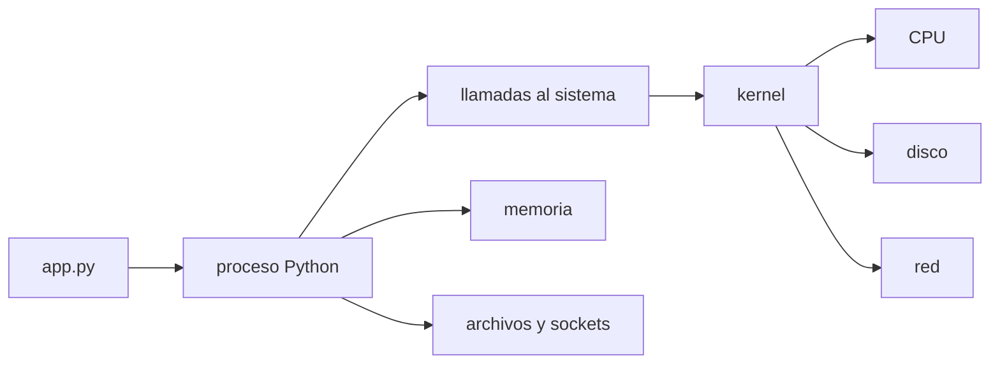
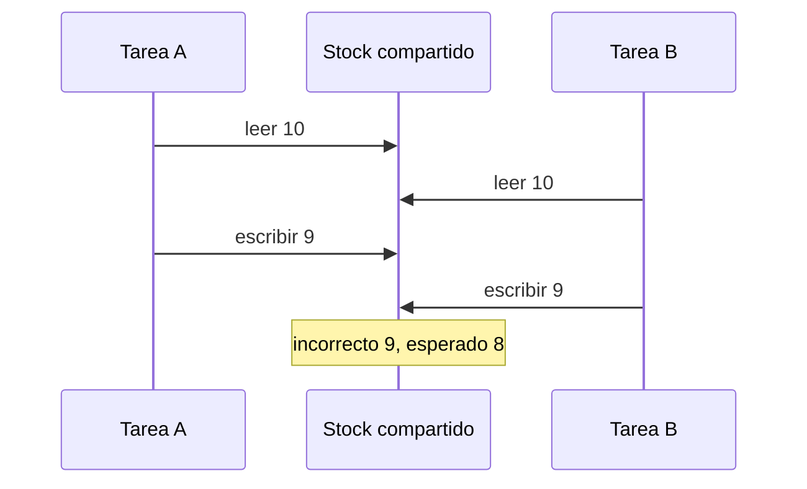
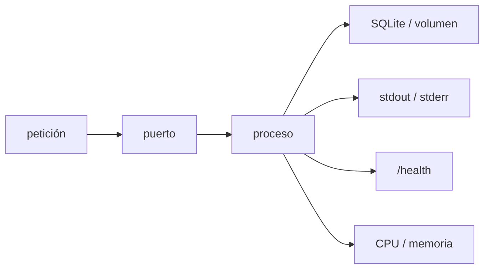
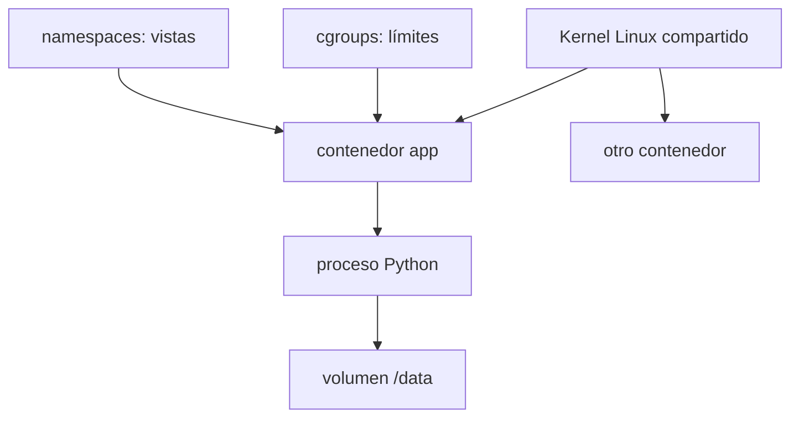
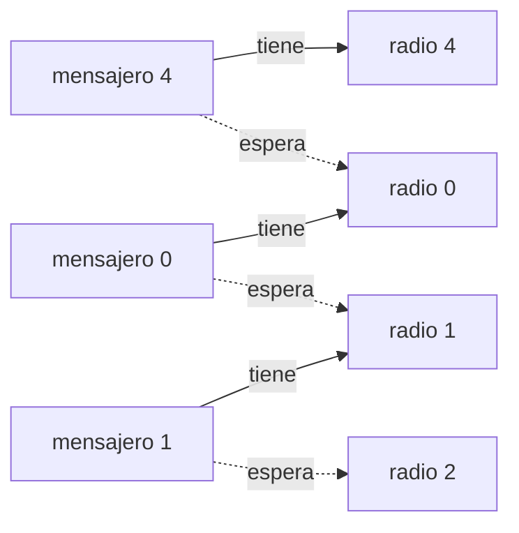

# Módulo 8: Sistemas operativos, concurrencia, Linux y contenedores

Hasta ahora construiste un inventario, lo protegiste con pruebas y seguridad y separaste su arquitectura. En este capítulo aprenderás qué sucede **debajo** del código: quién entrega CPU y memoria, cómo dos tareas interfieren, cómo investigar un servicio Linux y qué hace realmente Docker. El objetivo no es memorizar comandos, sino formar un modelo mental para diagnosticar sistemas reales.


## Aprende construyendo


### Tema 1: El sistema operativo como administrador y frontera · Avanzado · 45 min

<details open>
<summary><strong>Capa 1 — Lectura</strong></summary>

#### ► DE QUÉ TRATA
Al finalizar vas a escribir un cálculo de ruta mínimo, lanzarlo como proceso real, inspeccionarlo con ps y detenerlo con una señal. Prerrequisitos: Python 3 instalado.

#### ► CÓMO FUNCIONA


</details>

<details>
<summary><strong>Capa 2 — Construcción</strong></summary>

#### Código y verificación
```bash
python app.py >salida.log 2>errores.log &
ps -o pid,ppid,state,etime,command
kill -TERM 12345
```


```bash
mkdir ejemplo-procesos && cd ejemplo-procesos
```

```python
from dataclasses import dataclass
from math import hypot

@dataclass(frozen=True)
class Stop:
    shipment_id: str
    latitude: float
    longitude: float

def nearest_neighbor_route(origin: tuple[float, float], stops: list[Stop]) -> list[Stop]:
    """Heurística educativa O(n²); no afirma encontrar la ruta óptima."""
    remaining = stops.copy()
    ordered = []
    position = origin
    while remaining:
        selected = min(
            remaining,
            key=lambda stop: hypot(stop.latitude - position[0], stop.longitude - position[1]),
        )
        ordered.append(selected)
        remaining.remove(selected)
        position = (selected.latitude, selected.longitude)
    return ordered
```

```python
import os
import time

from domain import Stop, nearest_neighbor_route

paradas = [Stop(f"RF-{i}", i * 0.01, i * 0.01) for i in range(50000)]
print(f"pid={os.getpid()} paradas={len(paradas)}", flush=True)
time.sleep(30)
nearest_neighbor_route((0, 0), paradas)
```

```bash
python3 lento.py > proceso.log 2>&1 &
PID=$!
sleep 1
ps -o pid,ppid,state,etime,command -p "$PID"
cat proceso.log
```

</details>

### Tema 2: Memoria y concurrencia sin magia · Avanzado · 45 min

<details open>
<summary><strong>Capa 1 — Lectura</strong></summary>

#### ► DE QUÉ TRATA
Al finalizar vas a provocar una condición de carrera real sobre el contador de capacidad de un vehículo de reparto, y a corregirla con un lock. Prerrequisitos: Python 3 instalado.

#### ► CÓMO FUNCIONA


</details>

<details>
<summary><strong>Capa 2 — Construcción</strong></summary>

#### Código y verificación
```python
from threading import Lock

lock = Lock()

def retirar(conexion, producto_id, cantidad):
    with lock, conexion:
        cursor = conexion.execute(
            "UPDATE productos SET stock = stock - ? "
            "WHERE id = ? AND stock >= ?",
            (cantidad, producto_id, cantidad),
        )
        if cursor.rowcount != 1:
            raise ValueError("stock insuficiente")
```


```bash
mkdir ejemplo && cd ejemplo
```

```python
from threading import Thread

capacidad = {"disponible": 10}

def reservar_lugar():
    actual = capacidad["disponible"]
    capacidad["disponible"] = actual - 1

hilos = [Thread(target=reservar_lugar) for _ in range(10)]
[h.start() for h in hilos]
[h.join() for h in hilos]
print(capacidad["disponible"])
```

```bash
python3 ejemplo.py
```

</details>

### Tema 3: Linux como entorno observable · Avanzado · 45 min

<details open>
<summary><strong>Capa 1 — Lectura</strong></summary>

#### ► DE QUÉ TRATA
Al finalizar vas a diagnosticar, con herramientas reales de Linux, un servicio mínimo que expone la lógica de domain.py como endpoint de salud. Prerrequisitos: Python 3 instalado; Tema 1 de este módulo.

#### ► CÓMO FUNCIONA


</details>

<details>
<summary><strong>Capa 2 — Construcción</strong></summary>

#### Código y verificación
```bash
ps -eo pid,user,%cpu,%mem,command | sort -k3 -nr | head
curl --fail --silent http://127.0.0.1:8000/health
ss -ltnp
```


```bash
mkdir ejemplo && cd ejemplo
echo "ok" > index.html
python3 -m http.server 8765 > servicio.log 2>&1 &
PID=$!
sleep 1
curl --fail --silent http://127.0.0.1:8765/ && echo "sano"
lsof -nP -iTCP:8765 -sTCP:LISTEN
ps -o pid,state,command -p "$PID"
```

```text
ok
sano
COMMAND   PID        USER   FD   TYPE  NAME
Python  77911 nicolasruiz    5u  IPv6  TCP *:8765 (LISTEN)
  PID STAT COMMAND
77911 SN   python3 -m http.server 8765
```

</details>

### Tema 4: Contenedores: aislamiento reproducible · Avanzado · 45 min

<details open>
<summary><strong>Capa 1 — Lectura</strong></summary>

#### ► DE QUÉ TRATA
Al finalizar vas a contenerizar domain.py de RutaFlow con un usuario sin privilegios y a confirmar que los datos sobreviven a recrear el contenedor. Prerrequisitos: Docker instalado; Tema 3 de este módulo.

#### ► CÓMO FUNCIONA


</details>

<details>
<summary><strong>Capa 2 — Construcción</strong></summary>

#### Código y verificación
```yaml
> services:
>   db:
>     image: postgres:17
>     deploy:
>       resources:
>         limits:
>           memory: 512M
>         reservations:
>           memory: 512M
>   worker:
>     build: .
>     deploy:
>       resources:
>         limits:
>           memory: 256M
>         reservations:
>           memory: 256M
> ```

```dockerfile
FROM python:3.14-slim
WORKDIR /app
RUN useradd --create-home --uid 10001 appuser
COPY requirements.txt ./
RUN pip install --no-cache-dir -r requirements.txt
COPY src ./src
RUN mkdir /data && chown appuser:appuser /data
USER appuser
ENV INVENTORY_DB=/data/inventory.db
EXPOSE 8000
CMD ["python", "-m", "src.server"]
```


```bash
mkdir ejemplo-contenedor && cd ejemplo-contenedor
```

```python
from dataclasses import dataclass
from math import hypot

@dataclass(frozen=True)
class Stop:
    shipment_id: str
    latitude: float
    longitude: float

def nearest_neighbor_route(origin: tuple[float, float], stops: list[Stop]) -> list[Stop]:
    remaining = stops.copy()
    ordered = []
    position = origin
    while remaining:
        selected = min(remaining, key=lambda stop: hypot(
            stop.latitude - position[0], stop.longitude - position[1]))
        ordered.append(selected)
        remaining.remove(selected)
        position = (selected.latitude, selected.longitude)
    return ordered
```

```dockerfile
FROM python:3.14-slim
WORKDIR /app
RUN useradd --create-home --uid 10001 rutaflow
COPY domain.py ./domain.py
RUN mkdir /data && chown rutaflow:rutaflow /data
USER rutaflow
CMD ["python", "-c", "from domain import nearest_neighbor_route, Stop; print(nearest_neighbor_route((0,0),[Stop('RF-1',1,1)]))"]
```

</details>

### Tema 5: Problemas clásicos de concurrencia: filósofos y lectores-escritores · Avanzado · 45 min

<details open>
<summary><strong>Capa 1 — Lectura</strong></summary>

#### ► DE QUÉ TRATA
Al finalizar podrás reproducir un interbloqueo (deadlock) con la cena de los filósofos, evitarlo imponiendo un orden global de recursos y permitir lecturas concurrentes con exclusión de escritores. Prerrequisito: Tema 2 de este módulo (memoria y concurrencia).

#### ► CÓMO FUNCIONA


</details>

<details>
<summary><strong>Capa 2 — Construcción</strong></summary>

#### Código y verificación


```bash
mkdir concurrencia && cd concurrencia
```

```python
import threading, time

# --- Cena de los filósofos: 5 mensajeros comparten 5 radios; cada uno necesita 2 para coordinar
N = 5
radios = [threading.Lock() for _ in range(N)]
comidas = [0] * N

def mensajero(i, rondas=50):
    izquierda, derecha = i, (i + 1) % N
    # Orden global de recursos: siempre tomar primero el de menor número rompe la espera circular
    primero, segundo = min(izquierda, derecha), max(izquierda, derecha)
    for _ in range(rondas):
        with radios[primero]:
            time.sleep(0.001)                  # tiene una radio en la mano y espera la otra
            with radios[segundo]:
                comidas[i] += 1

hilos = [threading.Thread(target=mensajero, args=(i,)) for i in range(N)]
inicio = time.perf_counter()
for h in hilos: h.start()
for h in hilos: h.join(timeout=3)
vivos = sum(h.is_alive() for h in hilos)
print(f"Filósofos: rondas por mensajero={comidas}, hilos bloqueados={vivos}")

# --- Lectores y escritores: muchos leen el tablero a la vez, uno solo escribe
class Tablero:
    def __init__(self):
        self.datos = {"BO-1": "en ruta"}
        self.lectores = 0
        self.mutex = threading.Lock()          # protege el contador de lectores
        self.escritura = threading.Lock()      # exclusión para escritores
        self.max_simultaneos = 0
    def leer(self, guia):
        with self.mutex:
            self.lectores += 1
            if self.lectores == 1: self.escritura.acquire()   # el primer lector bloquea escritores
            self.max_simultaneos = max(self.max_simultaneos, self.lectores)
        time.sleep(0.01)
        valor = self.datos.get(guia)
        with self.mutex:
            self.lectores -= 1
            if self.lectores == 0: self.escritura.release()   # el último lector libera
        return valor
    def escribir(self, guia, estado):
        with self.escritura:
            self.datos[guia] = estado

tablero = Tablero()
lectores = [threading.Thread(target=tablero.leer, args=("BO-1",)) for _ in range(8)]
for h in lectores: h.start()
for h in lectores: h.join()
tablero.escribir("BO-1", "entregado")
print(f"Lectores simultáneos máximos: {tablero.max_simultaneos}, estado final: {tablero.leer('BO-1')}")
```

```bash
python3 concurrencia_clasica.py
```

```text
Filósofos: rondas por mensajero=[50, 50, 50, 50, 50], hilos bloqueados=0
Lectores simultáneos máximos: 8, estado final: entregado
```

</details>

### Proyecto 8 — Inventario operable en un contenedor

<details open>
<summary><strong>Capa 1 — Lectura</strong></summary>

</details>

<details>
<summary><strong>Capa 2 — Construcción</strong></summary>

#### Código y verificación
```yaml
services:
  inventory:
    build: .
    ports: ["127.0.0.1:8000:8000"]
    volumes: ["inventory-data:/data"]
    init: true
    healthcheck:
      test: ["CMD", "python", "-m", "src.healthcheck"]
      interval: 10s
      timeout: 3s
      retries: 3
    mem_limit: 256m
    cpus: 0.50
volumes:
  inventory-data:
```

</details>
